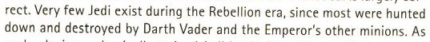
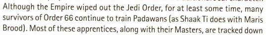

# Owner Material 037 — Star Wars D20 Drive folder (Core, Revised Core and Saga Edition): Sourcebooks/Rebellion Era Campaign Guide.pdf [Star Wars Roleplaying Game Saga Edition (2007)] (scan pages 1–60)

- **Source:** Wizards of the Coast Star Wars Roleplaying Game books, web enhancements, Living Force campaign modules and articles (2000–2010), from the owner's "Star Wars D20" Drive folder (only the three edition subfolders; "General" was not read, as instructed). Secondary source (licensed Legends reference). Scan OCR'd on the box; the scan stays box-only and is **not** published.
- **Method:** every scanned page was OCR'd and machine-screened sentence by sentence for power-relevant statements (fights, kills, defeats, Force feats, rankings, superweapons) that name a character on our roster; each kept sentence is quoted verbatim from the OCR text and has a crop of the printed passage directly under it. Pages with nothing power-relevant are still listed with what is on them.
- **Citation:** "*Rebellion Era Campaign Guide* (SWRPG Saga Edition), p.X" by printed page ("scan p.X" where no printed number applies). **Weight:** Licensed RPG material: a secondary source. Narrative text sums up Legends lore; game statistics are rules for players, not canon power levels, and rank lowest.

## scan p.1 (scan page 1)

Page contents: Cover: Star Wars Roleplaying Game Rebellion Era Campaign Guide; Rodney Thompson, Sterling Hershey, Owen K.C. Stephens, JD Wiker. (hand-read)

## scan p.2 (scan page 2)

Page contents: Title page: Rebellion Era Campaign Guide; Rodney Thompson, Sterling Hershey, Owen K.C. Stephens, JD Wiker. (hand-read)

## scan p.3 (scan page 3)

Page contents: Credits: designers Rodney Thompson, Sterling Hershey, Owen K.C. Stephens, JD Wiker; additional design Britt Frey; developer Rodney Thompson; editors Ray Vallese, Bradley Will; Lucas Licensing editor Frank Parisi; cover artist Jason Chan; interior artists list; special thanks Leland Chee; playtester names omitted; ISBN 978-0-7869-4983-0; First Printing July 2009; (c)2009 Lucasfilm. (hand-read)

## scan p.4 (scan page 4)

Page contents: Contents: Introduction; Ch I Heroes (Alliance Cell party concept, backgrounds, classes, skills, feats, species feats, Force-using traditions incl. Kilian Rangers); Ch II Prestige classes (Improviser, Pathfinder); Ch III Equipment and Droids; Ch IV Vehicles and Starships; Ch V Rebellion Era Campaign; Ch VI The Rebel Alliance (personalities Admiral Ackbar, Wedge Antilles, Tycho Celchu, General Airen Cracken, Nera Dantels, Biggs Darklighter, Derek "Hobbie" Klivian, Wes Janson, Nien Nunb, General Carlist Rieekan, Winter); Ch VII The Empire (Grand Moff Trachta, Janek Sunber); Ch VIII Fringe Factions (4-LOM, IG-88, Dengar, AEG-77 "Vigo", Lobot, Jabba the Hutt, Bib Fortuna, Zann Consortium, Corporate Sector); Index 158. (hand-read)

## scan p.5 (scan page 5)

Page contents: Introduction chapter opener (art). (hand-read)

## scan p.6 (scan page 6)

Page contents: Introduction: classic-era roleplaying; Luke Skywalker joining the Rebel Alliance; differs from Dark Times; Death Stars "but two of the Empire's superweapons" (Tarkin Doctrine); "Darth Vader and Emperor Palpatine have an iron grip on the galaxy"; heroes assumed to belong to the Rebel Alliance; like Han Solo, heroes might start as citizens, smugglers or Imperial soldiers. (hand-read)

## scan p.7 (scan page 7)

Page contents: A Time of Rebellion: Rebel Alliance (Alliance to Restore the Republic) in decentralized cells; era lasts about eight and a half years to the capture of Coruscant. The Corellian Treaty (Mon Mothma, Bail Organa, Garm Bel Iblis; brought together under false pretenses by agents of Darth Vader); Declaration to Restore the Republic. The Death Star Plans (stolen on Toprawa; to the Tantive IV carrying Leia Organa). The Battle of Yavin. The Battle of Derra IV. The Battle of Hoth (Lando Calrissian's assistance on Cloud City foils Darth Vader's plans). (hand-read)

### Stat block notes (game mechanics, not feats)

- The Battle of Yavin: The Death Star plans fall into the hands of a young farmboy from Tatooine named Luke Skywalker. After Alderaan is destroyed in retribution for its rebellion, Luke rescues Princess Leia and arrives at Yavin 4. Shortly thereafter, the Battle of Yavin takes place, resulting in the destruction of the Death Star. Not only is this the first major blow that the Rebellion lands against the Empire, but it also brings Skywalker—and Han Solo—into the Alliance. (Source: *Rebellion Era Campaign Guide* (SWRPG Saga Edition), scan p.7)

## scan p.8 (scan page 8)

Page contents: The Capture of the Suprosa (second Death Star construction data); The Battle of Endor; The Birth of the New Republic (Rogue Squadron engineers the capture of Coruscant over two years after Endor); An Empire at Its Peak (New Order, Humanocentrism, COMPNOR). Sidebar "What You Need to Play" (purple box, missing from page OCR; read via crop OCR): needs the Saga Edition core rulebook; uses Starships of the Galaxy and Threats of the Galaxy; www.wizards.com/starwars for errata. (hand-read)

### Stat block notes (game mechanics, not feats)

- The Battle of Endor: However, the ships fly into a trap, and only through the guile of Rebel leaders such as Han Solo and Lando Calrissian does the Alliance fight through to victory. Shortly before the station's destruction, Luke Skywalker redeems Darth Vader, who in turn slays the Emperor. (Source: *Rebellion Era Campaign Guide* (SWRPG Saga Edition), scan p.8)

## scan p.9 (scan page 9)

Page contents: Chapter I: Heroic Traits opener (art). (hand-read)

## scan p.10 (scan page 10)

Page contents: Chapter I intro: Han Solo the prototypical scoundrel, Princess Leia the model for the noble; heroes often ordinary citizens; Heroes of the Rebellion Era. (hand-read)

## scan p.11 (scan page 11)

Page contents: A Time of Rebellion (defections such as Biggs Darklighter; Incom engineers bring X-wing designs); A Time of Sacrifice (Han Solo as iconic example of moving beyond self-interest); A Time of Desperation (Princess Leia calls it the Rebellion's most desperate hour). (hand-read)

### Stat block notes (game mechanics, not feats)

- A Time of Desperation: Risk is a major element of a hero driven to desperation. Many heroes in the Star Wars saga take incredible risks—Obi-Wan Kenobi leaps out a window after an assassin droid, Han Solo pilots the Millennium Falcon into an asteroid field to flee the Empire, and Luke Skywalker surrenders to Darth Vader in hopes of turning his father away from the dark side. (Source: *Rebellion Era Campaign Guide* (SWRPG Saga Edition), scan p.11)

## scan p.12 (scan page 12)

Page contents: Caption "A Rebel cell on Mygeeto comes under attack from a TIE Oppressor". An Empire in Power. Even the Weak Can Be Mighty (Sullustans; Ewoks crucial at Endor). (hand-read)

### Stat block notes (game mechanics, not feats)

- Even the Weak Can Be Mighty: Luke Skywalker was a moisture farmer, Wedge Antilles's family owned a refueling station, Dack Ralter was born into political imprisonment, and Zev Senesca was a trader. Certainly, many heroes of the Rebellion have prestigious backgrounds—Princess Leia was raised as royalty on Alderaan, after all—but many come from lives that did little to prepare them to fight the Empire. (Source: *Rebellion Era Campaign Guide* (SWRPG Saga Edition), scan p.12)

## scan p.13 (scan page 13)

Page contents: Party Concept: Alliance Cell. Sidebar "Designing Your Rebel Cell" (Tierfon Yellow Aces at Hoth; SpecForce Pathfinders). Caption "A Rebel cell receives a briefing from its commanding officer beside a ULAV." Party Role: Command (noble, scoundrel). (hand-read)

## scan p.14 (scan page 14)

Page contents: Party Role: Command cont. (scout, soldier); Party Role: Intelligence (noble, scoundrel, scout, soldier); Party Role: Medical Officer (noble, scoundrel, scout; Felucia or Mustafar). (hand-read)

## scan p.15 (scan page 15)

Page contents: Medical Officer (soldier); Party Role: Quartermaster ("field acquisition—a nice way of saying 'stealing'"; Connections talent); Party Role: Recruiter (noble, scoundrel, scout). (hand-read)

## scan p.16 (scan page 16)

Page contents: Recruiter (soldier); Party Role: Security Officer; caption "Tycho Celchu leads a Rebel cell in the theft of a VT-49 Decimator."; Party Role: Transport Specialist begins. (hand-read)

## scan p.17 (scan page 17)

Page contents: Transport Specialist cont. Backgrounds (alternative to the Destiny system; event, occupation, planet of origin categories). Event backgrounds. Sidebar "Background or Destiny?" (background system tones down power level; era "practically devoid of Jedi"). (hand-read)

## scan p.18 (scan page 18)

Page contents: Event backgrounds: Bankrupt, Conspiracy (Falleen quarantine; Black Sun hit squad), Crippled (cybernetic prosthesis; damage threshold unaffected by condition track), Disgraced (Incom X-wing design team defected), Enslaved (+2 grapple), Exiled. (hand-read)

## scan p.19 (scan page 19)

Page contents: Event backgrounds: Imprisoned (spice mines of Kessel), Marooned, Orphaned, Scarred, Widowed (daughter kidnapped by one of the Emperor's Dark Jedi). Occupation backgrounds begin: Academic. (hand-read)

## scan p.20 (scan page 20)

Page contents: Occupation backgrounds: Celebrity, Criminal, Executive (Sienar Fleet Systems), Labor, Law Enforcement (CorSec, Sector Rangers), Medical, Military, Pilot, Politics, Technology. Caption "The Rebel Alliance always needs recruits with technical backgrounds to keep equipment in working order." (hand-read)

## scan p.21 (scan page 21)

Page contents: Planet of Origin backgrounds (two relevant class skills plus a bonus language): Alderaan, Bakura, Bespin, Bothawui, Cerea, Corellia, Coruscant (Imperial Center), Dorin, Duro. (hand-read)

## scan p.22 (scan page 22)

Page contents: Sidebar "Creating New Planetary Backgrounds". Planets: Fondor, Gamorr, Iridonia, Ithor, Kashyyyk, Mon Calamari, Naboo ("the home planet of Emperor Palpatine"), Nar Shaddaa, Rodia, Ryloth. (hand-read)

## scan p.23 (scan page 23)

Page contents: Planets: Socorro, Sullust (SoroSuub), Taris. Sidebar "New Languages" (Old Corellian, Socorran, Sy Bysti). Tatooine ("if there is a bright center of the universe, then Tatooine is the planet farthest from it"), Trandosha. Jedi in the Rebellion era (classically trained Jedi likely requires GM permission; Shaak Ti trains Maris Brood; Antinnis Tremayne and Adalric Brandl recruited into the Inquisitorius; COMPNOR's SAGroup). (hand-read)

- **Darth Vader (Anakin Skywalker)**: "Very few Jedi exist during the Rebellion era, since most were hunted down and destroyed by Darth Vader and the Emperor's other minions." Source: *Rebellion Era Campaign Guide* (SWRPG Saga Edition), scan p.23
  
- **Shaak Ti; Maris Brood**: "Although the Empire wiped out the Jedi Order, for at least some time, many survivors of Order 66 continue to train Padawans (as Shaak Ti does with Maris Brood)." Source: *Rebellion Era Campaign Guide* (SWRPG Saga Edition), scan p.23
  

### Stat block notes (game mechanics, not feats)

- Jedi: By the time Luke Skywalker receives his training from Yoda, the Jedi Master's claim that Luke is the last of the Jedi is largely correct. Very few Jedi exist during the Rebellion era, since most were hunted down and destroyed by Darth Vader and the Emperor's other minions. ... Although the Empire wiped out the Jedi Order, for at least some time, many survivors of Order 66 continue to train Padawans (as Shaak Ti does with Maris Brood). (Source: *Rebellion Era Campaign Guide* (SWRPG Saga Edition), scan p.23)

## scan p.24 (scan page 24)

Page contents: Jedi cont. (Sample Jedi Concepts). New Jedi Consular talents: Guiding Strikes, Recall. New Jedi Guardian talents: Close Maneuvering, Immovable. Sidebar "The Failed Jedi" (escaped the notice of Vader and the Inquisitors; take Force Sensitivity). New Jedi Sentinel talents: Gradual Resistance, Reap Retribution. (hand-read)

## scan p.25 (scan page 25)

Page contents: New Lightsaber Combat talent: Precise Redirect (prereq Redirect Shot). Noble in the Rebellion era; caption "Winter, a Human noble"; Sample Noble Concepts. Gambling Leader talent tree: Assault Gambit, Direct Fire, Face the Foe, Lead From the Front, Luck Favors the Bold. (hand-read)

## scan p.26 (scan page 26)

Page contents: New Leadership talent: Unwavering Ally. Scoundrel in the Rebellion era (Mos Eisley's cantinas); Sample Scoundrel Concepts; caption "Nera Dantels, Human scoundrel". Recklessness talent tree: Find Openings, Hit the Deck, Lure Closer, Risk for Reward. (hand-read)

### Stat block notes (game mechanics, not feats)

- Scoundrel: In truth, the galaxy has room for both the Empire and those on the fringes of society. Even Darth Vader recognizes this fact—he hires bounty hunters to hunt down the Millennium Falcon and barters with Lando Calrissian on the terms of the betrayal of Han Solo. ... Han Solo is the most famous example of a scoundrel who turns to the Rebellion, but he is far from the only one. (Source: *Rebellion Era Campaign Guide* (SWRPG Saga Edition), scan p.26)

## scan p.27 (scan page 27)

Page contents: Trick Step. Scout in the Rebellion era (Imperial Survey Corps; scouts pioneer secret hyperspace routes and find hidden bases for the Alliance); Sample Scout Concepts. Unpredictable talent tree: Aggressive Surge, Blast Back, Fade Away, Second Strike, Swerve. Caption "Deena Shan, Human scout". (hand-read)

## scan p.28 (scan page 28)

Page contents: Soldier in the Rebellion era (Academy of Carida; defectors; Crix Madine, founder of the Imperial Storm Commandos, defected and became pivotal in Alliance SpecForce). Sidebar "New Language: Military Sign". Caption "Janek 'Tank' Sunber, Human soldier". Sample Soldier Concepts. (hand-read)

## scan p.29 (scan page 29)

Page contents: Ambusher talent tree: Ambush Specialist (prime target), Destructive Ambusher, Keep It Going, Keep Them Reeling, Perceptive Ambusher, Spring the Trap. Skills: Mechanics Environmental Adaptation (Hoth cold, Ryloth day-side heat). Sidebar "Extreme Temperatures" (Extreme Heat or Cold CL 4 hazard for vehicles). Feats: Assured Attack, Deft Charge. (hand-read)

## scan p.30 (scan page 30)

Page contents: Table: Feat Prerequisites (Assured Attack, Deft Charge, Fast Surge, Imperial Military Training, Moving Target, Prime Shot, Rapid Reaction, Rebel Military Training, Recovering Surge, Unstoppable Combatant, Vehicular Surge, Vitality Surge). Feats Fast Surge, Imperial Military Training. Sidebar "Second Wind Feats" (Rebellion party less likely to include a Jedi with vital transfer). Moving Target, Prime Shot, Rapid Reaction. (hand-read)

## scan p.31 (scan page 31)

Page contents: Caption "A member of Renegade Squad prepares to steal an experimental TIE fighter." Feats Rebel Military Training, Recovering Surge, Unstoppable Combatant, Vehicular Surge, Vitality Surge. Sidebar "Bonus Feats" class bonus feat table (Jedi, Noble, Scoundrel, Scout, Soldier). (hand-read)

## scan p.32 (scan page 32)

Page contents: Species Feats (three per species except Humans; none are bonus feats): Ample Foraging (Ewok), Binary Mind (Cerean), Bothan Will, Bowcaster Marksman (Wookiee), Clawed Subspecies (Quarren), Confident Success (Bothan), Darkness Dweller (Sullustan), Deep Sight (Quarren), Devastating Bellow (Ithorian), Disarming Charm (Sullustan). (hand-read)

## scan p.33 (scan page 33)

Page contents: Table: Species Feats (Bothan, Cerean, Duros, Ewok, Gamorrean, Gungan, Ithorian, Kel Dor, Mon Calamari, Quarren, Rodian feats with prerequisites and benefits). (hand-read)

## scan p.34 (scan page 34)

Page contents: Species Feats table cont. (Sullustan, Trandoshan, Twi'lek, Wookiee, Zabrak). Feats Fast Swimmer, Flawless Pilot, Forest Stalker, Fringe Benefits, Gungan Weapon Master, Hunter's Instincts. (hand-read)

## scan p.35 (scan page 35)

Page contents: Species feats: Imperceptible Liar (Twi'lek), Inborn Resilience (Zabrak), Increased Resistance (Gamorrean), Instinctive Perception (Zabrak), Jedi Heritage (Twi'lek, Force Sensitivity), Justice Seeker (Kel Dor), Keen Scent (Ewok), Lasting Influence (Bothan), Master Tracker (Rodian), Mind of Reason (Cerean), Mon Calamari Shipwright, Nature Specialist (Ithorian). (hand-read)

## scan p.36 (scan page 36)

Page contents: Species feats: Perfect Intuition, Perfect Swimmer, Pitiless Warrior, Primitive Warrior, Quick Comeback, Read the Winds, Regenerative Healing, Resurgent Vitality, Scion of Dorin, Sharp Senses, Shrewd Bargainer, Spacer's Surge. (hand-read)

## scan p.37 (scan page 37)

Page contents: Species feats: Strong Bellow, Sure Climber, Survivor of Ryloth, Thick Skin, Unwavering Focus, Veteran Spacer, Warrior Heritage, Wroshyr Rage (Kashyyyk). Caption "Stormtroopers under fire from a Rebel T-28 tank". (hand-read)

## scan p.38 (scan page 38)

Page contents: Force-Using Tradition: Kilian Rangers (Kilia IV colonized over a thousand years ago; feudal society; siang lance and shield gauntlet; ranks Kilian Squire, Kilian Ranger, Kilian Lord analogous to Padawan, Jedi Knight, Jedi Master; membership limited to fewer than five). Kilian Ranger talent tree: Empower Siang Lance, Shield Gauntlet Defense, Shield Gauntlet Deflect, Shield Gauntlet Redirect, Siang Lance Mastery. Caption "A Kilian Ranger deflects a blaster bolt with a shield gauntlet." (hand-read)

## scan p.39 (scan page 39)

Page contents: Chapter II: Prestige Classes (title page art). (hand-read)

## scan p.40 (scan page 40)

Page contents: Prestige classes introduction; New Talents for Existing Prestige Classes (e.g. Rebel Recruiter talent tree for officer; new core-class talent trees are not added to prestige classes unless noted). (hand-read)

## scan p.41 (scan page 41)

Page contents: New Prestige Class Talents. Ace pilot: Wingman talent tree (Concentrate All Fire, Escort Pilot, Lose Pursuit, Run Interference, Wingman Retribution). Caption "Rebel ace pilots at the Battle of Yavin". Officer: Rebel Recruiter talent tree (Bolstered Numbers, Noble Sacrifice). (hand-read)

## scan p.42 (scan page 42)

Page contents: Recruit Enemy (stormtroopers immune), Stay in the Fight, Team Recruiting. Caption "Imperial forces at the Battle of Hoth". New Prestige Classes table (Improviser, Pathfinder). Improviser description; Table 2-2: The Improviser. (hand-read)

## scan p.43 (scan page 43)

Page contents: Improviser requirements (7th level; trained Mechanics, Use Computer; Skill Focus (Mechanics)), game rule information, class features (Defense Bonuses, No Tools Required, Talents from Procurement, Improviser, Outlaw Tech, Slicer trees). Caption "A Bothan improviser". (hand-read)

## scan p.44 (scan page 44)

Page contents: Procurement talent tree (Black Market Buyer, Excellent Kit, Just What Is Needed, Only the Finest, Right Gear for the Job). Improviser talent tree (Bigger Bang, Capture Droid, Custom Model, Improved Jury-Rig, Improvised Device). Contraband class feature. Pathfinder prestige class introduction (Alliance Special Forces Pathfinders). (hand-read)

## scan p.45 (scan page 45)

Page contents: Pathfinder description cont.; Table 2-3: The Pathfinder; requirements (7th level; trained Perception, Survival; two Awareness, Camouflage, or Survivor talents). Caption "Yan Ors, Rebel pathfinder". (hand-read)

## scan p.46 (scan page 46)

Page contents: Pathfinder game rule information, defense bonuses, talents. Pathfinder talent tree: Bunker Blaster, Defensive Measures, Enhance Cover, Escort Fighter, Launch Point, Obscuring Defenses, Relocate, Safe Passage, Safe Zone, Zone of Recuperation. Create Cover class feature. (hand-read)

## scan p.47 (scan page 47)

Page contents: Chapter III: Equipment and Droids (title page art). (hand-read)

## scan p.48 (scan page 48)

Page contents: Chapter introduction (Empire focuses on superweapons; Alliance finds new uses for older technology). Imperial Contraband (lightsabers become illegal and rare under Imperial rule; military-availability items cannot be obtained legally through non-Imperial channels). (hand-read)

## scan p.49 (scan page 49)

Page contents: Table 3-1 melee weapons (axe, energy lance, power lance, gaderffii). Melee Weapons (Empire lax on non-lightsaber melee weapons). Axe; Energy Lance/Power Lance (once carried by honor guards such as the Mon Calamari Knights); Gaderffii (gaffi stick, Tusken Raiders; double weapon). Ranged Weapons; Concussion Grenade. (hand-read)

## scan p.50 (scan page 50)

Page contents: Concussion grenade cont.; Flechette Launcher; Gas Grenade; Merr-Sonn PLX-2M Portable Missile Launcher ("Plex-Twoem", Arakyd 3t3 missiles); Miniature Proton Torpedo Launcher (zero-g stormtrooper armor). (hand-read)

## scan p.51 (scan page 51)

Page contents: Blastech 500 Riot Gun (Espos); SG-4 Blaster Rifle (Imperial Department of Military Research; harpoon mode underwater). Table: exotic, heavy, rifles, simple weapons. Siang Lance (Kilia IV; Kilian Ranger badge of office; oath "to defend justice, chivalry, and the people of Kilia"). (hand-read)

## scan p.52 (scan page 52)

Page contents: Table 3-2 armor. Merr-Sonn KZZ Riot Armor (Espos, "Boys in Brown"). Shield Gauntlet (Kilia IV nobility; oath to defend themselves and their families). Equipment: Ambient Aural Amplifier, Computerized Interface Scope. (hand-read)

## scan p.53 (scan page 53)

Page contents: Droids in the Rebellion era (distrust; "Droids Not Welcome" signs; restraining bolts). First-Degree Droids. FX-7 Medical Droid ("Fixit" line, Medtech Industries; Medtech bankrupt; New Order sold off FX-7s; can be reprogrammed as interrogation droids; cannot be played as droid heroes). Caption "An FX-7 medical droid". (hand-read)

## scan p.54 (scan page 54)

Page contents: FX-7 Medical Droid stat block (CL 0). Second-Degree Droids. R4-Series Agromech Droid (Industrial Automaton; based on the R2; can be played as droid heroes) and stat block. (hand-read)

## scan p.55 (scan page 55)

Page contents: WED Treadwell repair droid (often mistaken for tool racks) and stat block. Caption "A WED Treadwell droid repairs a SoroSuub 2004 landspeeder." Third-Degree Droids. LOM-Series Protocol Droid (Industrial Automaton competitor to Cybot Galactica's 3PO; insectoid head for Gand and Verpine; AA-1 Verbobrains; removed own restraining bolts; production stopped). (hand-read)

## scan p.56 (scan page 56)

Page contents: Caption "A LOM-series protocol droid assists a Rebel commando." LOM-Series Protocol Droid stat block. Fourth-Degree Droids. BT-16 Perimeter Security Droid (Arakyd; spider-like; used by the B'omarr monks as carriers of brains; can't be played as droid heroes) and stat block (CL 5). (hand-read)

## scan p.57 (scan page 57)

Page contents: Sidebar "B'omarr Monks" (Tatooine order; brain placed in a preserving container attached to a BT-16; conversion changes). RHTC-560 Hunter Trainer (developed on Rodia; gladiatorial and combat-training droid; controls 6 to 12 HT drones). Caption "An RHTC-560 droid attacks Rebel troopers aboard a cargo skiff." (hand-read)

## scan p.58 (scan page 58)

Page contents: RHTC-560 Hunter Trainer stat block (CL 6); HT Drone stat block (CL 1). Pull quote by Luke Skywalker. (hand-read)

## scan p.59 (scan page 59)

Page contents: Chapter IV: Vehicles and Starships (title page art). (hand-read)

## scan p.60 (scan page 60)

Page contents: Chapter introduction (Empire controls supply of military vessels; capital-class construction outside Empire-approved shipyards declined before the Battle of Yavin; Alliance warships too precious to risk; Zann Consortium develops unique designs). (hand-read)

