# Owner Material 037 — Star Wars D20 Drive folder (Core, Revised Core and Saga Edition): Sourcebooks/Rebellion Era Campaign Guide.pdf [Star Wars Roleplaying Game Saga Edition (2007)] (scan pages 61–120)

- **Source:** Wizards of the Coast Star Wars Roleplaying Game books, web enhancements, Living Force campaign modules and articles (2000–2010), from the owner's "Star Wars D20" Drive folder (only the three edition subfolders; "General" was not read, as instructed). Secondary source (licensed Legends reference). Scan OCR'd on the box; the scan stays box-only and is **not** published.
- **Method:** every scanned page was OCR'd and machine-screened sentence by sentence for power-relevant statements (fights, kills, defeats, Force feats, rankings, superweapons) that name a character on our roster; each kept sentence is quoted verbatim from the OCR text and has a crop of the printed passage directly under it. Pages with nothing power-relevant are still listed with what is on them.
- **Citation:** "*Rebellion Era Campaign Guide* (SWRPG Saga Edition), p.X" by printed page ("scan p.X" where no printed number applies). **Weight:** Licensed RPG material: a secondary source. Narrative text sums up Legends lore; game statistics are rules for players, not canon power levels, and rank lowest.

## scan p.61 (scan page 61)

Page contents: Speeders. Bantha-II Cargo Skiff (crime lords add extending planks for executions; world-specific variants) and stat block (CL 3). Storm IV Twin-Pod Cloud Car (Bespin Motors; patrol vehicle for Cloud City security forces). (hand-read)

## scan p.62 (scan page 62)

Page contents: Storm IV Twin-Pod Cloud Car stat block (CL 6); caption "A Storm IV twin-pod cloud car". Talon I Combat Cloud Car and stat block. 9000 Z004 Landspeeder (Ubrikkian Industries; adaptation of the Z001 designed for Ugors; "Zeefour"). (hand-read)

## scan p.63 (scan page 63)

Page contents: 9000 Z004 Landspeeder cont. and stat block (CL 2). Air-2 Racing Swoop (TaggeCo, Clone Wars; Podracing outlawed, replaced by swoop racing; SoroSuub copy) and stat block. Starfighters (X-wing most famous; Dunelizards hidden in transport hangars). (hand-read)

## scan p.64 (scan page 64)

Page contents: G1-M4-C Dunelizard Fighter (MandalMotors; rejected by the Imperial navy; Imperial advisor approved limited sales; Type II Dunelizard) and stat block (CL 8). Caption "Two Dunelizard fighters take on a SoroSuub Planetary Defender starfighter." Ixiyen-class Fast Attack craft (TransGalMeg Industries, Mid Rim side sales). (hand-read)

## scan p.65 (scan page 65)

Page contents: Ixiyen-class Fast Attack Craft cont. and stat block (CL 8). M12-L Kimogila Heavy Fighter (MandalMotors; violates Imperial policy; bribable Imperial advisor) and stat block (CL 10). (hand-read)

## scan p.66 (scan page 66)

Page contents: M12-L Kimogila stat block cont. M22-T Krayt Gunship (commissioned by Jabba the Hutt; last of MandalMotors' "scaled killer" series with Dunelizard, Kimogila, Scyk; Imperial advisor imprisoned; after Endor workers ousted the Imperial advisor to support the New Republic) and stat block. (hand-read)

- **Darth Krayt**: "The M22-T Krayt gunship was originally commissioned by Jabba the Hutt to serve as a command ship for his most powerful and loyal lieutenants." Source: *Rebellion Era Campaign Guide* (SWRPG Saga Edition), scan p.66
  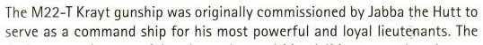

### Stat block notes (game mechanics, not feats)

- M22-T Krayt Gunship: The M22-T Krayt gunship was originally commissioned by Jabba the Hutt to serve as a command ship for his most powerful and loyal lieutenants. The design proved successful and popular, and MandalMotors produced many more such gunships, but only as special orders for valued clients. (Source: *Rebellion Era Campaign Guide* (SWRPG Saga Edition), scan p.66)

## scan p.67 (scan page 67)

Page contents: Pinook Fighter (Joraan Drive Systems; "so bad that it couldn't have happened by accident"; outflown by a Y-wing) and stat block. Caption "Two Alliance Pinook fighters escort a YV-545 space transport." Razor-class Starfighter (Starypan/SunHui Spaceworks; based on the R-41 Starchaser) stat block begins (CL 9). (hand-read)

## scan p.68 (scan page 68)

Page contents: Razor-class stat block cont. Caption "Two Razor-class starfighters attack a Kimogila fighter." Space Transports in the Rebellion era. Mobquet Medium Transport (Mobquet Swoops and Speeders, owned by TaggeCo; three modular nodes; 113 meters; hidden turbolaser turrets). (hand-read)

## scan p.69 (scan page 69)

Page contents: Mobquet Medium Transport stat block (CL 8). YKL-37R Nova Courier (Gallofree Yards, Inc.; unsold stock auctioned after the company folded). Caption "A Mesens scout ship launches from a Mobquet medium transport." (hand-read)

## scan p.70 (scan page 70)

Page contents: YKL-37R Nova Courier stat block (CL 8). YV-545 Light Freighter (Corellian Engineering Corporation; bridges YT and YV series; cockpit rotates 90 degrees in flight; untrained Pilot -2; only 3 unused emplacement points) and Corellian YV-545 stat block (CL 9). (hand-read)

## scan p.71 (scan page 71)

Page contents: Chapter V: Rebellion Era Campaign title page (art). (hand-read)

## scan p.72 (scan page 72)

Page contents: Chapter V intro (security vs. freedom; heroes may fight for the Empire, the Rebel Alliance, or the fringe). Heroes from Both Sides (precampaign discussion; introductory scenario to bring heroes together). (hand-read)

## scan p.73 (scan page 73)

Page contents: From a Specific Point of View (Imperial heroes may slowly realize they are on the wrong side). Shared Hero Backgrounds (example: Braht Rinnor, Miria, Zyrinna and Skollo "liberate" an Action VI supply ship; "Not everyone gets to be the last Jedi in the galaxy, after all."). Common Campaign Elements (four sample campaign outlines). (hand-read)

## scan p.74 (scan page 74)

Page contents: Caption "X-wing fighters take down a YE-4 gunship." Chain of Command (four examples, including junior officers on a Star Destroyer facing reassignment to the Dathomir penal colony, and shipjackers). Base of Operations (Dantooine Rebel base, Imperial Academy on Corulag, hidden hangar on Nar Shaddaa); uniting heroes with a major event. (hand-read)

## scan p.75 (scan page 75)

Page contents: Event hooks (witnesses to Alderaan's destruction; Imperials killed at Yavin; Imperial occupation of Bespin). The Common Cause. Themes of the Rebellion Era: The Rise of the Rebellion; Great Sacrifices. (hand-read)

## scan p.76 (scan page 76)

Page contents: Caption "Rebel B-wing fighters attack a Zann Consortium Kedalbe-class ship." Great Sacrifices cont. Desperate Measures. A Powerful Empire (sandtroopers on Tatooine; Zann Consortium and Hutt crime lords tied to the Empire). (hand-read)

## scan p.77 (scan page 77)

Page contents: Everyday Heroes (Sullustans and Ewoks; heroes from humble origins). Campaign Elements. Life on the Move, with adventure hook (General Airen Cracken sends the heroes to scout Graador; caverns with mynocks, mutated mynocks and colossal space slugs). Guerrilla Warfare. (hand-read)

## scan p.78 (scan page 78)

Page contents: Guerrilla Warfare cont., with adventure hook (missing bacta ship; a trap by Admiral Veritts of the Star Destroyer Carnifex; cargo ship Lifeline with gravity-well projectors). Superweapons (Death Stars, Centerpoint Station, Sun Crusher, war robots of Xim the Despot), with adventure hook (an ancient drill ship destroys Ord Dycoll and heads for Bothawui, then Muunilinst). (hand-read)

## scan p.79 (scan page 79)

Page contents: Secret Bases (Yavin 4, Hoth; Imperial hidden research bases), with adventure hook (Admiral Piett sends Imperial heroes to the Cularin system; ruins of the Jedi academy on Almas hold a malign dark side intelligence). Military Battles, with adventure hook (Home One refitting in the Senex sector; Admiral Ackbar asks every pilot to join the picket line; hold out 50 rounds; destroy the Interdictor). The Force Is With Us. (hand-read)

- **Admiral Ackbar**: "The Imperials bring an Interdictor cruiser into the fight, and soon the orders from Admiral Ackbar are to destroy the Interdictor at all costs." Source: *Rebellion Era Campaign Guide* (SWRPG Saga Edition), scan p.79
  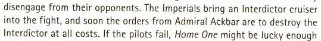

### Stat block notes (game mechanics, not feats)

- Military Battles: Adventure Hook: The Rebel fleet must protect Home One until it can power up its engines and make the jump to hyperspace, and Admiral Ackbar requests that every able-bodied Rebel with flight experience get into the cockpit of a starfighter and join the picket line at the jump point where Ackbar believes the Imperial ships will arrive. (Source: *Rebellion Era Campaign Guide* (SWRPG Saga Edition), scan p.79)

## scan p.80 (scan page 80)

Page contents: The Force Is With Us adventure hook (Jedi Aven Rolk revived from stasis calls Jedi survivors to Zissh; Darth Vader leads the Empire's Force-using agents there; Biggsy; Rolk persists as a Force spirit). Adventures in Rebellion (homage plots such as Hoth trench warfare, the dianoga, the Sarlacc pit and Endor; approaching existing story lines from new directions). Subplot (Leia falling in love with Han; Luke's training on Dagobah). (hand-read)

### Stat block notes (game mechanics, not feats)

- The Force Is With Us: Adventure Hook: Rumor has it that even Luke Skywalker, the Rebel Alliance's Jedi-in-training, is planning to journey to Zissh to meet with Rolk. Since the heroes' own Force-user needs a real teacher, the heroes cannot afford to pass up this opportunity. However, Rolk's bold proclamation has also drawn the attention of the Empire, and a cadre of the Empire's own Force-using agents—led by none other than Darth Vader—are en route to Zissh as well. (Source: *Rebellion Era Campaign Guide* (SWRPG Saga Edition), scan p.80)
- Subplot: For example, Leia's falling in love with Han Solo is a subplot in The Empire Strikes Back, but it gives her an excellent motive to risk her life to rescue him in Return of the Jedi. Similarly, Luke's training on Dagobah is a subplot designed to provide the character with insight into his own weaknesses; when he abandons his training to rescue his friends on Bespin, he returns to the main plot once more. (Source: *Rebellion Era Campaign Guide* (SWRPG Saga Edition), scan p.80)

## scan p.81 (scan page 81)

Page contents: Subplot cont. Metaplot (the redemption of Anakin Skywalker by his son; General Garm Bel Iblis's splinter Rebellion; "alternate history" options such as Vader killing Han Solo instead of encasing him in carbonite). News of the Worlds (why people support the Empire). Knowledge (Galactic Lore) table DC 10 and 15 (the official Imperial story: Palpatine declared Emperor by a grateful Senate; the Emperor and "his loyal assistant, Darth Vader" scarred by Jedi assassination attempts). (hand-read)

- **Palpatine (Darth Sidious)** — entry/section: Rebellion Era Campaign Guide (Saga): "NEWS OF THE WORLDS In Star Wars, Emperor Palpatine is one of the most evil beings the galaxy has ever seen." Source: *Rebellion Era Campaign Guide* (SWRPG Saga Edition), scan p.81
  
- **Luke Skywalker; Darth Vader (Anakin Skywalker); Han Solo**: "Perhaps Luke Skywalker fails to destroy the original Death Star, or Darth Vader kills Han Solo instead of encasing him in carbonite." Source: *Rebellion Era Campaign Guide* (SWRPG Saga Edition), scan p.81
  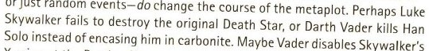

### Stat block notes (game mechanics, not feats)

- Metaplot: Perhaps Luke Skywalker fails to destroy the original Death Star, or Darth Vader kills Han Solo instead of encasing him in carbonite. Maybe Vader disables Skywalker's X-wing at the Battle of Yavin, and one of the heroes must make the historic shot—or the Millennium Falcon never makes it off Hoth, and Han Solo makes the heroes promise to get Princess Leia to safety before he is captured by the Empire and executed. (Source: *Rebellion Era Campaign Guide* (SWRPG Saga Edition), scan p.81)
- Knowledge (Galactic Lore) DC 15: The Emperor was betrayed by the Jedi Order during the Clone Wars, and both he and his loyal assistant, Darth Vader, are left with terrible scars as a result of Jedi assassination attempts. Despite their injuries and ongoing suffering, though, both men have come to forgive the Jedi and now work to rehabilitate those they encounter who originally escaped justice. The Jedi are too stubborn to convert, however, and must be imprisoned for the safety of the Empire. (Source: *Rebellion Era Campaign Guide* (SWRPG Saga Edition), scan p.81)

## scan p.82 (scan page 82)

Page contents: Knowledge (Galactic Lore) DC 20 (Alderaan eyewitnesses silenced), DC 25 (Order 66 holovids), DC 30 (Jedi Temple; Palpatine may have personally killed as many as five Jedi Masters; possibly the last of the Sith). Knowledge (Social Sciences) table DC 10–30 (Imperial governance in theory and practice; corrupt governors; Senators who opposed Palpatine; systematic erasure of records). Sidebar "The Imperial HoloNet" (thousands of channels; heavily censored by the Empire; maverick reporters join the Rebellion; many ex-reporters labor in the spice mines of Kessel). (hand-read)

- **Palpatine (Darth Sidious)** — entry/section: Rebellion Era Campaign Guide (Saga): "What can be gleaned is that Emperor Palpatine arranged for the execution of thousands of Jedi Knights—including defenseless younglings—and might have used Jedilike powers to personally murder as many as five Jedi Masters, a feat that should have been beyond the abilities of even the most skilled bureaucrat." Source: *Rebellion Era Campaign Guide* (SWRPG Saga Edition), scan p.82
  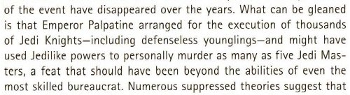

### Stat block notes (game mechanics, not feats)

- Knowledge (Galactic Lore) DC 30: Accounts of the destruction of the Jedi Temple are sketchy; records of the event have disappeared over the years. What can be gleaned is that Emperor Palpatine arranged for the execution of thousands of Jedi Knights—including defenseless younglings—and might have used Jedilike powers to personally murder as many as five Jedi Masters, a feat that should have been beyond the abilities of even the most skilled bureaucrat. Numerous suppressed theories suggest that Emperor Palpatine might be the last of the Sith—ancient enemies of the Jedi who were last seen at the Battle of Ruusan, a thousand years ago. If true, this knowledge casts all the Emperor's activities in a completely different, more sinister light. (Source: *Rebellion Era Campaign Guide* (SWRPG Saga Edition), scan p.82)

## scan p.83 (scan page 83)

Page contents: Chapter VI: Alliance title page (art). (hand-read)

## scan p.84 (scan page 84)

Page contents: Chapter VI: The Rebel Alliance intro. A Brief History of the Rebellion: Early Resistance (Bail Organa and Mon Mothma meet at Cantham House on Coruscant; Garm Bel Iblis of Corellia). Unleashing Rebellion (two years before Yavin; Mothma flees Coruscant; Bel Iblis believed dead after an assassination attempt). (hand-read)

## scan p.85 (scan page 85)

Page contents: Starkiller (saves Bail Organa on Felucia, hinders the Wookiee slave operation on Kashyyyk at Leia's behest; Darth Vader's trap on Corellia; Starkiller frees the conspirators at the Death Star construction site at the cost of his life; his family crest becomes the Alliance symbol; Corellian Treaty). Leia replaces Bail in the Senate; Declaration of Rebellion; Secession Worlds. The Battle of Yavin (Luke makes the shot). (hand-read)

- **Galen Marek**: "Starkiller's considerable ability with the Force leads Bail Organa and his allies to believe that he might be capable of succeeding." Source: *Rebellion Era Campaign Guide* (SWRPG Saga Edition), scan p.85
  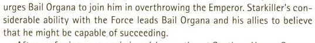
- **Leia Organa Solo**: "Bail Organa's quick order to sever the holographic link prevents the discovery of Leia's direct participation, but the three conspirators are immediately captured." Source: *Rebellion Era Campaign Guide* (SWRPG Saga Edition), scan p.85
  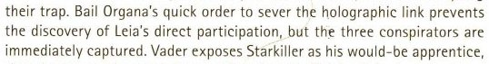
- **Darth Vader (Anakin Skywalker)**: "Determined to destroy Darth Vader and the Emperor's plans, he pursues the Sith Lords to the Death Star construction site." Source: *Rebellion Era Campaign Guide* (SWRPG Saga Edition), scan p.85
  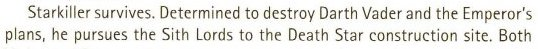
- **Leia Organa Solo**: "A rescued Princess Leia and the plans to the newly operational Death Star give the Rebels the means and, with the Death Star's rapid approach, an immediate need to destroy the Emperor's monstrous superweapon." Source: *Rebellion Era Campaign Guide* (SWRPG Saga Edition), scan p.85
  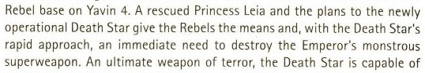

### Stat block notes (game mechanics, not feats)

- Unleashing Rebellion: Into this growing resistance movement suddenly appears a being strong in the Force, who calls himself Starkiller. He quickly proves worthy of trust by saving Senator Bail Organa from the wilds of Felucia. He also hinders the Empire's Wookiee slave operation on Kashyyyk at the behest of Princess Leia Organa, who has been ordered to oversee the construction of the operation by the Emperor as a form of punishment for her rebellious ways. Starkiller urges Bail Organa to join him in overthrowing the Emperor. Starkiller's considerable ability with the Force leads Bail Organa and his allies to believe that he might be capable of succeeding. (Source: *Rebellion Era Campaign Guide* (SWRPG Saga Edition), scan p.85)
- Unleashing Rebellion: Just as the meeting starts, Imperial forces led by Darth Vader spring their trap. Bail Organa's quick order to sever the holographic link prevents the discovery of Leia's direct participation, but the three conspirators are immediately captured. Vader exposes Starkiller as his would-be apprentice, then devastates the youth by revealing that the Sith Lords had manipulated Starkiller's entire life for this moment. Vader then tries to dispose of his now useless apprentice. Starkiller survives. Determined to destroy Darth Vader and the Emperor's plans, he pursues the Sith Lords to the Death Star construction site. Both Vader and Emperor Palpatine are on hand to witness the execution of the Rebel leaders. Starkiller infiltrates the incomplete battle station and frees the conspirators, but at the cost of his own life. (Source: *Rebellion Era Campaign Guide* (SWRPG Saga Edition), scan p.85)
- The Battle of Yavin: Fortunately for the Alliance, the Millennium Falcon also brings future Jedi Luke Skywalker at the time of the Rebels' greatest need. When Rebel starfighters make a desperate attack against the station, Luke joins them. After more experienced pilots fail to hit the station's vulnerable exhaust port, Luke makes the shot that shakes the galaxy and the Empire. In one cataclysmic explosion, the Death Star is gone. (Source: *Rebellion Era Campaign Guide* (SWRPG Saga Edition), scan p.85)

## scan p.86 (scan page 86)

Page contents: Imperial Pursuit (Vader leads the hunt; ISB and COMPNOR; Hoth; Luke trains with Yoda and duels Vader on Cloud City; death of Prince Xizor; Leia kills Jabba). The Battle of Endor and the Dawn of the New Republic (Vader turned back and throws the Emperor to his death; Alliance of Free Planets; Mon Mothma as Chief Councilor; Imperial warlords). (hand-read)

- **Darth Vader (Anakin Skywalker)**: "Darth Vader leads the effort to seek out and destroy Rebel forces." Source: *Rebellion Era Campaign Guide* (SWRPG Saga Edition), scan p.86
  
- **Luke Skywalker; Darth Vader (Anakin Skywalker)**: "Luke Skywalker manages to turn his father, Darth Vader, back from the dark side, but Vader is killed by injuries sustained when he throws the Emperor to his death." Source: *Rebellion Era Campaign Guide* (SWRPG Saga Edition), scan p.86
  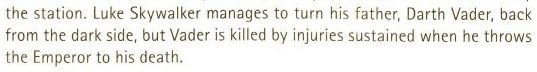

### Stat block notes (game mechanics, not feats)

- Imperial Pursuit: During this time, Luke Skywalker receives critical Jedi training from Jedi Master Yoda. All is nearly lost when the young Jedi is drawn into a trap and forced to battle Darth Vader on Cloud City in an effort to save his friends from capture. (Source: *Rebellion Era Campaign Guide* (SWRPG Saga Edition), scan p.86)
- Imperial Pursuit: Among these are the death of Black Sun head Prince Xizor, which disrupts the criminal syndicate and delivers information the Rebellion needs in order to locate and attack the second Death Star, still under construction. The Hutts also suffer a major blow when Princess Leia kills Jabba the Hutt while the heroes of Yavin rescue Han Solo from the crime lord. (Source: *Rebellion Era Campaign Guide* (SWRPG Saga Edition), scan p.86)
- The Battle of Endor and the Dawn of the New Republic: In an immense planetary and space battle, the Rebels destroy the station. Luke Skywalker manages to turn his father, Darth Vader, back from the dark side, but Vader is killed by injuries sustained when he throws the Emperor to his death. (Source: *Rebellion Era Campaign Guide* (SWRPG Saga Edition), scan p.86)

## scan p.87 (scan page 87)

Page contents: Organization (Corellian Treaty; Chief of State Mon Mothma). Alliance Civil Government (Chief of State "essentially an elected dictator"; Advisory Council of the seven governments that have given the most lives; Cabinet of six ministries: Finance, Education, State, Industry, Supply, War). Alliance Military (High Command; Fleet Command under Admiral Ackbar; Ordnance and Supply). (hand-read)

## scan p.88 (scan page 88)

Page contents: Starfighter Command (Rogue Squadron), Support Services, Intelligence, Special Forces Command (General Crix Madine the best-known commander), Sector Command. Allied Commands. Rebel Alliance Military Ranks sidebar and rank table (Navy/Army/SpecForce/Starfighter columns, down to Senior Deckman/Senior Trooper/Senior (1st) Trooper and Deckman/Trooper/Trooper/Flight Cadet). (hand-read)

## scan p.89 (scan page 89)

Page contents: The Alliance Fleet (Admiral Ackbar commands; Mon Mothma forbids a formal large-scale battle; up to one-quarter of the fleet detached for raids). Caption "A Dauntless-class heavy cruiser under fire from Imperial assault gunboats." Mon Calamari star cruisers; refitted Dreadnaughts. The Alliance Navy: Element, Section, Squadron. (hand-read)

### Stat block notes (game mechanics, not feats)

- The Alliance Fleet: Admiral Ackbar is the commander of the fleet throughout much of the Galactic Civil War. Even though the fleet is both a powerful symbol and a critical weapon against the Empire, Ackbar knows that he must pick and choose his battles carefully. A significant defeat would mean the loss of critically needed ships and personnel, not to mention the incalculable damage to the Alliance's public image. (Source: *Rebellion Era Campaign Guide* (SWRPG Saga Edition), scan p.89)

## scan p.90 (scan page 90)

Page contents: Battle Group and Fleet (Admiral of the Fleet, Admiral Ackbar for most of the war). Fleet Command Structure. Sidebar "Using the Rebel Fleet." Special Forces organization (Fire Team to Division; ten SpecForce divisions; the Command Division under the direct control of General Crix Madine). (hand-read)

## scan p.91 (scan page 91)

Page contents: SpecForce Regiments (1st Marines/SpaceOps, 2nd Pathfinders, 3rd Urban Guerrillas, 4th Wilderness Fighters, 5th Infiltrators, 6th Heavy Weapons Specialists, 7th Technicians). Sidebar "Using SpecForces." Starfighter Command; Starfighter Wings (Element, Flight, Squadron, Wing, Group). (hand-read)

## scan p.92 (scan page 92)

Page contents: Sector Forces; Alliance Army and Sector Force Command Structure (Squad 9 to Corps 36,864; Sector Army over 100,000). Sidebar "Using Sector Forces." (hand-read)

## scan p.93 (scan page 93)

Page contents: Rebel Bases (main base houses High Command; safe houses, caches, large Sector Force bases, starfighter bases). Rebel Operatives. Sidebar "Sectors in Rebellion" (partial list of 36 sectors, Ado through Trax). Rebel Cell Networks (cells of three or four; area coordinators; network leader; case officers). (hand-read)

## scan p.94 (scan page 94)

Page contents: Special Operations (mission groups of 5-10; autonomous Special Operations Teams). Alliance Personnel: Rebel Cell Member stat block (CL 1). Rebel Honor Guard (first Honor Guards are Alderaan survivors; Mon Mothma rotates them to prevent elitism). (hand-read)

## scan p.95 (scan page 95)

Page contents: Rebel Honor Guard stat block (nonheroic 6/soldier 3). Rebel Marksman (caption "A Rebel marksman lines up for a shot on a TIE crawler's commanding officer.") and stat block (CL 4). Pull quote "Hokey religions and ancient weapons are no match for a good blaster at your side, kid." — Han Solo. (hand-read)

## scan p.96 (scan page 96)

Page contents: Resistance Leader stat block (CL 5). Rogue Squadron Pilot (legendary exploits; members have other combat skills) and stat block (CL 8). Pull quote "Get set to make your attack run." — Garvin Dreis, Red Leader. (hand-read)

## scan p.97 (scan page 97)

Page contents: SpecForce Guerrilla (urban-combat specialists) stat block (CL 5). SpecForce Infiltrator ("most vengeance-ridden members"; most feared SpecForce operatives) stat block (CL 7). SpecForce Marine description. (hand-read)

## scan p.98 (scan page 98)

Page contents: Caption "From left to right: SpecForce guerrilla, SpecForce infiltrator, SpecForce marine, SpecForce officer." SpecForce Marine stat block (CL 4). (hand-read)

## scan p.99 (scan page 99)

Page contents: SpecForce Officer stat block (CL 7). Alliance Personalities intro (Mon Mothma, Bail Organa, Garm Bel Iblis, Starkiller covered in The Force Unleashed Campaign Guide). Admiral Ackbar (Tarkin's slave; freed by a Rebel attack; Shantipole Project created the B-wing; acquisition of Mon Calamari star cruisers). Art "Admiral Ackbar." (hand-read)

- **Admiral Ackbar** — entry/section: Rebellion Era Campaign Guide (Saga): "A brilliant tactician and powerful leader, Ackbar is best known for victory over Imperial fleet at the Battle of Endor." Source: *Rebellion Era Campaign Guide* (SWRPG Saga Edition), scan p.99
  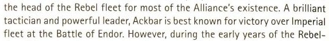

### Stat block notes (game mechanics, not feats)

- Admiral Ackbar: Hero of the Rebel Alliance and of his own people, Admiral Ackbar serves as the head of the Rebel fleet for most of the Alliance's existence. A brilliant tactician and powerful leader, Ackbar is best known for victory over Imperial fleet at the Battle of Endor. However, during the early years of the Rebellion, Ackbar is an Imperial slave, like the rest of the Mon Calamari. As Grand Moff Tarkin's slave, Ackbar gains considerable insight into Imperial tactics, weapons, and plans. After a Rebel attack on the Grand Moff frees Ackbar, he returns to Mon Calamari, where he convinces others to join the Rebel cause. He oversees the Shantipole Project, which created the B-wing starfighter. Quickly rising through the Rebel ranks, he becomes an admiral and directs the Rebel's major fleet actions and other operations. He is instrumental in the acquisition of Mon Calamari star cruisers by the Rebels, and in the ships' conversion to full-scale military capital ships. (Source: *Rebellion Era Campaign Guide* (SWRPG Saga Edition), scan p.99)

## scan p.100 (scan page 100)

Page contents: Admiral Ackbar (Episode VI) stat block (noble 5/soldier 2/officer 4). Wedge Antilles (destroys the pirate ship that killed his parents; Booster Terrik; Red Squadron; leads Rogue Squadron; only Rebel pilot to attack both Death Stars) and Wedge Antilles (Episode VI) stat block (CL 9). Art "Wedge Antilles." (hand-read)

### Stat block notes (game mechanics, not feats)

- Admiral Ackbar (Episode VI) stat block: Medium Mon Calamari noble 5/soldier 2/officer 4; Destiny 2; Force 5; Init +6; Senses low-light vision; Perception +17; Defenses Ref 24 (flat-footed 23), Fort 23, Will 27; hp 61; Threshold 23; Melee unarmed +9 (1d4+5); Ranged blaster pistol +10 (3d6+5); Base Atk +9; Grp +10; Special Actions Assault Tactics, Born Leader, Deployment Tactics, Rally; Abilities Str 10, Dex 12, Con 10, Int 15, Wis 15, Cha 14; Talents Armored Defense, Assault Tactics, Born Leader, Deployment Tactics, Distant Command, Rally; Skills Knowledge (tactics) +17, Perception +17, Pilot +11. (Source: *Rebellion Era Campaign Guide* (SWRPG Saga Edition), scan p.100)
- Wedge Antilles: Wedge soon becomes a member of Red Squadron and is one of the few survivors of the attack on the first Death Star. He goes on to join and later lead the elite Rogue Squadron. Although primarily a fighter pilot, he also briefly serves as a spy and a commando and even as the commander of a Star Destroyer and as a fleet commander in the days of the New Republic. With the Rebel Alliance and Rogue Squadron, Wedge distinguishes himself at the Rebellion's most critical battles, such as at Hoth and Endor. He is the only Rebel pilot to attack both Death Stars, destroying the second one with help from the Millennium Falcon. (Source: *Rebellion Era Campaign Guide* (SWRPG Saga Edition), scan p.100)
- Wedge Antilles (Episode VI) stat block: CL 9; Medium Human scoundrel 1/soldier 6/ace pilot 2; Destiny 1; Force 5; Init +12; Senses Perception +10; Defenses Ref 27 (flat-footed 23), Fort 22, Will 21; Dodge; hp 56; Threshold 22; Melee unarmed +7 (1d6+4); Ranged blaster pistol +10 (3d6+4); Base Atk +7; Grp +10; Abilities Str 10, Dex 16, Con 10, Int 12, Wis 12, Cha 11; Special Qualities vehicle dodge +1; Talents Devastating Attack (heavy weapons), Elusive Dogfighter, Penetrating Attack (heavy weapons), Spacehound, Weapon Specialization (heavy weapons); Skills Pilot +17, Stealth +12. (Source: *Rebellion Era Campaign Guide* (SWRPG Saga Edition), scan p.100)

## scan p.101 (scan page 101)

Page contents: Tycho Celchu (trained under Soontir Fel; defects after Alderaan; Rogue Squadron at Hoth; A-wing at Endor; later marries Winter) and Tycho Celchu (Episode VI) stat block (CL 8). General Airen Cracken (master mechanic of Contruum; forces the Imperial occupation to withdraw; "Cracken's Crew Says Hello" hydrospanner). Art "General Airen Cracken." (hand-read)

### Stat block notes (game mechanics, not feats)

- Tycho Celchu: Tycho Celchu joins the Imperial Academy with an idealistic intention to change the Imperial military from within. After training under Soontir Fel, Tycho graduates and is posted to a Star Destroyer as a TIE fighter pilot. Celchu's life changes direction when his birthday transmission to Alderaan abruptly ends as the Death Star shatters the planet. With his family and fiancée dead, Celchu abandons his post and soon joins the Rebel Alliance. He joins the elite Rogue Squadron, battling AT-ATs at Hoth and attacking the second Death Star in an A-wing at the Battle of Endor. Celchu flies and fights extensively for the New Republic, though his career has rocky times. He marries Winter after his retirement years later. (Source: *Rebellion Era Campaign Guide* (SWRPG Saga Edition), scan p.101)
- Tycho Celchu (Episode VI) stat block: CL 8; Medium Human soldier 7/ace pilot 1; Destiny 1; Force 5; Init +11; Senses Perception +10; Defenses Ref 24 (flat-footed 22), Fort 22, Will 19; Dodge; hp 103; Threshold 22; Ranged blaster pistol +9 (3d6+4) or +4 (4d6+4) with Rapid Shot; Base Atk +7; Grp +9; Special Actions Indomitable, Tough As Nails; Abilities Str 11, Dex 15, Con 13, Int 12, Wis 13, Cha 11; Skills Pilot +16. (Source: *Rebellion Era Campaign Guide* (SWRPG Saga Edition), scan p.101)
- General Airen Cracken: When Imperial forces arrive to take over the planet, Cracken and his employees organize a guerrilla force specializing in sabotage. He also establishes safe havens for the civilian population. In short, he single-handedly creates one of the most successful resistance groups to engage the Empire. In a few years, he and his crew make operating on Contruum so expensive for the Empire that the occupation forces withdraw. (Source: *Rebellion Era Campaign Guide* (SWRPG Saga Edition), scan p.101)

## scan p.102 (scan page 102)

Page contents: Airen Cracken continued (head of Alliance Intelligence; supports Crix Madine's commandos; mans a Millennium Falcon turret at Endor) and Airen Cracken (Episode VI) stat block (CL 10). Nera Dantels (smuggler turned Rebel; blue curved tattoos; once involved with Biggs Darklighter; Dagger Squadron B-wing pilot; freighter Starduster) and Nera Dantels (Episode V) stat block (CL 5). (hand-read)

### Stat block notes (game mechanics, not feats)

- General Airen Cracken: Cracken leads raids, trains and briefs Alliance agents of every sort, and works his way up to become head of Alliance Intelligence. His efforts support Crix Madine's commando units, and the hands-on general even mans one of the Millennium Falcon's turrets at the Battle of Endor. (Source: *Rebellion Era Campaign Guide* (SWRPG Saga Edition), scan p.102)
- Airen Cracken (Episode VI) stat block: CL 10; Medium Human noble 3/scout 1/scoundrel 5/soldier 1; Destiny 2; Force 5; Init +7; Senses Perception +12; Defenses Ref 24 (flat-footed 22), Fort 22, Will 24; hp 53; Threshold 22; Ranged heavy blaster pistol +9 (3d8+5) or +4 (4d8+5) with Rapid Shot; Base Atk +6; Grp +8; Special Actions Jury-Rigger, Knack; Abilities Str 10, Dex 14, Con 10, Int 16, Wis 15, Cha 14; Talents Demolitionist, Educated, Gimmick, Jury-Rigger, Knack, Master Slicer, Spontaneous Skill; Skills Knowledge (tactics) +18, Knowledge (technology) +18, Mechanics +18 (can reroll when making jury-rigged repair), Use Computer +18 (can reroll when improving access, keeping better result). (Source: *Rebellion Era Campaign Guide* (SWRPG Saga Edition), scan p.102)
- Nera Dantels: In the months following the Battle of Yavin, the smuggler turned Rebel Nera Dantels puts her substantial flying skills at the Alliance's disposal. She is passionate and headstrong and lets nothing stand in her way—whether it be rules or people. The blue, curved tattoos around her eyes prominently proclaim her individuality and refusal to blend in. Once romantically involved with Biggs Darklighter, Dantels continues his all-too-short fight against the Empire. Dantels is one of the first pilots to fly the newly developed B-wing starfighter, as a Dagger Squadron pilot. She also flies her own freighter, the Starduster. (Source: *Rebellion Era Campaign Guide* (SWRPG Saga Edition), scan p.102)
- Nera Dantels (Episode V) stat block: CL 5; Medium Human scoundrel 5; Destiny 1; Force 3; Init +4; Defenses Ref 19 (flat-footed 17), Fort 15, Will 17; hp 55; Threshold 15; Ranged blaster pistol +5 (3d6+2) or +0 (4d6+2) with Rapid Shot; Talents Hyperdriven, Knack, Lucky Shot; Skills Pilot +9, Stealth +9; Possessions blaster pistol, comlink, Starduster. (Source: *Rebellion Era Campaign Guide* (SWRPG Saga Edition), scan p.102)

## scan p.103 (scan page 103)

Page contents: Biggs Darklighter (Luke's friend; joins the Rebellion through Academy contacts; killed by Darth Vader in the trench protecting Luke; cousin Gavin joins Rogue Squadron) and Biggs Darklighter (Episode IV) stat block (CL 4). Wes Janson (Tierfon Yellow Aces with Jek Porkins; illness keeps him out of Yavin; Rogue 6; Wedge's gunner at Hoth, first to flatten a walker with harpoon and tow cable; co-founds Wraith Squadron) and Wes Janson (Episode VI) stat block (CL 8). Art "Biggs Darklighter." (hand-read)

### Stat block notes (game mechanics, not feats)

- Biggs Darklighter: A close friend of Luke Skywalker, Biggs Darklighter grows up in a relatively affluent family on Tatooine. Though Skywalker and Darklighter dream of joining the Academy together, only Biggs is able to go. He returns to Tatooine to tell Luke that he is joining the Rebellion through contacts at the Academy, and he tries to convince Luke of the dangers of the Empire. The two are surprised to see each other soon after as they prepare to defend the main Rebel base from the menacing Death Star. Darth Vader kills Biggs in the Death Star trench, as Biggs protects Luke during his attack run on the Death Star's thermal exhaust port. However, Biggs' legacy lives on as a Rebel hero and through the exploits of his younger cousin, Gavin, who joins Rogue Squadron after the fall of the Emperor and goes on to have a long career with the New Republic and Galactic Alliance. (Source: *Rebellion Era Campaign Guide* (SWRPG Saga Edition), scan p.103)
- Biggs Darklighter (Episode IV) stat block: CL 4; Medium Human scout 1/soldier 3; Destiny 1; Force 3; Init +9; Senses Perception +8 (can reroll); Defenses Ref 18 (flat-footed 16), Fort 17, Will 15; Dodge; hp 41; Threshold 17; Special Actions Harm's Way; Abilities Str 14, Dex 15, Con 10, Int 11, Wis 12, Cha 10; Talents Acute Senses, Harm's Way, Penetrating Attack (heavy weapons); Skills Pilot +9. (Source: *Rebellion Era Campaign Guide* (SWRPG Saga Edition), scan p.103)
- Wes Janson: Before the Battle of Yavin, Wes Janson flies as a member of the Tierfon Yellow Aces, stationed at the Alliance's Tierfon outpost. Along with Jek Porkins and others, Janson is transferred to the main Rebel base on Yavin 4 just prior to the Death Star's arrival, but illness keeps Janson from flying in the battle. The often-joking Janson goes on to join Rogue Squadron as Rogue 6. At Hoth, he serves as Wedge Antilles' gunner, becoming the first to flatten an Imperial walker with his harpoon and tow cable. Janson and Antilles eventually founded the New Republic's elite experimental Wraith Squadron. (Source: *Rebellion Era Campaign Guide* (SWRPG Saga Edition), scan p.103)
- Wes Janson (Episode VI) stat block: CL 8; Medium Human soldier 7/ace pilot 1; Destiny 1; Force 5; Init +11; Defenses Ref 25 (flat-footed 22), Fort 21, Will 18; hp 103; Threshold 21; Melee unarmed +8 (1d6+6); Ranged blaster pistol +9 (3d6+4); Talents Devastating Attack (heavy weapons), Expert Gunner, Melee Smash, Penetrating Attack (heavy weapons), Tough as Nails; Skills Pilot +11. (Source: *Rebellion Era Campaign Guide* (SWRPG Saga Edition), scan p.103)

## scan p.104 (scan page 104)

Page contents: Derek "Hobbie" Klivian (joins with Biggs after the Imperial Academy; Rogue Group at Hoth; with Wedge at Endor; legendary stories of his demise) and stat block (CL 8). Nien Nunb (quits SoroSuub in protest; with sister Aril raids SoroSuub ships; ship Sublight Queen; Lando's copilot at the second Death Star) and Nien Nunb (Episode VI) stat block (CL 8). (hand-read)

### Stat block notes (game mechanics, not feats)

- Derek "Hobbie" Klivian: Derek Klivian, known as "Hobbie," joins the Rebellion along with Biggs Darklighter after training at the Imperial Academy. Hobbie goes on to have a long Rebel career, flying with Rogue Group at the Battle of Hoth, with Wedge at the Battle of Endor, and as a member of Rogue Squadron for several years. His skepticism was well known among his squadron mates, as were incorrect but legendary stories of his demise. (Source: *Rebellion Era Campaign Guide* (SWRPG Saga Edition), scan p.104)
- Derek "Hobbie" Klivian (Episode VI) stat block: CL 8; Medium Human soldier 6/scoundrel 1/ace pilot 1; Destiny 1; Force 5; Init +6; Defenses Ref 25 (flat-footed 22), Fort 22, Will 20; Dodge; hp 74; Threshold 22; Talents Armored Defense, Devastating Attack (heavy weapons), Keep It Together, Lucky Shot, Penetrating Attack (heavy weapons); Skills Pilot +11. (Source: *Rebellion Era Campaign Guide* (SWRPG Saga Edition), scan p.104)
- Nien Nunb: Nien Nunb is a well-known Rebel hero in the Sullust system. He originally works for the interstellar SoroSuub Corporation, but he quits in protest when the company takes control of Sullust and becomes an Imperial ally. He and his sister, Aril, raid SoroSuub ships in support of Rebel war and supply efforts. He and his ship, the Sublight Queen, gain the support of the Sullustan people and soon attract others ready to fight the Imperials. He is directly responsible for bringing SoroSuub and his homeworld into an alliance with the Rebellion. Nunb and much of his growing fleet escape an Imperial blockade to join the Alliance fleet. Nunb becomes a hero known throughout the Alliance as Lando Calrissian's copilot in the attack on the second Death Star. (Source: *Rebellion Era Campaign Guide* (SWRPG Saga Edition), scan p.104)
- Nien Nunb (Episode VI) stat block: CL 8; Medium Sullustan scout 7/ace pilot 1; Destiny 1; Force 5; Init +11; Senses darkvision; Perception +10 (can reroll); Defenses Ref 24 (flat-footed 22), Fort 21, Will 19; hp 56; Threshold 21; Speed 6 squares; Surefooted; Talents Evasion, Fringe Savant, Jury-Rigger, Keep It Together, Surefooted; Skills Pilot +11, Stealth +11. (Source: *Rebellion Era Campaign Guide* (SWRPG Saga Edition), scan p.104)

## scan p.105 (scan page 105)

Page contents: General Carlist Rieekan (Alderaanian; survives Alderaan on a Delaya mission; guilt makes him defensively minded; commands Hoth base; later Minister of State) and General Carlist Rieekan (Episode V) stat block (CL 12). Deena Shan (self-doubt; encounter with the Millennium Falcon and the heroes of Yavin; undercover and commando operations). Art "General Carlist Rieekan." (hand-read)

### Stat block notes (game mechanics, not feats)

- General Carlist Rieekan: Carlist Rieekan is an early member of the Rebel Alliance, working with resistance forces in and around his homeworld of Alderaan. A mission to observe and inspect satellite transmitters near Delaya, also in the Alderaan system, saves his life when the Death Star arrives and obliterates Alderaan. He feels that if he had acted more quickly, he might have saved some of the population by beginning an evacuation upon the Death Star's arrival in the system. This guilt drives him to become acutely defensively minded, which serves him well on Hoth. A dedicated Rebel and a fine officer, he rises to the rank of general while directing a variety of Alliance commands and operations. He becomes the commanding officer of the new Alliance main base on Hoth and successfully oversees the delaying action that allows many Rebels to escape the devastating Imperial attack. Rieekan survives the Galactic Civil War and becomes Minister of State of the New Republic. (Source: *Rebellion Era Campaign Guide* (SWRPG Saga Edition), scan p.105)
- General Carlist Rieekan (Episode V) stat block: CL 12; Medium Human noble 7/officer 5; Destiny 2; Force 6; Init +7; Senses Perception +14; Defenses Ref 26 (flat-footed 25), Fort 24, Will 30; hp 74; Threshold 24; Ranged blaster pistol +12 (3d6+6); Base Atk +10; Grp +12; Special Actions Born Leader, Coordinate +1, Deployment Tactics, Field Tactics, Inspire Confidence, Outmaneuver, Trust; Abilities Str 10, Dex 13, Con 12, Int 15, Wis 16, Cha 16; Skills Knowledge (tactics) +18, Persuasion +19. (Source: *Rebellion Era Campaign Guide* (SWRPG Saga Edition), scan p.105)
- Deena Shan: Deena Shan is drawn to the excitement of the Rebellion but plagued with self-doubt about her capabilities and position within the Alliance. Her early mundane duties make her question her decision to join the Rebels, but an unexpected encounter with the Millennium Falcon and the heroes of Yavin quickly erases those feelings. Deena soon finds herself serving in the Rebellion in undercover and commando operations, using her looks and persuasive skills against unsuspecting Imperial officers. However, she is unprepared for the powerful emotional conflict between her duties and her feelings. She feels out of place and in over her head on the battlefield. Fellow Rebels have to remind her of her military position and help her overcome her inexperience and hesitation. Despite the emotional rollercoaster, she remains dedicated to the Rebel cause. (Source: *Rebellion Era Campaign Guide* (SWRPG Saga Edition), scan p.105)

## scan p.106 (scan page 106)

Page contents: Deena Shan (Episode V) stat block (CL 5). Wicket (brings Leia to Bright Tree Village; trap expertise) and Wicket (Episode VI) stat block (CL 3). Winter ("Targeter"; perfect memory; Leia's aide; nanny of the Solo children; marries Tycho Celchu) and Winter (Episode VI) stat block (CL 3). (hand-read)

- **Leia Organa Solo**: "Leia's arrival leads to his tribe's eventual alliance with the Rebel Special Forces team, there to destroy the massive shield generator protecting the Death Star in orbit high above the moon." Source: *Rebellion Era Campaign Guide* (SWRPG Saga Edition), scan p.106
  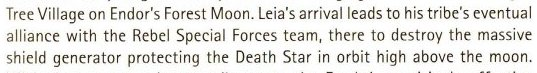

### Stat block notes (game mechanics, not feats)

- Deena Shan (Episode V) stat block: CL 5; Medium Human scoundrel 1/ scout 4; Destiny 1; Force 3; Init +3; Senses Perception +9 (can reroll); Defenses Ref 18 (flat-footed 17), Fort 16, Will 18; Dodge; hp 36; Threshold 16; Special Actions Disruptive; Talents Acute Senses, Disruptive, Improved Stealth; Skills Deception +15, Persuasion +15. (Source: *Rebellion Era Campaign Guide* (SWRPG Saga Edition), scan p.106)
- Wicket: Wicket is the young Ewok responsible for bringing Princess Leia to Bright Tree Village on Endor's Forest Moon. Leia's arrival leads to his tribe's eventual alliance with the Rebel Special Forces team, there to destroy the massive shield generator protecting the Death Star in orbit high above the moon. Wicket's trap expertise contributes to the Ewoks' surprisingly effective attack against the Imperial forces protecting the Death Star's shield generator. Wicket's observation of Imperial activities prior to the battle also gives the Ewoks confidence that they can defeat the invaders—even with their primitive weaponry. (Source: *Rebellion Era Campaign Guide* (SWRPG Saga Edition), scan p.106)
- Wicket (Episode VI) stat block: CL 3; Small Ewok scout 3; Force 3; Init +9; Senses Perception +7 (can reroll); Defenses Ref 19 (flat-footed 16), Fort 14, Will 14; Dodge; hp 33; Threshold 14; Speed 4 squares; Melee spear +4 (1d8+3); Ranged spear +6 (1d8+2); Abilities Str 13, Dex 16, Con 11, Int 11, Wis 13, Cha 9; Special Qualities scent; Skills Climb +12, Stealth +14 (can reroll), Survival +12. (Source: *Rebellion Era Campaign Guide* (SWRPG Saga Edition), scan p.106)
- Winter: Winter grows up in the Alderaan royal house, becoming known for her aristocratic manner and occasionally being mistaken for her close friend Princess Leia. As Leia enters politics, Winter becomes her personal assistant. After the destruction of Alderaan, Winter becomes an Alliance intelligence agent. She uses her unerring memory to scout potential targets. With that information, Winter can create detailed maps of targeted locations and dossiers on individuals. Both Imperials and Rebels know her as Targeter. Her perfect memory comes at a cost, however. She recalls details vividly, so she never escapes the pain of the loss of Alderaan or of any other trauma. After the establishment of the New Republic, Winter returns to work as Leia's aide and as nanny and protector of the Solo children. Winter eventually marries Tycho Celchu. (Source: *Rebellion Era Campaign Guide* (SWRPG Saga Edition), scan p.106)
- Winter (Episode VI) stat block: CL 3; Medium Human noble 1/scout 2; Force 3; Init +3; Senses Perception +12 (can reroll); Defenses Ref 18 (flat-footed 16), Fort 15, Will 17; hp 27; Threshold 15; Ranged hold-out blaster +3 (3d4+1); Abilities Str 9, Dex 15, Con 10, Int 16, Wis 12, Cha 16; Talents Acute Senses, Presence. (Source: *Rebellion Era Campaign Guide* (SWRPG Saga Edition), scan p.106)

## scan p.107 (scan page 107)

Page contents: Technology and Vehicles intro (Alliance presses any equipment into service). Equipment. Cracken's Tactics (encrypted Rebel Field Guide): Boosting the Power of a Repulsor Sled (Mechanics DC 15); sidebar Parts and Supplies; Disabling a Shield Generator (LK-4 fusible link or vampiric power tap); Disabling Speeder Safety Systems (Mechanics DC 25). (hand-read)

### Stat block notes (game mechanics, not feats)

- Cracken's Tactics: General Airen Cracken and his infamous Cracken's Crew excel at adapting equipment for sabotage or other disruptive purposes. Cracken and his crew members carry out extensive sabotage and clandestine attacks against the Empire, and they also train other units in their best tricks. Cracken's encrypted Rebel Field Guide can be found at most Rebel bases and training facilities. Not all of Cracken's tactics are destructive. As Cracken likes to point out, sometimes disabling a mechanism is more effective than destroying it, especially if you hope to use it later or if you need to prevent collateral damage. The creative use of mundane items is another of his specialties. (Source: *Rebellion Era Campaign Guide* (SWRPG Saga Edition), scan p.107)

## scan p.108 (scan page 108)

Page contents: Cracken's Tactics continued: Disabling Speeder Safety Systems result; Disabling a Walker's Drive Motor (Mechanics DC 15); Jury-Rigging a Power-Pack Bomb (2 to 5 power packs, sturm dowels; detonates 1d6 rounds after); Overloading a Starship or Vehicle Weapon (Mechanics DC 20 or Use Computer DC 30 remote); Sending a Reactor into Automatic Shutdown (Mechanics DC 20); Using Droid Restraining Bolts to Your Advantage (instantly fusing attachment disks). (hand-read)

## scan p.109 (scan page 109)

Page contents: Restraining bolts continued (a Jedi can use Move Light Object to slap a bolt on a droid). Emplacements. Atgar 1.4 FD P-Tower (Clone Wars-era; crew of four) stat block (CL 5). Sidebar Task Training (untrained Mechanics checks for a specific trained task; trainee DC 25 Perception). Golan Arms DF.9 anti-infantry tower (crew of three; modified against AT-STs) stat block start. (hand-read)

## scan p.110 (scan page 110)

Page contents: Caption "DF.9 anti-infantry cannons flank a T4-B heavy tank while defending a Rebel base." DF.9 stat block continued (Cost 14,000). Golan Arms FPC 6.7 Anti-Aircraft Battery stat block (CL 5). KDY v-150 Planet Defender ("ion cannon" or "the 150"; can disable an Imperial Star Destroyer for a few minutes; famously defended the evacuation of Hoth) stat block (CL 12; Crew 150; Cost 1.5 million). (hand-read)

## scan p.111 (scan page 111)

Page contents: Loratus Manufacturing MPTL-2a Mobile Proton Torpedo Launcher (nine fire-linked launchers; range 20 km with spotters) stat block (CL 8). Loratus Longvision LV-38 Spotter/Probe Droid (stealth programming, burst-stream transceivers; unarmed) stat block. (hand-read)

## scan p.112 (scan page 112)

Page contents: Combat Assault Vehicles (CAVs) intro (Arrow-23 and KAAC Freerunner in The Force Unleashed Campaign Guide). Gallofree HTT-26 Heavy Troop Transport (last days of the Old Republic; Passengers 16) stat block (CL 8). Sienar Ultra-Light Assault Vehicle (Clone Wars; Rebel commando raid steals a fleet of ULAVs from an Imperial storage facility on Hiffis) stat block (CL 5). (hand-read)

## scan p.113 (scan page 113)

Page contents: Mekuun Heavy Tracker (Omniprobe sensors; mobile command center) stat block (CL 8). T2-B Repulsor Tank (secret deal with Yutrane-Trackata leadership, shipments staged as Rebel raids; rarely fielded in large formations until after Endor) stat block (CL 7). (hand-read)

## scan p.114 (scan page 114)

Page contents: T4-B Heavy Tank (Yutrane-Trackata deal; dual laser cannons and triple concussion missile tubes) stat block (CL 12). Starships intro. YM-2800 Limpet Ship (Corellian Engineering Corporation survey and mining vessel; plasma beam cutter used to breach ships for boarding parties; grapple rules). Caption "A YM-2800 limpet ship lands on an Imperial Class II frigate." (hand-read)

## scan p.115 (scan page 115)

Page contents: Corellian Engineering Corporation YM-2800 Limpet Ship stat block (CL 7). T-Wing Interceptor (Hoersch-Kessel; design cues from X-wing and Z-95; hit-and-fade) and Hoersch-Kessel T-Wing Interceptor stat block (CL 8). Caption "A Royal Guard fighter takes shots at a T-wing interceptor." (hand-read)

## scan p.116 (scan page 116)

Page contents: X4 Gunship (Incom; two decks; six laser turrets; most end up in Rebel hands) and Incom X4 Gunship stat block (CL 10). Caption "An X-4 gunship repels an attack by TIE Aggressors." Pull quote "Move as close as you can, and engage those Star Destroyers at point-blank range." —Lando Calrissian. (hand-read)

## scan p.117 (scan page 117)

Page contents: Chapter VII opener: "Chapter VII The Empire" over full-page art of Imperial troops (no body text). (hand-read)

## scan p.118 (scan page 118)

Page contents: The Empire chapter intro (Palpatine dissolves the Republic; Imperial Intelligence Bureau obscures subjugation; would-be Sith at the feet of the Emperor or Darth Vader). The Imperial Machine (Dark Times and Clone Wars elements may be used). (hand-read)

### Stat block notes (game mechanics, not feats)

- The Empire: But the Empire is far more sinister than it would have its citizens know. Having carefully undermined the Republic, Supreme Chancellor Palpatine represents himself as the only hope for peace and order. After formally dissolving the remnants of the Galactic Republic and reorganizing it as a Galactic Empire, Palpatine puts into motion a plan to systematically subjugate those worlds and systems that resist his rule. The Imperial Intelligence Bureau obscures these activities. The average citizen has no idea of the true nature of the Empire. (Source: *Rebellion Era Campaign Guide* (SWRPG Saga Edition), scan p.118)
- The Empire: Similarly, those who are able to tap into and wield the Force find a place in the Empire—at the feet of the Emperor or his apprentice, Darth Vader. Where Jedi Knights once flourished are now would-be Sith. Although they are less common than they were during the Dark Times, devotees of the dark side are far more dangerous than before, since they now command the power of the Imperial military as well as the power of the Force. (Source: *Rebellion Era Campaign Guide* (SWRPG Saga Edition), scan p.118)

## scan p.119 (scan page 119)

Page contents: Organization (Imperial Center; Ubiqtorate). Sector Governments (Senate dissolved shortly after completion of the first Death Star). Moffs and Grand Moffs (quotas; discretionary budgets; a visit from Lord Vader). Planetary Governments. COMPNOR: Sub-Adult Group, Coalition for Progress, Coalition for Improvements, CompForce, Imperial Security Bureau. (hand-read)

### Stat block notes (game mechanics, not feats)

- Moffs and Grand Moffs: The Emperor is content to allow his Grand Moffs to manage the details of accounting and procurement, and even seems to encourage minor accounting irregularities. But if his appointed representatives become too brazen, they can expect a visit from Lord Vader to ensure that they, or their replacements, do not overstep their bounds again. (Source: *Rebellion Era Campaign Guide* (SWRPG Saga Edition), scan p.119)

## scan p.120 (scan page 120)

Page contents: COMPNOR continued (trillions of members; citizens blame the bureaucracy rather than the Emperor). Imperial Intelligence (Clone Wars origins: Palpatine has agencies monitor senators, then merges them; the Ubiqtorate): Adjustments, Internal Organization Bureau, Internal Security Branch, Internal Counterintelligence Bureau, Analysis Bureau (Media, Signal, Cryptanalysis, Technology), Interrogation, Bureau of Operations (Surveillance, Infiltration, Counterintelligence, Diplomatic Services, Destabilization, Assassination), Intelligence, External Communications, Sector Branches (Sedition). (hand-read)

### Stat block notes (game mechanics, not feats)

- Imperial Intelligence: At the onset of the Clone Wars, then-Chancellor Palpatine instructs the Republic's various intelligence agencies to closely monitor the activities of members of the Republic Senate. What eventually comes to light is that the malfeasance that runs throughout the Senate has also spread to the intelligence community: Corrupt senators have been feeding false information to intelligence agents or bribing them to bury reports. Amid massive firings, resignations, and criminal charges, Chancellor Palpatine convinces the remaining agency directors to merge their organizations into one bureau responsible for ensuring that the government remains free from internal corruption. Immediately after Emperor Palpatine reorganizes the Republic as an Empire, the agency directors unanimously agree to the provisions set forth in the New Order. (Source: *Rebellion Era Campaign Guide* (SWRPG Saga Edition), scan p.120)
