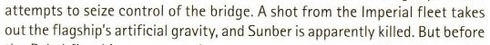
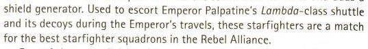
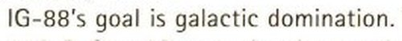
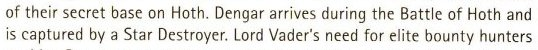
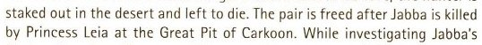
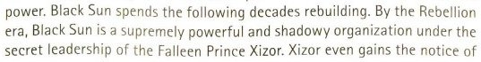
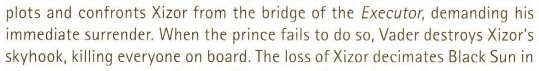

# Owner Material 037 — Star Wars D20 Drive folder (Core, Revised Core and Saga Edition): Sourcebooks/Rebellion Era Campaign Guide.pdf [Star Wars Roleplaying Game Saga Edition (2007)] (scan pages 121–161)

- **Source:** Wizards of the Coast Star Wars Roleplaying Game books, web enhancements, Living Force campaign modules and articles (2000–2010), from the owner's "Star Wars D20" Drive folder (only the three edition subfolders; "General" was not read, as instructed). Secondary source (licensed Legends reference). Scan OCR'd on the box; the scan stays box-only and is **not** published.
- **Method:** every scanned page was OCR'd and machine-screened sentence by sentence for power-relevant statements (fights, kills, defeats, Force feats, rankings, superweapons) that name a character on our roster; each kept sentence is quoted verbatim from the OCR text and has a crop of the printed passage directly under it. Pages with nothing power-relevant are still listed with what is on them.
- **Citation:** "*Rebellion Era Campaign Guide* (SWRPG Saga Edition), p.X" by printed page ("scan p.X" where no printed number applies). **Weight:** Licensed RPG material: a secondary source. Narrative text sums up Legends lore; game statistics are rules for players, not canon power levels, and rank lowest.

## scan p.121 (scan page 121)

Page contents: Imperial Intelligence continued: Crisis, Sector Plexus, System Cell (4-20 agents; RWStar A/P Transceiver), Imperial CompLink (spyware). The Imperial Military. Imperial Ground Forces. Stormtrooper Order of Battle (squad 8 through legion 8,192; officers replace the Jedi who once led clone troopers). Regular Army Command Structure (squad through regiment). (hand-read)

## scan p.122 (scan page 122)

Page contents: Regular army continued: battlegroup, corps, army, systems army, sector army (marshal). The Imperial Fleet (fewer than one percent non-Human, such as Grand Admiral Thrawn, a Chiss). Fleet Command Structure (command, line, squadron, system force, fleet, sector group of 2,400+ vessels). Personnel (Emperor's contempt for non-Human species). Blackhole Stormtrooper (Agent Blackhole, an Emperor's Hand, Star Destroyer Singularity; stygian-triprismatic polymer armor) stat block (CL 1). (hand-read)

### Stat block notes (game mechanics, not feats)

- The Imperial Fleet: Much of the Empire's fleet of starships comes from the original Republic navy, repurposed and refitted to serve the needs of the New Order. The majority of fleet crews are Human; fewer than one percent are not Human. Non-Humans are found in command ranks—such as Grand Admiral Thrawn, a Chiss—or as special adjuncts to the usual crew. (Source: *Rebellion Era Campaign Guide* (SWRPG Saga Edition), scan p.122)
- Personnel: Most of the Empire's armed forces consist of Humans or near-Human species. Imperial citizens believe government propaganda that this policy is driven by the need for uniformly configured control surfaces, cockpits, and other equipment, but in reality, this policy is based on the Emperor's contempt for non-Human species. (Source: *Rebellion Era Campaign Guide* (SWRPG Saga Edition), scan p.122)
- Blackhole Stormtrooper: When an Imperial Intelligence operative codenamed Agent Blackhole proves particularly effective at intelligence operations, the Emperor appoints him as one of the infamous Emperor's Hands and grants him a wide array of resources, including his own Star Destroyer, Singularity. Blackhole orders all the Star Destroyer's stormtroopers reoutfitted with stygian-triprismatic polymer armor. (Source: *Rebellion Era Campaign Guide* (SWRPG Saga Edition), scan p.122)

## scan p.123 (scan page 123)

Page contents: Caption "From left to right: novatrooper, seatrooper, swamptrooper, spacetrooper." Novatrooper (honor guard at the Emperor's birthworld of Naboo and captured starships; black and gold armor) stat block (CL 3). Seatrooper (trained like the Republic's subtroopers) stat block start (CL 2). (hand-read)

### Stat block notes (game mechanics, not feats)

- Novatrooper: The stormtrooper honor guard is assigned to historically significant locations such as the Emperor's birthworld of Naboo as well as to captured enemy starships. Novatroopers are somewhat better trained than the average stormtrooper, but they are similarly equipped. Novatroopers are distinguished by their distinctive black and gold, reinforced stormtrooper armor. (Source: *Rebellion Era Campaign Guide* (SWRPG Saga Edition), scan p.123)

## scan p.124 (scan page 124)

Page contents: Seatrooper stat block continued. Spacetrooper (zero-gravity stormtrooper armor, see page 127; less training than the Emperor's Royal Guards) stat block (CL 7). Storm Commando ("shadow scouts"; modified Aratech 74-Z speeder bikes; matte-black reflec) stat block (CL 9). (hand-read)

## scan p.125 (scan page 125)

Page contents: Caption "Storm commandos with AT-PT support." Swamptrooper (flechette launcher; camouflaged armor; rebreather for one hour underwater) stat block (CL 5). Influential Personalities intro. Grand Moff Trachta (plots a coup against the Emperor and Darth Vader after the first Death Star; student at Palpatine's lectures; loses limbs and eyes to a thermal detonator capturing defecting Jedi; cybernetics; believes the Sith cabal too small to control an empire). (hand-read)

### Stat block notes (game mechanics, not feats)

- Grand Moff Trachta: Shortly after the completion of the first Death Star, a group of Imperial Moffs and high-ranking military officers plot together to eliminate both the Emperor and Darth Vader in a single, decisive coup. The author of this plan and the leader of the conspiracy is Grand Moff Trachta. Trachta is a student in the Republic University on Coruscant when he attends then-Senator Palpatine's lectures on political science. Influenced by Palpatine's charisma and his no-nonsense theories of culture, economy, and social science, Trachta writes to the Naboo senator expressing his enthusiasm for Palpatine's philosophies, and volunteers to help the senator in whatever way he can. Palpatine forwards Trachta's records to the Republic Military Academy, and Trachta becomes an instructor in tactics and intelligence. When certain Jedi begin to defect to the side of the Separatists, Palpatine asks Trachta to help capture them. In the brutal fighting, Trachta loses his limbs and eyes when a thermal detonator explodes close to him. Evacuated to Coruscant, Trachta receives new cybernetic implants that save his life and restore his limbs and sight. Trachta is able to resume his service to Palpatine by the end of the Clone Wars. Even though Trachta rapidly ascends through the ranks of the military to one of the highest posts in the Imperial government, he concludes that the Empire cannot survive in its current form. The Sith cult is exclusionary, secretive, and harsh, and Trachta believes that a cabal so small is incapable of controlling a galactic empire. (Source: *Rebellion Era Campaign Guide* (SWRPG Saga Edition), scan p.125)

## scan p.126 (scan page 126)

Page contents: Grand Moff Trachta continued (programs a stormtrooper legion loyal only to him; coconspirators Grand Moff Bartam, Moff Kadir, General Skosef, Lieutenant Dezsetes of the Mathayus, assassin Gauer; Gauer murders Trachta; plot fails) and Grand Moff Trachta stat block (CL 7). Art "Grand Moff Trachta." Janek Sunber ("Tank"; Luke's childhood friend; Captain Gage; General Ziering's field promotion on Maridun). (hand-read)

### Stat block notes (game mechanics, not feats)

- Grand Moff Trachta: So Grand Moff Trachta begins laying the groundwork for a plot to remove Palpatine from the throne and install his own cabal as rulers of the Empire. To do so, he must first remove both Lord Vader and the Emperor's Royal Guard. He commissions the creation of a legion of stormtroopers for the defense of Coruscant and adjusts their programming so that they take orders only from him. Weeks before the first Death Star becomes operational, the cloned troopers are ready for deployment, and Trachta enlists a cadre of coconspirators, including Grand Moff Bartam, Moff Kadir, General Skosef, Lieutenant Dezsetes of the Star Destroyer Mathayus, and a professional assassin named Gauer. After luring Darth Vader off Coruscant with news of a surviving Jedi Knight, and using a bomb to kill more than half of the Royal Guard, Trachta deploys his legion of stormtroopers to the Imperial Palace. However, even as the troopers move into position to eliminate the surviving Royal Guard, mistrust among the conspirators turns into open war: General Skosef assassinates Grand Moff Bartam, and Gauer murders Grand Moff Trachta before heading to the palace to face the Emperor. Ultimately, the plot fails: Darth Vader escapes the ambushes laid for him, and the Emperor kills every enemy who approaches him. With the conspirators dead or captured, Trachta's plan to overthrow the Emperor dies. (Source: *Rebellion Era Campaign Guide* (SWRPG Saga Edition), scan p.126)
- Grand Moff Trachta stat block: CL 7; Medium Human nonheroic 6/noble 4/officer 1; Force 5; Dark Side 8; Init +5; Senses low-light vision, darkvision; Perception +18; Languages Basic, High Galactic, Kel Dor, Zabrak; Defenses Ref 17 (flat-footed 17), Fort 14, Will 20; hp 35; Threshold 14; Immune inhaled poison hazards; Ranged blaster pistol +8 (3d6+2); Talents Born Leader, Coordinate +1, Distant Command; Skills Deception +17, Perception +18, Persuasion +17; Possessions blaster pistol, cybernetic arms, cybernetic legs, cybernetic eyes (low-light vision, darkvision, +2 equipment), personal Imperial shuttle. (Source: *Rebellion Era Campaign Guide* (SWRPG Saga Edition), scan p.126)
- Janek Sunber: Perhaps Janek Sunber's greatest claim to fame is that he and Luke Skywalker are friends while the two are growing up on Tatooine. But Skywalker joins the Rebellion, and Sunber becomes a loyal servant of the Empire. On Tatooine, Sunber is known as "Tank" because of his size. Although he flies through Beggar's Canyon many times, his skills do not meet the minimum requirements to enter the Imperial Flight Academy. Instead, the recruiters see Sunber as another strong back and hard head—the perfect candidate for infantry training. However, Sunber surprises his instructors with his quick thinking and strategic planning, and he is enrolled in officer training. Within a year, he is serving as a lieutenant under the command of Captain Gage. Gage comes from a privileged background, and the two clash spectacularly. During a deployment to Maridun, Gage's superior, General Ziering, observes Sunber in action and is impressed. When the detachment comes under attack by the native Amanin, Sunber assumes a leadership role and Ziering gives him a field promotion to the rank of commander—placing him over Gage. When the general dies during the battle, Gage later claims that he is unaware of the order—ensuring that Sunber remains a lieutenant. (Source: *Rebellion Era Campaign Guide* (SWRPG Saga Edition), scan p.126)

## scan p.127 (scan page 127)

Page contents: Janek Sunber continued (captures a Rebel fortress on Jabiim; meets Luke dressed as an Imperial officer; reports to Darth Vader; infiltrates the Alliance flagship; escape pod recovered) and Janek Sunber stat block (CL 6). Equipment and Armor (CIS factories absorbed): Phrik Alloy template (Gromas 16; lightsabers do not ignore DR), Stygian-Triprismatic Polymer template, Seatrooper Armor (Mon Calamari and Tibrin; ten atmospheres), Zero-Gravity Stormtrooper Armor ("walking tanks"; light spacetrooper armor after the Mark II). (hand-read)

- **Janek Sunber**: "On his next assignment, Sunber captures an underground Rebel fortress on Jabiim and enslaves the survivors." Source: *Rebellion Era Campaign Guide* (SWRPG Saga Edition), scan p.127
  
- **Janek Sunber**: "A shot from the Imperial fleet takes out the flagship's artificial gravity, and Sunber is apparently killed." Source: *Rebellion Era Campaign Guide* (SWRPG Saga Edition), scan p.127
  

### Stat block notes (game mechanics, not feats)

- Janek Sunber (Saga CL 6): CL 6 Human nonheroic 2/soldier 5/officer 1 Force 5; Dark Side 2 Init +9; Senses Perception +5 Languages Basic, Huttese Defenses Ref 19 (flat-footed 18), Fort 22, Will 21 hp 77; Threshold 22 Speed 6 squares Melee unarmed +10 (1d6+6) Ranged blaster pistol +7 (3d6+3) Base Atk +7; Grp +10 Special Actions Battle Analysis, Coordinated Att (Source: *Rebellion Era Campaign Guide* (SWRPG Saga Edition), scan p.127)
- Janek Sunber: On his next assignment, Sunber captures an underground Rebel fortress on Jabiim and enslaves the survivors. After transporting the slaves, Sunber meets his old friend Luke Skywalker, who is dressed as an imperial officer. Sunber soon discovers that Skywalker is a Rebel. Disillusioned, Sunber tries and fails to apprehend Skywalker. Realizing that he has vital information about the Rebel Alliance's Jedi Knight, Sunber takes that intelligence directly to Darth Vader. Vader sends Sunber on a mission to infiltrate the Alliance, using his childhood connection with Skywalker to earn the Rebels' trust. When Skywalker vouches for Sunber and brings him aboard the Alliance fleet's flagship, Sunber attempts to seize control of the bridge. A shot from the Imperial fleet takes out the flagship's artificial gravity, and Sunber is apparently killed. But before the Rebel flagship escapes to hyperspace, one escape pod launches and is recovered by the Imperial fleet. (Source: *Rebellion Era Campaign Guide* (SWRPG Saga Edition), scan p.127)
- Janek Sunber stat block: CL 6; Medium Human nonheroic 2/soldier 5/officer 1; Force 5; Dark Side 2; Init +9; Senses Perception +5; Languages Basic, Huttese; Defenses Ref 19 (flat-footed 18), Fort 22, Will 21; hp 77; Threshold 22; Melee unarmed +10 (1d6+6); Ranged blaster pistol +7 (3d6+3); Special Actions Battle Analysis, Coordinated Attack, Deployment Tactics, Shake It Off, Tough as Nails; Abilities Str 17, Dex 11, Con 18, Int 13, Wis 13, Cha 12; Skills Endurance +13, Knowledge (tactics) +15, Pilot +9. (Source: *Rebellion Era Campaign Guide* (SWRPG Saga Edition), scan p.127)

## scan p.128 (scan page 128)

Page contents: Armor table (seatrooper armor; zero-g stormtrooper armor 21,000, +9, Large, 38 kg). Zero-g armor weapons (grenade launchers, blaster cannon, mini proton-torpedo launcher; DC 15 Pilot for complex maneuvers). Equipment: Propulsion Pack (swim speed 8 squares; 10 charges) table. Third-Degree Droids: Imperial Espionage Droid (Cybot Galactica; records owners' conversations for Imperial Intelligence) stat block (CL 1). (hand-read)

## scan p.129 (scan page 129)

Page contents: Fourth-Degree Droids (dark troopers created by General Rom Mohc around the Battle of Yavin). Dark Trooper Phase I (phrik alloy skeleton, vibroblade, blast shield; sentries) stat block (CL 2). Dark Trooper Phase II (assault cannon; armor gives +10 armor bonus) stat block (CL 5). Sidebar Dark Troopers: "The original Dark Trooper project uses droids rather than living beings wearing powered armor. However, Dark Trooper Phase II and III models are designed to function both as independent droids and as wearable suits of armor." (hand-read)

### Stat block notes (game mechanics, not feats)

- Fourth-Degree Droids: Fourth-degree droids cover the full range of combat droids. The primary fourth-degree droids of the Rebellion era are the dark troopers created by General Rom Mohc around the time of the Battle of Yavin and the variants of that model. (Source: *Rebellion Era Campaign Guide* (SWRPG Saga Edition), scan p.129)

## scan p.130 (scan page 130)

Page contents: Caption "From left to right: dark trooper phase I, dark trooper phase II, dark trooper phase III, Blackhole stormtrooper." Dark Trooper Phase III (Merr-Sonn PLX-2M option, see page 49; armor +12) stat block (CL 8; SR 20; Cost 85,000). (hand-read)

## scan p.131 (scan page 131)

Page contents: Fifth-Degree Droids: Imperial City Maintenance Droid (RC-M renamed IC-M; Coruscant's lower levels) stat block (CL 0). Vehicles and Starships intro. Weapon Systems: Anti-Aircraft Flak Pod (area attack at starship scale). Assassin-class Corvette (combat version of the CR90) stat block start (CL 16). (hand-read)

## scan p.132 (scan page 132)

Page contents: Assassin-class Corvette stat block continued. Assault Gunboat (Alpha-class Xg-1 Star Wing, Cygnus Spaceworks; escort groups with beam weapons) stat block (CL 12). AT-AA Anti-Aircraft Platform (flak pod; +5 Reflex vs missiles) stat block (CL 10). (hand-read)

## scan p.133 (scan page 133)

Page contents: AT-PT All-Terrain Personal Transport (Clone Wars forerunner of the AT-ST; Human-only cockpit) stat block (CL 6). Imperial Cargo Ship (converted Acclamator-class) stat block (CL 12). Imperial II-class Frigate (battle cruiser; patrols shipping lanes; first assignment for junior officers). (hand-read)

## scan p.134 (scan page 134)

Page contents: Imperial II-class Frigate stat block (CL 17). Lancet Aerial Artillery (TIE bomber pods plus Lambda tri-wing; proton beam cannon) stat block. Caption "Lancet aerial artillery supports a TIE mauler." (hand-read)

## scan p.135 (scan page 135)

Page contents: Missile Boat (personally designed by Admiral Thrawn; evolution of the Xg-1; SubLight Acceleration Motor) stat block (CL 15). Royal Guard Starfighter (red-and-black TIE/Interceptor variant flown only by the Emperor's Royal Guard; escorts the Emperor's Lambda shuttle and decoys) stat block. (hand-read)

- **Palpatine (Darth Sidious)**: "Used to escort Emperor Palpatine's Lambda-class shuttle and its decoys during the Emperor's travels, these starfighters are a match for the best starfighter squadrons in the Rebel Alliance." Source: *Rebellion Era Campaign Guide* (SWRPG Saga Edition), scan p.135
  

### Stat block notes (game mechanics, not feats)

- Missile Boat: Personally designed by Admiral Thrawn, the missile boat is the evolution of the Alpha-class Xg-1 Star Wing assault gunboat: a starfighter that relies on warheads instead of beam weapons, even in dogfight scenarios. The missile boat sports a single laser cannon, and two missile racks replace the gunboat's ventral wings. More important, it is outfitted with the advanced SubLight Acceleration Motor system, allowing it to sacrifice the use of its laser weapon for a tremendous (albeit temporary) burst of speed. (Source: *Rebellion Era Campaign Guide* (SWRPG Saga Edition), scan p.135)
- Royal Guard Starfighter: Flown only by the Emperor's Royal Guard, this distinctive red-and-black variant of the TIE/Interceptor mounts the same laser cannons and adds a shield generator. Used to escort Emperor Palpatine's Lambda-class shuttle and its decoys during the Emperor's travels, these starfighters are a match for the best starfighter squadrons in the Rebel Alliance. (Source: *Rebellion Era Campaign Guide* (SWRPG Saga Edition), scan p.135)

## scan p.136 (scan page 136)

Page contents: TIE Aggressor (two-person, never truly left the experimental stage) stat block (CL 10). TIE Crawler (TIE ap-1 mauler; century tank not widely used until well after Endor): TIE ap-1 Mauler stat block (CL 7) and TIE Crawler stat block (CL 6). (hand-read)

## scan p.137 (scan page 137)

Page contents: TIE Experimental Starfighter (Sienar TIE Experimental Project M1-M5, remotely controlled from a Beta-class ETR-3 escort transport): TIE Experimental M2 (CL 8) and M3 (CL 9) stat blocks. TIE Oppressor (light bomber favored by elite pilots) stat block (CL 11). (hand-read)

## scan p.138 (scan page 138)

Page contents: Caption "From left to right: TIE shuttle, missile boat, TIE scout". TIE Phantom Starfighter (stygium-crystal cloaking device, shields, hyperdrive, independent life support; most destroyed in their hangars aboard the Super Star Destroyer Terror shortly after the Battle of Hoth) stat block (CL 13). (hand-read)

## scan p.139 (scan page 139)

Page contents: TIE Scout (TIE/sr; "ping" emitter +5 to detect cloaked vessels; civilian Lone Scout-A) stat block (CL 5). TIE Shuttle (TIE/sh, bomber variant used by junior officers) stat block (CL 4). Pull quote (Han Solo). (hand-read)

## scan p.140 (scan page 140)

Page contents: VT-49 Decimator (long-range recon warship; command is a step toward a capital ship) stat block (CL 12). YE-4 Gunship (Sienar, patrols the Kessel system; Imperial military only) stat block (CL 15). Pull quote (Han Solo). (hand-read)

## scan p.141 (scan page 141)

Page contents: Chapter opener: "Chapter VIII Fringe Factions" (full-page art). (hand-read)

## scan p.142 (scan page 142)

Page contents: Chapter VIII intro: the galactic fringe during the Dark Times; Rebels hire smugglers and fringe criminals; organizations may shift between ally and villain; Rebels may balk at dealing with Jabba the Hutt. The Empire and the Fringe: corrupt officials take bribes; Darth Vader calls on bounty hunters; relationships end when the Empire decides a group is no longer useful. (hand-read)

### Stat block notes (game mechanics, not feats)

- The Empire and the Fringe: For example, corrupt Imperial bureaucrats will associate with crime lords when it suits them, accepting bribes in exchange for favors. Even Darth Vader, the second highest-ranking individual in the Empire, calls upon bounty hunters to track down the heroes of Yavin when his own Imperial forces fail. (Source: *Rebellion Era Campaign Guide* (SWRPG Saga Edition), scan p.142)
- Fringe Factions intro: Rebels heroes might balk at dealing with Jabba the Hutt to obtain ordnance and materiel, but heroes who are independent ship owners or smugglers might jump at the opportunity to make credits as regular haulers for Jabba. (Source: *Rebellion Era Campaign Guide* (SWRPG Saga Edition), scan p.142)

## scan p.143 (scan page 143)

Page contents: Bounty Hunters: Imperial bounties for Rebels; Jedi bounties (often con artists or untrained Force sensitives). Bounty Hunters' Guild shattered by Boba Fett in a plan masterminded by Prince Xizor and ordered by the Emperor; cross-references for Boba Fett, Bossk, Zuckuss. 4-LOM biography. Pull quote (Darth Vader). Caption "Bounty hunters". (hand-read)

### Stat block notes (game mechanics, not feats)

- Bounty Hunters' Guild: Until its destruction, the Bounty Hunters' Guild is a central clearinghouse for the majority of the galaxy's bounty hunters. In a plan masterminded by Black Sun head Prince Xizor and ordered by the Emperor, Boba Fett begins a bloody internal conflict that shatters the Guild. Following its destruction, individuals and small groups compete for bounties, power, and influence. (Source: *Rebellion Era Campaign Guide* (SWRPG Saga Edition), scan p.143)
- 4-LOM: 4-LOM is a unique bounty hunter with a highly unusual career. He is one of the few elite and successful droid bounty hunters in the galaxy. Prior to his career as a bounty hunter, 4-LOM is a standard LOM-series protocol droid. Unchallenged by his protocol tasks aboard the starliner Kuari Princess, 4-LOM first turns to thievery aboard the vessel. Jabba the Hutt becomes intrigued with the droid's inventiveness, intelligence, and operational planning. He arranges to upgrade 4-LOM to enable the droid to work as a bounty hunter. Jabba also suggests that 4-LOM form a partnership with the Gand bounty hunter Zuckuss. This partnership lasts for years. The two accept jobs throughout the galaxy for every conceivable type of client, including the Rebel Alliance and Darth Vader. However, Zuckuss and 4-LOM fail spectacularly in their attempt to steal the frozen Han Solo from Boba Fett high over Tatooine. Fett blasts 4-LOM to pieces. Zuckuss manages to repair the droid, but 4-LOM's personality becomes cold and compassionless. He stops working with other bounty hunters, including Zuckuss, and pursues his own goals. (Source: *Rebellion Era Campaign Guide* (SWRPG Saga Edition), scan p.143)

## scan p.144 (scan page 144)

Page contents: 4-LOM stat block (CL 12). IG-88 biography (Project Phlutdroid, Holowan Laboratories, IG-72, Mechis III, IG-88A-D, Cloud City, IG-2000, Dash Rendar, second Death Star core, Tyko Thul). Pull quote (Admiral Piett). (hand-read)

- **IG-88**: "IG-88's goal is galactic domination." Source: *Rebellion Era Campaign Guide* (SWRPG Saga Edition), scan p.144
  

### Stat block notes (game mechanics, not feats)

- 4-LOM stat block: 4-LOM CL 12 Medium droid (3rd-degree) nonheroic 1/noble 1/scoundrel 5/scout 3/bounty hunter 3 Destiny 2; Force 6; Dark Side 6 Init +7; Senses Perception +12 (can reroll) Languages Basic, Binary, Bocce, Gand, Huttese, Quarrenese, Rodese, Ryl, Shyriiwook Defenses Ref 27 (flat-footed 26), Fort 24, Will 25 hp 54; Threshold 24 Immune droid traits Speed 6 squares (walking) Melee unarmed +8 (1d3+6) Ranged heavy blaster rifle +10 (3d10+6) or Ranged blaster pistol +9 (3d6+6) or Ranged stun gas gun +9 vs. Fortitude Defense (-1 step on the condition track, 6-square cone, gas dissipates in 5 rounds) Base Atk +8; Grp +1 Atk Options autofire (heavy blaster rifle), Hunter's Mark, Point Blank Shot, Spacehound Special Actions Hunter's Target, Knack Abilities Str 10, Dex 12, Con -, Int 16, Wis 12, Cha 15 Special Qualities familiar foe +1 Talents Acute Senses, Educated, Expert Tracker, Gimmick, Hunter's Mark, Hunter's Target, Knack, Spacehound Feats Linguist, Point Blank Shot, Skill Training (Gather Information, Knowledge [bureaucracy, galactic lore, tactics], Mechanics, Perception, Survival, Use Computer), Weapon Focus (rifles), Weapon Proficiency (pistols, rifles, simple weapons) Skills Deception +13, Gather Information +13, Knowledge (bureaucracy) +14, Knowledge (galactic lore) +14, Knowledge (social sciences) +14, Knowledge (tactics) +14, Mechanics +14, Perception +12 (can reroll), Persuasion +13, Stealth +12, Survival +12, Use Computer +14 Systems walking locomotion, heuristic processor, translator unit (DC 10), 2 hand appendages, integrated comlink, locked access, secondary battery, vocabulator Possessions heavy blaster rifle, blaster pistol, stun gas gun, datapad, audio recorder (Source: *Rebellion Era Campaign Guide* (SWRPG Saga Edition), scan p.144)
- IG-88: The galaxy contains few beings with the vast ambition and drive of IG-88. Conceived as a droid fighting force built to crush the Rebellion, IG-88 is the result of Imperial Supervisor Gurdun's naive Project Phlutdroid. IG-88 achieves sentience within seconds of activation, perceives his creators as threats, and eliminates them. He copies his consciousness into three identical prototypes and escapes Holowan Laboratories. A similar unit, IG-72, also escapes the facility, but is ultimately destroyed on Tatooine while working as a bounty hunter. IG-88's goal is galactic domination. The IG-88 droids, now designated IG-88A, B, C, and D, secretly take over the Mechis III droid factories, altering the programming of all droids created there to act as IG-88's personal droid army when signaled. To provide cover for the scheme, IG-88B becomes a bounty hunter. His success and efficiency along with his pitiless drive make him highly feared. He soon becomes one of the galaxy's elite bounty hunters. His hunts cover his secondary mission: the elimination of anyone associated with the IG-88 project. IG-88B pursues the bounty that Darth Vader places on the Millennium Falcon after it flees the Battle of Hoth. IG-88B calculates that Boba Fett is the bounty hunter most likely to locate the target first, so he follows Fett to Cloud City, where Fett ambushes the droid and blows him to pieces before the Millennium Falcon's arrival. Units C and D arrive too late to aid their counterpart or to stop Fett's departure. They eventually set up an ambush for Boba Fett over Tatooine using their IG-2000 starship. Once again, they fail to stop Fett. Unit C is destroyed, and unit D escapes only to be destroyed by Dash Rendar on Ord Mantell. IG-88A continues with his plans, uploading his consciousness into a copy of the second Death Star's computer core. He then arranges to have this copy switched with the original core during an ambush of an Imperial convoy. Once installed, IG-88A’s consciousness controls the station. He is about to trigger his droid revolution when the Rebels destroy the Death Star. IG-88's consciousness is gone, but his abandoned droid body is discovered years later and used as Tyko Thul's bodyguard. (Source: *Rebellion Era Campaign Guide* (SWRPG Saga Edition), scan p.144)

## scan p.145 (scan page 145)

Page contents: IG-88 stat block (CL 14). Dengar biography (swoop crash with Han Solo, Imperial assassin, Holy Children of Asrat, Hoth, Manaroo, Jabba's palace, partnership with Boba Fett). Pull quote (Han Solo). (hand-read)

- **Dengar**: "Dengar arrives during the Battle of Hoth and is captured by a Star Destroyer." Source: *Rebellion Era Campaign Guide* (SWRPG Saga Edition), scan p.145
  
- **Leia Organa Solo**: "The pair is freed after Jabba is killed by Princess Leia at the Great Pit of Carkoon." Source: *Rebellion Era Campaign Guide* (SWRPG Saga Edition), scan p.145
  

### Stat block notes (game mechanics, not feats)

- IG-88 (Saga CL 14): CL 14 Medium droid (4th-degree) scout 4/soldier 5/scoundrel 1/bounty hunter 4 Destiny 2; Force 6; Dark Side 14 Init +15 (can reroll); Senses 360-degree vision, darkvision, low-light vision; Perception +16 (can reroll) Languages Basic, Binary, Bocce, Gand, Huttese Defenses Ref 31 (flat-footed 28), Fort 29, Will 28 hp 91; Threshold 29 (Source: *Rebellion Era Campaign Guide* (SWRPG Saga Edition), scan p.145)
- IG-88 stat block: IG-88 CL 14 Medium droid (4th-degree) scout 4/soldier 5/scoundrel 1/bounty hunter 4 Destiny 2; Force 6; Dark Side 14 Init +15 (can reroll); Senses 360-degree vision, darkvision, low-light vision; Perception +16 (can reroll) Languages Basic, Binary, Bocce, Gand, Huttese Defenses Ref 31 (flat-footed 28), Fort 29, Will 28 hp 91; Threshold 29 Immune droid traits Speed 6 squares (walking) Melee unarmed +15 (1d3+10) Ranged blaster cannon +15 (3d12+7) or Ranged blaster rifle +15 (3d8+7) or Ranged flamethrower +15 (3d6+7, 6-square cone) or Ranged blaster rifle +10 (3d8+7) and flamethrower +10 (3d6+7, 6-square cone) with Dual Weapon Mastery I or Ranged blaster cannon +13 (4d12+7) with Rapid Shot or Ranged blaster rifle +13 (4d8+7) with Rapid Shot or Ranged blaster rifle +8 (4d8+7) and flamethrower +8 (4d6+7, 6-square cone) with Dual Weapon Mastery I and Rapid Shot Base Atk +12; Grp +15 Atk Options Devastating Attack (rifles), Dual Weapon Mastery I, Hunter's Mark, Point Blank Shot, Rapid Shot, Skirmisher Special Actions Hunter's Target, Indomitable Abilities Str 17, Dex 17, Con -, Int 16, Wis 14, Cha 12 Special Qualities familiar foe +3 Talents Acute Senses, Armored Defense, Devastating Attack (rifles), Hunter's Mark, Hunter's Target, Improved Initiative, Indomitable, Skirmisher Feats Armor Proficiency (light, medium, heavy), Dual Weapon Mastery I, Exotic Weapon Proficiency (flamethrower), Point Blank Shot, Rapid Shot, Skill Training (Knowledge [gather information], Stealth), Weapon Proficiency (advanced melee weapons, heavy weapons, rifles, pistols, simple weapons) Skills Gather Information +13, Initiative +15 (can reroll), Knowledge (galactic lore) +15, Mechanics +15, Perception +16 (can reroll), Persuasion +13, Pilot +15, Stealth +15, Survival +14, Use Computer +15 Systems walking locomotion, heuristic processor, 2 hand appendages, Mandalorian steel shell (+9 armor), darkvision, improved sensor package, internal comlink, locked access, secondary battery, vocabulator Possessions blaster rifle, blaster cannon, flamethrower with 5 chemical cartridges, IG-2000 (Source: *Rebellion Era Campaign Guide* (SWRPG Saga Edition), scan p.145)
- Dengar: Initially, Dengar plans to become a professional swoop racer. He has the talent and drive, but his risk-taking personality eventually puts him in an illegal race against Han Solo. His aggressive racing style causes a collision with Solo's swoop, and Dengar's head is smashed into a crystal spike. Even though he survives, his racing career is finished. The Empire sees an opportunity to turn Dengar into an Imperial tool. Imperial surgeons implant an augmented neurosystem into his brain and install cybernetic eyes. Brain alterations eliminate all emotions other than rage, and Dengar becomes an Imperial assassin. When Dengar learns of Jabba the Hutt’s rich bounty on Han Solo, he undertakes bounty-hunting missions, occasionally partnering with other elite hunters such as IG-88 and Bossk. Ultimately, the Imperial order to assassinate the Holy Children of Asrat convinces him to oppose the Empire, or so he says. Dengar does not stop pursuing Han Solo, whom he blames for his racing crash. This drive leads him to infiltrate the Rebels, and he learns of their secret base on Hoth. Dengar arrives during the Battle of Hoth and is captured by a Star Destroyer. Lord Vader's need for elite bounty hunters enables Dengar to escape execution for treason, and the hunter is soon pursuing Solo to Cloud City. At Cloud City, Dengar meets a female Aruzan named Manaroo, who uses a cybernetic link to restore Dengar's lost emotions. The two fall in love. Dengar continues to work as a bounty hunter, and he and Manaroo eventually end up in Jabba's palace, where Manaroo is forced to become one of the Hutt's dancers. When Jabba notices Dengar's desire to free his love, the hunter is staked out in the desert and left to die. The pair is freed after Jabba is killed by Princess Leia at the Great Pit of Carkoon. While investigating Jabba's final resting place, Dengar and Manaroo discover a wounded Boba Fett, who had escaped the Sarlacc. After nursing Fett back to health, Dengar goes on to partner with him. Their success enables Dengar to marry Manaroo, and Dengar and Fett continue to work together for many years. (Source: *Rebellion Era Campaign Guide* (SWRPG Saga Edition), scan p.145)

## scan p.146 (scan page 146)

Page contents: Dengar stat block (CL 14). Black Sun: galaxywide criminal organization; Darth Maul eliminated its leadership; Prince Xizor's leadership, vendetta against Vader, death on his skyhook; cross-references. Caption "Two Authority IRD fighters try to run a Black Sun Aeg-77 "Vigo" space transport to ground." (hand-read)

- **Prince Xizor** — entry/section: Rebellion Era Campaign Guide (Saga): "By the Rebellion era, Black Sun is a supremely powerful and shadowy organization under the secret leadership of the Falleen Prince Xizor." Source: *Rebellion Era Campaign Guide* (SWRPG Saga Edition), scan p.146
  
- **Darth Vader (Anakin Skywalker); Prince Xizor** — entry/section: Rebellion Era Campaign Guide (Saga): "When the prince fails to do so, Vader destroys Xizor's skyhook, killing everyone on board." Source: *Rebellion Era Campaign Guide* (SWRPG Saga Edition), scan p.146
  

### Stat block notes (game mechanics, not feats)

- Dengar (Saga CL 14): CL 14 Medium Human scout 5/scoundrel 1/soldier 1/bounty hunter 4 Destiny 2; Force 5; Dark Side 3 Init +13 (can reroll); Senses Perception +11 (can reroll) Languages Basic, Bocce, Huttese Defenses Ref 28 (flat-footed 25), Fort 25, Will 23 hp 86; Threshold 25 Speed 6 squares Melee vibroblade +10 (1d4+7) Ranged blaster rifle +12 (2d6+7) (Source: *Rebellion Era Campaign Guide* (SWRPG Saga Edition), scan p.146)
- Dengar stat block: Dengar CL 14 Medium Human scout 5/scoundrel 1/soldier 1/bounty hunter 4 Destiny 2; Force 5; Dark Side 3 Init +13 (can reroll); Senses Perception +11 (can reroll) Languages Basic, Bocce, Huttese Defenses Ref 28 (flat-footed 25), Fort 25, Will 23 hp 86; Threshold 25 Speed 6 squares Melee vibroblade +10 (1d4+7) Ranged blaster rifle +12 (2d6+7) or Ranged blaster rifle +10 (4d8+5) with Rapid Shot or Ranged frag grenade +11 (4d6+5, 2-square burst) Base Atk +8; Grp +11 Atk Options autofire (blaster rifle), Hunter's Mark, Point Blank Shot, Rapid Shot Special Actions Hunter's Target, Knack, Shake It Off Abilities Str 15, Dex 16, Con 14, Int 14, Wis 13, Cha 10 Special Qualities familiar foe +2 Talents Acute Senses, Armored Defense, Hunter's Mark, Hunter's Target, Improved Initiative, Improved Stealth, Knack Feats Armor Proficiency (light, medium), Point Blank Shot, Rapid Shot, Shake It Off, Skill Training (Knowledge [gather information], Stealth, Survival), Weapon Focus (rifles), Weapon Proficiency (advanced melee weapons, rifles, pistols, simple weapons) Skills Endurance +12, Gather Information +10, Initiative +13 (can reroll), Knowledge (galactic lore) +12, Mechanics +12, Perception +11 (can reroll), Persuasion +10, Pilot +13, Stealth +13 (can reroll), Survival +11, Use Computer +12 Possessions blaster rifle, 2 frag grenades, vibroblade, blast vest (+2 armor), comlink, cybernetic enhancement (augmented neurosystem, +2 Dexterity), cybernetic prosthesis (eyes) (Source: *Rebellion Era Campaign Guide* (SWRPG Saga Edition), scan p.146)
- Black Sun: Prior to the Clone Wars and the Trade Federation's invasion of Naboo, Black Sun is dealt a severe blow when Darth Maul eliminates its entire top leadership, fulfilling Darth Sidious's plan to diminish the organization's power. Black Sun spends the following decades rebuilding. By the Rebellion era, Black Sun is a supremely powerful and shadowy organization under the secret leadership of the Falleen Prince Xizor. Xizor even gains the notice of the Emperor, which he uses to promote his own goals, such as the destruction of the Bounty Hunters’ Guild. Black Sun is vulnerable because of Prince Xizor's personal vendetta against Darth Vader and ambitions to replace the dark lord. Upon learning that Luke Skywalker is Vader's son, Xizor attempts to have Luke assassinated, hoping to diminish Vader in the eyes of the Emperor. Ultimately, the plan backfires as the prince vastly underestimates the heroes of Yavin, who destroy his Coruscant castle and escape his grasp. Vader learns of the assassination plots and confronts Xizor from the bridge of the Executor, demanding his immediate surrender. When the prince fails to do so, Vader destroys Xizor's skyhook, killing everyone on board. The loss of Xizor decimates Black Sun in the months prior to the Battle of Endor, sparking an internal power struggle that lasts for several years. (Source: *Rebellion Era Campaign Guide* (SWRPG Saga Edition), scan p.146)

## scan p.147 (scan page 147)

Page contents: AEG-77 "Vigo" (mainstay of Xizor Transport Systems, Black Sun front) gunship stat block (CL 10), transport version note. Kihraxz Light Fighter (TransGalMeg for Black Sun; Vaksai variant) stat block. (hand-read)

### Stat block notes (game mechanics, not feats)

- AEG-77 Vigo: A lightly armed but capable cargo transport ship, the AEG-77 “Vigo” transport becomes the mainstay of Xizor Transport Systems, the transporation company Prince Xizor uses as a front for Black Sun shipments. Able to carry legitimate and illegal cargoes with equal ease, the AEG-77 attracts attention from pirates and competing organizations. After the loss of many vessels, Xizor Transport Systems upgrades the weaponry of its fleet. The AEG-77 gunship version sacrifices much of its cargo space for 6 turrets—4 upper and 2 lower—and better shielding. (Source: *Rebellion Era Campaign Guide* (SWRPG Saga Edition), scan p.147)

## scan p.148 (scan page 148)

Page contents: Vaksai stat block. Caption "Kihraxz-class fighters attack an Imperial cargo ship." Supa Fighter (Joran Drive Systems; defends stations and convoys) stat block (CL 9). (hand-read)

## scan p.149 (scan page 149)

Page contents: Caption "Two Vaksai fighters escort a Rihkxyrk assault fighter." Rihkxyrk Assault Fighter (TransGalMeg) stat block (CL 11). Cloud City: refuge during the Dark Times; Lando wins it from Baron Administrator Dominic Raynor in sabacc (backed by Lobot and Ugnaughts); neutrality, no-weapons policy; Vader deal and Imperial garrison until after Endor (Lando's Commandos). Lobot biography (BioTech Borg Construct Aj-6). (hand-read)

### Stat block notes (game mechanics, not feats)

- Cloud City: Floating high above the gas giant Bespin, Cloud City remains much as it was during the Dark Times. The Tibanna gas mining colony is too small to interest the Empire, and it serves as a refuge for those who wish to escape the Empire while maintaining their commercial and social legitimacy. Two years before the Battle of Hoth, the infamous scoundrel Lando Calrissian wins control of the city from then Baron Administrator Dominic Raynor in a high-stakes sabacc game. Calrissian later discovers that the anonymous benefactor who helped him cover the enormous bet was, in fact, Lobot and thousands of Ugnaughts willing to put up their own credits to dethrone Raynor. Lando proves to be a natural administrator, and the 6 million inhabitants of the city enjoy years of profit and stability. The city maintains strict neutrality in the Galactic Civil War and enforces a no-weapons policy for visitors and inhabitants, with some exceptions. Cloud City still serves as a haven for underworld activity, but it has a low profile until the arrival of the Millennium Falcon and its Imperial pursuers. Although Lando Calrissian attempts to broker a deal with Darth Vader, handing over his friend Han Solo in the process, the effort ultimately fails. Lando and much of the population flee the city before an Imperial garrison is installed. The Empire maintains control of Cloud City until after the Battle of Endor, when Calrissian evicts the Imperials with the help of Lando's Commandos. LOBOT The cyborg Lobot is Cloud City's computer liaison. A one-time pirate and thief, Lobot is captured by Cloud City law enforcement and offered a choice between prison and a 15-year term as the city's computer liaison. He accepts the position and the permanent installation of a BioTech Borg Construct Aj-6 cybernetic unit. Lobot is in constant contact with the city’s central computer, which controls the city's infrastructure. He enjoys faster reaction time and higher intelligence because of the link, although he has lost his linguistic capabilities and, some would say, his emotions. He remains at his post long beyond his 15-year term and serves as an aide to many administrators. (Source: *Rebellion Era Campaign Guide* (SWRPG Saga Edition), scan p.149)

## scan p.150 (scan page 150)

Page contents: Lobot (Episode V) stat block (CL 6). Wing Guard (Cloud City security, Storm Guard; reformed by Lando) and Wing Guard (Episode V) stat block (CL 4). Sidebar "BioTech Borg Construct Aj-6" (printed p149). (hand-read)

### Stat block notes (game mechanics, not feats)

- Lobot stat block: Lobot (Episode V) CL6 Medium Human scoundrel 5/noble 1 Destiny 1; Force 4 Init +4; Senses Perception +15* Languages Basic, Binary, Bocce, Durese, Huttese, Ithorese, Shyriiwook, Sullustese Defenses Ref 20 (flat-footed 19), Fort 18, Will 21; Dodge hp 42; Threshold 18 Speed 6 squares Melee unarmed +3 (1d4+3) Ranged by weapon +4 Base Atk +3; Grp +4 Atk Options Point Blank Shot Special Actions Coordinate +1, Master Slicer, Melee Defense Abilities Str 11, Dex 13, Con 12, Int 16, Wis 15, Cha 10 Talents Coordinate +1, Gimmick, Master Slicer, Trace Feats Dodge, Improved Defenses, Linguist, Melee Defense, Point Blank Shot, Skill Focus (Knowledge [bureaucracy], Perception, Use Computer), Weapon Proficiencies (pistols, simple weapons) Skills Deception +8, Gather Information +8, Knowledge (bureaucracy)* +16, Knowledge (galactic lore)* +11, Mechanics +11, Perception +15*, Persuasion +3, Use Computer +16* Possessions BioTech Borg Construct Aj-6 cybernetic augmentation, cybernetic comlink (Cloud City computer access), datapad *Lobot gains an additional +2 beneficial circumstance bonus to all Knowledge, Perception, and Use Computer checks when linked to the Cloud City central computer. (Source: *Rebellion Era Campaign Guide* (SWRPG Saga Edition), scan p.150)
- Wing Guard: The Wing Guard serves as Cloud City's security force, provides all emergency services, and fulfills civil responsibilities such as those of the elite Storm Guard weather-prediction unit. Throughout most of the history of Cloud City, the Wing Guard is a corrupt force, reflecting the personality of the Baron Administrator. When Lando Calrissian becomes the administrator of Cloud City, he clears out the corruption and turns the Wing Guard into a respectable organization. With better training and leadership, the Wing Guard becomes a reliable security force. (Source: *Rebellion Era Campaign Guide* (SWRPG Saga Edition), scan p.150)
- Sidebar: BioTech Borg Construct Aj-6: The BioTech Borg Construct Aj-6 provides a direct cabled or wireless link to computers and networks within a 10-meter range. It allows a cyborg to remotely program and access on-board data through thought alone. The standard model has a built-in cyborg/droid interface and up to four BioTech Knowledge Cartridge or standard datacard ports (at 500 credits per port beyond the first). Knowledge Cartridges use proprietary technology to achieve Intelligence 4 (instead of Intelligence 2 for a standard datacard), cost 100 credits each, and are not widely available. Installation is described at the Cybernetic Surgery feat; the unit cannot be self-installed. Characters wearing the unit gain a +2 beneficial circumstance bonus to Use Computer, Knowledge, and other skills at the discretion of the Gamemaster. They can also use Issue Routine Commands as a swift action (or as a free action if they have the Gimmick talent). Wearers become more computerlike and less able to relate to people, causing them to take a -5 penalty to all Persuasion checks. They also speak less frequently as they grow accustomed to the speed of communicating through electronic networks. Cost: 80,000 credits (standard model), plus 70,000 credits for surgery (Source: *Rebellion Era Campaign Guide* (SWRPG Saga Edition), scan p.150)

## scan p.151 (scan page 151)

Page contents: Jabba the Hutt's Criminal Organization (Desilijic clan, B'omarr monastery palace, rancor, sarlacc; after Jabba's death Kumac and Jelasi, then Zorba). Jabba the Hutt biography and Jabba the Hutt (Episode VI) stat block (CL 12). Bib Fortuna biography (Bidlo Kwerve, rancor, BT-16 brain jar, Firith Olan) and stat block (CL 5) start. (hand-read)

### Stat block notes (game mechanics, not feats)

- Jabba the Hutt's Criminal Organization: During the Rebellion era, Jabba the Hutt's Outer Rim criminal empire is at its height. From Tatooine to Nal Hutta, Jabba rules the powerful Desilijic clan. Besides the organization's spice smuggling ring, slave trafficking, and extortion, Jabba pursues schemes to further increase his wealth, power, and standing among the Hutt clans. Jabba employs the best bounty hunters, smugglers, scoundrels, and criminals in the galaxy. Working for the ruthless Hutt is risky. Jabba tolerates few mistakes, especially where credits are concerned. Only the foolish would attempt to double-cross Jabba; few ever succeed, and the penalty for the attempt is death. Jabba rules his far-reaching organization from his Tatooine desert palace, parts of which are still inhabited by the B’morr monks who built it as their monastery. Jabba and his underlings fill its darkened corridors with intrigue and death. Jabba drops those who displease him to the ravenous rancor below the throne room, while those who anger him intensely are fed to the sarlacc in the Great Pit of Carkoon. With Jabba's death at the hands of Princess Leia, competing crime lords fight for control of Jabba's organization. Eventually, Hutts Kumac and Jelasi emerge as joint clan leaders. Within a year, they lose the organization to Jabba’s father, Zorba, through legal maneuverings and traditional Hutt scheming. (Source: *Rebellion Era Campaign Guide* (SWRPG Saga Edition), scan p.151)
- Jabba the Hutt: Through six centuries, the legendary Jabba amasses great power and wealth, managing clan operations and schemes throughout Hutt space and the galaxy at large. He is vile, disgusting, arrogant, and evil. He inspires great fear in his followers and enemies alike. Jabba the Hutt (Episode VI) CL 12 Large Hutt noble 3/scoundrel 4/crime lord 5 Destiny 2; Force 6; Dark Side 7 Init +4; Senses Perception +18 (can reroll, keeping the better result) Languages Basic, Bocce, Gamorrean, Huttese, Rodese, Ryl, Shyriiwook Defenses Ref 22 (flat-footed 22), Fort 26, Will 29 hp 98; Threshold 31 Speed 2 squares Melee unarmed +8 (1d6+6) Ranged by weapon +6 Base Atk +8; Grp +13 Atk Options Point Blank Shot Special Actions Demand Surrender, Disruptive, Impel Ally I, Impel Ally II, Walk the Line Abilities Str 11, Dex 7, Con 16, Int 15, Wis 14, Cha 14 Special Qualities command cover, Force resistance, supreme stability Talents Demand Surrender, Disruptive, Impel Ally I, Impel Ally II, Inspire Fear I, Inspire Fear II, Inspire Fear III, Presence, Walk the Line Feats Improved Defenses, Linguist, Point Blank Shot, Skill Focus (Deception, Gather Information, Knowledge [galactic lore, social sciences], Perception, Persuasion), Weapon Proficiency (pistols, rifles, simple weapons) Skills Deception +18, Gather Information +18, Knowledge (bureaucracy) +13, Knowledge (galactic lore) +18, Knowledge (social sciences) +18, Perception +18 (can reroll, keeping the better result), Persuasion +18, Stealth -1, Use Computer +13 Possessions repulsor sled, sail barge, skiffs, speeders, palace, bodyguards, servants, vast wealth (Source: *Rebellion Era Campaign Guide* (SWRPG Saga Edition), scan p.151)
- Bib Fortuna: Bib Fortuna is Jabba's scheming, ambitious, manipulative, and underhanded majordomo; he runs the organization's day-to-day operations. Fortuna begins as a ryll smuggler on Ryloth, where he is arrested. After escaping to Tatooine, he and Bidlo Kwerve make spice runs for Jabba and later move to slave trafficking. Fortuna is instrumental in bringing the rancor to Jabba. He uses the occasion to eliminate Kwerve, his primary rival, and to become Jabba's majordomo. Fortuna attempts to seize control of the organization following Jabba’s death, but is quickly taken by the mysterious B’omarr monks. The monks remove Fortuna’s brain and place it within a BT-16 perimeter droid, a process reserved for monks who have reached enlightenment. Sometime after the Battle of Endor, a Twi'lek named Firith Olan comes to Tatooine to try to take control of the Hutt's criminal empire. Olan is captured by Fortuna, who convinces the monks to place his brain in Olan’s body. (Source: *Rebellion Era Campaign Guide* (SWRPG Saga Edition), scan p.151)
- Bib Fortuna stat block (part 1): Bib Fortuna (Episode VI) CL5 Medium Twi'lek noble 2/scoundrel 3 Destiny 1; Force 3; Dark Side 4 Init +2; Senses low-light vision; Perception +14 Languages Basic, Bocce, Gamorrean, Huttese, Jawa Trade Language, Rodese, Ryl Defenses Ref 17 (flat-footed 17), Fort 18, Will 19 hp 37; Threshold 18 Speed 6 squares Melee knife +4 (1d4+3) Ranged hold-out blaster pistol +3 (3d4+2) Base Atk +3; Grp +4 Atk Options Point Blank Shot Special Actions Disruptive, Inspire Haste, Knack Abilities Str 12, Dex 10, Con 12, Int 14, Wis 14, Cha 14 Talents Disruptive, Inspire Haste, Knack (Source: *Rebellion Era Campaign Guide* (SWRPG Saga Edition), scan p.151)

## scan p.152 (scan page 152)

Page contents: Bib Fortuna stat block end. Gamorrean Guard (nine guards led by Ortugg) and Gamorrean Guard (Episode VI) stat block (CL 2). Sidebar "Using Jabba's Organization". (hand-read)

### Stat block notes (game mechanics, not feats)

- Bib Fortuna stat block (part 2): Feats Linguist, Point Blank Shot, Skill Focus (Gather Information, Perception, Persuasion), Skill Training (Stealth), Weapon Proficiency (pistols, simple weapons) Skills Deception +9 (can reroll), Gather Information +14, Knowledge (bureaucracy) +9, Knowledge (galactic lore) +9, Knowledge (social sciences) +9, Perception +14, Persuasion +14, Stealth +7, Use Computer +9 Possessions hold-out blaster pistol, knife, poisons (see page 255 of the Saga Edition core rulebook), desert robes, credit chip, datapad (Source: *Rebellion Era Campaign Guide* (SWRPG Saga Edition), scan p.152)
- Gamorrean Guard: Jabba employs a band of nine strong but dimwitted Gamorrean guards in his palace. Led by Ortugg, they are at Jabba's call as guards or to provide impromptu violent entertainment. (Source: *Rebellion Era Campaign Guide* (SWRPG Saga Edition), scan p.152)
- Sidebar: Using Jabba's Organization: For many players, interacting with Jabba the Hutt is one of the most sought-after experiences in the Star Wars Roleplaying Game. Fortunately, Jabba is one of the easiest major movie characters for the heroes to access, regardless of their level. When using this legendary crime lord in the game, keep the following points in mind to help create an authentic Jabba the Hutt experience: • Jabba is intimidating. The heroes should constantly be afraid of what Jabba might do to them or ask of them next. Every encounter should include at least one attempt to intimidate the heroes, either through a skill check or specific requests. • Jabba has seen every trick in the book. No standard scam is going to work on Jabba, unless he wants to twist it to his own ends. • Jabba is ready for anything. Catching Jabba off guard or surprising him is difficult. • Jabba hears rumors and news constantly, from his spies, aspiring underlings, and desperate associates willing to give up anything to save themselves from the Hutt. Hiding plots against Jabba should be difficult. • Jabba's anger is frightening. When something makes Jabba angry, his actions should make the heroes very uncomfortable. • Jabba is well protected. The heroes should never be alone with the Hutt, even if it appears that they are. Jabba's guards react immediately to any threat. • Credits are king. Jabba is interested in credits more than in anything else. Heroes who fail the Hutt monetarily should fear his reaction. • Jabba never forgets a wrong and never lets one slide, unless it serves his own purposes. • Jabba is out for himself and will sacrifice the heroes if necessary. • Jabba always collects interest—one way or another. Fortunately for the heroes, they do not necessarily need to deal with Jabba. In fact, at lower levels they might not even be allowed an audience until they prove their worth. Until then, they can deal with Bib Fortuna or another underling. Direct interaction with Jabba should be saved for a special encounter or for when things go seriously wrong. Being summoned to an audience with the crime lord after a failed smuggling run or bounty chase should rightfully frighten the heroes. (Source: *Rebellion Era Campaign Guide* (SWRPG Saga Edition), scan p.152)

## scan p.153 (scan page 153)

Page contents: Zann Consortium (crime lord Tyber Zann; opposes both Empire and Rebellion; Defilers; military arm). Zann Consortium Defiler (red armor) and stat block (CL 6). Caption "Zann Consortium Defilers prepare to attack an AT-AA." (hand-read)

### Stat block notes (game mechanics, not feats)

- Zann Consortium: The Zann Consortium is a powerful criminal syndicate opposing both the Empire and the Rebellion. Run by the crime lord Tyber Zann, the Consortium is his tool to take control of the galaxy's underworld and ultimately the galaxy. The Consortium’s enemies include most major organizations in the galaxy, as well as criminal operations such as that of the Desilijic Hutt clan. (Source: *Rebellion Era Campaign Guide* (SWRPG Saga Edition), scan p.153)

## scan p.154 (scan page 154)

Page contents: Canderous-class Assault Tank (MandalMotors, named after Mandalorian hero Canderous Ordo; Draw Enemy Fire) stat block (CL 10). F9-TZ Transport (cloaked troop landspeeder) description. Caption "Two Canderous-class tanks protect a F9-TZ transport." (hand-read)

### Stat block notes (game mechanics, not feats)

- Canderous-class Assault Tank: The Canderous-class assault tank is among the heaviest tanks in the galaxy, but it is so prohibitively expensive that few military forces can justify its purchase. A product of MandalMotors and named after the ancient Mandalorian hero Canderous Ordo, the tank features armor as durable as that of an Imperial walker. Armed with heavy laser cannons and a concussion missile launcher, the tank dominates a battlefield. The added maneuverability of its repulsorlift systems makes it more agile than walkers, although its low repulsorlift ceiling remains a limitation on its performance and it is vulnerable to aerial attack. The tank serves as a guardian for nearby weaker units by interfering with the targeting sensors of attacking vehicles and of missiles, drawing incoming fire to itself. (Source: *Rebellion Era Campaign Guide* (SWRPG Saga Edition), scan p.154)

## scan p.155 (scan page 155)

Page contents: F9-TZ Transport stat block and cloaking device rules. Keldabe-class Battleship (MandalMotors design stolen by the Zann Consortium; Shield Energy Drain) stat block (CL 19). Corporate Sector: Tingel Arm, expanded under Palpatine to 30,000 systems; Corporate Sector Authority. CSA Organization: Executive Direx Board, Imperial Advisor, Executive Officer. (hand-read)

### Stat block notes (game mechanics, not feats)

- Corporate Sector: The Corporate Sector is a section of space in the Tingel Arm, formed just under 500 years ago from a group of several hundred systems lacking intelligent life. The Galactic Republic closely supervised corporate exploitation of the resources found in the sector. Under the control of Emperor Palpatine, the Corporate Sector was expanded to its current 30,000 star systems, some of which contained native, sentient life. The Corporate Sector Authority (CSA) was established to manage the sector's business. The Empire has exercised less oversight of the Corporate Sector than did the Republic, and allows the CSA's military and police forces free rein in dealing with the sector's native populations. This freedom has allowed the CSA to maximize profits at the expense of ecosystems and personal rights. (Source: *Rebellion Era Campaign Guide* (SWRPG Saga Edition), scan p.155)

## scan p.156 (scan page 156)

Page contents: CSA Organization continued (Prex, Auditor-General, Vice-Prex divisions). Security Division: Ground Forces (Espos; Blastech 500 riot gun). Espo Trooper stat block (CL 2) and Espo Elite Trooper stat block. Caption "Espo troopers haul away a Rebel for questioning." (hand-read)

## scan p.157 (scan page 157)

Page contents: Detention Taskforce; Star's End (40-level spire on Mytus VII; 24,000 prisoners in stasis). Picket Fleet (CSA Naval Academy). Authority IRD Starfighters (Intercept · Reconnaissance · Defense; IRD-A). IRD Starfighter stat block; IRD-A Starfighter stat block (CL 10) start. (hand-read)

## scan p.158 (scan page 158)

Page contents: IRD-A stat block end. Beasts of the Galactic Civil War intro. Cracian Thumper (Craci System land mount; stealth; Rebellion trains them to see stormtroopers as the enemy) and stat block (CL 2), Uncanny Stealth. Caption "Cracian thumper". (hand-read)

## scan p.159 (scan page 159)

Page contents: Index (9000 Z004 landspeeder through Survivor of Ryloth). (hand-read)

## scan p.160 (scan page 160)

Page contents: Index continued (Swerve through Zone of Recuperation). Table "Rebellion Era Campaign Guide" listing CL and page for Characters (Blackhole stormtrooper 1/121, Rebel cell member 1/93, Espo trooper 2/155, Gamorrean guard 2/151, Seatrooper 2/122, Novatrooper 3/122, Wicket 3/105, Winter 3/105, Biggs Darklighter 4/102, Rebel marksman 4/94, SpecForce marine 4/97, Wing guard 4/149, Bib Fortuna 5/150, Deena Shan 5/105, Nera Dantels 5/101, Rebel honor guard 5/94, Resistance leader 5/95, SpecForce guerilla 5/96, Swamptrooper 5/124, Janek Sunber 6/126, Lobot 6/149, Zann Consortium Defiler 6/152, Espo elite trooper 7/155, Grand Moff Trachta 7/125, Spacetrooper 7/123, SpecForce infiltrator 7/96, SpecForce officer 7/98, Derek "Hobbie" Klivian 8/103, Nien Nunb 8/103, Rogue Squadron pilot 8/95, Tycho Celchu 8/100, Wes Janson 8/102, Storm commando 9/123, Wedge Antilles 9/99, Airen Cracken 10/101, Admiral Ackbar 11/99, Dengar 11/145, 4-LOM 12/143, Carlist Reiikan 12/104, Jabba the Hutt 12/150, IG-88 14/144), Droids, Starships, and Vehicles. (hand-read)

## scan p.161 (scan page 161)

Page contents: Back cover: headline "This is our most desperate hour." (unattributed); blurb "It is a dark time for the galaxy..."; contents bullets (new talents, feats, prestige classes; backgrounds system; Rebel Alliance; new threats); ISBN 978-0-7869-4983-0; ©2009 Lucasfilm; US $34.95. (hand-read)

