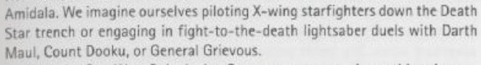
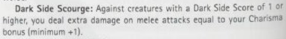

# Owner Material 037 — Star Wars D20 Drive folder (Core, Revised Core and Saga Edition): Sourcebooks/Saga Edition Core Rulebook.pdf [Star Wars Roleplaying Game Saga Edition (2007)] (scan pages 1–60)

- **Source:** Wizards of the Coast Star Wars Roleplaying Game books, web enhancements, Living Force campaign modules and articles (2000–2010), from the owner's "Star Wars D20" Drive folder (only the three edition subfolders; "General" was not read, as instructed). Secondary source (licensed Legends reference). Scan OCR'd on the box; the scan stays box-only and is **not** published.
- **Method:** every scanned page was OCR'd and machine-screened sentence by sentence for power-relevant statements (fights, kills, defeats, Force feats, rankings, superweapons) that name a character on our roster; each kept sentence is quoted verbatim from the OCR text and has a crop of the printed passage directly under it. Pages with nothing power-relevant are still listed with what is on them.
- **Citation:** "*Saga Edition Core Rulebook* (SWRPG Saga Edition), p.X" by printed page ("scan p.X" where no printed number applies). **Weight:** Licensed RPG material: a secondary source. Narrative text sums up Legends lore; game statistics are rules for players, not canon power levels, and rank lowest.

## scan p.1 (scan page 1)

Page contents: 5 words, 1 paragraphs | headings/entries: SAGA EDITION CORE RULEBOOK -

## scan p.2 (scan page 2)

Page contents: 19 words, 4 paragraphs | headings/entries: ROLE PLAY IWN G 35 AM E; SAGA EDITION; ReviseD Core RULEBOOK; CHRISTOPHER PERKINS, OWEN K.C. STEPHENS, RODNEY THOMPSON

## scan p.3 (scan page 3)

Page contents: 185 words, 12 paragraphs | headings/entries: CREDITS; A/a; Rodney Thompson F 7d; T i Sue Rastoni, Jonathan Ringler; VF

## scan p.4 (scan page 4)

Page contents: 239 words, 37 paragraphs | headings/entries: CONTENTS; This isa Pilesieving Game; This !s the Star Wars; Starting the Battle Vehicle Combat Actions; Creating a Droid Hero; SHO bwrrsseseseeeee rh | j.§ PRIUMYsesccarereresrnsessses; Building an Encounter...,.... 247 Awarding; NENMAS Ss sinaetee wassicsnacis; Wehbe teense; POR mew meme ree wee; OS SETA, BLS Py Sis; Se eS ee; ABV SRAAINNMY

## scan p.5 (scan page 5)

Page contents: 0 words, 0 paragraphs | headings/entries: 

## scan p.6 (scan page 6)

Page contents: 660 words, 9 paragraphs | headings/entries: Choi ake; Christopher Perkins January 7, 2007

## scan p.7 (scan page 7)

Page contents: 0 words, 0 paragraphs | headings/entries: 

## scan p.8 (scan page 8)

Page contents: 429 words, 14 paragraphs | headings/entries: Va; THis IS A ROLEPLAYING GAME; NOMONGORINi; THis Is THE STAR WARS ROLEPLAYING GAME

## scan p.9 (scan page 9)

Page contents: 879 words, 33 paragraphs | headings/entries: CHARACTERS; WHAT YOU NEED; DIcEeE; Some examples:; THE THREE ERAS OF PLAY

## scan p.10 (scan page 10)

Page contents: 888 words, 23 paragraphs | headings/entries: THE CORE MECHANIC; THE GAMEMASTER; HEROES; GAME PLAY; ROLLING DICE

- **Darth Maul; Count Dooku; General Grievous**: "We imagine ourselves piloting X-wing starfighters down the Death Star trench or engaging in fight-to-the-death lightsaber duels with Darth Maul, Count Dooku, or General Grievous." Source: *Saga Edition Core Rulebook* (SWRPG Saga Edition), scan p.10
  

## scan p.11 (scan page 11)

Page contents: 814 words, 32 paragraphs | headings/entries: WHAT CHARACTERS CAN DO; Listen at a door; Use a computer terminal; Explore a location; Converse with an alien; Bargain with a merchant; Intimidate a thug; Talk to an ally; Pilot a vehicle; Search for a clue; Bluff an official; Repair an item; Swing across a repulsorlift shaft; Move; Duck behind a bulkhead; Attack an opponent; WHAT'S NExtT?; SeTuP; GENERAL ADVICE; THE First GAME SESSION

## scan p.12 (scan page 12)

Page contents: 958 words, 33 paragraphs | headings/entries: Mike (Rorworr): 17 for Rorworr!; Everyone make an Initiative check!; Chris (Sia-Lan): Sio-Lan got an 18,; Mike (Rorworr): 10 for Rorworr!; Sia-Lan 18; Deel 15; Thugs 13 (her roll); Vor'en 12; Rorworr 10; Senator 7 (her roll)

## scan p.13 (scan page 13)

Page contents: 176 words, 12 paragraphs | headings/entries: Tl; SBIEV; Wee KSI SS

## scan p.14 (scan page 14)

Page contents: 748 words, 32 paragraphs | headings/entries: CHARACTER CREATION; Ss. CHOOSE YOUR CLaAss; CLASS STARTING HIT POINTS — Scout; Defenses Determine your character's defenses as follows:

## scan p.15 (scan page 15)

Page contents: 171 words, 10 paragraphs | headings/entries: STA SR; B; L7

## scan p.16 (scan page 16)

Page contents: 622 words, 28 paragraphs | headings/entries: Melee Attack Bonus; Ranged Attack Bonus; Speed; Destiny Point

## scan p.17 (scan page 17)

Page contents: 3 words, 2 paragraphs | headings/entries: CHAPTER !

## scan p.18 (scan page 18)

Page contents: 480 words, 11 paragraphs | headings/entries: ABILITY MODIFIERS; REROLLING

## scan p.19 (scan page 19)

Page contents: 567 words, 29 paragraphs | headings/entries: The standard score package is:; THE ABILITIES; You apply your character's Strength modifier to:; You apply your character's Dexterity modifier to:; CONSTITUTION (CON); You apply your Constitution modifier to:

## scan p.20 (scan page 20)

Page contents: 537 words, 20 paragraphs | headings/entries: You apply your character's Wisdom modifier to:; CHARISMA (CHA); You apply your Charisma modifier to:; CHANGING ABILITY SCORES

## scan p.21 (scan page 21)

Page contents: 3 words, 2 paragraphs | headings/entries: 

## scan p.22 (scan page 22)

Page contents: 332 words, 11 paragraphs | headings/entries: CHOOSING A SPECIES

## scan p.23 (scan page 23)

Page contents: 319 words, 18 paragraphs | headings/entries: SPECIES ABILITY ADJUSTMENTS; Bothan +2 Dex, -2 Con; Duros +2 Dex, +2 Int, -2 Con; Gamorrean +2 Str, -2 Dex, -2 Int; Ithorian +2 Wis, +2 Cha, -2 Dex; Rodian +2 Dex, -2 Wis, -2 Cha; Trandoshan +2 Str, -2 Dex; TO SPEAK DOES NOT MAKE YOU INTELLIGENT."

## scan p.24 (scan page 24)

Page contents: 702 words, 25 paragraphs | headings/entries: BOTHANS; ERA NOTES: SPECIES; SHS

## scan p.25 (scan page 25)

Page contents: 611 words, 31 paragraphs | headings/entries: BoTHan; CEREANS; Homeworld: The blissful planet Cerea [page 228); CEREAN SPecies TRAITS; Cereans share the following species traits:; Cesecar

## scan p.26 (scan page 26)

Page contents: 656 words, 28 paragraphs | headings/entries: Dvurce; EwoKks; Bwon

## scan p.27 (scan page 27)

Page contents: 614 words, 32 paragraphs | headings/entries: GAMORREANS; QGAMORREAN; GUNGANS; OUNGAN

## scan p.28 (scan page 28)

Page contents: 600 words, 25 paragraphs | headings/entries: ITHORIAN

## scan p.29 (scan page 29)

Page contents: 702 words, 31 paragraphs | headings/entries: Automatic Languages: Basic and Ithorese; Ket. DOR; Ke. COR; MON CALAMARI; MON CALAMARI

## scan p.30 (scan page 30)

Page contents: 684 words, 32 paragraphs | headings/entries: RODIANS

## scan p.31 (scan page 31)

Page contents: 614 words, 32 paragraphs | headings/entries: RODIAN; SULLUSTANS; Buclvusran

## scan p.32 (scan page 32)

Page contents: 630 words, 35 paragraphs | headings/entries: Automatic Languages: Basic and Sullustese; TRANDOSHANS; TRANDOSHAN SPecies TRAITS; Trandoshans share the following Species traits:; TRANODOSHAN; TWHrLEKS; Twi'ten

## scan p.33 (scan page 33)

Page contents: 628 words, 33 paragraphs | headings/entries: WOOKIEES; ZABRAK; Zaenaee

## scan p.34 (scan page 34)

Page contents: 324 words, 16 paragraphs | headings/entries: 

## scan p.35 (scan page 35)

Page contents: 5 words, 1 paragraphs | headings/entries: 

## scan p.36 (scan page 36)

Page contents: 455 words, 11 paragraphs | headings/entries: CHOOSING A MEROIC CLASS; THE MULTICLASS CHARACTER

## scan p.37 (scan page 37)

Page contents: 620 words, 22 paragraphs | headings/entries: CLASS AND LEVEL BONUSES; CLASS CLASS BONUSES TO DEFENSES; Noble +2 Will Defense; Scout +2 Reflex Defense, +1 Fortitude Defense; LEVEL-DEPENDENT BENEFITS

## scan p.38 (scan page 38)

Page contents: 468 words, 28 paragraphs | headings/entries: ABILITY; LEVEL XP FEATS INCREASES; CLASS DESCRIPTIONS; ABILITIES; CLASS STARTING HIT POINTS

## scan p.39 (scan page 39)

Page contents: 500 words, 29 paragraphs | headings/entries: Class Skills; CLASS FEATURES; JED!; ExPLoirTs; BASE ATTACK LEVEL BONUS CLASS FEATURES; Bonus feat

## scan p.40 (scan page 40)

Page contents: 526 words, 18 paragraphs | headings/entries: Lightsaber; Starting Feats; Talents; Bia-LAN Wertz, PEMALE HUMAN JED!

## scan p.41 (scan page 41)

Page contents: 808 words, 19 paragraphs | headings/entries: JED! SENTINEL TALENT TREE; Prerequisite; Dark Side Sense. j

- **Lord Scourge**: "Dark Side Scourge: Against creatures with a Dark Side Score of 1 of higher, you deal extra damage on melee attacks equal to your Charisma bonus (minimum +1)." Source: *Saga Edition Core Rulebook* (SWRPG Saga Edition), scan p.41
  

## scan p.42 (scan page 42)

Page contents: 799 words, 23 paragraphs | headings/entries: BER COMBAT TALENT TREE; Bonus Feats

## scan p.43 (scan page 43)

Page contents: 613 words, 17 paragraphs | headings/entries: ExPLoITs; Force Points; BACKGROUND; ARAN! KORDEN, PEMALE HUMAN NOBLE

## scan p.44 (scan page 44)

Page contents: 458 words, 27 paragraphs | headings/entries: IN TALENT TREE; BASE ATTACK LEVEL BONUS CLASS FEATURES

## scan p.45 (scan page 45)

Page contents: 933 words, 30 paragraphs | headings/entries: Prerequisites; Bolster Ally, Inspire Confidence,; Bonus Feats

## scan p.46 (scan page 46)

Page contents: 432 words, 28 paragraphs | headings/entries: OUNDREL; RACTERISTICS; AMPLES OF SCOUNDRELS IN R Wars; Hit Points; BASE ATTACK LEVEL BONUS CLASS FEATURES

## scan p.47 (scan page 47)

Page contents: 657 words, 25 paragraphs | headings/entries: CLASS FEATURES; Starting Feats; Talents; OBS. SvAOCOL, MALE Twi'teKx BSCOUNDFREL

## scan p.48 (scan page 48)

Page contents: 307 words, 9 paragraphs | headings/entries: 

## scan p.49 (scan page 49)

Page contents: 322 words, 16 paragraphs | headings/entries: Saga Edition Web Enhancement |; ROLE PtAY Ind Game; PRODUCTS » deere The Tech Specialist; New Talent Tree: The Outlaw Tech

## scan p.50 (scan page 50)

Page contents: 434 words, 16 paragraphs | headings/entries: Saga Edition Web Enhancement |; Hot Wire; Quick Fix; Personalized Modifications; Encrypted Transmission: The Outlaw Tech Talent Tree

## scan p.51 (scan page 51)

Page contents: 428 words, 12 paragraphs | headings/entries: Saga Edition Web Enhancement |; New Feat: Tech Specialist

## scan p.52 (scan page 52)

Page contents: 222 words, 34 paragraphs | headings/entries: Saga Edition Web Enhancement |; Tech Specialist Modifications; Armor Trait; Agile Armor Fortifying Armor; Protective Armor; Device Trait; Enhanced Strength; Improved Durability; Mastercraft Device; Droid Trait; Enhanced Dexterity; Enhanced Intelligence; Enhanced Strength; Vehicle Trait; Enhanced Dexterity Improved Speed; Improved Shields; Weapon Trait; Improved Accuracy; Improved Damage; Benefit

## scan p.53 (scan page 53)

Page contents: 285 words, 20 paragraphs | headings/entries: Saga Edition Web Enhancement |; Sample Character: The Outlaw Tech; OutlawCL Tech 7; Medium Mon Calamari scoundrel 7; Force Points 5; Init +5; Senses Low-light vision, Perception +15; Speed 6 squares; Melee +5; Atk Options Careful Shot, Running Attack; SQ breathe underwater, expert swimmer

## scan p.54 (scan page 54)

Page contents: 311 words, 19 paragraphs | headings/entries: Saga Edition Web Enhancement |; Sample Character: The Engineer; Medium Zabrak noble 6/scoundrel 1; Force Points 5; Init +9; Senses Perception + 10; Speed 6 squares; Melee +3; SQ heightened awareness; Talents Coordinate, Inspire Haste, Trace, Wealth

## scan p.55 (scan page 55)

Page contents: 86 words, 7 paragraphs | headings/entries: Saga Edition Web Enhancement |; CUCK TO PRIVACY STATEMENT

## scan p.56 (scan page 56)

Page contents: 541 words, 22 paragraphs | headings/entries: Scout; BASE ATTACK; LEVEL BONUS CLASS FEATURES; CHARACTERISTICS

## scan p.57 (scan page 57)

Page contents: 582 words, 34 paragraphs | headings/entries: Defense Bonuses; Prerequisites: Hidden Movement, Improved Stealth; Talents; KELKO, MAL. ROOIAN SCovT; Sesev ie) sv

## scan p.58 (scan page 58)

Page contents: 629 words, 23 paragraphs | headings/entries: See SSVI) SOV); BACKGROUND; VOR'EN KURN, MALE HUMAN SOLDIER

## scan p.59 (scan page 59)

Page contents: 279 words, 31 paragraphs | headings/entries: Proficiency (pistols) 'Proficiency (rifles) Proficiency (simple weapons); IST TALENT TREE; BASE ATTACK; LEVEL BONUS CLASS FEATURES; Bonus Feat; Tyee; O; S8SevIe sieve)

## scan p.60 (scan page 60)

Page contents: 801 words, 22 paragraphs | headings/entries: OR ANYBODY." —- LEIA ORGAN

