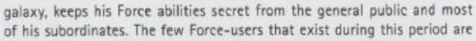
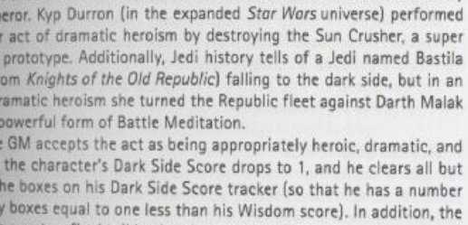
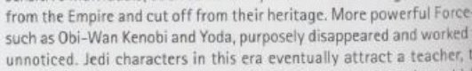
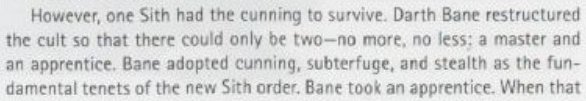
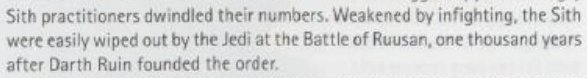
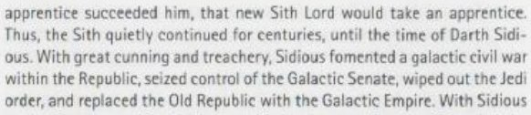
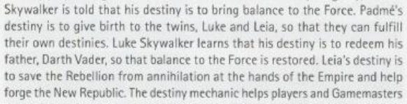

# Owner Material 037 — Star Wars D20 Drive folder (Core, Revised Core and Saga Edition): Sourcebooks/Saga Edition Core Rulebook.pdf [Star Wars Roleplaying Game Saga Edition (2007)] (scan pages 61–120)

- **Source:** Wizards of the Coast Star Wars Roleplaying Game books, web enhancements, Living Force campaign modules and articles (2000–2010), from the owner's "Star Wars D20" Drive folder (only the three edition subfolders; "General" was not read, as instructed). Secondary source (licensed Legends reference). Scan OCR'd on the box; the scan stays box-only and is **not** published.
- **Method:** every scanned page was OCR'd and machine-screened sentence by sentence for power-relevant statements (fights, kills, defeats, Force feats, rankings, superweapons) that name a character on our roster; each kept sentence is quoted verbatim from the OCR text and has a crop of the printed passage directly under it. Pages with nothing power-relevant are still listed with what is on them.
- **Citation:** "*Saga Edition Core Rulebook* (SWRPG Saga Edition), p.X" by printed page ("scan p.X" where no printed number applies). **Weight:** Licensed RPG material: a secondary source. Narrative text sums up Legends lore; game statistics are rules for players, not canon power levels, and rank lowest.

## scan p.61 (scan page 61)

Page contents: 419 words, 21 paragraphs | headings/entries: Bonus Feats

## scan p.62 (scan page 62)

Page contents: 800 words, 22 paragraphs | headings/entries: MULTICLASS; Level; Hit Points; Base Attack Bonus

## scan p.63 (scan page 63)

Page contents: 564 words, 15 paragraphs | headings/entries: HOW MULTICLASSING WORKS; Sesser aoeve~)

## scan p.64 (scan page 64)

Page contents: 5 words, 1 paragraphs | headings/entries: 

## scan p.65 (scan page 65)

Page contents: 422 words, 11 paragraphs | headings/entries: SKILLS SUMMARY; SKILLS " check, roll:

## scan p.66 (scan page 66)

Page contents: 902 words, 22 paragraphs | headings/entries: How DO SKILLS WORK?; MAKING SKILL CHECKS; ADVANCING SKILLS; TYPES OF SKILL CHECKS; UNTRAINED CHECKS; TRYING AGAIN

## scan p.67 (scan page 67)

Page contents: 603 words, 21 paragraphs | headings/entries: Po eae AL bile; Mechanics, Perception, Pilot, Ride, Stealth, Survival, Swim; FAVORABLE AND UNFAVORABLE CIRCUMSTANCES

## scan p.68 (scan page 68)

Page contents: 927 words, 15 paragraphs | headings/entries: TIME AND SKILL CHECKS; CHECKS WITHOUT ROLLS

## scan p.69 (scan page 69)

Page contents: 736 words, 20 paragraphs | headings/entries: ABINING SKILL —EMPTS; ITY CHECKS; EXAMPLE ABILITY CHECK; Navigating a maze intelligence; Getting yourself noticed ina crowd Charisma ;

## scan p.70 (scan page 70)

Page contents: 266 words, 9 paragraphs | headings/entries: NARROW SURFACE ACROBATICS DC

## scan p.71 (scan page 71)

Page contents: 446 words, 13 paragraphs | headings/entries: Binder cuts 25

## scan p.72 (scan page 72)

Page contents: 900 words, 23 paragraphs | headings/entries: 

## scan p.73 (scan page 73)

Page contents: 382 words, 14 paragraphs | headings/entries: 

## scan p.74 (scan page 74)

Page contents: 1034 words, 17 paragraphs | headings/entries: 

## scan p.75 (scan page 75)

Page contents: 239 words, 8 paragraphs | headings/entries: Al SBiawHd; U Wee

## scan p.76 (scan page 76)

Page contents: 826 words, 32 paragraphs | headings/entries: Armor Check Penalty

## scan p.77 (scan page 77)

Page contents: 506 words, 21 paragraphs | headings/entries: Tricky; YoU SEEM TO DO AN; Al SBaiavHnga

## scan p.78 (scan page 78)

Page contents: 1034 words, 21 paragraphs | headings/entries: 

## scan p.79 (scan page 79)

Page contents: 650 words, 19 paragraphs | headings/entries: RSUASION (CHA); SITUATION; MODIFIER

## scan p.80 (scan page 80)

Page contents: 916 words, 18 paragraphs | headings/entries: Rioe (Dex); Armor Check Penalty; Control mount in battie I

## scan p.81 (scan page 81)

Page contents: 532 words, 25 paragraphs | headings/entries: SURVivaL (wis); Basic Survival: Onc 8V0id natura Naz; Al #8ieawHS; Srna

## scan p.82 (scan page 82)

Page contents: 695 words, 33 paragraphs | headings/entries: SURFACE oc; Firm ground 20; CIRCUMSTANCE DC MODIFIER; Huge or bigger; Medium; Tiny or smatier; Swim (STR); Armor Check Penalty; SITUATION

## scan p.83 (scan page 83)

Page contents: 608 words, 13 paragraphs | headings/entries: Al BSL avo

## scan p.84 (scan page 84)

Page contents: 635 words, 14 paragraphs | headings/entries: Unfriendly; Friendly; INFORMATION —_—C TIME REQUIRED; Specific 20 10 minutes; Secret* 30 1 day (8 hours)

## scan p.85 (scan page 85)

Page contents: 776 words, 25 paragraphs | headings/entries: TO DESTROY; THE FORCE."

## scan p.86 (scan page 86)

Page contents: 16 words, 5 paragraphs | headings/entries: Vv TS _s ——; CHAPTE Fe

## scan p.87 (scan page 87)

Page contents: 373 words, 12 paragraphs | headings/entries: IRING FEATS; PREREQUISITES

## scan p.88 (scan page 88)

Page contents: 286 words, 30 paragraphs | headings/entries: FEAT; Armor Proficiency (heavy) 'Armor Proficiency (medium) Fire; Charging Fire; Reflexes; Double Attack; Dual Weapon Mastery |; Weapon Mastery Ill Extra Rage; FarShot Force Sensitivi ivity; Great Cleave; Impro é Defenses; PREREQUISITES BENEFIT

## scan p.89 (scan page 89)

Page contents: 261 words, 22 paragraphs | headings/entries: Base attack bonus +1; Dex 13

## scan p.90 (scan page 90)

Page contents: 750 words, 26 paragraphs | headings/entries: CAREFUL SHOT

## scan p.91 (scan page 91)

Page contents: 415 words, 18 paragraphs | headings/entries: 

## scan p.92 (scan page 92)

Page contents: 821 words, 28 paragraphs | headings/entries: Prerequisites: Dexterity 13, base attack bonus +1,

## scan p.93 (scan page 93)

Page contents: 632 words, 38 paragraphs | headings/entries: HOT; Se BOON; Se SENsitiviry; Cannot be a droid,

## scan p.94 (scan page 94)

Page contents: 760 words, 30 paragraphs | headings/entries: Prerequisite: Intelligence 13,; MIGHTY SWING

## scan p.95 (scan page 95)

Page contents: 402 words, 30 paragraphs | headings/entries: Prerequisite: Base attack bonus +1

## scan p.96 (scan page 96)

Page contents: 655 words, 31 paragraphs | headings/entries: SNIPER; THROW

## scan p.97 (scan page 97)

Page contents: 648 words, 37 paragraphs | headings/entries: CRIT

## scan p.98 (scan page 98)

Page contents: 6 words, 2 paragraphs | headings/entries: CHAPTER Y|

## scan p.99 (scan page 99)

Page contents: Rebellion-era Force: "Even the Emperor, one of the most powerful Force-users in the" galaxy (continues p.100) keeps his Force abilities secret. (hand-read)

## scan p.100 (scan page 100)

Page contents: 511 words, 10 paragraphs | headings/entries: IA VSEstavVHSD; USING THE FORCE; FORCE POINTS

- **Palpatine (Darth Sidious)** — entry/section: The Force in the Rebellion era (Saga Edition Core Rulebook, Ch6): "galaxy, keeps his Force abilities secret from the general public and most of his subordinates." Source: *Saga Edition Core Rulebook* (SWRPG Saga Edition), scan p.100
  

## scan p.101 (scan page 101)

Page contents: 565 words, 23 paragraphs | headings/entries: R LEVEL NUMBER OF DICE ROLLED; DARK SIDE; DARK SIDE SCORE; DARK SIDE TRANSGRESSIONS; SaHed Sri,

## scan p.102 (scan page 102)

Page contents: 807 words, 19 paragraphs | headings/entries: DARK SIDE SCORE

## scan p.103 (scan page 103)

Page contents: Dramatic heroism examples: Vader's sacrifice at Endor; Kyp Durron destroying the Sun Crusher; Bastila Shan turning the Republic fleet against Darth Malak with Battle Meditation. (hand-read)

- **Kyp Durron; Sun Crusher (superweapon); Bastila Shan; Darth Malak**: "Kyp Durron (in the expanded Star Wors universe) performed act of dramatic heroism by destroying the Sun Crusher, a super ote Additionally, Jedi history tells of a Jedi named Bastila n Knights of the Old Republic) falling to the dark side, but in an amatic heroism she turned the Republic fleet against Darth Malak ful form of Battie Meditation. accepts the act as being appropriately heroic, dramatic, and Cheracter's Dark Side Score drops to 1, and he clears all but on his Dark Side Score tracker (so that he has a number equal to one less than his Wisdom score)." Source: *Saga Edition Core Rulebook* (SWRPG Saga Edition), scan p.103
  

## scan p.104 (scan page 104)

Page contents: 733 words, 16 paragraphs | headings/entries: Force Power Descriptors; FORCE POWER DESCRIPTIONS

## scan p.105 (scan page 105)

Page contents: 557 words, 26 paragraphs | headings/entries: O-) =; P=

## scan p.106 (scan page 106)

Page contents: 843 words, 30 paragraphs | headings/entries: FORCE STUN; HAVE A STRONG; INFLUENCE ON A WEAK MIND."

## scan p.107 (scan page 107)

Page contents: 156 words, 44 paragraphs | headings/entries: Special: You must; K and take da; S negated and you; Point to rega

## scan p.108 (scan page 108)

Page contents: 893 words, 20 paragraphs | headings/entries: REBUKE; FORCE TALENTS

## scan p.109 (scan page 109)

Page contents: 806 words, 21 paragraphs | headings/entries: NT TREE; FORCE TECHNIQUES

## scan p.110 (scan page 110)

Page contents: 133 words, 7 paragraphs | headings/entries: 

## scan p.111 (scan page 111)

Page contents: 561 words, 26 paragraphs | headings/entries: Ce SECRETS; Devastating Power; Distant Power; Multitarget Power; Quicken Power; Shaped Power; FORCE-USING TRADITIONS

## scan p.112 (scan page 112)

Page contents: 759 words, 13 paragraphs | headings/entries: IS WHAT GIVES THE

- **Obi-Wan Kenobi; Yoda**: "More powerful Fo such as Obi-Wan Kenobi and Yoda, purposely disappeared and wo unnoticed." Source: *Saga Edition Core Rulebook* (SWRPG Saga Edition), scan p.112
  

## scan p.113 (scan page 113)

Page contents: 528 words, 14 paragraphs | headings/entries: Jd

- **Darth Bane** — entry/section: The Sith (Saga Edition Core Rulebook, Ch7): "However, one Sith had the cunning to survive. Darth Bane restructured the cult so that there could only be two—no more, no less: a master and an apprentice, Bane adopted cunning, subterfuge, and stealth as the fundamental tenets of the new Sith order." Source: *Saga Edition Core Rulebook* (SWRPG Saga Edition), scan p.113
  
- **Darth Ruin**: "Weakened by infighting, the Sith were easily wiped out by the Jedi at the Battle of Ruusan, one thousand years after Darth Ruin founded the order." Source: *Saga Edition Core Rulebook* (SWRPG Saga Edition), scan p.113
  

## scan p.114 (scan page 114)

Page contents: 666 words, 29 paragraphs | headings/entries: OTHER — FORCE-; USING TRADITIONS; Pd; Jedi accomplished their mission, killing Ti; Jensaarai followers retained much &; The Jensaarai resemble both the Jed! andt; Sith in many ways; they construct and

- **Palpatine (Darth Sidious); Darth Vader (Anakin Skywalker); Darth Bane** — entry/section: The Sith (Saga Edition Core Rulebook, Ch7): "apprentice succeeded him, that new Sith Lord would take an apprentice Thus, the Sith quietly continued for centuries, until the time of Darth Sidious. With great cunning and treachery, Sidious fomented a galactic civil war within the Republic, seized control of the Galactic Senate, wiped out the Jedi order, and replaced the Old Republic with the Galactic Empire." Source: *Saga Edition Core Rulebook* (SWRPG Saga Edition), scan p.114
  

## scan p.115 (scan page 115)

Page contents: 847 words, 19 paragraphs | headings/entries: DER TALENT TREE; DATHOMIRI WITCH TALENT TREE

## scan p.116 (scan page 116)

Page contents: 7 words, 3 paragraphs | headings/entries: CHAPTER VI) OIC TRAITS

## scan p.117 (scan page 117)

Page contents: 443 words, 20 paragraphs | headings/entries: DETAILS; NAME; Stor Wars feel,; Ge

## scan p.118 (scan page 118)

Page contents: 620 words, 10 paragraphs | headings/entries: Adult No modifier

## scan p.119 (scan page 119)

Page contents: 490 words, 28 paragraphs | headings/entries: ANCE; AND WEIGHT; IONALITY; AVERAGE HEIGHT; AVERAGE; SPECIES WEIGHT; Human, female 1.6m 55 kg; Cerean, maie 2.0m 78 kq; Duros 1.8m 70 kg; Gamorrean 1.8m 140 kg; Ithorian 2.0m 90 kq; Mon Calamari 1.8m 72 kg; Trandoshan 2.0m 80 kg; Twi'lek, female 1.6m 55 kg; Wookiee, female 2.0 m 100 kg

## scan p.120 (scan page 120)

Page contents: 900 words, 18 paragraphs | headings/entries: GOALs; DESTINY

- **Luke Skywalker; Leia Organa Solo; Darth Vader (Anakin Skywalker)**: "Padmeé's destiny is to give birth to the twins, Luke and Leia, so that they can fulfill their own destinies, Luke Skywalker learns that his destiny is to redeem his father, Darth Vader, so that balance to the Force is restored, Leia's destiny is to save the Rebellion from annihilation at the hands of the Empire and help forge the New Republic." Source: *Saga Edition Core Rulebook* (SWRPG Saga Edition), scan p.120
  
