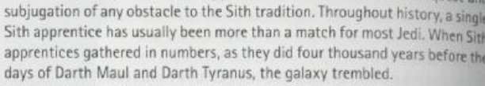

# Owner Material 037 — Star Wars D20 Drive folder (Core, Revised Core and Saga Edition): Sourcebooks/Saga Edition Core Rulebook.pdf [Star Wars Roleplaying Game Saga Edition (2007)] (scan pages 181–240)

- **Source:** Wizards of the Coast Star Wars Roleplaying Game books, web enhancements, Living Force campaign modules and articles (2000–2010), from the owner's "Star Wars D20" Drive folder (only the three edition subfolders; "General" was not read, as instructed). Secondary source (licensed Legends reference). Scan OCR'd on the box; the scan stays box-only and is **not** published.
- **Method:** every scanned page was OCR'd and machine-screened sentence by sentence for power-relevant statements (fights, kills, defeats, Force feats, rankings, superweapons) that name a character on our roster; each kept sentence is quoted verbatim from the OCR text and has a crop of the printed passage directly under it. Pages with nothing power-relevant are still listed with what is on them.
- **Citation:** "*Saga Edition Core Rulebook* (SWRPG Saga Edition), p.X" by printed page ("scan p.X" where no printed number applies). **Weight:** Licensed RPG material: a secondary source. Narrative text sums up Legends lore; game statistics are rules for players, not canon power levels, and rank lowest.

## scan p.181 (scan page 181)

Page contents: 522 words, 24 paragraphs | headings/entries: PECIAL VEHICLE OMBAT RULES; SIONS; SIZE OF COLLIDING; VEHICLE OR HAZARD DAMAGE'; Colossal (cruiser) 15d6 + Str modifier; Colossal 8d6 + Str modifier; Huge 4d6 + Str modifier

## scan p.182 (scan page 182)

Page contents: 605 words, 12 paragraphs | headings/entries: MISSILES AND TORPEDOES; VEHICLE DESCRIPTIONS

## scan p.183 (scan page 183)

Page contents: 476 words, 28 paragraphs | headings/entries: Crew 5 (expert); Passengers 40; Availability Military; Cost not available for sale; Atk +7 (+2 autofire), Dmg 3410x2_

## scan p.184 (scan page 184)

Page contents: 610 words, 33 paragraphs | headings/entries: SrPeeDERS; SoroSuub X-34 Landspeeder; Init +8; Senses Perception +5; Speed 12 squares (max. velocity 330 km/h); Fighting Space 2x2; Cover +5; Base Atk +0; Grp +15; SPEEDER BIKES; Aratech 74-Z Speeder Bike; Aratech 74-Z Speeder Bike ;; Large ground vehicle (speeder); Init +14; Senses Perception +8; Fighting Space 2x2; Cover none; Base Atk +5; Grp +14; Atk Options autofire (laser cannon); Atk +7 (+2 autofire), Dmg 4410

## scan p.185 (scan page 185)

Page contents: 504 words, 16 paragraphs | headings/entries: CL6; Double laser cannon; Atk +4, Dmg — (grapple +27)

## scan p.186 (scan page 186)

Page contents: 574 words, 49 paragraphs | headings/entries: STARFIGHTERS; X-wing Fighter; Incom T-65B X-wing Starfighter CL 10; Gargantuan starfighter; Init +7; Senses Perception +6; Ranged laser cannons +5 (see below) or; Ranged proton torpedoes +5 (see below); Base Atk +2; Grp +33; Atk Options autofire (laser cannons); Koensayr Y-wing Starfighter; Gargantuan starfighter; Init +5; Senses Perception +6; Base Atk +2; Grp +33; Atk Options autofire (laser cannons, ion cannons); Payload 8 proton torpedoes; Hyperdrive x1, 10-jump memory (astromech droid); Availability Military; Cost 135,000 (60,000 used)

## scan p.187 (scan page 187)

Page contents: 189 words, 17 paragraphs | headings/entries: Atk +5. Dmg Gd10x2, 4-square Splash; TIE Fighter; Ranged laser cannons +4 (see below}; Atk Options autofire (laser cannons); CL7; Se

## scan p.188 (scan page 188)

Page contents: 537 words, 48 paragraphs | headings/entries: TIE Interceptor; TIE Interceptor CL 8; Huge starfighter; Init +11; Senses Perception +6; Ranged laser cannons +5 (see below); Base Atk +2; Grp +26; Atk Options autofire (laser cannons); Crew 1 (skilled); Passengers none; Availability Military; Cost 120,000 (50,000 used); Eta-2 Actis Interceptor; Eta-2 Actis Interceptor; Huge starfighter; Init +18; Senses Perception +12; Ranged laser cannons +12 (see below) or; Ranged ion cannons +12 (see below); Base Atk +10; Grp +32; Atk Options autofire (laser cannons, ion cannons); Availability Military; Cost 140,000 used 7; Laser cannons (pilot); Atk +12 (+7 autofire), Dmg 4010x2 ion

## scan p.189 (scan page 189)

Page contents: 472 words, 35 paragraphs | headings/entries: Droid Starfighter CL7 ter/ground vehicle (walker); Dex 16, Con —, Int 14; Crew 0 (expert); Passengers none; Availability Restricted; Cost 19,000; Laser cannons; Atk +7, Dmg 84102, 4-square splash; Droid Tri-Fighter; Laser cannon; Atk +7 (+2 autofire), Dmg 4d10x2; Light laser cannons; Atk +7, Dmg 80102, 4-square splash

## scan p.190 (scan page 190)

Page contents: 242 words, 18 paragraphs | headings/entries: NEL; S Se) >); SPACE TRANSPORTS; CONVErsign; Corellian YT-1300 Transport; Colossal space transport; CL 6

## scan p.191 (scan page 191)

Page contents: 537 words, 38 paragraphs | headings/entries: Licensed; Cost 100,000 (25,000 used); Imperial I-class Star Destroyer; Imperial I-class Star Destroyer CL 20; Colossal (cruiser) capital ship; Init -2; Senses Perception +6; Speed fly 3 squares (starship scale); Fighting Space 2x2 (starship scale); Cover total; Base Atk +2; Grp +68; Crew 37,085 (skilled); Passengers 9,700 (troops); Hyperdrive x2 (backup x8], nay computer; Availability Military; Cost not available for sale; Tractor beam (2

## scan p.192 (scan page 192)

Page contents: 0 words, 0 paragraphs | headings/entries: 

## scan p.193 (scan page 193)

Page contents: 470 words, 11 paragraphs | headings/entries: CREATING A DROID HERO

## scan p.194 (scan page 194)

Page contents: 707 words, 24 paragraphs | headings/entries: Scie); OPTION 1:; PLAYING A CUSTOM DROID; Determining Ability Scores; Degree

## scan p.195 (scan page 195)

Page contents: 620 words, 17 paragraphs | headings/entries: Traits; STION 2: PLAYING A

## scan p.196 (scan page 196)

Page contents: 769 words, 17 paragraphs | headings/entries: Flying 9 squares 12 squares

## scan p.197 (scan page 197)

Page contents: 524 words, 14 paragraphs | headings/entries: Jump Servos; Magnetic Feet

## scan p.198 (scan page 198)

Page contents: 760 words, 16 paragraphs | headings/entries: Stabilized Mount

## scan p.199 (scan page 199)

Page contents: 895 words, 12 paragraphs | headings/entries: Be; Oral Inhibitors

## scan p.200 (scan page 200)

Page contents: 794 words, 20 paragraphs | headings/entries: Reprogramming; MADE TO SUFFEE

## scan p.201 (scan page 201)

Page contents: 577 words, 30 paragraphs | headings/entries: Armor; Availability: Some armor has limited availability; Munications; Diagnostics Package; Hardened Systems; Lewrwo; Sqr; Ty Pepin

## scan p.202 (scan page 202)

Page contents: 187 words, 20 paragraphs | headings/entries: EQUIPMENT COST; Hardened system x4; Locked access 50; DROID SIZE MAXIMUM WEIGHT LIMIT _; Colossal 5,000 kg; WEIGHT

## scan p.203 (scan page 203)

Page contents: 253 words, 24 paragraphs | headings/entries: Locked Access; WEIGHT AVAILABILITY 5 kg -

## scan p.204 (scan page 204)

Page contents: 484 words, 13 paragraphs | headings/entries: ARMOR BONUS MAX. DEX; Secondary Battery; DROID CosTs; DROID SIZE DAMAGE Small 4d6 Medium 6d6; Hose 10d6 Geargantuan or larger 2006. Sensors

## scan p.205 (scan page 205)

Page contents: 690 words, 53 paragraphs | headings/entries: Unit; IDIFYING DRoOIDS; SAMPLE DROIDS; Medium droid (1st-degree) nonheroic 2; Init +1; Senses low-light vision; Perception +5; Languages Basic, Binary, 2 unassigned; Immune droid traits; Speed 6 squares (walking); Melee unarmed +0 (1d3-1); Fighting Space 1 square; Reach 1 square; Base Atk +1; Grp +0; Availability Licensed; Cost 4,300 credits; CLO

## scan p.206 (scan page 206)

Page contents: 599 words, 28 paragraphs | headings/entries: R2 Series Astromech Droid; Melee electroshock probe +0 (148 ion); Fighting Space | square; Reach 1 square; Base Atk +1; Grp -4; Medium droid (3rd-degree) nonheroic 1; Init -1; Senses Perception +1; Speed 6 squares (walking); Melee unarmed -1 (103-1)

## scan p.207 (scan page 207)

Page contents: 440 words, 29 paragraphs | headings/entries: Atk +0; Grp -1; CL1; Skills Perception +6; Possessions blaster carbine; Availability Military; Cost 1,800 credits; B2 Series Super Battle Droid; Squess); AAARRaanraann

## scan p.208 (scan page 208)

Page contents: 579 words, 46 paragraphs | headings/entries: Speed 6 squares (walking); Melee unarmed +6 (1d3+1); Ranged wrist blasters +4 (3d8) or; Fighting Space 1 square; Reach 1 square; Base Atk +4; Grp +6; Skills Perception +8; Possessions wrist blasters (as blaster rifle); Availability Military; Cost 3,300 credits; Droideka Series Destroyer Droid; Droideka Series Destroyer Droid °; Large droid (4th-degree) nonheroic 12; Init +8; Senses Perception +13; Languages Basic, Binary; Immune droid traits; Speed 2 squares (walking), 10 squares (wheeled); Melee unarmed +12 (1d4+3); Ranged 2 laser cannons +11 (3d8) or; Fighting Space 2x2; Reach 1 square; Base Atk +9; Grp +17; Skills Perception +13, Stealth -3; Availability Military; Cost 21,000 credits; Dwarf Spider Droid; Large droid (4th-degree) nonheroic 9

## scan p.209 (scan page 209)

Page contents: 568 words, 28 paragraphs | headings/entries: Immune droid traits; Speed 6 squares (walking), climb 3 squares; Melee claw +16" (1d6+15) or; Melee claw +20° (1d6+21) with Powerful Charge; Ranged twin blaster +8 (3d10); Fighting Space 2x2; Reach 1 square; Base Atk +9; Grp +21; Atk Options Power Attack; Special Qualities stability; Availability Military; Cost 20,000 credits

## scan p.210 (scan page 210)

Page contents: 307 words, 8 paragraphs | headings/entries: Viper Series Probe Droid; Large droid (4th-degree) scout 1

## scan p.211 (scan page 211)

Page contents: 361 words, 36 paragraphs | headings/entries: Melee urerms; Fighting Space 2x2; Reach | square; Base Atk +0; Grp +9; Talents Acute Senses; Availability Restricted; Cost 18,500 credits; ASP Labor Droid; Speed 6 squares (walking); Melee claw +4 (1d4+3); Skills Endurance +11, Mechanics +4; Availability Licensed; Cost 1,000 credits; U; OAS); Sc

## scan p.212 (scan page 212)

Page contents: 8 words, 2 paragraphs | headings/entries: CHAPTER <i) SS TIOE cL ASSES

## scan p.213 (scan page 213)

Page contents: 291 words, 9 paragraphs | headings/entries: PRESTIGE CLASSES

## scan p.214 (scan page 214)

Page contents: 437 words, 22 paragraphs | headings/entries: Base Ve); PRESTIGE CLASS BASIC DESCRIPTION; Expert at locating and capturing fugitives; Bounty hunter; Elite trooper Highly trained soldier or bodyguard; ACE PILOT; ExXAMPLES OF ACE PILOT iN STAR WARS

## scan p.215 (scan page 215)

Page contents: 663 words, 37 paragraphs | headings/entries: Talents; EXPERT PILOT TALENT TREE; Vehicle Dodge; BOUNTY HUNTER; MALE BULLUGTAN ACE PLOT; SSyvIe BOo.Lessic) 9; Se)

## scan p.216 (scan page 216)

Page contents: 535 words, 32 paragraphs | headings/entries: Ux eaidvHoa; Sesser Ve; S; BOUNTY HUNTER TALENT TREE; Hunter's Target: Once per encounter ge a; Hit Points; MALE QuAAREN BOUNTY HUNTER

## scan p.217 (scan page 217)

Page contents: 374 words, 25 paragraphs | headings/entries: BASE ATTACK; BONUS CLASS FEATURES; Familiar foe +1; Familiar foe +2; Familiar foe +3; Familiar foe +4; Familiar foe +5; EXAMPLES OF CRIME LORDS IN STAR WARS; Minimum Heroic Level: 7th,; Trained Skills: Deception, Persuasion,; BASE ATTACK; BONUS CLASS FEATURES; Command cover, talent; Talent; Talent

## scan p.218 (scan page 218)

Page contents: 673 words, 29 paragraphs | headings/entries: Hit Points; Force Points; Talents; INFAMY TALENT TREE; Prerequisite: Notorious,; Mace RoOoOIMAN Ceime LOO

## scan p.219 (scan page 219)

Page contents: 465 words, 24 paragraphs | headings/entries: IiTe TROOPER; BASE ATTACK; LEVEL BONUS CLASS FEATURES; Damage reduction 2; Damage reduction 3; Damage reduction 5; Talents

## scan p.220 (scan page 220)

Page contents: 782 words, 16 paragraphs | headings/entries: Ux SSidwHo; SHssYI@ 2]aLS54)1<); PEMAL® HUMAN Euirte TeOOrer

## scan p.221 (scan page 221)

Page contents: 515 words, 32 paragraphs | headings/entries: EQUIREMENTS; BASE ATTACK; LEVEL BONUS CLASS FEATURES; Force technique

## scan p.222 (scan page 222)

Page contents: 661 words, 17 paragraphs | headings/entries: FORCE ADEPT TALENT TREE; FORCE DISCIPLE; PeEMaLle HUMAN FORCE ADErT

## scan p.223 (scan page 223)

Page contents: 433 words, 30 paragraphs | headings/entries: Force Points; BASE ATTACK LEVEL BONUS CLASS FEATURES; MALE ITHORIAN PORCE OieciPLe; See); SSSsseVvVe) Sei

## scan p.224 (scan page 224)

Page contents: 568 words, 21 paragraphs | headings/entries: SsSSsayrNS); EXAMPLES OF GUNSLINGERS IN STAR WARS; MALE WOCKIEE OUNSLINOER; GUNSLINGER TALENT TREE

## scan p.225 (scan page 225)

Page contents: Prestige-class example lists (Saga Core): Jedi Knight — Anakin Skywalker (Ep III), Barriss Offee, Bastila Shan, Kyle Katarn, Luke Skywalker (Ep VI), Nomi Sunrider, Ulic Qel-Droma; Jedi Master (p.227) — Adi Gallia, Eeth Koth, Luke Skywalker (NJO era), Kit Fisto, Luminara Unduli, Mace Windu, Obi-Wan (Ep III), Plo Koon, Shaak Ti, Yoda; Sith Lord (p.233) — Darth Bane, Sidious, Maul, Tyranus, Vader, Malak, Nihilus, Krayt, Exar Kun; Force adept list (p.221) ends "…Ventress, Inquisitor Tremayne, Maarek Stele, Sly Moore, Teneniel Djo." (hand-read)

## scan p.226 (scan page 226)

Page contents: 751 words, 17 paragraphs | headings/entries: Penmace Twi'tex Jf0! KniontT

## scan p.227 (scan page 227)

Page contents: 644 words, 30 paragraphs | headings/entries: BASE ATTACK; Force technique Force technique; Force Technique; JEDI MASTER; EXAMPLES OF JED! MASTERS IN STAR WARS; Trained Skills: Use the Force,

## scan p.228 (scan page 228)

Page contents: 540 words, 23 paragraphs | headings/entries: SeaLrSsex; J; Force Points; CLASS FEATURES; Fearless You are immune to fear effects; Serenity; TABLE 12-10:; OFrriceR; MALS Ket DOOR JEO! MASTER

## scan p.229 (scan page 229)

Page contents: 623 words, 31 paragraphs | headings/entries: EQUIREMENTS; AME RULE INFORMATION; LASS FEATURES; ARY TACTICS TALENT TREE; BASE ATTACK; LEVEL BONUS CLASS FEATURES; Share talent

## scan p.230 (scan page 230)

Page contents: 746 words, 26 paragraphs | headings/entries: Prerequisites: Shift Defense 1, Shift Defense Il; Command Cover; Starting at 2nd level, you can use; Share Talent; Mace OuRos Orricer; SiITH APPRENTICE

- **Darth Maul; Count Dooku; Darth Bane** — entry/section: Sith apprentice prestige class (Saga Edition Core Rulebook, Ch13): "Throughout history, @ si nal Sith apprentice has usually been more than a match for most Jedi. When apprentices gathered in numbers, as they did four thousand years before t é days of Darth Maul and Darth Tyranus, the galaxy trembled." Source: *Saga Edition Core Rulebook* (SWRPG Saga Edition), scan p.230
  

## scan p.231 (scan page 231)

Page contents: 566 words, 31 paragraphs | headings/entries: Force Points; LAST WE WILL HAVE REVENGE."; MALE HUMAN BSITH APPRENTICE

## scan p.232 (scan page 232)

Page contents: 599 words, 21 paragraphs | headings/entries: BASE ATTACK; LEVEL BONUS CLASS FEATURES; Bth +8 Force technique; Force Technique; BASE ATTACK LEVEL BONUS CLASS FEATURES; Force secret

## scan p.233 (scan page 233)

Page contents: 574 words, 36 paragraphs | headings/entries: EXAMPLES OF SitH LORDS iN STAR WARS; Minimum Heroic Level: 12th; Trained Skills: Use the Force; Hit Points; Force Points; Temptation; Force Secret; FEMALE HUMAN SITH LORD; ISS); Sa &2; Sess

## scan p.234 (scan page 234)

Page contents: 0 words, 0 paragraphs | headings/entries: 

## scan p.235 (scan page 235)

Page contents: 381 words, 4 paragraphs | headings/entries: 

## scan p.236 (scan page 236)

Page contents: 500 words, 49 paragraphs | headings/entries: PLANETS OF THE GALAXY; BESPIN; Region: Outer Rim; Climate: Temperate (in the Life Zone); Gravity: Standard; Moons: 2; Length of Day: 12 standard hours; Length of Year: 5,110 standard days; Government; Guild; Capital: Cloud City; Major Exports: Foodstuffs, technology; Major Imports: Tibanna gas, tourism, cloud cars; Knowledge (Galactic Lore); DC RESULT; Knowledge (Social Sciences); DC RESULT; BoTHAWUI; Region: Mid Rim; Climate: Temperate; Gravity: Standard; Moons: 3; Capital: Drev'starn; Major Exports: Information, technology Major Imports: Technology; Knowledge (Galactic Lore); DC RESULT; Knowledge (Social Sciences); DC RESULT; CEeEREA; Region: Mid Rim; Climate: Temperate; Gravity; Standard; Moons: 1

## scan p.237 (scan page 237)

Page contents: 513 words, 32 paragraphs | headings/entries: USCANT; Knowledge (Galactic Lore); DC RESULT; Knowledge (Social Sciences); DC RESULT; DORIN; Region: Expansion Region; Climate: Temperate (low oxygen) Gravity: Standard; Moons: 1; Major Exports: None; Major Imports: Technology; Knowledge (Galactic Lore); DC RESULT

## scan p.238 (scan page 238)

Page contents: 554 words, 47 paragraphs | headings/entries: Knowledge (Life Sciences); DC RESULT; DuURO; Region: Core; Climate: Temperate (polluted); Gravity: Standard; Moons: 0; Length of Day: 33 standard hours; Length of Year: 420 local days; Government: Corporate; Capital: None; Major Exports: Starships, technology; Major Imports: Foodstuffs, ore, labor; Knowledge (Galactic Lore); DC RESULT; Knowledge (Social Sciences); DC RESULT; ENOOR, FOREST MOON OF; Region: Outer Rim; Climate: Temperate; Gravity: Standard; Moons: —; Length of Day: 18 standard hours; Length of Year: 402 local days; Government: None; Capital: None; Major Exports: None; Major Imports: None; GAMORR; Region: Outer Rim; Climate: Temperate; Gravity: Standard; Moons: 1; Length of Day: 28 standard hours

## scan p.239 (scan page 239)

Page contents: 507 words, 39 paragraphs | headings/entries: Knowledge (Galactic Lore); DC RESULT; Knowledge (Social Sciences); DC RESULT; ITHOR; Region: Mid Rim; Climate: Tropical; Gravity: Standard; Moons: 1; Length of Day: 41 standard hours; Length of Year: 422 standard days; Capital: None; N; J

## scan p.240 (scan page 240)

Page contents: 541 words, 54 paragraphs | headings/entries: Knowledge (Social Sciences); DC RESULT; KASHYY YK; Region: Mid Rim; Climate: Temperate; Gravity: Standard; Moons: 1; Knowledge (Galactic Lore); DC RESULT; Knowledge (Social Sciences); DC RESULT; MON CALAMARI; Region: Outer Rim; Climate: Temperate; Gravity: Standard; Moons: 3; Length of Day: 21 standard hours; Length of Year: 398 local days; Government: Representative Council; Capital: Foamwater City; Major Exports: Warships, weapons; Major Imports: Foodstuffs, medicine, technology; Knowledge (Galactic Lore); DC RESULT; Knowledge (Social Sciences) DC RESULT

