# Owner Material 037 — Star Wars D20 Drive folder (Core, Revised Core and Saga Edition): Sourcebooks/Saga Edition Core Rulebook.pdf [Star Wars Roleplaying Game Saga Edition (2007)] (scan pages 241–295)

- **Source:** Wizards of the Coast Star Wars Roleplaying Game books, web enhancements, Living Force campaign modules and articles (2000–2010), from the owner's "Star Wars D20" Drive folder (only the three edition subfolders; "General" was not read, as instructed). Secondary source (licensed Legends reference). Scan OCR'd on the box; the scan stays box-only and is **not** published.
- **Method:** every scanned page was OCR'd and machine-screened sentence by sentence for power-relevant statements (fights, kills, defeats, Force feats, rankings, superweapons) that name a character on our roster; each kept sentence is quoted verbatim from the OCR text and has a crop of the printed passage directly under it. Pages with nothing power-relevant are still listed with what is on them.
- **Citation:** "*Saga Edition Core Rulebook* (SWRPG Saga Edition), p.X" by printed page ("scan p.X" where no printed number applies). **Weight:** Licensed RPG material: a secondary source. Narrative text sums up Legends lore; game statistics are rules for players, not canon power levels, and rank lowest.

## scan p.241 (scan page 241)

Page contents: 328 words, 28 paragraphs | headings/entries: Gravity: Standard Gravity: Standard; Major Imports: Foodstuffs, illegal goods, medicine, technology; DC RESULT; Knowledge (Social Sciences); DC RESULT; MEDMASZVS MLDVIVD

## scan p.242 (scan page 242)

Page contents: 630 words, 39 paragraphs | headings/entries: Knowledge (Galactic Lore); DC RESULT; Knowledge (Social Sciences); DC RESULT; RODIA; Region: Mid Rim; Climate: Tropical and arid (hot); Gravity: Standard; Moons: 2; Length of Day: 29 standard hours; Length of Year: 305 local days; Capital: Equator City; Knowledge (Galactic Lore); DC RESULT; RYLOTH; Region: Outer Rim; Climate: Subarctic, temperate, and arid; Gravity: Standard; Moons: 5; Length of Day: 305 standard days; Length of Year: 1 local day; Capital: Kala'uun; Major Exports: Ry/l spice, siaves; Major Imports: Foodstuffs, medicine, technology

## scan p.243 (scan page 243)

Page contents: 148 words, 11 paragraphs | headings/entries: Knowledge (Social Sciences) SuULLUST; Capital: Byliurun; Major Imports: Foodstuffs, water; Es)}; S29

## scan p.244 (scan page 244)

Page contents: 573 words, 41 paragraphs | headings/entries: Knowledge (Bureaucracy); DC RESULT; Knowledge (Galactic Lore); DC RESULT; TATOOINE; Region: Outer Rim; Climate: Arid; Gravity: Standard; Moons: 3; Length of Day: 23 standard hours; Length of Year: 304 local days; Government: Hutt crime lords; Capital: Bestine; Major Exports: Illegal weapons, minerals, narcotics; Major Imports: Foodstuffs, medicine, technology; Knowledge (Galactic Lore); DC RESULT; Knowledge (Social Sciences) ~; DC RESULT '; TRANDOSHA Region: Mid Rim; Climate: Arid; Gravity: 62% Standard; Moons: 1; Capital: Hsskhor

## scan p.245 (scan page 245)

Page contents: 499 words, 31 paragraphs | headings/entries: TRAVEL IN THE GALAxyY; TABLE 13-1: : ASTROGATION DC MoOoDIFIERS; HS LevHS >; Hix; AZ); Y; ILS WN

## scan p.246 (scan page 246)

Page contents: 11 words, 4 paragraphs | headings/entries: CHAPTER X<I\; GAMEMASTERING

## scan p.247 (scan page 247)

Page contents: 436 words, 10 paragraphs | headings/entries: GAMEMASTER; CREATING ADVENTURES; Aix Siew Ro

## scan p.248 (scan page 248)

Page contents: 711 words, 13 paragraphs | headings/entries: PROVIDING THE BACKDROP; RE ;; DETERMINING THE STYLE OF PLAY

## scan p.249 (scan page 249)

Page contents: 561 words, 19 paragraphs | headings/entries: Something in Between; THINK YOU'RE; BEING TREATED UNFAIRLY?"; SOUUDICATING THE RULES; KEEPING THE GAME BALANCED

## scan p.250 (scan page 250)

Page contents: 970 words, 20 paragraphs | headings/entries: Good Management; Trust; Handling Unbalanced Heroes; RUNNING A GAME SESSION

## scan p.251 (scan page 251)

Page contents: 260 words, 14 paragraphs | headings/entries: No-Show Players; Alix S@user; J; ES; He vA; BMIBMALSY

## scan p.252 (scan page 252)

Page contents: 646 words, 41 paragraphs | headings/entries: T; F; Jokes and Off-Topic Discussions; WORKING WITH THE FPLAYERS

## scan p.253 (scan page 253)

Page contents: 1034 words, 16 paragraphs | headings/entries: RECAPPING; SeETTinGe THE PACE

## scan p.254 (scan page 254)

Page contents: 954 words, 11 paragraphs | headings/entries: REFERENCING RULES; CHEATING

## scan p.255 (scan page 255)

Page contents: 972 words, 14 paragraphs | headings/entries: BUILDING AN SNCOUNTER; Measuring Encounter Difficulty

- **Darth Vader (Anakin Skywalker)** — entry/section: Gamemastering (Saga Edition Core Rulebook, Ch14): "Save the single-opponent encounter for higher-CL “bosses” like the rancor or Darth Vader." Source: *Saga Edition Core Rulebook* (SWRPG Saga Edition), scan p.255
  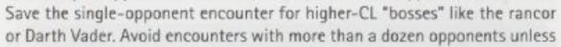

## scan p.256 (scan page 256)

Page contents: 542 words, 12 paragraphs | headings/entries: AWARDING EXPERIENCE POINTS; OTHER REWARDS

## scan p.257 (scan page 257)

Page contents: 608 words, 20 paragraphs | headings/entries: EQUIPMENT; BUILDING AN ADVENTURE; IVAW ®); SS; J uN; Sey

## scan p.258 (scan page 258)

Page contents: 895 words, 21 paragraphs | headings/entries: WHAT MAKES AN ADVENTURE EXxciTiInoc?; Intriguing Interactions; Exciting Combats

- **Darth Vader (Anakin Skywalker)** — entry/section: Gamemastering (Saga Edition Core Rulebook, Ch14): "An easy mistake is making an adversary too powerful, believing that the heroes will have it “too easy” unless their opponent is another Darth Vader." Source: *Saga Edition Core Rulebook* (SWRPG Saga Edition), scan p.258
  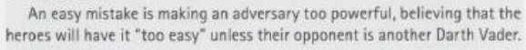

## scan p.259 (scan page 259)

Page contents: 943 words, 27 paragraphs | headings/entries: SUILDING A CAMPAIGN; BEATE A CONTEXT; INCORPORATE INTERESTING; GM CHARACTERS; Villains and Opponents

## scan p.260 (scan page 260)

Page contents: 896 words, 15 paragraphs | headings/entries: Allies; BUILD ON CAMPAIGN EVENTS

## scan p.261 (scan page 261)

Page contents: 293 words, 20 paragraphs | headings/entries: ATMOSPHERIC HMAZARDS; Defense. If the at; AT

## scan p.262 (scan page 262)

Page contents: 731 words, 15 paragraphs | headings/entries: BLINONESS; CRUSHING HAZARDS; DIseEASE; OBJECT SIZE EXAMPLE(S); Gargantuan Starfighter :

## scan p.263 (scan page 263)

Page contents: 684 words, 17 paragraphs | headings/entries: RADIATION; RADIATION TYPE; ATTACK BONUS; RADIATION TREAT INJURY DAMAGE oC; Moderate (CL 4) +2 4d6 20; Extreme (CL 10) +10 ad6 30

## scan p.264 (scan page 264)

Page contents: 740 words, 14 paragraphs | headings/entries: Traps and Security Systems

## scan p.265 (scan page 265)

Page contents: 750 words, 21 paragraphs | headings/entries: VISIBILITY; DARKVISION; LOW-LIGHT VISION; DURATION; Torch 3 squares 2 hours

## scan p.266 (scan page 266)

Page contents: 0 words, 0 paragraphs | headings/entries: 

## scan p.267 (scan page 267)

Page contents: 475 words, 10 paragraphs | headings/entries: CO Od; Ise OF THE; Ax HALA HOD

## scan p.268 (scan page 268)

Page contents: 579 words, 74 paragraphs | headings/entries: Vt been encountered yet (such as Ewoks); Padawan learner. Those w selecte; From tS Chamber; DARTH Vaoea; Pu; REBELLION ERA

## scan p.269 (scan page 269)

Page contents: NJO era: Yuuzhan Vong "cannot be [sen]sed through the Force" (OCR broken); Zonama Sekot fights the Vong at Coruscant. Ch16 OCR blank pages 266 and 280 are chapter-title art (checked by eye). (hand-read)

- **Darth Vader (Anakin Skywalker)** — entry/section: Darth Vader (Saga Edition Core Rulebook, Ch16): "In pursuing the power necessary to preserve Padme'’s life, Anakin becomes death incarnate." Source: *Saga Edition Core Rulebook* (SWRPG Saga Edition), scan p.269
  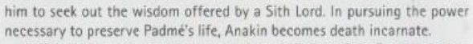
- **Darth Vader (Anakin Skywalker); Luke Skywalker; Palpatine (Darth Sidious)** — entry/section: Darth Vader (Saga Edition Core Rulebook, Ch16): "As Darth Vader, he uses the power of the dark side of the Force to betray and murder his fellow Jedi and enslave the galaxy, Over two decades later, his son Luke—now a Jedi himseif—leads Anakin back to the light. He finds redemption in his sacrifice, bringing balance to the Force by ending the tyranny of the Emperor and the Sith." Source: *Saga Edition Core Rulebook* (SWRPG Saga Edition), scan p.269
  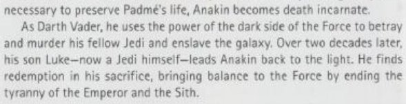
- **Qui-Gon Jinn; Darth Vader (Anakin Skywalker); Obi-Wan Kenobi**: "After being freed by Qui-Gon Jinn, Anakin studies the ways of the Jedi under Obi-Wan Kenobi, but he allows feelings of anger, fear, and hate to enslave him." Source: *Saga Edition Core Rulebook* (SWRPG Saga Edition), scan p.269
  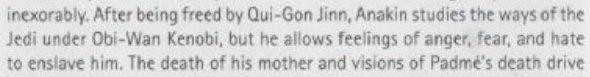

### Stat block notes (game mechanics, not feats)

- Darth Vader (Episode IV): CL 19, Jedi 7/Jedi Knight 5/ace pilot 2/Sith apprentice 2/Sith Lord 3; Destiny 3, Force 8, Dark Side 14; hp 181, Threshold 36; Ref 39/Fort 36/Will 33; lightsaber +22 (2d8+17); Use the Force +17; powers farseeing, Force disarm, Force grip, Force slam, Force thrust, move object, negate energy, rebuke, surge; Force Secrets Distant/Multitarget Power; talents incl. Djem So, Force Pilot (Source: *Saga Edition Core Rulebook* (SWRPG Saga Edition), scan p.269)

## scan p.270 (scan page 270)

Page contents: 575 words, 29 paragraphs | headings/entries: Ax H#SievHo; Weakness life support; Speed 6 squares; Melee lightsaber +22 (2d8+17) or; Ranged by weapon +20; Base Atk +17; Grp +20; Special Actions Djem So, Redirect Shot, temptation; Force Secrets Distant Power, Multitarget Power; Special Qualities life support; Improved Move Light Object __an; Om-Wan Kenog

- **Yoda; Qui-Gon Jinn; Obi-Wan Kenobi; Darth Maul**: "OBI-WAN KENOBI A student of Yoda and Qui-Gon Jinn, Obi-Wan exemplifies all that is noble and heroic about the Jedi, Padawan, he defeats Darth Maul after the Sith Lord strikes Qui-Gon Jinn." Source: *Saga Edition Core Rulebook* (SWRPG Saga Edition), scan p.270
  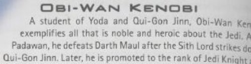

### Stat block notes (game mechanics, not feats)

- Obi-Wan Kenobi (Episode III): CL 14, Jedi 7/Jedi Knight 5/Jedi Master 2; hp 129, Threshold 29; Ref 30/Fort 29/Will 29; lightsaber +20 (2d8+13); Use the Force +19; Soresu; powers farseeing, Force slam (2), mind trick (2), move object, rebuke, surge, vital transfer (Source: *Saga Edition Core Rulebook* (SWRPG Saga Edition), scan p.270)

## scan p.271 (scan page 271)

Page contents: 457 words, 23 paragraphs | headings/entries: D; Init +12; Senses Perception +18; Speed 6 squares; Melee unarmed +7 (1d4; Base Atk +7; Grp +9; Special 'cial Actions Born Leader, Coordinate +1; Senator PACmMe AMID ALA

### Stat block notes (game mechanics, not feats)

- Padmé Amidala (Episode III): CL 10 noble 10; hp 59, Threshold 22; sporting blaster pistol +9 (3d4+5) (Source: *Saga Edition Core Rulebook* (SWRPG Saga Edition), scan p.271)

## scan p.272 (scan page 272)

Page contents: 379 words, 23 paragraphs | headings/entries: BZisewHD; PAN}; I\S= ou; Init +13; Senses Perception +12; LEIA ORGANA; Init +12; Senses Perception +18; Luxe SxYWALKerR

- **Leia Organa Solo**: "As the Senator of Alderaan, Leia Organa secretly serves the Rebel Alliance, determined to bring down the tyranny and injustice that her adopted father (and her late mother) had fought so hard to destroy." Source: *Saga Edition Core Rulebook* (SWRPG Saga Edition), scan p.272
  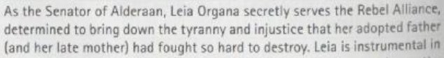

### Stat block notes (game mechanics, not feats)

- Luke Skywalker (Episode VI): CL 11, scout 1/Jedi 7/ace pilot 2/Jedi Knight 1; hp 99, Threshold 25; Ref 26/Fort 25/Will 25; lightsaber +14 (2d8+11); Use the Force +16; powers mind trick, move object, surge (Source: *Saga Edition Core Rulebook* (SWRPG Saga Edition), scan p.272)
- Leia Organa (Episode VI): CL 10, noble 8/soldier 2; hp 63, Threshold 23; Strong in the Force (Source: *Saga Edition Core Rulebook* (SWRPG Saga Edition), scan p.272)

## scan p.273 (scan page 273)

Page contents: 450 words, 31 paragraphs | headings/entries: Ubese; Ranged sporting blaster pistol +10 (3d4+5) or; Destiny 2; Force 6; Init + 18; Senses Perception +12; Languages Basic, Huttese, Rodese, Shyriiwook; Speed 6 squares; Melee unarmed +10 (1d4+7); Attack +1d6, Trigger Work; HAN BOLO 42ND LBA ORGBANA; Ie) 2)

- **Han Solo** — entry/section: Han Solo (Saga Edition Core Rulebook, Ch16): "Once an Imperial officer discharged for saving the life of a Wookiee slave, Han Solo goes on to become one of the best pilots and smugglers in the galaxy," Source: *Saga Edition Core Rulebook* (SWRPG Saga Edition), scan p.273
  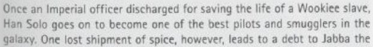

### Stat block notes (game mechanics, not feats)

- Han Solo (Episode VI): CL 12, scoundrel 5/soldier 2/ace pilot 3/gunslinger 2; hp 77, Threshold 25; Init +18; heavy blaster pistol +14 (3d8+6); Pilot +18 (Source: *Saga Edition Core Rulebook* (SWRPG Saga Edition), scan p.273)

## scan p.274 (scan page 274)

Page contents: 397 words, 28 paragraphs | headings/entries: Mechanics +13, Perception +12, Pilot +18; YT-1300 transport {Millennium Falcon); SUPPORTING CHARACTERS; Speed 6 squares; Melee unarmed +11 (1d6+9) or; Melee unarmed +15 (1d6+14) with Powerful Charge; Ranged bowcaster +8 (3d10+5) or; Ranged bowcaster +6 (4d10+5) with Rapid Shot; Base Atk +7; Grp +11; Special Actions rage 2/day; CHewraceé

- **Chewbacca; Yoda** — entry/section: Chewbacca (Saga Edition Core Rulebook, Ch16): "The mighty Chewbacca fights in the Clone Wars to defend the Republic, ; working closely with Jedi Master Yoda." Source: *Saga Edition Core Rulebook* (SWRPG Saga Edition), scan p.274
  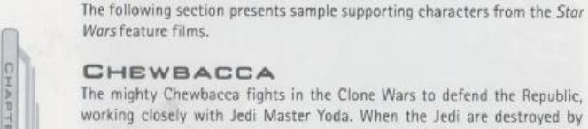

### Stat block notes (game mechanics, not feats)

- Chewbacca (Episode VI): CL 10, scout 6/scoundrel 4; hp 110, Threshold 27; unarmed +15 (1d6+14) with Powerful Charge; bowcaster +8 (3d10+5) (Source: *Saga Edition Core Rulebook* (SWRPG Saga Edition), scan p.274)

## scan p.275 (scan page 275)

Page contents: 628 words, 68 paragraphs | headings/entries: LANDO CALRISSIAN; Lando Calrissian (Episode VI) cL8; Medium Human scoundrel 8; Destiny 1; Force 4; Dark Side 1; Init +6; Senses Perception +10; Languages Basic, Shyriiwook, Sullustese; Speed 6 squares; Running Attack; Melee unarmed +7 (1d4+5); Ranged blaster pistol +9 (3d6+4) or; Base Atk +6; Grp +8; Special Actions Fool's Luck, Fortune's Favor, Gambler; Possessions blaster pistol, comlink, expensive clothes; R2-D2; R2-D2 (Episode VI); Init +3; Senses darkvision; Perception +6; CL6; Languages Basic, Binary, Huttese, Mon Calamarian, Shyriiwook; Immune droid traits; Melee electroshock probe +10 (1d8+3 ion); Ranged by weapon +14; Base Atk +5; Grp +3; Special Actions Melee Defense, Point Blank Shot; Special Actions Gimmick; Talents Gimmick, Master Slicer, Trace; C-3PO0 (Episode VI) CL5; Medium droid (3rd-degree) nonheroic 1/noble 5; Destiny 1; Force 4; Init -1; Senses Perception +0; Immune d

### Stat block notes (game mechanics, not feats)

- Lando Calrissian (Episode VI): CL 8; hp 50, Threshold 19; R2-D2 hp 34 (nonheroic 2/scoundrel 6); C-3PO hp 26 (nonheroic 1/noble 5) (Source: *Saga Edition Core Rulebook* (SWRPG Saga Edition), scan p.275)

## scan p.276 (scan page 276)

Page contents: 787 words, 28 paragraphs | headings/entries: Melee unarmed +2 (1d3+1); Ranged by weapon +2; Base Atk +3; Grp +2; Special Actions Coordinate +2; Talents Coordinate (2), Educated; Possessions audio recorder; YODA; Init +18; Senses Use the Force +24; Languages Basic, Cerean, Shyriiwook; Immune fear effects; Speed 4 squares; Melee lightsaber +25 (2d8+16) or; Base Atk +20; Grp +14

- **Yoda** — entry/section: Yoda (Saga Edition Core Rulebook, Ch16): "The wizened Jedi Master Yoda is a living legend to the Jedi order, the personification of its ideals." Source: *Saga Edition Core Rulebook* (SWRPG Saga Edition), scan p.276
  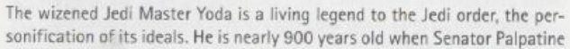
- **Palpatine (Darth Sidious)** — entry/section: Emperor Palpatine (Saga Edition Core Rulebook, Ch16): "Possessed of the boundless power of the Force and adept in the ways of the dark side, the Emperor is one of the most dangerous and evil Hu" Source: *Saga Edition Core Rulebook* (SWRPG Saga Edition), scan p.276
  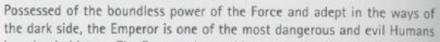
- **Yoda**: "He escapes the destruction and death caused by Order 66, and when the Jedi order is destroyed, Yoda retreats into hiding on Dagobah to await the day he will be needed to help restore balance to the Force." Source: *Saga Edition Core Rulebook* (SWRPG Saga Edition), scan p.276
  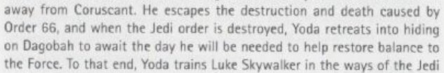

### Stat block notes (game mechanics, not feats)

- Yoda (Episode III): CL 20, Jedi 8/Jedi Knight 7/Jedi Master 5; Destiny 4, Force 8; hp 174, Threshold 33; Ref 37/Fort 33/Will 38; lightsaber +25 (2d8+16), Triple Attack +29/+29/+29 (as printed); Use the Force +24; powers battle strike (2), farseeing, Force disarm, Force slam (2), Force thrust, mind trick (2), move object (2), negate energy, rebuke (3), surge (2), vital transfer; Force Secrets Devastating/Distant/Multitarget/Quicken Power (Source: *Saga Edition Core Rulebook* (SWRPG Saga Edition), scan p.276)

## scan p.277 (scan page 277)

Page contents: 301 words, 34 paragraphs | headings/entries: Emperor Palpatine (Episode III) CL 20; Destiny 4; Force 8; Dark Side 21; Immune fear effec; Melee lightsaber +15; 10/3) with Triple Attack; Ranged by weapon +20; Base Atk +18: Grp +20; Special Actions Redirect Shot, temptation; J; Skills Deception +19, Gather Information +; Possessions lightsaber (self-built), Sith robes, comlink (encrypted); Tee Ewercnor

### Stat block notes (game mechanics, not feats)

- Emperor Palpatine (Episode III): CL 20, noble 6/Jedi 1/Sith apprentice 8/Sith Lord 5 (first class digit OCR "G"); Destiny 4, Force 8, Dark Side 21; hp 132, Threshold 34; Ref 35/Fort 34/Will 38; lightsaber +21 (2d8+10/x3); Use the Force +24; Force lightning (4), dark rage, farseeing, Force disarm, Force slam, Force thrust, move object (3), rebuke (2), surge (3), vital transfer; Force Secrets Devastating/Distant/Multitarget/Quicken Power (Source: *Saga Edition Core Rulebook* (SWRPG Saga Edition), scan p.277)

## scan p.278 (scan page 278)

Page contents: 341 words, 25 paragraphs | headings/entries: Fal; Boea Ferr

- **Boba Fett** — entry/section: Boba Fett (Saga Edition Core Rulebook, Ch16): "The most feared bounty hunter of his time, Boba Fett racks up an unheard-of" Source: *Saga Edition Core Rulebook* (SWRPG Saga Edition), scan p.278
  

### Stat block notes (game mechanics, not feats)

- Boba Fett (Episode IV): CL 15, scout 3/soldier 5/bounty hunter 5/elite trooper 2; hp 122, DR 1, Threshold 33; blaster carbine +18 (3d8+7); Mandalorian armor +8 (Source: *Saga Edition Core Rulebook* (SWRPG Saga Edition), scan p.278)

## scan p.279 (scan page 279)

Page contents: 544 words, 21 paragraphs | headings/entries: General Grievous CL 14; Destiny 2; Force 6; Dark Side 10; Init +16; Senses darkvision; Perception +14; Languages Basic, Kaleesh, Muun, Geonosian; Immune atmospheric and inhaled poison hazards; Ranged heavy blaster pistol +17 (3d8+7); Base Atk +13; Grp +19; Atk Options Double Attack, Dual Weapon Mastery; Melee Defense, Point Blank Shot, Triple Attack; Ceaneeraea. Grievous

- **General Grievous; Count Dooku; Obi-Wan Kenobi; Darth Vader (Anakin Skywalker)** — entry/section: General Grievous (Saga Edition Core Rulebook, Ch16): "Count Dooku trains Grievous in lightsaber dueling techniques, and Grievous proudly collects the lightsabers from the Jedi he defeats. Grievous has four metal arms and can fight with four lightsabers at once, making him a terrifying opponent in melee combat." Source: *Saga Edition Core Rulebook* (SWRPG Saga Edition), scan p.279
  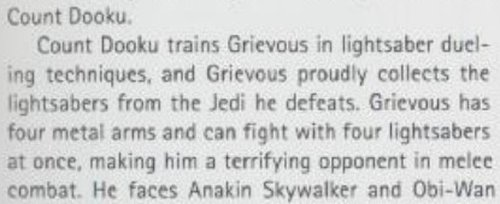

### Stat block notes (game mechanics, not feats)

- General Grievous: soldier 8/elite trooper 3/officer 3 (CL not legible); Ref 30/Fort 28/Will 28; Str 22; lightsaber +21 (2d8+21), up to four lightsabers with Dual Weapon Mastery + Double/Triple Attack; vulnerable to ion and stun (Source: *Saga Edition Core Rulebook* (SWRPG Saga Edition), scan p.279)

## scan p.280 (scan page 280)

Page contents: 0 words, 0 paragraphs | headings/entries: 

## scan p.281 (scan page 281)

Page contents: 304 words, 11 paragraphs | headings/entries: Ax wai.awrHo

## scan p.282 (scan page 282)

Page contents: 468 words, 20 paragraphs | headings/entries: BASE ATTACK BASE ATTACK; Natural Armor ;; ABILITY SIZE MODIFIER; CARRYING HEIGHT OR LENGTH

## scan p.283 (scan page 283)

Page contents: 443 words, 24 paragraphs | headings/entries: MULTICLASSING; BEAST DESCRIPTIONS; DEWBACK; ACKLAY; IA SSacvHD; Oo ony Barmy?; DSI; GUNS)

## scan p.284 (scan page 284)

Page contents: 551 words, 52 paragraphs | headings/entries: Dewback CL2 Large desert beast 3; Init +0; Senses Perception +0; Speed 6 squares; Melee bite +6 (1d8+5); Fighting Space 2x2; Reach | square; Base Atk +2; Grp +11; Nexu; Nexu CL5; Medium beast 6; Init +12; Senses low-light vision; Perception +10; Speed 8 squares; Fighting Space 1 square; Reach 1 square; Base Atk +4; Grp +8; Atk Options ambush +2d6, Pin; Feats Pin, Skill Training (Initiative, Perception); Skills Initiative +12, Perception +10, Stealth +12; RANCOR; Huge beast 12 i; Init +5; Senses low-light vision; Perception +9; Speed 8 squares; Melee 2 claws +11° (1d8+20) or; Melee bite +11" (2d6+20); Fighting Space 3x3; Reach 2 squares; Base Atk +9; Grp +27; Atk Options Cleave, Crush, Pin, Power Attack; Special Qualities fast healing 5; Feats Cleave, Crush, Pin, Power Attack, Toughness; Skills Perception +9; Speed 6 squares; Melee gore +10°* (2d6+16) or; Base Atk +6; Grp +24; Skills Endu

## scan p.285 (scan page 285)

Page contents: 649 words, 27 paragraphs | headings/entries: TAUNTAUN; Init +2; Senses scent; Perception +0; Speed 8 squares; Melee claw +5 (1d6+5) or; Melee bite +5 (1d8+5); Fighting Space 2x2; Reach 1 square; Base Atk +1; Grp +10; Feats Toughness; Skills Survival +5; WAMPA; NONHEROIC CHARACTERS

## scan p.286 (scan page 286)

Page contents: 534 words, 24 paragraphs | headings/entries: CHARACTER

## scan p.287 (scan page 287)

Page contents: 321 words, 48 paragraphs | headings/entries: Stormtrooper CL1 Medium Ruman nonheroic 4; Dark Side |; Init +2; Senses low-light vision; Perception +9; Speed 6 squares; Base Atk +3; Grp +4; Atk Options autofire (blaster rifle); Special Actions Coordinated Attack; Heavy Stormtrooper CL 2; Medium Human nonheroic 8; Dark Side |; Languages Basic; Speed 6 squares; Melee unarmed +8 (1d4+2); Ranged frag grenade +6 (4d6, 2-square burst); Base Atk +6; Grp +8; Special Actions brace (light repeating blaster); Skills Endurance +9, Mechanics +10, Perception +10; Scout Trooper; Medium Human nonheroic 6; Dark Side 1; Init +4; Senses low-light vision; Perception +10; Languages Basic; Speed 6 squares; Melee unarmed +4 (1d4); Ranged blaster pistol +5 (3d6) or; Ranged blaster rifle +5 (3d8) or; CL2; Sanww q iAx® SaidvHS; SAME); E

## scan p.288 (scan page 288)

Page contents: 624 words, 48 paragraphs | headings/entries: AX BSidvHS; Ranged frag grenade (46, 2-square burst); Base Atk +4; Grp +4; Atk Options Burst Fire; Skills Perception +10, Pilot +9, Stealth +9; Imperial Officer; Force 2; Dark Side 5; Init +3; Senses Perception +10; Languages Basic, Bocce, Durese, High Galactic; Speed 6 squares Melee unarmed +6 (1d4+2); Ranged blaster pistol +5 (3d6+2); Base Atk +6; Grp +6; Talents Born Leader, Coordinate, Trust; Rebel Trooper; Rebel Trooper cL; Medium Human nonheroic 3; Init +7; Senses Perception +6; Languages Basic; Speed 6 squares; Melee unarmed +2 (1¢4); Ranged blaster pistol! +4 (3d6) or; Ranged frag grenade +3 (4d6, 2-square burst); Base Atk +2; Grp +3; Special Actions Point Blank Shot"; Skills Initiative +7, Perception +6"; H Human bonus feat or trained skill

## scan p.289 (scan page 289)

Page contents: 462 words, 33 paragraphs | headings/entries: Elite Rebel Trooper CL2; Medium Human nonheroic 6; Init +9; Senses Perception +8; Languages Basic; Speed 6 squares; Melee unarmed +5 (1d4+1}; Ranged blaster pistol +6 (3d6) or; Ranged frag grenade +5 (406, 2-square burst); Base Atk +4; Grp +5; Special Actions Point Blank Shot"; Skills Initiative +9, Perception +8"; H Human bonus feat or trained skill; GALACTIC REPUBLIC Consisting of thousands of; Clone Trooper; CLONeS TROOPER; Je

## scan p.290 (scan page 290)

Page contents: 622 words, 63 paragraphs | headings/entries: ELNONGS©@ Guy San; Clone Trooper Commander CL5; Medium Human nonheroic 6/soldier 2/officer 1; Force 3; Dark Side 5; Init +4; Senses low-light vision; Perception +11; Languages Basic, High Galactic; Speed 6 squares; Melee unarmed +7 (1d4+1); Ranged heavy blaster rifle +8 (3d10+1) or; Base Atk +7; Grp +7; Atk Options autofire (heavy blaster rifle); Talents Assault Tactics, Battle Analysis; ARC Trooper; Destiny 1; Force 4; Dark Side 2; Init +12; Senses low-light vision; Perception +13; Languages Basic, Mando'a; Speed 6 squares; Melee unarmed +12 (1d4+5) or; Base Atk +10; Grp +12; Special Actions Point Blank Shot; N4)); Assassin; Assassin; Medium Human scoundrel 5; Force 1; Dark Side 12; Init +10; Senses Perception +8

- **Jango Fett** — entry/section: ARC Troopers (Saga Edition Core Rulebook, Ch16): "The ARC Troopers (Advanced Recon Commandos) are elite clone units that were personally trained by Jango Fett. Whereas most clone troopers are trained to work as a unit, ARC Troopers function well as individuals, making them even more formidable as foes." Source: *Saga Edition Core Rulebook* (SWRPG Saga Edition), scan p.290
  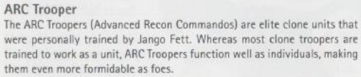

## scan p.291 (scan page 291)

Page contents: 624 words, 54 paragraphs | headings/entries: Special Actions Point Blank Shot, Precise Shot; Talents Dastardly Strike, Sneak Attack +2d6; H Human bonus feat or trained skill; Bounty Hunter; Bounty Hunter CL7; Medium Human nonheroic 4/scout 3/bounty hunter 3; Force 2; Dark Side 4; Init +13; Senses low-light vision; Perception +14; Languages Basic; Speed 4 squares; Melee vibrobayonet +10 (2d6+7) or; Melee vibrobayonet +10 (3d6+7) with Mighty Swing; Ranged blaster carbine +11 (3d8+3) or; Base Atk +8; Grp +11; H Human bonus feat or trained skill; Crime Lord; Crime Lord CL 8; Medium Human scoundrel 4/noble 3/crime lord 1; Force 2; Dark Side 9; Init +6; Senses Perception +10; Speed 6 squares; Running Attack; Melee unarmed +4 (1d4+3); Ranged heavy blaster pistol +7 (368+4) or; Base Atk +5; Grp +7; Special Actions Point Blank Shot, Presence; H Human bonus feat or trained skill

## scan p.292 (scan page 292)

Page contents: Dark side marauder intro: "Though the Jedi are the most powerful Force-users in the galaxy, they are by no means the only ones" (generic, no named character). (hand-read)

- **Luke Skywalker** — entry/section: Dark side marauder (Saga Edition Core Rulebook, Ch16): "Though the Jedi are the most powerful Force-users in the galaxy, they are by no means the only ones," Source: *Saga Edition Core Rulebook* (SWRPG Saga Edition), scan p.292
  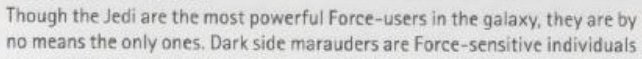

## scan p.293 (scan page 293)

Page contents: Yuuzhan Vong species traits: "Force Immunity: Yuuzhan Vong can't take the Force Sensitivity feat, can't make Use the Force checks, and never gain Force Points. In addition, they are immune to any Force effect that targets their Will Defense". Hutts: Force Resistance +5 vs Use the Force; Supreme Stability. (hand-read)

- **Tsavong Lah; Nom Anor** — entry/section: Yuuzhan Vong species traits (Saga Edition Core Rulebook, Ch16): "They are also 28" Source: *Saga Edition Core Rulebook* (SWRPG Saga Edition), scan p.293
  

## scan p.294 (scan page 294)

Page contents: 814 words, 127 paragraphs | headings/entries: INDEx; Acrobatic Recovery 40 Acute Senses 49; Ataru 218; Bolster Ally 43; Charm Beast 107; Cover Fire 52; Dark Presence 101; Dark Scourge 223; Force Power Adept 214; Force Recovery 101; Force Talisman 214; Force Treatment 214; Foresight 101; Fortified Body 214; Fortune's Favor 46; Fringe Savant 50; Full Throttle 207; Gambler 46; Gauge Force Potential 101; Gimmick 47; Greater Devastating Attack 212; Greater Force Talisman 214; Greater Penetrating Attack 212; Greater Weapon Focus 212 Lightsabers 218; Greater Weapon Specialization 212; Niman 218; Notorious 208, 210; Nowhere to Hide 208; One for the Team 221; Outmaneuver 221; Penetrating Attack 53; Power of the Dark Side 101; Presence 43; Quick Trigger 207; Rally 44; Ranged Disarm 217; Redirect Shot 41; Relentless 208; Relentless Pursuit 207; Resilience 40; Resist the Dark Side 41; Revenge 101; Ruthless Negotiator 208; Second Skin 52; Severi

## scan p.295 (scan page 295)

Page contents: 133 words, 10 paragraphs | headings/entries: GB Double-sided full-color battle map

