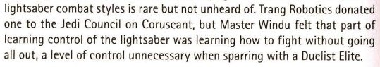
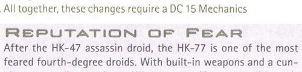

# Owner Material 037 — Star Wars D20 Drive folder (Core, Revised Core and Saga Edition): Sourcebooks/Scavenger's Guide to Droids.pdf [Star Wars Roleplaying Game Saga Edition (2007)] (scan pages 61–120)

- **Source:** Wizards of the Coast Star Wars Roleplaying Game books, web enhancements, Living Force campaign modules and articles (2000–2010), from the owner's "Star Wars D20" Drive folder (only the three edition subfolders; "General" was not read, as instructed). Secondary source (licensed Legends reference). Scan OCR'd on the box; the scan stays box-only and is **not** published.
- **Method:** every scanned page was OCR'd and machine-screened sentence by sentence for power-relevant statements (fights, kills, defeats, Force feats, rankings, superweapons) that name a character on our roster; each kept sentence is quoted verbatim from the OCR text and has a crop of the printed passage directly under it. Pages with nothing power-relevant are still listed with what is on them.
- **Citation:** "*Scavenger's Guide to Droids* (SWRPG Saga Edition), p.X" by printed page ("scan p.X" where no printed number applies). **Weight:** Licensed RPG material: a secondary source. Narrative text sums up Legends lore; game statistics are rules for players, not canon power levels, and rank lowest.

## scan p.61 (scan page 61)

Page contents: Holographic Image Disguiser (+10 Deceptive Appearance); ID Dodge; Improved Coordination Circuitry (+4 aid); Interference Generator (DC 30); Internal Defenses (1d20+5 shock); Internal Grapple Gun; Mesh Tape Dispenser; Micro Shield (+1 Reflex; handheld 400 cr); Multifunction Apparatus; Multispectrum Searchlight (6 km). (hand-read)

## scan p.62 (scan page 62)

Page contents: Multispectrum Searchlight continued (blind in 6-square cone); Radiant Heat Element; Remote Receiver Jammer (Clone Wars, vs battle droid remote links); Remote Receiver Signal Booster; Remote Viewer; Rental Restraining Bolt. Art caption: "A droid commando deploying its remote viewer." (hand-read)

## scan p.63 (scan page 63)

Page contents: Repulsorcam; Scomp Link (+2 Access Information); Sensors: Sensor Booster (2 km), Sensor Countermeasure Package, YV Sensor Package (YVH-Series, +10 to detect Yuuzhan Vong incl. ooglith masquers); Shield Expansion Module; Silence-Bubble Generator. Art caption: "A scomp link." (hand-read)

## scan p.64 (scan page 64)

Page contents: Space-Beacon Launcher; Survival Kit; Taser (heading lost in OCR); Video Screen; Voice-Print Command Lock; Weapon Detector (tibanna residue). Droid Stations: Droid Battle Station (two droid commander talents; Clone Wars Campaign Guide pp42-44); Droid Command Station (Int 14, Will 15; issue routine command...). (hand-read)

## scan p.65 (scan page 65)

Page contents: Droid Command Station functions (issue command +10, coordinate +3 aid, locate DC 5, status, reprogram, translate Binary). Droid Recharge Station (20 cr public fee, 1 hour, DC 10 diagnostics). Droid Socket (astromech copilot/systems/astrogation; prohibited: weapons, hyperspace without approval; optional astromech self-loading system as on the Naboo N-1 starfighter). Art caption: "Astromech units in a droid recharge station." (hand-read)

## scan p.66 (scan page 66)

Page contents: Sidebar/GM section "Adjudicating Droid Modifications": Unbalancing Modifications (complications, collateral damage, slicer reprogramming); Redundant Modifications (flawed performance); Taking Away Toys (make removal part of plot, offer replacement e.g. a Squib mechanic or a droid brain, chance to recover — parts scavenged by Jawas). (hand-read)

## scan p.67 (scan page 67)

Page contents: Chapter IV: Droid Construction(?) title page (art; OCR "DROID CO"). (hand-read)

## scan p.68 (scan page 68)

Page contents: Chapter IV: Droid Codex intro — sampling of droids from various eras; each with stat block, protocol-format block, "Playing the Droid" sidebar, modifications, background/adventure seed sidebar. (hand-read)

## scan p.69 (scan page 69)

Page contents: 8D Smelter Droid (CL 0, Medium 5th-degree; Roche, Verpine-run; duravlex shell from durasteel + kevlex, melting point over 1,650 °C; 7,250 cr; heat resistant). Full stat block and protocol-format block. Can be played as droid heroes. (hand-read)

## scan p.70 (scan page 70)

Page contents: 8D modifications: Damage Control Droid (restores 2d8 hp, +2 condition steps to ship); Master's Decoy (emulates master's voice, reroll Deception twice); Survivalist (1,000 cr, DC 20 Mechanics, 4 hours). Sidebars: "Playing an 8D Smelter Droid" (labor chassis, scout class, Mighty Swing/Extra Second Wind/Armor Proficiency feats, duravlex shell, darkvision); "A Little Attitude" (narrator on belligerent smelting droids; Resilon mine revolt, death of an owner). (hand-read)

## scan p.71 (scan page 71)

Page contents: A9G-Series Archive Droid (CL 0, 1st-degree; Industrial Automaton, after R2-Series success; data network administrator; flaw with high data volumes; 6,880 cr; archive processor). Stat and protocol blocks. Playable as droid heroes. Caption: "A9G-Series archive droid." (hand-read)

## scan p.72 (scan page 72)

Page contents: A9G modifications: Field Medic; Reconnaissance Droid; Slicer's Computer. Sidebar "Overworked" (dealer pitch: A9G carbon scoring from processor burnout; acquired from a pirate band on the Hydian Way; missing A9G of the royal family of Katchan). Caption: "A9G-Series archive droid." (hand-read)

## scan p.73 (scan page 73)

Page contents: AD-Series Weapons Maintenance Droid (CL 1, soldier 1; Arakyd Industries, companion to every stormtrooper squad; 13,840 cr; Harm's Way). Stat and protocol blocks. Caption: "AD-Series weapons maintenance droid." (hand-read)

## scan p.74 (scan page 74)

Page contents: AD-Series background: Imperial efficiency studies rejected it; nearly bankrupted Arakyd. Playable as droid heroes. Modifications: Police Droid; Sniper Droid (bounty hunters, guilds); Speakeasy Droid (crime lords' door muscle; weapon detector). Sidebars: "Playing an AD-Series" (law enforcement and criminal uses; scoundrel or soldier class); "Their Loss, My Gain" (narrator theory that the Empire killed the Arakyd contract after Alderaan to teach loyalty). (hand-read)

## scan p.75 (scan page 75)

Page contents: Annihilator Droid (CL 12, Huge 4th-degree; Colicoid homeworld Colla IV defense; "Scorpenek"; University of Sanbra xenosociologists; 59,275 cr; SR 20; not playable). Stat and protocol blocks. Sidebar (crop-OCR) "Encountering an Annihilator Droid" (scrap yard ambush; tunnels with nesting mynocks). (hand-read)

## scan p.76 (scan page 76)

Page contents: Annihilator modifications: Capital Ship Scrapper (Ord Mantell, Raxus Prime); Cargo Hauler (Ord Mantell scrap hauler, fire-linked); Space Sentry. Sidebar "A Private Pirate" (pirates in an asteroid field deploy annihilators on asteroids around the entry route). Caption: "Annihilator droid." (hand-read)

## scan p.77 (scan page 77)

Page contents: BLX Labor Droid (CL 0, 5th-degree; Serv-O-Droid, pre-Clone Wars general labor; magnetic feet, simianlike silhouette; 8,995 cr; jack of all trades). Stat and protocol blocks. Playable. Sidebar (crop-OCR) "Playing a BLX Labor Droid" (labor chassis, scout class, jack of all trades, magnetic feet). (hand-read)

## scan p.78 (scan page 78)

Page contents: BLX modifications: Attaché Droid; Long-Range Sensor Droid (5 km); Portable Generator. Sidebar "Memories" (crop-checked; narrator: BLX personalities, memory wipes; a scientist near the Maw whose BLX droid holding his journal and experimental starfighter/weapon schematics went missing). Caption: "BLX labor droid." (hand-read)

## scan p.79 (scan page 79)

Page contents: Colicoid Infiltrator-Series Droid (CL 4, 4th-degree; Colicoid Creation Nest, before the blockade of Naboo, for Separatists; looks like Droideka with four legs and hooks; 33,720 cr; SR 20; penetrate hull). Stat and protocol blocks. Caption: "Colicoid Infiltrator-Series droid." (hand-read)

## scan p.80 (scan page 80)

Page contents: Colicoid Infiltrator background (Clone Wars ship-boarding units for Neimoidians/Separatists; not playable). Modifications: Communications Beacon (500 km); Heavy Weapons Turret (E-Web, missile launchers); Walking Throne. Sidebars: "Encountering a Colicoid" (lone Infiltrator lair at end of a 16x2 corridor near Engineering; holographic disguise as computer console, shield and silence bubble generators); "Silent Death" (stories of Infiltrators boarding Republic ships; distress signal near Dubrillion). (hand-read)

## scan p.81 (scan page 81)

Page contents: CZ-Series Secretary Droid (CL 0, 3rd-degree; communications assistant for bureaucrats; languages incl. Bocce, Huttese; 8,280 cr; comlink jammer, comlink relay). Stat and protocol blocks. Playable. (hand-read)

## scan p.82 (scan page 82)

Page contents: CZ modifications: Identity Thief; Pirate HoloNet Transceiver (50,000 + 3,000 cr); Slicer's Proxy. Sidebars: "Playing a CZ-Series" (protocol chassis, noble class, Linguist feat, comlink jammer/relay); "Overlooked Espionage" hook (Rebel-compromised CZ in an ISB office on Brentaal; heroes retrieve it for Alliance High Command). (hand-read)

## scan p.83 (scan page 83)

Page contents: DP-2 Probe Droid (Large starfighter/ground vehicle (speeder); Duwani Mechanical Products; blaster cannon, space beacon launcher with 16 beacons; 36,500 cr). Vehicle stat block and protocol-format block (Extended Sensor Range, Extended Weapon Range, Patch Job, Reconnoiter, Telemetry). (hand-read)

## scan p.84 (scan page 84)

Page contents: DP-2 background (Duwani, before the Mandalorian Wars and Jedi Civil War; probe droid for scouts and explorers; ovoid body with six arms; not playable). Modifications: Blockade Breaker (SR 25 shield, DC 35); Courier Droid (31,300 cr, x8 hyperdrive). Sidebars: "Encountering a DP-2" (patrols a master's camp perimeter on a temperate world); "Extended Travels" (narrator: customer's engines shot out near Dantooine by a DP-2; rescue hook). (hand-read)

## scan p.85 (scan page 85)

Page contents: Droideka Mark II (CL 8, Large 4th-degree, nonheroic 12/soldier 4; SR 20; laser and ion cannons; bronzium shell; 31,435 cr). Stat and protocol blocks. (hand-read)

## scan p.86 (scan page 86)

Page contents: Droideka Mark II background: original decommissioned after the Clone Wars; Zann Consortium discovers a Hypori factory during the Galactic Civil War and fights Jabba the Hutt for it; not playable. Modifications: Magnetic Starship Turret (Riders of the Maelstrom smugglers); Sith Jedi Hunter (gyroscope, simultaneous cannons, lightsaber-disrupting emitters). Sidebars: "Encountering a Droideka" (landspeeder chase); "Use Only Genuine Droideka Parts" (Jawa narrator: Mark I/II parts interchangeable; sandcrawler security; Mark I in Mark II casing scams). (hand-read)

### Stat block notes (game mechanics, not feats)

- Droideka Mark II — Zann Consortium vs. Jabba on Hypori: the Clone Wars and soon became a distant nightmare. However, the Zann Consortium discovered a manufacturing facility on the planet Hypori during the Galactic Civil War. It engaged Jabba the Hutt in a battle for the facility, which produced the Droideka Mark II. The Consortium was victorious, and new Droidekas soon appear in the hands of mercenary units and private armies across the galaxy. The nightmare has returned. (Source: *Scavenger's Guide to Droids* (SWRPG Saga Edition), scan p.86)

## scan p.87 (scan page 87)

Page contents: DT-16 "Destructor" Battle Droid (CL 2, Large 4th-degree; Droidworks, Mandalorian Wars era; 2.7 m humanoid, rifles concealed in arms, chest grenade launcher; 13,725 cr; barrage; not playable). Stat and protocol blocks and background. Sidebar (crop-OCR) "Encountering a DT-16 Battle Droid" (two DT-16s and a Mark IV assault droid from a Sith-hired mercenary unit block a boarded starship). (hand-read)

## scan p.88 (scan page 88)

Page contents: DT-16 modifications: Sentry Droid; Antivehicle Defense Droid; Light Construction Droid. Sidebar "Old Cargo" (narrator: DT-16s hard-wired disobedience rumor; derelict ship near Elrood Sector with half a dozen DT-16s in its manifest; pirates). (hand-read)

## scan p.89 (scan page 89)

Page contents: Duelist Elite Training Droid (CL 1, Medium 4th-degree soldier 1; Trang Robotics fencing opponent for the rich; rapier; 11,330 cr; playable). Stat and protocol blocks, background. Modification: Lightsaber Sparring Partner (Trang donated one to the Jedi Council; Master Windu objected). Sidebar (crop-OCR) "Playing a Duelist Elite Training Droid" (servant leader among droids; soldier/noble; Melee Duelist tree from the KOTOR Campaign Guide). (hand-read)

- **Mace Windu**: "Trang Robotics donated one to the Jedi Council on Coruscant, but Master Windu felt that part of learning control of the lightsaber was learning how to fight without going all out, a level of control unnecessary when sparring with a Duelist Elite." Source: *Scavenger's Guide to Droids* (SWRPG Saga Edition), scan p.89
  

### Stat block notes (game mechanics, not feats)

- Lightsaber Sparring Partner — Windu declines Duelist Elite: lightsaber combat styles is rare but not unheard of. Trang Robotics donated one to the Jedi Council on Coruscant, but Master Windu felt that part of learning control of the lightsaber was learning how to fight without going all out, a level of control unnecessary when sparring with a Duelist Elite. (Source: *Scavenger's Guide to Droids* (SWRPG Saga Edition), scan p.89)

## scan p.90 (scan page 90)

Page contents: Duelist Elite modifications continued: lightsaber reprogramming (DC 11, 1,000 cr); Sith Weaponmaster (remove safeguards); Stiletto Droid (Tapani Sector nobles' hidden-weapon droids). Sidebar "The Droid from Lamaan" (narrator: Duelist Elite OX-73 tried to trade a "lightsaber" for a protocol droid and astromech, believing it was a Jedi). Caption: "Duelist Elite training droid." (hand-read)

## scan p.91 (scan page 91)

Page contents: E522 Assassin Droid (CL 7, Medium 4th-degree scout 1/soldier 6; heavy repeating blaster, ion rifle, hunter-seeker missiles, needler gun with neurotoxin darts; neutronium plating; 28,535 cr). Stat and protocol blocks. Sidebar (crop-OCR) "Encountering an E522 Assassin Droid" (host shot through a window; chase to a turbolift; hunter-seeker after 5 rounds; flees after 10). (hand-read)

## scan p.92 (scan page 92)

Page contents: E522 background (Sienar Intelligence Systems commission for the Emperor, Techno Union designers; used to silence Palpatine's critics; tracked feet; not playable). Modification: Heavy Weapon Support. Sidebar "Paranoia" (narrator witnessed an E522 killing a dignitary, officially a heart attack, Imperial cover-up; socialite hiding on Ord Mantell hook). (hand-read)

### Stat block notes (game mechanics, not feats)

- E522 assassin droids — built for the Emperor: During the formative years of the Empire, Sienar Intelligence Systems received a commission to build a weapons-laden droid to be used by the Emperor himself. Neither the reason for the droids nor the origins of the design were known at the time the commission was made. Records recovered by New Republic slicers after the fall of the Empire state that the plans were drafted by Sienar developers with the assistance of droid designers retained from the Techno Union after that organization was folded into the Imperial infrastructure. Soon after completion, the E522 assassin droids were delivered as promised. Little did the public know that the droids would be used to permanently silence Emperor Palpatine's critics as the Empire consolidated its rule of the galaxy. (Source: *Scavenger's Guide to Droids* (SWRPG Saga Edition), scan p.92)

## scan p.93 (scan page 93)

Page contents: EI-9 Network Security Droid (Medium 2nd-degree, nonheroic 3/scoundrel 3/scout 4; Arakyd; defense in depth, precision locator, quick-load hidden core; 23,840 cr). Stat and protocol blocks. (hand-read)

## scan p.94 (scan page 94)

Page contents: EI-9 background (Arakyd network and physical security; playable). Modifications: Electromagnetic Pulse (DC 25, 4,000 cr, 3 days); Slicer Tracker. Sidebars: "Playing an EI-9" (service chassis, scoundrel Slicer tree); "Serious Security" (narrator on ISB data storage facility guarded by EI-9s). (hand-read)

## scan p.95 (scan page 95)

Page contents: EV-Series Supervisor Droid (Medium 3rd-degree, nonheroic 1/noble 3; bully; Demand Surrender, Presence; 11,380 cr). Stat and protocol blocks. (hand-read)

## scan p.96 (scan page 96)

Page contents: EV-Series background (MerenData droid-pool supervisor; motivators accidentally swapped with torture-droid motivators; sadistic methods forced a recall; crime lord Ploovo Two-for-One preferred the flawed model; playable). Modifications: Quartermaster; Technician. Sidebars: "Playing an EV-Series" (protocol chassis, noble class, bully); "Rage Against the Machine" (Jawa narrator: droids ripping apart a supervisor in a sandcrawler; EV-Series on Malastare imprisons ~50 droid workers, has security droids kill its masters, locks down the facility). (hand-read)

## scan p.97 (scan page 97)

Page contents: FLTCH-Series Battle Droid (CL 5, Large 4th-degree, nonheroic 4/soldier 4; claws, heavy blaster rifle, built-in blaster rifle and missile launcher, jetpack; nightmare, zero-range attack; 31,375 cr). Stat and protocol blocks. Sidebar (crop-OCR) "Encountering a FLTCH-Series Battle Droid" (merc droids in mercenary units and syndicates; jetpack intimidation). (hand-read)

## scan p.98 (scan page 98)

Page contents: FLTCH-Series background (Colicoid Creation Nest for Trade Federation export; "merc droid"; claws hinder control panels; not playable). Modifications: Ammo Boost; Mercenary Rental Unit. Sidebar "A Big Help" (narrator: field merc droids on Rodia's clan wars as a special operations squad). (hand-read)

## scan p.99 (scan page 99)

Page contents: G2 Repair Droid (CL 0, Small 2nd-degree; SoroSuub after the Clone Wars; "goose droids"; overly talkative, discontinued eight years after Endor and restarted two years later; patch job; 5,210 cr; playable). Stat and protocol blocks, background. (hand-read)

## scan p.100 (scan page 100)

Page contents: G2 modifications: Copilot; Explosives Detector; Scavenger. Sidebars: "Playing a G2 Repair Droid" (mechanic chassis, scoundrel); "Much Too Talkative" (narrator hates 3PO and G2 chatter; Sluis Van shipyard sabotage and pirate hook). (hand-read)

## scan p.101 (scan page 101)

Page contents: GD16-Series Pilot Droid (CL 5, Medium 5th-degree, scout 3/soldier 2; sensor crown, simultaneous operation, vehicle link; four hands; 17,430 cr). Stat and protocol blocks. (hand-read)

## scan p.102 (scan page 102)

Page contents: GD16 background (MerenData clandestine pilot droid; telescopic limbs, double arms, 360-degree sensor crown; playable). Modifications: Advanced Espionage Upgrade; Precision Flight (take 20 on precision flying). Sidebars: "Playing a GD16-Series" (superiority complex; battle chassis, scout); "Surprise Spy" (narrator's GD16 was a spy for a Hutt checking his trustworthiness; fought off pirates). (hand-read)

## scan p.103 (scan page 103)

Page contents: GX1-Series Battle Droid (CL 6, Medium 4th-degree, nonheroic 6/soldier 3/scout 1; Trang Robotics private security droid, limited run, after the Duelist Elite; repositioning routines, small appendages; 23,305 cr; not playable). Stat and protocol blocks, background. Sidebar "GX1-Series Battle Droid Encounters" (crop; rare bodyguards for Senators or mid-level executives; four or more showcase repositioning routines). (hand-read)

## scan p.104 (scan page 104)

Page contents: GX1 modifications: Armored Courier (tight-beam laser transmitter, encryption Will 35, memory-erase device); Airdrop Droid (orbital drop armor). Sidebar "Private Armies" (narrator: initial investors used GX1s for private droid armies; some busted by the Jedi; slicers and assassins erased the sales; surviving Trang executive hidden by Black Sun agents, possibly on Taris). (hand-read)

## scan p.105 (scan page 105)

Page contents: GY-I Information Analysis Droid (CL 1, Medium 3rd-degree noble 1; Cybot Galactica, for survey teams and researchers; reassigned when Emperor Palpatine turned resources to the war machine; 11,855 cr; playable). Stat and protocol blocks. Sidebar "Playing a GY-I Information Analysis Droid" (crop; cautious long-term planners for heists and raids; noble Leadership, scoundrel Fortune/Misfortune). (hand-read)

### Stat block notes (game mechanics, not feats)

- GY-I droids — Palpatine redirects exploration to the war machine: a newly discovered planet. However, as Emperor Palpatine turned resources away from the explorations of the Old Republic to the war machine of the Galactic Empire, most GY-I droids were reassigned to other roles in which their analysis would be useful. (Source: *Scavenger's Guide to Droids* (SWRPG Saga Edition), scan p.105)

## scan p.106 (scan page 106)

Page contents: GY-I modifications: Astromech Droid (astromech buffer); Financial Wizard (Zorba the Hutt's GY-I that streamlined his operations and vanished; Wealth talent bonus). Sidebar "The Sad Tale of GY-I33" (Jawa narrator: Uncle Tukka's story of GY-I33, sole survivor of a 10-year Zabrak scout mission, believed it was its dead owner and stalked his family). Caption: "GY-I information analysis droid." (hand-read)

### Stat block notes (game mechanics, not feats)

- Financial Wizard — Zorba's GY-I: found different applications for these droids. Zorba the Hutt received a GY-I as part of a collection on a bad debt and tweaked the droid to suit his purposes. By analyzing the efficiency of the crime lord's operations, the droid could streamline procedures, identify areas of waste, and deduce who was skimming credits off the top. The droid also had a knack for ruthlessly determining when a loan should be collected with prejudice. Had the GY-I not mysteriously disappeared, it could have become the first droid lieutenant of a Hutt crime family. (Source: *Scavenger's Guide to Droids* (SWRPG Saga Edition), scan p.106)

## scan p.107 (scan page 107)

Page contents: H-1ME Battle Mechanic Droid (CL 1, Small 2nd-degree scout 1; eight tool appendages, magnetic feet, collapsible; preventive maintenance; 10,565 cr). Stat and protocol blocks. (hand-read)

## scan p.108 (scan page 108)

Page contents: H-1ME background (Intertran Systems hull-clinging in-flight repair droid, works in hyperspace; playable). Modification: Missile Droid (Mazer's Mynocks fire H-1MEs in concussion missile housings to damaged ships). Sidebars: "Playing an H-1ME Battle Mechanic Droid" (daredevil, protective; scout, Fringer); "A Personal Favorite" (Jawa narrator's H-88ME tells of H-2ME, launched by one of the last Jedi Knights with a small treasure, perhaps a holocron or lightsaber). (hand-read)

## scan p.109 (scan page 109)

Page contents: HK-77 Assassin Droid (CL 4, Medium 4th-degree soldier 4; arm-mounted blaster rifles; blaster surge; 19,865 cr). Stat and protocol blocks. Background: successor to HK-47, HK-58 and HK-65, conceived years before the Jedi Civil War; overt aggression flaw. Sidebar "Encountering an HK-77 Assassin Droid" (dark alleyway ambush on Zeltros). (hand-read)

### Stat block notes (game mechanics, not feats)

- HK-77 background — successor to the HK-47 line: Continuing the success of the HK-47 line, the HK-77 assassin droid was designed and built to be the ultimate hired killer. Originally conceived several years before the outbreak of the Jedi Civil War, the HK-77 is the culmination of the droids that came before it: the HK-47, HK-58, and HK-65 assassin models. The HK-77 is slightly shorter than its predecessors and has a narrow head with eyes that extend from each side, a shape that was borrowed from various predators found around the galaxy. Unlike the HK-47 and the HK-58, which were standard models that had hands and carried weapons, the HK-77 has weapons incorporated into its arms for ready access. (Source: *Scavenger's Guide to Droids* (SWRPG Saga Edition), scan p.109)

## scan p.110 (scan page 110)

Page contents: HK-77: still overly aggressive; not playable. Modifications: Firefighter; Gambler's Proxy (see-through vision boost for sabacc cards, burns out). Sidebar "Reputation of Fear" (crop-verified; HK-77 hunting Garm Bel Iblis from Anchoron). Caption: "HK-77 assassin droid." (hand-read)

- **HK-47** — entry/section: Scavenger's Guide to Droids: "All together, these changes require a DC 15 Mechanics REPUTATION OF FEAR ¢) After the HK-47 assassin droid, the HK-77 is one of the most &, feared fourth-degree droids." Source: *Scavenger's Guide to Droids* (SWRPG Saga Edition), scan p.110
  

### Stat block notes (game mechanics, not feats)

- Sidebar "Reputation of Fear" (crop-verified): After the HK-47 assassin droid, the HK-77 is one of the most feared fourth-degree droids. With built-in weapons and a cunning personality matrix, an HK-47 can terrify anyone with a price on his or her head. In many ways, that reputation works better than the droids themselves. When wanted beings discover that an HK-77 is after them, they often fear for their lives and surrender as quickly as they can. Some, though, believe that the droids' reputation is nothing more than hype. (Source: *Scavenger's Guide to Droids* (SWRPG Saga Edition), scan p.110)
- Sidebar "Reputation of Fear" — HK-77 sent after Bel Iblis (crop-verified): Have you heard the story of Garm Bel Iblis, a leader of the Rebellion? Apparently, someone high in the Imperial hierarchy discovered his location on Anchoron and sent a refurbished HK-77 droid, along with other assassins, to kill him. Many believe that Bel Iblis died when a bomb planted for him detonated, but others think that he was not caught in the blast and still lives. Most assassins believe him to be dead, but the HK-77 still pursues Bel Iblis, refusing to return to Coruscant. As a result, the Empire has left the droid to its own devices. Whether Bel Iblis is alive or dead, the Rebellion would be most grateful if a group of heroes could find the droid, which was last reported to be looking for clues on Anchoron, and dismantle it permanently. (Source: *Scavenger's Guide to Droids* (SWRPG Saga Edition), scan p.110)

## scan p.111 (scan page 111)

Page contents: HKB-3 Hunter-killer Droid (CL 6, Medium 4th-degree, nonheroic 3/scout 3/soldier 2; remote processor 5 km; coordinated tracking, hunting sensor, simultaneous fire; 19,130 cr). Stat and protocol blocks. (hand-read)

## scan p.112 (scan page 112)

Page contents: HKB-3 background (Baktoid, years before the Clone Wars; Trade Federation officials' bodyguards, replaced by Droidekas; playable). Modification: Jammer (12-square radius). Sidebars: "Playing an HKB-3" (battle chassis, replace remote processor; scout or soldier); "Hunting Hunter-Killers" (narrator: ex-Separatist Neimoidian Tornak Po hiding in Tatooine's southern polar wastes with HKBs). (hand-read)

## scan p.113 (scan page 113)

Page contents: KM1 Mining Droid (CL 2, Large 5th-degree nonheroic 6; laser cutters as heavy blaster pistols, mining shield generator SR 10, stability, adaptable programming; 21,880 cr). Stat and protocol blocks. (hand-read)

## scan p.114 (scan page 114)

Page contents: KM1 background (Duwani Mechanical Products; used at Peragus mining facility in the Old Republic; easy to reprogram; not playable). Modifications: Excavation Droid; Wall Walker (climbing claws). Sidebars: "Encountering a KM1" (small groups under a supervisor; heroes or villains can reprogram a primitive army); "A Scavenger's Gold Mine" (Jawa narrator: Blast Pit mining operation abandoned its KM1s; capture them, mind rival scavengers). (hand-read)

## scan p.115 (scan page 115)

Page contents: M38 Explorer Droid (Medium 2nd-degree scout 2; tracked, advanced sensors, holorecorder; 12,285 cr). Stat and protocol blocks. Background: Les Tech, a few years before the Clone Wars; customers feared replacement and found it more trouble than worth. (hand-read)

## scan p.116 (scan page 116)

Page contents: M38: slow, high maintenance, unarmed; still used by the Rebellion; playable. Modifications: Engineer; Navicomputer (astrogation buffer, 6 units); Patrol Droid. Sidebars: "Playing an M38" (probe droid chassis, scout); "Going Haywire" (narrator: a trader near Naboo got a distress signal from a woman stranded on Baarstal whose M38 wrecked her ship and fled into the jungle). (hand-read)

## scan p.117 (scan page 117)

Page contents: MEV-Series Medical Evacuation Droid (CL 1, Medium 1st-degree nonheroic 5; hovering, folding repulsorlift bed, quick load; Cybernetic Surgery, Surgical Expertise; 13,425 cr). Stat and protocol blocks. (hand-read)

## scan p.118 (scan page 118)

Page contents: MEV background (Industrial Automaton, 10 years before the Clone Wars; medical droid plus repulsorlift sled; playable). Modifications: High-Speed Booster; Improved Enclosure; Specialized Processor. Sidebars: "Playing a MEV-Series" (medical chassis; noble or soldier); "Emergency Evac" (narrator: groundquake on the Thuna III colony near the Unknown Regions, raiders coming). (hand-read)

## scan p.119 (scan page 119)

Page contents: MK-Series Maintenance Droid (CL 1, Medium 2nd-degree scout 1; Kalibac Industries; tracked, claw appendages; lateral thinker, versatile appendages; 11,080 cr). Stat and protocol blocks. Background: designed to solve unanticipated space-travel problems; engineers consulted starship engineers, mechanics and outlaw techs. (hand-read)

## scan p.120 (scan page 120)

Page contents: MK-Series: quirky, reckless, self-repairing; playable. Modification: Saboteur (Cunning Saboteur quality). Sidebars: "Playing an MK-Series" (mechanic chassis; scout or scoundrel); "Thrill Seekers Need Not Apply" (MK-87 aboard the YT-1930 Commander of Staves vented coolant to fake a comet and killed the crew; escaped, bounty on it). (hand-read)

