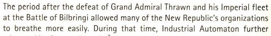

# Owner Material 037 — Star Wars D20 Drive folder (Core, Revised Core and Saga Edition): Sourcebooks/Scavenger's Guide to Droids.pdf [Star Wars Roleplaying Game Saga Edition (2007)] (scan pages 121–161)

- **Source:** Wizards of the Coast Star Wars Roleplaying Game books, web enhancements, Living Force campaign modules and articles (2000–2010), from the owner's "Star Wars D20" Drive folder (only the three edition subfolders; "General" was not read, as instructed). Secondary source (licensed Legends reference). Scan OCR'd on the box; the scan stays box-only and is **not** published.
- **Method:** every scanned page was OCR'd and machine-screened sentence by sentence for power-relevant statements (fights, kills, defeats, Force feats, rankings, superweapons) that name a character on our roster; each kept sentence is quoted verbatim from the OCR text and has a crop of the printed passage directly under it. Pages with nothing power-relevant are still listed with what is on them.
- **Citation:** "*Scavenger's Guide to Droids* (SWRPG Saga Edition), p.X" by printed page ("scan p.X" where no printed number applies). **Weight:** Licensed RPG material: a secondary source. Narrative text sums up Legends lore; game statistics are rules for players, not canon power levels, and rank lowest.

## scan p.121 (scan page 121)

Page contents: Model 88-Series Administration Droid (CL 5, Medium 1st-degree, nonheroic 6/noble 3; Uhr-Vah-Vo TechWorks (Tiss'shar); superior analysis, timely observation; 15,000 cr). Stat and protocol blocks. Background: InterGalactic Banking Clan bought the run and the company; resold 88s were IGBC industrial spies, shut down with the Separatist droids at war's end and scrapped. (hand-read)

## scan p.122 (scan page 122)

Page contents: Model 88: thin bipedal office droid valued by banks; playable. Modifications: Gambler's Friend; Industrial Spy (hidden core). Sidebars: "Playing a Model 88" (service chassis as 1st-degree, noble); "Junk Droids" (crop-verified; Jawa dealer's intact Model 88 head wanted by information broker 8t88 on Nar Shaddaa, who once tangled with Kyle Katarn). Caption: "Model 88-Series administration droid." (hand-read)

### Stat block notes (game mechanics, not feats)

- Sidebar "Junk Droids" — 8t88 once tangled with Kyle Katarn (crop-verified): You have a fine eye, welcome customer. This is a rare droid, inspirationally designated the Model 88. Yes, you are correct, it misses a couple of limbs. Extremely difficult to find a fully intact Model 88. Thus, the rarity. Their pieces are collectable! Oops—let me shut old 6z88 off here. Such talk disturbs it. There. Now, what really makes this particular droid a unique specimen is that its head is intact. Most 88s were junked after the Clone Wars by enemies of the Banking Clan, their heads destroyed, for spying. Anyway, such a deal for you. Buy this fine Model 88 from me and take to Nar Shaddaa. There, you'll find the nearly complete information broker 8t88, who's sure to pay prime credits for the head. Yes, that is the only part missed by 8t88! He's quite upset by the small replacement he has now. Probably, he takes the new head and uses the rest for spare parts. Sorry—can't sell you just the head. All or nothing. And be careful. 8t88 is a selfish criminal who once tangled with Kyle Katarn. (Source: *Scavenger's Guide to Droids* (SWRPG Saga Edition), scan p.122)

## scan p.123 (scan page 123)

Page contents: PG-5 Gunnery Droid (CL 0, Large 2nd-degree nonheroic 2; wheeled; battery fire, superior weapon repair; 7,280 cr). Stat and protocol blocks. Background: Industrial Automaton, supplement Imperial capital-ship gunners; taller R2 look-alike; a failure. (hand-read)

## scan p.124 (scan page 124)

Page contents: PG-5: only a few hundred made, bought by planetary forces, police and freight forwarders; playable. Modifications: Fire Control System; Mechanic's Assistant; Security System. Sidebars: "Playing a PG-5" (astromech chassis, scoundrel); "The Coward's Way Out" (narrator: a PG-5 on a Republic cruiser near Ord Mantell hesitated and let defectors escape with Senators as hostages). (hand-read)

## scan p.125 (scan page 125)

Page contents: PLNK-Series Power Droid (CL 1, Medium 5th-degree nonheroic 3; liquid Tibanna tank and LT generator; failsafe withdrawal, power charge; 6,990 cr). Stat and protocol blocks. Background: Industrial Automaton's stretched four-legged GNK for liquid Tibanna (GNKs called rip-offs of Veril Line Systems' EG-Series). Sidebar "Encountering a PLNK-Series Power Droid" (viewed; mobile pumping stations at outposts; self-preservation makes them flee danger, slowly). (hand-read)

## scan p.126 (scan page 126)

Page contents: PLNK: heavy shielding, limited programming; nicknamed "plunk droids"; not playable. Modifications: Observation Plunk; Supercharger (repeating blasters +1 die, barrel fuses after 200 shots). Caption: "PLNK-Series power droid." Sidebar "Wandering Droid" (crop; narrator asks heroes to retrieve a plunk droid spooked by rough customers before it detonates or Jawas take it apart). (hand-read)

## scan p.127 (scan page 127)

Page contents: RO-D-Series Droid (CL 3, Medium 5th-degree, nonheroic 1/scoundrel 3; concealed stun baton, holographic light rack; instant help, quick fix; 14,800 cr). Stat and protocol blocks. (hand-read)

## scan p.128 (scan page 128)

Page contents: RO-D background (Balmorran Arms stage labor/security droid for touring musicians during the Clone Wars; disguised as stage equipment; playable). Modifications: Escape Capsule; One Droid Band (voice mimicry +10 Deception). Sidebars: "Playing an RO-D-Series" (labor chassis, scoundrel; Disruptive, Walk the Line); "Killer Music" (crop; Melody Fellowship conspiracy theory; hire out to a Bith musical troupe). (hand-read)

## scan p.129 (scan page 129)

Page contents: R8-Series Astromech Droid (CL 0, Small 2nd-degree nonheroic 2; navigation charts; 7,990 cr). Stat and protocol blocks. Background: Industrial Automaton, after Grand Admiral Thrawn's defeat at Bilbringi. Sidebar "Playing an R8-Series Astromech Droid" (crop; astromech chassis, scoundrel, navigation charts). (hand-read)

- **Grand Admiral Thrawn**: "The period after the defeat of Grand Admiral Thrawn and his Imperial fleet at the Battle of Bilbringi allowed many of the New Republic's organizations to breathe more easily." Source: *Scavenger's Guide to Droids* (SWRPG Saga Edition), scan p.129
  

### Stat block notes (game mechanics, not feats)

- R8-Series — developed after Thrawn's defeat at Bilbringi: The period after the defeat of Grand Admiral Thrawn and his Imperial fleet at the Battle of Bilbringi allowed many of the New Republic's organizations to breathe more easily. During that time, Industrial Automaton further advanced its famous line of astromech droids and developed the R8-Series. (Source: *Scavenger's Guide to Droids* (SWRPG Saga Edition), scan p.129)

## scan p.130 (scan page 130)

Page contents: R8: after the limited R7, a successor to the R2 with full-frequency comlink; playable. Modifications: Signal Hub; Smuggler's Assistant (inspired by R2-D2 smuggling the Death Star plans). Sidebar "The Wanderer" (Jawa dealer's R8 developed wanderlust and rolled off with his sales datapad). Caption: "R8-Series astromech droid." (hand-read)

### Stat block notes (game mechanics, not feats)

- Smuggler's Assistant — R2-D2 and the Death Star plans: The widely known story of how R2-D2 secretly transported the stolen plans of the Death Star is only one example of how astromech droids can be used to smuggle items. This modification is inspired by the legacy created by the R8's predecessor. Begin by adding up to 5 kilograms of internal storage, spread throughout the droid's chassis as smaller compartments, each of which requires a DC 30 Perception check to discover. Next, install a spring-loaded mechanism to allow its master to store a spare blaster inside the droid in case of entanglements with the authorities. Erase the droid’s Perception skill, and replace it with Deception to help fool customs agents and other snoops into thinking that the R8 is merely a standard astromech. Setting up locked access to keep the droid running is a popular option. Many smugglers also consider installing an electric defense grid in case somebody manages to get into one of the droid's secret compartments. (Source: *Scavenger's Guide to Droids* (SWRPG Saga Edition), scan p.130)

## scan p.131 (scan page 131)

Page contents: RWW-Series Protocol Droid (Medium 3rd-degree nonheroic 1; mimic; 5,505 cr). Stat and protocol blocks. Background: built by the Devon of Teagan (Teagan Tech Consortium) after Trade Federation rule ended; near-organic soft shells; playable. (hand-read)

## scan p.132 (scan page 132)

Page contents: RWW modifications: Combat Training Opponent; Espionage Droid (reverse-polarity restraining bolt); Medical Assistant Droid. Sidebars: "Playing an RWW-Series" (protocol chassis, noble); "Take the Act on the Road" (narrator: a Falleen's traveling show on Nubia, sponsored by a Hutt gangster, has an RWW stolen from a rich Coruscant politician). (hand-read)

## scan p.133 (scan page 133)

Page contents: RX-Series Pilot Droid (CL 1, Medium 2nd-degree nonheroic 4; hovering, three claw arms; hot-shot pilot; 9,855 cr). Stat and protocol blocks. Background: Industrial Automaton pilot droid built to interact with organics; humanoid head; develops personality quickly. (hand-read)

## scan p.134 (scan page 134)

Page contents: RX: used to move ships, cargo and passengers; used by Star Tours on Starspeeder 3000 charters; playable. Modifications: Astrogation Droid; Communications Droid (hypertransceiver); Tactical Systems Droid. Sidebars: "Playing an RX-Series Pilot Droid" (probe chassis, scoundrel); "Shakedown Breakdown" (Jawa narrator: a woman near Naboo saw her RX fly off with her new ship toward Rodia, Bothawui or Nal Hutta). (hand-read)

## scan p.135 (scan page 135)

Page contents: S19 Astromech Droid (CL 0, Small 2nd-degree nonheroic 2; LesTech; tracked; focused repairs; 8,625 cr). Stat and protocol blocks. Background: response to the R2's success; just over 1 meter tall. Sidebar "Playing an S19 Astromech Droid" (crop; astromech chassis, scoundrel, tracked locomotion, focused repairs). (hand-read)

## scan p.136 (scan page 136)

Page contents: S19: boxlike, looks like an EG-6 power droid; single tracked foot topples; playable. Modifications: Gravity Well Projector; Mobile Shield Generator (SR 10/15/20); Trailblazer (automap). Sidebar "Too Good for Its Own Good" (narrator's S19 did all his work overnight; a scientist on Abregado-rae trapped in his lab by an S19). Caption: "S19 astromech droid." (hand-read)

## scan p.137 (scan page 137)

Page contents: SD-9-Series Battle Droid (CL 16, Large 4th-degree, soldier 8/elite trooper 8; heavy repeating blaster, plasma burst cannon; defense mode, swift assault mode; 51,405 cr). Stat and protocol blocks. (hand-read)

## scan p.138 (scan page 138)

Page contents: SD-9 background (Balmorran Arms sold it to the New Republic and the Empire before the reborn Emperor's second return; Imperial SD-9s cut to pieces by SD-10s at Balmorra; not playable). Modifications: Assault Unit (E-Web); Backseat Driver. Sidebars: "Encountering an SD-9" (Imperial infantry, a few New Republic and mercenary units around the destruction of the Emperor's first clone); "Dangerous Droids" (narrator: scavenge one off an old battlefield). (hand-read)

### Stat block notes (game mechanics, not feats)

- SD-9-Series — the reborn Emperor and the battle for Balmorra: Prior to the second return of the reborn Emperor, Balmorran Arms broke from its traditional Imperial allegiance and sold the latest of its successful SD battle droids, the SD-9-Series, to the New Republic as well as to Imperial forces. At twice the height of an average Human, the massive, heavily armored battle droid towers over most opponents. Built exclusively for combat, the droid features a heavy repeating blaster and a specialized plasma burst cannon integrated into its arms. The unit's tremendous firepower makes it a centerpiece of any infantry battle. The SD-9 also features upgraded defensive systems in the form of laser-reflective armor and an ion shield generator. When the reborn Emperor reasserted his power, he dispatched his underlings to bring Balmorra securely to his side. The ensuing battle pitted Imperial SD-9 droids against their newly updated comrades, the SD-10 model. As formidable as the SD-9 units were, the SD-10s cut them to pieces. (Source: *Scavenger's Guide to Droids* (SWRPG Saga Edition), scan p.138)

## scan p.139 (scan page 139)

Page contents: SD-X-Series Stealth Battle Droid (CL 9, Medium 4th-degree, soldier 3/scout 6; concealed vibrodaggers, stealth coating, threat scan; laminanium armor; 25,705 cr). Stat and protocol blocks. (hand-read)

## scan p.140 (scan page 140)

Page contents: SD-X background (Tendrando Arms, after the Yuuzhan Vong war, adapted from YVH design; bodyguard; playable). Modifications: Bodyguard Enhancements; Martial Arts Enhancements. Sidebars: "Playing an SD-X-Series Stealth Battle Droid" (battle droid chassis, soldier then scout); "Unauthorized Modifications" (Tanol Ocir bounty; Darth Caedus SD-X modifications; Lando against interrogation droids). (hand-read)

### Stat block notes (game mechanics, not feats)

- Sidebar "Unauthorized Modifications" (image-verified): Ever heard of a Human named Tanol Ocir? Well, if you want to earn some credits, I just heard that Tendrando Arms has issued something of a bounty on the scum. Yes, I know it's unusual for a corporation to do such a thing publicly. However, I think they're trying to make an example of the guy. It seems that he learned how to replicate some modifications that Darth Caedus made to his own SD-X droid—real nasty modifications that no civilized being would ever consider. Lando was angry enough at Caedus' modifications before this, and now he's raging mad. He's declared publicly that he in no way approves of interrogation droids, and he won't let his company's units be turned into them. That's why he's hiring people like you to track down any droid modified in this way and bring it back to Tendrando Arms, along with those responsible for modifying it. Lando doesn't want to be seen hiring thugs, but he'll do everything in his power to get these modified droids and their owners off the streets as soon as possible. Tanol's droid doesn't need to be functional when you bring it in, but it's got to have most of its parts. (Source: *Scavenger's Guide to Droids* (SWRPG Saga Edition), scan p.140)

## scan p.141 (scan page 141)

Page contents: LEP-Series Service Droid (CL 0, Medium 3rd-degree; empathic; 6,260 cr). Stat and protocol blocks. Background: Coachelle Automata nanny droid before Clone Wars; storage-latch recall. (hand-read)

## scan p.142 (scan page 142)

Page contents: LEP background cont. (rebranded as servant droid; playable). Modifications: Bodyguard; Nanny Droid; Personal Transport. Sidebars: "Playing an LEP-Series Service Droid" (service chassis, noble, Linguist; medical kit); "Secrets" (stolen LEP of a Republic ambassador on Nal Hutta, maybe taken by Hondo Ohnaka's brigands). (hand-read)

### Stat block notes (game mechanics, not feats)

- Sidebar "Secrets" (image-verified): These LEP droids you talk about sound like the perfect model to follow you around like a young akk pup. They do not talk much, they do as they are told, and they don't ask questions like some other servant droids. I like that in a droid working for me. I might even be able to get past the fact that it looks like a child's toy. On the other hand, they might be a bit too docile. Take this one LEP, for example. It was owned by a Republic ambassador on Nal Hutta and might contain sensitive political information. Supposedly, thugs grabbed the droid while it was running an errand for its master. Some say they worked for a Hutt crime lord, and others think a group of brigands under the command of Hondo Ohnaka took the droid. Regardless, it is only a matter of time before the thieves discover the information stored within the unit—whatever it might be. I am sure the ambassador would be willing to pay a nice reward for the safe return of the LEP and the information it supposedly holds. (Source: *Scavenger's Guide to Droids* (SWRPG Saga Edition), scan p.142)

## scan p.143 (scan page 143)

Page contents: Shadow Droid (CL 9, Huge 4th-degree, soldier 6/nonheroic 9; Dark Side 10; starfighter with Sith-alchemy-treated organic brain, from dead TIE pilots; 123,000 cr). Stat and protocol blocks; Palpatine background; not playable. Sidebar "Encountering a Shadow Droid" (image-viewed; a Sith apprentice in a hidden base with four shadow droids, making more with the Emperor's alchemy; fear generators in her meditation chamber). (hand-read)

### Stat block notes (game mechanics, not feats)

- Shadow droid — Palpatine's legacy: The shadow droid is one of the most unnerving parts of Emperor Palpatine's legacy. It is the culmination of his experiments with extending life spans through technology and a testimony to his knowledge of the power of the dark side. The shadow droid is a starfighter powered by an organic brain installed in the workings of the machine. The brain is treated with a Sith alchemical process that destroys the personality it once possessed and awakens dark side potential in the subject. When Palpatine started the shadow droid program, he used the brains of deceased TIE fighter pilots. Students of the process might not have access to the same caliber of raw materials, but other brains can be used with similar results. Shadow droids are primarily used by Sith apprentices and Sith masters to advance their schemes. (Source: *Scavenger's Guide to Droids* (SWRPG Saga Edition), scan p.143)

## scan p.144 (scan page 144)

Page contents: Modifications: Fear Generator; Sith Squadron. Sidebar "Unstoppable Shadows" (narrator saw shadow droids escort a Sith Interceptor; a Rodian tells of a masterless squadron using a freighter as a hangar). (hand-read)

### Stat block notes (game mechanics, not feats)

- Shadow droid — Sith Squadron modification: The alchemical processes that are used in the construction of shadow droids attune the organic materials to the dark side. This affinity was intended to allow Emperor Palpatine to stay in touch with his new army of starfighters. Sith in the field have taken this attunement and adjusted it to make the shadow droids more loyal to them. By touching the droids with their mastery of the dark side, the Sith make the droids deadlier in combat and better at assisting their schemes. The first step in this modification is to attune the dark side potential in the shadow droid to the Sith. This requires a Use the Force check against the droid's Will Defense and 1 hour of work. Once the droid is attuned, install an uplink in the droid through which it can monitor the master's ship and anticipate his or her next move. Adding the uplink requires a DC 20 Mechanics check and 30 minutes of work. When these modifications are complete, the shadow droid is attuned to its master and his or her ship. A shadow droid assisting its attuned Sith master grants a +4 bonus (instead of a +2 bonus) when using the aid another action. YStadVHoO | rai} SAGOHD Gov@g (Source: *Scavenger's Guide to Droids* (SWRPG Saga Edition), scan p.144)

## scan p.145 (scan page 145)

Page contents: Colicoid T4 Turret Droid (CL 3, Large 4th-degree nonheroic 9; 2 blaster cannons, grenade launcher, cutting laser; 26,940 cr). Stat and protocol blocks. Background: built before the Naboo blockade; Nute Gunray sent T4s to Theed. (hand-read)

### Stat block notes (game mechanics, not feats)

- T4 turret droid — Gunray diverts T4s to Naboo (continues p146): Conceived by the creative minds of the Colicoids, the T4 turret droid was first built several years before the Trade Federation's blockade of the planet Naboo. The droid consists of one or more heavy weapons, typically a heavy repeating blaster rifle or a blaster cannon, mounted on a set of four legs that allow the droid to move and brace the weapon(s) when firing. The T4s' primary function was to act as mobile defense guns for dignitaries traveling on potentially hostile worlds. When Viceroy Nute Gunray essentially gained full control of the Trade Federation, he diverted many T4 droids to the fleet attacking Naboo and placed them at strategic locations throughout the city of Theed. Although the droids failed to stop the queen's rescue, they performed well enough to continue being used in the years that followed, including service in the early part of the Clone Wars against the Republic. (Source: *Scavenger's Guide to Droids* (SWRPG Saga Edition), scan p.145)

## scan p.146 (scan page 146)

Page contents: T4 background cont. (Clone Wars; not playable). Modifications: Artillery Spotter; Listening Post; Patrol Guard. Sidebars: "Encountering a T4" (three T4s at plaza gateways in a Trade Federation-occupied city); "Working as One" (Colicoid synchronization; Trade Federation droids on Kubindi; Kubaz and Republic). (hand-read)

## scan p.147 (scan page 147)

Page contents: TC-SC Infiltration Droid (CL 1, Medium 4th-degree, scoundrel 1; holographic image disguiser; concealed pistol and knife; 20,380 cr). Stat and protocol blocks; background; playable. Sidebar "Playing a TC-SC Infiltration Droid" (image-viewed; observer first, run-and-gun escape; scoundrel and scout; Skill Focus Deception and Perception). (hand-read)

## scan p.148 (scan page 148)

Page contents: Modifications: Decoy Droid; Elimination Droid. Sidebar "No Droid Left Behind" (TC-SC disguises; nearly indestructible data storage; recovery teams). (hand-read)

## scan p.149 (scan page 149)

Page contents: TT-8L Gatekeeper Droid (CL 0, Large 3rd-degree nonheroic 1; stubborn; 5,970 cr). Stat and protocol blocks. Background: Serv-O-Droid door guard since the Jedi Civil War era; annoying personalities; not playable. (hand-read)

## scan p.150 (scan page 150)

Page contents: Modifications: Advance Scout Droid; Communications Antenna; Security Camera. Sidebars: "Encountering a TT-8L" (gate of a mercenary HQ on an Outer Rim world, 4–8 guards); "More Trouble Than It's Worth" (a TT-8L on Cularin trapped a recovery expedition and summoned battle droids). (hand-read)

## scan p.151 (scan page 151)

Page contents: V2-Series Commando Droid (CL 1, Medium 4th-degree, scout 1; 10,755 cr). Stat and protocol blocks. Background: Separatist commando droid, Clone Wars; survivors work for mercenaries; playable. (hand-read)

## scan p.152 (scan page 152)

Page contents: Modifications: Bomb Disposal Unit; EVA Shipjacker; HALA Droid. Sidebars: "Playing a V2-Series" (soldier, Commando talent tree, scout levels; independent droid prestige class, Force Unleashed Campaign Guide p46); "Commandos for Hire" (V2s were worthy foes of the Republic Commandos; a rumored V2 unit escaped to the Coruscant undercity as soldiers of fortune). (hand-read)

## scan p.153 (scan page 153)

Page contents: V6-Series Pilot Droid (CL 0, Small 2nd-degree nonheroic 2; 7,950 cr). Stat and protocol blocks. Background: Imperial pilot-droid regulation after the Clone Wars; memory wipes between flights; playable. (hand-read)

## scan p.154 (scan page 154)

Page contents: Modifications: Gunner Droid; Speeder Pilot (Coruscant "hoverhacks"); Hijacker Droid. Sidebars: "Playing a V6-Series" (scoundrel; astrogation buffer; smugglers' copilots); "Droid Zero" (a rogue V6 that spread anti-servitude programming from a Senatorial transport). (hand-read)

## scan p.155 (scan page 155)

Page contents: X-1 Viper Droid (CL 8, Huge 4th-degree nonheroic 12/soldier 4; molecular shielding; 43,000 cr). Stat and protocol blocks. Background: Balmorran Arms; seized by the reborn Emperor; Governor Beltane; New Republic commandos used X-1s on Byss; not playable. Modification: Deep Sea Diver (Mon Calamari engineers; begins). (hand-read)

### Stat block notes (game mechanics, not feats)

- X-1 viper droid — reborn Emperor and Byss: The X-1 viper droid was first built to counteract the AT-AT's dominance of the market for battlefield droids. It was designed by Balmorran Arms, one of the few arms manufacturers in the galaxy not to be nationalized by the Empire. Even after the formation of the New Republic, plans to build the X-1 were still in place. However, during the reborn Emperor Palpatine's bid to reconquer the galaxy, the viper droids were appropriated to serve in the Emperor's forces. Beltane, the governor of Balmorra, sought a truce with the Empire, but not before allowing a shipment of droids to be captured by New Republic commandos. The commandos deployed the X-1s on the Emperor's secret throne world of Byss and ended Palpatine's bid once and for all. (Source: *Scavenger's Guide to Droids* (SWRPG Saga Edition), scan p.155)

## scan p.156 (scan page 156)

Page contents: Deep Sea Diver modification cont. Modifications: Jawa Transport (a Jawa tribe in the Onatos Sector); Reconstruction Droid. Sidebars: "Encountering an X-1 Viper Droid" (X-1 abducts a loved one, hostage shield, escapes in 10 rounds); "Brutal Efficiency" (narrator calls the GX-15 "free droids" general rumors antidroid propaganda). (hand-read)

## scan p.157 (scan page 157)

Page contents: XLT-014 Labor Droid (CL 0, Medium 5th-degree nonheroic 1; quick scan; limited hovering; 9,600 cr). Stat and protocol blocks. Background: Publictechnic, the three decades before the Clone Wars; warehouse work with binary load lifters; playable. Modification: Chauffeur (begins). Sidebar "Playing an XLT-014 Labor Droid" (image-viewed; labor chassis, scoundrel, Point Blank Shot, remote processor, quick scan; video recorder). (hand-read)

## scan p.158 (scan page 158)

Page contents: Modifications: Chauffeur cont.; Infiltrator; Mechanic's Assistant. Sidebar "Misreadings" (cruise ship Galactic Breeze sent off course by a reprogrammed XLT-014 and taken by pirates near Bestine, Inner Rim). (hand-read)

## scan p.159 (scan page 159)

Page contents: YVH-Series Battle Droid (CL 9, Medium 4th-degree, soldier 5/scout 3/elite trooper 1; repulsor leap, Yuuzhan Vong scan, Yuuzhan Vong taunt, variable-power weapon; 28,830 cr). Stat and protocol blocks. (hand-read)

## scan p.160 (scan page 160)

Page contents: YVH protocol block cont. Background: Yuuzhan Vong Hunter droids, visage meant to enrage the Vong, detect ooglith masquers; voices like their creator Lando Calrissian; Swarm War variants; playable. Variant: YVH Guardian Droid (Tendrando Arms; Harm's Way). Sidebars: "Playing a YVH-Series Battle Droid" (battle droid chassis, soldier, scout levels, Draw Fire, Harm's Way); "Help Wanted" (crop; Lando recruiting at abandoned droid factories near the invasion corridor; Peace Brigade). (hand-read)

### Stat block notes (game mechanics, not feats)

- YVH-Series — Lando Calrissian's voice and design: technology is refined enough to detect even Yuuzhan Vong that use ooglith masquers to conceal their true forms. The YVH-Series droid is heavily armed, with a variable-output blaster cannon on the right arm and an interchangeable weapons mount on the left. The YVH also has low-power repulsorlifts built into its legs, giving it an extra boost on jumps. The bipedal droid has a distinctly skeletal look, with facial and other features patterned after the Yuuzhan Vong. YVH voices sound much like their creator, Lando Calrissian. The droids perform remarkably well during the Yuuzhan Vong war. After the war, the YVH-Series continues to develop, and variants are deployed as assault troops during the Swarm War and later conflicts. YVH-Series battle droids can be played as droid heroes. VARIANT: YVH GUARDIAN DROID Tendrando Arms continues to develop specialized YVH droids after the Yuuzhan Vong war. Several types of personal guardian droids are designed for specific owners. The guardian droids might or might not look like typical YVH units, depending on the cultural environment in which they are expected to operate. Their appearances are often softened to conceal their true function. Each droid is completely dedicated to protecting its ward and often requires multiple orders, even from the ward, to halt protective actions. This dedication allows the YVH guardian to use the Harm's Way talent as many times as needed during a round. YVH droids can be modified into guardian droids by spending 12 hours of reprogramming and making a DC 25 Use Computer check. The guardian gains the Harm's Way talent, replacing one of its soldier talents. RAGED GIeHGg (Source: *Scavenger's Guide to Droids* (SWRPG Saga Edition), scan p.160)
- Sidebar "Help Wanted" (crop-verified): Hey, do you need a job? I hear there's a new venture going on at some of the abandoned droid factories out near the invasion corridor. The word is that none other than Lando Calrissian has cobbled together a scheme to crank out battle droids specifically designed to fight the Yuuzhan Vong. They're calling for all kinds of help. They need technicians to work on the droids, on the manufacturing lines, and for just about everything else. They need security for the facilities. They need ships to run deliveries. I hear they also need people to clear out some Yuuzhan Vong and members of that despicable Peace Brigade. Here's the best bit—they need help field-testing their new battle droids. I'll put you in touch with Lando; he'll give you all the details and negotiate a suitable fee. Oh, and watch out for the Yuuzhan Vong recon patrols. You never know when or where the next invasion will begin. (Source: *Scavenger's Guide to Droids* (SWRPG Saga Edition), scan p.160)

## scan p.161 (scan page 161)

Page contents: Back cover: "Thank the Maker!" blurb; feature bullets (droid creation and modification, droids as equipment, memorable droids, 40+ models, equipment); ISBN 978-0-7869-5230-4; (c)2009 Lucasfilm; US $34.95 / CAN $43.00. (hand-read)

