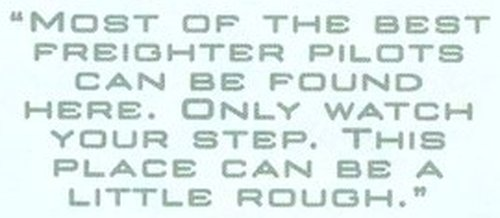
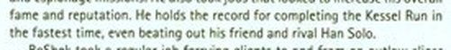
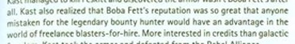
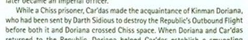
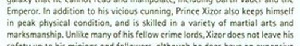
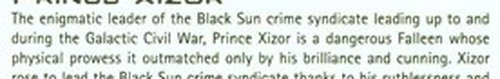
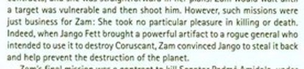
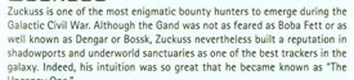

# Owner Material 037 — Star Wars D20 Drive folder (Core, Revised Core and Saga Edition): Sourcebooks/Scum and Villany.pdf [Star Wars Roleplaying Game Saga Edition (2007)] (scan pages 61–120)

- **Source:** Wizards of the Coast Star Wars Roleplaying Game books, web enhancements, Living Force campaign modules and articles (2000–2010), from the owner's "Star Wars D20" Drive folder (only the three edition subfolders; "General" was not read, as instructed). Secondary source (licensed Legends reference). Scan OCR'd on the box; the scan stays box-only and is **not** published.
- **Method:** every scanned page was OCR'd and machine-screened sentence by sentence for power-relevant statements (fights, kills, defeats, Force feats, rankings, superweapons) that name a character on our roster; each kept sentence is quoted verbatim from the OCR text and has a crop of the printed passage directly under it. Pages with nothing power-relevant are still listed with what is on them.
- **Citation:** "*Scum and Villany* (SWRPG Saga Edition), p.X" by printed page ("scan p.X" where no printed number applies). **Weight:** Licensed RPG material: a secondary source. Narrative text sums up Legends lore; game statistics are rules for players, not canon power levels, and rank lowest.

## scan p.61 (scan page 61)

Page contents: Holding Cells ("dungeon ships"), Interrogation Chamber (favored by Imperial Inquisitors and bounty hunters), Personalized Controls, Plasma Punch (Drever Corporation), Plasma Torch, Reinforced Keel. (hand-read)

## scan p.62 (scan page 62)

Page contents: Boarding keels; Security Bracing; Sensor Baffling (Arakyd Nightshadow coating); Sensor Decoy; Sensor Mask; Tractor Clamp; Workshop. Starship Codex intro. (hand-read)

## scan p.63 (scan page 63)

Page contents: Starship Codex: Gymsnor-3 Freighter (CorelliSpace; detachable cockpit; stat block); Kazellis Light Freighter (stat block); Surronian Conqueror-class assault ship intro (favored by bounty hunters; Guri pilots the Stinger). (hand-read)

### Stat block notes (game mechanics, not feats)

- Surronian Conqueror — Guri pilots the Stinger: Prince Xizor’s replica droid assistant, Guri, pilots a Conqueror-class assault ship called the Stinger. (Source: *Scum and Villany* (SWRPG Saga Edition), scan p.63)

## scan p.64 (scan page 64)

Page contents: Deck plan map: Surronian Conqueror-class Assault Ship (1 square = 1.5 meters; key: cockpit, escape pod access, boarding ramp and airlock, main cargo hold, laser cannon turret access, engine compartment and power core). (hand-read)

## scan p.65 (scan page 65)

Page contents: Surronian Conqueror stat block. YT-1250 (CEC redesign of YT-1200 series; sold to Trade Federation etc.; stat block). YT-1930 intro (variant predecessor of YT-2000). (hand-read)

## scan p.66 (scan page 66)

Page contents: Deck plan map: Corellian Engineering Corporation YT-1250 Transport (key: cockpit, cockpit corridor, boarding ramps, crew lounge, ring corridor, engineering compartment, crew quarters, main hold, forward airlock, secondary hold, ventral access port; 1 square = 1.5 meters). (hand-read)

## scan p.67 (scan page 67)

Page contents: YT-1930 stat block. Uglies intro (unreliable hybrid starfighters of pirates, slavers, smugglers). C-wing Ugly (Corellian/B-wing; YT cockpit on B-wing fuselage; New Republic abandoned damaged B-wings) with stat block. (hand-read)

## scan p.68 (scan page 68)

Page contents: Clutch Ugly Fighter (TIE/ln rebuild; first used by Moff Leonia Tavira's pirates from the Star Destroyer Invidious after Endor) with stat block. X-TIE Ugly Fighter (T-65 hull with TIE panels; Corellian Defense Forces; Incom defection; in service to the Corellian Insurrection; X-ceptor variant) with stat block. (hand-read)

## scan p.69 (scan page 69)

Page contents: Chapter III opener: "Fringe Campaigns" (art: bounty hunter with starships; image-viewed). (hand-read)

## scan p.70 (scan page 70)

Page contents: Chapter 3 intro (crime as a building block of society; smuggling vs profiteering; heroes in a Scum and Villainy campaign). A Gathering of Anti-Heroes (pre-campaign discussion of philosophies; "mystery loner" heroes; introductory scenario). Art: Jabba the Hutt with Salacious Crumb (image-read; OCR missed a line, restored from image: "(and at times corrupt) bureaucracy. Certainly, the smuggler makes a profit from supplying"). (hand-read)

## scan p.71 (scan page 71)

Page contents: Sidebar "Heroes and Anti-Heroes" (image-read; faint text not OCR'd): broken moral compass; ethical and moral limit; "relative evil"; Qui-Gon Jinn, Luke Skywalker, Han Solo as the iconic scoundrel. Caption: "Life on the fringe creates unlikely heroes" (art with R2-D2 and a battle droid). (hand-read)

### Stat block notes (game mechanics, not feats)

- Heroes and Anti-Heroes (sidebar, image-read): For certain types of players, exploring their hero's boundaries is what roleplaying is all about; the game's mechanics are at best a secondary concern. Most players, however, are more likely to embrace the "relative evil" of their heroes because it lets them approach the campaign's goals from a different direction, while at the same time not constraining them to the standards of behavior that characters such as Qui-Gon Jinn or Luke Skywalker might follow. This, after all, is what makes Han Solo such an interesting character and why many fans of the Star Wars setting think of him as the iconic scoundrel. (Source: *Scum and Villany* (SWRPG Saga Edition), scan p.71)

## scan p.72 (scan page 72)

Page contents: Shared Hero Backgrounds (example group: aspiring bounty hunter Lesk Hisshar, Wels Hillspringer and his Ghtroc 720 out of Corellia, Sullustan copilot Sall, Bothan con artist Eurrsk Joran'syk, Gungan soldier Winkin Wupps). Common Origins (example campaign setups). Allies (criminal organizations, bounty hunter houses, smuggling rings). (hand-read)

## scan p.73 (scan page 73)

Page contents: Allies cont. (bulleted ally setups: troubleshooters for a crime lord; freighter owned by a retired smuggler; support staff for a bounty hunter house); allies' fates linked to heroes. Location (cantina, docking bay, prison or spice mine). Caption: "The first meeting of some fringe heroes" (image-read; page OCR failed). (hand-read)

## scan p.74 (scan page 74)

Page contents: Location examples (spice mines of Kessel, Nar Shaddaa, Mos Eisley cantina). Events (Clone Wars, destruction of Alderaan, fall of the Empire, Yuuzhan Vong bounty on Jedi). The Common Cause. Campaign Elements (themes of Scum and Villainy). Bleak Prospects. (hand-read)

## scan p.75 (scan page 75)

Page contents: Adventure Hook: entrepreneur Turlo hires the heroes' ship from Rodia to Ryloth with endless side trips (Tatooine, Geonosis, Pzob). Retrograde Technology; Adventure Hook: deactivated droideka at a scrap dealer goes berserk. The Price of Trust (begins). Art: Han Solo by the Falcon's ramp (no caption). (hand-read)

## scan p.76 (scan page 76)

Page contents: Price of Trust cont. (caution on overusing betrayals); Adventure Hook: who tipped off the authorities (Twi'lek, Bothan banker, Human supply officer, Human friend). The Edge of Space (exploration); Adventure Hook: Ertraxi discovered beyond the Minos Cluster via Cronau radiation; finders' fee dilemma. Allies & Contacts; Making Allies. (hand-read)

## scan p.77 (scan page 77)

Page contents: Table 3-1 Contact level/attitude by d20 roll. Making Allies cont. (Persuasion, attitude shifts, reciprocity). Making Contacts (nobles, scoundrels, scouts, soldiers, Jedi). Caption: "A Gand smuggler gets news from his Duros contact" (image-read). (hand-read)

## scan p.78 (scan page 78)

Page contents: Table 3-2 Fees (attitude vs fee and favors). Contacts never accompany heroes. Generating Allies and Contacts (skill checks an ally/contact can make; money or equipment up to level x 1,000; base fee 500 x level). Risky Business (crime lords seeking dirty work). Caption: "A Bothan crime lord enjoys the fruits of risky business" (image-read; left column OCR partial, verified from image). (hand-read)

## scan p.79 (scan page 79)

Page contents: Table 3-3 Difficulty Classes for Adventures by CL (Easy to Heroic DCs). Honest jobs vs crime. Job Generator (flat fee or cut; witnesses Perception checks); Table 3-4 Jobs d20 (abduction, assassination, assault, burglary, espionage, exploration, hijacking, investigation, repair, rescue, robbery, sabotage, salvage, scam, shipjacking, smuggling). (hand-read)

## scan p.80 (scan page 80)

Page contents: Guards/police response times. Difficulties (refers to Table 3-3); XP Rewards (Table 3-5 XP Rewards). Abduction job (ransom, heroes' cut 20%, targets, complications). Assassination job (pay, targets). (hand-read)

## scan p.81 (scan page 81)

Page contents: (Page OCR failed; image-read.) Assassination complications cont. (security teams, entourage of assistants, witnesses, secured/high-security accommodations, multiple layers of security). Assault job ("Pay up," or "You can run, but you can't hide"; pay CL x 1,000; targets; complications). Burglary job (pay CL x 450; targets; complications). Caption: "An Imperial officer in the sights of a Clawdite assassin." (hand-read)

## scan p.82 (scan page 82)

Page contents: Espionage job (pay CL x 250; targets; complications incl. secured computers). Exploration job (mapping hyperspace hazards; Use Computer DCs; Table 3-13 Space Travel Hazards references). Hijacking job (ransom CL x 10,000; cut 20%; complications). (hand-read)

## scan p.83 (scan page 83)

Page contents: Investigation job (pay CL x 1,400). Repair job. Rescue job (pay CL x 1,500; ticking clock). Robbery job (begins). (hand-read)

## scan p.84 (scan page 84)

Page contents: (OCR fragmentary; image-read.) Robbery job cont. (pay CL x 2,000; targets; complications). Sabotage job (pay CL x 1,250; make it look like an accident; complications). Salvage job begins. Caption: "A Sullustan sabotages a crime lord's battle droids." (hand-read)

## scan p.85 (scan page 85)

Page contents: Salvage job (pay CL x 500). Scam job (pay CL x 450; see "Con Games" p88). Shipjacking job (ransom CL x 10,000; cut 20%). Smuggling job (pay CL x 1,000; customs officials; Table 3-13 refs). (hand-read)

## scan p.86 (scan page 86)

Page contents: The Black Market: finding a black market (Gather Information DC by item restriction; failed checks cause encounters), selling on the black market, black market adventures (Nar Shaddaa lure). Bounty Hunting; Bounty Hunting Guilds (House of Benelex, Quiok's Fist, Granse Confederacy, Bounty Hunters' Guild; 10% tithe; see Force Unleashed Campaign Guide ch4). (hand-read)

## scan p.87 (scan page 87)

Page contents: (Partly image-read.) Contracting Bounties (HoloNet postings, DC 10 Use Computer / DC 20 Gather Information; guild houses). Sidebar "License to Hunt" (IPKC permit, 1,000 credits; without permit only 50% of posted amount). Hunting Bounties; Tracking Targets (DC 15 Use Computer for planet). Caption: "A Wookiee bounty hunter tracks down his target." (hand-read)

## scan p.88 (scan page 88)

Page contents: Table 3-6 Bounties (d20 wanted-for/description/reward; roll 20 = treason, sedition: NPC such as Han Solo, Talon Karrde, Corran Horn, reward Special). Gather Information to locate target; example Lesk Hisshar hunting a Duros on Nar Shaddaa (Palace Casino). Survival tracking; DC 25 Use Computer to analyze Cronau radiation signature. Capturing Targets. (hand-read)

### Stat block notes (game mechanics, not feats)

- Table 3-6: Bounties: 20 Treason, sedition NPC (Han Solo, Talon Karrde, Corran Horn, etc.) Special (Source: *Scum and Villany* (SWRPG Saga Edition), scan p.88)

## scan p.89 (scan page 89)

Page contents: Bounty Generator (2d20 on Table 3-6; CL x 1,000; secondary bounty half value of captured equipment; famous targets such as Han Solo or Talon Karrde). Con Games; Sample Scam; sidebar Scammers and Marks; The Toydarian Drop (worth ~25,000 credits; Deception vs Will Defense, NPC +15). (hand-read)

### Stat block notes (game mechanics, not feats)

- Bounty Generator: Bounties posted on famous or notorious individuals from the Star Wors universe (such as Han Solo or Talon Karrde) rarely conform to the standard random bounty model. When developing a bounty on a famous character, the Gamemaster should make capturing that target part of a larger adventure or an adventure all its own. (Source: *Scum and Villany* (SWRPG Saga Edition), scan p.89)

## scan p.90 (scan page 90)

Page contents: Loan Sharks (loans up to CL x 50,000; Hutts, Herglics, Besalisks, Bothans make good loan sharks); Missed Payments (10% per month interest; escalating visits by goons). Piracy (Sector Rangers; pirate gangs; joining or founding a gang). (hand-read)

## scan p.91 (scan page 91)

Page contents: (OCR fragmentary; image-read.) Piracy cont.; Engaging in Piracy (Gather Information in Mos Eisley, Nar Shaddaa, Point Nadir; Immobilizer-418 cruiser; ion weapons). Privateers (letters of mark). Caption: "Pirates hijack a civilian vessel." (hand-read)

## scan p.92 (scan page 92)

Page contents: Smuggling (Rebel Alliance employs smugglers); Interdiction (gravity well generators); Cargo Generator; Table 3-7 Cargo (d20: animals, art, bacta, droids, foodstuffs, fuel, gems, labor machinery, luxury items, medical supplies, metals, raw materials, scrap, spare parts, spice, technological goods, textiles, water, weapons; weights). (hand-read)

## scan p.93 (scan page 93)

Page contents: (OCR fragmentary; image-read.) Inspection (customs teams of five or six officials; bribes). Famous Smuggling Runs; The Kessel Run (Maw Cluster; ~14 parsecs; DC 30 Use Computer through hyperspace, DC 25 Pilot). Caption: "Imperial pursuit on the Kessel Run" (Falcon chased by Star Destroyer art). (hand-read)

## scan p.94 (scan page 94)

Page contents: Spice (glitterstim, tempest rules; energy spiders on Kessel; Hutts). Rycar's Run (Rycar Ryjerd; Verpine shatter guns, Roche field, Tatooine, Kessel, Kiffex, Nar Shaddaa). The Byss Run (Deep Core Security Zone clearance; goods sold +500%). (hand-read)

### Stat block notes (game mechanics, not feats)

- The Byss Run: The Deep Core world of Byss was discovered in the latter decades of the Old Republic, and eventually became the seat of the reborn Emperor Palpatine's Empire after the Battle of Endor. (Source: *Scum and Villany* (SWRPG Saga Edition), scan p.94)

## scan p.95 (scan page 95)

Page contents: Spaceports and Shadowports (Point Nadir ch5). Sidebar "Spaceport Slang" (image-read): Action, Bantha Fodder, Binary, Blaster-proof, Coreward, Final Jump, Freeze, Grease the Servomotors, Long Zone, METOSP, Raider, Rimward, Short Zone, Spaced. Table 3-8 Parts Availability (d20 availability Poor–Universal, cost limits). (hand-read)

## scan p.96 (scan page 96)

Page contents: Table 3-9 Docking Bay Security (d20 quality Poor–Excellent; price per day; Mechanics DCs; attendants, security officers; long-term storage). Chop Shops; Simple Repairs (HP x 100 credits; 4 hp/hour/worker); Illegal Modifications (2,000 credits x checks x hours; Mechanics +16). (hand-read)

## scan p.97 (scan page 97)

Page contents: Spaceport Support: K-Series Spaceport Control Droid (Industrial Automaton; CL 1 stat block); RX-Series Pilot Droid (Industrial Automaton; stat block; playable droid heroes). (hand-read)

## scan p.98 (scan page 98)

Page contents: Table 3-10 Refueling Facilities; Table 3-11 Restocking Facilities; Table 3-12 Mechanic Availability (d20 quality, prices, effects, footnotes). (hand-read)

## scan p.99 (scan page 99)

Page contents: Orbital Service Shuttle (Gallofree Yards 23K, CL 5 stat block). Docking Bay Generator. Sample Docking Bay: example GM Kyle generating Kro La's Starship Storage on Nar Shaddaa using Tables 3-8 to 3-12. Caption: "A typical docking bay." (hand-read)

## scan p.100 (scan page 100)

Page contents: Table 3-13 Space Travel Hazards (minor/moderate/major: dust clouds, debris, gravity fields, supernova radiation, asteroid fields, dumped cargo, disabled Colossal vessel, black hole, superdense star cluster, gas giant). (hand-read)

## scan p.101 (scan page 101)

Page contents: Space Hazards; Dealing with Hazards. What Law There Is: Citations, Misdemeanors (minor/major), Felonies (minor/major/capital). Law Enforcement begins. (hand-read)

## scan p.102 (scan page 102)

Page contents: Calls for Help (response 1d4 x 10 rounds, modifiers; crisis response teams). Reasonable Use of Force (stun settings). Investigation (DC 15 Gather Information, DC 20 Perception, DC 15 Use Computer; case priority; inspectors). Arrest and processing begins. (hand-read)

## scan p.103 (scan page 103)

Page contents: (OCR fragmentary; image-read.) Processing cont. The Justice System: trial by opposed Persuasion checks (prosecution +10, +5 per severity step); court attitude outcomes Helpful/Friendly/Indifferent/Unfriendly/Hostile (Empire courts unfriendly; Nar Shaddaa corrupt courts friendly). Caption: "Sometimes the law catches up with you." (hand-read)

## scan p.104 (scan page 104)

Page contents: Table 3-14 Penalties (citation to capital felony by 1st/2nd/3rd offense). Sentencing (Persuasion, DC 25 Knowledge (bureaucracy); guilty pleas). Incarceration (Republic prisons/rehabilitation centers; Imperial prison planets during the reign of Emperor Palpatine); Forced Labor (Kessel spice mines; see Prison Break scenario ch6). (hand-read)

### Stat block notes (game mechanics, not feats)

- Incarceration: During the reign of Emperor Palpatine, prisons are dirty, overcrowded, understaffed, undersupplied, and isolated. (Source: *Scum and Villany* (SWRPG Saga Edition), scan p.104)

## scan p.105 (scan page 105)

Page contents: Chapter IV: Fringe Elements opener (full-page art of a freighter landing at a spaceport). (hand-read)

## scan p.106 (scan page 106)

Page contents: Chapter 4 intro (life on the edge). Eras of Play (notorious assassins, crime lords, bounty hunters, smugglers; adapt stats). Full-page alien art at left. (hand-read)

## scan p.107 (scan page 107)

Page contents: BoShek (Corellian ace; Kessel Run record beating Han Solo; Chalmun's Cantina, directed Obi-Wan Kenobi to Chewbacca and Han Solo; Imperial agent; incarcerated). Stat block CL 8 (Medium Human soldier 7/ace pilot 1). Pull quote by Obi-Wan Kenobi. Booster Terrik begins (Llollulion; Clone Wars; Separatists; Jysella; daughter Mirax). (hand-read)

- **Obi-Wan Kenobi** — entry/section: Pull quote: ""Most of the best freighter pilots can be found here. Only watch your step. This place can be a little rough." —Obi-Wan Kenobi" Source: *Scum and Villany* (SWRPG Saga Edition), scan p.107
  
- **Han Solo**: "He holds the record for completing the Kessel Run in the fastest time, even beating out his friend and rival Han Solo." Source: *Scum and Villany* (SWRPG Saga Edition), scan p.107
  

### Stat block notes (game mechanics, not feats)

- BoShek: If a “typical” Corellian ace from the years of the Galactic Civil War exists, BoShek is it. Driven by a desire for excitement and a dislike of rules, BoShek left his homeworld to make his fortune in the ranks of underworld pilots. He shied away from the roles of enforcer or bounty hunter and focused on smuggling and espionage missions. He also took jobs that looked to increase his overall fame and reputation. He holds the record for completing the Kessel Run in the fastest time, even beating out his friend and rival Han Solo. BoShek took a regular job ferrying clients to and from an outlaw slicer workshop concealed within a monastery on Tatooine, so he spent a lot of time there. While visiting Chalmun’s Cantina in Mos Eisley, he was approached by Obi-Wan Kenobi, seeking passage to Alderaan. BoShek couldn't take the job because his ship had been shot down, but he directed the old Jedi to Chewbacca and Han Solo. After that brief touch with history, BoShek went his own way. He tried to study the Force further but found his talent wasn't strong enough to grow (or his own attitudes prevented it from doing so). Shortly thereafter, he found a woman on the run from a Rebel cell that sought to kill her. His noble side getting the better of him, he helped her cross the planet only to discover she was an Imperial agent. Though she suggested he join the Empire, BoShek refused and was incarcerated. Although his known history ends there, the odds are slim that the Empire left such a talented, neutral pilot to rot in a cell. BoShek excels when behind the controls of a starfighter, space transport, or armed speeder. He believes his best chance at victory is to face foes headon. As a result, he prefers craft with powerful weapons and strong armor over sleeker, more maneuverable designs. (Source: *Scum and Villany* (SWRPG Saga Edition), scan p.107)
- BoShek Feats: Feats Armor Proficiency (light, medium), Burst Fire, Force Sensitivity, Point Blank Shot, Skill Focus (Pilot), Vehicular Combat, Weapon Focus (heavy weapons), Weapon Proficiency (heavy weapons, pistols, rifles, simple weapons) (Source: *Scum and Villany* (SWRPG Saga Edition), scan p.107)
- Booster Terrik: Booster Terrik began life as a Corellian seeking his fortune and adventure, having little luck finding the former and trouble every time he found the latter. His luck flipped repeatedly in the early years of his career, eventually taking a turn toward the profitable when he found a rich, bored Borlovian patron named Llollulion, who was more than willing to pay the way if Terrik would take him on as a copilot. Terrik happily agreed, and the two began a modest business as smugglers. Because of their lack of experience, they were caught more than once, but they always escaped with a good dose of blind luck. Their luck would eventually have run out if the Clone Wars hadn't started; by then, the Republic had more serious concerns than two mid-level smugglers and their gray-market cargoes. Although Terrik was mostly concerned with making a profit, Llollulion was a strong philosophical supporter of the Separatists (or at least those who were genuinely fighting for the right to be free). Terrik went along and was soon a supplier of fringe Separatist groups. When the Clone Wars ended, Terrik continued doing business with those groups that escaped detention. He later fell in love with a woman named Jysella, and the two had a daughter, Mirax. As a result, Terrik tried to settle down to spend more time with his family. He and Llollulion parted ways on good terms. (Source: *Scum and Villany* (SWRPG Saga Edition), scan p.107)

## scan p.108 (scan page 108)

Page contents: Booster Terrik cont. (Pulsar Skate; Antilles family, Wedge; Z-95; 5 years on Kessel; released after Hoth; fought Ysanne Isard; Yag'Dhul Station; Hutts and Talon Karrde; Star Destroyer Virulence renamed Errant Venture; Corran Horn, Rogue Squadron). Stat block CL 12 (Medium Human scoundrel 5/soldier 5/crime lord 2). Boushh begins (Ubese bounty hunter impersonated by Leia Organa at Jabba's Palace). (hand-read)

### Stat block notes (game mechanics, not feats)

- Booster Terrik (cont.): Aboard the star yacht Pulsar Skate, Terrik struggled to make ends meet— either legally or illegally—but luck continued to turn against him. When his wife died, he was forced to turn to friends, the Antilles family, to help raise Mirax. Terrik left his daughter with them whenever he had to make a long run, and he took both Mirax and the Antilles boy, Wedge, with him on shorter runs. He came to think of Wedge as his own blood; when Wedge's parents were killed by pirates, Terrik loaned the young man a Z-95 Headhunter, well aware that he would use it to get revenge. That casual disregard for the law caught up with Terrik eventually, and he was captured and sentenced to 5 years on Kessel. Five years of hard labor destroyed men with more obvious determination than Booster Terrik, and many CorSec officers assumed the freedom-loving smuggler would make a bid for escape (and be killed) long before his time was served. Terrik certainly considered possible escape routes, but he never saw one that looked promising enough to risk his life. Instead, he did his hard labor, building his already considerable muscles to Gamorrean proportions, and fought the deadly boredom of an unchanging daily routine. When Booster Terrik was released shortly after the Battle of Hoth, he found a galaxy in full rebellion, his daughter a competent smuggler in her own right, and young Wedge a combat pilot for the Rebel Alliance. He spent years keeping a low profile, but eventually found himself drawn back into Mirax and Wedge’s battle with the Empire. Terrik joined forces with them to fight Ysanne Isard, Director of Imperial Intelligence. He took over operation of their base of operations, Yag’Dhul Station, and turned the station into a successful shadowport business. Terrik’s small and thinly spread organization was still powerful enough for him to deal on nearly even terms with Hutts and Talon Karrde when the situation called for it. In that capacity, he ended up being involved in the capture of the Star Destroyer Virulence, which he managed to persuade the Alliance to hand over to him. Renaming the ship Errant Venture, he turned it into a mobile shadowport to rival any in the galaxy. (For more on the Errant Venture, see “Locations,” below.) Although it took more than a decade for Terrik to get the Errant Venture on financially stable footing, he managed to do so when most of the galaxy assumed he couldn't. His operation remained small, but even a stripped-down Star Destroyer acting as its mobile base of operations gave it a considerable advantage. Terrik continued to aid those he saw as family, primarily Mirax and Wedge, and to a lesser degree Corran Horn and the current or former members of the Rogue Squadron. Terrik is a proud, blunt man. He is willing to rough up senators, talk back to warlords, make demands of galactic governments, and refuse to show any sign of shame for doing so. Terrik considers himself a self-made man, and doesn't accept dominion from anyone—especially not now that he owns the Errant Venture. If he can fix a problem by knocking heads together, he does so. However, he is capable of resorting to bravado when true force fails, and even subterfuge if pushed to it. Although he accepts no national loyalties, those he considers friends can count on him to back them against any threat, no matter how overwhelming. (Source: *Scum and Villany* (SWRPG Saga Edition), scan p.108)
- Booster Terrik Feats: Feats Crush, Improved Damage Threshold, Improved Defenses, Martial Arts I, Martial Arts II, Melee Defense, Mighty Swing, Pin, Point Blank Shot, Trip, Vehicular Combat, Weapon Proficiency (pistols, rifles, simple weapons) (Source: *Scum and Villany* (SWRPG Saga Edition), scan p.108)
- Boushh: Boushh was an Ubese bounty hunter best known for being impersonated by Leia Organa at Jabba's Palace shortly after his death. He also had a reputation for being extremely calm, a useful quality in a profession filled with triggerhappy blaster jockeys. This is not to suggest Boushh was incapable of emotion. Indeed, he hated all non-Ubese with a passion. Nevertheless, Boushh was in complete control of his emotions, and he prided himself on always being able to make a calm, reasoned decision even in the heat of combat. Boushh was slender, even for an Ubese. This made it more difficult for the bounty hunter to achieve the level of physical intimidation critical to bringing in targets without constantly fighting every two-credit hired blaster with an attitude and a desire to prove they could take a bounty hunter. As a result, Boushh preferred to use powerful explosives to make an impression. Boushh wore a bandoleer of grenades chosen for the needs of a particular mission, Since he was known for being somewhat suicidal, his foes were willing to (Source: *Scum and Villany* (SWRPG Saga Edition), scan p.108)

## scan p.109 (scan page 109)

Page contents: (Image-read; OCR partial.) Boushh cont. (force pike; blackmail; killed by Guri for Prince Xizor; Leia used his gear). Stat block CL 10 (Medium Ubese scout 5/soldier 2/bounty hunter 3). Caption: "Boushh" (art of Leia-as-Boushh with force pike). (hand-read)

### Stat block notes (game mechanics, not feats)

- Boushh (cont., image-read): believe he would happily blow himself up as long as he took them along. (Leia used this reputation to good effect when she faced off against Jabba.) Armed with numerous ranged explosives, Boushh treated blasters as secondary weapons. Instead, he trained himself to be a master in melee combat, especially with the force pike. This also allowed him to take advantage of his slender frame to move through tight terrain and ambush a target in melee. Although a force pike is primarily used as a defensive or ceremonial weapon, Boushh used the fact that it was an unusual offensive choice to maximize the element of surprise, seeking to fight in circumstances that put blasters at a disadvantage. Because Boushh trusted no one, he always worked to gather information he could use to blackmail employers, allies, and foes alike. In the end, this overly cautious approach caused him to come to a bad end when he tried to use his information to force a Black Sun Vigo to pay more for an agreed-upon contract. Boushh hadn't allowed for the possibility that Prince Xizor would send his personal assassin, Guri, to eliminate him and take his armor and gear as trophies for the Underlord. Guri later gave those trophies to Princess Leia, who eventually used them in her mission to save Han Solo. Even after the death of Jabba, her impersonation of Boushh is not well known, and many underworld data traders believe he is retired rather than dead. (Source: *Scum and Villany* (SWRPG Saga Edition), scan p.109)
- Boushh Feats (image-read): Feats Armor Proficiency (light), Dodge, Improved Disarm, Melee Defense, Mobility, Rapid Strike, Shake It Off, Skill Focus (Perception), Weapon Focus (force pike), Weapon Proficiency (advanced melee weapons, pistols, rifles, simple weapons) (Source: *Scum and Villany* (SWRPG Saga Edition), scan p.109)

## scan p.110 (scan page 110)

Page contents: Jodo Kast (Rebel commando turned bounty hunter; Feskitt Bobb on Goratak III; impersonated Boba Fett; Zardra and Puggles Trodd; Lambda-class shuttle Foxcatch; killed in Fett's death trap on Nal Hutta). Stat block (Medium Human soldier 3/scout 4/gunslinger 3). Jorj Car'das begins (captured by Thrawn; Kinman Doriana; spy ring for Darth Sidious). (hand-read)

- **Boba Fett** — entry/section: Scum and Villainy (Saga): "Kast also realized that Boba Fett’s reputation was so great that anyone mistaken for the legendary bounty hunter would have an advantage in the world of freelance blasters-for-hire." Source: *Scum and Villany* (SWRPG Saga Edition), scan p.110
  
- **Palpatine (Darth Sidious)**: "While a Chiss prisoner, Car'das made the acquaintance of Kinman Doriana, who had been sent by Darth Sidious to destroy the Republic's Outbound Flight before both it and Doriana crossed Chiss space." Source: *Scum and Villany* (SWRPG Saga Edition), scan p.110
  

### Stat block notes (game mechanics, not feats)

- Jodo Kast: The mercenary Jodo Kast began his career as a commando working for the Rebel Alliance. On a mission to Goratak III, Kast’s force ran into a bounty hunter in Mandalorian battle armor. The Rebel forces mistook this bounty hunter, named Feskitt Bobb, for the feared Boba Fett. During the fighting, Kast managed to kill Feskitt and discovered the armor wasn't Boba Fett's after all. Kast also realized that Boba Fett’s reputation was so great that anyone mistaken for the legendary bounty hunter would have an advantage in the world of freelance blasters-for-hire. More interested in credits than galactic freedom, Kast took the armor and defected from the Rebel Alliance. Jodo Kast impersonated Boba Fett and began taking contracts and making contacts. He modified his gear to look as much like Fett’s as possible, rigging a heavy blaster to appear to be a carbine and repainting his own armor to match Fett's. Once he knew the ins and outs of the criminal underworld, Kast realized it might not be wise to take the name of the best tracker and fighter in the bounty hunting business, so he repainted his armor to a new, unique pattern. He began taking contracts under his own name, remaining mysterious about his armor and any assumed connection to the Mandalorian Supercommandos. During this period of the Galactic Civil War, Jodo Kast was a more successful scout and mercenary than bounty hunter. He could find and bring in low-level targets, and he was an effective combatant in a stand-up fight—but Kast lacked the true bounty hunter skill in tracking down elusive targets or extracting them without triggering a larger battle. He worked for a time with two other bounty hunters, Zardra and Puggles Trodd, allowing them to do the legwork while he acted as the backup. During this time, he acquired a Lambda-class shuttle, which became his base of operations. He had the shuttle massively up-gunned and renamed it the Foxcatch, and for a time Zardra and Trodd traveled in it with him. The partnership didn't last, and Kast found himself on his own again. When word got out that Boba Fett had died in the belly of the Sarlacc, Jodo Kast decided the time was again right to begin impersonating the more famous hunter—and charging the higher prices that Fett's name commanded. Ironically, Jodo Kast spent considerable time proving to people that Boba Fett was still alive. Thus, when the true Boba Fett began operations again (after the Sarlacc found him to be somewhat “indigestible"), no one questioned it. Fett was not amused to discover he was being impersonated, so he tracked down Kast. On Nal Hutta, five years after the Battle of Yavin, Fett captured Jodo Kast and placed him in a death trap. Fett explained that if Kast could escape the trap, Fett would have no further quarrel with him—but Fett added that Kast wouldn't survive because he was just an imposter. Fett was right. (Source: *Scum and Villany* (SWRPG Saga Edition), scan p.110)
- Jodo Kast Feats: Feats Armor Proficiency (light, medium), Collateral Damage, Martial Arts I, Point Blank Shot, Precise Shot, Quick Draw, Rapid Shot, Shake It Off, Weapon Focus (pistols), Weapon Proficiency (advanced melee weapons, pistols, rifles, simple weapons) (Source: *Scum and Villany* (SWRPG Saga Edition), scan p.110)
- Jorj Car'das: Though few people know his name, Jorj Car'das has touched many of the most important events in the galaxy. Beginning his career as a Corellian navigator on a smuggling ship, he and his allies were captured by the Chiss commander Thrawn on the Outer Rim. Despite the protests of his fellow prisoners, Car'das was entirely open and honest with Thrawn. He was held long enough to learn the Chiss language and learn something of their ways. When Thrawn finally released him, the two parted as friends. However, Car'das was also the first Corellian that Thrawn ever met, and the insight Thrawn gained about the Galactic Republic would serve him well when he later became an Imperial officer. While a Chiss prisoner, Car‘das made the acquaintance of Kinman Doriana, who had been sent by Darth Sidious to destroy the Republic’s Outbound Flight before both it and Doriana crossed Chiss space. When Doriana and Car’das returned to the Republic, Doriana helped Car'das establish a smuggling operation that was also to serve as a spy ring for Darth Sidious (although Doriana kept his ultimate benefactor secret from Car'das). By the time of the Clone Wars, Car'das was a powerful smuggler and a rising crime lord. Though he did not yet have the power of the Hutts, he was (Source: *Scum and Villany* (SWRPG Saga Edition), scan p.110)

## scan p.111 (scan page 111)

Page contents: Jorj Car'das cont. (took over Booster Terrik's organization; healed by Yoda on Dagobah; organization taken over by Talon Karrde; Exocron, Aing-Tii monks; Rei'kas; trip to Chiss space after Thrawn's death). Stat block CL 12 (Medium Human noble 7/crime lord 5), Dark Times. Mirax Terrik Horn (Pulsar Skate; Wedge Antilles; Corran Horn, son of Hal Horn; Block Asp; Mara Jade; Errant Venture). (hand-read)

### Stat block notes (game mechanics, not feats)

- Jorj Car'das (cont.): in a position to take over Booster Terrik’s organization when Terrik was sent to Kessel. After the Clone Wars, Car'das was captured and badly injured by a Dark Jedi, and he survived only after finding Yoda on Dagobah and receiving healing from the exiled Jedi Master. The experience gave Car'das renewed drive, and he began diversifying his criminal empire so it was involved in a wide range of activities but dominant in none. With this tactic, as well as an increasing interest in information, he built an organization that rivaled that of even the Hutts. In the same year as the Battle of Yavin. Car'das’s health once again began to fail him. He flew off in a private yacht to seek further healing from Yoda, but the Jedi Master chided him for wasting the second chance he had already received. Car'das never returned to his criminal empire, leaving it to be taken over by Talon Karrde. Car'das went instead to Exocron, hoping to find aid from the Aing-Tii monks. He required regular treatments from them, but he eventually managed to recover. He was, however, stuck on Exocron (so he could stay close to the monks), so he built a fortress and a vast library of datacards. When Talon Karrde later sought Car'das, hoping for a copy of a document to end a brewing political war, Car'das was able to turn events to his favor once more. He allowed Karrde's agents to find him while at the same time luring an enemy of the Aing-Tii, the crime lord Rei’kas, to his destruction. Although Car'das either couldn't or wouldn't give Karrde the exact information he sought, he did have enough other information to give Karrde an edge in the following negotiations. After that, Car’das once again faded into the background, apparently recovered enough to leave Exocron for prolonged periods. He made at least one known trip to Chiss space after the death of Thrawn, apparently to fulfill a promise he made decades before, but the details of his later actions are sparse at best. Still, he is a cunning and canny smuggler who once ruled an organization that could even threaten planetary governments, so it would be unwise to assume Car'das is done affecting events in the galaxy. The following stat block represents Jorj Car'das at the height of his criminal empire, after his encounter with the Dark Jedi and subsequent healing by Yoda but before his renewed health began to fail. This is appropriate for use in any Dark Times campaign, set between the end of the Clone Wars and the Battle of Yavin. (Source: *Scum and Villany* (SWRPG Saga Edition), scan p.111)
- Jorj Car'das Feats: Feats Force Sensitivity, Friends in Low Places, Improved Defenses, Linguist, Point Blank Shot, Precise Shot, Skill Focus (Gather Information, Knowledge [galactic lore], Persuasion), Vehicular Combat, Weapon Proficiency (pistols, simple weapons) (Source: *Scum and Villany* (SWRPG Saga Edition), scan p.111)
- Mirax Terrik Horn: Mirax Terrik, without doubt, took after her father. Raised on Corellia, Mirax spent much of her youth with childhood friend Wedge Antilles. When her father was apprehended by CorSec and sentenced to hard labor on Kessel, the underage Mirax took control of the small part of his smuggling operation not seized by Jorj Car'das. She personally flew the Baudo-class star yacht Pulsar Skate, managing to keep the organization together in part by shifting to mostly legal jobs. Until his defection to the Rebellion, Wedge aided her when he could, mostly with free ship repairs. Eventually her path and that of Wedge Antilles would cross again, as Wedge and his squadmate Corran Horn rescued her from the Imperial vessel Black Asp. Corran Horn was the son of Hal Horn, who had captured and imprisoned Mirax's father. Despite her instinctive dislike of anyone related to Hal Horn, Mirax’s friendship with Wedge convinced her to work for the Rebellion, and this in turn put her in more regular contact with Corran. As she smuggled critical supplies to the Rebellion and later the New Republic, Mirax came to appreciate Corran Horn. The two eventually fell in love and were married. Never content to allow her husband to have all the adventure, Mirax was active in blockade running, hunting Imperial criminals, and operating a smuggling empire even after being married and having children. She became good friends with Mara Jade and eventually began to learn the operation of her father’s ship, the Errant Venture. Mirax often succeeds by acting erratically. She catches her foes off-guard with sudden maneuvers (in both the tactical and strategic sense). She fiercely defends of her family, friends, and allies. Those who would see this as a weakness discover the hard way that Mirax doesn’t take threats well. (Source: *Scum and Villany* (SWRPG Saga Edition), scan p.111)

## scan p.112 (scan page 112)

Page contents: Mirax Terrik Horn stat block (Medium Human scoundrel 7/master privateer 3). Moxin Tark (bounty hunter; Bandonia; armor of the Sun Guards of Thyrsus). Stat block (soldier 3/scout 3/scoundrel 1/bounty hunter 4). Prince Xizor begins (Black Sun; Falleen; Darth Vader and the Emperor; Guri). (hand-read)

- **Prince Xizor** — entry/section: Scum and Villainy (Saga): "In addition to his vicious cunning, Prince Xizor also keeps himself in peak physical condition, and is skilled in a variety of martial arts and marksmanship." Source: *Scum and Villany* (SWRPG Saga Edition), scan p.112
  
- **Prince Xizor**: "The enigmatic leader of the Black Sun crime syndicate leading up to and during the Galactic Civil War, Prince Xizor is a dangerous Falleen whose physical prowess it outmatched only by his brilliance and cunning." Source: *Scum and Villany* (SWRPG Saga Edition), scan p.112
  

### Stat block notes (game mechanics, not feats)

- Mirax Terrik Horn Feats: Feats Fleet-Footed, Point Blank Shot, Precise Shot, Running Attack, Skill Focus (Persuasion, Pilot), Vehicular Combat, Weapon Finesse, Weapon Proficiency (advanced melee, pistols, simple weapons) (Source: *Scum and Villany* (SWRPG Saga Edition), scan p.112)
- Moxin Tark: Moxin Tark is a notorious bounty hunter respected for his cruelty and viciousness. Active during the Galactic Civil War and the days of the New Republic, Tark cares little for the sanctity of life or the trails of blood he leaves in his wake. Tark’s father was a career military commander and served the Empire faithfully, but Moxin elected not to follow in his father’s footsteps. At a young age, he abandoned a privileged life on Bandonia and sought a career to spite his father’s honorable legacy. Moxin Tark wears the armor of the Sun Guards of Thyrsus, which is said to have inspired the armor of the Imperial Royal Guard (and, likely, the Senate Guards that preceded them). Tark's armor has been modified to suit his needs, and he takes great care in upgrading and maintaining its systems, allowing him to function alone, without the need for partners. Tark believes that fear is an extremely powerful weapon, and he goes out of his way to terrorize a mark before taking it into custody. (Source: *Scum and Villany* (SWRPG Saga Edition), scan p.112)
- Moxin Tark Feats: Feats Armor Proficiency (light, medium), Point Blank Shot, Shake It Off, Skill Focus (Persuasion), Skill Training (Persuasion), Skill Training (Survival), Skill Training (Use Computer), Tech Specialist (see page 21 of Starships of the Galaxy), Weapon Proficiency (advanced melee weapons, heavy weapons, pistols, rifles, simple weapons) (Source: *Scum and Villany* (SWRPG Saga Edition), scan p.112)
- Prince Xizor: The enigmatic leader of the Black Sun crime syndicate leading up to and during the Galactic Civil War, Prince Xizor is a dangerous Falleen whose physical prowess is outmatched only by his brilliance and cunning. Xizor rose to lead the Black Sun crime syndicate thanks to his ruthlessness and his ability to outthink his opponents, and Xizor prides himself on his ability to read people. Xizor believes (perhaps too much) that there is no one in the galaxy that he cannot read and manipulate, including Darth Vader and the Emperor. In addition to his vicious cunning, Prince Xizor also keeps himself in peak physical condition, and is skilled in a variety of martial arts and marksmanship. Unlike many of his fellow crime lords, Xizor does not leave his safety up to his minions and followers, although he does have an expensive and well-trained human replica droid bodyguard, Guri. (Source: *Scum and Villany* (SWRPG Saga Edition), scan p.112)

## scan p.113 (scan page 113)

Page contents: Prince Xizor cont. (skyhook above Coruscant; StarViper-class). Stat block CL 16 (Medium Falleen noble 7/crime lord 9; Guri; Virago). Snoova (Wookiee bounty hunter; Aurodium Sword; Black Sun; cybernetic eyepatch). Stat block (soldier 4/scout 3/bounty hunter 3). (hand-read)

### Stat block notes (game mechanics, not feats)

- Prince Xizor (Saga CL 16): CL 16 Medium Falleen noble 7/crime lord 9 Destiny 2, Force 6; Dark Side 14 Init +14: Senses Perception +20 Languages Basic, Bocce, Bothese, Falleen, High Galactic, Huttese, Rodese, Ryi, Sullustese Defenses Ref 32 (flat-footed 28), Fort 26, Will 32 hp 80; Threshold 26 Immune +5 to Fortitude Defense against Fallen pheromones ‘Speed 6 s (Source: *Scum and Villany* (SWRPG Saga Edition), scan p.113)
- Prince Xizor (cont.): Xizor is a tall, muscular Falleen with green, scaly skin and long black hair pulled back in a topknot. Xizor owns a skyhook that floats in the space above Coruscant, and has a personal StarViper-class attack platform he uses for transportation. (Source: *Scum and Villany* (SWRPG Saga Edition), scan p.113)
- Prince Xizor Feats: Feats Linguist, Martial Arts I, Martial Arts II, Martial Arts III, Point Blank Shot, Precise Shot, Skill Focus (Deception), Skill Focus (Perception), Skill Focus (Persuasion), Sniper, Weapon Proficiency (pistols, simple weapons) (Source: *Scum and Villany* (SWRPG Saga Edition), scan p.113)
- Snoova Feats: Feats Armor Proficiency (light, medium), Point Blank Shot, Power Attack, Shake It Off, Skill Training (Survival), Weapon Focus (advanced melee weapons), Weapon Focus (rifles), Weapon Proficiency (advanced melee weapons, pistols, rifles, simple weapons) (Source: *Scum and Villany* (SWRPG Saga Edition), scan p.113)
- Snoova (image-checked): Snoova is a Wookiee bounty hunter active during the time of the Galactic Civil War. Exiled from Kashyyyk for using his claws in combat (a taboo that the Wookiees take very seriously), Snoova turned to a life on the fringe to avoid slavery at the hands of the Empire. Though not much is known about Snoova, he is said to be a member of a mercenary group known as the Aurodium Sword, and Black Sun has been known to employ his services from time to time. Snoova also takes Imperial bounties and is well known as a brutal, bloodthirsty bounty hunter. Snoova is recognizable among the other Wookiees thanks to his fur, which is mottled with black spots, and the way he shaves the top of his head so that his fur comes to a flat top. Snoova lost an eye in pursuit of a bounty and wears an eyepatch that connects to cybernetics lodged in his eye socket, giving him enhanced vision (replicating the helmet package found on many armors). (Source: *Scum and Villany* (SWRPG Saga Edition), scan p.113)

## scan p.114 (scan page 114)

Page contents: Tyber Zann (Zann Consortium; Anaxes; expelled from Carida by Thrawn; Kessel spice mines). Stat block CL 13 (Medium Human scoundrel 5/soldier 4/crime lord 4). Zam Wesell begins (Clawdite; Mabari; Jal Shey; Denon; daughter Sone; Jango Fett; Gardulla the Elder; Komari Vosa; Count Dooku; Boba Fett; Padmé Amidala). (hand-read)

- **Jango Fett**: "However, such missions were Just business for Zam: She took no particular pleasure in killing or death. ladeed, when Jango Fett brought a powerful artifact to a rogue general who intended to use it to destroy Coruscant, Zam convinced Jango to steal it back and help prevent the destruction of the planet." Source: *Scum and Villany* (SWRPG Saga Edition), scan p.114
  

### Stat block notes (game mechanics, not feats)

- Tyber Zann: A powerful and cruel crime lord, Tyber Zann is the leader of the Zann Consortium, 3 criminal syndicate that operates around the time of the Galactic Civil War. Born on Anaxes, Zann studied at the Imperial Academy at Carida until his expulsion at the hands of Grand Admiral Thrawn. Zann, who had been running a number of criminal schemes on Carida ranging from crooked sabacc games to smuggling ventures, grew to resent the Empire and positioned the Zann Consortium as an enemy of both the Empire and the Rebel Alliance. Zann and his crime syndicate have many enemies, ranging from the Desilijic Hutt clan to the Emperor himself, yet the Zann Consortium flourishes and grows despite adversity. So powerful is the Zann Consortium that, like the Tenloss Syndicate, Zann can manufacture his own weapons, ships, and other material needed to maintain his criminal empire. Tyber Zann is a handsome man with white hair and a scarred face. A hard man, Zann has done time in the spice mines of Kessel (from which he managed to escape) and has cultivated a reputation for being cold, calculating, and merciless. Zann’s ambitions are great, and he lets no one stand in his way, leveraging the significant amounts of power he has obtained against any obstacles. (Source: *Scum and Villany* (SWRPG Saga Edition), scan p.114)
- Tyber Zann Feats: Feats Double Attack (rifles), Friends in Low Places, Improved Defenses, Point Blank Shot, Precise Shot, Quick Draw, Skill Focus (Deception), Skill Focus (Persuasion), Skill Training (Use Computer), Weapon Focus (pistols), Weapon Focus (rifles), Weapon Proficiency (pistols, rifles, simple weapons) (Source: *Scum and Villany* (SWRPG Saga Edition), scan p.114)
- Zam Wesell: Unlike most Clawdites, Zam Wesell didn't grow up in a ghetto or slum. She was raised by the Mabari, an order of warrior-knights that developed from the teachings of the Jal Shey monks. However, Zam still suffered as a second-class citizen in an oppressive society that mistrusted her for what she was, not what she'd done or believed. This drove Zam to seek credits to escape her homeworld, which conflicted with the more selfless teachings of the Mabari. After reaching the third degree of Mabari warrior training, Zam left the order to try her hand as a freelance mercenary. She was first hired on the planet Denon, a city-world similar to Coruscant (though a distant second to that planet in terms of galactic importance). Zam worked her way up through corporate security positions, eventually becoming an executive bodyguard. She also found another Clawdite working on Denon and tried to enjoy a free family life for a time, bearing a daughter named Sone (who disappeared shortly after her mother’s eventual death). However, living on a single world was still too restrictive for Zam, and she left corporate life to hire herself out as a bounty hunter and assassin. Early in her career, Zam found herself working to capture the same target as Jango Fett. The two ruined one another's plans and ended up having to work together to escape from the fiasco that followed. The two began an on-again, off-again partnership that included such events as Zam betraying Fett to Gardulla the Elder, being left in a dungeon by him, and later escaping to rescue him from the fallen Jedi (and leader of the Bando Gora cult) Komari Vosa. Shortly afterward, Jango Fett was hired by Count Dooku to be the template for a clone army, with Jango receiving Boba Fett as part of the deal. Zam liked Jango Fett and considered a romance with the Mandalorian, but events never seemed to allow for such a relationship; still, Zam did take a liking to young Boba Fett, who regarded her as a mother figure. Zam continued to work with Jango but also took missions on her own. Able to infiltrate nearly any organization thanks to her shapechanging, Zam tended to take assassination contracts rather than bring-them-back-alive contracts, and she was straightforward in her plans. Zam would wait until a target was vulnerable and then shoot him. However, such missions were just business for Zam: She took no particular pleasure in killing or death. Indeed, when Jango Fett brought a powerful artifact to a rogue general who intended to use it to destroy Coruscant, Zam convinced Jango to steal it back and help prevent the destruction of the planet. Zam’s final mission was a contract to kill Senator Padmé Amidala, under the guidance of Jango Fett. Her first effort was to pose as a reporter and, through a combination of seduction and promises of future payments, (Source: *Scum and Villany* (SWRPG Saga Edition), scan p.114)

## scan p.115 (scan page 115)

Page contents: Zam Wesell cont. (bomb on royal cruiser; kouhuns; Anakin Skywalker and Obi-Wan Kenobi; Outlander Club; Kamino saberdart). Stat block CL 10 (Medium Clawdite soldier 4/scoundrel 3/assassin 3; Mabari armorweave). Zardra (bounty hunter; Jodo Kast partnership). Art: Zam Wesell (labelled "ZAM WESELL", image-checked). (hand-read)

### Stat block notes (game mechanics, not feats)

- Zam Wesell (cont.): convince a Naboo security guard to plant a “listening device” on the royal cruiser. The device was, of course, a bomb, and while the blast destroyed the cruiser and the security guard who planted it, it failed to kill Senator Amidala. Jango Fett insisted her next effort be more subtle and provided Zam with poisonous kouhuns. Zam managed to sneak the creatures into the Senator's room using a courier droid, but Anakin Skywalker and Obi-Wan Kenobi prevented them from killing Amidala. In the ensuing chase, Anakin forced Zam to crash her speeder into the Outlander Club. The Jedi captured her and pressured her to reveal who had hired her, but Jango Fett silenced her with a Kamino saberdart. Zam knew who had shot her and cursed at Jango in Huttese as she died, but there was little enough true anger in her voice. It was, after all, just business. (Source: *Scum and Villany* (SWRPG Saga Edition), scan p.115)
- Zam Wesell Feats: Feats Armor Proficiency (light, medium), Careful Shot, Deadeye, Deadly Sniper, Point Blank Shot, Precise Shot, Skill Focus (Perception), Skill Training (Stealth), Sniper, Weapon Proficiency (pistols, rifles, simple weapons) (Source: *Scum and Villany* (SWRPG Saga Edition), scan p.115)
- Zardra: Zardra is a classic example of a “typical” bounty hunter—successful at her chosen trade, but neither widely famous nor particularly feared. A tall Human female, Zardra is a skilled tracker and competent in a fight, but not in the same class as more infamous bounty hunters. However, she is more than a match for the common riffraff that makes the mistake of angering powerful senators, connected crime lords, and wealthy merchants. For bounties beneath the notice of Boba Fett or Bossk, Zardra is your woman. Zardra is active before and during the Galactic Civil War, but little is known about her background or early work. Whenever possible, Zardra prefers to work with a partner. For a time she worked with Jodo Kast. Zardra did the legwork, tracking down targets and forming plans to bring them in, and left the heavier combat tasks to Kast. The partnership worked well for months, though their biggest targets continued to elude them. When Kast decided he preferred to work alone, Zardra felt no remorse: Kast was too brash and trigger-happy for her tastes (and in fact got himself killed not long after leaving her). Zardra is cautious, spending time to understand a target before she moves in to apprehend. She looks for weaknesses, or at least strengths to avoid, and makes meticulous plans for each capture. Zardra is sure to consider how locals might react to any bounty she tries to bring in, what allies her target might have hidden, and alternate escape routes to use if her plan falls apart. This caution means her targets occasionally escape before she's ready to confront them, but Zardra is satisfied to be alive long enough to hunt them down again. She has every intention of retiring someday and isn’t going to allow pride to get her killed over a job. When all else fails, Zardra is happy to lob a thermal detonator into a fray, using the confusion to escape. (Source: *Scum and Villany* (SWRPG Saga Edition), scan p.115)

## scan p.116 (scan page 116)

Page contents: Zardra stat block (Medium Human scout 5/scoundrel 2/bounty hunter 1). Zuckuss (Gand Findsman; "The Uncanny One"; Crimson Nova chapter of the Bounty Hunter's Guild; partner 4-LOM; split personality; rivalry with Boba Fett; New Republic bounties; detention on Coruscant). Art caption (image-read): "Zuckuss (right) and 4-LOM". (hand-read)

- **Boba Fett; Dengar; Bossk** — entry/section: Scum and Villainy (Saga): "Although the Gand was not as feared as Boba Fett or as well known as Dengar or Bossk, Zuckuss nevertheless duilt a reputation in shadowports and underworld sanctuaries as one of the best trackers in the galaxy." Source: *Scum and Villany* (SWRPG Saga Edition), scan p.116
  

### Stat block notes (game mechanics, not feats)

- Zardra Feats: Feats Armor Proficiency (light), Dodge, Mobility, Running Attack, Shake It Off, Skill Focus (Initiative), Skill Training (Mechanics), Weapon Focus (advanced melee weapons), Weapon Proficiency (advanced melee weapons, pistols, rifles, simple weapons) (Source: *Scum and Villany* (SWRPG Saga Edition), scan p.116)
- Zuckuss: Zuckuss is one of the most enigmatic bounty hunters to emerge during the Galactic Civil War. Although the Gand was not as feared as Boba Fett or as well known as Dengar or Bossk, Zuckuss nevertheless built a reputation in shadowports and underworld sanctuaries as one of the best trackers in the galaxy. Indeed, his intuition was so great that he became known as “The Uncanny One.” The truth of Zuckuss’s amazing tracking ability goes back to his origin on Gand, a mist-covered world with poor visibility. There arose the Force-using tradition of the Findsmen, trackers able to use the Force (which they saw as trained intuition) to locate missing people or items. Zuckuss comes from a long line of Findsmen, and he decided to take his skills offworld to become a bounty hunter. Zuckuss quickly proved able to track down quarry no other bounty hunter could locate. He was soon in the employ of the Crimson Nova chapter of the Bounty Hunter's Guild, building a reputation as the best possible partner for combat-oriented mercenaries who could fight but needed help tracking down targets. Over the course of his career, Zuckuss collaborated with many other bounty hunters, though his longest and best known association was with the droid criminal 4-LOM. Zuckuss’s career was full of highs and lows. He worked with (and without) the aid of guilds, served the Hutts, the Empire, and even the Alliance, and found numerous targets that had remained hidden from all other hunters. Despite this, he could never maintain a high level of success or satisfaction. Indeed, the stress of his lifestyle caused him to suffer a split personality—one a humble, proper Gand with a strong moral streak, the other a bold braggart and cruel mercenary willing to take any job if the pay was right. As if his mental illness weren't enough, he suffered severe lung damage for years, and he was often in poor health. One bounty hunter Zuckuss never managed to get along with was Boba Fett. The famous Mandalorian managed to steal bounties Zuckuss was after, defeat him (and his partners) in combat, or otherwise humiliate the Gand. Fett was also responsible for the destruction of 4-LOM, which had begun to develop a set of morals Zuckuss could agree with. Zuckuss had the droid rebuilt, but the droid’s mental state was never the same. After failing to capture Han Solo, Zuckuss began to show increasing Rebel sympathies. After the Empire's defeat, he took New Republic bounties, tracking down wanted war criminals from the Empire. Still, his glory days were behind him, and his questionable health continued to deteriorate. He ended up in detention on Coruscant, under the scrutiny of New Republic psychiatrists, too valued as a one-time ally of the Alliance to throw into a common prison, and too dangerous to be let free. However, Zuckuss became a legend on his homeworld, inspiring a new generation of Gand bounty hunters to follow his example. (Source: *Scum and Villany* (SWRPG Saga Edition), scan p.116)

## scan p.117 (scan page 117)

Page contents: Zuckuss stat block (Medium Gand scout 7/bounty hunter 4). Pull quote: Darth Vader. ARCHETYPES section intro and Table 4-1: Other Archetypes (Assassin, Bounty hunter, Con artist, Gambler, Information broker, Outlaw tech, Pirates, Police officer, Sector ranger, Slicer, Smuggler, Swoop gangs, Thug; table tail image-read). (hand-read)

- **Darth Vader (Anakin Skywalker)** — entry/section: Pull quote: ""I want them alive. No disintegrations!" —Darth Vader" Source: *Scum and Villany* (SWRPG Saga Edition), scan p.117
  

### Stat block notes (game mechanics, not feats)

- Zuckuss Feats: Feats Armor Proficiency (heavy, light, medium), Force Sensitivity, Force Training, Point Blank Shot, Shake It Off, Skill Training (Use the Force), Weapon Proficiency (pistols, rifles, simple weapons) (Source: *Scum and Villany* (SWRPG Saga Edition), scan p.117)

## scan p.118 (scan page 118)

Page contents: Archetypes: Blockade Runner/Privateer (boarding actions; stat block CL 8, Medium Human scoundrel 7/master privateer 1). Brawler (unarmed combat; stat block Medium Human soldier 5). Generic NPCs, no named characters. (hand-read)

## scan p.119 (scan page 119)

Page contents: Archetypes: Charlatan (stat block CL 8, Medium Human noble 7/charlatan 1). Data Slicer (stat block CL 7, Medium Human scoundrel 7). Generic NPCs, no named characters. (hand-read)

## scan p.120 (scan page 120)

Page contents: Archetypes: Enforcer (Corporate Alliance, Smuggler's Alliance, security forces on the Errant Venture; stat block CL 5, Medium Human soldier 5). Expert Assassin begins (guilds/orders). Generic NPCs. Art caption (image-read): "Lando Calrissian, escorted by Cloud City enforcers". (hand-read)

