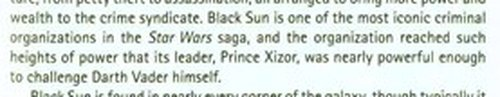

# Owner Material 037 — Star Wars D20 Drive folder (Core, Revised Core and Saga Edition): Sourcebooks/Scum and Villany.pdf [Star Wars Roleplaying Game Saga Edition (2007)] (scan pages 121–180)

- **Source:** Wizards of the Coast Star Wars Roleplaying Game books, web enhancements, Living Force campaign modules and articles (2000–2010), from the owner's "Star Wars D20" Drive folder (only the three edition subfolders; "General" was not read, as instructed). Secondary source (licensed Legends reference). Scan OCR'd on the box; the scan stays box-only and is **not** published.
- **Method:** every scanned page was OCR'd and machine-screened sentence by sentence for power-relevant statements (fights, kills, defeats, Force feats, rankings, superweapons) that name a character on our roster; each kept sentence is quoted verbatim from the OCR text and has a crop of the printed passage directly under it. Pages with nothing power-relevant are still listed with what is on them.
- **Citation:** "*Scum and Villany* (SWRPG Saga Edition), p.X" by printed page ("scan p.X" where no printed number applies). **Weight:** Licensed RPG material: a secondary source. Narrative text sums up Legends lore; game statistics are rules for players, not canon power levels, and rank lowest.

## scan p.121 (scan page 121)

Page contents: Archetypes: Expert Assassin stat block (CL 8, Medium Human soldier 4/scoundrel 3/assassin 1). Fixer (black market contacts; stat block CL 7, Medium Human scoundrel 4/noble 3). Notorious Outlaw begins. Generic NPCs. (hand-read)

## scan p.122 (scan page 122)

Page contents: Archetypes: Notorious Outlaw stat block (CL 8, Medium Human scoundrel 3/scout 4/gunslinger 1); art caption "A notorious outlaw". Space Transport Pilot (stat block CL 7, Medium Human scoundrel 7). Generic NPCs. (hand-read)

## scan p.123 (scan page 123)

Page contents: Archetypes: Security and Law Enforcement Officers (security officers, security specialists, inspectors/customs; bribery). Security Officer stat block (CL 4, Medium Human nonheroic 4); Security Specialist stat block (CL 5, Medium Human soldier 5). Generic NPCs. (hand-read)

## scan p.124 (scan page 124)

Page contents: Archetypes: Inspector stat block (CL 7, Medium Human scoundrel 3/scout 4). ORGANIZATIONS section: six criminal organizations. Black Sun (Underlord, Vigos; Prince Xizor; Darth Vader; Coruscant HQ; fleet from TransGalMeg and Joraan Drive Systems; Force Unleashed Campaign Guide; Threats of the Galaxy Vigos). GenoHaradan begins (assassins over 4,000 years; Guildmaster and four Overseers; Jedi Civil War, Darth Revan; Tatooine). (hand-read)

- **Prince Xizor; Darth Vader (Anakin Skywalker)** — entry/section: Scum and Villainy (Saga): "Black Sun is one of the most iconic criminal organizations in the Stor Wars saga, and the organization reached such heights of power that its leader, Prince Xizor, was nearly powerful enough to challenge Darth Vader himself." Source: *Scum and Villany* (SWRPG Saga Edition), scan p.124
  

### Stat block notes (game mechanics, not feats)

- Black Sun: Black Sun is one of the most iconic criminal organizations in the Star Wars saga, and the organization reached such heights of power that its leader, Prince Xizor, was nearly powerful enough to challenge Darth Vader himself. (Source: *Scum and Villany* (SWRPG Saga Edition), scan p.124)
- GenoHaradan: The GenoHaradan surfaces briefly during the Jedi Civil War, hoping to capitalize on Darth Revan's rise to power, on worlds as far out in the Outer Rim as Tatooine. (Source: *Scum and Villany* (SWRPG Saga Edition), scan p.124)

## scan p.125 (scan page 125)

Page contents: GenoHaradan cont. (Knights of the Old Republic Campaign Guide). Hutt Kajidics (Nal Hutta; Hutt Space; Nikto, Gamorreans; Jabba's example). Swoop Gangs (Tatooine, Taris; Hidden Beks of Taris in the Mandalorian Wars). (hand-read)

### Stat block notes (game mechanics, not feats)

- Hutt Kajidics: Most Hutts take great pleasure in tormenting their enemies, and more than a few follow Jabba's example in finding new "sport" in torturing a nemesis. (Source: *Scum and Villany* (SWRPG Saga Edition), scan p.125)

## scan p.126 (scan page 126)

Page contents: Tenloss Criminal Syndicate (Tenloss Corporation front; Bajic sector; disruptors; Tenloss XQ space platform; Rebel Alliance buys weapons; Force Unleashed Campaign Guide). Hornet-class Interceptor (Tenloss Corporation; stat block CL 12 Gargantuan starfighter; advanced heavy laser cannons explode on natural 1; alternate configuration medium laser cannons). (hand-read)

## scan p.127 (scan page 127)

Page contents: Thalassian Slavers (Outer Rim slavers; battle groups of a Kaloth-style battlecruiser and Y164 slave transports; Senators of the Old Republic connected to slaving ring). Kaloth-style Battlecruiser (the Hormzuay; stat block Colossal (frigate) capital ship). (hand-read)

## scan p.128 (scan page 128)

Page contents: Y164 Slave Transport (stat block CL 13, Colossal (frigate) space transport; 12,400 slaves). LOCALES intro. The Errant Venture (ex-Virulence, Imperial II-class Star Destroyer; Battle of Endor, Battle of Thyferra; Booster Terrik; painted red; Talon Karrde; Thrawn's "return"; Yuuzhan Vong; Second Corellian Insurrection; Jedi Academy; son-in-law Corran Horn). (hand-read)

### Stat block notes (game mechanics, not feats)

- The Errant Venture: The Errant Venture has the distinction of being the only Star Destroyer ever owned by entirely private interests, with no affiliation to any government. Originally commissioned as the Virulence, an Imperial II-class Star Destroyer, the ship saw service at the Battle of Endor and the Battle of Thyferra. There the ship was surrendered, undamaged, to Booster Terrik. Terrik, never a timid man, decided the price of his help in capturing the vessel was the ship itself. Although the New Republic was uneasy with the idea, in the end a deal was struck that removed most of the ship's armament (netting Terrik a cool 18 million credits), and the hull was painted red to make it distinctively different from other Star Destroyers. From that point on, the Errant Venture was a mobile shadowport and one of the best-defended places to acquire a bit of data or gear without legal complications. Terrik enjoyed the prestige that came with the ship, and he played on the fact that it was once an Imperial warship. For example, the Errant Venture's crew wears variants of Imperial uniforms, in Corellian green-and-gold colors. Although many feel this is in poor taste, others suspect Terrik did it because the manufacturing plant in the ship already had the patterns for those uniforms programmed into it, and changing the color of cloth fed into it was cheaper than having new uniforms designed or imported. Indeed, money quickly became an issue for Terrik. His smuggling organization was never the size of Black Sun or Talon Karrde’s operation, which might have been able to maintain a full-size space cruiser. Terrik was strained to the limit of his resources to maintain even a down-gunned Star Destroyer, and he was always looking for ways to make it profitable. This ranged from highly secure smuggling runs to renting out space on the hull for advertisements. Although many New Republic officials assumed the ship would be an embarrassment for only a few years before Terrik had to have it scrapped or sold, in truth he managed to keep it running through the end of the Civil War, the “return” of Thrawn, the Yuuzhan Vong invasions, and the Second Corellian Insurrection. It even became the home of the Jedi Academy, due in large part to personal connections between Terrik and his son-in-law, Corran Horn. Although the ship was “officially” limited to just a few heavy weapons for most of this time (represented by the stat block below), Booster Terrik likely had weapons either reinstalled or replaced on more than one occasion. Although Terrik isn’t talking, some observers have noticed that every time the New Republic decided it needed the ship to be rearmed for an operation, it took surprisingly little time to accomplish. (Even when only a few weapons were active, the Errant Venture always tracked all its targeting sensors on any potential enemy.) Though its core layout remains that of an Imperial II-class Star Destroyer, the Errant Venture is constantly being refurbished and redesigned. It turns out that if you don’t try to maintain bays for 20 AT-AT walkers, the barges to land them, and the ground forces to support them, you have considerable room for remodeling. Booster Terrik claims to have a fore-to-aft refit (Source: *Scum and Villany* (SWRPG Saga Edition), scan p.128)

## scan p.129 (scan page 129)

Page contents: Errant Venture cont. (The Mines; Docking Bay 15, Pulsar Skate; Black Level, Block 1138 Sable; Blue Level; six-deck courtyard with holodiorama of the Battle of Thyferra). Errant Venture stat block (Colossal (cruiser) capital ship). (hand-read)

### Stat block notes (game mechanics, not feats)

- The Errant Venture (cont.): planned for the ship “in his head,” but observers assume he does whatever he can afford to, whenever he has the time; even so, the change of the ship from purely military to largely mercantile is noticeable. The lowest levels of the Errant Venture are referred to as The Mines, and are restricted to passengers coming and going on large ships and the ship's crew. It includes the docking bays designed to capture enemy ships, all of which still function well enough. The largest of these, Docking Bay 15, is the central docking area and can house multiple ships in excess of 150 meters. This is the normal home of Terrik’s freighter, the Pulsar Skate, when it isn't on independent missions. Docking Bay 15 is also sometimes used as a mobile repair base, able to fix major damage to ships as large as Corellian gunships, no questions asked—if the captain has the credits, of course. Black Level is just above The Mines, and is the lowest of the three passenger areas of the ship (as well as being the least interesting or comfortable). It’s largely holds, stripped passenger cabins (with little more than a light and a bunk), and empty spaces that can, with effort, be turned into workshops or similar industrial spaces. The Black Level is for those who want to hop safe passage aboard the Errant Venture (which is, after all, unlikely to fall prey to pirates or bounty hunters) but can't afford better accommodations. Sales of anything but food are forbidden on Black Level without Terrik’s special permission, and the area is regularly patrolled by the ship's security forces (who have their own—much nicer—room block in the center of Black Level, Block 1138 Sable). Of course, some shadow shops are set up with Terrik’s clandestine permission, places where business is done that even Terrik isn't willing to have out in the open. Terrik keeps claiming he's going to remodel Black Level, but never finds the time or credits to do so. (Source: *Scum and Villany* (SWRPG Saga Edition), scan p.129)

## scan p.130 (scan page 130)

Page contents: Errant Venture cont.: Trader's Alley (gray market bazaar on Blue Level; black market items one step less restricted); Diamond Level (luxury; Jedi Academy). StarForge Station (shadowport in the StarForge Nebula, Ado sector, Mid Rim; founded for smuggler Muo Glandish; neutral in the Clone Wars; Moff Irest Stavveld; Bothan SpyNet; Imperial Remnant; Yuuzhan Vong). (hand-read)

## scan p.131 (scan page 131)

Page contents: StarForge Station cont. (image-read, OCR fragmentary): administration by whoever proves apt; trade rules (prices +25%, no legal penalties; 10% chance cargo in high demand, DC 20 Gather Information raises to 20%); fully functional shipyard up to Colossal (frigate). StarForge Station stat block (CL 20, Colossal (station) space station). Art caption (image-read): "A shootout on StarForge Station" (Bossk-like Trandoshan, a Twi'lek, a Human; unnamed). (hand-read)

## scan p.132 (scan page 132)

Page contents: Nar Shaddaa (the Smuggler's Moon; Vertical City; no central government; Kurka, a minor Hutt of the Desilijic clan, databroker; the Falleen Lady casino). (hand-read)

## scan p.133 (scan page 133)

Page contents: Chapter V: Point Nadir opener (image-read; art of a cantina/marketplace scene with a Sullustan-like and other aliens; no caption text beyond "Chapter V Point Nadir"). (hand-read)

## scan p.134 (scan page 134)

Page contents: Point Nadir intro: shadowport inside comet Resh 9376, ruled by the Anjiliac Hutts; usable in any era. Resh 9376 (Republic Bureau of Astronomy threat category 1; gypsum, granite, base ores, ice; ~30 km by 10 km; cavern possibly once home to a space slug). (hand-read)

## scan p.135 (scan page 135)

Page contents: History (heading image-read): comet surveyed by the Corellian automated vessel Saving Grace; Corellian pirate captain Salovan Fische made it his base, was marooned by mutineers; crew sold the information to the Anjiliac clan of Hutts, who developed it a century later. Art caption (image-read): "Salovan Fische". Minor NPC. (hand-read)

## scan p.136 (scan page 136)

Page contents: Sidebar "The Legacy of Salovan Fische" (Fische marooned ~six years; rumored treasure trove "Fische's Legacy"). Finding Point Nadir (Anjiliac Hutts as source; two other organizations, Epsis and the Sable Dawn; regular denizens). (hand-read)

## scan p.137 (scan page 137)

Page contents: On Approach (Resh 9376 catalogued; cloaking fields block sensors; Point Nadir Traffic Control; flight etiquette; Anjiliac thugs board noncompliant ships; fighters: modified Z-95 Headhunters, CloakShape fighters, R-41 Starchasers). (hand-read)

## scan p.138 (scan page 138)

Page contents: Map of Point Nadir (image-read): The Tethers, Fische's Cove, The Jackal Hole, The Nest, Trade District, The Souk, The Slips, Ministry Precinct, Utility Ward, The Fissures, The Mines. Legend: 1 Crown Court, 2 Lucky's, 3 Evad Court, 4 Council Chamber, 5 Zebedda's Palace, 6 The Cruelest Cut, 7 930's, 8 Fische's Pub, 9 Keane's Emporium, 10 Under the Table, 11 Point Nadir Bounty Post, 12 Slave Auction, 13 Down Low, 14 To the Teeth, 15 Void Imports. (hand-read)

## scan p.139 (scan page 139)

Page contents: Docking and Accommodations (landing beacon; the Jackrab Hole, 500+ m opening with atmospheric shielding; DC 15 Pilot check; Fische's Cove; the Tethers; the Slips controlled by Epsis; "shadowport security operatives"). Docking Services and Expenses in Point Nadir; Table 5-1: Services (mooring at Jackrab Hole Tethers, Central Cove, The Slips; ship replenishment). (hand-read)

## scan p.140 (scan page 140)

Page contents: Government: loose triumvirate of criminal factions. The Anjiliac Clan (spice dealers and flesh merchants led by Zietta the Hutt; puppet princess guided by Wroonian confidant Tis Dolan; text gaps image-read). Sidebar "Heroes and the Anjiliac Clan" (slave trade; Houks). Art caption (image-read): "The Tethers". (hand-read)

## scan p.141 (scan page 141)

Page contents: Zietta the Hutt (sent to serve cousin Tirello; Tirello assassinated; ruby-studded gold nostril hoop). Stat block (Large Hutt noble 3/scoundrel 4/crime lord 2). Tis Dolan begins (Wroonian crime-family heir; Twi'lek criminals). Art caption: "The Anjiliac Clan of Point Nadir". Minor NPCs. (hand-read)

## scan p.142 (scan page 142)

Page contents: Tis Dolan cont. (hired a trio of assassins to kill Tirello the Hutt; true power behind Zietta). Stat block CL 13 (Medium Wroonian noble 2/scoundrel 7/crime lord 4). Anjiliac Clan Thugs (Houks; at least eighty on payroll). Stat block CL 3 (Medium Houk nonheroic 3/soldier 2). Minor NPCs. (hand-read)

## scan p.143 (scan page 143)

Page contents: Epsis (Ubese technocrat Liash Keane; named for an extinct bird of Uba III; controls Point Nadir's HoloNet tap and the Slips). Liash Keane (from Uba IV; mercenary, assassin; Nar Shaddaa tech procurement; refused the Hutts; environmental suit). Stat block CL 10 (Medium Ubese scoundrel 4/scout 3/soldier 1/crime lord 2). Sidebar "Heroes and Epsis" (image-read; missed by OCR): freelancers by referral, comfortable pay scale, alternate identities, death reserved for former employees who know too much. Minor NPCs. (hand-read)

## scan p.144 (scan page 144)

Page contents: Liash Keane stat block cont. Yissk (Barabel bodyguard freed from a gladiatorial pit; from Barab I; power hammer with Barabel motifs). Stat block CL 8 (Medium Barabel soldier 8). Art caption (image-read): "Liash Keane". Minor NPCs. (hand-read)

## scan p.145 (scan page 145)

Page contents: The Sable Dawn (fewer than one hundred members; stock in trade is murder; espionage; secret core of Force adepts focused on temporal wealth and power). Sidebar "Heroes and the Sable Dawn" (recruits Force-sensitives; pursues enemies for life). Viree/Virec Xan, Sable Dawn administrator (assassinated Tirello the Hutt for Tis Dolan). Art caption: "The Sable Dawn". Minor NPCs. (hand-read)

## scan p.146 (scan page 146)

Page contents: Virec Xan cont. (charity in the Fissure District; platinum engraved sporting blaster). Stat block (Medium Human noble 5/Force adept 5/crime lord 4). Sable Dawn Assassins (Force-using assassins; self-realization philosophy). Stat block (Medium Human soldier 4/scoundrel 3/assassin 2). Minor NPCs. (hand-read)

## scan p.147 (scan page 147)

Page contents: Geography (galleries, winding streets, the Souk; life support and inertial generators; dianogas in cisterns; street gangs). The Arcade (entertainment/red-light district; Anjiliac-run; plot hook). Fische's Cove (zero-g cavern; mynock infestation, 70% of power disruptions; 10-credit bounty plot hook). The Fissure District (slums; plot hook slum gang). The Jackrab Hole (named for long-eared mammals of Tatooine; ~2 km long, 500 m wide). (hand-read)

## scan p.148 (scan page 148)

Page contents: Jackrab Hole plot hook (crashed transport). The Mines (off-limits by Ministry decree; Fische's Legacy; predator like spice spiders; plot hook). The Ministry Precinct (Council Chamber; estates; Zietta's Palace rock garden; 0.98 standard gravity; assassination plot hook) (gappy OCR image-read). The Nest (K'lor' Nest; mercenary district; Cruelest Cut auditions plot hook). Art caption (image-read): "A typical night at the Nest". (hand-read)

## scan p.149 (scan page 149)

Page contents: The Slips (Epsis-controlled luxury moorings; "tourists"; ambush plot hook). Salovan's Souk (open-air market; slave auctions three times daily overseen by Anjiliacs; pickpocket plot hook). The Tethers (Anjiliac-controlled cable moorings; plot hook). The Trade District (permanent businesses, warehouses; Houk extortion plot hook). Art caption: "Salovan's Souk". (hand-read)

## scan p.150 (scan page 150)

Page contents: Trade District hook cont. Utility Ward (Epsis technicians control power/life support; Togorian saboteurs plot hook). Services. Cantinas: The Cruelest Cut (in the Nest; owner Yuelo the Hutt; gladiatorial "Floor"); Fische's Pub (in the Slips; pirates such as Zan Dane; live music). (hand-read)

## scan p.151 (scan page 151)

Page contents: Sidebar "Zan Dane, Pirate" stat block CL 8 (Medium Human scoundrel 5/soldier 3; vibrorapier) (image-read; missed by OCR). Sidebar "Taarna Renay, Smuggler" (frequents Under the Table; Sullustan pilot Polein Frue; Corellian ne'er-do-well dress) and stat block CL 8 (Medium Human scoundrel 8) (image-read). Under the Table cantina (triple entendre name; near the Slips/Trade District border). Minor NPCs. (hand-read)

## scan p.152 (scan page 152)

Page contents: Casinos (mostly Zietta/Anjiliac-controlled): Crown Court (sports betting; HoloNet transceiver); Lucky's (Ortolan owner "Lucky"; sabacc; gourmet dining). Chop Shops: 93D's (silver multi-armed droid owner in the Slips). Information Services. Art caption (image-read): "Fights are common at Under the Table". (hand-read)

## scan p.153 (scan page 153)

Page contents: Sidebar "Fetwin Porlo, Information Broker" (Toydarian ex-librarian blackmailer) and stat block CL 6 (Small Toydarian nonheroic 2/scoundrel 6) (image-read; missed by OCR). Down Low (Porlo's info service, Trade District; "if they respire, then there's something they don't want someone else to know"). The Bounty Post (Souk; networked). Safe Houses: Evad Court (Fissure District; blindfolded clients; black-silk guards). Minor NPCs. (hand-read)

## scan p.154 (scan page 154)

Page contents: Evad Court cont. (rumored Sable Dawn ownership). Shops ("buyer beware"): Keane's Emporium (Liash Keane; slicing, forgery, identities; hovering security droids); To the Teeth (weapon shop owned by Quarren Yalpor Waar, in a Trade District warehouse near the Nest); Void Imports (Balosar Ferrika Lazerra; kickbacks to Anjiliacs and Epsis; Rodian gunslinger guards; cites Table 8-2 Restricted Objects, Saga core p119). Art caption (image-read): "Yalpor Waar has forgotten more about weapons than most people will ever know". (Garbled OCR; page image-read.) (hand-read)

## scan p.155 (scan page 155)

Page contents: Other Species. Balosar (homeworld Balosar; antennapalps) and Balosar Species Traits. Barabel (Barab I; Jedi-mediated clan peace; venerate Jedi). Sidebar "Yalpor Waar, Arms Dealer" (Quarren from an influential Mon Calamari clan; "Someone is always fighting... Why not profit from the bloodshed, instead?"; missing facial tentacle) and stat block CL 5 (Medium Quarren nonheroic 3/noble 1/scout 3) (image-read; missed by OCR). Minor NPC. (hand-read)

## scan p.156 (scan page 156)

Page contents: Sidebar "Ferrika Lazerra, Black Market Agent" (sole survivor of eight siblings; stowaway on a pirate prize ship; Void Imports; joined Anjiliac kajidic at Tirello the Hutt's offer) and stat block CL 6 (Medium Balosar nonheroic 3/noble 1/scoundrel 4) (image-read; missed by OCR). Barabel Species Traits. Houk (ill-tempered; Wookiee-comparable strength). (hand-read)

## scan p.157 (scan page 157)

Page contents: Houk Species Traits. Wroonian (Inner Rim planet Wroona; blue skin) and Wroonian Species Traits. Droids (Roche droids captured by Fische, reactivated by the Anjiliacs). Roche 11-17 Series Mining Droid (heavy plasma jet; stat block CL 1, Small droid (5th-degree) nonheroic 3; 3,500 credits). (hand-read)

## scan p.158 (scan page 158)

Page contents: Roche 8D8 Smelting Operator Droid (keviex coating; skeletal look; inferiority complex; stat block CL 0; 2,500 credits). Roche J9 Worker Drone (failed insectoid protocol droid by the Verpine Roche Hive; stat block CL 0; 1,200 credits). (hand-read)

## scan p.159 (scan page 159)

Page contents: Chapter VI: Mini-Adventures opener. Full-page art (image-viewed): film still of Luke Skywalker aiming a blaster among Jabba's palace denizens (a Gamorrean guard, Ree-Yees-like and other aliens). No body text. (hand-read)

## scan p.160 (scan page 160)

Page contents: Chapter VI intro: GM-only mini-adventures for outlaw heroes. Using Mini-Adventures (each a two-page outline plus a two-page climactic tactical encounter; "Boarding Party," "Breaking and Entering," "Wanted Alive," "Smuggler's Rendezvous," "The Big Hit," "Snow Job"; can be strung together as a sub-campaign). (hand-read)

## scan p.161 (scan page 161)

Page contents: Mini-Adventure #1: Wreck and Ruin (2nd-level heroes; salvage of the Starworm, a Trade Federation Lucrehulk-class battleship hulk from the Clone Wars). Background: smuggler Vordell sold coordinates to Neimoidian gunrunner Sude Raalo (Mos Eisley; remote processor worth up to a million credits). Outline (2,500 credits offer; Mos Eisley cantina meeting). Bargaining with Raalo. The YT-1300 (backup hyperdrive, faulty laser cannon). (hand-read)

## scan p.162 (scan page 162)

Page contents: Finding the Starworm (DC 25 Use Computer; debris collision table). Healthy Competition (CL 7): junker TIEs of shipjacker Geelo. Boarding the Starworm (CL 2): wreck drifting toward the Geonosis system; battle droids retrofitted with independent programming after the Battle of Naboo; DC 30 Pilot. Art: battle droid adrift among crates (image-viewed; gappy OCR image-read). (hand-read)

## scan p.163 (scan page 163)

Page contents: Encounter: Wreck of the Starworm (CL 2; 4 battle droids and 2 super battle droids; Saga core p199). Shifting Wreckage (fusion cutter DC 20 Mechanics; explosives, DR 2, 4d6 hp). Opening Airlocks (DC 15 Strength). Read-aloud text (frozen, powerless interior; battle droids climbing over debris). Droid Tactics. (hand-read)

## scan p.164 (scan page 164)

Page contents: Features of the Area (illumination, zero power, zero gravity, vacuum, hangar with "vulture" droid starfighters, cargo bay, supply lockers, fire control). Encounter map. Conclusion (crates 2d10x10 credits; 50-km range remote processor; quad laser cannon worth 11,500; droid starfighter ~12,000). (hand-read)

## scan p.165 (scan page 165)

Page contents: Mini-Adventure #2: Smugglers' Rendezvous (4th-level heroes). Outline: smuggler Vordell's surveillance gear; Imperial customs sting at the moon Phinel's Folly. Bargain on Barab I (Barabel foreman Tolkar; 65 blaster rifles). Journey to Phinel's Folly (Auril Sector; Interdictor-class cruiser Chokehold near Mon Calamari). Surrendering (CL 8; stormtrooper platoon inspection). (hand-read)

## scan p.166 (scan page 166)

Page contents: Escape! (CL 17): fleeing the Chokehold (gravity well, Starships of the Galaxy p45; two TIE squadrons; 36 stormtroopers). Arrival (Vordell's ship Lost Opportunity; crew held aboard customs corvette Auditor). Ambush! (CL 4): Vordell with crew Kollu and Trom; four test shots as the signal; nine stormtroopers and a lieutenant (two-column OCR image-read). (hand-read)

## scan p.167 (scan page 167)

Page contents: Encounter: Betrayal on Phinel's Folly (CL 4). Read-aloud text (Perception DC 15; "Sorry—it was you or me"). Sidebar "Vordell, Turncoat Smuggler" (Corellian; Imperial Customs corvette Auditor; fear of Kessel spice mines). Stat block CL 6 (Medium Human scoundrel 6; Lost Opportunity, junker Ghtroc 720 freighter). Minor NPC. (hand-read)

## scan p.168 (scan page 168)

Page contents: Vordell's Tactics (Kollu and Trom as thugs, Saga core p284). Features of the Area (illumination, cover, 8 m walls DC 25 Climb, mesas, caves). Conclusion (Vordell's lie; lieutenant's threats; charges of smuggling, resisting arrest, treason). Map legend: Crate, L=Imperial Lieutenant, S=Stormtrooper (garbled OCR image-read). (hand-read)

## scan p.169 (scan page 169)

Page contents: Mini-Adventure #3: Boarding Party (6th-level heroes). Outline: Imperial Governor Zerex of Ord Adinorr (Meridian Sector) seeks Moffship; target Captain Bythen Forral of the Vensenor Flight Academy on Arkanis, flying to Bakura in the Corellian corvette Gallant. A Visit to Arkanis (the Full Burn nightclub). The Art of Persuasion (Deception, Persuasion, Coercion). Sidebar "Rebel Heroes" (image-read): the GM may reverse the roles so that Bythen Forral hires the heroes to do away with Governor Zerex. (hand-read)

## scan p.170 (scan page 170)

Page contents: Ambushing the Gallant (between Moorja and the Ison Corridor on the Corellian Trade Spine; evacuation drill). Lying in Wait (DC 25 Pilot). Sidebar "The Gallant Crew" (cadets, -4 penalty). Boarding the Gallant (forward airlock; DC 20 Pilot/Mechanics; hatch DR 15, 80 hp). Art (image-viewed): a Wookiee lifting an Imperial officer overhead. (hand-read)

## scan p.171 (scan page 171)

Page contents: Encounter: Storming the Bridge (CL 6). Read-aloud text. Sidebar "Captain Forral, Flight Instructor" (Clone Wars veteran; encourages nonstandard solutions, leading cadets to the Rebellion). Stat block CL 8 (Medium Human soldier 4/noble 3/officer 1). Forral's Tactics. Minor NPC; passing Palpatine mention recorded as T. (hand-read)

### Stat block notes (game mechanics, not feats)

- Captain Forral, Flight Instructor (Emperor Palpatine mention): Bythen Forral is a veteran of the Clone Wars who climbed out of the cockpit and took up teaching after Emperor Palpatine brought order to the troubled galaxy. (Source: *Scum and Villany* (SWRPG Saga Edition), scan p.171)

## scan p.172 (scan page 172)

Page contents: Crew tactics (junior officers as Imperial officers, Saga core p280; crew as thugs p284). Features of the Area (cameras, turbolift, bridge blast doors DR 15/80 hp, officers' and captain's quarters, computer room astromech download in 10 rounds, galley, refreshers). Conclusion (disable/destroy computer DR 3, hp 80; send the Gallant between the Tapani Sector and the Ssi-ruuk Star Cluster; "piggyback" option). (hand-read)

## scan p.173 (scan page 173)

Page contents: Mini-Adventure #4: Snow Job (6th-level heroes; con on newly appointed Moff Zerex of the Meridian Sector after Forral's exposure). Draba the Hutt crime lord, snubbed, wants leverage. Ord Adinorr (snow world; plasteel homes in snowbanks). The Moff's Estate. Formulating the Plan. The Hook (Deception vs Will; Zerex stats p182). (hand-read)

## scan p.174 (scan page 174)

Page contents: The Pull (spreading rumors among guests). The Sting (hidden recorder; Stealth vs Zerex and security chief Meren Siefel). Getting Caught (Siefel ties heroes to a landing-pad stanchion in the cold). Art (image-viewed): a Muun-like guest and an Imperial officer with drinks in a library. (hand-read)

## scan p.175 (scan page 175)

Page contents: Encounter: When All Else Fails (CL 6). Read-aloud ("Siefel! What am I paying you for?"). The Guest List: Greddin Zel (ZelFlight), Brult Kiais (Muun banker), Admiral Bornet Lorax, Meren Siefel (assassin/security), Klorma Draill (holo-starlet mistress), Captain Piedell, the Vortices (Bith trio; Threats of the Galaxy p26), 10 snowtroopers, servants and protocol droids. Zerex's, Siefel's, Captain Piedell's, Snowtroopers' Tactics. (hand-read)

## scan p.176 (scan page 176)

Page contents: Admiral Lorax's Tactics; the Guests' Tactics. Features of the Area (doors, transparisteel windows, study, dining room, library, drawing room, bedroom, master suite, laundry power cut). Conclusion (Zerex's revenge: wanted criminals, spice mines of Kessel). Map. (hand-read)

## scan p.177 (scan page 177)

Page contents: Mini-Adventure #5: Breaking and Entering (8th-level heroes). Draba the Hutt hires heroes to steal confidential Imperial Navy documents from bureaucrat Narp Pilyev's Coruscant penthouse within five days for 250,000 credits. Researching the Job: Surveilling the Penthouse (1,000 credits/day; DC 20 Perception); The Floor Plan. Security Systems (DC 25/DC 20 Mechanics; silent alarms). (hand-read)

## scan p.178 (scan page 178)

Page contents: Alarms (DC 25 Perception/Mechanics). Guards: two private security guards (security officers p122 with subrepeating blasters p50), patrol every fifteen minutes; two IG-100 series MagnaGuard droids on clockwise patrols. The Safe (behind a false wall in the master bedroom; passcode hint). The Get-Away (Exfiltration; Dust-Off). (hand-read)

## scan p.179 (scan page 179)

Page contents: Encounter: The House of Pilyev (CL 8). Read-aloud text. MagnaGuard stats Saga core pp201-202. Features of the Area (image-read): illumination, transparisteel windows DR 5/30 hp, cameras, Sitting Room (trade regulation Section 919.88.101 is the safe combination), Security Center, Living Room (Podrace telecast), Garden. (hand-read)

## scan p.180 (scan page 180)

Page contents: Features cont.: Master Bedroom (false wall DC 20), Safe (DC 40 Mechanics; DR 10, hp 120). Conclusion (Pilyev returns in 90 minutes minus 10 per missing surveillance success; Coruscant police arrive in thirty rounds; erasing evidence; convincing stunned guards they dozed off). Map. (hand-read)

