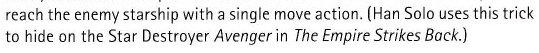
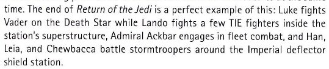
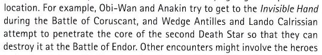

# Owner Material 037 — Star Wars D20 Drive folder (Core, Revised Core and Saga Edition): Sourcebooks/Starships of the Galaxy.pdf [Star Wars Roleplaying Game Saga Edition (2007)] (scan pages 1–60)

- **Source:** Wizards of the Coast Star Wars Roleplaying Game books, web enhancements, Living Force campaign modules and articles (2000–2010), from the owner's "Star Wars D20" Drive folder (only the three edition subfolders; "General" was not read, as instructed). Secondary source (licensed Legends reference). Scan OCR'd on the box; the scan stays box-only and is **not** published.
- **Method:** every scanned page was OCR'd and machine-screened sentence by sentence for power-relevant statements (fights, kills, defeats, Force feats, rankings, superweapons) that name a character on our roster; each kept sentence is quoted verbatim from the OCR text and has a crop of the printed passage directly under it. Pages with nothing power-relevant are still listed with what is on them.
- **Citation:** "*Starships of the Galaxy* (SWRPG Saga Edition), p.X" by printed page ("scan p.X" where no printed number applies). **Weight:** Licensed RPG material: a secondary source. Narrative text sums up Legends lore; game statistics are rules for players, not canon power levels, and rank lowest.

## scan p.1 (scan page 1)

Page contents: Front cover (image-viewed): Star Wars Roleplaying Game "Starships of the Galaxy" (Saga Edition) by Gary Astleford, Owen K.C. Stephens, Rodney Thompson; art of a red-and-white Corellian ship firing in an asteroid field. (hand-read)

## scan p.2 (scan page 2)

Page contents: Title page: Starships of the Galaxy; authors; faint R2-D2 art. (hand-read)

## scan p.3 (scan page 3)

Page contents: Credits (designers Gary Astleford, Owen K.C. Stephens, Rodney Thompson; developer Rodney Thompson; special thanks Leland Chee); legal; ISBN 978-0-7869-4823-9; first printing December 2007. (hand-read)

## scan p.4 (scan page 4)

Page contents: Contents: Introduction; Chapter I Starship Adventures; Chapter II Starship Combat (maneuvers); Chapter III Starship Modifications; Chapter IV Starship Codex (Acclamator to Z-95 Headhunter, incl. Slave I 85, Millennium Falcon 156, Executor 137, Lusankya 138, Eclipse 138, The Outbound Flight Project 77, Krayt's Honor 91). (hand-read)

## scan p.5 (scan page 5)

Page contents: Introduction opener art (image-viewed): ships and laser fire in space. (hand-read)

## scan p.6 (scan page 6)

Page contents: Introduction: space-battle opening vignette (Star Destroyer vs Nebulon-B; corvette rams the bridge); purpose of the book. Lock S-Foils in Attack Position! Art of a Geonosian-style starfighter. (hand-read)

## scan p.7 (scan page 7)

Page contents: Get Everyone Involved. Starship Specialists (maneuvers system akin to the Force system). Starship Codex (stock ships; Ebon Hawk given as stock Dynamic-class freighter). Make It Your Own (Han Solo's "special modifications" line). (hand-read)

### Stat block notes (game mechanics, not feats)

- Make It Your Own (Millennium Falcon modifications): Han Solo's famous line about having made a few "special modifications" to the Millennium Falcon comes to life in the form of the starship modification rules. (Source: *Starships of the Galaxy* (SWRPG Saga Edition), scan p.7)

## scan p.8 (scan page 8)

Page contents: Make It Your Own cont. (factory orders; deckplans). Enhanced Encounters (Chapter 2 terrain such as debris fields and nebulae; complications). Updated Statistics (supersede core rulebook). Art (image-viewed): a green alien pilot (Rodian-like) in a cockpit. (hand-read)

## scan p.9 (scan page 9)

Page contents: Chapter I: Starship Adventures opener art (image-viewed): Death Star and starfighters. (hand-read)

## scan p.10 (scan page 10)

Page contents: Chapter I intro. Starship Basics. Getting Your Own Starship: Joining an Organization (Rebel Alliance, Judicial Department), Wealthy Benefactors (noble sponsor, Will Defense 20). (hand-read)

## scan p.11 (scan page 11)

Page contents: Sidebar "Record-Keeping vs. Upkeep" (starship as residence at comfortable upkeep; wealthy upkeep if still paying). Legitimate Financing (20% down, 2%/month for five years). Loan Sharks and Gangsters. Shipjacking and Theft. Permits and Licenses via BoSS: Captain's Accredited License (200 cr; Spacehound qualifies), Ship's Operating License (1,000 cr), Arms Load-Out Permit; forging BoSS documents. Transponder Codes. Sidebar "Used Starships" (persistent condition at -3 steps). (hand-read)

## scan p.12 (scan page 12)

Page contents: Sidebar "The Bureau of Ships and Services (BoSS)" (crop-read; OCR garbled): ancient neutral agency; data sold to spaceports, small ones such as Mos Eisley update once or twice a year, a haven for smugglers; BoSS computers Will Defense 25, hostile. Transponder codes (built into sublight engines; false codes, p53). IFF Transponders. Travel in Realspace (sublight, ion, repulsorlift drives; travel-time table). Art (image-viewed): a starship. (hand-read)

## scan p.13 (scan page 13)

Page contents: Travel in Hyperspace (mass shadows; interdictors; pirates dragging asteroids into lanes). Detecting Hyperspace Travel (Cronau radiation, DC 25 Use Computer). Sidebar "Otherspace" (crop-read; OCR garbled): extradimensional space reached via hyperspace, populated by the Charon. Astrogation (DCs by age of data). Space Ministry (5,947-datapage Spacers' Information Manual; 150-credit updates); bribes. (hand-read)

## scan p.14 (scan page 14)

Page contents: Hyperspace Navigator's Guild (based on the planet later known as Empress Teta; 500-credit data). Hyperspace Hazards. Table 1-1: Hyperspace Mishaps (supernova, black hole, gas giant, superdense cluster). Sidebar "Major Hyperlanes" (crop-read; OCR garbled): Corellian Run, Corellian Trade Spine (Ison Trade Corridor), Hydian Way, Perlemian Trade Route, Rimma Trade Route with listed planets. Communications. HoloNet (military-only during the Clone Wars and Empire). (hand-read)

## scan p.15 (scan page 15)

Page contents: Table 1-2: System Damage. HoloNet slicing (Will Defense 20, hostile); hypertransceivers. METOSP (Message to Spacers). Planetary Information Channels. Docking, Fuel, and Maintenance: Docking Fees (20 cr/day), Refueling and Restocking (50 cr per day of fuel), Routine Maintenance (every twenty jumps), System Damage. (hand-read)

## scan p.16 (scan page 16)

Page contents: Starship Talents (ranged talent damage added before multiplier; TIE pilot example). Affecting Targets (communication, mind-affecting, line of sight). Specific Talents: Jedi Talents (Adept/Master Negotiator, Battle Meditation, Force Haze, Force Intuition); Noble Talents (Demand Surrender "Star Destroyers don't surrender to X-wings", Rally, Weaken Resolve). (hand-read)

## scan p.17 (scan page 17)

Page contents: Scoundrel, Scout, Soldier, Bounty Hunter, Gunslinger talents at starship scale. New Talents: Force Reflexes (Sense tree); Engineer (noble Lineage tree); Outlaw Tech talent tree (scoundrel): Fast Repairs, Hot Wire. (hand-read)

## scan p.18 (scan page 18)

Page contents: Outlaw Tech cont.: Quick Fix, Personalized Modifications. Ace Pilot talents: Expert Pilot tree (Blind Spot, Close Scrape, Improved Attack Run, Vehicle Focus, Wingman); Gunner tree (Crippling Hit, Great Shot, Synchronized Fire); Squadron Leader talent tree (squadron size; Begin Attack Run). (hand-read)

## scan p.19 (scan page 19)

Page contents: Squadron Leader cont. (Regroup, Squadron Maneuvers, Squadron Tactics). Officer Naval Officer talent tree (Combined Fire, Fleet Deployment, Fleet Tactics, It's a Trap!, Legendary Commander). Starship Skills: Deception, Perception, Stealth (hiding against a larger ship's hull; Han Solo on the Avenger). (hand-read)

- **Han Solo**: "(Han Solo uses this trick to hide on the Star Destroyer Avenger in The Empire Strikes Back.)" Source: *Starships of the Galaxy* (SWRPG Saga Edition), scan p.19
  

### Stat block notes (game mechanics, not feats)

- Starship Skills: Stealth (hiding on the Avenger): You can even attempt to hide against the hull of an enemy starship that is at least two sizes larger than your vehicle, provided that you make a Deception check to create a diversion to hide and you can reach the enemy starship with a single move action. (Han Solo uses this trick to hide on the Star Destroyer Avenger in The Empire Strikes Back.) (Source: *Starships of the Galaxy* (SWRPG Saga Edition), scan p.19)

## scan p.20 (scan page 20)

Page contents: Use Computer expansions: Astrogate (aggressive plotting), Use Communications (hail, secure, intercept; "It might be an Imperial code."), Use Sensors. Starship Feats (ranged dice before multiplier; Burst Fire). (hand-read)

## scan p.21 (scan page 21)

Page contents: Starship feats cont. (Careful Shot/Deadeye, Coordinated Attack, Dodge, Double/Triple Attack, Dual Weapon Mastery, Far/Point Blank/Rapid Shot, Improved Defenses, Triple Crit, Weapon Focus). New Feats: Starship Designer (custom modifications: Add Emplacement, Improve Hull, Improve Hyperdrive, Improve Shields, Improve Weapons); Starship Tactics. (hand-read)

## scan p.22 (scan page 22)

Page contents: Tactical Genius feat. Tech Specialist feat (reprinted) with trait table (armor, device, droid, vehicle, weapon traits). (hand-read)

## scan p.23 (scan page 23)

Page contents: Chapter 2 opener: full-page art (image-viewed on sheet), no text. (hand-read)

## scan p.24 (scan page 24)

Page contents: Chapter 2: Starship Combat intro. Starship Maneuvers (starfighter/airspeeder pilots and gunners). Learning New Maneuvers, with the Syal Antilles example (attack pattern delta, Corellian slip, target lock, Tallon roll, angle deflector shields). (hand-read)

### Stat block notes (game mechanics, not feats)

- Learning New Maneuvers (example): For example, Syal Antilles is a 5th-level soldier with a Wisdom score of 13 (+1 modifier). When she advances to 6th level, she takes the Starship Tactics feat and immediately gains two starship maneuvers. She chooses attack pattern delta and Corellian slip. (Source: *Starships of the Galaxy* (SWRPG Saga Edition), scan p.24)

## scan p.25 (scan page 25)

Page contents: Using Starship Maneuvers; maneuver suite; regaining maneuvers; descriptors (Attack Pattern, Dogfight, Force, Gunner); entry format. Ackbar Slash maneuver (reaction; redirect missed attack, DC 20-35). (hand-read)

### Stat block notes (game mechanics, not feats)

- Ackbar Slash (starship maneuver): A starship tactic made famous by the Mon Calamari Admiral Ackbar, the Ackbar slash involves a ship moving into the midst of enemy forces in order to cause an opponent to strike its own allies. (Source: *Starships of the Galaxy* (SWRPG Saga Edition), scan p.25)

## scan p.26 (scan page 26)

Page contents: Maneuvers: Afterburn, Angle Deflector Shields, Attack Formation Zeta Nine, Attack Pattern Delta, Corellian Slip. Sidebar "Starship Maneuvers in Your Game" (crop-read; OCR garbled): GM may allow or disallow; use only if maneuvers come up at least once per adventure. (hand-read)

## scan p.27 (scan page 27)

Page contents: Maneuvers: Counter, Darklighter Spin (autofire area attack), Devastating Hit, Engine Hit, Evasive Action, Explosive Shot. (hand-read)

## scan p.28 (scan page 28)

Page contents: Maneuvers: Explosive Shot cont., Howlrunner Formation, I Have You Now, Intercept, Overwhelming Assault. (hand-read)

## scan p.29 (scan page 29)

Page contents: Maneuvers: Segnor's Loop, Shield Hit, Skim the Surface, Skywalker Loop (dogfight reaction attack of opportunity). (hand-read)

## scan p.30 (scan page 30)

Page contents: Maneuvers: Snap Roll, Strike Formation, Tallon Roll. Sidebar "Starship Maneuvers and Crew Quality" (generic crew maneuvers by quality; suggested maneuvers table by role: bomber, superiority, interceptor, scout, shuttle/transport). (hand-read)

## scan p.31 (scan page 31)

Page contents: Maneuvers: Target Lock, Target Sense [Force], Thruster Hit, Wotan Weave. Making Starship Encounters Interesting (tailoring encounters to heroes' roles). (hand-read)

## scan p.32 (scan page 32)

Page contents: Combined Encounters (split-screen; Return of the Jedi example). Start Small. Proportional Battles. Handling Large Battles: weapon batteries (narrow salvo, proximity spread), tactical fire, fighter groups. (hand-read)

- **Luke Skywalker; Darth Vader (Anakin Skywalker); Lando Calrissian; Admiral Ackbar; Leia Organa Solo; Chewbacca**: "The end of Return of the Jedi is a perfect example of this: Luke fights Vader on the Death Star while Lando fights a few TIE fighters inside the station's superstructure, Admiral Ackbar engages in fleet combat, and Han, Leia, and Chewbacca battle stormtroopers around the Imperial deflector shield station." Source: *Starships of the Galaxy* (SWRPG Saga Edition), scan p.32
  

## scan p.33 (scan page 33)

Page contents: Fighter group benefits. Connect Space to the Adventure (Hutt crime lord pirate fleet example). Sidebar-style section "But I'm Not a Pilot!" (Han, Obi-Wan in Revenge of the Sith, Leia copiloting the Falcon, Anakin's Podracer experience). Designing Starship Combat Encounters (something for every player; series of encounters). (hand-read)

### Stat block notes (game mechanics, not feats)

- But I'm Not a Pilot!: Despite what Han Solo might think, being a starship pilot in the Star Wars universe isn't as specialized a skill as being a fighter pilot in the real world. ... Obi-Wan Kenobi didn't fly a fighter in the opening sequence of Revenge of the Sith because he was a master pilot: He flew one because there was a fight going on in space, and he needed to be part of it. (Source: *Starships of the Galaxy* (SWRPG Saga Edition), scan p.33)
- But I'm Not a Pilot!: When the situation called for it, Leia was able to copilot the Millennium Falcon through an asteroid field, and Anakin Skywalker found that his experience with Podracers was enough to be familiar with the basic controls of a starfighter. (Source: *Starships of the Galaxy* (SWRPG Saga Edition), scan p.33)

## scan p.34 (scan page 34)

Page contents: Series of encounters (Battle of Yavin). Give Objectives Other Than Destruction (escort, getting from A to B, obtaining something). Build Interesting Battlefields (Falcon's asteroid escape; Obi-Wan vs. Jango Fett in Slave I in the rings of Geonosis). Asteroids, Debris, or Other Objects; Vehicle Traffic. (hand-read)

- **Obi-Wan Kenobi; Darth Vader (Anakin Skywalker); Lando Calrissian**: "For example, Obi-Wan and Anakin try to get to the Invisible Hand during the Battle of Coruscant, and Wedge Antilles and Lando Calrissian attempt to penetrate the core of the second Death Star so that they can destroy it at the Battle of Endor." Source: *Starships of the Galaxy* (SWRPG Saga Edition), scan p.34
  

### Stat block notes (game mechanics, not feats)

- Designing Starship Combat Encounters: Large-scale conflicts, such as the Battle of Yavin, are actually composed of multiple smaller encounters strung together into a sequence that tells an ongoing story (in this case, that of Luke Skywalker's discovery of his faith in the Force and the destruction of the Death Star). (Source: *Starships of the Galaxy* (SWRPG Saga Edition), scan p.34)
- Build Interesting Battlefields: For example, the Millennium Falcon's daring escape from the forces of the Empire is made far more interesting by the fact that it flees through an asteroid belt wrought with peril, and Obi-Wan Kenobi's dogfight with Jango Fett in Slave I is made more exciting by the hazards found in the rings of Geonosis. (Source: *Starships of the Galaxy* (SWRPG Saga Edition), scan p.34)

## scan p.35 (scan page 35)

Page contents: Object hazard table (sparse/moderate/dense). Damaging Environment (corrosive gases, dust clouds, ionic discharges, radiation; intensity table). Enclosed Terrain (Death Star trench run). Periodic Damage (hazard frequency table). (hand-read)

## scan p.36 (scan page 36)

Page contents: Visibility (clouds, nebulae, storms). Create Exciting Scenarios with Complications (time limit: Death Star vs. Yavin 4; space limit; jamming). Challenge Level Adjustments for Starship Disparities (X-wings vs. TIE fighters; YT-1300 example). (hand-read)

## scan p.37 (scan page 37)

Page contents: Chapter 3 opener: "Starship Modifications" title page with full-page art (image-viewed on sheet). (hand-read)

## scan p.38 (scan page 38)

Page contents: Chapter 3: Starship Modifications intro (modification motivates heroes; ship as base). How to Use This Chapter (catalog; GM need not count every credit). (hand-read)

## scan p.39 (scan page 39)

Page contents: GM judgment on overpowered ships. Cost Modifiers (Table 3-1 by size, Huge x1 to Colossal (station) x5,000; regenerating shields example). Sidebar "A Note on Costs". Emplacement Points; lacking points (+2 days, +5 DC, +20% cost; ship becomes "used"). Gaining Emplacement Points (remove systems, sacrifice cargo, remove escape pods illegally). (hand-read)

## scan p.40 (scan page 40)

Page contents: Table 3-2: Unused Emplacement Points by stock ship (YT-series 10, Dynamic-class 6, etc.). Unused Emplacement Points (V-19 Torrent; Corellian Engineering Corporation ships 5). Nonstandard Modifications (x2 points, x5 cost). Installation; Installation Work Force; Installation Time formula. (hand-read)

## scan p.41 (scan page 41)

Page contents: Installation Checks (DC 20 + emplacement points; partial/total failure). Starship Systems (emplacement points, availability, size restriction, cost). Movement Systems: Atmospheric Thrusters (X-wing example), Combat Thrusters, Hyperdrives (class .5 via Starship Designer, illegal; maintenance; class 1 pinnacle). (hand-read)

## scan p.42 (scan page 42)

Page contents: Hyperdrive classes cont. (class 4-6 retrofits; backups class 8-15). Starfighters: Hyperdrive Sleds (CloakShape). Movement systems table (thrusters, hyperdrives .75-15, maneuvering jets, navicomputers, SLAM, sublight drives). (hand-read)

## scan p.43 (scan page 43)

Page contents: Hyperdrive Rings (drawbacks). Maneuvering Jets (+2/+4/+6 Dex). Navicomputer (advanced +10; limited for starfighters). SubLight Accelerator Motor (SLAM). Sublight Drive. (hand-read)

## scan p.44 (scan page 44)

Page contents: Sublight drive replacement (military-only fast ion drives). Defense Systems intro. Defense systems table (armor +1 to +4, jamming suite/array, regenerating shields, reinforced bulkheads, shields SR 10-200). (hand-read)

## scan p.45 (scan page 45)

Page contents: Armor (equipment bonus to Reflex). Jammers (ARC-170 suite too small to matter; suite vs. array penalties). Regenerating Shields (Mon Calamari backup generators; +10 on recharge). Reinforced Bulkheads. Shields. Weapon Systems intro (arms load-out permit): Autoblaster, Blaster Cannons, Cannon Double/Quad. (hand-read)

## scan p.46 (scan page 46)

Page contents: Double/quad autofire; Triple Cannons; Cannon Enhancements; Concussion Missiles (armor-piercing; launcher capacity); Docking Guns; Droid Jammer (late Clone Wars, vs. Trade Federation droid starfighters and tri-fighters); Fire-Linked Weapons; Gravity Well Projectors; Ion Bombs. (hand-read)

## scan p.47 (scan page 47)

Page contents: Ion Bombs cont. Ion Cannons (Hapan Triple Ion Cannon, illegal outside the Hapan Consortium until the New Jedi Order era). Laser Cannons. Point-Defense Weapon. Proton Torpedoes. Shieldbuster Torpedoes (T-33, K-wings). Space Mines. Tractor Beams. (hand-read)

## scan p.48 (scan page 48)

Page contents: Table: Weapon Systems (damage, emplacement points, availability, cost) and weapon range table (character and starship scale). (hand-read)

## scan p.49 (scan page 49)

Page contents: Turbolasers. Accessories: Cargo Jettison System, Cargo Pods, Cloaking Device (stygium crystals from Aeten II; hibridium from Garos IV, "double-blind"), Cryogenic Chambers, Docking Clamp, Droid Repair Team. (hand-read)

## scan p.50 (scan page 50)

Page contents: Table: Accessories (emplacement points, availability, size restriction, cost) from cargo jettison system to disguised transponders (OCR columns scrambled; table only). (hand-read)

## scan p.51 (scan page 51)

Page contents: Droid repair team destruction chance. Escape Pods (stat block, Escape Pod CL 1; small and large lifeboats). Extended Range. Hangar Bay; Concealed Hangars. HoloNet Transceiver/Hypertransceiver. (hand-read)

## scan p.52 (scan page 52)

Page contents: HoloNet transceivers cont. (Banking Clan Frigates network). Luxury Upgrade (basic/advanced/extreme). Medical Suite. Passenger Conversion. Sensor Array Computer. Sensor Enhancement Package. Slave Circuitry. (hand-read)

## scan p.53 (scan page 53)

Page contents: Slave circuits cont. (Katana fleet); Recall Circuits. Smuggler's Compartments (DC 30 Perception; max 5% of cargo). Transponders: masked and disguised. Table 3-6: Stock Ships (class, size, Str, Dex, Int, speed, hp, DR, armor, cost) with notes. (hand-read)

## scan p.54 (scan page 54)

Page contents: Stock ships table cont. (crew, passengers, cargo, consumables, emplacement points); worsening stock values for points. Disguised transponder installation (Use Computer + Deception). IFF Transponders (spoofing friend codes). Stock Ships (designing from scratch; Challenge Level by comparison). (hand-read)

## scan p.55 (scan page 55)

Page contents: Chapter 4 opener: "Starship Codex" title page with full-page art (image-viewed on sheet). (hand-read)

## scan p.56 (scan page 56)

Page contents: Chapter 4: Starship Codex intro (stat blocks, illustrations, deckplans). Tactical Fire (capital ship "aura" option). Focused Fire (area attacks by capital ships). (hand-read)

## scan p.57 (scan page 57)

Page contents: Acclamator-class Assault Ship (Rothana Heavy Engineering) stat block; history (built for Kamino's cloners, mobilized when Yoda arrived; baptism of fire at Geonosis; later rear-echelon Imperial service, broken down by Kuat Drive Yards); Capabilities (16,000 clone troopers, AT-TEs, LAATs). (hand-read)

### Stat block notes (game mechanics, not feats)

- Acclamator-class Assault Ship: Produced on a scale to match that of the clone troopers it was designed to carry, dozens of the ships were crewed and ready to depart when Jedi Master Yoda arrived to mobilize an invasion force. (Source: *Starships of the Galaxy* (SWRPG Saga Edition), scan p.57)

## scan p.58 (scan page 58)

Page contents: Acclamator cont. (Base Delta Zero; overspecialization; tactical fire). Acclamator-II variant (orbital bombardment; heavy proton torpedoes; reduced troops; tactical fire) with stat block. (hand-read)

## scan p.59 (scan page 59)

Page contents: Action VI Transport (Corellian Engineering Corporation bulk transport) stat block; description (industry standard, unarmed, prey for pirates); Capabilities (90,000-ton cargo, single-type holds; secondhand market). (hand-read)

## scan p.60 (scan page 60)

Page contents: Advanced Ship (Template): maintenance, modifications (CL, SR, hp, Str, Dex, Int, weapons, cost); example Advanced V-19 Torrent Starfighter stat block. (hand-read)

