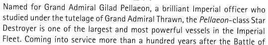
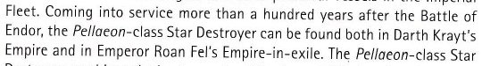
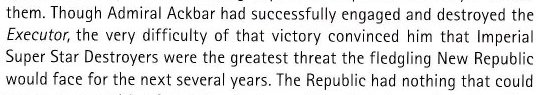

# Owner Material 037 — Star Wars D20 Drive folder (Core, Revised Core and Saga Edition): Sourcebooks/Starships of the Galaxy.pdf [Star Wars Roleplaying Game Saga Edition (2007)] (scan pages 61–120)

- **Source:** Wizards of the Coast Star Wars Roleplaying Game books, web enhancements, Living Force campaign modules and articles (2000–2010), from the owner's "Star Wars D20" Drive folder (only the three edition subfolders; "General" was not read, as instructed). Secondary source (licensed Legends reference). Scan OCR'd on the box; the scan stays box-only and is **not** published.
- **Method:** every scanned page was OCR'd and machine-screened sentence by sentence for power-relevant statements (fights, kills, defeats, Force feats, rankings, superweapons) that name a character on our roster; each kept sentence is quoted verbatim from the OCR text and has a crop of the printed passage directly under it. Pages with nothing power-relevant are still listed with what is on them.
- **Citation:** "*Starships of the Galaxy* (SWRPG Saga Edition), p.X" by printed page ("scan p.X" where no printed number applies). **Weight:** Licensed RPG material: a secondary source. Narrative text sums up Legends lore; game statistics are rules for players, not canon power levels, and rank lowest.

## scan p.61 (scan page 61)

Page contents: Aethersprite Interceptor (Delta-7 Aethersprite Light Interceptor, Kuat Systems Engineering) stat block; history (suggested by Saesee Tiin; Tiin's two custom modifications; Jedi-only via the Supreme Chancellor's office); Capabilities (light reconnaissance; booster ring; R-4P astromech hardwired). (hand-read)

### Stat block notes (game mechanics, not feats)

- Aethersprite Interceptor: Kuat Systems Engineering developed the Delta-7 Aethersprite when Jedi Master Saesee Tiin suggested that the Jedi form its own corps of starfighter pilots. (Source: *Starships of the Galaxy* (SWRPG Saga Edition), scan p.61)
- Aethersprite Interceptor: Although the design was well received by the Jedi, Saesee Tiin was nonetheless dissatisfied with the Aethersprite light interceptor's performance. He insisted on modifying two Aethersprites to his own specifications, adding additional weaponry, a hyperdrive of his own design, and a meditation chair in place of the pilot's seat. (Source: *Starships of the Galaxy* (SWRPG Saga Edition), scan p.61)

## scan p.62 (scan page 62)

Page contents: ARC-170 Starfighter (Incom/Subpro) stat block; history (line leading to the X-wing; high supply cost; replaced by TIEs; some liberated by the Rebellion); Capabilities (5-day endurance, scout and picket role; slow acceleration). (hand-read)

## scan p.63 (scan page 63)

Page contents: Archaic Ship (Template): upgrading; modifications (CL 2/3, half threshold vs. modern weapons, 50% shield failure, no crits, -2 attacks, 50% cost); example Archaic Heavy Cruiser (Dreadnaught) stat block. (hand-read)

## scan p.64 (scan page 64)

Page contents: A-wing Starfighter (Alliance) stat block; history (designed after Yavin by General Dodonna with engineer Walex Blissex; fastest of the Galactic Civil War; A-wings destroyed the Executor at Endor); Capabilities (jammers; concussion missiles standard by the New Republic). (hand-read)

### Stat block notes (game mechanics, not feats)

- A-wing Starfighter: Development of the A-wing began in secret shortly after the Battle of Yavin. General Dodonna realized that the speed of Imperial fighters had nearly cost the Alliance its victory, and he intended to remedy the situation by designing a newer, faster starfighter. With the aid of starship engineer Walex Blissex, the A-wing was born. (Source: *Starships of the Galaxy* (SWRPG Saga Edition), scan p.64)

## scan p.65 (scan page 65)

Page contents: Banking Clan Frigate (Munificent-class) stat block; history (InterGalactic Banking Clan's own comm network and warships; San Hill brought them to the Separatists; scuttled after the Confederacy's defeat; some joined pirates or the Rebellion); Capabilities; tactical fire (removes enemy morale/insight bonuses). (hand-read)

### Stat block notes (game mechanics, not feats)

- Banking Clan Frigate: When San Hill brought the Banking Clan into the Separatists' fold, he brought the frigates with him. After the defeat of the Confederacy, most of the remaining frigates were scuttled. (Source: *Starships of the Galaxy* (SWRPG Saga Edition), scan p.65)

## scan p.66 (scan page 66)

Page contents: Baudo-class Star Yacht stat block; description (custom-built by reclusive Aqualish shipwright Mendel Baudo, referral-only clients); Capabilities (luxury; class 2 hyperdrive; easy controls). (hand-read)

## scan p.67 (scan page 67)

Page contents: B-wing Starfighter (Slayn & Korpil) stat block; history (designed by Admiral Ackbar; rotating cockpit; B-wing/E2 variant with gunner); Capabilities (a B-wing squadron destroyed an Imperial Star Destroyer at Endor). (hand-read)

### Stat block notes (game mechanics, not feats)

- B-wing Starfighter: Designed by Admiral Ackbar, the B-wing starfighter is a mobile weapons platform designed to provide heavy assault support to the Rebel fleet. (Source: *Starships of the Galaxy* (SWRPG Saga Edition), scan p.67)

## scan p.68 (scan page 68)

Page contents: B-wing cont. (slow, needs escorts; untrained penalty; modular weapons). B-wing/E2 Starfighter and B-wing Shuttle stat blocks. (hand-read)

## scan p.69 (scan page 69)

Page contents: Carrack-class Light Cruiser (Damorian Manufacturing) stat block; history (late Old Republic escort; Carracks helped destroy the Invisible Hand at the Battle of Coruscant; later Imperial scouts and dignitary transports); Capabilities (heavily armed; four TIE fighters on external racks); tactical fire. (hand-read)

## scan p.70 (scan page 70)

Page contents: Chiss Clawcraft (Nssis-class) stat block; history (traced to Grand Admiral Thrawn's merger of TIE ball cockpit with Chiss claw-wing; used by Imperials, Chiss Ascendancy, Empire of the Hand); Capabilities (improvement on TIE interceptor; beacon-ship dependence in early models). (hand-read)

### Stat block notes (game mechanics, not feats)

- Chiss Clawcraft: The Nssis-class Clawcraft can be traced directly to the Imperial forces under the command of Grand Admiral Thrawn. Thrawn had access to Chiss technology in the form of his Household Phalanx and to Imperial resources as a grand admiral. Sometime after the Battle of Yavin, Thrawn began trying to merge these technologies, resulting in custom-built craft using the ball cockpit of the TIE design coupled with the claw-wing design common among Chiss Clawcraft. (Source: *Starships of the Galaxy* (SWRPG Saga Edition), scan p.70)

## scan p.71 (scan page 71)

Page contents: Citadel-class Cruiser (Koensayr ILH-KK) stat block; history (late Old Republic armed transport; peaked in the Clone Wars; converted to yachts or minor warships for Rebels, freebooters, the CSA, pirates); Capabilities (two docking clamps carry hyperdrive-less fighters). (hand-read)

## scan p.72 (scan page 72)

Page contents: CloakShape Fighter (Kuat Systems Engineering) stat block; history (contemporary of the Z-95; Jedi "Whitecloak" fighters before the Clone Wars; licensed production; pirates and planetary defense into the Galactic Alliance era); common modifications (maneuvering jets, hyperdrive sled); Capabilities. (hand-read)

## scan p.73 (scan page 73)

Page contents: Commerce Guild Destroyer (Recusant-class Light Destroyer, Hoersch-Kessel Drive/Free Dac Volunteers) stat block; history (from Mon Calamari schematics stolen by Quarren Separatists; droid-controlled; deployed in groups of four; later Rebel and CSA use); Capabilities (single-minded droid brain); tactical fire. (hand-read)

## scan p.74 (scan page 74)

Page contents: Coralskipper (Yuuzhan Vong yorik-et living starfighter) stat block; description (grown, coral-based; spearheaded the invasion); Capabilities (register as asteroids; dovin basal SR, splinter-shot autofire tactic, dovin basal as weapon and tractor; swift-action dovin basal focus). (hand-read)

## scan p.75 (scan page 75)

Page contents: Corellian Corvette (CR90, Corellian Engineering Corporation) stat block; description (blockade runner, hammerhead design, Rebel and pirate fleets); Capabilities (easily modified). Sidebar: The Vanguard c20 Retrofit (CR70 to CR90 upgrade; Tantive IV used by Bail Organa). (hand-read)

### Stat block notes (game mechanics, not feats)

- The Vanguard c20 Retrofit (sidebar): The Tantive IV, for example, began as a CR70 Corvette that was used by Bail Organa at the tail end of the Clone Wars. By the time of the Galactic Civil War, the Tantive IV had undergone retrofitting that transformed it into a CR90 Corvette. (Source: *Starships of the Galaxy* (SWRPG Saga Edition), scan p.75)

## scan p.76 (scan page 76)

Page contents: Corellian Corvette cont. (blockade breaking; dynamic roles); tactical fire (avoid dogfights). The CR70 Corvette (unarmed predecessor; escape pods disguised as weapons) with stat block. (hand-read)

## scan p.77 (scan page 77)

Page contents: Dreadnaught-class Heavy Cruiser (Rendili StarDrive) stat block; history (outdated by the Clone Wars; crewed by volunteers and planetary defense forces, not clones); Capabilities (redundant systems, used as shields); tactical fire begins. (hand-read)

## scan p.78 (scan page 78)

Page contents: Dreadnaught tactical fire cont. (draws attacks from allied capital ships). Sidebar-style section: The Outbound Flight Project (Jedi Master Jorus C'baoth; derailed in the Republic's first encounter with the Chiss who became Grand Admiral Thrawn); Outbound Flight (six Dreadnaughts around a central fuselage) with stat block CL 22. (hand-read)

### Stat block notes (game mechanics, not feats)

- The Outbound Flight Project: An exploratory mission originally proposed by the Jedi, the Outbound Flight Project became the personal project of Jedi Master Jorus C'baoth, who fought with the Senate at every turn to get the project funded and under way. The Outbound Flight Project was created not only to explore new places, but also to set up colonies and—unbeknownst to all but a few of C'baoth's confidants—find new Force-sensitive apprentices to bolster the numbers of the Jedi Order. (Source: *Starships of the Galaxy* (SWRPG Saga Edition), scan p.78)
- The Outbound Flight Project: However, the grand exploratory mission did not go as planned. In the Republic's first encounter with the Chiss that would eventually go on to become Grand Admiral Thrawn, the Outbound Flight Project was derailed and the ship was lost, never reaching its destination in the Unknown Regions. (Source: *Starships of the Galaxy* (SWRPG Saga Edition), scan p.78)

## scan p.79 (scan page 79)

Page contents: Droid Starfighters: Vulture-class Starfighter (Baktoid Armor Workshop) stat block; description (Confederacy, Trade Federation; Droid Control Ships; Vulture used since the Battle of Naboo; Scarab-class and tri-fighter); Capabilities begins. (hand-read)

## scan p.80 (scan page 80)

Page contents: Droid starfighters cont. (redundant control ships; each weapon fires as if crewed; immune to the Force and mind-affecting effects). Droid Tri-Fighter (Phlac-Arphocc Automata Industries) and Scarab-class Starfighter (Haor Chall Engineering) stat blocks; Vulture starfighter art. (hand-read)

## scan p.81 (scan page 81)

Page contents: Dynamic-class Freighter stat block; history (Core Galaxy Systems subsidiary on Transel; the Ebon Hawk was a heavily modified Dynamic-class freighter in the Jedi Civil War); Capabilities (+2 Mechanics to repair/modify). (hand-read)

## scan p.82 (scan page 82)

Page contents: Dynamic-class Freighter deckplan (cockpit, communications, security/main hold, medical bay, turret access, engine room, cargo hold, garage, dormitories, storage, exit ramp). (hand-read)

## scan p.83 (scan page 83)

Page contents: Eta-2 Actis Interceptor (Kuat Systems Engineering, "Jedi Interceptor") stat block; description (TIE predecessor, Clone Wars); Capabilities (unshielded; ion cannons; rare concussion-missile refit). (hand-read)

## scan p.84 (scan page 84)

Page contents: E-wing Starfighter, Type B (FreiTek) stat block; history (founded after Endor by X-wing designers; replacement for the A-wing; laser redesign; service against Grand Admiral Thrawn, Black Fleet Crisis, Yuuzhan Vong War); Capabilities (R7 astromech, +2 Pilot). (hand-read)

### Stat block notes (game mechanics, not feats)

- E-wing: They have seen service against the remnants of the Imperial Navy as led by Grand Admiral Thrawn, during the Black Fleet Crisis, and in the Yuuzhan Vong War. (Source: *Starships of the Galaxy* (SWRPG Saga Edition), scan p.84)

## scan p.85 (scan page 85)

Page contents: Firespray-31 Patrol Craft (Kuat Systems Engineering) stat block; description (prisoner transport and patrol; rotating cockpit orientation; prototypes destroyed by Jango Fett, Slave I survived; Imperial-era mass production; Mandalorian Protectors); Capabilities. (hand-read)

### Stat block notes (game mechanics, not feats)

- Firespray-31 Patrol Craft: Though most of the original Firespray-31 prototypes were destroyed some time before the Clone Wars, a few of the ships (such as Slave I) made their way into the hands of private citizens. Most were constructed from blueprints sold by Kuat Systems Engineering to buyers who had the means of constructing the ships themselves, since Jango Fett destroyed all of the officially manufactured prototype models. (Source: *Starships of the Galaxy* (SWRPG Saga Edition), scan p.85)

## scan p.86 (scan page 86)

Page contents: Firespray-31 cont. (favorite of bounty hunters; 3 unused emplacement points). Original Prototypes (six prototype blueprints; Jango Fett's stolen prototype; black-market blueprints). Slave I (Boba Fett's ship, formerly Jango's; combat thrusters; proton tracking devices) stat block CL 17. (hand-read)

### Stat block notes (game mechanics, not feats)

- Firespray-31 Patrol Craft: The ease with which the Firespray-31 is modified makes it a favorite ship for bounty hunters, the most famous example being Jango and Boba Fett and their ship, Slave I. (Source: *Starships of the Galaxy* (SWRPG Saga Edition), scan p.86)
- Original Prototypes: When Kuat Systems Engineering began manufacturing the Firespray-31 patrol craft, it did so using the blueprints for the prototype stolen by Jango Fett. (Source: *Starships of the Galaxy* (SWRPG Saga Edition), scan p.86)
- Slave I: Slave I is the personal transport of the bounty hunter Boba Fett. The ship, once belonging to his father Jango, is a heavily modified Firespray-31 system patrol craft. Armed with more weapons than many capital starships carry, Slave I represents an example of how a Firespray-31 can be customized to fit the needs of an individual owner. (Source: *Starships of the Galaxy* (SWRPG Saga Edition), scan p.86)
- Slave I: Combined with the excellent piloting skills of the Mandalorian bounty hunter, Slave I is a dangerous foe in space combat that can lay waste to unsuspecting starfighters with only a few shots from its more potent weapons. (Source: *Starships of the Galaxy* (SWRPG Saga Edition), scan p.86)

## scan p.87 (scan page 87)

Page contents: Geonosian Starfighter (Nantex-class Territorial Defense Starfighter, Huppla Pasa Tisc Shipwrights Collective) stat block; history (defense of Geonosis; "beak wing"); Capabilities (pilot bonded to flight computer from hatching; pheromone avionics; tractor-beam emitters aid accuracy). (hand-read)

## scan p.88 (scan page 88)

Page contents: Ginivex-class Starfighter ("fanblade") stat block; history (six built for Count Dooku, given to Asajj Ventress on Rattatak; two stolen by Obi-Wan Kenobi and Anakin Skywalker); Capabilities (solar sail shields; hyperdrive at Dooku's insistence). (hand-read)

### Stat block notes (game mechanics, not feats)

- Ginivex-class Starfighter: According to captured Separatist records, only six Ginivex-class starfighters were manufactured by the Geonosians for Count Dooku. Referred to as "fanblades" due to their distinctive fan-shaped solar sails, these fighters were as effective as they were exotic. Dooku eventually bequeathed the six fighters to his disciple, Asajj Ventress, who had them transported to her homeworld of Rattatak. In a short time, the unique starfighters became Ventress's calling card, striking dread into any pilot unlucky enough to face one in combat. (Source: *Starships of the Galaxy* (SWRPG Saga Edition), scan p.88)
- Ginivex-class Starfighter: During the course of the Clone Wars, Asajj Ventress suffered the theft of two of her fighters by Obi-Wan Kenobi and his padawan, Anakin Skywalker. The last known location of these appropriated ships was the Jedi Temple on Coruscant, but it is assumed that they were subsequently destroyed or taken by the Emperor during the Jedi Purge. Ventress's remaining four ships vanished with her, and their whereabouts are currently unknown. (Source: *Starships of the Galaxy* (SWRPG Saga Edition), scan p.88)
- Ginivex-class Starfighter: In another deviation from Geonosian fighter doctrine, the Ginivex-class is equipped with an integral hyperdrive engine and a limited-use navicomputer. These additions were incorporated at great expense and at the insistence of Count Dooku. (Source: *Starships of the Galaxy* (SWRPG Saga Edition), scan p.88)

## scan p.89 (scan page 89)

Page contents: Ghtroc 720 Freighter (Ghtroc Industries) stat block; history (competitor to the YT-1300; Outer Rim foothold; bankruptcy; Luke Skywalker's modified 720 at Poderis ferried his X-wing); Capabilities (shield generator, larger cargo; fixed-forward cannon; split engines). (hand-read)

### Stat block notes (game mechanics, not feats)

- Ghtroc 720 Freighter: When he was investigating Poderis's possible use as an Imperial transfer point, Luke Skywalker employed a heavily modified Ghtroc 720 to secretly ferry his X-wing fighter. The Ghtroc's cargo bay was gutted by Alliance techs and retrofitted with a modified hull section that could break away, allowing the X-wing to depart the 720 while in flight. (Source: *Starships of the Galaxy* (SWRPG Saga Edition), scan p.89)

## scan p.90 (scan page 90)

Page contents: Ghtroc Industries class 720 Freighter deckplan (24 keyed areas: stations, engine rooms, crew quarters, cargo lifts and holds, repair bay, escape pods, reactor core, exit ramp). (hand-read)

## scan p.91 (scan page 91)

Page contents: Gozanti Cruiser stat block; history (CEC design leased to other builders, "Brocklander" ships; antipiracy freighter made deliberately slow; Hutts bought some; Rebellion used old ones; back in production after the Emperor's fall); Capabilities (slow, heavily armed; conversions to prison ships and secure transports). (hand-read)

## scan p.92 (scan page 92)

Page contents: Gozanti cont. (diplomatic vessels, mobile command centers). Krayt's Honor (Gozanti defending Jabba the Hutt's yacht before the Clone Wars; Kel Dor captain Siqo Vass with Layn Wynest posing as captain; Q-ship; Trade Federation bounty) with Capabilities and stat block CL 11. (hand-read)

### Stat block notes (game mechanics, not feats)

- Krayt's Honor: Krayt's Honor is a Gozanti cruiser most famous for once defending the personal luxury yacht of Jabba the Hutt prior to the Clone Wars. (Source: *Starships of the Galaxy* (SWRPG Saga Edition), scan p.92)
- Krayt's Honor: The Trade Federation placed a bounty on Vass's head, but the patronage of a grateful Jabba ensured that Krayt's Honor could always find a safe harbor. (Source: *Starships of the Galaxy* (SWRPG Saga Edition), scan p.92)

## scan p.93 (scan page 93)

Page contents: Corellian Gunship (DP20 frigate and related CEC designs) stat block; description (non-modular escort; Republic Navy origin); Capabilities (independent gunners); tactical fire (+1/-1 Reflex). (hand-read)

## scan p.94 (scan page 94)

Page contents: Hapan Battle Dragon stat block; description (Hapes Consortium capital ship, disclike hulls, rotating weapon tracks); Capabilities (early single-target computers, slow turbolaser recharge, mass pulse mines); tactical fire (slows enemies). (hand-read)

## scan p.95 (scan page 95)

Page contents: Hapes Nova Cruiser stat block; history (support ship for Battle Dragons, built on ideas stolen from major shipyards; three-ship border patrols); Capabilities (refits, CL 19); tactical fire (extra condition step vs. starfighters). (hand-read)

## scan p.96 (scan page 96)

Page contents: Imperial Assault Shuttle (Telgorn Corp Gamma-class) stat block; description (troop boarding craft; 62% power to shields; spacetroopers); Capabilities (crew; degrading shields; boarding tactics). (hand-read)

## scan p.97 (scan page 97)

Page contents: Imperial Star Destroyer (Kuat Drive Yards Imperial II-class) stat block; description (symbol of Imperial might; deployed in every sector; Deep Core fortress worlds; orbital bombardment). Sidebar: Using the Star Destroyer (as high-CL challenge or as set piece using tactical fire, a "terrain hazard"). (hand-read)

## scan p.98 (scan page 98)

Page contents: Star Destroyer cont. (orbital strikes, Base Delta Zero; Caamas devastated). Sidebar: The Star Destroyer Designation (Imperial I/II; Executor-class and Eclipse informally called Star Destroyers). Capabilities (twenty turbolaser batteries, ion cannons, ten tractor beams); tactical fire (+2 attacks for allies). (hand-read)

## scan p.99 (scan page 99)

Page contents: The Victory II-class Star Destroyer (Rendili StarDrive; sector patrol and interdiction, ion cannons to capture smugglers and pirates) with stat block. (hand-read)

## scan p.100 (scan page 100)

Page contents: The Pellaeon-class Star Destroyer (named for Grand Admiral Gilad Pellaeon, Thrawn's student; serves Darth Krayt's Empire and Emperor Roan Fel's Empire-in-exile; combines Imperial II and Executor features) with stat block CL 28. (hand-read)

- **Grand Admiral Thrawn**: "Named for Grand Admiral Gilad Pellaeon, a brilliant Imperial officer who studied under the tutelage of Grand Admiral Thrawn, the Pellaeon-class Star Destroyer is one of the largest and most powerful vessels in the Imperial Fleet." Source: *Starships of the Galaxy* (SWRPG Saga Edition), scan p.100
  
- **Darth Krayt; Roan Fel**: "Coming into service more than a hundred years after the Battle of Endor, the Pellaeon-class Star Destroyer can be found both in Darth Krayt's Empire and in Emperor Roan Fel's Empire-in-exile." Source: *Starships of the Galaxy* (SWRPG Saga Edition), scan p.100
  

### Stat block notes (game mechanics, not feats)

- The Pellaeon-class Star Destroyer: Named for Grand Admiral Gilad Pellaeon, a brilliant Imperial officer who studied under the tutelage of Grand Admiral Thrawn, the Pellaeon-class Star Destroyer is one of the largest and most powerful vessels in the Imperial Fleet. Coming into service more than a hundred years after the Battle of Endor, the Pellaeon-class Star Destroyer can be found both in Darth Krayt's Empire and in Emperor Roan Fel's Empire-in-exile. (Source: *Starships of the Galaxy* (SWRPG Saga Edition), scan p.100)

## scan p.101 (scan page 101)

Page contents: Interdictor Cruiser (Immobilizer 418 Interdictor-class Heavy Cruiser) stat block; description (gravity well projectors pull ships from hyperspace; answer to Rebel hit-and-run tactics; some Star Destroyers retrofitted); Capabilities (needs escorts; trained gravity well crews); tactical fire (shared with Vindicator; DC 20 Pilot or stop). (hand-read)

## scan p.102 (scan page 102)

Page contents: Sidebar-style section: Origin of the Vindicator (Immobilizer 418 is a Vindicator refit) with Vindicator-class Heavy Cruiser stat block. Sidebar: Gravity Well Projectors (3x3 area, Reflex 10, hyperspace interdiction field). (hand-read)

## scan p.103 (scan page 103)

Page contents: Imperial Customs Corvette (Rendili Star Drive Light Corvette) stat block; description (Imperial Customs Office sole-source; corrupt officers; patrol patterns at hyperspace exit points); Capabilities (six double laser turrets; stormtrooper platoon; two-month patrols; atmospheric entry). (hand-read)

## scan p.104 (scan page 104)

Page contents: J-Type Star Skiff stat block; history (first armed Naboo diplomatic vessel during the Clone Wars; loaned by Queen Apailana to Senator Amidala; retired after Amidala's death; imitated by other Senators); Capabilities (Theed Palace Space Vessel Engineering Corps; class .5 hyperdrive; luxury; augmented lasers). (hand-read)

### Stat block notes (game mechanics, not feats)

- J-Type Star Skiff: Though Queen Apailana of Naboo herself never used the armed star skiff, it was loaned out to Senator Amidala, a sign of the Senator's great popularity with her homeworld and her monarch. After Amidala died, the star skiff was retired, because it had become a painful reminder of the Senator's last days in service to her people. (Source: *Starships of the Galaxy* (SWRPG Saga Edition), scan p.104)

## scan p.105 (scan page 105)

Page contents: Junker (Template): poorly built or ill-maintained ships and "uglies" (TYE-wing); modifications (CL, Initiative, abilities, Systems Failure table, Patchwork); example Junker TYE-wing stat block. (hand-read)

## scan p.106 (scan page 106)

Page contents: K-wing (Koensayr BTL-S8) stat block; history (New Republic Defense Fleet bomber replacing Y-wings; Black Fleet Crisis; four-crew complement; rarer after the Yuuzhan Vong war); Capabilities (mission-specific payloads; second-generation turrets; no hyperdrive; SLAM; cockpit escape pod). (hand-read)

## scan p.107 (scan page 107)

Page contents: Lambda-class Shuttle (Sienar Fleet Systems) stat block; history (carried Darth Vader and Emperor Palpatine; the Tydirium carried the Rebel strike force to Endor; designed by defected Cygnus Spaceworks engineers; open-market and Rebel use; later New Republic and Galactic Federation of Free Alliances); Capabilities (troop or dignitary transport; tri-wing stability). (hand-read)

### Stat block notes (game mechanics, not feats)

- Lambda-class Shuttle: One of the most recognizable Imperial spacecraft is the Lambda-class shuttle. A workhorse of the Imperial fleet, Lambda-class shuttles have transported Imperial luminaries such as Lord Darth Vader, as well as Emperor Palpatine himself. It is perhaps ironic that one particular Lambda, the Tydirium, was employed by the Rebel Alliance to deliver a strike force to the forest moon of Endor. (Source: *Starships of the Galaxy* (SWRPG Saga Edition), scan p.107)

## scan p.108 (scan page 108)

Page contents: Lambda-class Shuttle deckplan (16 keyed areas); cargo use; crew of six; cockpit blast door; the Emperor's personal shuttle (rumored cloaking device, secure HoloNet transceiver; destroyed with the second Death Star). Deckplan label text partly garbled in OCR (art labels only). (hand-read)

### Stat block notes (game mechanics, not feats)

- Lambda-class Shuttle: The specifications of the Emperor's personal shuttle, for instance, were highly classified, and can be extrapolated based only upon rumors and hearsay. It has been put forth that Palpatine's shuttle was equipped with a cloaking device, as well as a secure HoloNet transceiver, heavier weaponry, and an ultra-efficient hyperdrive. Since it was destroyed with the second Death Star, none can say for certain if any of these reports are accurate. (Source: *Starships of the Galaxy* (SWRPG Saga Edition), scan p.108)

## scan p.109 (scan page 109)

Page contents: Lancer-class Frigate (Kuat Drive Yards) stat block; history (antifighter escort after Yavin; fire-control malfunctions; considered a failure; Grand Admiral Thrawn used Lancers to raid New Republic worlds; the Rebel-captured Fowler); Capabilities (picket vessel); tactical fire (halves small ships' SR). (hand-read)

### Stat block notes (game mechanics, not feats)

- Lancer-class Frigate: Despite this, Grand Admiral Thrawn employed the Lancer's capabilities to excellent effect, using them to raid New Republic worlds that were largely equipped with starfighter-based defenses. (Source: *Starships of the Galaxy* (SWRPG Saga Edition), scan p.109)

## scan p.110 (scan page 110)

Page contents: Mankvim-814 Light Interceptor (Feethan Ottraw Scalable Industries; "Techno Union fighter") stat block; history (built on Utapau; droid-piloted with real cockpit; continued in the Corporate Sector); Capabilities (fast, fragile; converted to in-system couriers). (hand-read)

## scan p.111 (scan page 111)

Page contents: Marauder Corvette (Sienar Technologies) stat block; history (Republic Senate refused purchase; rights sold to the Corporate Sector Authority; pirate and Rebel use); Capabilities ("pocket cruiser"; Rebel missile cruiser/carrier conversions); tactical fire. (hand-read)

## scan p.112 (scan page 112)

Page contents: Medium Transport (Gallofree GR-75) stat block; history (Republic resupply in the Clone Wars; Rebel Alliance service; post-Endor salvage ships); Capabilities (slow; modified for troops, hospital, landing, salvage). (hand-read)

## scan p.113 (scan page 113)

Page contents: Miy'til Fighter/Bombers: Olanji/Charubah Miy'til Fighter stat block; history (Hapes Consortium standard fighter, royal family support; post-Clone Wars; carried on Battle Dragons); Capabilities (space superiority; astromech socket/compartment; command fighters; noble modifications). (hand-read)

## scan p.114 (scan page 114)

Page contents: Miy'til Assault Bomber: history (single shipyard slip; secret; Hapan Cluster home defense on Battle Dragons); Capabilities (heavy assault on capital ships); stat block. (hand-read)

## scan p.115 (scan page 115)

Page contents: Mon Calamari MC80 Star Cruiser stat block; description (most powerful Rebel ship; no two alike; Mon Calamari command crews; Mon Calamari generosity and sacrifice). (hand-read)

## scan p.116 (scan page 116)

Page contents: MC80 Capabilities (Mon Calamari tactics; rarely engage Star Destroyers directly; up to 36 fighters; backup shield generators double recharge); tactical fire (+10 SR to allies). Sidebar-style section: Home One (Liberty type vs. Home One type subclassification) with Home One stat block. (hand-read)

## scan p.117 (scan page 117)

Page contents: Mon Calamari Star Defender (Viscount-class) stat block CL 45; history (Admiral Ackbar's view after destroying the Executor that Super Star Destroyers were the greatest threat; Star Defender classification; first completed 25 years after Yavin; Yuuzhan Vong invasion; backbone of the Galactic Alliance fleet; Battle of Mon Calamari); Capabilities begin. (hand-read)

- **Admiral Ackbar**: "Though Admiral Ackbar had successfully engaged and destroyed the Executor, the very difficulty of that victory convinced him that Imperial Super Star Destroyers were the greatest threat the fledgling New Republic would face for the next several years." Source: *Starships of the Galaxy* (SWRPG Saga Edition), scan p.117
  

### Stat block notes (game mechanics, not feats)

- Mon Calamari Star Defender: Though Admiral Ackbar had successfully engaged and destroyed the Executor, the very difficulty of that victory convinced him that Imperial Super Star Destroyers were the greatest threat the fledgling New Republic would face for the next several years. The Republic had nothing that could go toe-to-toe with a Super Star Destroyer. (Source: *Starships of the Galaxy* (SWRPG Saga Edition), scan p.117)

## scan p.118 (scan page 118)

Page contents: Star Defender Capabilities cont. (support fleet complement; berths left open for damaged ships; regenerating shields; bacta tanks, escape pods for 500,000, HoloNet, docking clamps); tactical fire (+20 SR, +1 Reflex). Sidebar: Concentrate Your Fire (GM advice on limiting massive capital ships' attacks on PC vessels). (hand-read)

## scan p.119 (scan page 119)

Page contents: Naboo Royal N-1 Starfighter (Theed Palace Space Vessel Engineering Corps) stat block; description (premier fighter of Naboo's security volunteers; chromium as part of the Royal House; honor guard for Royal Transports); Capabilities (lasers and proton torpedoes as deterrence). OCR interleaves two columns; content complete. (hand-read)

## scan p.120 (scan page 120)

Page contents: Nebula-class Star Destroyer stat block CL 26; history (largest ship of the New Republic "New Class" program; kept near the Core Worlds; fought the Yuuzhan Vong); Capabilities (Endurance-class fleet carrier variant); tactical fire (enhanced critical hits). (hand-read)

