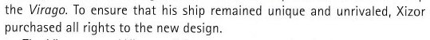
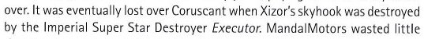
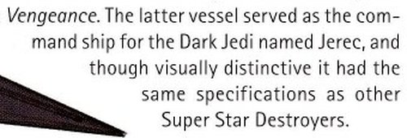
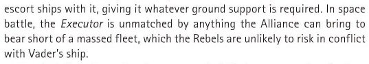
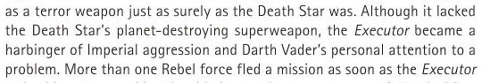
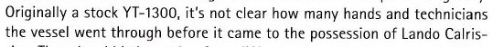

# Owner Material 037 — Star Wars D20 Drive folder (Core, Revised Core and Saga Edition): Sourcebooks/Starships of the Galaxy.pdf [Star Wars Roleplaying Game Saga Edition (2007)] (scan pages 121–162)

- **Source:** Wizards of the Coast Star Wars Roleplaying Game books, web enhancements, Living Force campaign modules and articles (2000–2010), from the owner's "Star Wars D20" Drive folder (only the three edition subfolders; "General" was not read, as instructed). Secondary source (licensed Legends reference). Scan OCR'd on the box; the scan stays box-only and is **not** published.
- **Method:** every scanned page was OCR'd and machine-screened sentence by sentence for power-relevant statements (fights, kills, defeats, Force feats, rankings, superweapons) that name a character on our roster; each kept sentence is quoted verbatim from the OCR text and has a crop of the printed passage directly under it. Pages with nothing power-relevant are still listed with what is on them.
- **Citation:** "*Starships of the Galaxy* (SWRPG Saga Edition), p.X" by printed page ("scan p.X" where no printed number applies). **Weight:** Licensed RPG material: a secondary source. Narrative text sums up Legends lore; game statistics are rules for players, not canon power levels, and rank lowest.

## scan p.121 (scan page 121)

Page contents: Nebulon-B Frigate (Kuat Drive Yards) stat block; history (Imperial convoy escort carrying TIE fighters; captured and defected Alliance frigates; Redemption medical frigate, 700 wounded); Capabilities (patrol, search and rescue, command center); tactical fire (+5 Pilot). (hand-read)

## scan p.122 (scan page 122)

Page contents: P-38 Starfighter (Buuper Torsckil Abbey Devices Porax-38) stat block; history (Utapau port administrator Tion Medon hid the militia fighters; readied with Obi-Wan Kenobi's arrival; supported ARC-170s; P-38 "Jenta" ground-assault variant); Capabilities (built for Utai pilots; sensors; anti-droid jammers; fin-guided ion bombs). (hand-read)

### Stat block notes (game mechanics, not feats)

- P-38 Starfighter: Prior to the occupation of Utapau by the Separatists during the Clone Wars, the port administrator at the time, Tion Medon, instructed that the planetary militia was to hide its starfighter fleet in the multitude of caves and recessed sinkholes that covered the planetary surface. With the arrival of Obi Wan Kenobi, the hidden starfighters (including several squadrons of P-38s) were readied for battle. (Source: *Starships of the Galaxy* (SWRPG Saga Edition), scan p.122)

## scan p.123 (scan page 123)

Page contents: Predator-class Starfighter stat block; history (Darth Krayt's Imperial fleet, over a hundred years after Endor; TIE resemblance; two cockpit styles); Capabilities (space superiority; rivals X-83 Twintail; favored by the Imperial Knights). (hand-read)

### Stat block notes (game mechanics, not feats)

- Predator-class Starfighter: The Predator-class starfighter is one of the foremost weapons in Darth Krayt's Imperial fleet. Designed over a hundred years after the Empire's defeat at Endor, the Predator-class fighter bears more than just a passing resemblance to the Imperial TIE fighter. (Source: *Starships of the Galaxy* (SWRPG Saga Edition), scan p.123)

## scan p.124 (scan page 124)

Page contents: Prototype (Template): hand-built test or custom ships; removal by overhaul; modifications (Threshold, Abilities, Speed, Random Benefit/Drawback, Maintenance Requirement); example Rebel Assault Frigate Prototype stat block (from a Dreadnaught). (hand-read)

## scan p.125 (scan page 125)

Page contents: Rebel Assault Frigate Mk I stat block; history (heavily modified Old Republic-era Dreadnaughts; superstructure removed, solar fins, droids/automation cut crew nearly sixty percent; no losses before Endor). (hand-read)

## scan p.126 (scan page 126)

Page contents: Assault Frigate Capabilities (twenty umbilical docking fixtures; docked Imperial assault shuttle); tactical fire (-2 enemy attacks). Rebel Assault Frigate Mk II (Rendili Star Drive sympathizers' covert design; engineers killed or captured; Mon Calamari-style regenerating shields; crew reduced by an additional 180 — OCR dropped "180", confirmed by crop) with stat block. (hand-read)

## scan p.127 (scan page 127)

Page contents: Republic Cruiser (Corellian Engineering Corporation Consular-class) stat block; history (pre-Clone Wars; Jedi negotiators; armed for the Judicial Forces and Stark Hyperspace War, flagship Invincible; Clone Wars pod roles; postwar pirate/Rebel use; Rebel sympathizer Rif Taranu and the Dead Reckoning); Capabilities (swappable salon pods, ejectable as lifeboats; mission pods). (hand-read)

## scan p.128 (scan page 128)

Page contents: Scimitar Assault Bomber (Sienar Fleet Systems) stat block; history (developed at Grand Admiral Thrawn's behest after Endor; named for the Scimitar Assault Wing; limited deployment); Capabilities (shields; detachable escape pod; massed missile volleys; angled lasers for strafing). (hand-read)

### Stat block notes (game mechanics, not feats)

- Scimitar Assault Bomber: The Scimitar Assault Bomber was developed by Imperial engineers at the behest of Grand Admiral Thrawn following the Battle of Endor. Thrawn saw the need for a craft that would be more effective than the aging TIE bomber, which suffered from poor maneuverability and a distinct lack of shields. (Source: *Starships of the Galaxy* (SWRPG Saga Edition), scan p.128)
- Scimitar Assault Bomber: In emergency situations, the forward section of the ship could be detached, allowing the pilot and copilot to survive their vessel's destruction. Thrawn's reasoning was that the experienced crews that manned the bombers were at least as valuable as the ships they flew. (Source: *Starships of the Galaxy* (SWRPG Saga Edition), scan p.128)

## scan p.129 (scan page 129)

Page contents: Sith Infiltrator (Modified Republic Sienar Systems Armored Star Courier; codenamed Scimitar) stat block; history (Darth Maul's personal vessel; given by Darth Sidious; hidden in Theed by Palpatine after Maul's death). Sidebar: One of a Kind? (only example; Inquisitor Valin Draco's similar ship at the Citadel Inquisitorius on Prakith; Sidious executed the engineers; Raith Sienar's denial). (hand-read)

### Stat block notes (game mechanics, not feats)

- Sith Infiltrator: Sleek, deadly, and unique, the Sith Infiltrator (codenamed the Scimitar) is the personal vessel of Darth Maul prior to the Battle of Naboo. Designed by Sienar Design Systems as a prototype armored star courier, the Sith Infiltrator never saw production as a full line of ships, but rather remained in the prototype stage indefinitely. The first working prototype of the ship was given by Darth Sidious to his apprentice, and it served as Darth Maul's personal transport ship until his death at the hands of Obi-Wan Kenobi. (Source: *Starships of the Galaxy* (SWRPG Saga Edition), scan p.129)
- Sith Infiltrator: Following Darth Maul's death on Naboo, the Sith Infiltrator was taken to a top-secret hangar in Theed for inspection. In truth, Supreme Chancellor Palpatine had the vessel hidden away until such a time as he needed it again. Though his subsequent apprentices would have no need of the Sith Infiltrator, the vessel was secretly maintained and kept in working order as a precaution in case the Sith Lord needed the transport on a moment's notice. (Source: *Starships of the Galaxy* (SWRPG Saga Edition), scan p.129)
- One of a Kind? (sidebar): Though the Scimitar remains under Emperor Palpatine's control throughout the reign of the Empire, at least one other person— an Imperial Inquisitor by the name of Valin Draco—owns and pilots a ship strikingly similar to the Sith Infiltrator. Whether this is the Scimitar or merely a ship of similar design is unknown. The vessel makes its berth on the Imperial fortress world of Prakith at the Citadel Inquisitorius, and few have ever witnessed the ship's arrival or departure. (Source: *Starships of the Galaxy* (SWRPG Saga Edition), scan p.129)
- One of a Kind? (sidebar): It is said that Darth Sidious had every engineer and mechanic who worked on the Sith Infiltrator executed (lending credence to Raith Sienar's claim that he had nothing to do with the ship's design). If the plans ever found their way into the hands of another person, chances are that the Sith Lord would be equally ruthless—not to mention what he would do to someone who actually tried to build a replica of the ship. (Source: *Starships of the Galaxy* (SWRPG Saga Edition), scan p.129)

## scan p.130 (scan page 130)

Page contents: Sith Infiltrator deckplan (keyed areas incl. passenger seating, cargo hold, ready room, sleeping compartment/holding cells, aft airlock); Capabilities (six laser cannons; leaves no witnesses; stygium crystal cloaking device; +5 sensor bonus; Sith Lord's effects: Dark Eye probe droids, poisons, torture devices). (hand-read)

## scan p.131 (scan page 131)

Page contents: Sith Interceptor stat block; history (Jedi Civil War era; mass-produced "swarms", ten-to-one odds); Capabilities (fragile; aid another tactics; Sith disregard for pilots). (hand-read)

## scan p.132 (scan page 132)

Page contents: Skipray Blastboat (Sienar Fleet Systems GAT-12h) stat block; history (pre-Yavin; smallest Imperial hyperdrive vessel; rejected by high command; militia, corporate, pirate, smuggler use); Capabilities (fills gap between snubfighters and capital ships; crew of four; +2 Dex in atmosphere). (hand-read)

## scan p.133 (scan page 133)

Page contents: SoroSuub Cutlass-9 Patrol Fighter stat block; history (Old Republic corporate patrol fighter; sold to nonhumans; production stopped under the Empire after SoroSuub's Confederacy support; SoroSuub later switched to the Rebels); Capabilities (3 unused emplacement points). (hand-read)

## scan p.134 (scan page 134)

Page contents: Star Galleon-class Frigate (Kuat Drive Yards) stat block; history (self-escorting transport; nearly impossible to capture); Capabilities (flotillas; choke points and 300 Naval troopers; detachable hyperdrive-equipped cargo hold with homing beacon); tactical fire (-1 die enemy damage). (hand-read)

## scan p.135 (scan page 135)

Page contents: StarViper (Virago): MandalMotors StarViper Assault Fighter stat block; history (Prince Xizor's personal ship; he bought all rights; lost over Coruscant when the Executor destroyed his skyhook; MandalMotors regained the rights); Capabilities (four independently adjusting wings; articulated heavy double lasers; later model Dex 20, SR 20). (hand-read)

- **Prince Xizor** — entry/section: Starships of the Galaxy: "To ensure that his ship remained unique and unrivaled, Xizor purchased all rights to the new design." Source: *Starships of the Galaxy* (SWRPG Saga Edition), scan p.135
  
- **Prince Xizor**: "It was eventually lost over Coruscant when Xizor's skyhook was destroyed by the Imperial Super Star Destroyer Executor." Source: *Starships of the Galaxy* (SWRPG Saga Edition), scan p.135
  

### Stat block notes (game mechanics, not feats)

- StarViper (Virago): The Virago was the personal starship of Prince Xizor, Black Sun's Underlord. He personally commissioned MandalMotors to design a unique starfighter for his personal use. Xizor's demands were steep: He required a ship that could match the TIE interceptor in speed and that was both versatile and combat-capable. The spacecraft that was produced as a result was the first Star Viper-class assault fighter, and the criminal prince christened his ship the Virago. To ensure that his ship remained unique and unrivaled, Xizor purchased all rights to the new design. (Source: *Starships of the Galaxy* (SWRPG Saga Edition), scan p.135)
- StarViper (Virago): The Virago served Xizor well for many years, paying for itself many times over. It was eventually lost over Coruscant when Xizor's skyhook was destroyed by the Imperial Super Star Destroyer Executor. MandalMotors wasted little time in regaining the rights to the Star Viper design following Xizor's death. (Source: *Starships of the Galaxy* (SWRPG Saga Edition), scan p.135)

## scan p.136 (scan page 136)

Page contents: Strike-class Medium Cruiser (Loronar Corporation) stat block; history (half a Victory Star Destroyer's function at 25% cost; Rebel captures; Imperial Remnant reliance); Capabilities (modular cargo/troop/hangar trade-offs); tactical fire (+1 Reflex or +1 attack). (hand-read)

## scan p.137 (scan page 137)

Page contents: Super Star Destroyer (Fondor Shipyards) stat block CL 40; description (19-km Super-class; lack of point-defense; naming convention: Star Destroyer as star-system destroyer, Super Star Destroyer as star dreadnaught; roles; the Vengeance, command ship of the Dark Jedi Jerec). (hand-read)

- **Jerec**: "The latter vessel served as the command ship for the Dark Jedi named Jerec, and though visually distinctive it had the same specifications as other Super Star Destroyers." Source: *Starships of the Galaxy* (SWRPG Saga Edition), scan p.137
  

### Stat block notes (game mechanics, not feats)

- Super Star Destroyer: Two Super Star Destroyers that fit this model are the Executor (described below) and the Vengeance. The latter vessel served as the command ship for the Dark Jedi named Jerec, and though visually distinctive it had the same specifications as other Super Star Destroyers. (Source: *Starships of the Galaxy* (SWRPG Saga Edition), scan p.137)

## scan p.138 (scan page 138)

Page contents: Executor: Darth Vader's command ship, flagship of the Death Squadron; built secretly at Fondor; tool of fear; destroyed at Endor when Admiral Ackbar focused fire and an A-wing struck the bridge; Capabilities (standard complement); tactical fire (+1 attack, +1 die damage). (hand-read)

- **Darth Vader (Anakin Skywalker)** — entry/section: Starships of the Galaxy: "In space battle, the Executor is unmatched by anything the Alliance can bring to bear short of a massed fleet, which the Rebels are unlikely to risk in conflict with Vader's ship." Source: *Starships of the Galaxy* (SWRPG Saga Edition), scan p.138
  
- **Darth Vader (Anakin Skywalker)**: "Although it lacked the Death Star's planet-destroying superweapon, the Executor became a harbinger of Imperial aggression and Darth Vader's personal attention to a problem." Source: *Starships of the Galaxy* (SWRPG Saga Edition), scan p.138
  

### Stat block notes (game mechanics, not feats)

- Executor: The Executor is Darth Vader's command ship, and the flagship of the Death Squadron. Built in secret at Fondor Shipyards, the Executor was designed as a terror weapon just as surely as the Death Star was. Although it lacked the Death Star's planet-destroying superweapon, the Executor became a harbinger of Imperial aggression and Darth Vader's personal attention to a problem. More than one Rebel force fled a mission as soon as the Executor arrived insystem, making the ship in practice a more successful tool of fear than the Death Star. (Source: *Starships of the Galaxy* (SWRPG Saga Edition), scan p.138)
- Executor: The destruction of the Executor came at the Battle of Endor, when Admiral Ackbar had the entire firepower of the Rebel fleet directed at the Executor alone. Although that assault managed to breach the Executor's shields, the ship survived even that apocalypse in functional condition. It was not until an A-wing fighter smashed into the Executor's bridge that the ship lost functional control. It fell into the second Death Star and was destroyed on impact. (Source: *Starships of the Galaxy* (SWRPG Saga Edition), scan p.138)

## scan p.139 (scan page 139)

Page contents: Lusankya: Executor's secret sister ship buried on Coruscant as a disguised shield generator and secret prison; used by Ysanne Isard to flee after the Emperor's death (Bacta War); New Republic service with Rogue Squadron; suicide weapon against a Vong worldship; Capabilities; Lusankya stat block CL 36. (hand-read)

### Stat block notes (game mechanics, not feats)

- Lusankya: Exactly why the Emperor went to such great lengths to hide a Super Star Destroyer is unknown, though it's certainly possible that he intended the ship to serve as an emergency command vehicle, should his throne world ever come under siege. (Source: *Starships of the Galaxy* (SWRPG Saga Edition), scan p.139)
- Lusankya: As events occurred, the Lusankya was used by intelligence officer Ysanne Isard to flee Coruscant after the Emperor's death. She built a command group around the ship and engaged in such gambits as the Bacta War. Eventually she was defeated and killed, and the Lusankya entered the service of the New Republic. (Source: *Starships of the Galaxy* (SWRPG Saga Edition), scan p.139)

## scan p.140 (scan page 140)

Page contents: Eclipse: the only two Eclipse-class ships; first briefly held by Tyber Zann of the Zann Consortium, who abandoned it; neither completed before the Emperor's death; both destroyed by sabotage and trickery; Capabilities (17.5 km; keel-mounted axial superlaser two-thirds a Death Star component projector); Eclipse stat block CL 50. (hand-read)

### Stat block notes (game mechanics, not feats)

- Eclipse: The first of the line briefly fell into the hands of Tyber Zann, head of the criminal Zann Consortium, but the crime lord realized the Empire would never allow him to keep the ship (and would place his destruction above even that of the Rebel Alliance if he tried), and he abandoned it in space. (Source: *Starships of the Galaxy* (SWRPG Saga Edition), scan p.140)

## scan p.141 (scan page 141)

Page contents: System Patrol Craft (IPV-1, Sienar; Independent/Imperial Patrol Vehicle; monitors/system frigates) stat block; description (secure-system duty; laxity and corruption; pirate potential); Capabilities (antipirate; no hyperdrive; used as escorts before the Lancer); tactical fire (crit on 19-20). (hand-read)

## scan p.142 (scan page 142)

Page contents: Theta-class Shuttle (Cygnus Spaceworks "personnel transport") stat block; history (shuttle of Old Republic and Imperial Senators; precursor of the Lambda; auctioned after the Senate's dissolution); Capabilities (luxury, fighting power, two-month endurance; typical Senatorial shuttle fittings). (hand-read)

## scan p.143 (scan page 143)

Page contents: TIE Fighter (Sienar Fleet Systems TIE/In) stat block; history (Imperial standardization); Capabilities (no shields, hyperdrive, or life support; sealed flight suits; numbers tactics). TIE Bomber (TIE/sa, "dupes"; Battle of Hoth, razing Echo Base, search for the Millennium Falcon, Endor); Capabilities (payload options incl. thermal detonators, propaganda leaflets). (hand-read)

## scan p.144 (scan page 144)

Page contents: TIE Bomber payloads cont. and stat block. TIE Interceptor history (post-Yavin answer to the X-wing; twenty percent of TIEs by Endor); Capabilities (four fire-linked wingtip lasers; notched arrays). (hand-read)

## scan p.145 (scan page 145)

Page contents: TIE Interceptor stat block (interleaved by OCR with TIE Advanced x1 stat block). TIE Advanced: built to Darth Vader's specifications; Vader flew the first prototype at Yavin; later found mothballed; Lando Calrissian used modified TIE advanced fighters for sport in the Dubrillion asteroid belt; Capabilities (sturdier frame, hyperdrive, shields). (hand-read)

### Stat block notes (game mechanics, not feats)

- TIE Advanced: The first TIE advanced prototype was built by Sienar Fleet Systems to Darth Vader's specifications. Only limited quantities of these starfighters were produced, due in large part to the fighter's excessive price tag. Those prototypes that did see use were instead assigned to elite squadrons and utilized to great effect during high-risk sorties against the Rebel Alliance. Vader himself flew the first prototype during the Battle of Yavin, taking the lives of many Rebel pilots in the process. (Source: *Starships of the Galaxy* (SWRPG Saga Edition), scan p.145)
- TIE Advanced: These fighters, rare as they are, occasionally turn up on the open market, or are found mothballed in abandoned Imperial caches throughout the Core. Lando Calrissian, for instance, utilized modified TIE advanced starfighters for sport in the Dubrillion asteroid belt. (Source: *Starships of the Galaxy* (SWRPG Saga Edition), scan p.145)

## scan p.146 (scan page 146)

Page contents: TIE Defender: produced secretly by Sienar under Admiral Demetrius Zaarin before Endor; first used against Zaarin's own rogue forces; Onyx Squadron at Endor; Capabilities (hyperdrive, shields, armor, lasers, ion cannons, torpedoes; five times a TIE's cost); stat block. (hand-read)

### Stat block notes (game mechanics, not feats)

- TIE Defender: Sienar Fleet Systems, under the direct supervision of Admiral Demetrius Zaarin, produced the TIE defender in complete secrecy shortly before the Battle of Endor. (Source: *Starships of the Galaxy* (SWRPG Saga Edition), scan p.146)
- TIE Defender: Ironically, the TIE defender's first use in combat was against rogue naval elements commanded by Admiral Zaarin himself. In the end, the defender was instrumental in engineering Zaarin's ultimate defeat. (Source: *Starships of the Galaxy* (SWRPG Saga Edition), scan p.146)

## scan p.147 (scan page 147)

Page contents: Trade Federation Battleship (Hoersch-Kessel Drive Lucrehulk-class) stat block; description (battleships and Droid Control Ships; converted freighters upgraded for the Clone Wars); Capabilities (volatile reactors near cargo bays; Droid Control Ship destroyed from within at Naboo). (hand-read)

## scan p.148 (scan page 148)

Page contents: Tactical fire (-1 Reflex and attack to small enemies); Lucrehulk-class Droid Control Ship stat block. Sidebar-style section: The Core Ship (detachable spherical center as mobile ground fortress) with Core Ship stat block. (hand-read)

## scan p.149 (scan page 149)

Page contents: Venator-class Star Destroyer (Republic attack cruiser) stat block; history (designed by Lira Blissex for the Clone Wars; flagship for Jedi commanders; supply-line dependent); Capabilities (point-defense around flight deck; dorsal flight deck weakness abandoned in later designs); tactical fire (+2 attack, damage dice step). (hand-read)

## scan p.150 (scan page 150)

Page contents: V-19 Torrent Starfighter stat block; history (early Clone Wars Republic favorite; Battle of Muunilinst; prototypes at Geonosis; booster rings then hyperdrive retrofit); Capabilities (unshielded, tough hull, missiles; precursor of Imperial mass-fighter doctrine). (hand-read)

## scan p.151 (scan page 151)

Page contents: V-wing Starfighter (Kuat Systems Engineering Alpha-3 Nimbus) stat block; history (late Clone Wars; engineered by Walex Blissex; astromech; booster ring); Capabilities (fast pursuit and hit-and-run; inspiration for Rebel guerrilla tactics; escort fighter launched from capital ships). (hand-read)

## scan p.152 (scan page 152)

Page contents: X-83 TwinTail Starfighter (Incom) stat block; history (X-wing successor used by the Jedi before the rise of Darth Krayt; hardwired astromechs develop personalities); Capabilities (durability and firepower; damage-soaking squadrons). (hand-read)

## scan p.153 (scan page 153)

Page contents: X-wing (Incom T-65B) stat block; history (Incom ISB investigation; Rebel commandos rescued the design team with plans and prototypes); Capabilities (all-around; astromech socket). T-65XJ3 (Yuuzhan Vong war; favored by Jedi pilots; backup shields; stutter-fire lasers vs. dovin basals) with stat block begun. (hand-read)

## scan p.154 (scan page 154)

Page contents: T-65XJ3 stat block cont. Recon X-wing (T-65BR; Y-wing Longprobe replacement; New Republic "Improve and Replace"); Capabilities (sensors +10/-10 Stealth; hypertransceiver; self-destruct and dead man's switch); T-65BR stat block. (hand-read)

## scan p.155 (scan page 155)

Page contents: YT-Series Transports (Corellian Engineering Corporation): Corellian YT-1300 Transport stat block; history (Old Republic onward; disc body and external cockpit; shared parts; modular; Millennium Falcon is a YT-1300); Capabilities (10 unused emplacement points; smuggler reputation). YT-2000 (YT-1930 symmetry; heavier shields and weapons; corporate espionage) begins. (hand-read)

## scan p.156 (scan page 156)

Page contents: YT-2000 cont. (rushed production, -2 Mechanics; discontinued to push the YT-2400) with stat block. YT-2400 ("perfect" light freighter; off-center cockpit; escape pod; the Outrider of smuggler and mercenary Dash Rendar). (hand-read)

### Stat block notes (game mechanics, not feats)

- YT-2400: Among the most well-known YT-2400s is the Outrider, the ship of smuggler and mercenary Dash Rendar. (Source: *Starships of the Galaxy* (SWRPG Saga Edition), scan p.156)

## scan p.157 (scan page 157)

Page contents: Corellian YT-2400 stat block. Millennium Falcon (stock YT-1300 via Lando Calrissian; aliases Argos, Sunlight Franchise, Longshot, Shadow Bird; served Lando, Han Solo, Princess Leia; Capabilities as of Yavin) with stat block CL 12. (hand-read)

- **Lando Calrissian**: "Originally a stock YT-1300, it's not clear how many hands and technicians the vessel went through before it came to the possession of Lando Calrissian." Source: *Starships of the Galaxy* (SWRPG Saga Edition), scan p.157
  

### Stat block notes (game mechanics, not feats)

- Millennium Falcon: The Millennium Falcon is among the most famous starships in the galaxy. Originally a stock YT-1300, it's not clear how many hands and technicians the vessel went through before it came to the possession of Lando Calrissian. Though cobbled together from different ships, the Falcon is proof that the whole is often more than the sum of its parts. It is often flown under false registration, and has been identified at the Argos, Sunlight Franchise, Longshot, and Shadow Bird, among other aliases. (Source: *Starships of the Galaxy* (SWRPG Saga Edition), scan p.157)
- Millennium Falcon: It served Lando Calrissian, Han Solo, and Princess Leia and was at various points piloted by any number of copilots and allies. (For this reason, the statistics given here assume a "typical" crew of ace smugglers; if the ship is encountered with Lando, Han Solo, or Chewbacca flying it, their abilities may be used rather than those of a generic crew.) (Source: *Starships of the Galaxy* (SWRPG Saga Edition), scan p.157)

## scan p.158 (scan page 158)

Page contents: Deck plan: Corellian Engineering Corporation YT-1300 Stock Light Transport (Freight Configuration), 1 square = 1.5 meters; key: Boarding Ramps, Docking Rings, Main Corridor, Observation Deck, Cockpit Access Corridor, Cockpit, Main Hold, Circuitry Bay, Refresher, Freight Loading Room, Cargo Holds, Engineering Bay (OCR garbled; labels confirmed from contact sheet image). (hand-read)

## scan p.159 (scan page 159)

Page contents: Y-wing (Koensayr BTL-S3) stat block; history (designed for Clone Wars, built after; sold to anyone incl. Hutts and Rebels; "wishbone"; backbone of the early Rebellion; serves through Yuuzhan Vong invasion); Capabilities (fighter/bomber with ion cannons). Y-wing Longprobe begins. (hand-read)

## scan p.160 (scan page 160)

Page contents: Longprobe cont. (recon teams of six to twelve); Koensayr BTL-A4 LP "Longprobe" stat block. Y-wing Courier (ion cannons gutted; passengers; ejecting cockpit escape pod); Koensayr BTL-S3 "Courier" stat block. (hand-read)

## scan p.161 (scan page 161)

Page contents: Z-95 Headhunter (Incom/Subpro) stat block; history (most numerous starfighter in planetary and law-enforcement service; cousin of the T-65 X-wing); Capabilities (stock no hyperdrive; Alliance hyperdrive variants for sensitive operations; durable, cheap parts). (hand-read)

## scan p.162 (scan page 162)

Page contents: Back cover: headline "She's the fastest hunk of junk in the galaxy..." (unattributed film line); blurb on space battles; features list (nearly 100 starships across all eras; talents and feats; upgrade system); ISBN 978-0-7869-4823-9; (c)2007 Lucasfilm; US $34.95. (hand-read)

