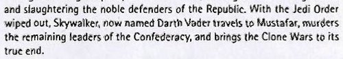
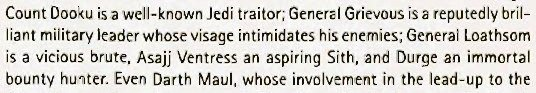

# Owner Material 037 — Star Wars D20 Drive folder (Core, Revised Core and Saga Edition): Sourcebooks/The Clone Wars Campaign Guide.pdf [Star Wars Roleplaying Game Saga Edition (2007)] (scan pages 1–60)

- **Source:** Wizards of the Coast Star Wars Roleplaying Game books, web enhancements, Living Force campaign modules and articles (2000–2010), from the owner's "Star Wars D20" Drive folder (only the three edition subfolders; "General" was not read, as instructed). Secondary source (licensed Legends reference). Scan OCR'd on the box; the scan stays box-only and is **not** published.
- **Method:** every scanned page was OCR'd and machine-screened sentence by sentence for power-relevant statements (fights, kills, defeats, Force feats, rankings, superweapons) that name a character on our roster; each kept sentence is quoted verbatim from the OCR text and has a crop of the printed passage directly under it. Pages with nothing power-relevant are still listed with what is on them.
- **Citation:** "*The Clone Wars Campaign Guide* (SWRPG Saga Edition), p.X" by printed page ("scan p.X" where no printed number applies). **Weight:** Licensed RPG material: a secondary source. Narrative text sums up Legends lore; game statistics are rules for players, not canon power levels, and rank lowest.

## scan p.1 (scan page 1)

Page contents: Cover: Star Wars Roleplaying Game, The Clone Wars Campaign Guide; Rodney Thompson, Patrick Stutzman, JD Wiker. (hand-read)

## scan p.2 (scan page 2)

Page contents: Title page: The Clone Wars Campaign Guide; Rodney Thompson, Patrick Stutzman, JD Wiker. (hand-read)

## scan p.3 (scan page 3)

Page contents: Credits (designers, editors, artists, Lucasfilm); rules basis note; Wizards of the Coast addresses; ISBN 978-0-7869-4999-1; First Printing January 2009; (c)2008 Lucasfilm. (hand-read)

## scan p.4 (scan page 4)

Page contents: Table of contents (OCR partly garbled): The Force during the Clone Wars, Heroes of the Clone Wars, prestige classes (Droid Commander, Military Engineer, Vanguard), equipment, droids, space transports, starfighters, Decline of the Jedi, worlds (Cato Neimoidia through Utapau), Jedi Order, Republic, Confederacy, Mercenary factions, beasts, appendix. (hand-read)

## scan p.5 (scan page 5)

Page contents: Introduction chapter opener art (clone troopers, Yoda); no body text. (hand-read)

## scan p.6 (scan page 6)

Page contents: Introduction: the Clone Wars polarize the galaxy; heroes can tip the balance; Jedi stretched as generals; villains (Dooku, Grievous, Ventress, Loathsom) vs. Yoda, Windu, Obi-Wan, Anakin; Palpatine secretly playing both sides as Darth Sidious. Epigraph "Twice the pride, double the fall." - Count Dooku. (hand-read)

### Stat block notes (game mechanics, not feats)

- Introduction: Meanwhile, the Confederacy recruits more villainous members, and soon the likes of Count Dooku, General Grievous, Asajj Ventress, and General Loathsom are facing off against Yoda, Mace Windu, Obi-Wan Kenobi, and Anakin Skywalker. As the Jedi go into decline, sinister villains are on the rise. Meanwhile, Supreme Chancellor Palpatine oversees the entire conflict, secretly playing each side against the other in his guise as the Sith Lord, Darth Sidious. (Source: *The Clone Wars Campaign Guide* (SWRPG Saga Edition), scan p.6)
- Introduction (epigraph): "Twice the pride, double the fall." - Count Dooku (Source: *The Clone Wars Campaign Guide* (SWRPG Saga Edition), scan p.6)

## scan p.7 (scan page 7)

Page contents: A Galaxy at War (neutral worlds crushed; Utapau forced to build Mankvim-814 and Porax-38 fighters; Tatooine embroiled via the plot to trick Jabba the Hutt; Techno Union facility on Nelvaan). Choosing Sides (Republic, Separatist, trade organizations, fringe/neutral heroes). Purple sidebar (missed by base OCR; read via crop/tesseract): What You Need to Play (Saga core; Starships of the Galaxy and Threats of the Galaxy optional; website errata). (hand-read)

### Stat block notes (game mechanics, not feats)

- A Galaxy at War: Remote Tatooine—where the Republic has had no presence—is embroiled in the war as the Confederacy attempts to trick Jabba the Hutt into influencing the other Hutt clans to allow the Separatists to use their shipping lanes. (Source: *The Clone Wars Campaign Guide* (SWRPG Saga Edition), scan p.7)

## scan p.8 (scan page 8)

Page contents: The Clone Wars timeline: Battle of Naboo (Palpatine elected; Anakin becomes Obi-Wan's Padawan); Battle of Geonosis (Dooku's betrayal; Jedi as commanders); Coruscant and Utapau (death of Dooku; Grievous ended by Obi-Wan); Order 66 (Windu dead, Anakin becomes Vader, murders Separatist leaders on Mustafar). Purple sidebar (missed by base OCR): The Clone Wars (content drawn from the animated series). Epigraph "The shroud of the dark side has fallen. Begun, this clone war has!" - Yoda (confirmed by image crop). (hand-read)

- **Darth Vader (Anakin Skywalker)**: "With the Jedi Order wiped out, Skywalker, now named Darth Vader travels to Mustafar, murders the remaining leadérs of the Confederacy, and brings the Clone Wars to Its true end." Source: *The Clone Wars Campaign Guide* (SWRPG Saga Edition), scan p.8
  

### Stat block notes (game mechanics, not feats)

- The Battle of Naboo: After the Battle of Naboo, Palpatine is elected to the post of Supreme Chancellor, allowing him to manipulate the Republic into the Clone Wars. Meanwhile, the Trade Federation is rebuffed and joins with the other trade organizations to form the alliance that eventually becomes the Confederacy of Independent Systems. Lastly, the Battle of Naboo leads to Anakin Skywalker becoming the Padawan of Obi-Wan Kenobi, a course of events that shakes the entire galaxy. (Source: *The Clone Wars Campaign Guide* (SWRPG Saga Edition), scan p.8)
- The Battle of Geonosis: On this desolate planet the first shots of the galactic conflict are fired, and the full extent of Count Dooku's betrayal becomes evident to the Jedi. Many Jedi die on Geonosis, but just as many are thrust into the command of clone forces, setting a precedent that draws the Jedi out into the galaxy as military leaders. (Source: *The Clone Wars Campaign Guide* (SWRPG Saga Edition), scan p.8)
- Coruscant and Utapau: After three years of struggling against the Confederacy, the Jedi strike a major blow against the Separatists with the death of Count Dooku. In the process of rescuing Supreme Chancellor Palpatine from the flagship of the Separatist fleet, Anakin Skywalker dispatches the Sith apprentice, and the Republic wins a significant victory. A short time later, Obi-Wan Kenobi ends General Grievous's reign of terror during the siege of Utapau. In a short time, the Jedi eliminate two of the Confederacy's powerful leaders, and the tide shifts heavily in favor of the Republic. (Source: *The Clone Wars Campaign Guide* (SWRPG Saga Edition), scan p.8)
- Order 66: After a confrontation leaves Mace Windu dead and Anakin Skywalker as the new apprentice of Darth Sidious, clone forces throughout the galaxy respond to Order 66, turning on their Jedi generals and slaughtering the noble defenders of the Republic. With the Jedi Order wiped out, Skywalker, now named Darth Vader travels to Mustafar, murders the remaining leaders of the Confederacy, and brings the Clone Wars to its true end. (Source: *The Clone Wars Campaign Guide* (SWRPG Saga Edition), scan p.8)
- The Clone Wars (epigraph): "The shroud of the dark side has fallen. Begun, this clone war has!" - Yoda (Source: *The Clone Wars Campaign Guide* (SWRPG Saga Edition), scan p.8)

## scan p.9 (scan page 9)

Page contents: Chapter 1: Species, chapter opener art; no body text. (hand-read)

## scan p.10 (scan page 10)

Page contents: Species chapter intro (neutral species like Nelvaanians drawn in); Species Characteristics; Table 1-1 Species Ability Adjustments (Gen'Dai, Kaleesh, Kaminoan, Kerkoiden, Nautolan, Nelvaanian, Vurk). (hand-read)

## scan p.11 (scan page 11)

Page contents: Table 1-2 Age by Species; Table 1-3 Height and Weight (OCR interleaved with body column). Dugs: Malastare; Gran colonies and war; martyr beads; personality, physical description; example names incl. Sebulba; adventurers. (hand-read)

## scan p.12 (scan page 12)

Page contents: Dug Species Traits (Small, Athletic). Gen'Dai: extreme longevity, no centralized vital organs, nomads; personality and insanity with age; example names Durge, Grozm, Kranth, Lu'urn; Gen'Dai Species Traits (Large, Gen'Dai Surge, Hibernation, Mental Instability, Regeneration, Resilient Physiology). (hand-read)

## scan p.13 (scan page 13)

Page contents: Iktotchi (Iktotchon and moon Iktotch; precognition; famed pilots; diplomats foreseeing the Clone Wars; personality; physical description; example names incl. Saesee Tiin; notable Iktotchi Jedi such as Saesee Tiin); Iktotchi Species Traits (Natural Armor, Limited Precognition, Expert Pilot). Kaleesh (nomadic, ancestor worship; Huk invasion repelled under the hero later known as Grievous; Republic sanctions) begins. (hand-read)

### Stat block notes (game mechanics, not feats)

- Iktotchi: Because of their precognitive talents, there have been several notable Iktotchi Jedi, such as Saesee Tiin. (Source: *The Clone Wars Campaign Guide* (SWRPG Saga Edition), scan p.13)
- Kaleesh: However, the Huk invasion of Kalee is short lived. Under the leadership of a hero who eventually comes to be known as Grievous, the Kaleesh repel the Huk. They doggedly pursue their enemies into space, and the Huk are completely overcome by the Kaleesh. The hunters become the hunted. The Huk request assistance from the Republic, and through a number of underhanded dealings, they receive it. As a result, the Republic subjects the Kaleesh to severe economic sanctions, and the Kaleesh are marginalized by galactic society. (Source: *The Clone Wars Campaign Guide* (SWRPG Saga Edition), scan p.13)

## scan p.14 (scan page 14)

Page contents: Kaleesh cont. (personality, honor; skull masks; homeworld Kalee; example names; adventurers); Kaleesh Species Traits (Skill Focus Survival, Darkvision, Driven, Persistent). Kaminoans (Kamino cloners; selective breeding; perfectionism; example names incl. Lama Su, Taun We; adventurers). (hand-read)

## scan p.15 (scan page 15)

Page contents: Kaminoan Species Traits (Skill Focus Treat Injury, Resistant). Kerkoidens (Expansion Region; predatory ancestry; elitist politicians; homeworld Kerkoidia, Kira Sector off the Harrin Trade Corridor; example names incl. Whorm Loathsom; adventurers). Epigraph quote: "Unless you call off your troops right now, I will have no choice but to destroy you." -General Whorm Loathsom (OCR truncated; completed from page image). (hand-read)

### Stat block notes (game mechanics, not feats)

- Kerkoidens (epigraph): "Unless you call off your troops right now, I will have no choice but to destroy you." -General Whorm Loathsom (Source: *The Clone Wars Campaign Guide* (SWRPG Saga Edition), scan p.15)

## scan p.16 (scan page 16)

Page contents: Kerkoiden Species Traits (Predator's Heritage, Social Cunning). Nautolans (Glee Anselm; Nautila pheromone language; tendrils; example names incl. Kit Fisto; several notable Nautolan Jedi); Nautolan Species Traits (swim 4, Breathe Underwater, Expert Swimmer, Low-Light Vision, Natural Damage Reduction DR 2 (OCR dropped "DR 2"; confirmed by crop), Pheromonal Sensor). (hand-read)

## scan p.17 (scan page 17)

Page contents: Nelvaanians (Nelvaan tribal canine humanoids; chief, mate and shaman; "Great Mother"; males abducted and mutated by the Techno Union; experiments stopped by Anakin Skywalker; example names Harvos, Orvos, Tuzes-Adaz); Nelvaanian Species Traits (Low-Light Vision, Primitive, Scent, Shadow Swiftness). Epigraph (missed by base OCR; read from page image): "The Force has guided us here for your final trial. The one you've never truly faced." -Obi-Wan Kenobi. (hand-read)

### Stat block notes (game mechanics, not feats)

- Nelvaanians: During the Clone Wars, male Nelvaanians are abducted by the Techno Union and subjected to extensive physiological and genetic manipulation in an attempt to create a race of mutant warriors. The experiments are partially successful, turning the males of the species into monstrous versions of their former selves. However, the experiments are stopped by Anakin Skywalker, and the modified Nelvaanians reunite with their tribes. (Source: *The Clone Wars Campaign Guide* (SWRPG Saga Edition), scan p.17)
- Nelvaanians (epigraph): "The Force has guided us here for your final trial. The one you've never truly faced." -Obi-Wan Kenobi (Source: *The Clone Wars Campaign Guide* (SWRPG Saga Edition), scan p.17)

## scan p.18 (scan page 18)

Page contents: Vurks (amphibious nomads of Sembla; clan feasts; integrity and honesty; diplomats; example names Coleman Trebor, Sweitt Concorkill); Vurk Species Traits (swim 4, Breathe Underwater, Expert Swimmer, Placid, Nomads). Epigraph (OCR garbled; read from image): "The Jedi are guardians of peace and justice. We are servants, not celebrities." -Jedi Master Coleman Trebor. (hand-read)

### Stat block notes (game mechanics, not feats)

- Vurks (epigraph): "The Jedi are guardians of peace and justice. We are servants, not celebrities." -Jedi Master Coleman Trebor (Source: *The Clone Wars Campaign Guide* (SWRPG Saga Edition), scan p.18)

## scan p.19 (scan page 19)

Page contents: Chapter 2: Heroic Traits, chapter opener art (OCR garbled title). (hand-read)

## scan p.20 (scan page 20)

Page contents: Chapter 2 intro: heroes shaped by the Clone Wars; new talents, feats and skill uses; consider character arcs over levels. Heroes of the Clone Wars (themes of the era) begins. (hand-read)

## scan p.21 (scan page 21)

Page contents: Heroes of the Clone Wars themes: Large-Scale Conflict (Nelvaan, Commenor; Ewoks/Chiss with GM permission); Decline of the Jedi (Order 66; Jedi Master Kota); Rampant Corruption (Palpatine, Sidious, Dooku); High-Profile Villains (Dooku, Grievous, Loathsom, Ventress, Durge, Darth Maul). Epigraph: "Your lightsabers will make a fine addition to my collection." -General Grievous. (hand-read)

- **Count Dooku; General Grievous; Asajj Ventress**: "Count Dooku is a well-known Jedi traitor; General Grievous is a reputedly brilliant military leader whose visage intimidates his enemies; Generali Loathsom is a vicious brute, Asajj Ventress an aspiring Sith, and Durge an immortal bounty huater." Source: *The Clone Wars Campaign Guide* (SWRPG Saga Edition), scan p.21
  

### Stat block notes (game mechanics, not feats)

- Large-Scale Conflict: Your hero might be from an obscure, out-of-the-way planet like Nelvaan, drawn into the war after Anakin Skywalker and Obi-Wan Kenobi liberate the Nelvaanians from the oppression of the Techno Union. (Source: *The Clone Wars Campaign Guide* (SWRPG Saga Edition), scan p.21)
- Decline of the Jedi: Likewise, your hero could be a mercenary who serves alongside a Jedi general who, like Jedi Master Kota, prefers not to work with clone troops; when the Jedi falls in battle, your hero suddenly finds himself without an employer. (Source: *The Clone Wars Campaign Guide* (SWRPG Saga Edition), scan p.21)
- Rampant Corruption: Corruption in the Senate allows Senator Palpatine to maneuver his way into the position of Supreme Chancellor, and the greed of the member organizations of the Confederacy allows Darth Sidious and Count Dooku to manipulate them into starting a galaxy-spanning war. Heroes of this era have likely been exposed to corruption. Jedi witness the fall of Count Dooku, nobles have brushes with power-hungry peers, and soldiers are thrown into chaos by the carelessness with which politicians commit lives to battle. (Source: *The Clone Wars Campaign Guide* (SWRPG Saga Edition), scan p.21)
- Rampant Corruption (epigraph): "Your lightsabers will make a fine addition to my collection." -General Grievous (Source: *The Clone Wars Campaign Guide* (SWRPG Saga Edition), scan p.21)
- High-Profile Villains: The Separatists, denounced by the Republic as greed-driven traitors, have some of the most visible and eclectic villains in the entire Star Wars saga. Count Dooku is a well-known Jedi traitor; General Grievous is a reputedly brilliant military leader whose visage intimidates his enemies; General Loathsom is a vicious brute, Asajj Ventress an aspiring Sith, and Durge an immortal bounty hunter. Even Darth Maul, whose involvement in the lead-up to the Clone Wars ends nearly ten years before the outbreak of war, works closely alongside leaders of the Trade Federation. Your hero might have a history involving one of these high-profile Separatists, even if the Gamemaster chooses not to integrate that villain into your campaign. Your hero might be a Kaleesh who fought alongside General Grievous on Kalee, but now your hero resents Grievous for his role in the devastation of your planet. Similarly, your world might have been blasted from orbit by Separatist vessels under the command of General Loathsom, or the bounty hunter Durge might have killed or captured a member of your immediate family. (Source: *The Clone Wars Campaign Guide* (SWRPG Saga Edition), scan p.21)

## scan p.22 (scan page 22)

Page contents: Militarization (Republic has no standing army before the war; Kaminoan cloners and Rothana Heavy Engineering; Felucia guide example). Jedi in the Clone Wars (military leaders; Guardian/Consular/Sentinel roles; RMSUs; undercover Jedi such as Quinlan Vos). Art caption: Plo Koon dispatches a cold assault battle droid. (hand-read)

### Stat block notes (game mechanics, not feats)

- Jedi: Though the Jedi are allied with the Republic, some Jedi, such as Quinlan Vos, go undercover to infiltrate the Confederacy; such Jedi would likely keep their allegiances and powers a secret, as the powerful Force-users among the Separatists would be able to detect both their deception and, likely, their subterfuge. (Source: *The Clone Wars Campaign Guide* (SWRPG Saga Edition), scan p.22)
- art caption: Plo Koon dispatches a cold assault battle droid. (Source: *The Clone Wars Campaign Guide* (SWRPG Saga Edition), scan p.22)

## scan p.23 (scan page 23)

Page contents: New Jedi Talents: Consular (Consular's Vitality, Improved Consular's Vitality), Guardian (Exposing Strike, Guardian Strike), Sentinel (Sentinel's Observation, Unseen Eyes). Nobles in the Clone Wars; New Noble Talents: Collaborator talent tree (Double Agent). (hand-read)

## scan p.24 (scan page 24)

Page contents: Collaborator tree cont. (Enemy Tactics, Feed Information, Friendly Fire, Protection); Loyal Protector talent tree (Inspire Loyalty, Undying Loyalty, Punishing Protection, Protector Actions: Bodyguard, Diversion Attack, The Best Defense). Scoundrels in the Clone Wars (privateers, smugglers turned legitimate shippers, Sector Rangers stretched thin). (hand-read)

## scan p.25 (scan page 25)

Page contents: New Scoundrel Talents: Misfortune (Stymie); Opportunist talent tree (Advantageous Opening, Retribution, Slip By, Thrive on Chaos, Vindication). Scouts in the Clone Wars (guides and trackers; Felucia, Saleucami; pressed into service) begins. (hand-read)

## scan p.26 (scan page 26)

Page contents: Scouts cont. New Scout Talents: Reconnaissance talent tree (Reconnaissance Team Leader, Close-Combat Assault, Get Into Position, Reconnaissance Actions: Forward Scouting, Group Sniping, Sweep the Area); Surveillance talent tree (Advanced Intel, Hidden Eyes, Hunt the Hunter, Seek and Destroy, Spotter). Soldiers in the Clone Wars begins. (hand-read)

## scan p.27 (scan page 27)

Page contents: Soldiers cont. New Soldier Talents: Brawler (Bayonet Master, Unrelenting Assault); Commando (Keep Them at Bay); Trooper talent tree (Comrades in Arms, Focused Targeting, Phalanx, Stick Together, Watch Your Back); Squad Leader talent tree (Commanding Officer, Coordinated Tactics, Fire at Will, Squad Actions: Autofire Barrage, Open Fire). (hand-read)

## scan p.28 (scan page 28)

Page contents: Squad Actions cont. (Painted Target). Skills: Knowledge (tactics) new uses (Anticipate Enemy Strategy, Battlefield Tactics); Perception (Long-Range Spotter with electrobinoculars). (hand-read)

## scan p.29 (scan page 29)

Page contents: Survival: Create Defensive Position. Use the Force: Move Light Object; Place Other in Force Trance (RMSU Jedi healers). Feats chapter section begins: Anointed Hunter (Nelvaanian), Artillery Shot, Coordinated Barrage, Droidcraft. (hand-read)

## scan p.30 (scan page 30)

Page contents: Feats: Droid Hunter, Experienced Medic, Expert Droid Repair, Flash and Clear, Flood of Fire. Sidebar "Bonus Feats" (class bonus feat lists for Jedi, Noble, Scoundrel, Scout, Soldier). Art label: Anointed Hunter. (hand-read)

## scan p.31 (scan page 31)

Page contents: Table: Feats (feat name, prerequisites, benefit summary for all 21 new feats). (hand-read)

## scan p.32 (scan page 32)

Page contents: Feats: Grand Army of the Republic Training, Gunnery Specialist, Jedi Familiarity, Leader of Droids, Overwhelming Attack, Pall of the Dark Side, Separatist Military Training, Spray Shot, Trench Warrior, Unstoppable Force. (hand-read)

## scan p.33 (scan page 33)

Page contents: Feats: Unwavering Resolve, Wary Defender (art label: Trench Warrior). Followers (nonheroic allies gained via talents; leadership; GM detail). Sidebar "Human Followers" (choose one item from another template instead of species bonus). (hand-read)

## scan p.34 (scan page 34)

Page contents: Follower Statistics (level, species, initiative, Destiny/Force Points, Dark Side Score, languages, defenses, hp, damage threshold, BAB, grapple, ability scores, talents and feats, skills, possessions). Sidebar "Droid Followers" (droid follower species traits, fourth-degree, starting equipment). (hand-read)

## scan p.35 (scan page 35)

Page contents: Follower Templates: The Aggressive Follower, The Defensive Follower, The Utility Follower. (hand-read)

## scan p.36 (scan page 36)

Page contents: Sample Follower: Gamma-383 "Trench" (clone trooper defensive follower, stat block; book-original). Follower Actions: standard actions (Attack, Aid Another, Charge, Fight Defensively, Retrieve a Concealed Item, Use Special Ability); move actions (Draw or Holster a Weapon, Manipulate an Item, Move With You). (hand-read)

## scan p.37 (scan page 37)

Page contents: Follower swift actions (Activate an Item, Drop an Item, Fall Prone, Recover, Switch Weapon Mode); full-round (Run). Sidebar "Sharing Actions" (why followers act in concert with their hero). Followers in Vehicles: standard actions (Attack, Aid Another, Attack Run, Dogfight, Fight Defensively, Use Special Ability). (hand-read)

## scan p.38 (scan page 38)

Page contents: Vehicle follower move/swift/full-round actions (Move Vehicle With You, Full Stop, Increase Vehicle Speed, Raise or Lower Shields, Recharge Shields, Reroute Power, All-Out Movement). Attacks of Opportunity; Equipping a Follower; Follower Death. Sidebar "Followers and Dark Side". (hand-read)

## scan p.39 (scan page 39)

Page contents: Chapter 3: Prestige Classes, chapter opener art (clone trooper). (hand-read)

## scan p.40 (scan page 40)

Page contents: Chapter 3 intro (prestige class requirements; GM discretion; intro text on dark background partly dropped by OCR, read from crop). New Talents: Ace Pilot (Expert Pilot tree: Renowned Pilot); Elite Trooper talents: Melee Specialist talent tree (Accurate Blow) begins. (hand-read)

## scan p.41 (scan page 41)

Page contents: Melee Specialist cont. (Close-Quarters Fighter, Ignore Armor (OCR dropped "armor."; crop-confirmed), Improved Stunning Strike, Whirling Death); Republic Commando talent tree (Ambush, Higher Yield, Rapid Reload, Shoulder to Shoulder, Strength in Numbers, Weapon Shift). Force Adept talents: Force Item tree (Focused Force Talisman, Greater Focused Force Talisman). Art caption: Republic commandos attack a homing spider droid. Epigraph (missed by base OCR; read from crop): "Some people say that in order to achieve maximum combat effectiveness, they need to get into the zone. Sir, I live in the zone." -Clone Commando RC-1207 "Sev". (hand-read)

### Stat block notes (game mechanics, not feats)

- Republic Commando talents (epigraph): "Some people say that in order to achieve maximum combat effectiveness, they need to get into the zone. Sir, I live in the zone." -Clone Commando RC-1207 "Sev" (Source: *The Clone Wars Campaign Guide* (SWRPG Saga Edition), scan p.41)

## scan p.42 (scan page 42)

Page contents: Gunslinger talent (Blind Shot). Jedi Knight talents: Jedi Archivist talent tree (Direct, Impart Knowledge, Insight of the Force, Master Advisor, Scholarly Knowledge); Jedi Healer talent tree (Force Treatment, Healing Boost, Improved Healing Boost, Soothe). Art caption: The Mon Calamari Jedi healer Nahdar Vebb. (hand-read)

### Stat block notes (game mechanics, not feats)

- art caption: The Mon Calamari Jedi healer Nahdar Vebb (Source: *The Clone Wars Campaign Guide* (SWRPG Saga Edition), scan p.42)

## scan p.43 (scan page 43)

Page contents: Officer talents: Military Tactics (Exploit Weakness, Grand Leader, Uncanny Defense). Table 3-1 Prestige Classes (droid commander, military engineer, vanguard). Droid Commander prestige class intro; Table 3-2 The Droid Commander; Examples of Droid Commanders in Star Wars: OLR-4, OOM-9, OOM-14; requirements (7th level, Knowledge (tactics), Use Computer, Leadership or Commando talent, droids only). (hand-read)

### Stat block notes (game mechanics, not feats)

- Examples of Droid Commanders in Star Wars: OLR-4, OOM-9, OOM-14. (Source: *The Clone Wars Campaign Guide* (SWRPG Saga Edition), scan p.43)

## scan p.44 (scan page 44)

Page contents: Droid Commander game rule information (1d10 hp, Force Points 6 + one-half level, Defense bonuses, talents); Droid Commander talent tree (Automated Strike, Droid Defense, Droid Mettle, Expanded Sensors) begins. (hand-read)

## scan p.45 (scan page 45)

Page contents: Droid Commander talents cont. (Inspire Competence, Maintain Focus, Overclocked Troops, Reinforced Commands); Networked Mind class feature. Military Engineer prestige class intro; Table 3-3 The Military Engineer; Examples of Military Engineers in Star Wars: Bao-Dur, Raith Sienar, Wat Tambor; requirements (BAB +7, Mechanics, Use Computer); game rule information. (hand-read)

### Stat block notes (game mechanics, not feats)

- Examples of Military Engineers in Star Wars: Bao-Dur, Raith Sienar, Wat Tambor (Source: *The Clone Wars Campaign Guide* (SWRPG Saga Edition), scan p.45)

## scan p.46 (scan page 46)

Page contents: Military Engineer class features (Defense bonuses, talents); Military Engineer talent tree (Breach Cover, Breaching Explosive, Droid Expert, Prepared Explosive, Problem Solver, Quick Modifications, Repairs on the Fly). Art: military engineer. (hand-read)

## scan p.47 (scan page 47)

Page contents: Military Engineer talents cont. (Sabotage Device, Tech Savant, Vehicular Boost); Field-Created Weapon. Vanguard prestige class intro; Table 3-4 The Vanguard; Examples of Vanguards in Star Wars: 91st Reconnaissance Corps clone troopers, Aleenan scouts, Antarian Rangers, Neyo (CC-826, as printed), Rebel Plex Troopers; requirements; game rule information; Defense bonuses. (hand-read)

### Stat block notes (game mechanics, not feats)

- Examples of Vanguards in Star Wars: 91st Reconnaissance Corps clone troopers, Aleenan scouts, Antarian Rangers, Neyo (CC-826), Rebel Plex Troopers. (Source: *The Clone Wars Campaign Guide* (SWRPG Saga Edition), scan p.47)

## scan p.48 (scan page 48)

Page contents: Vanguard talents; Vanguard talent tree (Enhanced Vision, Impenetrable Cover, Invisible Attacker, Mark the Target, Maximize Cover, Shellshock, Soften the Target, Triangulate); Surprise Attack class feature. Art: vanguard. (hand-read)

## scan p.49 (scan page 49)

Page contents: Chapter 4: The Force, chapter opener art (Dooku, Sidious, Ventress and Jedi with lightsabers). (hand-read)

## scan p.50 (scan page 50)

Page contents: Chapter 4 intro (light/dark side by emotional state; Jedi exploits seen in the war; new powers, secrets, talents, techniques and traditions). The Force during the Clone Wars (Jedi losing prominence; young Jedi generals tempted to the dark side; Jedi who stay level-headed earn respect). Art: Yoda. (hand-read)

## scan p.51 (scan page 51)

Page contents: Other traditions (Jensaarai, Korunnai) and Dark Side Points in battle. Force Powers (telekinetic descriptor). Cloak (heading dropped by OCR; DC 15-30, Stealth bonus; spend Force Point to increase Stealth bonus by 5). Levitate [telekinetic]. Art caption: Obi-Wan Kenobi issues orders from atop a Kappa-class shuttle. (hand-read)

### Stat block notes (game mechanics, not feats)

- art caption: Obi-Wan Kenobi issues orders from atop a Kappa-class shuttle. (Source: *The Clone Wars Campaign Guide* (SWRPG Saga Edition), scan p.51)

## scan p.52 (scan page 52)

Page contents: Force powers: Malacia [light side], Morichro, Phase (heading dropped by OCR; DC 25-40 phasing speed). Art caption: The Dark Woman uses her phase power to get the jump on a combat tri-droid. (hand-read)

### Stat block notes (game mechanics, not feats)

- art caption: The Dark Woman uses her phase power to get the jump on a combat tri-droid. (Source: *The Clone Wars Campaign Guide* (SWRPG Saga Edition), scan p.52)

## scan p.53 (scan page 53)

Page contents: Force powers: Rend [dark side], Shatterpoint (DC 25-40 damage threshold reduction), Technometry (read/control droids and devices; droid-specific effects). Art caption: Quinlan Vos uses psychometry on a sniper droid's rifle. (hand-read)

### Stat block notes (game mechanics, not feats)

- art caption: Quinlan Vos uses psychometry on a sniper droid's rifle. (Source: *The Clone Wars Campaign Guide* (SWRPG Saga Edition), scan p.53)

## scan p.54 (scan page 54)

Page contents: Force Talents: new Alter talent (Aversion); new Control talent (The Will To Resist); new Dark Side talent (Consumed by Darkness); Light Side talent tree (At Peace, Attuned, Focused Attack, Surge of Light); new Sense talents (Heightened Awareness, Psychometry, Shift Sense). (hand-read)

## scan p.55 (scan page 55)

Page contents: Force Techniques: Advanced Vital Transfer, Improved Cloak, Improved Levitate, Improved Malacia, Improved Phase, Improved Rend, Improved Shatterpoint, Improved Technometry. Epigraph (OCR garbled; read from crop): "I sometimes can see the weak places in an opponent—shatterpoints where the unbreakable can be broken. They can occur in individuals...and in events." -Mace Windu. (hand-read)

### Stat block notes (game mechanics, not feats)

- Force Techniques (epigraph): "I sometimes can see the weak places in an opponent—shatterpoints where the unbreakable can be broken. They can occur in individuals...and in events." -Mace Windu (Source: *The Clone Wars Campaign Guide* (SWRPG Saga Edition), scan p.55)

## scan p.56 (scan page 56)

Page contents: Force Secrets: Extend Power, Linked Power, Unconditional Power. Force-Using Traditions (Sith, Korunnai and others). The Bando Gora (Kholma, Bogden system; after Galidraan the Jedi sent against them nearly all lost; Komari Vosa survives, falls and leads the cult; death sticks; ritual transformation; membership); Bando Gora Captain talent tree (Bando Gora Surge) begins. (hand-read)

### Stat block notes (game mechanics, not feats)

- The Bando Gora: Shortly after the Battle of Galidraan, the Bando Gora gains the attention of the Galactic Republic, which swiftly requests Jedi intervention against the criminal faction. Even the mighty Jedi Order underestimates the sect's power and loses nearly every member they send against the Bando Gora. The only known survivor is Komari Vosa, who abandons her Jedi teachings and succumbs to the dark side of the Force to escape her bonds, eventually becoming the new leader of the Bando Gora. (Source: *The Clone Wars Campaign Guide* (SWRPG Saga Edition), scan p.56)

## scan p.57 (scan page 57)

Page contents: Bando Gora Captain talents cont. (Force Fighter, Resist Enervation, Victorious Force Mastery). The Believers (Cularin system dark side cult after the Battle of Naboo; reject Bane's Rule of Two; Almas Sith fortress tattoo; Jedi in Cularin fall and join; plague virus against the Caarites and Metatheran Cartel; the Darkstaff possesses Len Markus; agents free the Oblee; membership); Believer Disciple talent tree (Believer Intuition, Defense Boost, Hardiness, High Impact, Sith Reverence). The Korunnai (Haruun Kal, Al'Har system; grassers; war with the Balawai; Republic sends only Depa Billaba; pelekotan, the "jungle mind"). (hand-read)

### Stat block notes (game mechanics, not feats)

- The Believers: Members devote their energies to studying and embracing the dark side of the Force, with the intent of following the doctrines and customs of the ancient Sith that existed before Darth Bane. Rejecting Bane's Rule of Two, the Believers seek to expand their numbers to eventually challenge the Jedi directly and usher in a new age for the Sith. (Source: *The Clone Wars Campaign Guide* (SWRPG Saga Edition), scan p.57)
- The Korunnai: When the Separatist-backed Balawai are reinforced with updated weapons and technology to protect the planet's only spaceport, the Republic has too few troops to help in the conflict and sends only a single Jedi—Depa Billaba—to back the Korunnai. The conflict between the Korunnai and Balawai escalates to such an extent that the Jedi Master is mentally scarred from the experience. (Source: *The Clone Wars Campaign Guide* (SWRPG Saga Edition), scan p.57)

## scan p.58 (scan page 58)

Page contents: Korunnai membership; Korunnai Adept talent tree (Akk Dog Master, Akk Dog Trainer's Actions: Attack in Concert, Fall Upon Prey, Paired Maul; Akk Dog Attack Training, Protective Reaction). Sidebar "Akk Dog Followers" (akk dog species traits). Art caption: A Korunnai warrior uses the Force to tame an akk dog. Epigraph: "The Force grows dark, Anakin, and we're all affected by it." - Obi-Wan Kenobi. (hand-read)

### Stat block notes (game mechanics, not feats)

- Korunnai (epigraph): "The Force grows dark, Anakin, and we're all affected by it." - Obi-Wan Kenobi (Source: *The Clone Wars Campaign Guide* (SWRPG Saga Edition), scan p.58)

## scan p.59 (scan page 59)

Page contents: Chapter 5: Equipment and Droids, chapter opener art (weapons, droids). (hand-read)

## scan p.60 (scan page 60)

Page contents: Chapter 5 intro (wartime weapons advancement; BlasTech, Industrial Automaton, Sienar Fleet Systems). Melee Weapons: Garrote (exotic), Snap Baton (simple; Merr-Sonn model). Art: battle droid. (hand-read)

