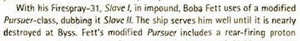
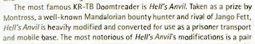
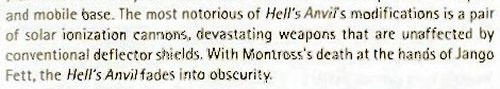
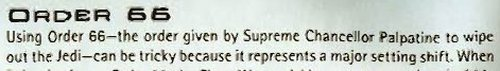
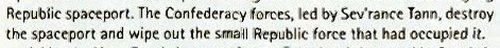

# Owner Material 037 — Star Wars D20 Drive folder (Core, Revised Core and Saga Edition): Sourcebooks/The Clone Wars Campaign Guide.pdf [Star Wars Roleplaying Game Saga Edition (2007)] (scan pages 61–120)

- **Source:** Wizards of the Coast Star Wars Roleplaying Game books, web enhancements, Living Force campaign modules and articles (2000–2010), from the owner's "Star Wars D20" Drive folder (only the three edition subfolders; "General" was not read, as instructed). Secondary source (licensed Legends reference). Scan OCR'd on the box; the scan stays box-only and is **not** published.
- **Method:** every scanned page was OCR'd and machine-screened sentence by sentence for power-relevant statements (fights, kills, defeats, Force feats, rankings, superweapons) that name a character on our roster; each kept sentence is quoted verbatim from the OCR text and has a crop of the printed passage directly under it. Pages with nothing power-relevant are still listed with what is on them.
- **Citation:** "*The Clone Wars Campaign Guide* (SWRPG Saga Edition), p.X" by printed page ("scan p.X" where no printed number applies). **Weight:** Licensed RPG material: a secondary source. Narrative text sums up Legends lore; game statistics are rules for players, not canon power levels, and rank lowest.

## scan p.61 (scan page 61)

Page contents: Table 5-1 Melee Weapons (vibroknucklers, vibrorapier, garrote, snap baton, stunning gauntlet). Stunning Gauntlet; Vibroknucklers; Vibrorapier. Ranged Weapons intro. (hand-read)

## scan p.62 (scan page 62)

Page contents: Table 5-2 Ranged Weapons (wrist rocket launcher; Czerka Adjudicator, Gee-Tech 12 Defender, BlasTech DH-23, BlasTech DT-12, Merr-Sonn Model 434; BlasTech 500 "ESPO", Czerka Adventurer, SoroSuub Firelance, BlasTech DLT-20A; EMP grenade). BlasTech 500 "ESPO" Riot Gun (Corporate Sector Security Division); BlasTech DH-23 "Outback" Blaster Pistol. (hand-read)

## scan p.63 (scan page 63)

Page contents: Art caption: top to bottom BlasTech DT-12, BlasTech DH-23, Czerka Adventurer, BlasTech DLT-20A. BlasTech DLT-20A "Longbarrel" Blaster Rifle (Republic recon patrols; magnatomic adhesion grip); BlasTech DT-12 Heavy Blaster Pistol (Rodian grip); Czerka Adjudicator; Czerka Adventurer; EMP Grenade ("droid poppers"); Gee-Tech 12 Defender Microblaster. (hand-read)

## scan p.64 (scan page 64)

Page contents: Merr-Sonn Model 434 "DeathHammer"; SoroSuub Firelance Blaster Rifle; Wrist Rocket Launcher. Sidebar "Wrist Rocket Ammunition" (antipersonnel, antivehicle, flash, hollow-tip with nerve toxin or stun gas, ion blast) with rockets table. (hand-read)

## scan p.65 (scan page 65)

Page contents: Armor table (shadowsuit, thinsuit, tracker utility vest, camo armor, vacuum pod). Armor intro. Camo Armor (medium; photoreactive fibers, +10 Stealth); Shadowsuit (light; shadowsilk); Thinsuit (light; breath mask, extreme temperatures); Tracker Utility Vest (light). (hand-read)

## scan p.66 (scan page 66)

Page contents: Vacuum Pod (heavy; EVA powered armor with droid brain; comlink, life support, powerlamp, repair kit, strength augmentation). Epigraph (read from crop): "This deluxe model is the only thing standing between you and a bloody death." -Clone Commando RC-1138 "Boss". Equipment intro and table; Bioscanner; Bracer Computer; Camouflage Netting. (hand-read)

### Stat block notes (game mechanics, not feats)

- Vacuum Pod (epigraph): "This deluxe model is the only thing standing between you and a bloody death." -Clone Commando RC-1138 "Boss" (Source: *The Clone Wars Campaign Guide* (SWRPG Saga Edition), scan p.66)

## scan p.67 (scan page 67)

Page contents: Halo Lamp; Visual Wrist Comm. Droids intro (droids of Republic in Chapter 10, Separatists in Chapter 11). First-Degree Droids: DD-13 Medical Assistant Droid (Ubrikkian; "Galactic Chopper"; stat block). Art caption: An IM-6 medical droid and a DD-13 medical assistant droid operate on a patient. (hand-read)

## scan p.68 (scan page 68)

Page contents: EW-3 Midwife Droid (Polis Massan design; stat block); IM-6 Medical Droid (Cybot Galactica; stat block). Epigraph (read from crop): "My lord, the construction is finished ... he lives." -DD-13 Medical Assistant Droid. (hand-read)

### Stat block notes (game mechanics, not feats)

- EW-3 / IM-6 droids (epigraph): "My lord, the construction is finished ... he lives." -DD-13 Medical Assistant Droid (Source: *The Clone Wars Campaign Guide* (SWRPG Saga Edition), scan p.68)

## scan p.69 (scan page 69)

Page contents: SP-4 Analysis Droid (Cybot Galactica; Jedi Temple Archives; stat block). Epigraph (read from crop): "Master Jedi, our records are very thorough. They cover eighty percent of the galaxy. If I can't tell you where it came from, nobody can." -SP-4 Analysis Droid. Second-Degree Droids intro; LE Series Repair Droid (Cybot Galactica). Art caption: An SP-4 analysis droid and a 5YQ protocol droid study a holographic image. (hand-read)

### Stat block notes (game mechanics, not feats)

- SP-4 Analysis Droid (epigraph): "Master Jedi, our records are very thorough. They cover eighty percent of the galaxy. If I can't tell you where it came from, nobody can." -SP-4 Analysis Droid (Source: *The Clone Wars Campaign Guide* (SWRPG Saga Edition), scan p.69)

## scan p.70 (scan page 70)

Page contents: Art caption (read from crop): An FA-5 valet droid and a LE Series repair droid argue over how to fix a damaged console. LE Series Repair Droid stat block. P2 Series Astromech Droid (Industrial Automaton prototype, forerunner of the R2; stat block). Epigraph (base OCR missed; read from crop): "I'm afraid R3 is a little slow on the uptake." -Anakin Skywakler [sic, book misprint]. (hand-read)

### Stat block notes (game mechanics, not feats)

- P2 Series Astromech Droid (epigraph): "I'm afraid R3 is a little slow on the uptake." -Anakin Skywakler [sic] (Source: *The Clone Wars Campaign Guide* (SWRPG Saga Edition), scan p.70)

## scan p.71 (scan page 71)

Page contents: Pit Droid (Serv-O-Droid; stat block). Epigraph (read from crop): "Don't touch anything" -Qui-Gon Jinn. Third-Degree Droids intro; 5YQ Series Protocol Droid (Cybot Galactica budget 3PO; stat block). (hand-read)

### Stat block notes (game mechanics, not feats)

- Pit Droid (epigraph): "Don't touch anything" -Qui-Gon Jinn (Source: *The Clone Wars Campaign Guide* (SWRPG Saga Edition), scan p.71)

## scan p.72 (scan page 72)

Page contents: Fourth-Degree Droids intro. BCA-11/X Lightsaber Practice Droid (Baktaid Combat Automata; cortosis matrix; stat block). IG-86 Sentinel Droid (Holowan Mechanicals; used by Ziro the Hutt and Gha Nachkt; KRONOS-327; stat block). (hand-read)

### Stat block notes (game mechanics, not feats)

- IG-86 Sentinel Droid: Both Ziro the Hutt and Gha Nachkt use IG-86 sentinel droids as agents and protectors. Ziro the Hutt has allowed several of his IG-86 droids to go for long periods of time without memory wipes, causing them to gain significant experience and develop personalities. One such droid, KRONOS-327, is a formidable assassin droid. (Source: *The Clone Wars Campaign Guide* (SWRPG Saga Edition), scan p.72)

## scan p.73 (scan page 73)

Page contents: Fifth-Degree Droids intro. CLL-6 Binary Load Lifter (stat block). Epigraph (read from crop): "My first job was programming binary load lifters...very similar to your vaporators." -C-3PO. FA-5 Valet Droid (SoroSuub; stat block). (hand-read)

### Stat block notes (game mechanics, not feats)

- CLL-6 Binary Load Lifter (epigraph): "My first job was programming binary load lifters...very similar to your vaporators." -C-3PO (Source: *The Clone Wars Campaign Guide* (SWRPG Saga Edition), scan p.73)

## scan p.74 (scan page 74)

Page contents: IW-37 Pincer Loader Droid (Industrial Automaton, "the bantha of load lifters"; stat block). Art caption: An IW-37 pincer loader droid holds a blaster cannon while two pit droids prepare to weld it to a starship. (hand-read)

## scan p.75 (scan page 75)

Page contents: Chapter 6: Starships, chapter opener art. (hand-read)

## scan p.76 (scan page 76)

Page contents: Chapter 6 intro (mercenaries used by both sides; piracy; Mandalmotors Mandalorian ships; Seltiss luxury ships of the Hutts). Space Transports: Barloz-class Freighter (Corellian Engineering Corporation; single turret laser cannon; superseded by the YT series). (hand-read)

## scan p.77 (scan page 77)

Page contents: Barloz Justifier gunships; Barloz-class Freighter stat block. Epigraph (read from crop): "We're taking this junker? We'd be better off on that big bug." -Ahsoka Tano. G9 Rigger (Corellian Engineering Corporation; spice smugglers; the Twilight, Ziro the Hutt's freighter stolen from Teth by Anakin Skywalker; stat block). (hand-read)

### Stat block notes (game mechanics, not feats)

- G9 Rigger (epigraph): "We're taking this junker? We'd be better off on that big bug." -Ahsoka Tano (Source: *The Clone Wars Campaign Guide* (SWRPG Saga Edition), scan p.77)
- G9 Rigger: The Twilight, a spice freighter owned by Ziro the Hutt and stolen from the planet Teth by Anakin Skywalker, is a G9 Rigger. (Source: *The Clone Wars Campaign Guide* (SWRPG Saga Edition), scan p.77)

## scan p.78 (scan page 78)

Page contents: Deck plan: Barloz-class Medium Freighter (1 square = 3 meters; keyed areas 1-17: cockpit, ship's computer, life support, galley, refresher, passenger cabins, first mate's cabin, captain's cabin, common room, boarding ramp, machine shop/storage, cargo bay, cargo elevator, escape pod, cargo loading ramp, engineering section, gunwell to turret). (hand-read)

## scan p.79 (scan page 79)

Page contents: GS-100 Salvage Ship (Gallofree Yards; Gha Nachkt's Vulture's Claw; stat block). Art caption (read from crop): An S40K Phoenix Hawk-class light pinnace and KR-TB Doomtreader on a landing pad. Epigraph (read from crop): "Looks like a Trandoshan scavenger, probably combing the battlefield for salvage." -Anakin Skywalker. KR-TB Doomtreader (Corellian Engineering Corporation) begins. (hand-read)

### Stat block notes (game mechanics, not feats)

- GS-100 Salvage Ship: Gha Nachkt's ship, the Vulture's Claw, is a heavily modified GS-100 salvage ship. (Source: *The Clone Wars Campaign Guide* (SWRPG Saga Edition), scan p.79)
- GS-100 Salvage Ship (epigraph): "Looks like a Trandoshan scavenger, probably combing the battlefield for salvage." -Anakin Skywalker (Source: *The Clone Wars Campaign Guide* (SWRPG Saga Edition), scan p.79)

## scan p.80 (scan page 80)

Page contents: KR-TB Doomtreader cont. (Hell's Anvil taken by Montross; solar ionization cannons; Montross killed by Jango Fett; stat block). Art caption: A Pursuer-class enforcement ship chases down a Barloz-class freighter. Pursuer-class Enforcement Ship (MandalMotors; Mandalorian Protectors; Boba Fett's Slave II, nearly destroyed at Byss). (hand-read)

- **Boba Fett** — entry/section: The Clone Wars Campaign Guide (Saga): "With his Firespray-31, S/ave /, in impound, Boba Feti uses of a modified Pursuer-class, dubbing it Slave ff The ship serves him well until it is nearly destroyed at Byss." Source: *The Clone Wars Campaign Guide* (SWRPG Saga Edition), scan p.80
  
- **Jango Fett**: "Taken as a prize by Montross, a well-known Mandalorian bounty hunter and rival of Jango Fett, Hell's Anvil is heavily modified and converted for use as a prisoner transport and mobile base." Source: *The Clone Wars Campaign Guide* (SWRPG Saga Edition), scan p.80
  
- **Jango Fett**: "The most notorious of Hell's Anvii's modifications is a pair of solar ionization cannons, devastating weapons that are unaffected by conventional deflector shields, With Montross's death at the hands of Jango Fett, the Hell's Anvil fades into obscurity." Source: *The Clone Wars Campaign Guide* (SWRPG Saga Edition), scan p.80
  

### Stat block notes (game mechanics, not feats)

- KR-TB Doomtreader: The most famous KR-TB Doomtreader is Hell's Anvil. Taken as a prize by Montross, a well-known Mandalorian bounty hunter and rival of Jango Fett, Hell's Anvil is heavily modified and converted for use as a prisoner transport and mobile base. The most notorious of Hell's Anvil's modifications is a pair of solar ionization cannons, devastating weapons that are unaffected by conventional deflector shields. With Montross's death at the hands of Jango Fett, the Hell's Anvil fades into obscurity. (Source: *The Clone Wars Campaign Guide* (SWRPG Saga Edition), scan p.80)
- Pursuer-class Enforcement Ship: With his Firespray-31, Slave I, in impound, Boba Fett uses of a modified Pursuer-class, dubbing it Slave II. The ship serves him well until it is nearly destroyed at Byss. Fett's modified Pursuer includes a rear-firing proton torpedo launcher, an improved sensor array, and improved shield generators and sublight engines. (Source: *The Clone Wars Campaign Guide* (SWRPG Saga Edition), scan p.80)

## scan p.81 (scan page 81)

Page contents: Pursuer-class Enforcement Ship stat block. Seltiss-2 Caravel (Ubrikkian; Hutt taste; sail-barge look; Nal Hutta to Nar Shaddaa; detachable main cabin; stat block). Seltiss-2 Caravel Cabin intro (no escape pods; cabin lets the owner escape). (hand-read)

## scan p.82 (scan page 82)

Page contents: Art caption (read from crop): Dagger-class starfighters attack the Twilight, a G9 Rigger spice freighter. Ubrikkian Seltiss-2 Caravel Cabin stat block. Starfighters intro. Dagger-class Starfighter (Republic Sienar Systems; no shields; planetary defense, Separatist and mercenary use; Republic Sienar dissolved by Emperor Palpatine; elements used in the TIE series; stat block). (hand-read)

### Stat block notes (game mechanics, not feats)

- Dagger-class Starfighter: With Republic Sienar's dissolution by Emperor Palpatine, and subsequent incorporation into the Republic Navy, production of many of its starfighters ceases completely. This includes the Dagger-class starfighter. (Source: *The Clone Wars Campaign Guide* (SWRPG Saga Edition), scan p.82)

## scan p.83 (scan page 83)

Page contents: Dianoga-class Assault Starfighter (Koensayr, pre-Y-wing; stat block). Freefall-class Starfighter (Nubian Design Collective bomber; crew of four bonus; Bith engineer Jinkins; stat block). (hand-read)

### Stat block notes (game mechanics, not feats)

- Freefall-class Starfighter: During the Clone Wars, the Freefall-class starfighter is employed by several independent mercenary units, mostly on the side of the Republic. The best known of these mercenaries is the Bith engineer Jinkins, who flies a heavily modified Freefall-class starfighter with improved weaponry. (Source: *The Clone Wars Campaign Guide* (SWRPG Saga Edition), scan p.83)

## scan p.84 (scan page 84)

Page contents: MorningStar Assault Starfighter (Kuat Systems Engineering tri-wing; Trade Federation mercenaries; A, B, C variants; MorningStar-A stat block). Art caption: MorningStar assault starfighters meet their match. (hand-read)

## scan p.85 (scan page 85)

Page contents: S40K Phoenix Hawk-class Light Pinnace (Kuat Systems Engineering; squat Firespray look; cramped; good shields and weapons; stat block). Art caption: Two Scurrg H-6 prototype bombers attack the Vulture's Claw, a GS-100 salvage ship. (hand-read)

### Stat block notes (game mechanics, not feats)

- S40K Phoenix Hawk (art caption): Two Scurrg H-6 prototype bombers attack the Vulture's Claw, a GS-100 salvage ship. (Source: *The Clone Wars Campaign Guide* (SWRPG Saga Edition), scan p.85)

## scan p.86 (scan page 86)

Page contents: Scurrg H-6 Prototype (Nubian Design Collective; refused by Naboo; prototype stolen by the Feeorin pirate Nym with Jinkins; bomblet generator; Nym's Havoc with two integrated astromechs; stat block). Epigraph (base OCR scrambled; read from crop): "Sometimes, I get the feeling the Havoc is alive. She sometimes fires before I pull the trigger, and when we're in hyperspace, I swear her engines sing me to sleep." -Nym. (hand-read)

### Stat block notes (game mechanics, not feats)

- Scurrg H-6 Prototype: As they search, the prototype is stolen by a Feeorin pirate named Nym with the aid of Jinkins, one of the Collective's engineers. (Source: *The Clone Wars Campaign Guide* (SWRPG Saga Edition), scan p.86)
- Scurrg H-6 Prototype: The original Scurrg prototype, as flown by Nym, is known as the Havoc. In addition to an improved hyperdrive engine, the Havoc is modified to allow Nym to operate it without a full crew complement. While Nym takes the helm, the gunner and navigator positions are filled by two astromech droids, which have been integrated into the ship's system. (Source: *The Clone Wars Campaign Guide* (SWRPG Saga Edition), scan p.86)
- Scurrg H-6 Prototype (epigraph): "Sometimes, I get the feeling the Havoc is alive. She sometimes fires before I pull the trigger, and when we're in hyperspace, I swear her engines sing me to sleep." -Nym (Source: *The Clone Wars Campaign Guide* (SWRPG Saga Edition), scan p.86)

## scan p.87 (scan page 87)

Page contents: Chapter 7: Clone Wars Campaigns, chapter opener art. (hand-read)

## scan p.88 (scan page 88)

Page contents: Chapter 7 intro (conventional warfare vs. Galactic Civil War guerilla warfare; no sanctuary; villains like General Grievous and General Loathsom). Decline of the Jedi (Geonosis deaths; more Jedi killed than knighted; fewer by Order 66). (hand-read)

### Stat block notes (game mechanics, not feats)

- Chapter 7 intro: The corrupt leaders of the Confederacy use droid troops to advance their agenda, aided by the sinister leadership of villains like General Grievous and General Loathsom. (Source: *The Clone Wars Campaign Guide* (SWRPG Saga Edition), scan p.88)

## scan p.89 (scan page 89)

Page contents: The Dwindling Jedi Campaign (reduce Jedi appearances over the campaign). The Masterless Padawan (Padawan heroes whose masters died; Ahsoka Tano entrusted to Anakin Skywalker). Order 66 (order given by Supreme Chancellor Palpatine; climactic betrayal by clone trooper followers; Jedi become outlaws). (hand-read)

- **Palpatine (Darth Sidious)**: "ORDER 6&6 Using Order 66—the order given by Supreme Chancellor Palpatine to wipe out the Jedi—can be tricky because it represents a major setting shift." Source: *The Clone Wars Campaign Guide* (SWRPG Saga Edition), scan p.89
  

### Stat block notes (game mechanics, not feats)

- The Masterless Padawan: Alternatively, a Padawan might be entrusted to the care of a mere Jedi Knight—as Ahsoka Tano is entrusted to Anakin Skywalker just a short time after his Knighting ceremony. This leaves the hero under the tutelage of a Jedi who is not yet ready to truly train the Padawan. (Source: *The Clone Wars Campaign Guide* (SWRPG Saga Edition), scan p.89)
- Order 66: Using Order 66—the order given by Supreme Chancellor Palpatine to wipe out the Jedi—can be tricky because it represents a major setting shift. When Palpatine issues Order 66, the Clone Wars quickly come to an end, and within a brief time the Empire rises and the Dark Times begin. (Source: *The Clone Wars Campaign Guide* (SWRPG Saga Edition), scan p.89)

## scan p.90 (scan page 90)

Page contents: Rampant Corruption (corruption let Palpatine become Supreme Chancellor and, as Darth Sidious, manipulate the Separatists into war; corrupt senators, officers; using enemy corruption; temptation of heroes; Scum and Villainy reference). Epigraph: "Greed can be a powerful ally." -Qui-Gon Jinn. Villains (Count Dooku, General Grievous, Durge, Asajj Ventress, General Loathsom). Dehumanization begins (Count Dooku a very Human villain). (hand-read)

### Stat block notes (game mechanics, not feats)

- Rampant Corruption: In fact, corruption in the Republic allowed Palpatine to maneuver his way into becoming Supreme Chancellor a decade before the outbreak of the Clone Wars. Similar corruption allowed him—in his guise as Darth Sidious—to manipulate the Separatists into engaging the Republic in open war. (Source: *The Clone Wars Campaign Guide* (SWRPG Saga Edition), scan p.90)
- Rampant Corruption (epigraph): "Greed can be a powerful ally." -Qui-Gon Jinn (Source: *The Clone Wars Campaign Guide* (SWRPG Saga Edition), scan p.90)
- Villains: The Clone Wars has an abundance of high-profile villains. Count Dooku, General Grievous, Durge, Asajj Ventress, General Loathsom, and others make up a motley group of villains who share the spotlight. Though some, like Asajj Ventress, work behind the scenes, other villains are well-known. Count Dooku and General Grievous are famous names recognized throughout the galaxy, even among those who are not directly involved in the war. (Source: *The Clone Wars Campaign Guide* (SWRPG Saga Edition), scan p.90)

## scan p.91 (scan page 91)

Page contents: Dehumanization cont. (Ventress twisted shadow of humanity; Grievous near-total replacement cyborg; Durge faceless armor; voices and mannerisms: Grievous's metallic echo and coughs, Ventress's hissing voice, Durge's silence, Loathsom's boiling anger; ruthlessness). Powerful Personality (Dooku charismatic and bold, left the Order after the death of a beloved apprentice; Ventress strives to be heir to the Sith legacy and prove herself to Dooku; villains as dark reflections of heroes; example fallen smuggler). (hand-read)

### Stat block notes (game mechanics, not feats)

- Dehumanization: Some villains, like Asajj Ventress, are merely twisted shadows of humanity; her gray skin, dark eyes, and lack of hair are just different enough from Humans to make her seem both alien and terrifying. On the far end of the spectrum are villains like General Grievous and Durge; though vaguely humanoid in shape, they are so distinctly monstrous in their appearance that no one confuses them with Humans. Grievous achieves new levels of inhumanity because he is a near-total replacement cyborg, truly embodying the idea of being more machine than creature. Durge, on the other hand, is dehumanized by his faceless armor, an effect like that of stormtroopers and clone troopers. (Source: *The Clone Wars Campaign Guide* (SWRPG Saga Edition), scan p.91)
- Dehumanization: The metallic echo to General Grievous' voice, the harsh accent, and the hacking coughs wracking his cybernetic body combine with his physical description to create a complete, memorable villain package. Asajj Ventress has a hissing, snakelike voice, while Durge is notable for his disturbing silence. General Loathsom's boiling anger complements his physical stature and personality, producing a three-dimensional villain. (Source: *The Clone Wars Campaign Guide* (SWRPG Saga Edition), scan p.91)
- Powerful Personality: For example, Count Dooku is an excellent and iconic villain of the Clone Wars because he is charismatic and bold. Likewise, he is not afraid to delve into darkness to achieve his goals. Yet he is still very much the Jedi Master who left the Order after the death of one of his most beloved apprentices. Similarly, Asajj Ventress is more than just a pair of lightsabers and a frightful appearance. She strives to be the heir to the Sith legacy, and must prove again and again to Count Dooku that she is worthy of his tutelage. (Source: *The Clone Wars Campaign Guide* (SWRPG Saga Edition), scan p.91)

## scan p.92 (scan page 92)

Page contents: Powerful Personality cont. (smuggler turned pirate captain example). Militarization intro. Conversion of Civilian Assets. Forces of the Clone Wars (clone troopers, V-19 starfighters, AT-XT walkers; Recusant-class destroyers; off-duty clone troopers in a cantina) begins. Yellow sidebar (missed by base OCR; re-OCR from crop c728_092b/d): Clone Heroes (ARC Troopers or Republic clone commandos, based on the original Jango Fett template with more of Fett's personality) and Republic Clone Species Traits (Str 15, Dex 13, Con 10, Int 12, Wis 10, Cha 8, +2 to one ability; Medium; speed 6; bonus trained skill; bonus feat; Automatic Languages: Basic). (hand-read)

### Stat block notes (game mechanics, not feats)

- Clone Heroes (sidebar): The basic clone trooper is bred for obedience and military discipline. This can stifle players who want more free will. Instead, the player could choose to play an ARC Trooper or a Republic clone commando; both unit types are clones based on the original Jango Fett template, but they have more of Fett's personality and fewer behavioral restrictions than standard clone troopers. They receive special training better suited to heroic careers, and many have destinies that stretch out beyond the Clone Wars. (Source: *The Clone Wars Campaign Guide* (SWRPG Saga Edition), scan p.92)

## scan p.93 (scan page 93)

Page contents: Forces of the Clone Wars cont. (window dressing). Playing as Separatists (villain campaign vs. heroes who believe in the Separatist cause; Techno Union research facility example). Large-Scale Conflict (Battle of Glee Anselm example; backdrop vs. pivotal battle). Art caption (small caps, OCR garbled; not legible in crop): V-19 Torrent fighters under attack from CIG advanced starfighters [approx.]. (hand-read)

## scan p.94 (scan page 94)

Page contents: Large-scale conflict cont. (location, factions, turning points). Battlefield Adventures (objective-based encounters, terrain effects). Using Troopers (low-CL troopers, aid another). Squads intro (three to four creatures as one unit; 15 battle droids vs. 5 squads). (hand-read)

## scan p.95 (scan page 95)

Page contents: Squads rules: Creating a Squad (size +1, double hp, threshold +10, +4 attack), Squad Traits (melee area attacks, 1-square splash, +2 dice from area attacks, cannot be grabbed); Sample: B1-Series Battle Droid Squad stat block (CL 3). Art caption: Droid commando squad. (hand-read)

## scan p.96 (scan page 96)

Page contents: Mass Combat intro (heroes as commanders; units function like vehicles; starship scale; Felucia, Mygeeto, Utapau, Geonosis examples). Units (statistics based on representative creature; total cover for heroes in unit; disbanding and recombining; advantaged units). (hand-read)

## scan p.97 (scan page 97)

Page contents: Sidebar (missed by base OCR; re-OCR from crops c728_097a/b): Combining Mass Combat and Battlefield Encounters (mass combat triggers smaller encounters; objectives trigger battlefield effects, e.g. taking out a communications tower; simultaneous play with players also controlling Republic Commandos sent to disable a shield generator). Creating a Unit rules (CL +6; Colossal; hp x4; DR 15; +50 threshold; attrition numbers; speed 1 square; x2 damage multipliers; fighting space 1 square; talents and feats with flat bonuses retained; skills; possessions). (hand-read)

## scan p.98 (scan page 98)

Page contents: Sample Unit: Clone Trooper Battalion stat block (CL 8; hp 82; DR 15; Threshold 63; Attrition 62/42/22). Vehicle Units (four vehicles; hp x4; fighter groups per Starships of the Galaxy; Colossal (frigate) and larger as terrain; roles use the lower of unique character's and default statistics). (hand-read)

## scan p.99 (scan page 99)

Page contents: Sidebar (missed by base OCR; re-OCR from crop c728_099a): Colossal Vehicles (LAAT/i as individual combatant; grounded capital ships as terrain; -20 penalty for capital ship weapons against units). Advantaged Units (hp x5; each special quality +1 CL): All-Terrain Unit, Antiair Unit, Antiarmor Unit, Dedicated Officer, Mobile Unit, Reinforcements, Superior Formation, Superior Training, Superior Weapons, Vehicle Contingent. (hand-read)

## scan p.100 (scan page 100)

Page contents: Disadvantaged Units (hp x3, CL -2). Attacks (melee only ground vs ground in same space; ranged; vehicle attacks; Table 7-1 Starship Scale ranges for character-scale weapons). Area Attacks (single starship-scale square; ground or air). Critical Hits and Automatic Misses. Hit Points; Damage Threshold = Fortitude Defense + 50. (hand-read)

## scan p.101 (scan page 101)

Page contents: Reducing a Unit to 0 Hit Points (heroes take damage equal to lowest attrition number). Speed (move action; hard march x4). Table 7-2 Vehicle Speed conversion. Occupying the Same Square (two ground and two flying units). Characters in Units: roles Commander, First Officer, Attack Leader, Communications Officer, Medic. Using Talents, Feats, and Special Abilities in mass combat (see/hear/understand, line of sight, single target rules). (hand-read)

## scan p.102 (scan page 102)

Page contents: Starting Mass Battles; Initiative (per character or per unit; Knowledge (tactics) option). Standard Actions: Aid Another (aiding an attack roll, suppressing an enemy), Attack with Melee Weapons, Attack with Ranged Weapons, Attack with Vehicle Weapons. (hand-read)

## scan p.103 (scan page 103)

Page contents: Charge (commander), Fight Defensively (+5 Reflex). Move actions; Swift actions: Disband Unit, Provide Medical Assistance (DC 20 Treat Injury), Use Tactical Knowledge (DC 20 Knowledge (tactics)). Full-round: Hard March. Reactions: Disband and Reform Unit. Special Mass Combat Rules: Cover and Concealment. (hand-read)

## scan p.104 (scan page 104)

Page contents: Orbital Bombardment. Weapon Emplacements: LR1K Sonic Antipersonnel Cannon (Gordarl Weaponsmiths for the Confederacy; used at the Battle of Geonosis; stat block); Republic Antivehicle Cannon AV-7 (Taim & Bak; used to secure Christophsis; stat block CL 6). Yellow sidebar (missed by base OCR; re-OCR from crop c728_104a): Falling Vehicles (disabled flying vehicle crashes into its square; nonflying units take collision damage, Saga Edition core p173). (hand-read)

## scan p.105 (scan page 105)

Page contents: Chapter VIII: Galactic Gazetteer, chapter opener art. (hand-read)

## scan p.106 (scan page 106)

Page contents: Chapter intro (new planet entries and updates to Saga Edition core Chapter 13). Contested Worlds (Republic-controlled, Confederacy-controlled e.g. rebellious Jabiim, worlds wooed by Count Dooku; contested/neutral worlds). (hand-read)

### Stat block notes (game mechanics, not feats)

- Contested Worlds: The second category usually comes about when the leaders of the Confederacy, usually Count Dooku, promise planetary leaders great wealth, power, and influence in exchange for their support for the Separatist cause. (Source: *The Clone Wars Campaign Guide* (SWRPG Saga Edition), scan p.106)

## scan p.107 (scan page 107)

Page contents: Cato Neimoidia (Colonies; Neimoidian purse world; bridge cities; capital Zarra; Knowledge DCs). Epigraph: "That business on Cato Neimoidia doesn't...doesn't count." -Obi-Wan Kenobi. Christophsis (Outer Rim; crystal spires; capital Chalcydonia; crystals sometimes usable as lightsaber crystals). (hand-read)

### Stat block notes (game mechanics, not feats)

- Cato Neimoidia (epigraph): "That business on Cato Neimoidia doesn't...doesn't count." -Obi-Wan Kenobi (Source: *The Clone Wars Campaign Guide* (SWRPG Saga Edition), scan p.107)

## scan p.108 (scan page 108)

Page contents: Geonosis (Outer Rim; Stalgasin Hive; Baktoid Armor Workshop foundries; drones and aristocrats; castes). Glee Anselm (Mid Rim; Anselmi and Nautolans; capitals Anselom and Pieralos). Epigraph (book NPC): "They said it would be easy to wash away the memories of battle on a watery world. I guess they never saw an entire ocean run red." -Commander Rin Mako. (hand-read)

## scan p.109 (scan page 109)

Page contents: Iktotch (Expansion; third moon of Iktotchon; capital Ankheia; sand and gravel storms; Republic seal carved into a mountain; Iktotchi precognition). Kalee (Outer Rim; Kaleesh; warring tribes; capital Kaleela) begins. (hand-read)

## scan p.110 (scan page 110)

Page contents: Kalee cont. (Huk invasion, Huk defeated by Kaleesh; Republic sanctions and war crimes trials due to Senate corruption; Kaleesh revere ancestors who died in self-sacrifice; holy island Abesmi). Kamino (Wild Space; near the Rishi Maze; Tipoca City; Grand Army of the Republic clones created and trained on Kamino). (hand-read)

## scan p.111 (scan page 111)

Page contents: Kerkoidia (Expansion Region; Kerkoidens; Maldinian City; Retail Caucus HQ). Malastare (Mid Rim; Gran Protectorate; Port Pixelito; Podracing; Dugs marginalized, disarmed by the Republic, tree thorps). Mustafar (Outer Rim; Techno Union; capital Fralideja; ancient Jedi temples abandoned after war with the Sith). (hand-read)

## scan p.112 (scan page 112)

Page contents: Mustafar cont. (Northern and Southern Mustafarians; lava fleas). Muunilinst (Outer Rim; Muun; Harnaidan; InterGalactic Banking Clan; "Moneyland"; smokers). Nelvaan (Outer Rim; Nelvaanians; no government) begins. (hand-read)

## scan p.113 (scan page 113)

Page contents: Nelvaan cont. (ice age caused by a Techno Union siphon generator; Bothan water siphoning; Nelvaanian tribal culture; the Great Mother). Polis Massa (Outer Rim asteroid; Eellayin civilization; Polis Massans from Kaliidah; medical and archaeological expertise; cloning learned from the Kaminoans). Sembla (Outer Rim; Vurks; nomadic tribes; subaquatic ruins). (hand-read)

## scan p.114 (scan page 114)

Page contents: Sembla cont. (Vurk philosophy, empathetic diplomats). Skako (Core Worlds; Skakoans; one massive city; methane high-pressure atmosphere; Techno Union largely controlled by Skakoans; pressure suits). Teth (Outer Rim; Inner Teth; purple mist; smugglers' haven; abandoned B'omarr Monk monasteries claimed by criminals). (hand-read)

## scan p.115 (scan page 115)

Page contents: Toydaria (Mid Rim; Hutt Space; capital Toydor; Toydarian king and vassals; famines). Utapau (Outer Rim; Pau City; Utai and Pau'ans; sinkholes; healing water). Epigraph: "Greetings, young Jedi. What brings you to our remote sanctuary?" -Tion Medon. (hand-read)

### Stat block notes (game mechanics, not feats)

- Utapau (epigraph): "Greetings, young Jedi. What brings you to our remote sanctuary?" -Tion Medon (Source: *The Clone Wars Campaign Guide* (SWRPG Saga Edition), scan p.115)

## scan p.116 (scan page 116)

Page contents: Planetary Updates: Bespin (Battle of Bespin; Tibannopolis vs. Cloud City). Bothawui (neutral; Senator Polo Se'lab abstains; Bothan intelligence to both sides). Cerea (Refugee Resettlement Coalition; Battle of Cerea; assassination attempt on the president). Coruscant (military staging areas, displacement, Separatist terrorism). (hand-read)

## scan p.117 (scan page 117)

Page contents: Coruscant cont. (clone patrols with deadly force; species discrimination and mass deportations alienate supporters of Palpatine). Dorin (Kel Dor support the Republic). Duro (Battle of Duro in Operation Durge's Lance; bombardment ordered by General Grievous; Senatorial corruption rerouted ships; Grievous lauded as a military genius). Gamorr (Gamorrean mercenaries, under 8 percent survival; Trade Federation finder's fee to the Hutts). Iridonia ("The Great Debate"). (hand-read)

### Stat block notes (game mechanics, not feats)

- Coruscant: The majority of the deported individuals are loyal citizens of the Republic, however, which only makes enemies of individuals who might have otherwise been supportive of Palpatine's leadership. (Source: *The Clone Wars Campaign Guide* (SWRPG Saga Edition), scan p.117)
- Duro: The planet Duro is devastated by the Separatist invasion. Bombardment of the planet's vast industrial holdings, ordered by General Grievous, results in a catastrophic release of toxic pollutants into the atmosphere. (Source: *The Clone Wars Campaign Guide* (SWRPG Saga Edition), scan p.117)
- Duro: The ultimate result of Duro's fall is the incredible boost it gives to the Separatist cause. General Grievous, the invasion's architect, is lauded throughout the Confederacy as a military genius. Scores of undecided systems rally to the Separatist cause in the wake of Duro's conquest. (Source: *The Clone Wars Campaign Guide* (SWRPG Saga Edition), scan p.117)

## scan p.118 (scan page 118)

Page contents: Ithor (loyal; Separatist diversions; capture of the Ithorian herdship Ottega Dawn, reclaimed by Ithorian mutineers). Kashyyyk (neutral for a year and a half; General Grievous's attacks; King Grakchawwaa's son's accidental death; Battle of Kashyyyk; Order 66; Wookiees shelter Jedi survivors). Mon Calamari (Quarren Senator Tikkas defects, leads the Quarren Isolation League; Kit Fisto leads Republic troops; the Moappa group intellect). Art caption: Kit Fisto on Mon Calamari. (hand-read)

### Stat block notes (game mechanics, not feats)

- Kashyyyk: Despite a small number of hostile actions by Separatist forces, Kashyyyk maintains its neutrality for nearly a year and a half. General Grievous orders a number of attacks in an attempt to persuade the Wookiees to make a choice, but the tactic backfires when King Grakchawwaa learns of his son's accidental death at the hands of Separatist droids. (Source: *The Clone Wars Campaign Guide* (SWRPG Saga Edition), scan p.118)
- Kashyyyk: In a rage, Grakchawwaa sides with the Galactic Republic. This spurs a massive invasion by the Confederacy, which is eventually repulsed by a combined Republic/Wookiee force during the Battle of Kashyyyk. The tide of battle turns when Order 66 turns the Republic clone army against its Jedi generals. The Wookiees shelter a number of Jedi survivors, an act of mercy for which they suffer greatly in the years to come. (Source: *The Clone Wars Campaign Guide* (SWRPG Saga Edition), scan p.118)
- Mon Calamari: In the time leading up to the Clone Wars, Senator Tikkas, the Quarren Senator from Mon Calamari, turns a blind eye to slaver activity in the Calamari Sector. When his part in these activities is discovered, Tikkas is forced out of office, and he defects to the Confederacy of Independent Systems. As leader of the Quarren Isolation League, a group dedicated to reducing the influence of the Mon Calamari on planetary politics, Tikkas foments outright civil war on Mon Calamari. (Source: *The Clone Wars Campaign Guide* (SWRPG Saga Edition), scan p.118)
- Mon Calamari: With the aid of Separatist droids as well as a number of Mon Calamari who are loyal to the Confederacy, Tikkas begins his campaign. He orders attacks against a number of Mon Calamari cities. The Republic counterattacks by sending troops, led by Kit Fisto, to aid the Mon Calamari. (Source: *The Clone Wars Campaign Guide* (SWRPG Saga Edition), scan p.118)
- Mon Calamari (art caption): Kit Fisto on Mon Calamari (Source: *The Clone Wars Campaign Guide* (SWRPG Saga Edition), scan p.118)

## scan p.119 (scan page 119)

Page contents: Naboo (staunch Republic bastion due to Chancellor Palpatine; Defense of Naboo; Gungan lunar colony Ohma-D'un wiped out). Nar Shaddaa (Hutts sell to both sides; Separatists the largest customer; violent agent conflicts). Rodia (loyal; Count Dooku's negotiators in Iskaayuma; Senator Onaconda Farr, Loyalist Committee, exposed for bribery diverting ships from Duro). Ryloth (seized by the Confederacy; Senator Orn Free Taa protests; martial law; droid reclamation facility; ryll; Outer Rim Sieges). (hand-read)

### Stat block notes (game mechanics, not feats)

- Naboo: Because of Naboo's close relationship with Chancellor Palpatine, himself a citizen of that planet, Naboo remains a staunch bastion of the Galactic Republic throughout the length of the Clone Wars. Despite Naboo's peaceful nature, the average citizen sees support of Palpatine's initiatives as common sense. With the invasion of Theed by the Trade Federation prior to the Clone Wars as an example, there is little doubt to the citizenry of Naboo that the Separatists are a grave threat that must be dealt with in a decisive manner. To the majority of the Naboo, the person to bring about an end to such a terrible enemy is Palpatine. (Source: *The Clone Wars Campaign Guide* (SWRPG Saga Edition), scan p.119)
- Rodia: Rodia is never directly threatened by the Confederacy of Independent Systems, though negotiators sent by Count Dooku are often found in Iskaayuma as they attempt to sway the Rodians to support their cause. (Source: *The Clone Wars Campaign Guide* (SWRPG Saga Edition), scan p.119)
- Rodia: Rodia is represented in the Galactic Senate by Senator Onaconda Farr, a tried and true loyalist of the Republic. Farr is appointed to the Loyalist Committee, gaining a great deal of influence as a result. Unfortunately for Rodia, Onaconda Farr is exposed for bribing a fellow Senator in order to divert a number of naval starships to Rodia. Had the starships been sent to Duro, their original destination, it is quite possible that the Battle of Duro would not have been a Separatist victory. (Source: *The Clone Wars Campaign Guide* (SWRPG Saga Edition), scan p.119)
- Ryloth: At the start of the Clone Wars, the homeworld of the Twi'leks is a strong supporter of the Galactic Republic in the Senate. Despite this, the planet is seized by the Confederacy of Independent Systems, an act that is protested by Senator Orn Free Taa of Ryloth. (Source: *The Clone Wars Campaign Guide* (SWRPG Saga Edition), scan p.119)

## scan p.120 (scan page 120)

Page contents: Sullust (SoroSuub in the Commerce Guild; secedes; Confederacy fortress world; failed Republic invasion). Tatooine (Republic spaceport destroyed by Sev'rance Tann's forces at Boorka the Hutt's request; Jabba betrays Boorka to the Jedi while supplying cortosis ore to the Techno Union). Trandosha (Senator Yarua, a Wookiee; Wookiee blockade; Trandoshan groups aid the Separatists). Epigraph: "The desert is merciless. It takes everything from you." -Anakin Skywalker. (hand-read)

- **Sev'rance Tann**: "The Confederacy forces, led by Sev'rance Tann, destroy the spaceport and wipe out the smail Republic force that had occupied it." Source: *The Clone Wars Campaign Guide* (SWRPG Saga Edition), scan p.120
  

### Stat block notes (game mechanics, not feats)

- Tatooine: Boorka the Hutt, seeking to remove the Republic from Tatooine, negotiates a pact with the Confederacy in exchange for the destruction of the fledgling Republic spaceport. The Confederacy forces, led by Sev'rance Tann, destroy the spaceport and wipe out the small Republic force that had occupied it. (Source: *The Clone Wars Campaign Guide* (SWRPG Saga Edition), scan p.120)
- Tatooine: Jabba the Hutt, Boorka's competitor on Tatooine, is incensed by Boorka's cooperation with the Separatists. He betrays Boorka to the Jedi, who kill Boorka and root out the Separatist units on Tatooine. Despite his loud objections, Jabba's interest in seeing Boorka fall are not entirely altruistic; the Hutt crime lord is playing one side against the other, taking a dangerous competitor out of the picture while continuing to supply cortosis ore to the Techno Union. (Source: *The Clone Wars Campaign Guide* (SWRPG Saga Edition), scan p.120)
- Trandosha: Due to its position within the Kashyyyk system, Trandosha's only representation in the Senate is Yarua, a Wookiee. (Source: *The Clone Wars Campaign Guide* (SWRPG Saga Edition), scan p.120)
- Tatooine (epigraph): "The desert is merciless. It takes everything from you." -Anakin Skywalker (Source: *The Clone Wars Campaign Guide* (SWRPG Saga Edition), scan p.120)
