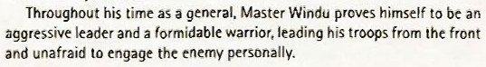
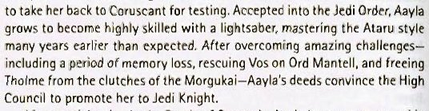
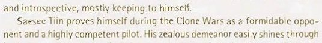
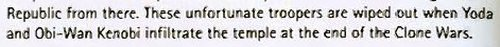
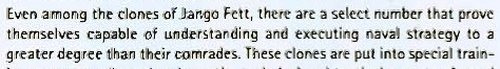
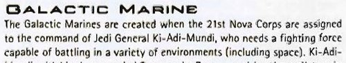
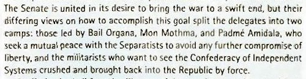
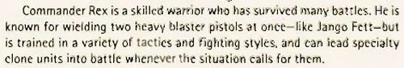
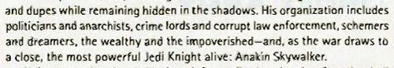

# Owner Material 037 — Star Wars D20 Drive folder (Core, Revised Core and Saga Edition): Sourcebooks/The Clone Wars Campaign Guide.pdf [Star Wars Roleplaying Game Saga Edition (2007)] (scan pages 121–180)

- **Source:** Wizards of the Coast Star Wars Roleplaying Game books, web enhancements, Living Force campaign modules and articles (2000–2010), from the owner's "Star Wars D20" Drive folder (only the three edition subfolders; "General" was not read, as instructed). Secondary source (licensed Legends reference). Scan OCR'd on the box; the scan stays box-only and is **not** published.
- **Method:** every scanned page was OCR'd and machine-screened sentence by sentence for power-relevant statements (fights, kills, defeats, Force feats, rankings, superweapons) that name a character on our roster; each kept sentence is quoted verbatim from the OCR text and has a crop of the printed passage directly under it. Pages with nothing power-relevant are still listed with what is on them.
- **Citation:** "*The Clone Wars Campaign Guide* (SWRPG Saga Edition), p.X" by printed page ("scan p.X" where no printed number applies). **Weight:** Licensed RPG material: a secondary source. Narrative text sums up Legends lore; game statistics are rules for players, not canon power levels, and rank lowest.

## scan p.121 (scan page 121)

Page contents: Chapter IX: The Jedi, chapter opener art. (hand-read)

## scan p.122 (scan page 122)

Page contents: Chapter IX intro (Jedi and Republic entwined; Jedi fail against droid forces until clone troops arrive with Master Yoda; Jedi become leaders in war; splinter groups; Council undermined by the Dark Lords of the Sith). The Jedi Order (younglings, Padawans, Service Corps, Knights, Masters, councils). (hand-read)

### Stat block notes (game mechanics, not feats)

- Chapter IX intro: The Jedi Order's efforts to put down the droid forces of the Separatists fail and cost the lives of many of Jedi Knights, but the arrival of cloned troops with Master Yoda turns the tide of the battle and drives the Separatist leaders into retreat. (Source: *The Clone Wars Campaign Guide* (SWRPG Saga Edition), scan p.122)

## scan p.123 (scan page 123)

Page contents: The Jedi Service Corps (AgriCorps, EduCorps, ExplorCorps with the Intergalactic Zoological Society, MedCorps). AgriCorps Worker (description; stat block CL 2). EduCorps Worker description. (hand-read)

## scan p.124 (scan page 124)

Page contents: EduCorps Worker stat block (CL 1). ExplorCorps Worker ("the lucky ones," traveling Jedi academy; stat block CL 2). MedCorps Worker description (Temple infirmary linked to Galactic City Medical Center). (hand-read)

## scan p.125 (scan page 125)

Page contents: MedCorps Worker stat block (CL 1). Specialized Jedi Knights: Jedi Archivist (temple archives on Coruscant or Ossus; fewer during the Clone Wars; stat block CL 10). Jedi Healer description begins. (hand-read)

## scan p.126 (scan page 126)

Page contents: Jedi Healer cont. (not pacifists; accompany troops onto battlefields; stat block CL 9). Jedi Instructor (Temple on Coruscant; seek recruits in the Outer Rim; effective instructors invited to the High Council; stat block CL 9). (hand-read)

## scan p.127 (scan page 127)

Page contents: The Jedi Councils: Council of First Knowledge (northwest tower; holocrons; permanent member Caretaker of the Tower of First Knowledge, Jedi Master Astaal Vilbum), Council of Reassignment (northeast tower), Council of Reconciliation (southwest tower), High Council (southeast tower; twelve members; Anakin Skywalker appointed by the Supreme Chancellor). Influential Figures (Behind the Scenes; Brief Appearance). Anakin Skywalker entry begins (Chosen One). Art caption: Anakin Skywalker. (hand-read)

### Stat block notes (game mechanics, not feats)

- The High Council: The High Council selects all new members, with the exception of Anakin Skywalker (appointed by the Supreme Chancellor near the end of the Clone Wars). (Source: *The Clone Wars Campaign Guide* (SWRPG Saga Edition), scan p.127)
- Anakin Skywalker: Believed by many to be the Chosen One and foretold by ancient prophecies to bring balance to the Force, Anakin Skywalker is the exception to other Jedi in many ways. He spends most of his childhood away from the Jedi Temple on Tatooine with his mother. Highly stubborn and emotional, he shows arrogance in his abilities as a pilot, with a lightsaber, and with the Force. Unlike other Jedi who display overconfidence in their abilities, Anakin is able to back up his boasts. (Source: *The Clone Wars Campaign Guide* (SWRPG Saga Edition), scan p.127)

## scan p.128 (scan page 128)

Page contents: Anakin Skywalker cont. (assistant to Obi-Wan leading clone starfighter pilots; paired with Padawan Ahsoka Tano); Anakin Skywalker stat block (CL 14; Medium Human Jedi 7/Jedi Knight 5/ace pilot 2; Dark Side 7; talents incl. Djem So, Force Pilot, Renowned Pilot; feats incl. Rapid Strike, Strong in the Force, Vehicular Combat). Obi-Wan Kenobi (general in command of thousands of clone troopers; stat block CL 14; Jedi 7/Jedi Knight 5/Jedi Master 2; Soresu, Severing Strike; Double Attack). (hand-read)

### Stat block notes (game mechanics, not feats)

- Anakin Skywalker (Saga CL 14): CL 14 Medivm Human Jedi 7jJedi Knight 5/ace pilot 2 Destiny 2; Force 6, Strong in the Force; Dark Side 7 Init +15; Senses Perception +9 Languages Basic, Binary, Huttese Defenses Ref 31 (flat-footed 28), Fort 31, Will 28; Block, Deflect, vehicle dodge +1 hp 141; Threshold 31 Speed 6 squares Melee lightsaber +18 (2d8+15) or Melee light (Source: *The Clone Wars Campaign Guide* (SWRPG Saga Edition), scan p.128)
- Obi-Wan Kenobi (Saga CL 14): CL 14 Medium Human Jedi 7/Jedi Knight S/Jedi Master 2 Destiny 2; Force 7 Init +15; Senses Perception +9 Languages Basic, Shyriiwook Defenses Ref 30 (flat-footed 27), Fort 31, Will 29; Block, Deflect, Soresu hp 129; Threshold 31 Immune fear effects Speed 6 squares Melee lightsaber +19 (2d8+13) or Melee lightsaber +14/+14 (2d8+13) with (Source: *The Clone Wars Campaign Guide* (SWRPG Saga Edition), scan p.128)
- Anakin Skywalker: When Obi-Wan Kenobi is tasked with leading Republic troops into battle during the Clone Wars, Anakin serves as his assistant, leading clone starfighter pilots against Separatist forces. His leadership and piloting skills help the clone pilots emerge victorious time and again, even though his recklessness and overconfidence frustrates Obi-Wan. Anakin begins to feel the true burden of leadership when he is paired with a strong-minded Padawan named Ahsoka Tano. Only then does he begin to appreciate all that Obi-Wan has tried to teach him. (Source: *The Clone Wars Campaign Guide* (SWRPG Saga Edition), scan p.128)
- Anakin Skywalker (stat block): Anakin Skywalker CL 14 Medium Human Jedi 7/Jedi Knight 5/ace pilot 2 Destiny 2; Force 6, Strong in the Force; Dark Side 7 ... Talents Armored Defense, Block, Deflect, Djem So, Force Pilot, Redirect Shot, Renowned Pilot, Weapon Specialization (lightsabers) Feats Armor Proficiency (light), Force Sensitivity, Force Training (3), Rapid Strike, Skill Focus (Use the Force), Strong in the Force, Vehicular Combat, Weapon Focus (lightsabers), Weapon Proficiency (lightsabers, simple weapons) ... Possessions lightsaber (self-built), comlink (encrypted), cybernetic prosthesis (1, right hand), Jedi robes, utility belt (Source: *The Clone Wars Campaign Guide* (SWRPG Saga Edition), scan p.128)
- Obi-Wan Kenobi: Obi-Wan Kenobi has a long and successful career that helps to shape the future of the galaxy. Honorable and gallant, he speaks and acts in a manner that many consider the ideal of what a Jedi should strive to be. His reputation is well earned as he deals with many trials on the road to becoming one of the most highly regarded Jedi Masters. With the outbreak of the Clone Wars, Obi-Wan becomes a general in command of thousands of clone troopers. His stalwart presence and leadership skills earn him the respect of his troops and fellow Jedi, as he proves to be a highly capable and trusted strategist and commander. (Source: *The Clone Wars Campaign Guide* (SWRPG Saga Edition), scan p.128)
- Obi-Wan Kenobi (stat block): Obi-Wan Kenobi CL 14 Medium Human Jedi 7/Jedi Knight 5/Jedi Master 2 Destiny 2; Force 7 ... Talents Adept Negotiator, Armored Defense, Block, Deflect, Redirect Shot, Severing Strike, Soresu, Weapon Specialization (lightsabers) Feats Armor Proficiency (light), Combat Reflexes, Double Attack (lightsabers), Force Sensitivity, Force Training (3), Skill Focus (Use the Force), Weapon Finesse, Weapon Focus (lightsabers), Weapon Proficiency (lightsabers, simple weapons) ... Possessions lightsaber (self-built), comlink (encrypted), Jedi robes, utility belt with medpac, electrobinoculars (Source: *The Clone Wars Campaign Guide* (SWRPG Saga Edition), scan p.128)

## scan p.129 (scan page 129)

Page contents: Master Yoda (wisest of all Jedi; trained Jedi for eight hundred years; leads troops mounted on his kybuck); Yoda stat block (Small Jedi/Jedi Knight 7/Jedi Master 5; Destiny 4; Force 8; Ataru, Foresight, Visions; Triple Attack, Whirlwind Attack; gimer stick cane). (hand-read)

### Stat block notes (game mechanics, not feats)

- Master Yoda: Considered by many to be the wisest of all Jedi, Yoda is a senior member of the High Council and highly respected by virtually the entire Jedi Order. Not much of his personal history is known, but the fact that he has trained Jedi for eight hundred years is widely known even by the politicians of the Galactic Senate and many other high-ranking officials of the Republic. Most Jedi in this timeframe have received at least some training from Yoda, most often as younglings. Throughout the Clone Wars, Yoda leads troops on the front lines, mounted on his kybuck (see sidebar) with lightsaber in hand. Throughout the war, Master Yoda continues to show concern for the lives of his soldiers as well as the state of the Republic and the Jedi Order. (Source: *The Clone Wars Campaign Guide* (SWRPG Saga Edition), scan p.129)
- Master Yoda (stat block): Talents Ataru, Block, Deflect, Force Perception, Foresight, Multiattack Proficiency (lightsabers x2), Redirect Shot, Severing Strike, Skilled Advisor, Visions Feats Acrobatic Strike, Double Attack (lightsabers), Force Sensitivity, Force Training (3), Melee Defense, Skill Focus (Use the Force), Strong in the Force, Triple Attack (lightsabers), Weapon Finesse, Weapon Focus (lightsabers), Weapon Proficiency (lightsabers, simple weapons), Whirlwind Attack ... Possessions lightsaber (self-built), gimer stick cane, Jedi robes (Source: *The Clone Wars Campaign Guide* (SWRPG Saga Edition), scan p.129)
- Yoda (epigraph): "Impossible to see, the future is. But ... do their duty, the Jedi will." - Yoda (Source: *The Clone Wars Campaign Guide* (SWRPG Saga Edition), scan p.129)

## scan p.130 (scan page 130)

Page contents: Yellow sidebar (re-OCR crop c728_130a): Kybuck (swift herbivores from Kashyyyk; Yoda received one as a gift for healing an ailing Wookiee princess; max velocity 90 km/h); Kybuck stat block (CL 1; Medium beast 2; Skill Focus (Jump); kybuck kick). (hand-read)

- **Mace Windu**: "Throughout his time as a general, Master Windu proves himself to be an aggressive leader and a formidable warrior, leading his troops from the front and unafraid to engage the enemy personally." Source: *The Clone Wars Campaign Guide* (SWRPG Saga Edition), scan p.130
  

### Stat block notes (game mechanics, not feats)

- Mace Windu (Saga CL 19): CL 19 Medium Human Jedi 8/Jedi Knight 6/Jedi Master 5 Destiny 3; Foree & Init +16; Senses Improved Sense Surroundings, Use the Force +23 Languages Basic, Huttese, Mando’a, Ryl Defenses Ref 35 (flat-footed 32), Fort 34, Will 36; Block, Deflect hp 167; Threshold 34 Immune fear effects Speed 6 squares Melee lightsaber +28 (2d8+26/19-20) (Source: *The Clone Wars Campaign Guide* (SWRPG Saga Edition), scan p.130)
- Mace Windu: Believed by many Jedi to be on par with Master Yoda in his skills with the lightsaber, Mace is a diplomat at heart, preferring to negotiate toward peaceful resolution rather than resort to combat. As the Clone Wars dawn on Geonosis, Mace Windu easily slips into the role of a military leader, leading the clone troopers against the droid forces of Count Dooku and the Separatists. His role as a senior member of the Jedi High Council and his natural talent as a negotiator help him muster the troops and spearhead his part in the Republic's overall battle plan to bring down the Separatists. Throughout his time as a general, Master Windu proves himself to be an aggressive leader and a formidable warrior, leading his troops from the front and unafraid to engage the enemy personally. (Source: *The Clone Wars Campaign Guide* (SWRPG Saga Edition), scan p.130)
- Mace Windu (stat block): Mace Windu CL 19 Medium Human Jedi 8/Jedi Knight 6/Jedi Master 5 ... Talents Block, Deflect, Force Perception, Greater Weapon Focus (lightsabers), Greater Weapon Specialization (lightsabers), Juyo, Redirect Shot, Severing Strike, Vaapad, Weapon Specialization (lightsabers) Feats Cleave, Double Attack (lightsabers), Force Sensitivity, Force Training (2), Great Cleave, Martial Arts I, Power Attack, Powerful Charge, Rapid Strike, Skill Focus (Use the Force), Weapon Focus (lightsabers), Weapon Proficiency (lightsabers, simple weapons) ... Possessions lightsaber (self-built), comlink (encrypted), Jedi robes, utility belt (Source: *The Clone Wars Campaign Guide* (SWRPG Saga Edition), scan p.130)
- Kybuck (sidebar): Kybucks are swift herbivores from the Wookiee homeworld of Kashyyyk. During the Clone Wars, Jedi Master Yoda receives one as a gift for healing an ailing Wookiee princess. Yoda forms a bond of friendship with the riding beast. When General Grievous attacks Coruscant, Yoda rides his kybuck into battle but keeps it away from danger. (Source: *The Clone Wars Campaign Guide* (SWRPG Saga Edition), scan p.130)

## scan p.131 (scan page 131)

Page contents: Ahsoka Tano (Padawan of Anakin Skywalker; Togruta; quips; Shien form, horizontal grip); stat block (CL 4; Togruta young adult Jedi 4; pack hunter, spatial awareness). Kit Fisto (Nautolan; lack of self-confidence; Padawan Bant Eerin after the death of her master Tahl; leads clone subtroopers on Mon Calamari against the Quarren Isolationist League; Devaron and Ord Cestus); stat block begins (Jedi 7/Jedi Knight 5/Jedi Master 1). Art caption: Ahsoka Tano. (hand-read)

### Stat block notes (game mechanics, not feats)

- Ahsoka Tano: Ahsoka Tano is the young, eager Padawan of Jedi Knight Anakin Skywalker. Despite her young age, the precocious Togruta is placed under Anakin Skywalker to help him learn not only how to train a Padawan but also how to let one go once her training is complete. Ahsoka Tano is a fan of unorthodox strategies and, like Anakin as a Padawan, sometimes lets her eagerness get in the way of good sense and forethought. Moreover, she seems to have little respect for the sanctity of the bond between a Jedi Knight and his Padawan, as she constantly makes quips at Anakin's expense. Ahsoka studies the Shien form of lightsaber combat, choosing to hold her lightsaber in a horizontal grip to take advantage of her speed and agility. (Source: *The Clone Wars Campaign Guide* (SWRPG Saga Edition), scan p.131)
- Ahsoka Tano (stat block): Ahsoka Tano CL 4 Medium Togruta (young adult) Jedi 4 ... Special Qualities pack hunter, sneaky, spatial awareness Talents Deflect, Lightsaber Defense Feats Force Sensitivity, Force Training (2), Weapon Finesse, Weapon Focus (lightsabers), Weapon Proficiency (lightsabers, simple weapons) ... Pack Hunter—Ahsoka Tano deals an extra 2 points of damage against an opponent she flanks. Spatial Awareness—Ahsoka Tano ignores all cover and concealment when making Perception checks to notice targets within 10 squares. (Source: *The Clone Wars Campaign Guide* (SWRPG Saga Edition), scan p.131)
- Kit Fisto: Growing up in the Jedi Temple as a young Nautolan, Kit Fisto focuses his training to take advantage of his aquatic abilities. Throughout his life, he strives to maintain a low profile as he struggles with a lack of self-confidence. He steps out of his self-imposed solitude when he accepts the Mon Calamari Padawan Bant Eerin as his first apprentice after the death of her master, Tahl. Even when instructing his Padawan, he lacks confidence in himself as an instructor. Only after he effectively leads units of clones into battle against the droid forces of the Separatists does he find faith in his abilities and accept a seat on the High Council. (Source: *The Clone Wars Campaign Guide* (SWRPG Saga Edition), scan p.131)
- Kit Fisto: Kit Fisto accepts command of a unit of clone subtroopers and leads the campaign on Mon Calamari against the Separatist-supporting Quarren Isolationist League. He successfully leads his forces and his Mon Calamari allies to victory over the Quarren, securing the planet for the Republic. Later campaigns on Devaron and Ord Cestus add more triumphant returns for the Nautolan Jedi. (Source: *The Clone Wars Campaign Guide* (SWRPG Saga Edition), scan p.131)

## scan p.132 (scan page 132)

Page contents: Kit Fisto stat block cont. (Shii-Cho; Force Focus; breathe underwater). Nahdar Vebb (Padawan under Kit Fisto; healer; stat block CL 8, Mon Calamari Jedi 7/Force adept 1). Ki-Adi-Mundi (found at age four by the Dark Woman; Cerea's watchman; High Council seat before Master; captured with Plo Koon at Geonosis; fought General Grievous and survived; 21st Nova Corps). Art caption: Ki-Adi-Mundi. (hand-read)

### Stat block notes (game mechanics, not feats)

- Kit Fisto (stat block): Talents Block, Deflect, Force Focus, Force Perception, Greater Weapon Focus (lightsabers), Lightsaber Defense, Redirect Shot, Shii-Cho Feats Cleave, Double Attack (lightsabers), Force Sensitivity, Force Training (3), Power Attack, Skill Focus (Use the Force), Weapon Focus (lightsabers), Weapon Proficiency (lightsabers, simple weapons) ... Possessions lightsaber (self-built), Jedi robes (Source: *The Clone Wars Campaign Guide* (SWRPG Saga Edition), scan p.132)
- Nahdar Vebb: Nahdar Vebb is a young Jedi who studies under Kit Fisto as a Padawan. Though skilled in the art of lightsaber combat, Nahdar Vebb's talents also extend to healing. Vebb is a master of using the Force to help a body repair itself more quickly and efficiently, and during his service in the Clone Wars, Vebb uses his talents to keep clone troops fighting despite their grievous wounds. (Source: *The Clone Wars Campaign Guide* (SWRPG Saga Edition), scan p.132)
- Nahdar Vebb (stat block): Nahdar Vebb CL 8 Medium Mon Calamari Jedi 7/Force adept 1 ... Talents Block, Deflect, Equilibrium, Force Perception, Force Treatment Feats Acrobatic Strike, Force Sensitivity, Force Training (2), Improved Defenses, Skill Focus (Use the Force), Weapon Focus (lightsabers), Weapon Proficiency (lightsabers, simple weapons) ... Possessions lightsaber (self-built), comlink (Source: *The Clone Wars Campaign Guide* (SWRPG Saga Edition), scan p.132)
- Ki-Adi-Mundi: Discovered at the age of four by the Dark Woman, Ki-Adi-Mundi travels to Coruscant and join the Jedi Order. Decades later, he returns to Cerea and becomes his homeworld's watchman, driving out the raiders that haunted his people for many years and helping the planet join the Republic. Even during his time as Cerea's protector, Ki-Adi learns about the Force quickly, exemplifying the role of Jedi Knight to his people and impressing the rest of the Jedi Order. Eventually, he is invited to join the Jedi High Council, becoming one of a few Jedi to gain a permanent seat on the Council before reaching the level of Jedi Master. (Source: *The Clone Wars Campaign Guide* (SWRPG Saga Edition), scan p.132)
- Ki-Adi-Mundi: When the Clone Wars begin on Geonosis, Ki-Adi fights alongside the other Jedi, although he and fellow Jedi Master Plo Koon are captured while attempting to disable the droid control ship. After the battle, he serves with the Grand Army of the Republic as a general, becoming one of the first to fight against General Grievous and survive (thanks to the timely arrival of a squad of ARC troopers). After his recovery, Ki-Adi-Mundi accepts command of the 21st Nova Corps. (Source: *The Clone Wars Campaign Guide* (SWRPG Saga Edition), scan p.132)

## scan p.133 (scan page 133)

Page contents: Ki-Adi-Mundi stat block (CL 13; Cerean Jedi 7/Jedi Knight 5/Jedi Master 1; Clear Mind). Epigraph: "A person always takes his home with him, wherever he goes. Worlds are so vast—yet they fit easily into one's heart." -Ki-Adi-Mundi. K'Kruhk (Whiphid Padawan of Lilit Twoseas; Yinchorri Uprising with Micah Giiett, Qui-Gon Jinn, Plo Koon; Geonosis rescue task force; 416th Star Corps on Teyr; disappears; rejoins with Mace Windu's help; Hypori, left for dead by General Grievous; protects Senator Viento). (hand-read)

### Stat block notes (game mechanics, not feats)

- Ki-Adi-Mundi (Saga CL 13): CL 13 Medium Cerean Jedi 7JJedi Knight S/Jedi Master 1 Destiny 2; Force € Init +17; Senses Perception +8 Lanquages Basic, Cerean, Ryl Defenses Ref 28 {flat-footed 27), Fort 29, Will 29; Block, Deflect hp 122; Threshold 29 Imrnune fear effects Speed 6 squares Melee lightsaber +17 (2d8+10) or Melee lightsaber +15 (3d8+10) with Rapid St (Source: *The Clone Wars Campaign Guide* (SWRPG Saga Edition), scan p.133)
- Ki-Adi-Mundi (stat block): Ki-Adi-Mundi CL 13 Medium Cerean Jedi 7/Jedi Knight 5/Jedi Master 1 ... Talents Block, Clear Mind, Deflect, Equilibrium, Greater Weapon Focus (lightsabers), Lightsaber Defense, Redirect Shot, Weapon Specialization (lightsabers) Feats Combat Reflexes, Force Sensitivity, Force Training (2), Improved Defenses, Improved Disarm, Melee Defense, Rapid Strike, Skill Focus (Initiative), Weapon Focus (lightsabers), Weapon Proficiency (lightsabers, simple weapons) ... Possessions lightsaber (self-built), Jedi robes (Source: *The Clone Wars Campaign Guide* (SWRPG Saga Edition), scan p.133)
- Ki-Adi-Mundi (epigraph): "A person always takes his home with him, wherever he goes. Worlds are so vast—yet they fit easily into one's heart." -Ki-Adi-Mundi (Source: *The Clone Wars Campaign Guide* (SWRPG Saga Edition), scan p.133)
- K'Kruhk: Selected to be the Padawan of Lilit Twoseas, the Whiphid named K'Kruhk fights alongside her as well as Micah Giiett, Qui-Gon Jinn, and Plo Koon during the Yinchorri Uprising. Witnessing his master's death as she saves him from a Yinchorri warrior, K'Kruhk flies into a rage and slaughters countless Yinchorri until he recovers her body. Although he completes his training under another master, Twoseas's death continues to haunt his memories. (Source: *The Clone Wars Campaign Guide* (SWRPG Saga Edition), scan p.133)
- K'Kruhk: K'Kruhk matures into a capable Jedi Knight and joins the task force sent to Geonosis to rescue Obi-Wan Kenobi, Anakin Skywalker, and Senator Padmé Amidala. Entrusted with the rank of general and command of the 416th Star Corps, K'Kruhk leads his troops into battle on the planet Teyr. Despite his best efforts, his unit suffers heavy casualties and he disappears without a trace, distraught over the high death toll that occurred under his command. He later rejoins the war effort with the help of Master Mace Windu, joining a Jedi strike force on the planet Hypori, where he is terribly injured and left for dead by General Grievous. Surviving even that, he escapes back to Coruscant and is reassigned to the protection of Senator Viento. (Source: *The Clone Wars Campaign Guide* (SWRPG Saga Edition), scan p.133)

## scan p.134 (scan page 134)

Page contents: K'Kruhk stat block (CL 13; Whiphid Jedi 7/Jedi Knight 5/Jedi Master 1; Extra Second Wind; conical straw hat). Plo Koon (Kel Dor; studied under Tyvokka; Padawans Bultar Swan and the Trandoshan Lissarkh; Stark Hyperspace Wars; High Council seat; captured with Ki-Adi-Mundi at Geonosis; Battles of Brentaal IV and Rendili); stat block (CL 15; Shien, Telekinetic Savant). (hand-read)

### Stat block notes (game mechanics, not feats)

- K'Kruhk (Saga CL 13): CL 13 Medium Whiphid Jedi 7/Jedi Knight 5/Jedi Master 1 Destiny 3; Force 7 Init +8; Senses scent, Perception +8 Languages Basic, Whiphid Defenses Ref 28 (flat-footed 26), Fort 27 (32 against cold), Will 28; Block, Deflect hp 122, Extra Second Wind; Threshold 32 Immune fear effects Speed 6 squares Melee lightsaber +18 (2d8+14) or Mele (Source: *The Clone Wars Campaign Guide* (SWRPG Saga Edition), scan p.134)
- Plo Koon (Saga CL 15): CL 15 Medium Kel Dor Jedi 7Jedi Knight 5jJedi Master 3 Destiny 3; Force 7 Init Use the Force +19; Senses low-light vision, Use the Force +19 Languages Basic, Huttese, Kel Dor, Shyriiwook (understand only) Defenses Ref 32 (flat-footed 28), Fort 29, Willl 30; Block, Deflect hp 122; Threshold 29 Immune fear effects Speed 6 squares Melee (Source: *The Clone Wars Campaign Guide* (SWRPG Saga Edition), scan p.134)
- K'Kruhk (stat block): K'Kruhk CL 13 Medium Whiphid Jedi 7/Jedi Knight 5/Jedi Master 1 ... Talents Adept Negotiator, Block, Clear Mind, Deflect, Equilibrium, Force Fortification, Lightsaber Defense, Weapon Specialization (lightsabers) Feats Double Attack (lightsabers), Extra Second Wind, Force Sensitivity, Force Training (2), Improved Damage Threshold, Skill Focus (Use the Force), Toughness, Weapon Focus (lightsabers), Weapon Proficiency (lightsabers, simple weapons) ... Possessions lightsaber (self-built), Jedi robes, conical straw hat (Source: *The Clone Wars Campaign Guide* (SWRPG Saga Edition), scan p.134)
- Plo Koon: Plo Koon is descended from a long line of Kel Dor Jedi that includes his uncle and niece. He studies under the Wookiee Jedi Master Tyvokka, but his sarcastic wit and tendency to make quick decisions without considering the consequences of his actions push Tyvokka's patience to its limits many times. Plo Koon eventually trains several Padawans during his career with the Jedi, including Bultar Swan and the female Trandoshan Lissarkh. Following the Stark Hyperspace Wars, Plo Koon receives his promotion to Jedi Master and is offered a permanent seat on the Jedi High Council in honor of his dying master's wish. Although he feels that many others are more deserving, he nevertheless accepts the honor. (Source: *The Clone Wars Campaign Guide* (SWRPG Saga Edition), scan p.134)
- Plo Koon: Plo Koon survives the Battle of Geonosis, although he and fellow Jedi Master Ki-Adi-Mundi are captured while trying to disable the droid control ship and escorted to the arena to be executed with the rest. After helping lead the Republic to victory that day, Plo Koon is given the rank of general, directing his troops through the Battle of Brentaal IV and the Battle of Rendili. (Source: *The Clone Wars Campaign Guide* (SWRPG Saga Edition), scan p.134)
- Plo Koon (stat block): Plo Koon CL 15 Medium Kel Dor Jedi 7/Jedi Knight 5/Jedi Master 3 ... Talents Block, Deflect, Force Intuition, Force Perception, Redirect Shot, Resilience, Shien, Telekinetic Savant, Weapon Specialization (lightsabers) Feats Combat Reflexes, Double Attack (lightsabers), Force Sensitivity, Force Training (3), Martial Arts I, Skill Focus (Use the Force), Weapon Finesse, Weapon Focus (lightsabers), Weapon Proficiency (lightsabers, simple weapons) ... Possessions lightsaber (self-built), Jedi robes, antiox breath mask and goggles (Source: *The Clone Wars Campaign Guide* (SWRPG Saga Edition), scan p.134)

## scan p.135 (scan page 135)

Page contents: An'ya Kuro (The Dark Woman) (finds Force-sensitive children incl. Ki-Adi-Mundi; harsh training methods; Aurva Sing leaves the Order; Geonosis starfighter battle; spy in the war); stat block (CL 16; Gauge Force Potential; black Jedi robes). Aayla Secura (found by Tholme and Quinlan Vos on Ryloth; Ataru; promoted after memory loss, rescuing Vos on Ord Mantell, freeing Tholme from the Morgukai; 327th Star Corps; Kamino, Saleucami, Hypori vs. General Grievous). (hand-read)

- **Aayla Secura** — entry/section: The Clone Wars Campaign Guide (Saga): "Accepted into the Jedi Order, Aayla grows to become highly skilled with a lightsaber, mastering the Ataru style many years earlier than expected, After overcoming amazing challenges— including a period of memory loss, rescuing Vos on Ord Mantell, and freeing Thoime from the clutches of the Morgukai—Aayla’s deeds convince the High Council to promote her to Jedi Knight." Source: *The Clone Wars Campaign Guide* (SWRPG Saga Edition), scan p.135
  

### Stat block notes (game mechanics, not feats)

- An'ya Kuro (The Dark Woman): The Dark Woman, originally named An'ya Kuro, has an unremarkable childhood in the Jedi Temple, but she gains notice soon after achieving the rank of Jedi Knight. She travels the galaxy searching for Force-sensitive children to bring into the Jedi Order, among them Ki-Adi-Mundi. Kuro uses training methods considered by the High Council to be too harsh, despite the fact that her methods quite effective [sic] for most of her students. However, a few of her pupils—among them Aurva Sing—fail under the pressure and leave the Jedi Order. After a short exile and return to the Jedi Order, Kuro accompanies the Jedi task force to Geonosis and helps in the starfighter battle. Later, she chooses to assist the war effort as a spy instead of as a military leader. (Source: *The Clone Wars Campaign Guide* (SWRPG Saga Edition), scan p.135)
- An'ya Kuro (stat block): An'ya Kuro (The Dark Woman) CL 16 Medium Human Jedi 7/Jedi Knight 6/Jedi Master 3 ... Talents Block, Clear Mind, Deflect, Force Perception, Gauge Force Potential, Lightsaber Defense (2), Multiattack Proficiency (lightsabers), Skilled Advisor Feats Dodge, Double Attack (lightsabers), Force Sensitivity, Force Training (2), Martial Arts I, Mobility, Power Attack, Skill Focus (Use the Force), Weapon Finesse, Weapon Focus (lightsabers), Weapon Proficiency (lightsabers, simple weapons) ... Possessions lightsaber (self-built), black Jedi robes (Source: *The Clone Wars Campaign Guide* (SWRPG Saga Edition), scan p.135)
- Aayla Secura: Discovered by Jedi Master Tholme and his apprentice Quinlan Vos, Aayla Secura is rescued from certain death at the hands of a Hutt's wampa guard on Ryloth. Quinlan, sensing her sensitivity to the Force, convinces his master to take her back to Coruscant for testing. Accepted into the Jedi Order, Aayla grows to become highly skilled with a lightsaber, mastering the Ataru style many years earlier than expected. After overcoming amazing challenges—including a period of memory loss, rescuing Vos on Ord Mantell, and freeing Tholme from the clutches of the Morgukai—Aayla's deeds convince the High Council to promote her to Jedi Knight. (Source: *The Clone Wars Campaign Guide* (SWRPG Saga Edition), scan p.135)
- Aayla Secura: After participating in the Battle of Geonosis, Aayla becomes a general in the Grand Army of the Republic, taking command of the 327th Star Corps. She fights alongside her troops in various battles during the Clone Wars, including the Battle of Kamino, the Siege of Saleucami, and the Battle of Hypori, where she faces off against General Grievous and almost dies at the cyborgs [sic] hands. (Source: *The Clone Wars Campaign Guide* (SWRPG Saga Edition), scan p.135)

## scan p.136 (scan page 136)

Page contents: Aayla Secura stat block (CL 11; Twi'lek Jedi 8/Jedi Knight 3; Ataru; Dual Weapon Mastery I; 2 lightsabers). Saesee Tiin (Padawan of Omo Bouri; fanatical conviction; stern, introspective; formidable pilot). Art caption: Saesee Tiin. (hand-read)

- **Saesee Tiin**: "Saesec Tiin proves himself during the Clone Wars as @ formidable opponent and a highly competent pilot." Source: *The Clone Wars Campaign Guide* (SWRPG Saga Edition), scan p.136
  

### Stat block notes (game mechanics, not feats)

- Aayla Secura (Saga CL 11): CL 11 Medium Twi'lek Jedi 8/Jedi Knight 3 Force 6; Dark Side 2 Init +13; Senses Improved Sense Surroundings, low-light visior, Perception +12 Languages Basic, Huttese, Nautolan, Ry! Defenses Ref 26 (flat-footed 23), Fort 26, Willi 25; Defiect, Dodge, Mobility hp 96; Threshold 26 Speed 6 squares Melee lightsaber +16 (2d8+11) or Melee (Source: *The Clone Wars Campaign Guide* (SWRPG Saga Edition), scan p.136)
- Aayla Secura (stat block): Aayla Secura CL 11 Medium Twi'lek Jedi 8/Jedi Knight 3 ... Talents Acrobatic Recovery, Ataru, Clear Mind, Deflect, Force Haze, Redirect Shot Feats Acrobatic Strike, Dodge, Double Attack, Dual Weapon Mastery I, Force Sensitivity, Force Training, Mobility, Weapon Finesse, Weapon Focus (lightsabers), Weapon Proficiency (lightsabers, simple weapons) ... Possessions 2 lightsabers (self-built), Twi'lek-style Jedi uniform (Source: *The Clone Wars Campaign Guide* (SWRPG Saga Edition), scan p.136)
- Saesee Tiin: Saesee Tiin grows up in the Jedi Temple before Master Omo Bouri chooses him as a Padawan. Bouri strives to instill a strong sense of conviction in his pupil, succeeding to the point that many Jedi see Tiin's skill and dedication to the Jedi Order as fanatical, his conviction growing even more after Bouri's death. In addition to his stark devotion to the Jedi Order, Master Tiin is stern and introspective, mostly keeping to himself. Saesee Tiin proves himself during the Clone Wars as a formidable opponent and a highly competent pilot. His zealous demeanor easily shines through in the heat of battle, leading his troops into seemingly insurmountable odds but coming out virtually unscathed. (Source: *The Clone Wars Campaign Guide* (SWRPG Saga Edition), scan p.136)
- Saesee Tiin (epigraph): "I can fly anything." -Saesee Tiin (Source: *The Clone Wars Campaign Guide* (SWRPG Saga Edition), scan p.136)

## scan p.137 (scan page 137)

Page contents: Saesee Tiin stat block (CL 16; Iktotchi Jedi 8/Jedi Knight 5/Jedi Master 3; limited precognition; Vehicular Combat; Pilot +20). Epigraph: "We must move quickly if the Jedi Order is to survive." -Mace Windu. Quinlan Vos (Kiffar; son of the leaders of Kiffar, expected to become a Guardian; found by Tholme; loses memories on Nar Shaddaa at the hands of his cousin; undercover spy network; Count Dooku's inner circle); stat block (CL 12; Kiffar Jedi 7/Jedi Knight 5; Dark Side 7; Psychometry; Triple Crit). (hand-read)

### Stat block notes (game mechanics, not feats)

- Saesee Tiin (Saga CL 16): CL 16 Medium Iktotchi Jedi 8/Jedi Knight 5/Jedi Master 3 Destiny 2; Force 6 Init +15; Senses Use the Force +15 Languages Basic, Binary, Iktotchese Defenses Ref 32 (flat-footed 30), Fort 33, Will 30; Block, Deflect, limited precognition, +1 natural armor hp 144; Threshold 33 Immune fear effects Speed 6 squares Melee lightsaber +19 (24 (Source: *The Clone Wars Campaign Guide* (SWRPG Saga Edition), scan p.137)
- Quinlan Vos (Saga CL 12): CL 12 Medium Kiffar (Near-Human) Jedi 7edi Knight 5 Destiny 2; Force 6; Dark Side 7 Init +13; Senses Use the Force +18 Languages Basic, Ry! Defenses Ref 25 (flat-footed 24), Fort 26, Will 26; Block, Deflect hp 114; Threshold 26 Speed 6 squares; Running Attack Melee lightsaber +16 (2d8+16/x3) or Melee lightsaber +14/+14 (3d8+10/x3) wi (Source: *The Clone Wars Campaign Guide* (SWRPG Saga Edition), scan p.137)
- Saesee Tiin (stat block): Saesee Tiin CL 16 Medium Iktotchi Jedi 8/Jedi Knight 5/Jedi Master 3 ... Talents Armored Defense, Block, Deflect, Force Intuition, Force Perception, Lightsaber Defense (2), Redirect Shot, Severing Strike Feats Armor Proficiency (light), Cleave, Force Sensitivity, Force Training (3), Power Attack, Rapid Strike, Skill Focus (Pilot), Vehicular Combat, Weapon Focus (lightsabers), Weapon Proficiency (lightsabers, simple weapons) ... Possessions lightsaber (self-built), comlink (encrypted), Jedi robes, electrobinoculars, utility belt (Source: *The Clone Wars Campaign Guide* (SWRPG Saga Edition), scan p.137)
- Mace Windu (epigraph): "We must move quickly if the Jedi Order is to survive." -Mace Windu (Source: *The Clone Wars Campaign Guide* (SWRPG Saga Edition), scan p.137)
- Quinlan Vos: Quinlan Vos's early life is fraught in turmoil. As the son of the leaders of his homeworld of Kiffar, his destiny is set in stone by his people, who expect him to grow and become a Guardian like his parents. His latent abilities with the Force and his discovery by Jedi Master Tholme change everything: After his parents are killed, Quinlan is taken to Coruscant to complete his Jedi training against the wishes of the Kiffar people. After growing and passing the trials to become a Jedi Knight, Quinlan accepts a mission that takes him to Nar Shaddaa. At the hands of his cousin, he loses his memories, including the knowledge of his position with the Jedi and his abilities with the Force. He spends the next several years fighting against the temptations of the dark side. (Source: *The Clone Wars Campaign Guide* (SWRPG Saga Edition), scan p.137)
- Quinlan Vos: When the Separatists rise up against the Republic, Quinlan Vos works undercover establishing a spy network to obtain information from the Confederacy. He works his way into Count Dooku's inner circle, by which time many believe Vos to have changed his allegiance to the Separatists after finally succumbing to the dark side. (Source: *The Clone Wars Campaign Guide* (SWRPG Saga Edition), scan p.137)
- Quinlan Vos (stat block): Quinlan Vos CL 12 Medium Kiffar (Near-Human) Jedi 7/Jedi Knight 5 Destiny 2; Force 6; Dark Side 7 ... Talents Block, Dark Side Sense, Deflect, Force Perception, Lightsaber Defense, Psychometry, Weapon Specialization (lightsabers) Feats Combat Reflexes, Force Sensitivity, Force Training (3), Rapid Strike, Running Attack, Skill Focus (Use the Force), Triple Crit (lightsabers), Weapon Focus (lightsabers), Weapon Proficiency (lightsabers, simple weapons) ... Possessions lightsaber (self-built), Jedi robes (Source: *The Clone Wars Campaign Guide* (SWRPG Saga Edition), scan p.137)

## scan p.138 (scan page 138)

Page contents: Jedi Vehicles and Starships intro. Delta-7 Aethersprite Interceptor (High-Speed Variant) (CL 10; fly 18 squares; Military (Jedi only); 385,000). Aethersprite Interceptor (High-Maneuver Variant) (input from Jedi pilots including Plo Koon and Anakin Skywalker; CL 10; Dex 30; 210,000). (hand-read)

### Stat block notes (game mechanics, not feats)

- Aethersprite Interceptor (High-Maneuver Variant): Input from a number of Jedi pilots, including Plo Koon and Anakin Skywalker, leads to the development of this high-maneuver variant of the Aethersprite interceptor. Tests performed in closed runs and on the front lines prove the ship's ability to frustrate pursuing droid starfighters. (Source: *The Clone Wars Campaign Guide* (SWRPG Saga Edition), scan p.138)

## scan p.139 (scan page 139)

Page contents: Azure Angel (Anakin Skywalker's modified Delta-7; Saesee Tiin's endorsement convinces the Council; reports delivered to Kuat Systems Engineering; CL 12; 16 proton torpedoes; not available for sale). Daystar Craft DC0052 "Intergalactic" Speeder (Jedi fleet of sixteen on Coruscant; 800 km/h; range 2,000 km; "drop-deployment" panel; CL 1; 10,000). (hand-read)

### Stat block notes (game mechanics, not feats)

- Azure Angel: Not satisfied with the base model issued by the Jedi Order, Anakin Skywalker puts his technical skills to use in modifying his Delta-7 starfighter to perform more to his liking. Although the High Council expresses their disdain for Skywalker claiming ownership of a fighter, Saesee Tiin's endorsement of the young Jedi's activities convinces the Council to let him continue. Skywalker's efforts result in the construction of the Azure Angel, a highly modified Aethersprite interceptor. Highly detailed reports of his accomplishments are delivered to Kuat Systems Engineering. This information helps in the development of later variants and models of starfighters for the Jedi and the Republic. (Source: *The Clone Wars Campaign Guide* (SWRPG Saga Edition), scan p.139)

## scan p.140 (scan page 140)

Page contents: Eta-2 Actis Interceptor (High-Maneuver Variant) (Kuat Systems Engineering; CL 11 (image-read); 1,500 km/h; 320,000). Eta-2 Actis Interceptor (Heavy-Defense Variant) (revisions by Jedi Council member Saesee Tiin; tested during the Battle of Coruscant; +4 armor; 310,000). (hand-read)

### Stat block notes (game mechanics, not feats)

- Eta-2 Actis Interceptor (Heavy-Defense Variant): Demanded by a number of Jedi Knights, a version of the Eta-2 geared for heavy combat was created. After a number of revisions by Jedi Council member Saesee Tiin to remove unnecessary offensive systems, Kuat Systems Engineering devised a variant that focused on higher defense rather than a space superiority starfighter. Initial reactions to the final decision were not positive, but those opinions changed after the ship was tested during the Battle of Coruscant. (Source: *The Clone Wars Campaign Guide* (SWRPG Saga Edition), scan p.140)

## scan p.141 (scan page 141)

Page contents: Chapter X: Republic (chapter opener art). (hand-read)

## scan p.142 (scan page 142)

Page contents: Chapter X: The Republic intro: the Confederacy's threat; Trade Federation blockade of Naboo led by Viceroy Nute Gunray; Battle of Naboo; Finis Valorum replaced by Palpatine; secession stirrings; Dooku as spokesperson (left the Order after a failed mission on Galidraan); Loyalist faction calls for a military solution. Art: clone trooper. (hand-read)

### Stat block notes (game mechanics, not feats)

- The Republic: The first rumblings of war come with the Trade Federation's blockade of Naboo. In retaliation against what some consider to be overly restrictive taxes and tariffs, the Trade Federation sends dozens of battleships, led by Viceroy Nute Gunray, to surround the peaceful planet, cutting off all traffic. The blockade leads to invasion and culminates with the Battle of Naboo. The incident also leads to the replacement of the politically weak Supreme Chancellor Finis Valorum with the somewhat more influential Palpatine. Under Palpatine's leadership, the Senate renews its commitment to cooperation and compromise, and, for several years, the Galactic Republic looks forward to a new era of peace and prosperity for all. (Source: *The Clone Wars Campaign Guide* (SWRPG Saga Edition), scan p.142)
- The Republic: Those advocating separation from the Galactic Republic find a charismatic and influential spokesperson: the former Jedi Master Dooku. Dooku leaves the Jedi Order after a failed mission on Galidraan convinces him that the Republic's goals are neither pure nor just—and that the Jedi are fooling themselves by believing differently. Rallying under Dooku's Separatist movement, the galaxy's malcontents begin fighting for their independence—figuratively, in political arenas, and sometimes literally, undertaking acts of sabotage and extortion to free themselves from the oppression of the Republic. (Source: *The Clone Wars Campaign Guide* (SWRPG Saga Edition), scan p.142)

## scan p.143 (scan page 143)

Page contents: Palpatine forestalls votes on an army; droid army on Geonosis; emergency powers; clones from Kamino. Epigraph (Bail Organa). Organization (over one million member worlds; Supreme Court). The Galactic Senate (duties; Hierarchy: Supreme Chancellor, Speaker of the Senate/Vice Chair; delegations; Senators; Associate Representatives — Amidala empowered Binks to vote on the Military Creation Act; Senate Committees). (hand-read)

### Stat block notes (game mechanics, not feats)

- The Republic: However, Supreme Chancellor Palpatine demurs, fearing that forming an army will send the wrong message to the Separatists and dash any hopes of ending the hostilities with a mutually agreeable compromise. Repeatedly, he arranges to forestall votes on the matter, striving to buy time for one more negotiation, one last chance to make amends. Despite the respect of key figures in both the Galactic Republic and the Confederacy of Independent Systems, it becomes clearer every day that neither side feels that the other is willing to arrange any kind of settlement. Then, the news breaks that the Separatists are constructing a massive droid army on Geonosis, bringing the Republic Senate to the inescapable conclusion that war is inevitable. Reluctantly, Supreme Chancellor Palpatine accepts the Senate's vote to cede him emergency powers, which Palpatine uses to mobilize an army of clones that have been created for the Republic on Kamino. The collision of these two great armies signals the beginning of the Clone Wars. (Source: *The Clone Wars Campaign Guide* (SWRPG Saga Edition), scan p.143)
- Bail Organa (epigraph): "We can't let a thousand years of democracy disappear without a fight." - Senator Bail Organa (Source: *The Clone Wars Campaign Guide* (SWRPG Saga Edition), scan p.143)
- Associate Representatives: However, in the event of an absence, a Senator can designate one of the delegate's associate representatives to be "acting Senator," as Senator Amidala did when she empowered Associate Planetary Representative Binks to cast her vote on the Military Creation Act. (Source: *The Clone Wars Campaign Guide* (SWRPG Saga Edition), scan p.143)

## scan p.144 (scan page 144)

Page contents: Senate committees as gatekeepers. Senate Factions sidebar (Core faction and Rim faction). Special Interests and Senate Corruption. Senate Platforms sidebar. The Supreme Court (Galactic Courts of the Justice Building; a dozen justices; Palpatine replaces all but five, including the Chief Justice). The Supreme Chancellor (ceremonial; extraordinary session; "special prerogative"). (hand-read)

### Stat block notes (game mechanics, not feats)

- The Supreme Court: During the Separatist Crisis and the Clone Wars, Palpatine eventually replaces all but five of the justices, including the Chief Justice. (Source: *The Clone Wars Campaign Guide* (SWRPG Saga Edition), scan p.144)

## scan p.145 (scan page 145)

Page contents: Supreme Chancellor cont. ("Your Excellency"; figurehead; head of state). Election and Removal (four-year terms; vote of no confidence). Emergency Powers (Separatist crisis; Palpatine drafts the Jedi into leading clones; suspension of elections keeps Palpatine beyond two legal terms). Office of the Supreme Chancellor (Speaker of the Senate, Aide to the Chancellor, Ministers, Advisors; Republic High Command). (hand-read)

### Stat block notes (game mechanics, not feats)

- Emergency Powers: Another emergency power exercised by the Supreme Chancellor is the temporary suspension of the election process, enabling Palpatine to remain in office for the duration of the crisis. Although an extraordinary measure, even in times of war, the Senate votes in favor of retaining his leadership for as long as necessary to resolve the crisis, enabling Palpatine to stay in office well beyond his two legal terms. (Source: *The Clone Wars Campaign Guide* (SWRPG Saga Edition), scan p.145)

## scan p.146 (scan page 146)

Page contents: Senate Advisory Council (Senatorial Council). The Republic High Command. War Council Advisory Panel (HomeWorld Security Command). Jedi Commanders (Jedi integrated into the military; Padawans commanders; Knights and Masters generals). The Republic Army (Grand Army and Special Operations Brigade under Palpatine). The Grand Army of the Republic (clones from the template of Jango Fett; order of battle: squad 9, platoon 36, company 144, battalion 576, regiment 2,304). (hand-read)

### Stat block notes (game mechanics, not feats)

- Jedi Commanders: When Palpatine is granted emergency powers to deal with the Separatist threat and create a central military, one of the results is the creation of the Republic High Command and the reorganization of the bureaucracy to coordinate the Judicial Department with the war effort. The Jedi are moved out of their traditional peacekeeper role, instead becoming officers in the Grand Army of the Republic and the Republic Navy. As the Supreme Chancellor is the Commander-in-Chief, he is now in a position to command the Jedi directly. (Source: *The Clone Wars Campaign Guide* (SWRPG Saga Edition), scan p.146)
- The Grand Army of the Republic: The Republic Army is largely comprised of clone troopers created from the genetic template of Jango Fett. (Source: *The Clone Wars Campaign Guide* (SWRPG Saga Edition), scan p.146)

## scan p.147 (scan page 147)

Page contents: Order of battle cont.: brigade 9,216 ("legion"), corps 36,864, sector army 147,456, systems army 284,912 [sic], Grand Army 3,000,000+ (Commander-in-Chief Palpatine). Special Operations Brigade (ARC troopers, Republic commandos, clone assassin corps; Jedi General Arligan Zey; squad 4, troop 20, company 100, group 500 (most famous under Jedi General Bardan Jusik, former Padawan of Zey, who resigns and leaves the Order), SO Brigade 5,000). Army Command Structure. The Republic Navy. Republic Starfighter Corps (section, flight, squadron, wing, group). The Republic Navy fleets. (hand-read)

### Stat block notes (game mechanics, not feats)

- Special Operations Brigade: Group (500 troopers plus support personnel): A group consists of 5 companies. (The most famous is commanded by Jedi General Bardan Jusik, the former Padawan of General Zey. Jusik eventually resigns his military commission and leaves the Jedi Order.) Special Operations Brigade (5,000 troopers plus support personnel): The SO Brigade consists of 10 groups, commanded by Jedi General Arligan Zey. (Source: *The Clone Wars Campaign Guide* (SWRPG Saga Edition), scan p.147)

## scan p.148 (scan page 148)

Page contents: Navy order of battle (element, section/line/flotilla, squadron, battle group, fleet, armada — Open Circle Armada under General Kenobi during the Outer Rim Sieges — Navy). Navy Command Structure. Personnel (over three million clones from Jango Fett; ten years to maturity; flash-trained). GAR Rank Colors sidebar (Commander yellow, Sergeant green, Trooper white). ARC Trooper (trained personally by Jango Fett). (hand-read)

### Stat block notes (game mechanics, not feats)

- Armada: An armada is an organizational unit that it [sic] not meant to engage in battle but rather to represent the total forces assigned to a major theater of battle, such as the Open Circle Armada under General Kenobi during the Outer Rim Sieges. (Source: *The Clone Wars Campaign Guide* (SWRPG Saga Edition), scan p.148)
- Personnel: In addition to the numerous Jedi, public officials, and other leaders who guide the Republic through the strife of the Clone Wars, the Grand Army of the Republic consists of over three million troops created from the basic genetic template provided by the Mandalorian bounty hunter Jango Fett. Created by the cloners of Kamino, the clone troopers are artificially matured to reach peak efficiency in only ten years (from cloning crèche to military deployment), flash-trained via computer programs, combat-trained by experienced contractors, mercenaries, professional soldiers, and sometimes even Jango Fett himself, and equipped with the finest weapons and armor the Republic can afford. (Source: *The Clone Wars Campaign Guide* (SWRPG Saga Edition), scan p.148)
- ARC Trooper: Advanced Recon Commandos—known to most as "ARC troopers"—are elite clone troops personally trained by Jango Fett to be every bit as efficient and ruthless as himself. (Source: *The Clone Wars Campaign Guide* (SWRPG Saga Edition), scan p.148)

## scan p.149 (scan page 149)

Page contents: ARC troopers cont. (released from cryogenic storage by Prime Minister Lama Su when Kamino is assaulted; Muunilinst with Obi-Wan vs. Durge; Hypori rescue from Grievous); ARC Trooper stat block (CL 8; nonheroic 6/soldier 3/elite trooper 3). Clone Assassin (special order from Palpatine against a Jedi coup; guard the Communication Center in the Jedi Temple; wiped out by Yoda and Obi-Wan); stat block (CL 8; vibroblades; Dual Weapon Mastery II, Martial Arts II). (hand-read)

- **Yoda; Obi-Wan Kenobi**: "These unfortunate troopers are wiped out when Yoda and Obi-Wan Kenobi infiltrate the temple at the end of the Clone Wars." Source: *The Clone Wars Campaign Guide* (SWRPG Saga Edition), scan p.149
  

### Stat block notes (game mechanics, not feats)

- ARC Trooper: ARC troopers see their first combat when the Separatist droid army assaults Kamino and Prime Minister Lama Su releases the troopers from their cryogenic storage to help drive off the invaders. They are famously employed at the Battle of Muunilinst, where they help Jedi General Obi-Wan Kenobi subdue the Separatist commander, the bounty hunter Durge, and again at the Battle of Hypori, rescuing stranded Jedi from General Grievous. (Source: *The Clone Wars Campaign Guide* (SWRPG Saga Edition), scan p.149)
- Clone Assassin: Created by a special order from Supreme Chancellor Palpatine to safeguard against the unlikely possibility that the Jedi Order might attempt a military coup against the Republic Senate, clone assassins are specially trained in martial arts techniques involving bladed weapons. Moving with blinding speed, a squad of clone assassins is a match for any one Jedi Knight, though they fare somewhat less well against a Jedi Master. When the Jedi do rebel against Palpatine, the Supreme Chancellor assigns a unit of clone assassins to guard the Communication Center in the Jedi Temple and to arrest any Jedi who attempt to coordinate attacks against the Republic from there. These unfortunate troopers are wiped out when Yoda and Obi-Wan Kenobi infiltrate the temple at the end of the Clone Wars. (Source: *The Clone Wars Campaign Guide* (SWRPG Saga Edition), scan p.149)

## scan p.150 (scan page 150)

Page contents: Caption (image-read): "Left to right: Clone jet trooper, clone subtrooper, clone assassin, and clone blaze trooper". Clone Blaze Trooper (specialized jet troopers with fire-resistant armor and wrist-mounted flamethrowers; stat block CL [not legible], nonheroic 6/soldier 3; Charging Fire; Exotic Weapon Proficiency (flamethrower)). (hand-read)

## scan p.151 (scan page 151)

Page contents: Clone Commando (Jango Fett suggests a special clone commando; Kaminoans compromise: ARC troopers plus a battalion of extra-trained clones; trained by the Cuy'val Dar; four-clone squads); stat block (nonheroic 6/soldier 4/elite trooper 2; Shoulder to Shoulder; Special Training options: Command, Demolitions/Technical, Field Medicine, Heavy Weapons, Infiltration). Clone Jet Trooper (jet packs, short "burst" flights; CL 4). (hand-read)

### Stat block notes (game mechanics, not feats)

- Clone Commando: Long before the Battle of Geonosis, Jango Fett suggests to the Kaminoan cloners that a special type of clone commando be created to handle infiltration and sabotage operations. What he envisions are the ARC troopers, but the Kaminoans are uncomfortable with clones having that level of autonomy after experiencing discipline problems with a previous prototype, so they suggest smaller squads of more highly trained clone troopers. In the end, they reach a compromise: Fett gets his ARC troopers, and the Kaminoans set aside a battalion of clone troopers to receive additional training. (Source: *The Clone Wars Campaign Guide* (SWRPG Saga Edition), scan p.151)

## scan p.152 (scan page 152)

Page contents: Clone Jet Trooper stat block cont. Clone Naval Officer (aptitude speculated to come from Jango Fett's dogfighting understanding; certified on V-19 Torrent, ARC-170, Nu-class attack shuttle; tensions with nonclone Navy; CL 3, nonheroic 6/noble 1). Clone Pilot (CL 4; nonheroic 6/scoundrel 2; Spacehound). (hand-read)

- **Jango Fett**: "Even among the clones of Jango Fett, there are a select number that prove themselves capable of understanding and executing naval strategy to a greater degree than their comrades." Source: *The Clone Wars Campaign Guide* (SWRPG Saga Edition), scan p.152
  

### Stat block notes (game mechanics, not feats)

- Clone Naval Officer: Kaminoan scientists speculate that these clones' aptitude for space combat comes from Jango Fett's understanding of dogfighting tactics, and many of these clones eventually go on to become clone officers in the Republic Navy. (Source: *The Clone Wars Campaign Guide* (SWRPG Saga Edition), scan p.152)

## scan p.153 (scan page 153)

Page contents: Clone Fighter Pilot stat block (CL 6; nonheroic 6/scoundrel 2/ace pilot 2; Vehicular Evasion). Caption: "Left to right: Clone shocktrooper, clone shadow trooper, clone pilot, and clone naval officer" (OCR-garbled; image-check on sheet). Clone Scout Trooper begins (reconnaissance; camouflaged armor). (hand-read)

## scan p.154 (scan page 154)

Page contents: Clone Scout Trooper stat block (CL 2; nonheroic 6; BARC speeder). Clone Shadow Trooper (commissioned by Armand Isard, Director of the Senate Bureau of Intelligence, to replace ARC troopers; infiltration and espionage; CL 7). Clone Shocktrooper (Palpatine's security division for Coruscant and the Core Worlds; known as "stormtroopers"; CL 1). (hand-read)

### Stat block notes (game mechanics, not feats)

- Clone Shadow Trooper: Commissioned late in the Clone Wars by Armand Isard, Director of the Senate Bureau of Intelligence, to replace the rapidly diminishing numbers of ARC troopers, shadow troopers are envisioned as fulfilling more of an infiltration and espionage role than serving as "one-clone armies" like their Advanced Recon Commando predecessors. (Source: *The Clone Wars Campaign Guide* (SWRPG Saga Edition), scan p.154)
- Clone Shocktrooper: As anti-war sentiment spreads throughout the Galactic Republic, reaching the streets and plazas of Coruscant itself, Supreme Chancellor Palpatine recognizes that the Grand Army of the Republic is stretched too thinly to pull troops off the front lines. Therefore, in the late stages of the war, Palpatine calls for a special division of clone troopers to be created and assigned to maintain security on Coruscant and other critical planets of the Core Worlds. These new clones prove to be somewhat ruthless in their zeal to restore order. Authorized to perform random searches and detain citizens who fail to present proper identification on command, the clone shocktroopers quickly come to be known as "stormtroopers," an epithet that would, after the end of the war, be applied to all clone troopers. (Source: *The Clone Wars Campaign Guide* (SWRPG Saga Edition), scan p.154)

## scan p.155 (scan page 155)

Page contents: Clone Subtrooper (aquatic; under Kit Fisto on Mon Calamari, Tibrin and others; CL 2). Galactic Marine (21st Nova Corps under Ki-Adi-Mundi with clone marshal Commander Bacara; CL 6; spacetrooper armor). Senate Commando (elite branch of the Senate Guard; bodyguards for Palpatine before the Royal Guards; rivalry with Republic commandos). (hand-read)

- **Ki-Adi-Mundi**: "The Galactic Marines are created when the 21st Nova Corps are assigned to the command of Jedi General Ki-Adi-Mundi, who needs a fighting force capable of battling in a variety of environments (including space)." Source: *The Clone Wars Campaign Guide* (SWRPG Saga Edition), scan p.155
  

### Stat block notes (game mechanics, not feats)

- Clone Subtrooper: These clones see extensive use under Jedi General Kit Fisto, who leads them in action on Mon Calamari, Tibrin, and a half dozen other worlds in the course of the Clone Wars. (Source: *The Clone Wars Campaign Guide* (SWRPG Saga Edition), scan p.155)
- Galactic Marine: The Galactic Marines are created when the 21st Nova Corps are assigned to the command of Jedi General Ki-Adi-Mundi, who needs a fighting force capable of battling in a variety of environments (including space). Ki-Adi-Mundi, with his clone marshal Commander Bacara, envision these all-terrain soldiers as the best of the best, and they routinely reassign any clone who cannot keep up with the others—while at the same time transferring in clones from other units who perform particularly well. (Source: *The Clone Wars Campaign Guide* (SWRPG Saga Edition), scan p.155)
- Senate Commando: The Senate commandos also serve as the bodyguards for Supreme Chancellor Palpatine, prior to the creation of the red-armored Royal Guards. (Source: *The Clone Wars Campaign Guide* (SWRPG Saga Edition), scan p.155)

## scan p.156 (scan page 156)

Page contents: Senate Commando stat block (nonheroic 6/soldier 3; Draw Fire, Harm's Way). Influential Figures (Senate split: Bail Organa, Mon Mothma, Padmé Amidala vs. militarists; Jedi assign Anakin to report on Palpatine). Admiral Wullf Yularen (Senate Intelligence Bureau; retires; coaxed back by Palpatine; task force assigned to Obi-Wan Kenobi). Art caption: Admiral Wullf Yularen. (hand-read)

- **Padmé Amidala**: "The Senate is united in its desire to bring the war to a swift ¢nd, but their differing views on how to accomplish this goal split the delegates into two camps: those led by Bail Organa, Mon Mothma, and Padmé Amidala, who seek a mutual peace with the Separatists to avoid any further compromise of liberty, and the militarists who want to see the Confederacy of Independent Systems crushed and brought back into the Republic by force." Source: *The Clone Wars Campaign Guide* (SWRPG Saga Edition), scan p.156
  

### Stat block notes (game mechanics, not feats)

- Influential Figures: The Senate is united in its desire to bring the war to a swift end, but their differing views on how to accomplish this goal split the delegates into two camps: those led by Bail Organa, Mon Mothma, and Padmé Amidala, who seek a mutual peace with the Separatists to avoid any further compromise of liberty, and the militarists who want to see the Confederacy of Independent Systems crushed and brought back into the Republic by force. (Source: *The Clone Wars Campaign Guide* (SWRPG Saga Edition), scan p.156)
- Influential Figures: The Jedi become more and more suspicious of Supreme Chancellor Palpatine's motives as the war drags on and on, with no end in sight, and ultimately assign young Anakin Skywalker to report on the Chancellor's activities—suspecting that Palpatine has hidden motives for prolonging the conflict. (Source: *The Clone Wars Campaign Guide* (SWRPG Saga Edition), scan p.156)
- Admiral Wullf Yularen: One of the youngest members of the Republic's naval officer corps to hold the rank of admiral, Wullf Yularen begins his career in the Senate Intelligence Bureau, but after years of dealing with corrupt Senators and officials, Yularen retires. He comes to Supreme Chancellor Palpatine's attention as a potentially dedicated and loyal Intelligence officer and is coaxed out of retirement. Palpatine quickly promotes Yularen to admiral in order to retain his service. Unable to pass up such a promotion, the dedicated, loyal, and disciplined officer takes control of a naval task force assigned to Obi-Wan Kenobi. During the Clone Wars, Admiral Yularen serves as an unflinching naval commander who follows his orders, no matter what doubts he might have. (Source: *The Clone Wars Campaign Guide* (SWRPG Saga Edition), scan p.156)

## scan p.157 (scan page 157)

Page contents: Admiral Wullf Yularen stat block (CL 4; noble 4; Educated, Inspire Haste; Linguist). ARC Trooper Alpha-17 (clone trainer on Kamino; Ohma-D'un, Jabiim; captured and tortured by Ventress on Rattatak; trains CC-2224 and CC-1138; escorts Bail Organa aboard the Intervention; wounded by Grievous; transport vanishes); stat block begins (CL 10). Art caption: ARC Trooper Alpha-17. (hand-read)

### Stat block notes (game mechanics, not feats)

- Admiral Wullf Yularen (stat block): Admiral Wullf Yularen CL 4 Medium human noble 4 ... Talents Educated, Inspire Haste Feats Linguist, Point Blank Shot, Precise Shot, Skill Focus (Gather Information), Skill Focus (Perception), Weapon Proficiency (heavy weapons, pistols, simple weapons) ... Possessions blaster pistol, officer's uniform, comlink, datapad, various personal belongings (Source: *The Clone Wars Campaign Guide* (SWRPG Saga Edition), scan p.157)
- ARC Trooper Alpha-17: One of the most respected clone trainers on Kamino, ARC trooper Alpha-17 serves through the first year of the Clone Wars in engagements on Ohma-D'un, Jabiim, and—like all ARC troopers of his day—Kamino itself. Often working alongside Jedi luminaries such as General Obi-Wan Kenobi and General Anakin Skywalker, Alpha-17 faces off against foes as deadly as General Grievous, the bounty hunter Durge, and the Sith apprentice Asajj Ventress. (Source: *The Clone Wars Campaign Guide* (SWRPG Saga Edition), scan p.157)
- ARC Trooper Alpha-17: After his capture and torture by Ventress on Rattatak, and his subsequent escape, Alpha-17 returns to Kamino, where he trains clone commanders such as CC-2224 and CC-1138—clones who, at General Skywalker's suggestion, are given names by Alpha-17. Following his stint as a trainer, Alpha-17 serves aboard the Intervention, escorting Senator Bail Organa on his tour of the Outer Rim Sieges. During this mission, Alpha-17 is gravely wounded battling General Grievous. He is sent back to Coruscant for treatment, but his transport vanishes en route. The famous ARC trooper is not seen again. (Source: *The Clone Wars Campaign Guide* (SWRPG Saga Edition), scan p.157)

## scan p.158 (scan page 158)

Page contents: ARC Trooper Alpha-17 stat block cont. (Indomitable). Captain Argyus (leader of the Senate commandos; secret spy for the Confederacy on Count Dooku's payroll; saved by Dooku years before Naboo); stat block (CL 9; soldier 7/elite trooper 2; Juggernaut; Triple Crit). Art caption: Captain Argyus. (hand-read)

### Stat block notes (game mechanics, not feats)

- ARC Trooper Alpha-17 (stat block): ARC Trooper Alpha-17 CL 10 Medium Human nonheroic 6/soldier 3/elite trooper 3 [OCR "§"] ... Talents Armored Defense, Controlled Burst, Improved Armored Defense, Indomitable, Weapon Specialization (heavy weapons) Feats Armor Proficiency (light), Burst Fire, Dual Weapon Mastery I, Martial Arts I, Point Blank Shot, Running Attack, Weapon Focus (heavy weapons), Weapon Proficiency (heavy weapons, pistols, rifles, simple weapons) ... Possessions ARC trooper armor, blaster rifle, missile launcher with 4 missiles, 2 heavy blaster pistols, 2 frag grenades, 2 ion grenades, 6 power packs, utility belt with medpac (Source: *The Clone Wars Campaign Guide* (SWRPG Saga Edition), scan p.158)
- Captain Argyus: Captain Argyus is the respected leader of the Senate commandos. A veteran officer and a formidable combatant, Argyus also has a dark secret: He is a spy for the Confederacy on the payroll of Count Dooku. Argyus first encounters Count Dooku several years before the Battle of Naboo, while Dooku is still a respected member of the Jedi Order and Argyus is a young recruit just beginning his service as a Senate Guard. Argyus is assigned to guard a diplomatic envoy that includes Count Dooku among its members. After negotiations fail, the consular ship comes under attack, and during the fighting Argyus is gravely wounded. Only timely action by Count Dooku saves the young Senate Guard, after which Argyus and Count Dooku become friends and associates. When Count Dooku leaves the Jedi Order to join the Separatists, he contacts Argyus and persuades his friend—now Captain of the Senate commandos—to work for him in secret. Captain Argyus continues to serve the Republic, though he knows that the day will come when he will be forced to reveal his true allegiance. (Source: *The Clone Wars Campaign Guide* (SWRPG Saga Edition), scan p.158)
- Captain Argyus (stat block): Captain Argyus CL 9 Medium human soldier 7/elite trooper 2 ... Talents Armored Defense, Controlled Burst, Improved Armored Defense, Indomitable, Juggernaut Feats Armor Proficiency (light, medium), Improved Defenses, Martial Arts I, Martial Arts II, Point Blank Shot, Precise Shot, Running Attack, Triple Crit (blaster rifle), Weapon Focus (rifles), Weapon Proficiency (pistols, rifles, simple weapons) ... Possessions battle armor with helmet package, blaster rifle, comlink (Source: *The Clone Wars Campaign Guide* (SWRPG Saga Edition), scan p.158)

## scan p.159 (scan page 159)

Page contents: Commander Rex (clone commander under General Anakin Skywalker; two heavy blaster pistols like Jango Fett); stat block (CL 10; soldier 7/officer 3; Assault Tactics, Battle Analysis, Shift Defense I; Dual Weapon Mastery II). Mas Amedda (Speaker of the Senate; Senator of Champala; nominated by Orn Free Taa; manipulated Valorum; outwitted by Palpatine). Art caption: Mas Amedda. (hand-read)

- **Jango Fett**: "Commander Rex is a skilled warrior who has survived many battles, He is known for wieiding two heavy blaster pistols a1 oncee—like Jango Fett—but is trained in a variety of tactics and fighting styles, and can iead specialty clone units inte battle whenever the situation cails for them." Source: *The Clone Wars Campaign Guide* (SWRPG Saga Edition), scan p.159
  

### Stat block notes (game mechanics, not feats)

- Commander Rex: A clone commander assigned to a detachment of clones under General Anakin Skywalker, Commander Rex is a steadfast and resilient clone officer who is unafraid to do his duty, even if it means placing himself and his men in mortal danger. With a reputation as one of the toughest clones in the galaxy, Commander Rex spits in the face of danger, and though far from reckless, his courage and willingness to leap into the fray has helped the Republic win numerous engagements. Having developed something of a friendship with General Skywalker, Commander Rex has learned not to doubt the resolve of Jedi, nor their capabilities, and when given an order he faithfully executes it with little concern for his own well being. (Source: *The Clone Wars Campaign Guide* (SWRPG Saga Edition), scan p.159)
- Commander Rex: Commander Rex is a skilled warrior who has survived many battles. He is known for wielding two heavy blaster pistols at once—like Jango Fett—but is trained in a variety of tactics and fighting styles, and can lead specialty clone units into battle whenever the situation calls for them. (Source: *The Clone Wars Campaign Guide* (SWRPG Saga Edition), scan p.159)
- Commander Rex (stat block): Commander Rex CL 10 Medium human soldier 7/officer 3 ... Special Qualities command cover, share talent (Shift Defense I) Talents Armored Defense, Assault Tactics, Battle Analysis, Cover Fire, Indomitable, Shift Defense I Feats Armor Proficiency (light, medium), Charging Fire, Coordinated Attack, Dual Weapon Mastery I, Dual Weapon Mastery II, Improved Defenses, Point Blank Shot, Rapid Shot, Weapon Focus (pistols), Weapon Proficiency (pistols, rifles, simple weapons) ... Possessions clone trooper armor, 2 heavy blaster pistols (Source: *The Clone Wars Campaign Guide* (SWRPG Saga Edition), scan p.159)
- Mas Amedda: Mas Amedda, the Speaker of the Senate, is truly a sad case of an ambitious and overconfident politician being outwitted and outmaneuvered by a far superior strategist—in this case, a Sith Lord posing as the Supreme Chancellor of the Republic. Mas Amedda begins his political career as the Senator of Champala, the Chagrian homeworld. Though he thinks of himself as incorruptible, he quickly falls in with manipulative delegates, including Senator Orn Free Taa of Ryloth, who nominates Amedda to the position of Speaker shortly before the Trade Federation commences its blockade of Naboo. Amedda, something of an idealist, believes that he can use his position to restore order and eliminate corruption in the Senate, unaware that this same corruption has secured his position. It is his obsession with orderly proceedings that make him such an excellent pawn. (Source: *The Clone Wars Campaign Guide* (SWRPG Saga Edition), scan p.159)
- Mas Amedda: Although Amedda knows he does not have the political influence to become Supreme Chancellor himself, he believes that he can easily use his superior knowledge of the Republic bureaucracy to manipulate the Chancellor, and, in truth, his tactics work well with Supreme Chancellor Valorum. After Palpatine succeeds Valorum, things seem to go much more smoothly, and Palpatine seems as easy to control as a broken down farm eopie. The new Supreme Chancellor agrees to nearly every measure that the Speaker suggests, and Amedda believes that he has achieved his greatest political victory. However, as worlds begin seceding from the Republic to join the Confederacy of Independent Systems, Mas Amedda gradually becomes aware that Palpatine is the true master of manipulation. Mas Amedda becomes increasingly suspicious of Palpatine's every move, and, when four Jedi Masters from the High Council come to arrest the Supreme Chancellor, the Chagrian finally sees what a fool he has been. (Source: *The Clone Wars Campaign Guide* (SWRPG Saga Edition), scan p.159)

## scan p.160 (scan page 160)

Page contents: Mas Amedda stat block (CL 4 [OCR]; Chagrian nonheroic 3/noble 5; Dark Side 6; Coordinate, Inspire Confidence, Presence; Linguist). Chagrian Species Traits sidebar (Champala; lethorns; +2 Str, -2 Dex; breathe underwater; radiation resistance; low-light vision). Sly Moore (Palpatine's senior aide; Umbaran; abducted by a tattooed Zabrak assassin, imprisoned in a tomb in the Kron Drift, assaulted by long-dead Sith Lords; rescued by Palpatine; learns his scheme and alter ego). Art caption: Sly Moore. (hand-read)

### Stat block notes (game mechanics, not feats)

- Mas Amedda (stat block): Mas Amedda Medium Chagrian nonheroic 3/noble 5 Force 3; Dark Side 6 ... Talents Coordinate, Inspire Confidence, Presence Feats Linguist, Skill Focus (Gather Information, Knowledge [bureaucracy], Persuasion), Skill Training (Knowledge [galactic lore], Knowledge [social sciences], Perception, Use Computer) ... Possessions encrypted comlink, datapad (Source: *The Clone Wars Campaign Guide* (SWRPG Saga Edition), scan p.160)
- Sly Moore: Little is known about the past life of Sly Moore, the Supreme Chancellor's senior aide. Quiet and unassuming, Sly Moore is a familiar face in the Senate, and although everyone knows her title and her place in the government hierarchy, her activities are so low-profile that no one can say exactly what it is that she does for the Supreme Chancellor. Sly Moore has actually been working with Palpatine since his days as the Senator of Naboo, although she has never set foot on that planet. She is introduced to Palpatine after being abducted by a tattooed Zabrak assassin and imprisoned for months in an ancient tomb somewhere in the Kron Drift. While imprisoned, she is mentally and spiritually assaulted on a daily basis by long-dead Sith Lords; only her natural strength of will keeps her from going completely mad. Palpatine rescues her, claiming that he "heard" her cries for help in his mind. He praises Sly for having survived the ordeal and cares for her until she is ready to be on her own again. In time, they form a close bond, and Palpatine eventually admits to the young Umbaran that he has powerful mental abilities that he intends to use to bring order to the galaxy. Intrigued by his vision of the Republic, Moore asks Palpatine if there is anything she can do to help him. (Source: *The Clone Wars Campaign Guide* (SWRPG Saga Edition), scan p.160)
- Sly Moore: Palpatine gradually comes to trust Moore's discretion, finally revealing the details of his grand scheme to her, as well as his "alter ego." After Palpatine becomes Supreme Chancellor of the Republic, Sly Moore finds it easier to suppress the voice of her conscience. She watches as Darth Sidious plots against the Jedi, oversees the creation of a secret clone army, and manipulates everyone around him to bring about a galaxy-spanning war. By the time Palpatine issues Order 66, Sly Moore firmly believes that he has the galaxy's best interests at heart, and that war is a necessary step toward ensuring lasting peace. (Source: *The Clone Wars Campaign Guide* (SWRPG Saga Edition), scan p.160)

## scan p.161 (scan page 161)

Page contents: Green sidebar (re-OCR crop c728_161a): Umbaran Species Traits (humanoids from the Ghost Nebula; masters of persuasion, leading others to believe they are all Force-users; -2 Con, +2 Wis, +2 Cha; low-light vision; conditional bonus feat Skill Focus (Persuasion); reroll Persuasion; light sensitivity; Basic, Umbarese). (hand-read)

### Stat block notes (game mechanics, not feats)

- Sly Moore (stat block): Sly Moore Medium Umbaran noble 8/Force adept 3 Destiny 2; Force 5, Power of the Dark Side; Dark Side 13 ... Talents Dark Presence, Force Perception, Force Power Adept (mind trick), Gauge Force Potential, Power of the Dark Side, Presence Feats Force Sensitivity, Force Training, Linguist, Skill Focus (Deception, Gather Information, Knowledge [bureaucracy], Knowledge [galactic lore], Knowledge [social sciences], Persuasion, Use the Force), Weapon Proficiency (pistols, simple weapons) ... Possessions holo-comlink, datapad (Source: *The Clone Wars Campaign Guide* (SWRPG Saga Edition), scan p.161)

## scan p.162 (scan page 162)

Page contents: FX-6 stat block cont. (Cybernetic Surgery, Surgical Expertise; 4,300 credits). Second-Degree Droids. FA-4 Pilot Droid (SoroSuub; chauffeurs and copilots; "privacy buffer"; CL 0; 4,200 credits). Green sidebar (re-OCR crops c728_162a/b): Other Republic Forces — table of characters (ARC Trooper CL 8, Clone Trooper CL 2, Clone Trooper Commander CL 5; Saga Edition 281-282) and starships (Acclamator-class Assault Ship, ARC-170, Consular-class Cruiser, CR70 Corvette, Delta-7 Aethersprite, Dreadnaught-class Cruiser, Eta-2 Actis, LAAT/i Gunship, Theta-class Shuttle, V-wing, V-19 Torrent, Venator-class and Victory I-class Star Destroyers; sources Saga Edition and Starships of the Galaxy). (hand-read)

## scan p.163 (scan page 163)

Page contents: Green sidebar (re-OCR crop c728_163a): Weapon Systems (vehicle weapons interchangeable with starship weapons, as seen at the Battle of Geonosis; some later discontinued, "military surplus"): Composite Beam Cannon (ignores 5 points of SR); Mass-Driver Cannon (accelerated microprojectiles; Gargantuan or larger only); Proton Grenade (3-square burst; half damage on miss); Rail Cannon (explosive warheads; Gargantuan or larger only). (hand-read)

## scan p.164 (scan page 164)

Page contents: All-Terrain Attack Pod (AT-AP) (lighter, faster AT-TE; Kashyyyk; CL 10). All-Terrain Experimental Transport (AT-XT) (prototype of the AT-RT; armored canopy; plasma shield; CL 6; 14,700). Caption: "Two AT-XTs and three AT-RTs explore a forest world." (hand-read)

## scan p.165 (scan page 165)

Page contents: All-Terrain Recon Transport (AT-RT) (single-trooper; teams of three; civilian police variant with grenade mortar; CL 5; 40,000). All-Terrain Tactical Enforcer (AT-TE) begins (Rothana Heavy Engineering; platoon carrier; dorsal rail cannon; vulnerable underside; magnetic grapplers; medical droid). (hand-read)

## scan p.166 (scan page 166)

Page contents: AT-TE stat block (CL 12; 38 passengers; rail cannon). BARC Speeder (Aratech; replaces the 74-Z; Biker Advanced Recon Commando; escorts LAAT/i and LAAT/c; CL 5; 8,300). Art caption: BARC Speeder. (hand-read)

## scan p.167 (scan page 167)

Page contents: CR-20 Troop Carrier (Corellian Engineering Corporation; bought from Corellian Defense Force surplus after Geonosis; racks for a dozen BARC or 74-Z speeders; CL 13). Infantry Support Platform (ISP; vectored-thrust turbofan; Felucia and Kashyyyk; late in the war; CL 7). Low-Altitude Assault Transport/Carrier (LAAT/c) begins (Rothana; variant of LAAT/i; carries the AT-TE; rapid cargo deployment). (hand-read)

## scan p.168 (scan page 168)

Page contents: LAAT/c stat block (CL 8; carries 1 AT-TE, 4 AT-XTs, an RTT, a TX-130, or an FCC). Caption: "A LAAT/c drops an AT-TE." Green sidebar (re-OCR crop c728_168a): Forward Command Center (portable tactical center crewed by four clone troopers; +5 equipment bonus to Knowledge (tactics); +1 Initiative for troops under an officer at the FCC). Medlifter Troop Transport (Ubrikkian Industries Model 300; four duraplast "cocoons"; field medic; CL 4). Republic Troop Transport (RTT) begins. (hand-read)

## scan p.169 (scan page 169)

Page contents: Caption: "A tri-droid attacks clone troopers as they emerge from their RTT." RTT stat block (CL 8; 12 passengers). Self-Propelled Heavy Artillery (SPHA; delivered from Acclamator-class assault ships; starship-scale weapon; 12 heavy repeating blaster cannons; three squads; variants SPHA-T, -I, -V, -C, -M; CL 16). (hand-read)

## scan p.170 (scan page 170)

Page contents: SPHA stat block cont. (crew 25; SPHA-T/I/V/C/M weapons). TX-130 Saber-class Fighter Tank (counter to Trade Federation AATs without "lowest-bidder" design flaws; often piloted by Jedi; R2 compartment used as cargo; later TX-130T variant with composite beam cannon turret). (hand-read)

## scan p.171 (scan page 171)

Page contents: Unstable Terrain Artillery Transport (UT-AT, "Trident"; Kuat Drive Yards and Mekuun Corporation; repulsorlift skis reconfigurable for traction; bomblet generator of ion "grenades"). Republic Starships intro (Corellian Engineering Corporation). Consular-class Cruiser (Modified) (Supreme Chancellor Palpatine orders thousands of government vessels converted to warships; Charger c70 retrofit; 1,650,000). (hand-read)

### Stat block notes (game mechanics, not feats)

- Consular-class Cruiser (Modified): At the start of the Clone Wars, when starships and other weapons of war are still in short supply, Supreme Chancellor Palpatine issues an order that thousands of government vessels be converted into warships for use against the Separatist fleet. At this time, much of the Republic's fleet of Consular-class cruisers receive a retrofit (known as the Charger c70 retrofit) to improve their combat capability. (Source: *The Clone Wars Campaign Guide* (SWRPG Saga Edition), scan p.171)

## scan p.172 (scan page 172)

Page contents: Kappa-class Shuttle (Republic Sienar Systems; troop transport for local militias; drops a platoon and lifts off within half a minute; CL 1? [OCR]). MedStar-class Frigate (mobile hospitals; "Only the most ruthless Separatist captain would think of firing on a hospital ship."; CL 15). (hand-read)

## scan p.173 (scan page 173)

Page contents: Nu-class Attack Shuttle (Cygnus Spaceworks; supplements the LAAT/i; personal transport for Jedi generals; 85,000). Caption: "Hyena-class bombers attack a Pelta-class medical frigate." Pelta-class Medical Frigate (Kuat Drive Yards; folding auxiliary "wings"; modular interiors; serves alongside MedStar-class; CL 16). (hand-read)

## scan p.174 (scan page 174)

Page contents: Pelta-class stat block cont. (crew 900; 300 troops). Koensayr BTL-S1 Y-wing (predecessor to the Rebel Alliance Y-wing at the Battle of Yavin; copilot in swiveling gunnery bubble; CL 10; 127,000). Caption: "A Y-wing pursues a Droch-class boarding ship." (hand-read)

## scan p.175 (scan page 175)

Page contents: Chapter XI opener: The Confederacy. (hand-read)

## scan p.176 (scan page 176)

Page contents: Confederacy introduction (Republic corruption; frustrated Senators turn to new leadership; Count Dooku as advisor; over a thousand member worlds; Dooku reveals he was a Jedi; Dooku is secretly Darth Tyranus, apprentice of Darth Sidious; both sides to be sacrificed for a new Galactic Empire). (hand-read)

### Stat block notes (game mechanics, not feats)

- The Confederacy: Influential outsiders such as Count Dooku convince frustrated Senators to abandon the Republic to join the Separatist movement, taking their worlds and systems with them. These Senators are easily convinced that the Republic is a lost cause. Drawn together by their idealism and cynicism, they forge an alliance apart from the Republic, devoted to restoring equality and ending strife on their respective worlds. (Source: *The Clone Wars Campaign Guide* (SWRPG Saga Edition), scan p.176)
- The Confederacy: Dooku's words stir the hearts of many, though he thinks of himself as merely an advisor rather than a leader. When the "Confederacy of Independent Systems" swells to over a thousand member worlds, Count Dooku reveals that he had once been a Jedi—and had left the Jedi Order for many of the same reasons that the Separatists had left the Republic. The fact that a Jedi Master is just as disillusioned with the Republic as they are lends the Separatists a great deal more conviction, and gives them the final bit of encouragement they need to challenge the Republic militarily as well as politically. The constituent members of the Confederacy of Independent Systems have no clue that Count Dooku has become Darth Tyranus, the new ally and apprentice of Darth Sidious. Sidious casts the Republic loyalists and the Separatists into war with the foreknowledge that neither side will survive the conflict intact—that both the Republic and the Confederacy of Independent Systems are to be sacrificed for the creation of a new Galactic Empire. (Source: *The Clone Wars Campaign Guide* (SWRPG Saga Edition), scan p.176)

## scan p.177 (scan page 177)

Page contents: Organization (over ten thousand systems; Nebula Front pirates; forces in the quadrillions). The Commerce Factions (Trade Federation, Commerce Guild, Corporate Alliance, Techno Union, InterGalactic Banking Clan, Geonosian Industries, Retail Caucus). Retail Caucus (financial backing for clandestine droid and starship plants; receives 10% of materiel). Trade Federation (Viceroy Nute Gunray; reparations to the Naboo and Gungans). Commerce Guild (President Shu Mai, a Gossam from Castell; plays both sides). Corporate Alliance (Magistrate Passel Argente, a Koorivar). Techno Union (Wat Tambor, a Skakoan; Haor Chall Engineering, Republic Sienar Systems, Kuat Systems Engineering, TaggeCo; BlasTech and CEC decline). (hand-read)

### Stat block notes (game mechanics, not feats)

- The Commerce Factions: They all know that supporting the Separatist movement is an end to their lucrative relations with the Republic; they have all weighed the risks and decided that following Count Dooku is the best strategy for optimizing their profits. (Source: *The Clone Wars Campaign Guide* (SWRPG Saga Edition), scan p.177)
- The Trade Federation: The Trade Federation, under the leadership of Viceroy Nute Gunray, feels cheated by the backlash over its occupation of Naboo—which was, technically speaking, perfectly legal—and they are awaiting an opportunity to recoup some of their considerable losses from the reparations they were forced to pay to the Naboo and the Gungans. (Source: *The Clone Wars Campaign Guide* (SWRPG Saga Edition), scan p.177)
- The Commerce Guild: The Commerce Guild comes to the Confederacy in secret. As the most influential commodities broker in the Republic, it knows all too well that too much pressure here or there can severely unbalance the market, costing hundreds of trillions of credits. But after a few of the more cagey prospective members of the Confederacy die in convenient accidents, Commerce Guild President Shu Mai—a Gossam, from the world of Castell—decides that she can play both sides of the conflict without arousing the ire of either; both the Republic and the Confederacy need ore and minerals and bulk produce, particularly in wartime. (Source: *The Clone Wars Campaign Guide* (SWRPG Saga Edition), scan p.177)
- The Corporate Alliance: The Corporate Alliance—the organization in charge of regulating sales and distribution throughout the galaxy—knows all along that the Republic will not miss them if they leave; there will always be someone else more than eager to fill their seats in the Senate. But its Magistrate, Passel Argente, is a Koorivar—a species driven from its adopted homeworld by a Republic resolution that ceded the planet to another species over two thousand years before the Battle of Naboo. The Koorivars have never forgiven the Republic for the grievous injury, so Magistrate Argente feels no compunctions whatsoever about joining the Separatist movement, pledging the Corporate Alliance wholeheartedly to the Confederacy of Independent Systems. (Source: *The Clone Wars Campaign Guide* (SWRPG Saga Edition), scan p.177)
- The Techno Union: The galaxy's foremost developer of emerging technologies, including advanced engineering and microelectronics, the Techno Union is strongly devoted to the Separatist agenda. Represented by Wat Tambor, a Skakoan, the Techno Union incorporates Haor Chall Engineering, Republic Sienar Systems, Kuat Systems Engineering, and TaggeCo, among others. (Source: *The Clone Wars Campaign Guide* (SWRPG Saga Edition), scan p.177)

## scan p.178 (scan page 178)

Page contents: InterGalactic Banking Clan (Muunilinst; Chairman San Hill). Geonosian Industries (Archduke Poggle the Lesser). Dooku epigraph (display font; crop c728_178a). The Sith (Darth Tyranus and Darth Sidious; Galidraan; Dooku expendable; replaced by Darth Vader). The Combined Confederacy (five independent armies combined by Dooku; Sev'rance Tann, Asajj Ventress, Durge; General Grievous takes command). (hand-read)

- **Darth Vader (Anakin Skywalker)** — entry/section: The Clone Wars Campaign Guide (Saga): "His organization includes politicians and anarchists, crime fords and corrupt law enforcement, schemers and dreamers, the wealthy and the impoverished—and, as the war draws to a close, the most powerful Jedi Knight alive: Anakin Skywalker." Source: *The Clone Wars Campaign Guide* (SWRPG Saga Edition), scan p.178
  

### Stat block notes (game mechanics, not feats)

- The InterGalactic Banking Clan: Based on Muunilinst, the InterGalactic Banking Clan supports the Confederacy of Independent Systems—but not exclusively. The enigmatic Chairman of the IGBC, San Hill, feels that denying the Republic the services provided by the InterGalactic Banking Clan—the administration of loans and interest rates, and the regulation of investment market prices—will only put the Republic in a position where it has no choice but to fight until the bitter end. If allowed to view the independent systems as friendly competitors, rather than enemies, the Republic will be much more willing to concede the war and let those systems secede, in order to preserve its own financial stability. (Source: *The Clone Wars Campaign Guide* (SWRPG Saga Edition), scan p.178)
- Geonosian Industries: The Geonosians have always felt slighted by the Republic's refusal to accept the supremacy of their queen—despite most humanoids' lack of wings (a clear sign that the galaxy's other species are of inferior castes). The Geonosians' archduke, Poggle the Lesser, is impressed by Count Dooku's deference toward the Geonosian queen caste, so he pledges every last one of his species' underground factories to the Separatist cause and offers his homeworld as a meeting place for the other trade faction representatives. (Source: *The Clone Wars Campaign Guide* (SWRPG Saga Edition), scan p.178)
- Count Dooku (epigraph): "There will come a time when that cult of greed, called the Republic, will lose even the pretext of democracy and freedom." - Count Dooku (Source: *The Clone Wars Campaign Guide* (SWRPG Saga Edition), scan p.178)
- The Sith: At the top of the Separatist hierarchy—and kept carefully hidden from both sides—are the Sith: Darth Tyranus and his dark master, Darth Sidious. Under Darth Sidious's sinister tutelage, Darth Tyranus (Count Dooku) spends ten years manipulating a minor political movement into a full-blown secessionist front while Sidious maneuvers the Republic loyalists into declaring all-out war. Darth Sidious adheres to a tradition of secrecy imposed by the Sith a thousand years before, working his evil schemes through intermediaries and dupes while remaining hidden in the shadows. His organization includes politicians and anarchists, crime lords and corrupt law enforcement, schemers and dreamers, the wealthy and the impoverished—and, as the war draws to a close, the most powerful Jedi Knight alive: Anakin Skywalker. (Source: *The Clone Wars Campaign Guide* (SWRPG Saga Edition), scan p.178)
- The Sith: Sidious recruits the disillusioned Count Dooku shortly after the Jedi Master leaves the Order over an ill-fated mission to the world of Galidraan. A suave and charismatic speaker, Dooku makes the ideal figurehead for the Separatists: a dynamic orator with a strong desire to see the Republic made to serve its most influential constituents, without all the inconvenient public safety rules and annoying trade regulations. Much of his own philosophy has formed the core of Separatist views, and it is little wonder that they flock to his side. However, like all of Sidious's apprentices, Dooku is expendable. In fact, the Sith philosophy is for an apprentice to continually prove himself. If the apprentice does not survive, he can be replaced—often by whoever killed the apprentice. This is the case with Darth Tyranus—slain by the Jedi Anakin Skywalker, who soon replaces Dooku as Sidious's new apprentice, Darth Vader. (Source: *The Clone Wars Campaign Guide* (SWRPG Saga Edition), scan p.178)
- The Combined Confederacy: But Dooku recognizes early on that he is not the best general for such an army, and he recruits numerous tacticians, commanders, and, in some cases, particularly aggressive figureheads to lead the Separatist forces into battle: the Chiss general Sev'rance Tann, the Sith apprentice Asajj Ventress, and the brutish cyborg Durge. None of these, however, combine all the qualities needed to ensure victory for the Confederacy, until Dooku persuades the Kaleesh cyborg Grievous to take command. General Grievous turns the war around for the Separatists and slowly pushes the conflict right to Supreme Chancellor Palpatine's very doorstep, abducting Palpatine and nearly capturing Coruscant in the process. (Source: *The Clone Wars Campaign Guide* (SWRPG Saga Edition), scan p.178)

## scan p.179 (scan page 179)

Page contents: The Separatist Droid Army (five signatory members; combined under General Grievous). Separatist Ground Forces. Commerce Guild Punitive Security Forces (Gossam commandos; squad/troop/division; droid units: advanced DSD, spelunker probe droid, dwarf spider droid, heavy dwarf spider droid, OG-9 homing spider droid). Caption: "A CR-20 troop transport offloads clone troopers" [approx., OCR garbled]. (hand-read)

## scan p.180 (scan page 180)

Page contents: Corporate Alliance Policy Administration Directorate (Koorivar Fusiliers; squad to regiment; NR-N99 Persuader-class droid enforcers). Geonosian Hive Army (warrior caste serves the queen; Archduke Poggle's influence). IGBC Collections and Security Division (Muun Guard, IG lancer combat droids, IG-100 MagnaGuards; Hailfire-class tank droids). Techno Union Droid Army (LM-432 crab droids, octuptarra tri-droids, spelunker probe droids). (hand-read)

