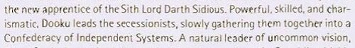
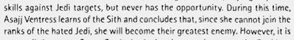
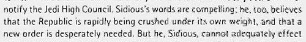
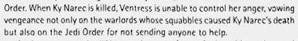
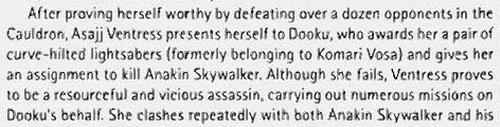
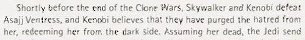
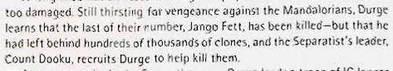
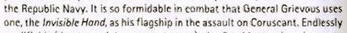
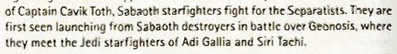

# Owner Material 037 — Star Wars D20 Drive folder (Core, Revised Core and Saga Edition): Sourcebooks/The Clone Wars Campaign Guide.pdf [Star Wars Roleplaying Game Saga Edition (2007)] (scan pages 181–225)

- **Source:** Wizards of the Coast Star Wars Roleplaying Game books, web enhancements, Living Force campaign modules and articles (2000–2010), from the owner's "Star Wars D20" Drive folder (only the three edition subfolders; "General" was not read, as instructed). Secondary source (licensed Legends reference). Scan OCR'd on the box; the scan stays box-only and is **not** published.
- **Method:** every scanned page was OCR'd and machine-screened sentence by sentence for power-relevant statements (fights, kills, defeats, Force feats, rankings, superweapons) that name a character on our roster; each kept sentence is quoted verbatim from the OCR text and has a crop of the printed passage directly under it. Pages with nothing power-relevant are still listed with what is on them.
- **Citation:** "*The Clone Wars Campaign Guide* (SWRPG Saga Edition), p.X" by printed page ("scan p.X" where no printed number applies). **Weight:** Licensed RPG material: a secondary source. Narrative text sums up Legends lore; game statistics are rules for players, not canon power levels, and rank lowest.

## scan p.181 (scan page 181)

Page contents: Trade Federation Droid Army (AAT/MTT crews, squad through army; C-9979 landing craft; Lucrehulk-class battleship). The Separatist Droid Army (over a quadrillion droids answerable to General Grievous; faction heads as advisory council led by Count Dooku). Army Command Structure (Grievous reports to Dooku, who does the bidding of Darth Sidious). Separatist Naval Fleet begins. (hand-read)

### Stat block notes (game mechanics, not feats)

- The Separatist Droid Army: Once combined, the individual elements of the commerce factions' military organizations form the mighty Separatist Droid Army: over a quadrillion droids in total (including the vast numbers of support droids necessary to keep such a large force operational), all of which are ultimately answerable to the cunning Kaleesh cyborg General Grievous. Reporting directly to Grievous are the various military leaders of the commerce factions, while the heads of the factions collectively act as an advisory council, with Count Dooku as their leader (much the way Supreme Chancellor Palpatine leads the Galactic Senate). The Separatist Droid Army has no true order of battle due to the completely separate militaries that comprise it; instead, task forces are assembled as needed from available units. The genius of General Grievous is his ability to coordinate radically different force structures in a way that keeps the Republic off balance at the strategic level. (Source: *The Clone Wars Campaign Guide* (SWRPG Saga Edition), scan p.181)
- Army Command Structure: But all report to their respective superiors, and, eventually and ultimately, to General Grievous. Grievous, in turn, reports to Count Dooku, who does the bidding of Darth Sidious. (Source: *The Clone Wars Campaign Guide* (SWRPG Saga Edition), scan p.181)

## scan p.182 (scan page 182)

Page contents: Orange sidebar (re-OCR crop c728_182a): Geonosian Species Traits (insectoid, hive-oriented; rigid caste system; warriors have wings; worker caste oppressed; +2 Str, -2 Int, -2 Cha; fly 6; radiation resistance; low-light vision; Basic, Geonosian). (hand-read)

### Stat block notes (game mechanics, not feats)

- The Separatist Admiralty: Like their ground forces, the Confederacy Navy begins as separate corporate fleets of the various commerce factions, only to be later combined under General Grievous. ... Admiralty: The Separatist Admiralty consists of hundreds of individual Fleets, under the command of General Grievous. (Source: *The Clone Wars Campaign Guide* (SWRPG Saga Edition), scan p.182)

## scan p.183 (scan page 183)

Page contents: Geonosian Elite Warrior (guards nurseries and queen-caste chambers; CL 3). Trandoshan Bounty Hunter (hunt Wookiees; CL 6; limb regeneration). Trandoshan Mercenary begins (CL 12; soldier 7/elite trooper 5). (hand-read)

## scan p.184 (scan page 184)

Page contents: Trandoshan Mercenary stat block cont. Influential Figures (Asajj Ventress, Durge, General Grievous, Count Dooku, Darth Sidious; Dooku plans to dispatch Sidious). Art caption: "Count Dooku and Whorm Loathsom". Count Dooku, Separatist Leader and Sith Lord begins (Darth Tyranus; Galidraan; Jango Fett among the Mandalorians). (hand-read)

- **Count Dooku** — entry/section: The Clone Wars Campaign Guide (Saga): "Powerful, skilled, and charismatic, Dooku leads the secessionists, slowly gathering them together into a Confederacy of independent Systems." Source: *The Clone Wars Campaign Guide* (SWRPG Saga Edition), scan p.184
  

### Stat block notes (game mechanics, not feats)

- Influential Figures: For the Separatists, the leadership comes down to a handful of individuals: the Dark Jedi Asajj Ventress, the mad cyborg Durge, the merciless tactician General Grievous, and, above them, the charismatic Count Dooku. But even Dooku answers to an even higher authority: the Sith Lord Darth Sidious. Unlike the Jedi who lead the Grand Army of the Republic, the Separatist commanders fight the war with vengeance in their hearts; each has a reason to hate the enemy, and, in at least two cases, a bloodlust that almost makes them more effective assassins than commanders. Although Grievous sees the war as a tactical equation to be solved, Ventress and Durge see it as an opportunity to settle old scores; for them, the war cannot go on long enough. (Source: *The Clone Wars Campaign Guide* (SWRPG Saga Edition), scan p.184)
- Influential Figures: For Count Dooku, the end of the war means the end of his charade with his Sith Master. When the war is over, there will no longer be a need to pretend that Darth Sidious and Supreme Chancellor Palpatine are two different people—neither of whom are otherwise necessary to the Confederacy of Independent Systems. Dooku can dispatch Sidious and become the new Sith Master ... and the ruler of the new Sith Empire. (Source: *The Clone Wars Campaign Guide* (SWRPG Saga Edition), scan p.184)
- Art caption: Count Dooku and Whorm Loathsom (Source: *The Clone Wars Campaign Guide* (SWRPG Saga Edition), scan p.184)
- Count Dooku, Separatist Leader and Sith Lord: Count Dooku is the enigmatic and compelling leader of the Separatists, former Jedi Master who broke with the Jedi Order. He is also Darth Tyranus, the new apprentice of the Sith Lord Darth Sidious. Powerful, skilled, and charismatic, Dooku leads the secessionists, slowly gathering them together into a Confederacy of Independent Systems. A natural leader of uncommon vision, Count Dooku has enticed thousands of worlds away from the Republic with his dream of reshaping the galaxy, of wiping away the greed and the bureaucracy and the inequities that come with them. Of all the Separatists, Dooku alone is the best suited for the task of forging a true and lasting political system—for of all the Separatists, Dooku alone knows the will of the Force and how it can guide the Separatists to a new age of peace and prosperity. (Source: *The Clone Wars Campaign Guide* (SWRPG Saga Edition), scan p.184)
- Count Dooku, Separatist Leader and Sith Lord: But Dooku has fallen under the sway of the dark side, and, sadly, cannot see how it clouds his judgment. As a Jedi Master, Dooku is assigned to lead a mission to Galidraan, to repel an invasion by Mandalorians—among them, Jango Fett—but his forces are only hastily assembled, and he loses over half of the Jedi assigned to him. Only later does Dooku learn that he had been manipulated; Galidraan's governor had actually hired the Mandalorians for another job, wanting the Jedi to get rid of them when they became inconvenient. Anyone but a Jedi might have been enraged by this betrayal, but Dooku is more disappointed in how the Jedi Order had become dupes for the Galactic Republic. Upon hearing the news that his former apprentice, Komari Vosa, has been killed while on a similarly pointless mission, Dooku resigns from the Jedi Order. (Source: *The Clone Wars Campaign Guide* (SWRPG Saga Edition), scan p.184)

## scan p.185 (scan page 185)

Page contents: Count Dooku continues (visited by Darth Sidious after Darth Maul's loss; agrees to be public voice of secession). Count Dooku stat block (CL 18; Jedi 7/Jedi Knight 5/Jedi Master 4/Sith Lord 2; Makashi). Asajj Ventress, Dark Jedi begins (Rattatak; Ky Narec; the Cauldron; Komari Vosa's lightsabers; fails to kill Anakin; captures Kenobi once). (hand-read)

- **Asajj Ventress** — entry/section: The Clone Wars Campaign Guide (Saga): "During this time, Asajj Ventress learns of the Sith and concludes that, since she cannot jain the ranks of the hated Jedi, she will become their greatest enemy." Source: *The Clone Wars Campaign Guide* (SWRPG Saga Edition), scan p.185
  
- **Palpatine (Darth Sidious)**: "Sidious's words are cornpebing: he, 100, beligves that the Republic is rapidly being crushed under its own weight, and that a new order is desperately needed." Source: *The Clone Wars Campaign Guide* (SWRPG Saga Edition), scan p.185
  
- **Asajj Ventress**: "When Ky Narec is killed, Ventress is unable to control her anger, vowing vengeance not only on the warlords whose squabbles caused Ky Narec's death but also on the Jedi Order for not sending anyone to help." Source: *The Clone Wars Campaign Guide* (SWRPG Saga Edition), scan p.185
  
- **Asajj Ventress; Count Dooku; Darth Vader (Anakin Skywalker)**: "After proving herself worthy by defeating over a dozen opponents in the Cauldron, Asajj Ventress presents herself to Dooku, who awards her a pair of curve-hilted lightsabers (formerly belonging to Komari Vosa) and gives her an assignment to kill Anakin Skywalker, Although she fails, Ventress proves to be a resourceful and vicious assassin, carrying oul Numerous Missions on Dooku's behalf." Source: *The Clone Wars Campaign Guide* (SWRPG Saga Edition), scan p.185
  

### Stat block notes (game mechanics, not feats)

- Count Dooku (Saga CL 18): CL 18 Medium Human Jedi 7/Jedi Knight Siedi Master 4/Sith Lord 2 Destiny 3; Force 7, Strong in the Forex; Dark Side 14 Init +16; Senses Use the Foret +17 Languages Basic, Geonosian, Shyriiwouk Defenses Ref 33 [flat-fuoted 31), Fort 32, Will 33; Block hp 141; Threshold 32 Immune fear effects Speed 6 squares Melee lightsaber +22 (2d8+9 (Source: *The Clone Wars Campaign Guide* (SWRPG Saga Edition), scan p.185)
- Count Dooku, Separatist Leader and Sith Lord: Soon after his departure, though, Count Dooku is visited by the Dark Lord of the Sith, Darth Sidious. The loss of Sith Lord's former apprentice, Darth Maul, motivates Sidious to seek out a new apprentice, a convert who already has the training he needs—and who can be turned to the dark side. Dooku fits the bill perfectly, a fully trained Jedi Master with radical philosophies on galactic politics. Dooku is disenchanted with the Jedi way just enough to hear what the Sith Lord has to say rather than immediately attack him or notify the Jedi High Council. Sidious's words are compelling: he, too, believes that the Republic is rapidly being crushed under its own weight, and that a new order is desperately needed. But he, Sidious, cannot adequately effect change without attracting the attention of the Jedi. Furthermore, the last thing the Sith Lord can afford at this point is to be exposed; his plans to rescue the Republic from itself depend on his own anonymity. The need for secrecy severely hinders Sidious. He needs someone who can openly talk to the right people, to arrange meetings between them, and to serve as the public voice for the secessionist movement he proposes. In exchange for Dooku becoming that person, Sidious agrees to teach the former Jedi Master about the dark side of the Force and how Dooku can use it to bring about the positive changes they both envision for the galaxy. So, yet again, Dooku chooses his destiny. But in doing so, he has truly sealed his fate. (Source: *The Clone Wars Campaign Guide* (SWRPG Saga Edition), scan p.185)
- Count Dooku (stat block): Count Dooku CL 18 Medium Human Jedi 7/Jedi Knight 5/Jedi Master 4/Sith Lord 2 Destiny 3; Force 7, Strong in the Force; Dark Side 14 ... Force Powers Known (Use the Force +17): Force grip, Force lightning, Force slam, Force thrust, mind trick, move object Force Secrets Devastating Power, Distant Power, Multitarget Power, Quicken Power Force Techniques Force Power Mastery, Improved Move Light Object ... Talents Adept Negotiator, Block, Force Deception, Force Perception, Force Persuasion, Lightsaber Defense, Makashi, Multiattack Proficiency (lightsabers), Severing Strike, Telekinetic Savant Feats Double Attack (lightsabers), Force Sensitivity, Force Training (2), Improved Disarm, Melee Defense, Rapid Strike, Strong in the Force, Triple Attack (lightsabers), Weapon Finesse, Weapon Focus (lightsabers), Weapon Proficiency (lightsabers, simple weapons), Whirlwind Attack ... Possessions lightsaber (self-built) (Source: *The Clone Wars Campaign Guide* (SWRPG Saga Edition), scan p.185)
- Asajj Ventress, Dark Jedi: Although the Sith tradition prevents Count Dooku from taking on an apprentice, he does train several acolytes in the Sith arts, including a bitter young former Jedi named Asajj Ventress. Ventress was trained on her homeworld of Rattatak by a Jedi Knight named Ky Narec, and she knows little of the Jedi Order. When Ky Narec is killed, Ventress is unable to control her anger, vowing vengeance not only on the warlords whose squabbles caused Ky Narec's death but also on the Jedi Order for not sending anyone to help. (Source: *The Clone Wars Campaign Guide* (SWRPG Saga Edition), scan p.185)
- Asajj Ventress, Dark Jedi: As the years pass, Asajj Ventress becomes increasingly embittered toward the Jedi. She tries her hand at bounty hunting for a while, hoping to pit her skills against Jedi targets, but never has the opportunity. During this time, Asajj Ventress learns of the Sith and concludes that, since she cannot join the ranks of the hated Jedi, she will become their greatest enemy. However, it is not until she meets Count Dooku in the battle arena known as the Cauldron that she learns what a Sith truly is. After proving herself worthy by defeating over a dozen opponents in the Cauldron, Asajj Ventress presents herself to Dooku, who awards her a pair of curve-hilted lightsabers (formerly belonging to Komari Vosa) and gives her an assignment to kill Anakin Skywalker. Although she fails, Ventress proves to be a resourceful and vicious assassin, carrying out numerous missions on Dooku's behalf. She clashes repeatedly with both Anakin Skywalker and his master Obi-Wan Kenobi, but despite capturing Kenobi at one point, she is unable to kill either Jedi. (Source: *The Clone Wars Campaign Guide* (SWRPG Saga Edition), scan p.185)

## scan p.186 (scan page 186)

Page contents: Asajj Ventress concluded (defeated by Skywalker and Kenobi; body vanishes en route to Coruscant; rumor of Second Battle of Xagobah). Ventress stat block (CL 13; Rattataki Jedi 5/scout 4/Sith apprentice 4; Dual Weapon Mastery III). Durge, Separatist Commander begins (Gen'Dai; over 1,500 years old; apprenticed with Mandalorian Jaing; cybernetics; vengeance on Mandalorians; IG lancer droids; Ohma-D'un; Queyta; Muunilinst; Grievous bests him on the Trenchant Space Station). (hand-read)

- **Obi-Wan Kenobi; Asajj Ventress**: "Shortly before the end of the Clone Wars, Skywalker and Kenobi defeat Asajj Ventress, and Kenobi believes that they have purged the hatred from her, redeeming her from the dark side." Source: *The Clone Wars Campaign Guide* (SWRPG Saga Edition), scan p.186
  
- **Jango Fett; Count Dooku**: "Still thirsting far vengeance against the Mandalorians, Durge learns that the last of their eumber, Jango Fett, has been killed—but that he had left behind hundreds of thousands of clones, and the Separatist's leader, Count Dooku, recruits Durge to help kill them." Source: *The Clone Wars Campaign Guide* (SWRPG Saga Edition), scan p.186
  

### Stat block notes (game mechanics, not feats)

- Ventress (Saga CL 13): CL 13 Medium Rattataki (near-Human) Jedi 5/scout 4/Sith apprentice 4 Destiny 2; Force 7; Dark Side 13 Init +14; Senses Perception +7 Languages Basic Defenses Ref 28 (flat-footed 25), Fart 26, Will 26; Block. Elusive Target hp 105; Threshold 26 Speed 6 squares Melee lightsaber +15 (2d8+7} or Melee lightsaber +15 (208+7] and Atk Option (Source: *The Clone Wars Campaign Guide* (SWRPG Saga Edition), scan p.186)
- Asajj Ventress, Dark Jedi: Shortly before the end of the Clone Wars, Skywalker and Kenobi defeat Asajj Ventress, and Kenobi believes that they have purged the hatred from her, redeeming her from the dark side. Assuming her dead, the Jedi send her body back to Coruscant aboard a medical shuttle. However, the shuttle vanishes en route, and, despite a rumor that she fights in the Second Battle of Xagobah, she has not been seen since. (Source: *The Clone Wars Campaign Guide* (SWRPG Saga Edition), scan p.186)
- Asajj Ventress (stat block): Asajj Ventress CL 13 Medium Rattataki (near-Human) Jedi 5/scout 4/Sith apprentice 4 Destiny 2; Force 7; Dark Side 13 ... Force Powers Known (Use the Force +13): battle strike, dark rage, Force slam, move object Force Techniques Improved Move Light Object, Improved Sense Surroundings ... Talents Block, Dark Healing, Dark Scourge, Elusive Target, Improved Stealth, Lightsaber Defense, Power of the Dark Side Feats Acrobatic Strike, Dual Weapon Mastery I, Dual Weapon Mastery II, Dual Weapon Mastery III, Force Sensitivity, Force Training (2), Running Attack, Skill Training (Pilot, Stealth), Weapon Finesse, Weapon Proficiency (lightsabers, simple weapons) ... Possessions 2 lightsabers (Source: *The Clone Wars Campaign Guide* (SWRPG Saga Edition), scan p.186)
- Durge, Separatist Commander: Part cyborg, part ancient warrior, and almost entirely insane, Durge is little more than a killing machine. He is given the rank of commander in the Separatist army by Count Dooku and assigned the task of eliminating the last vestiges of the Mandalorians in the galaxy: the Grand Army's clone troopers, created from the genetic template of Jango Fett. (Source: *The Clone Wars Campaign Guide* (SWRPG Saga Edition), scan p.186)
- Durge, Separatist Commander: Over 1,500 years old, Durge is the epitome of the aggressive Gen'Dai warrior: strong, fearless, and ruthless. An early interest in bounty hunting leads him to apprentice with a Mandalorian named Jaing, and the two become friends. Eventually, they are approached by a doctor who offers to enhance their already formidable skills with cybernetics—essentially bonding them to their armor. Shortly after the procedure, a group of rival Mandalorians attack the doctor's laboratory, killing Jaing and setting Durge on a path of vengeance that ultimately leads him to slay the Mandalorian leader. However, he is tortured by Mandalore's followers, which drives him past the brink of sanity. A long hibernation restores Durge to physical health, but his mind is too damaged. Still thirsting for vengeance against the Mandalorians, Durge learns that the last of their number, Jango Fett, has been killed—but that he had left behind hundreds of thousands of clones, and the Separatist's leader, Count Dooku, recruits Durge to help kill them. (Source: *The Clone Wars Campaign Guide* (SWRPG Saga Edition), scan p.186)
- Durge, Separatist Commander: As a commander in the Separatist army, Durge leads a troop of IG lancer combat droids and often works alongside the equally vengeance-driven dark side acolyte Asajj Ventress. Together, the two poison the moon of Ohma-D'un, killing countless Naboo and Gungans, and nearly kill Obi-Wan Kenobi and Anakin Skywalker. They set up a trap for the Jedi on Queyta, and square off against Kenobi and Skywalker again at the Battle of Muunilinst. Durge's increasing mental instability troubles Count Dooku. Although an effective killer, he lacks the leadership skills that the Separatists require. In response, Dooku recruits another cyborg, the deadly Grievous, to be his general—and to make sure that Durge is in no position to object. Pitting Grievous against both Durge and Asajj Ventress aboard the Trenchant Space Station, Dooku is most pleased when his new candidate bests both of his previous commanders in short order. (Source: *The Clone Wars Campaign Guide* (SWRPG Saga Edition), scan p.186)

## scan p.187 (scan page 187)

Page contents: Durge concluded (faces Kit Fisto and Plo Koon; Karthakk system; launched into a star by Anakin). Durge stat block (CL 16; Large Gen'Dai cyborg soldier 8/elite trooper 2/scout 3/bounty hunter 3; Dark Side 24). (hand-read)

### Stat block notes (game mechanics, not feats)

- Durge, Separatist Commander: Dooku still sees a use for Durge and Ventress, however, and orders his medics to treat them and restore them to health. Durge soon returns to action, facing off against Jedi Master Kit Fisto and Plo Koon, and, later, battling Kenobi and Skywalker again in the Karthakk system, where Anakin Skywalker maneuvers Durge into an escape pod. Trapped, Durge is helpless to prevent young Skywalker from launching the shuttle into the nearest star—apparently ending Durge's long life once and for all. (Source: *The Clone Wars Campaign Guide* (SWRPG Saga Edition), scan p.187)
- Durge (stat block): Durge CL 16 Large Gen'Dai (cyborg) soldier 8/elite trooper 2/scout 3/bounty hunter 3 Destiny 3; Force 5; Dark Side 24 ... Special Qualities cyborg hybrid, hibernation, regeneration Talents Acute Senses, Armored Defense, Exotic Weapon Mastery, Improved Armored Defense, Improved Initiative, Juggernaut, Second Skin, Uncanny Dodge I, Uncanny Dodge II Feats Armor Proficiency (light, medium, heavy), Cleave, Double Attack, Extra Second Wind, Great Cleave, Martial Arts I, Mighty Swing, Pin, Point Blank Shot, Power Attack, Rapid Shot, Shake It Off, Weapon Proficiency (heavy weapons, pistols, rifles, simple weapons) ... Systems 2 hand appendages, unique armor (+10 armor, +4 equipment), shield generator (SR 10), improved sensor package, darkvision, synchronized fire circuits Possessions 2 blaster pistols, blaster rifle, flamethrower (5 shots), spiked flail, flechette launcher, jet pack (10 charges) (Source: *The Clone Wars Campaign Guide* (SWRPG Saga Edition), scan p.187)

## scan p.188 (scan page 188)

Page contents: Orange sidebar (re-OCR crop c728_188a): Other Separatist Forces — table of droids (B1-Series battle droid, B2-Series super battle droid, crab droid scout, droideka, dwarf spider droid, IG-100 MagnaGuard; Saga Edition 199-201) and starships (droid tri-fighter, Lucrehulk-class battleship, Mankvim-814 interceptor, Munificent-class frigate, Nantex-class starfighter, Porax-38 starfighter, Recusant-class destroyer, "...grob-class starfighter" [OCR partial; first letters cut], "Vulture" droid starfighter; Saga Edition and Starships of the Galaxy). (hand-read)

- **Obi-Wan Kenobi**: "This flaw allows Obi-Wan Kenobi to stall the Retail Caucus's advance at the Battle of Christophsis, a blunder that shames General Loathsom after the Separatist defeat." Source: *The Clone Wars Campaign Guide* (SWRPG Saga Edition), scan p.188
  

### Stat block notes (game mechanics, not feats)

- Durge (special qualities): Cyborg Hybrid—Durge can use any type of droid system except a Processor. His cyborg chassis includes a life support system, making him immune to atmospheric and inhaled poison hazards. Gen'Dai Surge—Durge heals 5 hit points per round after he takes his second wind. Though Durge cannot regrow lost body parts, he can reattach severed limbs if his dismembered extremities can be recovered. Hibernation—Durge can enter a hibernation trance. While in the trance, he can remove persistent conditions, such as from the effects of poison and disease, at a rate of one condition per hour. While in the trance, Durge ceases to age, and needs no food, water, or air until he emerges from hibernation. Pseudopodia—Durge has learned how to stretch his natural Gen'Dai form, giving him a reach of 4 squares. Durge can use this ability only when he is not wearing his armor. Resilient Physiology—Durge's Gen'Dai physiology allows him to shrug off the effects of wounds that would be fatal to anyone else; his damage threshold is doubled after adding in all bonuses for feats or size. (Source: *The Clone Wars Campaign Guide* (SWRPG Saga Edition), scan p.188)
- General Whorm Loathsom: The commander of the Retail Caucus's military forces, General Whorm Loathsom is a Kerkoiden who prides himself on his cunning and leadership ability. General Loathsom's creative strategies lead the Separatists to victory on a number of battlefields. If General Loathsom has one flaw it is that his ego sometimes gets in the way of his strategic thinking, resulting in command decisions made more out of arrogance than solid strategy. This flaw allows Obi-Wan Kenobi to stall the Retail Caucus's advance at the Battle of Christophsis, a blunder that shames General Loathsom after the Separatist defeat. (Source: *The Clone Wars Campaign Guide* (SWRPG Saga Edition), scan p.188)
- Whorm Loathsom (stat block): Whorm Loathsom CL 7 Medium Kerkoiden nonheroic 6/noble 3/officer 2 Destiny 1; Force 5; Dark Side 6 ... Special Qualities command cover, predator's heritage, share talent (Bolster Ally), social cunning Talents Assault Tactics, Bolster Ally, Born Leader, Inspire Haste Feats Improved Defenses, Leader of Droids, Skill Focus (Knowledge [tactics]), Skill Focus (Perception), Skill Training (Knowledge [tactics]), Skill Training (Use Computer), Toughness, Weapon Proficiency (pistols, simple weapons) ... Possessions blaster pistol, comlink, various personal belongings (Source: *The Clone Wars Campaign Guide* (SWRPG Saga Edition), scan p.188)

## scan p.189 (scan page 189)

Page contents: Confederacy Droids. Fourth-Degree Droids (Geonosis factories; Trade Federation OOM-Series; B1 and B2; Techno Union field-tests). Droid Colors sidebar (Droid Officer: Yellow; Security Droid: Red; Pilot/Technical Droid: Blue; Battle Droid: None). A-DSD Advanced Dwarf Spider Droid (Commerce Guild; leg shields; used in Kamino training simulations; CL 6). (hand-read)

### Stat block notes (game mechanics, not feats)

- Art caption: Captain Rex blasts an A-DSD advanced spider droid from above. (Source: *The Clone Wars Campaign Guide* (SWRPG Saga Edition), scan p.189)

## scan p.190 (scan page 190)

Page contents: A-DSD stat block cont. (stability; leg shields; 25,000). A-Series Assassin Droid (created by Anx scientist Pollux Poi; Count Dooku deploys them at the Battle of Jabiim; collapse into wheel shape; CL 11). B1-A Air Battle Droid begins (jet packs; forearm blades). (hand-read)

### Stat block notes (game mechanics, not feats)

- A-Series Assassin Droid: Count Dooku acquires a sizeable quantity of them just in time for deployment against the Jedi in the Battle of Jabiim, though he continues to assign them to various commanders throughout the course of the war. (Source: *The Clone Wars Campaign Guide* (SWRPG Saga Edition), scan p.190)

## scan p.191 (scan page 191)

Page contents: B1-A Series Air Battle Droid stat block (CL 4). Battle Droid Assassin (B1 chassis sniper; few produced; 6,460). Cold Assault Battle Droid ("snow droids"; enlarged B2 chassis; large feet slow running). (hand-read)

## scan p.192 (scan page 192)

Page contents: Cold Assault Battle Droid stat block (CL 2). Caption (OCR approx.): "Left to right: B1-A air battle droid, cortosis battle droid, OOM-Series battle droid, and A-Series assassin droid." Cortosis Battle Droid (C-B3; cortosis-durasteel alloy; counters Jedi). (hand-read)

## scan p.193 (scan page 193)

Page contents: C-B3 stat block (CL 5; DR 5 lightsabers only; 25,000). Droid Commando (BX-Series; Baktoid Combat Automata; groups of 3-6; CL 6). IG Lancer Combat Droid begins (Phlut Design Systems of Muunilinst; seized by the IGBC; swoop bikes; first mass deployment at the Battle of Muunilinst). (hand-read)

## scan p.194 (scan page 194)

Page contents: IG Lancer stat block (CL 2; energy lance). IG-110 Lightsaber Droid (Holowan Mechanicals; based on MagnaGuards; synthetic-crystal lightsabers, technique handed down from Count Dooku; CL 6). JK-13 Security Droid begins (Cestus Cybernetics "Jedi killer"; rumor Dooku will buy thousands is a ruse; dashta eel organic processor; gold plating). (hand-read)

### Stat block notes (game mechanics, not feats)

- IG-110 Lightsaber Droid: An IG-110 lightsaber droid wields two lightsabers crafted with synthetic crystals; the technique for creating the lightsabers is handed down from Count Dooku himself, though the lightsaber droid does not share the same connection to its weapons that the Jedi do. (Source: *The Clone Wars Campaign Guide* (SWRPG Saga Edition), scan p.194)
- JK-13 Security Droid: Cestus Cybernetic's infamous "Jedi killer" security droids are of grave concern to the Republic because of the threat they pose to the Jedi commanders of the Grand Army—and, early in the war, rumors circulate that Count Dooku intends to purchase thousands of them for use in the Separatist army. The rumor ultimately proves to be an elaborate ruse to lure the Jedi into a trap; the JK-13's organic processor incorporates a Force-sensitive dashta eel, which is driven mad when it is made to use lethal force—obviously making them all but useless on the battlefield. (Source: *The Clone Wars Campaign Guide* (SWRPG Saga Edition), scan p.194)

## scan p.195 (scan page 195)

Page contents: JK-13 stat block (soldier 12; killing rage; stability; 50,000). LM-432 Assault Crab Droid ("Muckraker"; water jet sprayer; Merr-Sonn blaster cannon; CL 6 [OCR]). (hand-read)

## scan p.196 (scan page 196)

Page contents: Caption (OCR approx.): "Left to right: JK-13 security droid, spelunker probe droid, LM-432 assault crab droid, and LR-57 combat droid." LR-57 Combat Droid (Retail Caucus at Christophsis; buried like land mines; CL 3). (hand-read)

## scan p.197 (scan page 197)

Page contents: Octuptarra Combat Tri-Droid (Techno Union; named for Skakoan herbivore; virus variant; CL 3). OOM-Series Battle Droid (Neimoidian design; yellow commanders, blue pilots, red security; viewed as "obsolete"; CL 2). (hand-read)

## scan p.198 (scan page 198)

Page contents: Spelunker Probe Droid (Commerce Guild design handed to Techno Union; "chameleon droids"; cloaking; mines; traction-field generators; CL 6). Ultra Droideka begins (oversized destroyer droid; shieldless mode). Caption (OCR approx.): "IG-110 lightsaber droids defend an ultra droideka." (hand-read)

## scan p.199 (scan page 199)

Page contents: Ultra Droideka stat block (29,000). Orange sidebar (re-OCR crop c728_199a): Weapon Systems (Separatist vehicle weapons interchangeable with starship weapons; Heavy Ordnance Launcher—chain-fed, like ancient repeating slugthrower cannons; Microtractor-Pressor—tractor beam with halved grapple bonus, can push target 10 squares). Confederacy Vehicles intro. Ground Armored Tank (GAT; Baktoid Armor Workshop; answer to the TX-130; escorted by B1s on STAPs; obsolete by second year; CL 10). (hand-read)

## scan p.200 (scan page 200)

Page contents: Caption: "Republic Nu-class attack shuttles attack a Separatist GAT." IG-227 Hailfire-class Droid Tank (Haor Chall Engineering; "wheel droid"; Baktoid "hailfire" missiles; 60,000). Manta Droid Subfighter (Haor Chall; aquatic; Mon Calamari and Gungans; after the Battle of Mon Calamari, abandoned Mantas ally with the Quarren). (hand-read)

## scan p.201 (scan page 201)

Page contents: Manta stat block (CL 9). Multi-Troop Transport (MTT; Baktoid; hydraulic rack of 112 B1s; Multi-Utility Transport variant; CL 6 [OCR]). OG-9 Homing Spider Droid begins (Commerce Guild; "spider walker"; DSD1 spotters; weak legs). Epigraph (display font; crops c728_201a/b): "Being hard is good, being hard with superior tech is better." —Walon Vau. (hand-read)

### Stat block notes (game mechanics, not feats)

- Walon Vau (epigraph): "Being hard is good, being hard with superior tech is better." —Walon Vau (Source: *The Clone Wars Campaign Guide* (SWRPG Saga Edition), scan p.201)

## scan p.202 (scan page 202)

Page contents: Caption (OCR approx.): "A Persuader-class droid enforcer chases clone troopers on BARC speeders." OG-9 stat block (CL 7; 70,000). Persuader-class Droid Enforcer (NR-N99; Corporate Alliance tank droid, CAD, "snail" tank; anti-insurgent origin; massive numbers at the Battle of Kashyyyk; escorts for OG-9s; CL 14). (hand-read)

## scan p.203 (scan page 203)

Page contents: Single Trooper Aerial Platform (STAP; Baktoid; for OOM and B1 droids; CL 2). Trade Federation Troop Carrier (unarmed MTT variant; 112 B1s). Tri-Droid (Techno Union mobile artillery; three heavy ordnance launchers; Battle of Mygeeto; CL 9). (hand-read)

## scan p.204 (scan page 204)

Page contents: Tsmeu-6 Personal Wheel Bike (all-terrain recon; civilian racing; retractable legs; CL 3). General Grievous's Wheel Bike (passenger seat replaced with a double laser cannon; CL 5). Confederacy Starships intro. BC-714 Luxury Transport (commissioned by the IGBC, designed by the Techno Union; Muun status symbol; CL 5). (hand-read)

### Stat block notes (game mechanics, not feats)

- General Grievous's Wheel Bike: General Grievous's personal wheel bike has been modified by replacing the passenger seat with a double laser cannon. (Source: *The Clone Wars Campaign Guide* (SWRPG Saga Edition), scan p.204)

## scan p.205 (scan page 205)

Page contents: Belbullab Heavy Starfighter (Feethan Ottraw Scalable Assemblies; Belbullab-22/-23/-24; rivals ARC-170s; CL 13). General Grievous's Soulless One (modified Belbullab-22; HoloNet transceiver; CL 14). Caption (image-verified, crop c728_205a): "Belbullab-22 starfighters escort a Sheathipede-class shuttle.". (hand-read)

### Stat block notes (game mechanics, not feats)

- Belbullab Heavy Starfighter: General Grievous owns a modified Belbullab-22, the Soulless One, which includes a cutting-edge HoloNet transceiver and considerably more efficient hyperdrives. He uses the Soulless One as his personal transport when he needs to travel quickly, without the protection of the Separatist fleet. (Source: *The Clone Wars Campaign Guide* (SWRPG Saga Edition), scan p.205)

## scan p.206 (scan page 206)

Page contents: C-9979 Landing Craft (Haor Chall Engineering; Trade Federation invasion of Naboo; later pledged to the CIS; OOM then B1 crews). Caption (stylized font; crop c728_206a): "C-9979 landing craft face heavy ground fire from SPHA-Ts." CIS-Advanced Starfighter begins (prototype stolen from Diado by Jedi Master Saesee Tiin; innovations used on Eta-2 Actis). (hand-read)

### Stat block notes (game mechanics, not feats)

- CIS-Advanced Starfighter: Stolen from a secret weapons factory on Diado by Jedi Master Saesee Tiin, the CIS-Advanced starfighter is a prototype that never sees actual battlefield use except in a few trials. However, many of the systemic innovations are borrowed by Republic engineers for inclusion on Republic starships such as the Eta-2 Actis Interceptor developed by Kuat Systems Engineering specifically for Jedi fighter pilots. (Source: *The Clone Wars Campaign Guide* (SWRPG Saga Edition), scan p.206)
- CIS-Advanced Starfighter (cont.): Very few CIS-Advanced starfighters are built, and most of those are constructed by the Republic for use in training clone fighter pilots. The one Saesee Tiin steals is the only one the Separatists have, and the plans are vaporized when Master Tiin destroys the weapons factory building the prototype. (Source: *The Clone Wars Campaign Guide* (SWRPG Saga Edition), scan p.206)

## scan p.207 (scan page 207)

Page contents: CIS-Advanced stat block (CL 9). Diamond-class Cruiser (Commerce Guild; delivers OG-9s and DSD1s; Shu Mai's personal transport and Commerce Guild flagship; CL 13). Caption: "A Diamond-class cruiser fires upon a Republic frigate." (hand-read)

### Stat block notes (game mechanics, not feats)

- Diamond-class Cruiser: The president of the Commerce Guild, Shu Mai, uses a Diamond-class cruiser as her personal transport and as the flagship of the Commerce Guild fleet. (Source: *The Clone Wars Campaign Guide* (SWRPG Saga Edition), scan p.207)

## scan p.208 (scan page 208)

Page contents: Droch-class Boarding Ship (boarding drill rules; CL 7 [OCR]). Hardcell-class Transport (Techno Union; ~300 before the war, another thousand after Geonosis; thrusters; Skakoan crew cabins; crit triple damage; CL 10). (hand-read)

## scan p.209 (scan page 209)

Page contents: Hyena-class Bomber (Baktoid; expanded droid starfighter; CL 7). Caption: "Hardcell-class transports defend a Providence-class destroyer." Providence-class Destroyer begins (Quarren Free Dac Volunteers Engineering Corps; "Trade Federation cruiser"; Grievous's Invisible Hand at Coruscant; modular). (hand-read)

- **General Grievous**: "It is so formidable in combat that General Grievous uses one, the Invisible Hand, as his flagship in the assault on Coruscant." Source: *The Clone Wars Campaign Guide* (SWRPG Saga Edition), scan p.209
  

## scan p.210 (scan page 210)

Page contents: Punworcca 116-class Sloop (Huppla Pasa Tisc Shipwrights Collective; Dooku's custom sloop, a gift from Poggle the Lesser, fitted with an antique solar sail; CL 6). Sheathipede-class Shuttle (Haor Chall; "Neimoidian shuttle"; CL 4). Subjugator-class Heavy Cruiser begins (Quarren Separatists at Pammant; ion pulse cannons; Grievous's Malevolence; Tactical Fire). (hand-read)

### Stat block notes (game mechanics, not feats)

- Punworcca 116-class Sloop: As a gift to Count Dooku, the Geonosian archduke, Poggle the Lesser, had Huppla Pasa Tisc Shipwrights Collective build a custom Punworcca 116-class interstellar sloop. Dooku then modified the vessel by having an antique solar sail fitted to the ship, allowing him to cruise largely undetected by most starship sensors. (Source: *The Clone Wars Campaign Guide* (SWRPG Saga Edition), scan p.210)
- Subjugator-class Heavy Cruiser: The Malevolence, one of General Grievous's command ships, is a Subjugator-class heavy cruiser. (Source: *The Clone Wars Campaign Guide* (SWRPG Saga Edition), scan p.210)

## scan p.211 (scan page 211)

Page contents: Providence-class Destroyer cont. ("bridge-forward"; water landings; stat block CL 18). Invisible Hand stat block (CL 20). (hand-read)

## scan p.212 (scan page 212)

Page contents: Caption (OCR approx.): "A pair of Banking Clan transports support the Malevolence, a Subjugator-class heavy cruiser." Subjugator-class stat block (CL 20). Sidebar: Ion Pulse Cannon (area attack; -2 steps on hit; three full-round recharge; overload). (hand-read)

## scan p.213 (scan page 213)

Page contents: Chapter XII opener art: "Chapter XII Fringe Factions" (title read from sheet image; OCR only "APTER XII"). (hand-read)

## scan p.214 (scan page 214)

Page contents: Chapter XII intro (new allies, enemies, technology of factions other than the Republic and Confederacy). Mercenary Factions (Sabaoth Mercenaries deploy trihexalon; mercenaries maintain Separatist presence; planetary defense forces such as the Wookiees with Yoda and Commander Gree at Kashyyyk). (hand-read)

### Stat block notes (game mechanics, not feats)

- Mercenary Factions: For example, the Wookiee defense forces work closely with both Jedi Master Yoda and the Republic military forces under the control of Commander Gree at the Battle of Kashyyyk, but they are not technically part of the Republic command hierarchy. (Source: *The Clone Wars Campaign Guide* (SWRPG Saga Edition), scan p.214)

## scan p.215 (scan page 215)

Page contents: Influential Figures (Fringe). Boba Fett (Episode III) description and stat block (CL 7). Cavik Toth (Sabaoth Squadron founder; allied with Dooku; foes Nym, Lok Revenants, Adi Gallia) and stat block (CL 11). (hand-read)

### Stat block notes (game mechanics, not feats)

- Boba Fett: Boba Fett is the unaltered clone of Jango Fett. He sees his "father" beheaded by Mace Windu during the Battle of Geonosis. As a teenager in the later part of the Clone Wars, he begins his career finding work wherever he can—as mercenary, soldier, personal guard, assassin, and of course, bounty hunter. The following statistics reflect Boba Fett at the start of what promises to be a notorious career. (Source: *The Clone Wars Campaign Guide* (SWRPG Saga Edition), scan p.215)
- Boba Fett (Episode III) (stat block): Boba Fett (Episode III) CL 7 / Medium Human (clone) scout 3/soldier 4 / Destiny 1; Force 3; Dark Side 2 ... Talents Acute Senses, Armored Defense, Juggernaut, Keen Shot / Feats Armor Proficiency (light, medium), Double Attack, Exotic Weapon Proficiency (flamethrower), Martial Arts I, Point Blank Shot, Precise Shot, Quick Draw, Running Attack, Weapon Proficiency (pistols, rifles, simple weapons) / Possessions Slave I, Mandalorian armor (as battle armor with helmet package; 4 weapon attachments), blaster carbine, 4 stun grenades, flamethrower (5 shots), missile launcher, 4 missiles, whipcord (treat as net), blaster gauntlet (treat as hold-out blaster), jet pack (10 charges), utility belt with medpac (Source: *The Clone Wars Campaign Guide* (SWRPG Saga Edition), scan p.215)
- Cavik Toth: Cavik Toth's ambition leads him to found his own mercenary force, the Sabaoth Squadron. Prior to the start of the Clone Wars, Toth and his forces ally with Count Dooku and the Confederacy of Independent Systems. Toth's adversaries include Nym and his Lok Revenants as well as Jedi Master Adi Gallia. (Source: *The Clone Wars Campaign Guide* (SWRPG Saga Edition), scan p.215)
- Captain Cavik Toth (stat block): Captain Cavik Toth CL 11 / Medium Human soldier 4/scoundrel 3/ace pilot 2/officer 2 / Destiny 2; Force 4; Dark Side 2 ... Talents Battle Analysis, Cover Fire, Deployment Tactics, Elusive Dogfighter, Hyperdriven, Spacehound / Feats Armor Proficiency (light, medium), Careful Shot, Coordinated Attack, Deadeye, Dodge, Point Blank Shot, Precise Shot, Rapid Shot, Vehicular Combat, Weapon Focus (pistols), Weapon Proficiency (pistols, rifles, simple weapons) / Possessions heavy blaster pistol, flight suit, command uniform (Source: *The Clone Wars Campaign Guide* (SWRPG Saga Edition), scan p.215)

## scan p.216 (scan page 216)

Page contents: Chewbacca (Episode III) description and stat block (CL 6). Merumeru (Wookiee elder ~250; beachfront defense at Kachirho) and stat block (CL 6). (hand-read)

### Stat block notes (game mechanics, not feats)

- Chewbacca: Known for his great strength and loyalty, Chewbacca is a wise, sophisticated Wookiee and an exceptional scout. As a close friend to Wookiee city leader Tarfful of Kachirho, Chewbacca is asked to be part of the Wookiee High Command responsible for the battle plan to protect the city from a Separatist invasion. When Order 66 is issued, Chewbacca assists his friend Tarfful in protecting Jedi Master Yoda and aiding the venerable Force-user in his escape from Kashyyyk. (Source: *The Clone Wars Campaign Guide* (SWRPG Saga Edition), scan p.216)
- Chewbacca (Episode III) (stat block): Chewbacca (Episode III) CL 6 / Medium Wookiee scout 6 / Destiny 1; Force 4 ... Talents Acute Senses, Extreme Effort, Jury-Rigger / Feats Careful Shot, Martial Arts I, Pin, Point Blank Shot, Powerful Charge, Precise Shot, Shake It Off, Weapon Proficiency (pistols, rifles, simple weapons) / Possessions bowcaster, bandolier, tool kit (Source: *The Clone Wars Campaign Guide* (SWRPG Saga Edition), scan p.216)
- Merumeru: This intelligent Wookiee elder is about 250 years old during the Clone Wars. He develops effective defensive tactics against Trandoshan raiders prior to the war. Due to his vast experience, he leads the beachfront defense at Kachirho during the Confederacy's invasion of Kashyyyk. (Source: *The Clone Wars Campaign Guide* (SWRPG Saga Edition), scan p.216)
- Merumeru (stat block): Merumeru CL 6 / Medium Wookiee soldier 5/noble 1 / Destiny 1; Force 3 ... Talents Battle Analysis, Coordinate +1, Cover Fire, Indomitable / Feats Armor Proficiency (light, medium), Charging Fire, Coordinated Attack, Point Blank Shot, Precise Shot, Rapid Shot, Weapon Proficiency (pistols, rifles, simple weapons) / Possessions bowcaster, battle staff, battle helm (Source: *The Clone Wars Campaign Guide* (SWRPG Saga Edition), scan p.216)

## scan p.217 (scan page 217)

Page contents: Nym (Feeorin pirate; leader of the Lok Revenants; Scurrg H-6 bomber Havoc; teams with Vana Sage and Rhys Dallows; pardoned by Palpatine; later teams with Adi Gallia vs. Cavik Toth) and stat block (CL 11). (hand-read)

### Stat block notes (game mechanics, not feats)

- Nym: Leader of the Lok Revenants, Nym is a brigand with a sense of honor and of higher purpose. The Feeorin pirate is also considered a scourge of the space lanes. After being orphaned at an early age, a young Nym is raised by harsh criminals—thus developing his physical skills and abrasive personality. Later, his reputation as a fierce fighter and brilliant tactician earns him the respect he desires in the underworld. Eventually, he builds a pirate crew whose speed and effectiveness make them fearsome. Despite this, he makes every effort to minimize bloodshed on each mission. (Source: *The Clone Wars Campaign Guide* (SWRPG Saga Edition), scan p.217)
- Nym (cont.): Nym's most prized bounty is a heavily modified Scurrg H-6 prototype bomber he calls Havoc. Nym is caught by a Trade Federation-hired mercenary while trying to fence weapons, but he is rescued by his loyal crew. The Lok Revenants' base is attacked by the Trade Federation, and Nym moves on with his life. Ironically, he teams up with the mercenary who caught him, Vana Sage, and with Rhys Dallows, a Naboo pilot, to wreak havoc on the Trade Federation. For aiding Naboo forces, Supreme Chancellor Palpatine awards Nym a full pardon. Despite that, he goes back to his fringe ways and lays low in Bothan space looking for work. Later, he reluctantly teams up with Jedi Master Adi Gallia to fight his old foe, Captain Cavik Toth, commander of the Sabaoth Squadron mercenaries. (Source: *The Clone Wars Campaign Guide* (SWRPG Saga Edition), scan p.217)
- Nym (stat block): Nym CL 11 / Medium Feeorin scoundrel 11 / Destiny 2; Force 4 ... Talents Hyperdriven, Knack, Lucky Shot, Sneak Attack +1d6, Spacehound, Starship Raider / Feats Careful Shot, Charging Fire, Deadeye, Dodge, Point Blank Shot, Precise Shot, Rapid Shot, Skill Focus (Pilot), Vehicular Combat, Weapon Proficiency (pistols, rifles, simple weapons) / Possessions heavy blaster pistol, blaster rifle, Scurrg H-6 prototype bomber (Havoc) (Source: *The Clone Wars Campaign Guide* (SWRPG Saga Edition), scan p.217)

## scan p.218 (scan page 218)

Page contents: Salporin (ryyk blades master; under Merumeru at Kachirho; bond-engaged to Gorrlyn; childhood friend of Chewbacca) and stat block (CL 5). Tarfful (city leader of Kachirho; war chief; Yoda in his "honor family") and stat block (CL 12). (hand-read)

### Stat block notes (game mechanics, not feats)

- Salporin: Salporin joins Captain Merumeru's defense during the Separatist invasion of Kachirho. He is best known for his mastery of the ryyk blades. Despite his bond-engagement to the Wookiee maiden Gorrlyn, the couple serve together under Merumeru. In addition, Salporin is a childhood friend of Chewbacca. (Source: *The Clone Wars Campaign Guide* (SWRPG Saga Edition), scan p.218)
- Salporin (stat block): Salporin CL 5 / Medium Wookiee soldier 4/scout 1 / Destiny 1; Force 2 ... Talents Devastating Attack (ryyk blades), Surefooted, Weapon Specialization (ryyk blades) / Feats Armor Proficiency (light, medium), Dual Weapon Mastery I, Rapid Strike, Shake It Off, Weapon Focus (ryyk blades), Weapon Proficiency (advanced melee weapons, pistols, rifles, simple weapons) / Possessions 2 ryyk blades (see page 97 of The Force Unleashed Campaign Guide), bowcaster (Source: *The Clone Wars Campaign Guide* (SWRPG Saga Edition), scan p.218)
- Tarfful: A mighty warrior leader, fierce and towering, Tarfful works his way up to become the city leader of coastal Kachirho, where he serves for decades before the Clone Wars. He enjoys dangerous hunting expeditions. At one point in the war, he is taken prisoner by Trandoshan slavers, but later he is rescued by clone commandos. During the Confederacy's invasion of Kachirho, he takes up the little-used mantle of war chief as the Wookiees and their Republic allies fight off the invasion. Notable among the Republic forces is Jedi Master Yoda. Yoda and Tarfful share a strong bond, so much so that Tarfful considers Yoda a member of his "honor family." Because of this, he aids Yoda when the clone troopers under Yoda's command betray the venerable Jedi Master. Another of Tarfful's close friends is the Wookiee scout Chewbacca. (Source: *The Clone Wars Campaign Guide* (SWRPG Saga Edition), scan p.218)
- Tarfful (stat block): Tarfful CL 12 / Medium Wookiee [book: "Wookie" sic] scout 3/soldier 4/noble 5 / Destiny 3; Force 6 ... Talents Acute Senses, Battle Analysis, Born Leader, Cover Fire, Distant Command, Improved Initiative, Rally / Feats Armor Proficiency (light, medium), Charging Fire, Coordinated Attack, Double Attack (bowcaster), Point Blank Shot, Precise Shot, Rapid Shot, Shake It Off, Skill Focus (Persuasion), Skill Training (Knowledge (bureaucracy)), Skill Training (Persuasion), Weapon Focus (bowcaster), Weapon Proficiency (pistols, rifles, simple weapons) / Possessions bowcaster (Source: *The Clone Wars Campaign Guide* (SWRPG Saga Edition), scan p.218)

## scan p.219 (scan page 219)

Page contents: Ziro the Hutt description (re-read from crop c728_219c; base OCR dropped a line) and stat block (CL 9). Epigraph (crop c728_219b, image-verified). (hand-read)

### Stat block notes (game mechanics, not feats)

- Ziro the Hutt: The uncle of Jabba the Hutt, Ziro the Hutt (whose full name and title is Ziro Desilijic Tiure) is a devious crime lord who dwells in the seedy depths of Coruscant. Ziro the Hutt employs assassins, thugs, thieves, and a variety of other sinister agents, both on Coruscant and abroad. Despite holding the rank of Vigo in the Black Sun crime syndicate, he is considered a lesser crime lord on Coruscant; however, Ziro has considerable power thanks to his association with influential members of the Confederacy of Independent Systems. Unafraid to make deals with those who would harm the Desilijic clan if it would bring him more profit and power, Ziro is a treacherous Hutt whose betrayals will surely catch up with him. (Source: *The Clone Wars Campaign Guide* (SWRPG Saga Edition), scan p.219)
- Ziro the Hutt (stat block): Ziro the Hutt CL 9 / Large Hutt noble 4/scoundrel 3/crime lord 2 / Destiny 1; Force 7; Dark Side 6 ... Talents Disruptive, Presence, Impel Ally I, Impel Ally II, Walk the Line, Weaken Resolve / Feats Improved Damage Threshold, Improved Defenses, Linguist, Point Blank Shot, Skill Focus (Deception), Skill Focus (Perception), Skill Focus (Persuasion), Weapon Proficiency (pistols, simple weapons) / Possessions various personal belongings (Source: *The Clone Wars Campaign Guide* (SWRPG Saga Edition), scan p.219)
- Ziro the Hutt (epigraph): "Senator, I believe you are too dangerous to be kept alive." -Ziro the Hutt (Source: *The Clone Wars Campaign Guide* (SWRPG Saga Edition), scan p.219)

## scan p.220 (scan page 220)

Page contents: Vehicles and Starships (Fringe) intro. Oevvaor Jet Catamaran (named for a Kashyyyk flying marine reptile; Podracer-style engines; wroshyr timber hull; CL 3). Raddaugh Gnasp Fluttercraft (Ornithopter) begins (named for an insect of Alaris; Appazanna Engineering Works). Caption fragment: "Wookiee fluttercraft" [OCR]. (hand-read)

## scan p.221 (scan page 221)

Page contents: Raddaugh Gnasp Fluttercraft stat block (CL 4). Sabaoth Destroyer (Sabaoth Squadron recruited by Dooku; Nym destroys several, including Cavik Toth's flagship the Reaver; CL 12). Sabaoth Starfighter begins (first seen at Geonosis vs. Adi Gallia and Siri Tachi). Caption (OCR approx.): "A Sabaoth destroyer launches a squadron of Sabaoth starfighters." (hand-read)

- **Adi Gallia**: "They are first seen launching from Sabaoth destroyers in battic over Geonosis, where they meet the Jedi starfighters of Adi Gallia and Siri Tachi." Source: *The Clone Wars Campaign Guide* (SWRPG Saga Edition), scan p.221
  

### Stat block notes (game mechanics, not feats)

- Sabaoth Destroyer: Sabaoth destroyers are intimidating capital ships employed by the mercenary Sabaoth Squadron. Recruited by Count Dooku, the Sabaoth Squadron fights for the Separatists in early engagements of the Clone Wars, influencing key battles. Several Sabaoth destroyers are eliminated by the Feeorin pirate Nym and his allies—including Sabaoth Squadron Leader Cavik Toth's flagship, the Reaver. (Source: *The Clone Wars Campaign Guide* (SWRPG Saga Edition), scan p.221)
- Sabaoth Starfighter: Under the command of Captain Cavik Toth, Sabaoth starfighters fight for the Separatists. They are first seen launching from Sabaoth destroyers in battle over Geonosis, where they meet the Jedi starfighters of Adi Gallia and Siri Tachi. (Source: *The Clone Wars Campaign Guide* (SWRPG Saga Edition), scan p.221)

## scan p.222 (scan page 222)

Page contents: Sabaoth Starfighter stat block (CL 7). Beasts intro. Dactillion (Utapau; domesticated as mounts; CL 2). Horax (Nelvaan; CL 8; tail slap). (hand-read)

## scan p.223 (scan page 223)

Page contents: Appendix: list of every character, creature, droid, vehicle, starship and emplacement sorted by CL (characters and creatures; droids begin). (hand-read)

## scan p.224 (scan page 224)

Page contents: Appendix cont. (droids; vehicles and starships; weapon emplacements). (hand-read)

## scan p.225 (scan page 225)

Page contents: Back cover: "Like fire across the galaxy the Clone Wars spread." Blurb; contents bullets (new talents, feats, prestige classes, equipment; followers; advice on Clone Wars adventures; mass combat system). ISBN 978-0-7869-4999-1; US $39.95. (hand-read)

