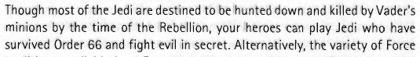
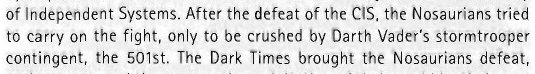
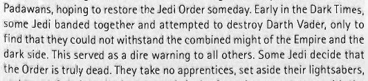
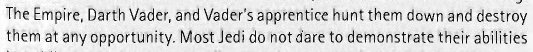
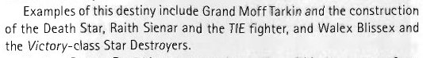

# Owner Material 037 — Star Wars D20 Drive folder (Core, Revised Core and Saga Edition): Sourcebooks/The Force Unleashed Campaign Guide.pdf [Star Wars Roleplaying Game Saga Edition (2007)] (scan pages 1–60)

- **Source:** Wizards of the Coast Star Wars Roleplaying Game books, web enhancements, Living Force campaign modules and articles (2000–2010), from the owner's "Star Wars D20" Drive folder (only the three edition subfolders; "General" was not read, as instructed). Secondary source (licensed Legends reference). Scan OCR'd on the box; the scan stays box-only and is **not** published.
- **Method:** every scanned page was OCR'd and machine-screened sentence by sentence for power-relevant statements (fights, kills, defeats, Force feats, rankings, superweapons) that name a character on our roster; each kept sentence is quoted verbatim from the OCR text and has a crop of the printed passage directly under it. Pages with nothing power-relevant are still listed with what is on them.
- **Citation:** "*The Force Unleashed Campaign Guide* (SWRPG Saga Edition), p.X" by printed page ("scan p.X" where no printed number applies). **Weight:** Licensed RPG material: a secondary source. Narrative text sums up Legends lore; game statistics are rules for players, not canon power levels, and rank lowest.

## scan p.1 (scan page 1)

Page contents: Cover: Star Wars Roleplaying Game, The Force Unleashed Campaign Guide; Sterling Hershey, Peter Schweighofer, Owen K.C. Stephens, Rodney Thompson. (hand-read)

## scan p.2 (scan page 2)

Page contents: Title page: The Force Unleashed Campaign Guide; authors. (hand-read)

## scan p.3 (scan page 3)

Page contents: Credits (designers, developer Rodney Thompson, editor Kim Mohan, Lucas Licensing editors Frank Parisi and Sue Rostoni; artists; playtesters; special thanks Leland Chee); legal; ISBN 978-0-7869-4743-0; first printing March 2008. (hand-read)

## scan p.4 (scan page 4)

Page contents: Table of contents (Ch. I Species; II Prestige Classes; III The Force; IV Organizations; V Equipment and Droids; VI Campaign; VII Galactic Gazetteer; VIII The Empire; IX Allies and Antagonists incl. important figures of the Dark Times). (hand-read)

## scan p.5 (scan page 5)

Page contents: Chapter/introduction opener art (no body text; OCR "Ore/O~w"). (hand-read)

## scan p.6 (scan page 6)

Page contents: Introduction: "The Republic has fallen. The Jedi are all but extinct. The Sith rule the galaxy..." Welcome to the Dark Times; book scope between Revenge of the Sith and A New Hope. (hand-read)

## scan p.7 (scan page 7)

Page contents: Introduction cont.: ties with The Force Unleashed video game (follows Darth Vader's first apprentice); What Is in This Book (chapter summaries 1-11); What Is a Force Unleashed Campaign? (Luke on Tatooine, Yoda on Dagobah, no Rebel Alliance yet). (hand-read)

### Stat block notes (game mechanics, not feats)

- What Is in This Book: The Force Unleashed takes place during the Dark Times and follows the path of Darth Vader's first apprentice. (Source: *The Force Unleashed Campaign Guide* (SWRPG Saga Edition), scan p.7)

## scan p.8 (scan page 8)

Page contents: Force Unleashed campaign vs. Rebellion Era (Empire monolithic; Kashyyyk enslaved; Shmi Skywalker's remark about Tatooine; Han and Luke at Mos Eisley). (hand-read)

## scan p.9 (scan page 9)

Page contents: Heroes on their own; draw on all six films; Jan Dodonna and Crix Madine still Imperial; Thrawn in his prime; young Mara Jade; Jensaarai, Felucian shamans. Major Events: Establishment of the New Order (Order 66; Palpatine's Declaration of a New Order); Ascension of Imperial Leaders (Tarkin, Thrawn, Veers, Motti, Ozzel, Armand Isard, Moffs Jerjerrod and Tavira; Madine and Dodonna serve the Empire). (hand-read)

- **Darth Vader (Anakin Skywalker)**: "Though most of the Jedi are destined to be hunted down and killed by Vader's minions by the time of the Rebellion, your heroes can play Jedi who have survived Order 66 and fight evil in secret." Source: *The Force Unleashed Campaign Guide* (SWRPG Saga Edition), scan p.9
  

### Stat block notes (game mechanics, not feats)

- What Is a Force Unleashed Campaign?: During the Dark Times, heroes of the Rebellion such as Jan Dodonna and Crix Madine are still working for the Empire, making them dangerous foes whose tactical minds will one day help the Rebel Alliance defeat the Empire, but for now serve only to foil the heroes' plans. Moreover, a Force Unleashed campaign gives heroes the chance to face off against old enemies in new ways: Imagine squaring off in a space battle against Grand Admiral Thrawn during his prime, or finding that the young assassin you fought to a standstill was in fact Mara Jade during her training years. (Source: *The Force Unleashed Campaign Guide* (SWRPG Saga Edition), scan p.9)
- Ascension of Imperial Leaders: Some of the galaxy's most tyrannical leaders rise to power during the Dark Times. Grand Moff Tarkin, the man who will eventually be responsible for the destruction of Alderaan, rises through the Imperial hierarchy during this time. Grand Admiral Thrawn revolutionizes Imperial naval tactics, while famous officers such as General Veers, Admiral Motti, and Admiral Ozzel continue their ascension to command roles. Imperial Intelligence reaches new levels of pervasiveness under the control of Armand Isard, and ambitious Moffs such as Jerjerrod and Tavira accumulate power the way a space slug accumulates mynocks. (Source: *The Force Unleashed Campaign Guide* (SWRPG Saga Edition), scan p.9)

## scan p.10 (scan page 10)

Page contents: Ascension cont. (later defections; Han Solo briefly serves the Empire). Growing Threat of the Dark Side (Inquisitorius; Emperor's Hands Mara Jade and Shira Brie; Prophets of the Dark Side of Dromund Kaas; Sith alchemy on Byss creates Imperial Sentinels; Royal Guards trained as Sovereign Protectors). Imperial Atrocities (Caamas razed; Ghorman Massacre; Duro and Centares used up; slavery of Mon Calamari and Wookiees; Corporate Sector Authority). A Less Civilized Age (Black Sun; Jorj Car'das's smuggling cartel). Corellian Treaty (Mon Mothma, Garm Bel Iblis, Bail Organa; meeting on Corellia, finalized on Kashyyyk). Sidebar: Unleashed Concepts (concept art from the game). (hand-read)

### Stat block notes (game mechanics, not feats)

- Ascension of Imperial Leaders (cont.): Additionally, late in the Dark Times some famous heroes such as Han Solo even serve the Empire for a short time, but as it becomes apparent how deep the Empire's evil goes, they strike out on their own. (Source: *The Force Unleashed Campaign Guide* (SWRPG Saga Edition), scan p.10)
- Growing Threat of the Dark Side: The establishment of the Inquisitorius (the Empire's cabal of Jedi hunters) gives Jedi traitors and fallen Jedi a place to continue service under the Empire, while the Emperor and Vader begin training a small number of Force-users to serve as their personal servants. During the Dark Times, Emperor's Hands such as Mara Jade and Shira Brie have already begun their training, and they will start taking on missions for the Empire despite being merely teenagers. (Source: *The Force Unleashed Campaign Guide* (SWRPG Saga Edition), scan p.10)
- Growing Threat of the Dark Side (cont.): The Emperor also allows the spread of dark side Force-users in other areas. The Prophets of the Dark Side, cultists and evil Force adepts from the world of Dromund Kaas, serve the Emperor and train his agents in the ways of the dark side. On the Emperor's personal fortress world of Byss, dark side adepts use Sith alchemy to create Imperial Sentinels, while the Emperor's elite Royal Guardsmen are taught the techniques of the dark side of the Force in their training as Sovereign Protectors. (Source: *The Force Unleashed Campaign Guide* (SWRPG Saga Edition), scan p.10)
- Imperial Atrocities: The Empire razes the planet Caamas at Palpatine's command, leaving the planet devastated and inhospitable to the native Caamasi. (Source: *The Force Unleashed Campaign Guide* (SWRPG Saga Edition), scan p.10)
- Corellian Treaty: The Dark Times conclude with the signing of the Corellian Treaty. Mon Mothma, Garm Bel Iblis, and Bail Organa create the document that officially establishes the Rebel Alliance, which is considered to be the act of treason that begins the Galactic Civil War. The treaty has its origins in a clandestine meeting on Corellia, but is finalized on Kashyyyk. (Source: *The Force Unleashed Campaign Guide* (SWRPG Saga Edition), scan p.10)

## scan p.11 (scan page 11)

Page contents: Chapter I opener: "Chapter I Species" (montage art). (hand-read)

## scan p.12 (scan page 12)

Page contents: Species intro (Dark Times oppression; any Rise of the Empire species usable). Species Characteristics; Gran the only common language; Ability Adjustments. (hand-read)

## scan p.13 (scan page 13)

Page contents: Tables: species ability adjustments, height/weight, age categories (Aleena, Caamasi, Felucian, Gran, Nosaurian, Talz, Togorian, Togruta, Whiphid, Yarkora). Aleena begins (small reptilian galactic travelers; served as Senators and Jedi; Aleena scouts helped defend Kashyyyk; Podracers). (hand-read)

## scan p.14 (scan page 14)

Page contents: Aleena cont. (description; homeworld Aleen; example names Bogg Tyrell, Kazdan Paratus, Ratts Tyrell, Tsui Choi; Aleena species traits: Small, Nimble, Quick Energy). Caamasi (Caamas orbital bombardment months after the Clone Wars; refugees to Kerilt, Susevfi, Alderaan; memnii; pacifists; example names Elegos A'Kla, Ylenic It'kla, Releqy, Tegas Sulkec, Megli Likarin). (hand-read)

## scan p.15 (scan page 15)

Page contents: Caamasi species traits (Adept Diplomat, Pacifism, Memory Sharing). Felucian (amphibious natives of Felucia; planetwide tribe led by shamans strong in the Force; example names Gokkuul, Kargrek, Hagark; traits begin). (hand-read)

## scan p.16 (scan page 16)

Page contents: Felucian traits cont. (Natural Camouflage, Force Sensitivity bonus feat, Force Blast, Primitive, skullblade familiarity). Gran (Kinyen; Malastare conflict with Dugs; Empire bombards Kinyen; example names incl. Ainlee Teem, Ree-Yees, Mawhonic; traits: Darkvision, Target Awareness, Triple Vision). Nosaurian (New Plympto; joined CIS; crushed by Darth Vader's 501st; enslaved; "sing down the sun"). (hand-read)

- **Darth Vader (Anakin Skywalker)**: "After the defeat of the CIS, the Nosaurians tried to carry on the fight, only to be crushed by Darth Vader's stormtrooper contingent, the 501st." Source: *The Force Unleashed Campaign Guide* (SWRPG Saga Edition), scan p.16
  

### Stat block notes (game mechanics, not feats)

- Nosaurian: After the defeat of the CIS, the Nosaurians tried to carry on the fight, only to be crushed by Darth Vader's stormtrooper contingent, the 501st. The Dark Times brought the Nosaurians defeat, enslavement, and the systematic exploitation of their world by their new Imperial masters. (Source: *The Force Unleashed Campaign Guide* (SWRPG Saga Edition), scan p.16)

## scan p.17 (scan page 17)

Page contents: Nosaurian cont. (personality embittered; example names Fefar Blackeye, Bomo Greenbark, Clegg Holdfast, Churra Leafhorn, Moco Minkfruit; traits: Climber's Heritage, horns natural weapon, Survival Instinct). Talz (secretly enslaved to mine Alzoc III; four eyes; example names Foul Moudama, Muftak, etc.; traits begin). (hand-read)

## scan p.18 (scan page 18)

Page contents: Talz traits cont. (claws, Skill Focus Mechanics). Togorian (pirate fleets crushed by the Empire; mosgoth mounts; example names incl. Muuurgh, Mrrov; Large, Feline Reflexes, Physical Intimidation). Togruta (Shili; pack hunters; thimiars; venom rumor). (hand-read)

## scan p.19 (scan page 19)

Page contents: Togruta cont. (example names Ashla, Raana Tey, Shaak Ti, Ahsoka [Tano; surname cut], etc.; traits Pack Hunter, Sneaky, Spatial Awareness). Whiphid (Toola; Spearmaster; example names J'Quille, K'Kruhk, etc.; traits begin). (hand-read)

## scan p.20 (scan page 20)

Page contents: Whiphid traits cont. (Insulating Fur, claws, Scent). Yarkora (mysterious information brokers; escaped notice until after Yavin; example names; traits Confusion, Deceptive, Streetwise). (hand-read)

### Stat block notes (game mechanics, not feats)

- Whiphid (epigraph): "I have seen enough of war." - Master K'Kruhk, Whiphid Jedi (Source: *The Force Unleashed Campaign Guide* (SWRPG Saga Edition), scan p.20)

## scan p.21 (scan page 21)

Page contents: Chapter II opener: "Chapter II Heroic Traits". (hand-read)

## scan p.22 (scan page 22)

Page contents: Chapter II intro (Dark Times heroes; focus on the forces of good). Heroic Origins (Luke Skywalker example; what pushes a hero to fight the Empire). (hand-read)

### Stat block notes (game mechanics, not feats)

- Heroic Origins: Heroes are created through a combination of circumstance and personal ability. How heroic would Luke Skywalker have been if he had remained on Tatooine? He had significant innate talents and powers, but the Death Star would not have been destroyed if he had remained at home. Though circumstances beyond his control forced him from his homeworld, his own abilities and desires enabled him to turn those negatives into a great victory for the Rebellion and ultimately the galaxy. (Source: *The Force Unleashed Campaign Guide* (SWRPG Saga Edition), scan p.22)

## scan p.23 (scan page 23)

Page contents: Heroic origin themes: Imperial Persecution (Garm Bel Iblis example), Gradual Oppression (Crix Madine example), Mistaken Suspicion. Sidebar: The Birth of a Hero (key back-story questions; see A Gathering of Heroes p124). (hand-read)

### Stat block notes (game mechanics, not feats)

- Imperial Persecution: Former Republic Senator Garm Bel Iblis is an example of a hero forged by direct Imperial persecution. (Source: *The Force Unleashed Campaign Guide* (SWRPG Saga Edition), scan p.23)
- Gradual Oppression: General Crix Madine is an example of how repeated atrocities and exposure to the Empire's truly ruthless nature could cause a loyal Imperial soldier to defect to the resistance. (Source: *The Force Unleashed Campaign Guide* (SWRPG Saga Edition), scan p.23)

## scan p.24 (scan page 24)

Page contents: Mistaken Suspicion cont.; Moral Conscience (Mon Mothma and Bail Organa examples). The Heroic Classes. Jedi in the Dark Times (~200 survived Order 66; hunted by the Empire, Darth Vader and Vader's apprentice; early Jedi band tried to destroy Vader and failed). Jedi scenarios: Order 66 Survivor, The Isolated Master, Self-Trained. (hand-read)

- **Darth Vader (Anakin Skywalker)** — entry/section: The Force Unleashed Campaign Guide (Saga): "Early in the Dark Times, some Jedi banded together and attempted to destroy Darth Vader, only to find that they could not withstand the combined might of the Empire and the dark side." Source: *The Force Unleashed Campaign Guide* (SWRPG Saga Edition), scan p.24
  
- **Darth Vader (Anakin Skywalker)**: "The Empire, Darth Vader, and Vader's apprentice hunt them down and destroy them at any opportunity." Source: *The Force Unleashed Campaign Guide* (SWRPG Saga Edition), scan p.24
  

### Stat block notes (game mechanics, not feats)

- Moral Conscience: These heroes can fight the Empire from the familiar covers of their legitimate lives, or they might abandon their former lives altogether and join a band of other heroes directly working to overthrow the Empire. Mon Mothma and Bail Organa are examples of this type of hero. (Source: *The Force Unleashed Campaign Guide* (SWRPG Saga Edition), scan p.24)
- Jedi: Order 66 decimated the Jedi. The few surviving Jedi are in hiding, although some still resist the Empire in their own, limited ways. It is thought that around two hundred Jedi survived Order 66, but that number is dwindling. The Empire, Darth Vader, and Vader's apprentice hunt them down and destroy them at any opportunity. Most Jedi do not dare to demonstrate their abilities in public, for to do so eventually attracts unwanted Imperial attention. (Source: *The Force Unleashed Campaign Guide* (SWRPG Saga Edition), scan p.24)
- Jedi (cont.): Early in the Dark Times, some Jedi banded together and attempted to destroy Darth Vader, only to find that they could not withstand the combined might of the Empire and the dark side. This served as a dire warning to all others. (Source: *The Force Unleashed Campaign Guide* (SWRPG Saga Edition), scan p.24)

## scan p.25 (scan page 25)

Page contents: Self-Trained cont. New Jedi Talents: Consular (Cleanse Mind, Force of Will); Guardian (Forceful Warrior, Mobile Combatant); Sentinel (Dampen Presence, Steel Resolve). Noble in the Dark Times begins. (hand-read)

## scan p.26 (scan page 26)

Page contents: Noble cont. (idealists may find Mon Mothma, Bail Organa, Garm Bel Iblis). New Noble Talents: Inspiration (Willpower); Ideologue tree (Instruction, Idealist, Know Your Enemy, Known Dissident, Lead by Example); Lineage (Influential Friends). Sidebar: Influential Friends (GM explanation). (hand-read)

### Stat block notes (game mechanics, not feats)

- Noble: Anti-Empire ideologues might eventually find those who are secretly working to free the galaxy, such as Mon Mothma, Bail Organa, or Garm Bel Iblis. (Source: *The Force Unleashed Campaign Guide* (SWRPG Saga Edition), scan p.26)

## scan p.27 (scan page 27)

Page contents: Influential Friends cont.; Powerful Friends. Scoundrel in the Dark Times begins (opportunists; outcasts forced to the fringe). Art: "The Empire Needs You" poster scene. (hand-read)

## scan p.28 (scan page 28)

Page contents: Scoundrel cont. (smugglers profit). New Scoundrel Talents: Slicer (Electronic Forgery, Electronic Sabotage, Security Slicer); Smuggling tree (Art of Concealment, Fast Talker, Hidden Weapons, Illicit Dealings, Surprise Strike). Scout in the Dark Times (Imperial scouts; scouts as spies). (hand-read)

## scan p.29 (scan page 29)

Page contents: New Scout Talents: Awareness (Reset Initiative); Spy tree (Blend In, Incognito, Improved Surveillance, Intimate Knowledge, Surveillance, Traceless Tampering). Soldier in the Dark Times (clone troopers then regular forces; displaced soldiers join resistance/mercenaries). New Soldier Talents: Mercenary tree (Commanding Presence, Dirty Fighting). (hand-read)

## scan p.30 (scan page 30)

Page contents: Mercenary talents cont. (Feared Warrior, Focused Warrior, Ruthless). Skills: new uses. Acrobatics (low/high gravity, zero-gravity); Climb (extreme conditions); Deception (Creating a Diversion to Hide an Item; Feign Haywire, droids only). (hand-read)

## scan p.31 (scan page 31)

Page contents: Gather Information (Analysis); Mechanics (Build Object, DC and size-multiplier tables); Persuasion intro. (hand-read)

## scan p.32 (scan page 32)

Page contents: Persuasion: Bribery (risk DC and modifier tables), Improvised Communication. Stealth: Conceal Large Items. Survival: Extended Survival. Feats intro; Advantageous Attack; Advantageous Cover. (hand-read)

## scan p.33 (scan page 33)

Page contents: Feats table (Advantageous Attack ... Unleashed). Angled Throw, Blaster Barrage, Bad Feeling. (hand-read)

## scan p.34 (scan page 34)

Page contents: Feats: Controlled Rage, Crossfire, Cunning Attack, Focused Rage, Improved Bantha Rush, Informer, Mighty Throw. Sidebar: Bonus Feats (class bonus feat lists). (hand-read)

## scan p.35 (scan page 35)

Page contents: Feats: Natural Leader (found your own organization), Powerful Rage, Rapport. (hand-read)

## scan p.36 (scan page 36)

Page contents: Feats: Recall, Savage Attack, Scavenger, Strafe, Swarm, Unleashed. Destinies intro (Dark Times themes; complementary destinies). Creation destiny begins. (hand-read)

## scan p.37 (scan page 37)

Page contents: Sidebar (purple, c729_037a/b): Sample Destinies - Sample Champion Destiny: Recruiting; Sample Discovery Destiny: Base of Resistance; Sample Discovery Destiny: Force Unleashed (example: Darth Vader's secret apprentice). (hand-read)

- **Grand Moff Tarkin**: "Examples of this destiny include Grand Moff Tarkin and the construction of the Death Star, Raith Sienar and the TIE fighter, and Walex Blissex and the Victory-class Star Destroyers." Source: *The Force Unleashed Campaign Guide* (SWRPG Saga Edition), scan p.37
  

### Stat block notes (game mechanics, not feats)

- Champion (destiny): Examples of this destiny include Mon Mothma leading the Rebel Alliance, Darth Sidious gaining control of the Republic, Wedge Antilles leading Rogue Squadron, and Admiral Ackbar escaping Grand Moff Tarkin and eventually taking command of the Rebel Fleet. (Source: *The Force Unleashed Campaign Guide* (SWRPG Saga Edition), scan p.37)
- Sample Discovery Destiny: Force Unleashed: You believe the Force to be far more powerful than most people think it is. Your destiny requires you to discover the depths of the Force and its abilities, expose friendly Force-users to this potential, and prevent enemies from wielding such power against you and your allies. The Gamemaster can use this destiny in combination with a special campaign to allow characters access to the Unleashed Force powers presented in Chapter 6 and gain use of the Unleashed feat on page 35. Characters who are not Force-sensitive could take this destiny to gain access to the Unleashed feat. Campaigns might focus on one aspect of this destiny, such as discovering and learning new powers, preventing a specific enemy from using Unleashed powers, or training another Force-user. For long-term campaigns, one aspect of the destiny might lead to the next. An example of a character with this destiny is Darth Vader's secret apprentice. (Source: *The Force Unleashed Campaign Guide* (SWRPG Saga Edition), scan p.37)

## scan p.38 (scan page 38)

Page contents: Liberation cont. (bonus/penalty/fulfilled). Unleashed Abilities intro (spend a Destiny Point; requires Unleashed feat and a destiny). (hand-read)

## scan p.39 (scan page 39)

Page contents: Table 2-2 Unleashed Abilities. Unleashed Bantha Rush, Unleashed Charge, Unleashed Cleave, Unleashed Devastating Attack, Unleashed Extreme Effort. (hand-read)

## scan p.40 (scan page 40)

Page contents: Unleashed Firepower, Ignite Fervor, Keen Shot, Mighty Swing, Penetrating Attack, Rage, Skirmisher, Sneak Attack, Strafe, Whirlwind Attack. (hand-read)

## scan p.41 (scan page 41)

Page contents: Chapter III opener: "Chapter III Prestige Classes". (hand-read)

## scan p.42 (scan page 42)

Page contents: Prestige classes intro (six new prestige classes). New Talents for Existing Prestige Classes (how new trees attach; Critical Master for elite trooper example). (hand-read)

## scan p.43 (scan page 43)

Page contents: New Prestige Class Talents. Bounty Hunter tree (Fearsome, Signature Item, Jedi Hunter). Elite Trooper: Critical Master tree (Deny Move, Extended Critical Range heavy weapons/rifles, Flurry Attack, Knockback, Reduce Defense, Reduce Mobility). Force Adept: Imperial Inquisitor tree (requires membership in the Inquisitorius and dark side score 1+; Cower Enemies). (hand-read)

## scan p.44 (scan page 44)

Page contents: Inquisitor talents cont. (Force Interrogation, Inquisition, Unsettling Presence). Jedi Knight: new Duelist talents (Improved Lightsaber Throw, Thrown Lightsaber Mastery). Table 3-1 New Prestige Classes (enforcer, independent droid, infiltrator, master privateer, medic, saboteur). Enforcer begins. (hand-read)

## scan p.45 (scan page 45)

Page contents: Enforcer description (honest vs. corrupt; Sector Rangers, ISB and COMPNOR agents). Table 3-2 The Enforcer. (hand-read)

## scan p.46 (scan page 46)

Page contents: Examples of enforcers (CSA Security, Corran Horn, CorSec agents, Sector Rangers, ISB, COMPNOR). Requirements; game rules; Defense bonuses; Resources; Talents; Enforcement talent tree (Cover Bracing, Intentional Crash, Nonlethal Tactics, Pursuit, Respected Officer, Slowing Stun, Takedown); Targeted Suspect. (hand-read)

## scan p.47 (scan page 47)

Page contents: Independent Droid prestige class (program-breaking event; Raxus Prime droids). Table 3-3. (hand-read)

## scan p.48 (scan page 48)

Page contents: Examples of independent droids (HK-47, IG-88, PROXY, Blue Max, Bollux). Requirements; game rules; Sapience; Autonomy talent tree (Defensive Electronics, Ion Resistance 10, Soft Reset, Modification Specialist, Repair Self); Specialized Droid tree (Computer Language, Computer Master, Enhanced Manipulation, Hotwired Processor). (hand-read)

## scan p.49 (scan page 49)

Page contents: Specialized Droid cont. (Power Surge, Skill Conversion); Independent Spirit. Infiltrator prestige class (Bothan infiltrators and the Spynet; Imperial/ISB infiltrators). (hand-read)

## scan p.50 (scan page 50)

Page contents: Examples of infiltrators (Lt. Judder Page, Sabe, Shira Brie, Winter, Bothan Spynet operatives). Table; requirements; Infiltration talent tree (Always Ready, Concealed Weapon Expert, Creeping Approach, Set for Stun, Silent Takedown). (hand-read)

## scan p.51 (scan page 51)

Page contents: Bothan Spynet talent tree (Bothan Resources, Knowledge Is Life/Power/Strength, Six Questions, Spynet Agent); Unarmed Stun; Lead Infiltrator. Master Privateer begins (letters of marque; CIS privateers in the Clone Wars). (hand-read)

## scan p.52 (scan page 52)

Page contents: Master privateer cont. (Empire treats privateers as pirates; future Alliance's controversial use). Examples (Bakken, Captain Dhas Vedij of the Far Orbit, Grov Bricker, Urias Xhaxin). Requirements; Table 3-5. (hand-read)

## scan p.53 (scan page 53)

Page contents: Master privateer class features; Privateer talent tree (Armored Spacer, Attract Privateer, Blaster and Blade I-III, Boarder, Ion Mastery, Multiattack Proficiency (advanced melee), Preserving Shot); Veteran Privateer. Medic begins. (hand-read)

## scan p.54 (scan page 54)

Page contents: Medic description (battlefield surgeons, back-alley clinics). Examples (Dhagon Gent, Elassar Targon, Jos Vondar, Ton Phanan). Requirements; Table 3-6. (hand-read)

## scan p.55 (scan page 55)

Page contents: Medic game rules; Advanced Medicine talent tree (Battlefield Medic, Bring Them Back, Emergency Team, Extra First Aid, Medical Miracle, Natural Healing, Second Chance, Steady Under Pressure); Medical Secrets. Saboteur begins. (hand-read)

## scan p.56 (scan page 56)

Page contents: Saboteur description (radical anti-Imperial saboteurs pursued by the ISB). Examples (Kell Tainer, Kyle Katarn (pre-Jedi Knight), Wes Janson, Zann Consortium Defilers). Requirements; Table 3-7. (hand-read)

## scan p.57 (scan page 57)

Page contents: Saboteur class features; Sabotage talent tree (Device Jammer, Droid Jammer). (hand-read)

## scan p.58 (scan page 58)

Page contents: Sabotage cont. (Extreme Explosion, Mine Mastery, Shaped Explosion, Skilled Demolitionist); Turret talent tree (Blaster Turret I-III, Ion Turret, Stun Turret, Turret Self-Destruct); Unexpected Results; Destructive; Quick Sabotage; Master Saboteur. Epigraph (c729_058b). (hand-read)

### Stat block notes (game mechanics, not feats)

- Saboteur (epigraph): "Explosive charges on levels two, five, and twelve, just like we planned." - Master Rahm Kota (Source: *The Force Unleashed Campaign Guide* (SWRPG Saga Edition), scan p.58)

## scan p.59 (scan page 59)

Page contents: Chapter IV opener: "Chapter IV Organizations". (hand-read)

## scan p.60 (scan page 60)

Page contents: Chapter IV intro: organizations in the Dark Times (no Rebel Alliance yet; Black Sun); organization score; one organization at a time. (hand-read)

