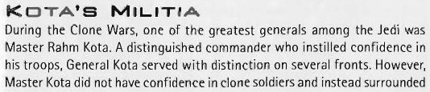
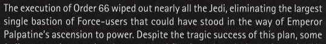

# Owner Material 037 — Star Wars D20 Drive folder (Core, Revised Core and Saga Edition): Sourcebooks/The Force Unleashed Campaign Guide.pdf [Star Wars Roleplaying Game Saga Edition (2007)] (scan pages 61–120)

- **Source:** Wizards of the Coast Star Wars Roleplaying Game books, web enhancements, Living Force campaign modules and articles (2000–2010), from the owner's "Star Wars D20" Drive folder (only the three edition subfolders; "General" was not read, as instructed). Secondary source (licensed Legends reference). Scan OCR'd on the box; the scan stays box-only and is **not** published.
- **Method:** every scanned page was OCR'd and machine-screened sentence by sentence for power-relevant statements (fights, kills, defeats, Force feats, rankings, superweapons) that name a character on our roster; each kept sentence is quoted verbatim from the OCR text and has a crop of the printed passage directly under it. Pages with nothing power-relevant are still listed with what is on them.
- **Citation:** "*The Force Unleashed Campaign Guide* (SWRPG Saga Edition), p.X" by printed page ("scan p.X" where no printed number applies). **Weight:** Licensed RPG material: a secondary source. Narrative text sums up Legends lore; game statistics are rules for players, not canon power levels, and rank lowest.

## scan p.61 (scan page 61)

Page contents: Features of an Organization (Type; Enemies and Allies; Scale; Organization Score Criteria; Criteria Tables; Titles, Benefits, and Duties; Roleplaying Applications). Creating a New Organization (Natural Leader feat); What Are the Organization's Goals?; Who Is a Member? (hand-read)

## scan p.62 (scan page 62)

Page contents: Who Runs the Organization?; Where Does It Operate?; What Does It Do on a Regular Basis?; Who Supports It and Who Works Against It?; Designing a New Organization: Type. (hand-read)

## scan p.63 (scan page 63)

Page contents: Organization type/Knowledge table; Enemies and Allies; Scale; Table 4-1 Organization Scale (examples incl. House Organa, Kota's Militia, Bounty Hunters Guild, Car'das Smugglers, Bothan Spynet, Hutt Clan, Black Sun, Old Republic, Jedi Order, Rebel Alliance, Galactic Empire). (hand-read)

## scan p.64 (scan page 64)

Page contents: Scale cont. (CSA vs. Jedi Order). Organization Scale vs. Power (power checks; Lok Revenants vs. Desilijic Hutt clan example). Organization Score Criteria. Sidebar: Using Organizations to Resolve Mass Combat (Kota's Militia vs. Empire example). (hand-read)

## scan p.65 (scan page 65)

Page contents: Modifiers for larger scales; positive and negative criteria tables. (hand-read)

## scan p.66 (scan page 66)

Page contents: Benefits tables for organization scores 10-19, 20-29, 30+; duties list. (hand-read)

## scan p.67 (scan page 67)

Page contents: Titles, Benefits, and Duties; Roleplaying Applications. Organizations for the Dark Times. Antarian Rangers (founded by Gotal Kaskutal; support for the Jedi; targeted by Order 66; cells at Toprawa and Tabiid; type paramilitary; scale 14). (hand-read)

### Stat block notes (game mechanics, not feats)

- Antarian Rangers: When Supreme Chancellor Palpatine executed Order 66, the Jedi were not the only ones targeted. Antarian Rangers, long known to be staunch supporters of the Jedi, were branded as enemies of the state and collaborators who should be wiped out as well. Their numbers already diminished by the Clone Wars, the Antarian Rangers were all but wiped out by the clone troopers, much the same as the Jedi were, and they nearly faded into obscurity. (Source: *The Force Unleashed Campaign Guide* (SWRPG Saga Edition), scan p.67)

## scan p.68 (scan page 68)

Page contents: Antarian Rangers criteria tables; Titles, Benefits, and Duties; ranks (Explorer, Lieutenant, Ranger). (hand-read)

## scan p.69 (scan page 69)

Page contents: Ranks cont. (Ranger Captain, Ranger General); Roleplaying Applications. Black Sun (widespread syndicate centered on Coruscant; Vigos; type crime syndicate; scale 16). (hand-read)

## scan p.70 (scan page 70)

Page contents: Black Sun criteria tables; Titles, Benefits, and Duties; ranks (Operative, Enforcer, Vigo). Epigraph (c729_070b). (hand-read)

### Stat block notes (game mechanics, not feats)

- Black Sun (epigraph): "If you cannot afford to lose, you should not play the game." - Prince Xizor (Source: *The Force Unleashed Campaign Guide* (SWRPG Saga Edition), scan p.70)

## scan p.71 (scan page 71)

Page contents: Black Sun ranks cont. (Underlord); Roleplaying Applications. Bothan Spynet (information network; non-Bothan agents; Bothan spies; type business/professional; scale 15). (hand-read)

### Stat block notes (game mechanics, not feats)

- Black Sun Underlord: Underlord: The underlord is the supreme ruler of the entire organization. Prince Xizor is the Black Sun underlord throughout most of the Dark Times and the Rebellion Era. There can be only one underlord at any given time, and a rising agent of Black Sun who wants to seize the title of underlord must kill the current underlord to take his place. (Source: *The Force Unleashed Campaign Guide* (SWRPG Saga Edition), scan p.71)
- Bothan Spynet: Moreover, since the Spynet often obtains and then redistributes sensitive information (such as blueprints for a prototype starship, or the travel plans of Grand Moff Tarkin), thousands of people throughout the galaxy wouldn't be opposed to killing a Spynet agent just to keep that information from getting out. (Source: *The Force Unleashed Campaign Guide* (SWRPG Saga Edition), scan p.71)

## scan p.72 (scan page 72)

Page contents: Bothan Spynet criteria tables; Titles, Benefits, and Duties; ranks (Informer, Agent, Spy, Spymaster); Roleplaying Applications. (hand-read)

## scan p.73 (scan page 73)

Page contents: Bothan Spynet roleplaying cont. Bounty Hunters Guild (regulates bounty hunters since before the Jedi Civil War; led by Trandoshan Cradossk; houses: Crimson Nova, House Benelex, Neuvalis, Paramexor, Renliss, Salaktori, Tresario, Mantis Syndicate, Ragnar Syndicate, Skine Bounty Hunter College, Slaver Syndicate). Sidebar: Guild Houses. (hand-read)

### Stat block notes (game mechanics, not feats)

- Bounty Hunters Guild: From the early years of the Empire until the rise of the Rebellion, the guild is led by a Trandoshan named Cradossk (father of the famous bounty hunter Bossk). During these years, the guild flourishes and bounty hunters spread throughout the galaxy. (Source: *The Force Unleashed Campaign Guide* (SWRPG Saga Edition), scan p.73)
- Guild houses: The houses are the Crimson Nova (whose members included Aurra Sing, Boushh, and Zuckuss), House Benelex (specializing in kidnapping retrieval), House Neuvalis (a secretive group that rarely deals with outsiders), ... (Source: *The Force Unleashed Campaign Guide* (SWRPG Saga Edition), scan p.73)

## scan p.74 (scan page 74)

Page contents: Bounty Hunters Guild cont. (benefits; type business/professional; scale 14; 500-credit fee; 10% dues). Sidebar: Claiming a Bounty (about 1,000 x target CL). Criteria tables; Titles, Benefits, and Duties. (hand-read)

## scan p.75 (scan page 75)

Page contents: Guild ranks (Freelancer, Hunter, Senior Hunter, Head of House, Guildmaster); Roleplaying Applications. Car'das Smugglers (founded by Jorj Car'das; took over Booster Terrik's organization; vanished and returned changed; cells; precognitive leader). (hand-read)

### Stat block notes (game mechanics, not feats)

- Car'das Smugglers: Founded by a talented young smuggler by the name of Jorj Car'das, the Car'das smugglers (often referred to simply as the Car'das) are a band of criminals whose power rivals that of many Hutt clans and Black Sun cells. Shortly before the Clone Wars, Jorj Car'das was in control of a modest smuggling ring that had gained some notoriety on the Outer Rim. When another smuggler by the name of Booster Terrik was sent to Kessel, Jorj Car'das took over his organization and began building up his own small criminal empire. Not long after the establishment of the Galactic Empire, Jorj Car'das vanished for several months; when he returned, he was visibly a changed man, and he quickly began turning his small criminal empire into a relatively large one. Thanks to Jorj Car'das's newfound insights and intuition, the smuggling ring grew to the point where its agents spread throughout the Outer Rim and beyond. (Source: *The Force Unleashed Campaign Guide* (SWRPG Saga Edition), scan p.75)
- Car'das (leader): Jorj Car'das has little patience for anything other than intelligent actions, and those who take foolish chances often find themselves kicked out of the organization before too long. Jorj Car'das seems to have precognitive abilities, and he expects those who work for him to act as though they do as well. (Source: *The Force Unleashed Campaign Guide* (SWRPG Saga Edition), scan p.75)

## scan p.76 (scan page 76)

Page contents: Car'das cont. (screening for Imperial agents; shadowports; type crime syndicate; scale 14; joining requires convincing Jorj Car'das). Criteria tables. (hand-read)

## scan p.77 (scan page 77)

Page contents: Car'das ranks (Crewmember, Navigator or Helmsman, Officer, First Officer, Captain); Roleplaying Applications (Talon Karrde). House Organa (royal family of Alderaan; Queen Breha; Bail funnels resources to anti-Imperial causes; Sabe trains Leia and Winter; hidden resources on Bothawui and Eriadu). (hand-read)

### Stat block notes (game mechanics, not feats)

- Car'das roleplaying: Additionally, many members of the Car'das organization go on to be heroes in their own right (including Talon Karrde, who in the future will go on to help the New Republic on a number of occasions), meaning that scoundrels who have a heart of gold fit right in with other members of the smuggling ring. (Source: *The Force Unleashed Campaign Guide* (SWRPG Saga Edition), scan p.77)
- House Organa: One of the most popular and famous noble houses in the entire galaxy, House Organa is the royal family of Alderaan and the house of Senator Bail Organa. An ancient noble house dating back to the early days of Alderaan, House Organa wields a great amount of influence not only on Alderaan but also throughout the galaxy. Thanks primarily to the efforts of the outspoken Senator, House Organa is a trusted group of nobles who are concerned with the well-being of all people throughout the galaxy. It is wealthy, prominent, and powerful; there are few other houses that any young noble would want to be born into. The noble house of Queen Breha Organa herself, House Organa has a great deal of political influence that has been built up over thousands of years. ... Despite outward appearances of loyalty to the Empire, Bail Organa regularly funnels credits and other resources into the hands of those who would seek to bring about the resurrection of the Old Republic. House Organa walks a fine line, maintaining the appearance of dedication to the Galactic Empire while in truth supporting seditious activity throughout the galaxy. (Source: *The Force Unleashed Campaign Guide* (SWRPG Saga Edition), scan p.77)
- House Organa (members): Although Senator Bail Organa is the most famous member of this noble house, a number of people affiliated with House Organa are not directly related to the Organa line. Many friends, allies, and subjects of House Organa have been taken in and enjoy the benefits of being associated with the prestigious noble house. For example, though she is not a member of the Organa family, the Naboo woman known as Sabé has been invited into House Organa to train Bail's young daughter and her friend Winter. (Source: *The Force Unleashed Campaign Guide* (SWRPG Saga Edition), scan p.77)

## scan p.78 (scan page 78)

Page contents: House Organa: type noble house; enemies and allies (Imperials suspect Bail; Mon Mothma and Garm Bel Iblis allies); scale 9; criteria (Bail's sisters Celly, Rouge, and Tia); criteria tables. (hand-read)

### Stat block notes (game mechanics, not feats)

- House Organa (enemies and allies): Despite the precautions taken over the years, many agents of the Empire suspect that Bail Organa has been working against the Empire since its inception. Some rising powers within the Empire want to make an example of House Organa, showing that even wealthy and powerful noble families can be crushed by the might of Imperial justice. Thus far, Senator Organa has not yet given them the excuse they need to make a move against House Organa, though it is only a matter of time before someone gets bold enough to try. Many influential people support House Organa, some of whom are more powerful than others; Mon Mothma of Chandrila and Garm Bel Iblis of Corellia are two examples among those who ally themselves with House Organa on a regular basis. (Source: *The Force Unleashed Campaign Guide* (SWRPG Saga Edition), scan p.78)
- House Organa (sisters): Likewise, Bail Organa's sisters (Celly, Rouge, and Tia) have families of their own, and a hero from House Organa could be related to one of those individuals. (Source: *The Force Unleashed Campaign Guide* (SWRPG Saga Edition), scan p.78)

## scan p.79 (scan page 79)

Page contents: House Organa titles (Vassal, Lord/Lady, Prince/Princess, High Prince/High Princess); Roleplaying Applications. Kota's Militia (Rahm Kota's distrust of clones; Antarian Rangers saved him at Order 66; strikes against the Empire; type military/paramilitary). (hand-read)

- **Rahm Kota** — entry/section: The Force Unleashed Campaign Guide (Saga): "KOTA’S MILITIA During the Clone Wars, one of the greatest generals among the Jedi was Master Rahm Kota." Source: *The Force Unleashed Campaign Guide* (SWRPG Saga Edition), scan p.79
  

### Stat block notes (game mechanics, not feats)

- Kota's Militia: During the Clone Wars, one of the greatest generals among the Jedi was Master Rahm Kota. A distinguished commander who instilled confidence in his troops, General Kota served with distinction on several fronts. However, Master Kota did not have confidence in clone soldiers and instead surrounded himself with dedicated warriors from throughout the galaxy. In the end, it was this mistrust of the clones that saved his life; when Order 66 was given, a squad of Antarian Rangers in his service was notified and managed to ferry Kota and many of his soldiers into hiding. When the Empire rose and took control of the galaxy, Kota and his loyal armsmen remained in hiding, emerging only to execute carefully planned strikes against the Empire. (Source: *The Force Unleashed Campaign Guide* (SWRPG Saga Edition), scan p.79)
- Kota's Militia (enemies): Kota's Militia has a single primary enemy: the Galactic Empire. More to the point, General Kota tends to pick targets that are of significance to Darth Vader; one mission might involve destroying a factory that Vader recently visited, while another might require the militia to steal a shuttle that Vader used as a personal transport. Additionally, since a Jedi leads the organization, the Inquisitorius has taken a particular interest in Kota's Militia. Many Inquisitors have dedicated large amounts of time to finding Rahm Kota and his agents, and they would like nothing more than to crush Kota's Militia under their boot heels. (Source: *The Force Unleashed Campaign Guide* (SWRPG Saga Edition), scan p.79)

## scan p.80 (scan page 80)

Page contents: Kota's Militia: scale 10; criteria; criteria tables; Titles, Benefits, and Duties; ranks (Recruit, Private, Lieutenant, Captain, General). (hand-read)

## scan p.81 (scan page 81)

Page contents: Kota's Militia roleplaying. Lok Revenants (led by Feeorin Nym; base on Lok; Karthakk Sector raids on Imperial convoys; sells arms to Kota's Militia; type outlaw gang; scale 12). Criteria tables. (hand-read)

### Stat block notes (game mechanics, not feats)

- Lok Revenants: One of the oldest surviving pirate groups in the galaxy, the Revenants of Lok have been around since well before the Clone Wars. Led by a Feeorin by the name of Nym, the Revenants are a group of pirates, mercenaries, and rebels who operate outside the bounds of Imperial law. ... Despite the inherent love of money and mayhem that comes with being a pirate, most of the Revenants came into Nym's service thanks to his actions against the Trade Federation prior to and during the Clone Wars. With the rise of the Empire, Nym and the Revenants have a new establishment to hate and rage against, and they do so with pleasure. ... The Revenants remain loyal to Nym through even the hardest of times, and their small fleet has survived battles against seemingly insurmountable odds. (Source: *The Force Unleashed Campaign Guide* (SWRPG Saga Edition), scan p.81)
- Lok Revenants (neutrality): Though Nym would gruffly disdain the idea of doing so, much of the bounty pilfered from Imperial vessels is sold to those who need it most: Foodstuffs and medical supplies go to worlds where Imperial oppression is rampant, while the weapons and vehicles that the pirate gang does not want for itself are often sold to anti-Imperial factions (such as Kota's Militia). Though the Revenants target Imperial convoys and sell weapons to rebellious groups, the Revenants consider themselves to be neutral in galactic conflicts, and Nym is reluctant to declare open war on the Empire. (Source: *The Force Unleashed Campaign Guide* (SWRPG Saga Edition), scan p.81)

## scan p.82 (scan page 82)

Page contents: Lok Revenants negative criteria; titles (Deck Hand, Privateer, Bosun, Captain); Roleplaying Applications. Epigraph (c729_082a). (hand-read)

### Stat block notes (game mechanics, not feats)

- Lok Revenants (titles): Though the Revenants operate on the fringes of society, Nym runs a tight ship, and most members of the organization know their place very clearly. (Source: *The Force Unleashed Campaign Guide* (SWRPG Saga Edition), scan p.82)
- Lok Revenants (epigraph): "Five thousand credits up front and you've got your hero." - Nym (Source: *The Force Unleashed Campaign Guide* (SWRPG Saga Edition), scan p.82)

## scan p.83 (scan page 83)

Page contents: Chapter V opener: "Chapter V The Force". (hand-read)

## scan p.84 (scan page 84)

Page contents: Chapter V intro (Force-users surviving the Dark Times; Vader's Jedi hunters). Jedi During the Dark Times. (hand-read)

- **Palpatine (Darth Sidious)**: "The execution of Order 66 wiped out nearly all the Jedi, eliminating the largest single bastion of Force-users that could have stood in the way of Emperor Palpatine's ascension to power." Source: *The Force Unleashed Campaign Guide* (SWRPG Saga Edition), scan p.84
  

### Stat block notes (game mechanics, not feats)

- Force chapter intro: The execution of Order 66 wiped out nearly all the Jedi, eliminating the largest single bastion of Force-users that could have stood in the way of Emperor Palpatine's ascension to power. Despite the tragic success of this plan, some Jedi managed to survive the purge and flee into the relative safety of a life of seclusion. Despite their efforts to remain hidden, these Jedi often find themselves continually on the run from Darth Vader's Jedi hunters. (Source: *The Force Unleashed Campaign Guide* (SWRPG Saga Edition), scan p.84)
- Jedi During the Dark Times: Though some Jedi survived the purge, their lives were irrevocably altered the moment Anakin Skywalker gave in to the dark side and Darth Vader was born. (Source: *The Force Unleashed Campaign Guide* (SWRPG Saga Edition), scan p.84)

## scan p.85 (scan page 85)

Page contents: Jedi During the Dark Times cont.: Jedi who go insane (Kazdan Paratus on Raxus Prime), crusaders (Rahm Kota), those who abandon the past, those who fade away (Yoda, Obi-Wan Kenobi, Shaak Ti). Reactions to Force-Users (Emperor eradicates Jedi records). (hand-read)

### Stat block notes (game mechanics, not feats)

- Jedi During the Dark Times: Some Jedi actually go insane, either partially or wholly, leaving them but shells of the great heroes they once were. In fact, an Aleena Jedi Knight named Kazdan Paratus was so deranged in the wake of the purge that he constructed an entire false world for himself on the junkyard planet of Raxus Prime. Though his was an extreme example, it simply illustrates how badly the extermination affects those surviving Jedi. (Source: *The Force Unleashed Campaign Guide* (SWRPG Saga Edition), scan p.85)
- Jedi During the Dark Times: Jedi Master Rahm Kota, a brilliant tactician and military commander from the Clone Wars, wages a private war against the Empire, striking out from hidden safe houses to sabotage Imperial facilities. Many heroic Jedi follow a similar path, since doing so allows them to remain true to their principles and beliefs. (Source: *The Force Unleashed Campaign Guide* (SWRPG Saga Edition), scan p.85)
- Jedi During the Dark Times: Finally, a few Jedi choose to fade away into the backdrop of the galaxy, biding their time until they can act. They do not abandon their lives as Jedi, but they do not actively seek to draw the Empire's attention. Both Yoda and Obi-Wan Kenobi choose this life, as does the Togruta Jedi Shaak Ti. By retreating into the shadows, these individuals ensure that the Empire's Jedi hunters do not find them, allowing them to prepare for a time in the future when they will once again step onto the galactic stage. (Source: *The Force Unleashed Campaign Guide* (SWRPG Saga Edition), scan p.85)
- Reactions to Force-Users: Following the execution of Order 66, the Emperor orders the eradication of nearly all records of the Jedi, effectively wiping their names from galactic history. (Source: *The Force Unleashed Campaign Guide* (SWRPG Saga Edition), scan p.85)

## scan p.86 (scan page 86)

Page contents: Reactions cont. (Inquisitorius; ISB reports). Noticing Force-Users (unfavorable circumstances for Stealth after public Force use). Temptation of the Dark Side (optional). Optional Rule: Atonement. Force Powers: Corruption [dark side]. (hand-read)

## scan p.87 (scan page 87)

Page contents: Corruption cont.; Force Blast; Force Shield [telekinetic]; Force Storm [dark side, telekinetic]; Kinetic Combat. (hand-read)

## scan p.88 (scan page 88)

Page contents: Repulse [telekinetic]. Force Talents; Alter talent tree: Illusion. (hand-read)

## scan p.89 (scan page 89)

Page contents: Alter: Telekinetic Prodigy. Control tree: Force Exertion, Indomitable Will. Dark Side tree: Wrath of the Dark Side. Sense tree: Feel the Force. Force Techniques: Improved Battle Strike, Dark Rage, Force Disarm, Force Thrust, Force Grip, Force Lightning, Force Storm. (hand-read)

## scan p.90 (scan page 90)

Page contents: Techniques cont. (Improved Mind Trick, Rebuke, Repulse). Force Secrets (Corrupted Power, Debilitating Power, Enlarged Power, Pure Power, Remote Power). Force Unleashed Abilities: Unleashed Battle Meditation. (hand-read)

## scan p.91 (scan page 91)

Page contents: Unleashed Battle Strike, Unleashed Corruption, Unleashed Dark Rage. (hand-read)

## scan p.92 (scan page 92)

Page contents: Unleashed Force Blast, Force Grip, Force Lightning, Force Storm, Force Thrust, Move Object, Repulse. Force-Using Traditions (Jensaarai, Witches of Dathomir referenced). The Agents of Ossus: origin (Padawan Jin-Lo Rayce, apprentice of Jocasta Nu, flees the Temple during Vader's assault). (hand-read)

### Stat block notes (game mechanics, not feats)

- Agents of Ossus: During Darth Vader's assault on the Jedi Temple, a young Human Jedi Padawan named Jin-Lo Rayce hid in the archives in the hope of avoiding detection by the newly named Sith Lord and his clone troopers. Rayce, who as a boy had been fascinated by the intricacies of Jedi history, had spent many long nights in the archives and was apprenticed to Jedi Knight Jocasta Nu as her most recent Padawan. As Lord Vader stormed through the Jedi Temple, Jocasta Nu went to face the Sith Lord to stop him from accessing the temple's signal beacon. Before she left, she told her Padawan to take a datapad filled with blueprints of the Coruscant underbelly and flee the Jedi Temple through underground passages. As his Master was struck down, Jin-Lo Rayce escaped into the lower levels of Coruscant and vanished from the sight of the Empire. (Source: *The Force Unleashed Campaign Guide* (SWRPG Saga Edition), scan p.92)

## scan p.93 (scan page 93)

Page contents: Agents of Ossus cont. (Rayce trains Force-sensitives in urban cells; named for Ossus; Inquisitorius eradicates cells). Membership; Agent of Ossus talent tree (Buried Presence, Conceal Other, Insightful Aim, Vanish). Felucian Shamans begin. (hand-read)

### Stat block notes (game mechanics, not feats)

- Agents of Ossus: Jin-Lo Rayce always made sure to keep his allegiances quiet. Even though he was training students in the ways of the Force, he didn't want even a whisper of the word "Jedi" to reach Imperial ears. Having lost his lightsaber in his escape from the Jedi Temple, Rayce never tried to teach his students the use of the traditional weapon (and, in truth, he had not yet mastered it himself). Instead, he taught the basics of using the Force to guide a blaster or a vibroblade, and he instructed his students in techniques that he developed living hidden on the streets of Coruscant and a dozen other urban worlds. (Source: *The Force Unleashed Campaign Guide* (SWRPG Saga Edition), scan p.93)

## scan p.94 (scan page 94)

Page contents: Felucian Shamans (execute dark-siders in the Ancient Abyss Sarlacc; Force blast; healing). Membership; Felucian Shaman talent tree (Detonate, Hive Mind, Infuse Weapon, Sickening Blast). Epigraph (c729_094a). (hand-read)

### Stat block notes (game mechanics, not feats)

- Felucian Shamans (epigraph): "This whole planet has gone insane." - Vader's Apprentice (Source: *The Force Unleashed Campaign Guide* (SWRPG Saga Edition), scan p.94)

## scan p.95 (scan page 95)

Page contents: Chapter VI opener: "Chapter VI Equipment and Droids". (hand-read)

## scan p.96 (scan page 96)

Page contents: Chapter VI intro (technology boom of the late Republic; Imperial equipment in Chapter 10). Imperial Contraband (lightsabers illegal and rare; military items illegal outside Imperial channels). Text over dark art partly garbled in OCR; rules only. (hand-read)

## scan p.97 (scan page 97)

Page contents: Table 6-1 Melee Weapons. Melee Weapons (resurgence in early Empire). Felucian Skullblade (Force-reactive crystal in bones). Guard Shoto (lightsaber tonfa; phrik). (hand-read)

## scan p.98 (scan page 98)

Page contents: Power Hammer (asteroid miners resisting Imperial seizures). Ryyk Blade (Wookiee). OCR garble at page foot is art noise (verified c729_098a). (hand-read)

## scan p.99 (scan page 99)

Page contents: Ryyk blade cont. (Trandoshan slavers mock Wookiees). Vibroblade, Double; Vibrosword. Ranged Weapons (CIS weapons not confiscated). Bryar Pistol; Bryar Rifle. (hand-read)

## scan p.100 (scan page 100)

Page contents: Table 6-2 Ranged Weapons. DX-2 Disruptor Pistol and DXR-6 Disruptor Rifle (Tenloss Criminal Syndicate). Incinerator Rifle (Bothan spies). (hand-read)

## scan p.101 (scan page 101)

Page contents: Incinerator rifle cont.; Stokhli Spray Stick. Explosives (mines for covert fighters); Table 6-3 Explosives; Antivehicle Mine; Flechette Mine; Land Mine. (hand-read)

## scan p.102 (scan page 102)

Page contents: Laser Trip Mine; Manual Trigger; Proximity Mine. Equipment: Decoy Glowrod; Holoshroud (Corellidyne CQ-3.9x); Hush-About Personal Jetpack (Arakyd). (hand-read)

## scan p.103 (scan page 103)

Page contents: Hush-About cont.; Repulsor Pad; Sound Sponge; Table 6-4 Equipment. Droids ("Droids Not Welcome" signs). Droid Talent Trees: first-degree (Dull the Pain, Interrogator, Medical Droid); second-degree (Adept Assistant, Mechanics Mastery, Vehicle Mechanic). (hand-read)

## scan p.104 (scan page 104)

Page contents: Third-degree (Etiquette, Helpful, Protocol); fourth-degree (Combat Repairs, Droid Smash, Targeting Package); fifth-degree (Cargo Hauler, Environmentally Shielded, Power Supply). First-degree droids; FX-6 Medical Droid (Clone Wars field medic droid) with stat block. (hand-read)

## scan p.105 (scan page 105)

Page contents: FX-6 cont. (replaced by FX-7, later 2-1B). Second-degree droids; Q7 Series Astromech Droid (Industrial Automaton hover astromech for the V-wing) with stat block. (hand-read)

## scan p.106 (scan page 106)

Page contents: Q7 cont. (production stopped; converted by the Battle of Yavin). Third-degree droids; BD-3000 Luxury Attendant (LeisureMech; Senators; criminal reuse) with stat block. Fourth-degree droids (surplus battle droids). (hand-read)

## scan p.107 (scan page 107)

Page contents: Fourth-degree cont. Junk Droids (Raxus Prime; regular, brute, behemoth) with Junk Droid stat block. (hand-read)

## scan p.108 (scan page 108)

Page contents: Brute Junk Droid and Behemoth Junk Droid stat blocks. (hand-read)

## scan p.109 (scan page 109)

Page contents: Chapter VII opener: "Chapter VII Vehicles and Starships". (hand-read)

## scan p.110 (scan page 110)

Page contents: Chapter VII intro (vehicle tech stagnates under the Empire; "armed civilian" and gray-market models; Empire-only vehicles in Chapter 10). (hand-read)

## scan p.111 (scan page 111)

Page contents: Wheeled Vehicles; Armored Groundcar ("warcrawlers") stat block. Speeders; Arrow-23 Landspeeder (Aratech) paramilitary stat block. (hand-read)

## scan p.112 (scan page 112)

Page contents: Arrow-23 cont. ("tramp shuttle"). Flare-S Swoop (Mobquet; swoop racing after Podracing outlawed; swoop gangs) stat block. Page headers for V-35 Courier and Zephyr-G Swoop. (hand-read)

## scan p.113 (scan page 113)

Page contents: V-35 Courier (SoroSuub; Owen Lars's farm speeder) stat block. Zephyr-G Swoop stat block. Heavy Speeders; A-A5 Speeder Truck (Trast Heavy Transport). (hand-read)

### Stat block notes (game mechanics, not feats)

- V-35 Courier: Even then, the V-35 turns up regularly on fringe worlds (Luke Skywalker's Uncle Owen kept a V-35 for family business on his Tatooine moisture farm). (Source: *The Force Unleashed Campaign Guide* (SWRPG Saga Edition), scan p.113)
- Zephyr-G Swoop: (Owen Lars owned a Zephyr-G, which Anakin Skywalker borrowed to search for his mother.) (Source: *The Force Unleashed Campaign Guide* (SWRPG Saga Edition), scan p.113)

## scan p.114 (scan page 114)

Page contents: A-A5 cont. and stat block. Freerunner (KAAC; Kelliak Arms and Armor Company bankrupt) stat block. Starfighters (ship of choice for cartels and insurgents). (hand-read)

## scan p.115 (scan page 115)

Page contents: H-60 Tempest Bomber (Slayn & Korpil; elements later in the B-wing) stat block. M3-A Scyk Fighter (MandalMotors; Imperial advisor bribed; sold to Zann Consortium and Hutts). (hand-read)

## scan p.116 (scan page 116)

Page contents: Scyk stat block. NovaSword Space Superiority Fighter (Subpro; Z-95 successor; Separatist elite commanders; Durge's personal fighter) stat block. R-41 Starchaser begins. (hand-read)

### Stat block notes (game mechanics, not feats)

- NovaSword Space Superiority Fighter: The Separatists managed to buy several dozen NovaSwords for use by elite commanders in their fleet. Durge used a NovaSword as his personal fighter for much of the Clone Wars. When the X-wing was produced by Incom several years later, the NovaSword was largely forgotten. (Source: *The Force Unleashed Campaign Guide* (SWRPG Saga Edition), scan p.116)

## scan p.117 (scan page 117)

Page contents: R-41 Starchaser stat block (Hoersch-Kessel Drive; R-42 two-seat). Toscan Multipurpose Fighter (Shobquix Yards; Koensayr cockpit) Toscan 8-Q stat block. (hand-read)

## scan p.118 (scan page 118)

Page contents: Toscan cont. (failure; Sienar gunship test beds for the Skipray blastboat). Zebra Starfighter (Hyrotii Vehicle Works). Art captions: Maka-Eekai L4000, M3-A Scyk. (hand-read)

## scan p.119 (scan page 119)

Page contents: Zebra stat block. Space Transports (converted Clone Wars ships; pocket warships). CEC HWK-290 (Hawk series; Moldy Crow used by Kyle Katarn) stat block. (hand-read)

### Stat block notes (game mechanics, not feats)

- CEC HWK-290: Ships actually intended for military use (such as the Moldy Crow, used by Kyle Katarn among others) can carry more than twice as many weapons, though at the expense of some cargo capacity. (Source: *The Force Unleashed Campaign Guide* (SWRPG Saga Edition), scan p.119)

## scan p.120 (scan page 120)

Page contents: Deck plan: Gallofree Yards Maka-Eekai L4000 Transport (lower deck; legend). (hand-read)

