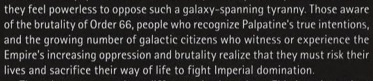
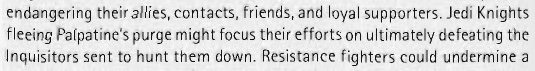
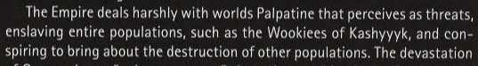
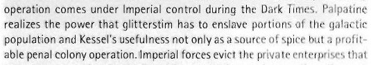
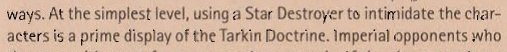
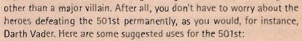

# Owner Material 037 — Star Wars D20 Drive folder (Core, Revised Core and Saga Edition): Sourcebooks/The Force Unleashed Campaign Guide.pdf [Star Wars Roleplaying Game Saga Edition (2007)] (scan pages 121–180)

- **Source:** Wizards of the Coast Star Wars Roleplaying Game books, web enhancements, Living Force campaign modules and articles (2000–2010), from the owner's "Star Wars D20" Drive folder (only the three edition subfolders; "General" was not read, as instructed). Secondary source (licensed Legends reference). Scan OCR'd on the box; the scan stays box-only and is **not** published.
- **Method:** every scanned page was OCR'd and machine-screened sentence by sentence for power-relevant statements (fights, kills, defeats, Force feats, rankings, superweapons) that name a character on our roster; each kept sentence is quoted verbatim from the OCR text and has a crop of the printed passage directly under it. Pages with nothing power-relevant are still listed with what is on them.
- **Citation:** "*The Force Unleashed Campaign Guide* (SWRPG Saga Edition), p.X" by printed page ("scan p.X" where no printed number applies). **Weight:** Licensed RPG material: a secondary source. Narrative text sums up Legends lore; game statistics are rules for players, not canon power levels, and rank lowest.

## scan p.121 (scan page 121)

Page contents: Gallofree Yards Maka-Eekai L4000 Transport (independent freighter; gun boom ball turret) stat block. Capital Ships (Empire tracks modern capital ships; older ships lower priority). (hand-read)

## scan p.122 (scan page 122)

Page contents: Neutron Star Bulk Cruiser (Rendili StarDrive; Tactical Fire) stat block. Civilian Vessels (SoroSuub Cutlass-9 restricted). Epigraph (c729_122a). (hand-read)

### Stat block notes (game mechanics, not feats)

- Civilian Vessels (epigraph): "I'm sick of training new pilots." - Vader's Apprentice (Source: *The Force Unleashed Campaign Guide* (SWRPG Saga Edition), scan p.122)

## scan p.123 (scan page 123)

Page contents: Chapter VIII opener: "Chapter VIII Campaign Guidelines". (hand-read)

## scan p.124 (scan page 124)

Page contents: Chapter VIII intro: heroes oppose the growing Imperial oppression after Palpatine declares the New Order; foes include clone troopers, ISB agents, stormtroopers, Imperial Inquisitors and complicit citizens. (hand-read)

- **Palpatine (Darth Sidious)**: "Those aware of the brutality of Order 66, people who recognize Palpatine's true intentions, and the growing number of galactic citizens who witness or experience the Empire's increasing oppression and brutality realize that they must risk their lives and sacrifice their way of life to fight Imperial domination." Source: *The Force Unleashed Campaign Guide* (SWRPG Saga Edition), scan p.124
  

### Stat block notes (game mechanics, not feats)

- Campaign Guidelines: When Supreme Chancellor Palpatine declares his New Order, few realize its sinister, oppressive intention. Many people accept it as a reasonable solution to the turmoil caused by the Separatist uprising. The average, law-abiding citizen who views galactic government as a distant concern sees Palpatine's speech as yet another seemingly meaningless policy announcement, heralding at most a gradual change in daily life. (Source: *The Force Unleashed Campaign Guide* (SWRPG Saga Edition), scan p.124)

## scan p.125 (scan page 125)

Page contents: A Gathering of Heroes; Shared Hero Backgrounds (sample heroes Nanto Vanix, Joren Q'aal, Rass Throven); Common Campaign Elements (Wookiee slaves, noble house, Mon Calamari floating cities incinerated, criminal fringers). (hand-read)

## scan p.126 (scan page 126)

Page contents: Origins: Location; Shared Experience (planet Callos devastated); Common Allies; Rally Around a Cause (Wookiee enslavement; Duro and Mon Calamari shipyards seized); It's a Trap! (hand-read)

## scan p.127 (scan page 127)

Page contents: It's a Trap! cont. Adversaries (Moffs, Inquisitors hunting Jedi fleeing Palpatine's purge, corrupt corporations). (hand-read)

- **Palpatine (Darth Sidious)**: "Jedi Knights fleeing Palpatine's purge might focus their efforts on ultimately defeating the Inquisitors sent to hunt them down." Source: *The Force Unleashed Campaign Guide* (SWRPG Saga Edition), scan p.127
  

## scan p.128 (scan page 128)

Page contents: Adversaries cont. Campaign Elements; Clandestine Existence (with adventure hook); Covert Opposition. (hand-read)

## scan p.129 (scan page 129)

Page contents: Covert Opposition adventure hook. Scarce Resources (with adventure hook: ISB trap at a supply dump). Recruiting Allies. (hand-read)

## scan p.130 (scan page 130)

Page contents: Recruiting Allies cont.: Informers, Suppliers, Safe Haven Providers, Transport Pilots, Bureaucrats. The Fringe begins. (hand-read)

## scan p.131 (scan page 131)

Page contents: The Fringe cont. (adventure hook: noblewoman's gala); Criminals; Smugglers; Fugitives. (hand-read)

## scan p.132 (scan page 132)

Page contents: Finding a Safe Haven (adventure hook: com-scan array). Fugitive Jedi (Inquisitors; Jedi destined to die at the hands of Vader's minions; planning Jedi heroes' deaths). (hand-read)

## scan p.133 (scan page 133)

Page contents: Jedi fates: Blaze of Glory, Exposing the Truth, Final Confrontation, Noble Sacrifice; adventure hook (crash-landed Jedi, possible ISB impostor). Ordinary People reactions: Tacit Complacency, Influenced Complicity, Quiet Betrayal (ISB/COMPNOR informer corps), Alarm. (hand-read)

## scan p.134 (scan page 134)

Page contents: Betrayal (era of betrayal after Order 66; ISB and COMPNOR agents; when to play the traitor card; adventure hook). Growing Criminal Elements (adventure hook: crime syndicate gear for a mountaintop prison raid). (hand-read)

### Stat block notes (game mechanics, not feats)

- Betrayal: Palpatine's Order 66 and the brutal slaying and pursuit of the Jedi Knights sets the stage for an entire era of betrayal. (Source: *The Force Unleashed Campaign Guide* (SWRPG Saga Edition), scan p.134)

## scan p.135 (scan page 135)

Page contents: Resistance Operations: Surveillance, Infiltration, Turning Agents, Ambush, Sabotage, Rescue. (hand-read)

## scan p.136 (scan page 136)

Page contents: A Less Civilized Age (decline under the New Order). Everyday Paranoia: Imperial Patrol, Shadowing. (hand-read)

### Stat block notes (game mechanics, not feats)

- A Less Civilized Age: Those who are loyal to the Empire rise in prominence and splendor, leaving everyone else to wallow in neglect and decay. Palpatine's friends gain power, prestige, and riches, while anyone beneath his notice suffers at the whim of his minions. (Source: *The Force Unleashed Campaign Guide* (SWRPG Saga Edition), scan p.136)

## scan p.137 (scan page 137)

Page contents: Shadowing cont.; Shady Offer. Suspicion of the Force (Jedi hiding lightsabers, dress, forbidden Jedi writings; subtle Force powers only). (hand-read)

### Stat block notes (game mechanics, not feats)

- Suspicion of the Force: Jedi who are fleeing the galaxywide purge engineered by Vader and his minions must take particular care to mask their true nature. (Source: *The Force Unleashed Campaign Guide* (SWRPG Saga Edition), scan p.137)
- Suspicion of the Force: Anyone who quotes Jedi wisdom or speaks of the Jedi Knights in a favorable manner comes under suspicion from those who believe the lies Palpatine has spread about the Jedi Council's treachery and its role in the Republic's decline. Even reading Jedi writings or spreading Jedi teachings remains forbidden. (Source: *The Force Unleashed Campaign Guide* (SWRPG Saga Edition), scan p.137)

## scan p.138 (scan page 138)

Page contents: Suspicion of the Force cont. (overt powers; Inquisitorius). Imperial Intrusiveness (customs inspections, tariffs 5-25%, arrest grounds). Imprisoned by the Empire (interrogation; prison camps; regional detention centers; regional prisons). (hand-read)

## scan p.139 (scan page 139)

Page contents: Imperial penal facilities (spice mines of Kessel, penal colony on Despayre); escape difficulty. Bounty Hunters (growth in the Dark Times; warrants; guilds; methods). (hand-read)

## scan p.140 (scan page 140)

Page contents: Bounty Hunters cont. Adventure: Round-Up on Salliche (ISB trap at Docking Bay 723; rumored backer Graaf Savraan; prisoner caravan; country-estate detention camp). Epigraph (c729_140a). (hand-read)

### Stat block notes (game mechanics, not feats)

- Adventure: Round-Up on Salliche: Upon announcing his New Order, Palpatine immediately seeks to solidify his hold on systems vital to the Empire's survival. Imperial forces spearheaded by ISB agents descend on Salliche, an agricultural planet that supports many neighboring Core Worlds with its abundant crops and efficient harvesting corporation. (Source: *The Force Unleashed Campaign Guide* (SWRPG Saga Edition), scan p.140)
- Adventure: Round-Up on Salliche (epigraph): "Bounty hunters. We don't need their scum." - Admiral Piett (Source: *The Force Unleashed Campaign Guide* (SWRPG Saga Edition), scan p.140)

## scan p.141 (scan page 141)

Page contents: Encounter Docking Bay (CL 4): setup; read-aloud text; "The Graaf" (ISB field agent impostor) stat block; Imperial Tactics. (hand-read)

## scan p.142 (scan page 142)

Page contents: Docking Bay cont.: Stormtrooper stat block; Conclusion; map "Ambush at Docking Bay 723"; Features of the Area. (hand-read)

## scan p.143 (scan page 143)

Page contents: Encounter Prisoner Convoy (CL 6): setup; read-aloud text; Convoy Vehicles; Modified SoroSuub X-34 Speeder Escort and Aratech 74-Z Speeder Bike stat blocks. (hand-read)

## scan p.144 (scan page 144)

Page contents: Escort Tactics; Imprisoned Heroes; map "Prisoner Convoy"; Features of the Area; Conclusion. (hand-read)

## scan p.145 (scan page 145)

Page contents: Encounter Graaf's Pleasure (CL 7): setup; read-aloud text (detention camp on Graaf Savraan's estate); Sentry Tactics; Imperial Officer stat block. (hand-read)

## scan p.146 (scan page 146)

Page contents: Stormtrooper stat block; Features of the Area (electrified fence, muck pond); Imprisoned Heroes; Conclusion; map "Estate Detention Camp". (hand-read)

## scan p.147 (scan page 147)

Page contents: Chapter IX opener: "Chapter IX Galactic Gazetteer". (hand-read)

## scan p.148 (scan page 148)

Page contents: Chapter IX intro: Empire's treatment of worlds (Wookiees of Kashyyyk enslaved; Caamas devastated by an "unknown enemy"; Mon Calamari garrison; Thyferra Bacta Cartels; Muunilinst left alone). (hand-read)

- **Palpatine (Darth Sidious)**: "The Empire deals harshly with worlds Palpatine that perceives as threats, enslaving entire populations, such as the Wookiees of Kashyyyk, and conspiring to bring about the destruction of other populations." Source: *The Force Unleashed Campaign Guide* (SWRPG Saga Edition), scan p.148
  

### Stat block notes (game mechanics, not feats)

- Galactic Gazetteer: The Empire deals harshly with worlds Palpatine that perceives as threats, enslaving entire populations, such as the Wookiees of Kashyyyk, and conspiring to bring about the destruction of other populations. The devastation of Caamas by an "unknown enemy" shows how ruthlessly the Empire deals with even the most benign dissenters. (Source: *The Force Unleashed Campaign Guide* (SWRPG Saga Edition), scan p.148)

## scan p.149 (scan page 149)

Page contents: Planets of the Dark Times. Caamas (bombarded after its shield system was disabled; Caamasi; early Jedi temple legend; Knowledge DCs). Callos planet data begins. (hand-read)

## scan p.150 (scan page 150)

Page contents: Callos (assaulted by Imperial forces led by Juno Eclipse; permanent winter; Callosians). Despayre (penal colony; Wookiee and Mon Calamari slaves; orbital stardocks; moon Haroon crystals for a top-secret project). Felucia planet data begins. (hand-read)

### Stat block notes (game mechanics, not feats)

- Callos: Imperial forces led by Juno Eclipse assaulted the planet after the Empire discovered evidence that the Callosians were developing a new offensive technology intended to oppose those who were spreading the New Order. (Source: *The Force Unleashed Campaign Guide* (SWRPG Saga Edition), scan p.150)

## scan p.151 (scan page 151)

Page contents: Felucia (Separatist stronghold; Gossam; Kway Teow; fungal forests; Sarlacc, bull rancor; Felucian shamans). New Plympto (Nosaurians; ji rikknit; Karsten moon; Imperial Procurator). (hand-read)

### Stat block notes (game mechanics, not feats)

- Felucia: During the Dark Times, the Jedi Shaak Ti and Maris Brood seek refuge here from Imperial Inquisitors. (Source: *The Force Unleashed Campaign Guide* (SWRPG Saga Edition), scan p.151)
- Felucia: The Jedi apprentice Maris Brood, after hiding out on Felucia and turning to the dark side, corrupts several Felucian shamans and trains them to tap into the more sinister aspects of the Force. (Source: *The Force Unleashed Campaign Guide* (SWRPG Saga Edition), scan p.151)
- New Plympto: Dass Jennir, a Jedi leading clone forces on New Plympto, supposedly escaped Order 66 and went into hiding, remaining on the planet to later lead its resistance movement. (Source: *The Force Unleashed Campaign Guide* (SWRPG Saga Edition), scan p.151)

## scan p.152 (scan page 152)

Page contents: New Plympto Knowledge (Tactics) (Hajial Chase; "singing down the sun"). Raxus Prime (Star Destroyer orbital facilities; ore cannon; Jawa clan). Planetary Updates intro; Alderaan begins. (hand-read)

### Stat block notes (game mechanics, not feats)

- Raxus Prime: The Confederacy of Independent Systems first convened on Raxus Prime, and the planet later served as Count Dooku's personal fortress before the Clone Wars. (Source: *The Force Unleashed Campaign Guide* (SWRPG Saga Edition), scan p.152)
- Raxus Prime: During the Dark Times, the Aleena Jedi Kazdan Paratus goes into hiding in Raxus Prime's warren of industrial facilities. The strain of the Clone Wars and the carnage of Order 66 send Paratus spiraling into insanity; he builds a replica of the Jedi Temple from debris gathered from an abandoned industrial quarter on Raxus Prime, and he holds council sessions there with "Jedi Masters" fashioned from debris and guarded by an army of animated junk droid sentries also constructed from junk. (Source: *The Force Unleashed Campaign Guide* (SWRPG Saga Edition), scan p.152)
- Alderaan: As a secret witness to Palpatine's ruthless elimination of his enemies, including the Jedi Knights, Bail Organa realizes that any open political or military opposition could bring Imperial retribution down upon his homeworld. (Source: *The Force Unleashed Campaign Guide* (SWRPG Saga Edition), scan p.152)

## scan p.153 (scan page 153)

Page contents: Alderaan cont. (pacifism; armory ship Another Chance; funding insurgents via Ralltiir and Brentaal; former general Gavvix Sironna). Bakura (repulsorlift industry; ISB infiltration of Arden Repulsorlift and Bakur RepulsorCorp). (hand-read)

### Stat block notes (game mechanics, not feats)

- Alderaan: Organa becomes the leader of a well-masked, clandestine effort to quietly aid offworld resistance groups while maintaining the facade in the Imperial Senate that his world poses no threat to Palpatine's schemes. (Source: *The Force Unleashed Campaign Guide* (SWRPG Saga Edition), scan p.153)
- Alderaan: Organa recruits one of Queen Amidala's former handmaidens, Sabé, to serve as a noble envoy traveling throughout the galaxy to covertly establish resistance cells, spread and collect valuable intelligence, and oversee material support to those who have the courage to oppose the Empire. (Source: *The Force Unleashed Campaign Guide* (SWRPG Saga Edition), scan p.153)
- Alderaan: When he heard the ISB intended to arrest the Chandrilan Senator Mon Mothma for treason, Organa tipped her off so she could escape at the last minute. (Source: *The Force Unleashed Campaign Guide* (SWRPG Saga Edition), scan p.153)
- Alderaan: Bail Organa could tolerate his planet's peaceful stance in galactic affairs for only so long, however, especially in the face of the Empire's growing power and treachery. Toward the end of the Dark Times, Organa resigns from the Imperial Senate, returns to Alderaan, and—outraged by continued Imperial atrocities—tries to reverse his homeworld's policy of pacifism to rally his people to join the increasingly open rebellion. (Source: *The Force Unleashed Campaign Guide* (SWRPG Saga Edition), scan p.153)

## scan p.154 (scan page 154)

Page contents: Bakura cont. (annexed after Yavin). Bespin (Tibanna gas; Cloud City; Tibannopolis; Bloodhawk Pirates). Bestine IV (Imperial shipyard; displaced citizens; renegades). Bothawui (limited neutrality). (hand-read)

### Stat block notes (game mechanics, not feats)

- Bestine IV: Many speculate that Palpatine chooses the world to punish its independent-minded citizens for joining the Separatists during the Clone Wars, albeit in a small support role as a medium-sized starship repair facility. (Source: *The Force Unleashed Campaign Guide* (SWRPG Saga Edition), scan p.154)

## scan p.155 (scan page 155)

Page contents: Bothawui cont. (ISB monitoring of the Bothan spynet). Cerea (seclusion; Council of Elders; Outsider Citadels evicted). Chandrila (Chandrilan House; Brionelle Academy; Hanna City garrison). Corellia begins (Diktat Dupas Thomree's deal). (hand-read)

### Stat block notes (game mechanics, not feats)

- Bothawui: By leaving the Bothan spynet to its own devices, Palpatine keeps Bothawui a quiet, content, and somewhat marginalized world while gaining from the Bothans' naturally adept espionage activities. (Source: *The Force Unleashed Campaign Guide* (SWRPG Saga Edition), scan p.155)
- Chandrila: Mon Mothma's increasing condemnation of Imperial oppression and her covert involvement in growing resistance movements bring about her downfall in the Senate and her condemnation as a traitor of the Empire. (Source: *The Force Unleashed Campaign Guide* (SWRPG Saga Edition), scan p.155)
- Corellia: By the time Palpatine declares his New Order, Corellia's descent into lawlessness is already under way. Diktat Dupas Thomree cuts a deal with the Emperor to largely keep Imperial forces out of the system and Corellian affairs in general. In return, the Diktat promises Palpatine to maintain production at the vital Corellian Engineering Corporation shipyards, pay taxes to the Empire, and politically support Palpatine's galactic policies. (Source: *The Force Unleashed Campaign Guide* (SWRPG Saga Edition), scan p.155)

## scan p.156 (scan page 156)

Page contents: Corellia cont. (CorSec; ISB and COMPNOR agents). Corulag (loyal; Imperial academy; Sienar Advanced Research Division; bamboo-forest prisons; Crullov City). Coruscant begins. (hand-read)

### Stat block notes (game mechanics, not feats)

- Corulag: This longtime and loyal supporter of its fellow Core Worlds shrewdly aligns itself with Senator Palpatine during his rise to power. Upon declaring the New Order, the Emperor rewards Corulag for its devotion by awarding many prominent citizens high-ranking posts in the new Imperial government and military bureaucracies. (Source: *The Force Unleashed Campaign Guide* (SWRPG Saga Edition), scan p.156)

## scan p.157 (scan page 157)

Page contents: Coruscant cont. (Jedi Temple closed; renamed Imperial Center; Alien Protection Zones, Invisec; Black Sun). Eriadu (Tarkin's Seswenna sector capital; slave trade; resistance nucleus). (hand-read)

### Stat block notes (game mechanics, not feats)

- Coruscant: Palpatine quietly sweeps away most vestiges of the Republic that interfered with his agenda, leaving the masses their upscale diversions, Human High Culture, and the illusion that they still hold prominence in the galaxy. The once grand Jedi Temple remains closed by Imperial order, left to crumble over time as citizens politely ignore its presence. (Source: *The Force Unleashed Campaign Guide* (SWRPG Saga Edition), scan p.157)
- Coruscant: Prince Xizor, head of the fabulously successful Xizor Transport Systems, maintains a palace in the heart of Imperial City, the covert hub of the vast Black Sun crime syndicate. (Source: *The Force Unleashed Campaign Guide* (SWRPG Saga Edition), scan p.157)
- Eriadu: Its service as a forward base for Republic forces confronting the Separatists during the Clone Wars seemingly goes unrewarded until the Emperor places Wilhuff Tarkin in charge of the Seswenna sector. As a native of Eriadu with a long family history involved in the planet's affairs, Moff Tarkin establishes his administration on Eriadu and makes it the sector capital. (Source: *The Force Unleashed Campaign Guide* (SWRPG Saga Edition), scan p.157)
- Eriadu: Under Tarkin's rule, the planet's manufacturing grows, exports of technology increase, and corporations that have interests there thrive. (Source: *The Force Unleashed Campaign Guide* (SWRPG Saga Edition), scan p.157)

## scan p.158 (scan page 158)

Page contents: Kashyyyk (Wookiee enslavement; Trandoshan hunters; coastal garrison; Wookiee resistance). Kessel (Imperial penal colony; glitterstim; Garrison Moon; Kessendra). Kuat begins (BoSS protocols). (hand-read)

- **Palpatine (Darth Sidious)**: "Palpatine realizes the power that glitterstim has to enslave portions of the galactic population and Kessel's usefulness not only as a Source of spice but a profit able penal colony operation." Source: *The Force Unleashed Campaign Guide* (SWRPG Saga Edition), scan p.158
  

## scan p.159 (scan page 159)

Page contents: Kuat cont. (Moff Thichis Kuras; Senator Giddean Danu). Mon Calamari (Quarren traitors disable shields; Admiral Garrus Tharydine bombards three floating cities; revolt ousts Imperials). (hand-read)

### Stat block notes (game mechanics, not feats)

- Kuat: Senator Giddean Danu, known for signing the Petition of 2000 opposing Palpatine's broad powers as Supreme Chancellor during the Clone Wars, now quietly supports the efforts of Mon Mothma and others who are secretly working to thwart Palpatine's plans and undermine the Empire's authority. (Source: *The Force Unleashed Campaign Guide* (SWRPG Saga Edition), scan p.159)
- Mon Calamari: Despite the planet's stand against Count Dooku's intimidation and treachery during the Clone Wars, the Empire quickly realizes it must seize the orbital shipyards to increase and maintain its fleets and to deny growing resistance groups a potential source of fighters, transports, and capital ships. (Source: *The Force Unleashed Campaign Guide* (SWRPG Saga Edition), scan p.159)
- Mon Calamari: But as passive resistance grows into work stoppages, shoddy production, and outright sabotage, Admiral Garrus Tharydine—the Imperial commander overseeing the occupation of Mon Calamari—carries out the Emperor's orders to bombard three cities floating on the planet's surface. (Source: *The Force Unleashed Campaign Guide* (SWRPG Saga Edition), scan p.159)

## scan p.160 (scan page 160)

Page contents: Muunilinst (Imperial curbs on Muun finance; High Port; Golan platforms; IoTran Guard). Naboo (outwardly loyal; secret resistance; Imperial governor). (hand-read)

### Stat block notes (game mechanics, not feats)

- Naboo: The end of the Clone Wars and the ascendancy of the Empire brought peace to Naboo's people even after the loss of their beloved Senator Padmé Amidala and a scandal that involved the ruling queen sheltering renegade Jedi. (Source: *The Force Unleashed Campaign Guide* (SWRPG Saga Edition), scan p.160)

## scan p.161 (scan page 161)

Page contents: Nar Shaddaa (Hutts; crime influx; Hutts monitor insurgents). Ralltiir (Human financial center; ISB infiltration of banks). Rodia (Navik the Red's coup; Grand Protector; Iskaayuma; Black Sun ties). (hand-read)

## scan p.162 (scan page 162)

Page contents: Rodia cont. (Equator City decline). Sidebar Expanding Worlds (Objectives, Resources, Base Areas). Salliche (Salliche Ag Corp; Netassa garrison; Moff Gegren Throsen; Senator Selnia Harbright). Sullust begins (SoroSuub; Corporate Proclamation 137d). (hand-read)

### Stat block notes (game mechanics, not feats)

- Salliche: Upon announcing his New Order, Palpatine immediately sent Imperial forces to Salliche to ensure that its abundant crops and efficient harvesting corporation continue to support nearby Core Worlds and his growing war machine. (Source: *The Force Unleashed Campaign Guide* (SWRPG Saga Edition), scan p.162)

## scan p.163 (scan page 163)

Page contents: Sullust cont. (SoroSuub rule; moon Sulon garrison; civil disobedience). Tatooine (Hutts; Mos Eisley; Imperial prefect; hidden Jedi in the Jundland Wastes). Thyferra begins (Zaltin and Xucphra bacta contracts; Vratix). (hand-read)

### Stat block notes (game mechanics, not feats)

- Sullust: So long as the system's industrial power continues to support Imperial military might, Palpatine allows SoroSuub to run Sullust as it pleases. (Source: *The Force Unleashed Campaign Guide* (SWRPG Saga Edition), scan p.163)
- Tatooine: The Hutts still retain their control over the planet—with the infamous Jabba eventually gaining prominence—while paying token respect to the Empire. Eventually the Podracer action dries up and the racing circuit leaves to find a better venue, but Jabba the Hutt continues using the world as a quiet place from which to conduct his criminal activities. (Source: *The Force Unleashed Campaign Guide* (SWRPG Saga Edition), scan p.163)
- Tatooine: Although some resistance cells visit the planet to make deals with criminal elements, Jabba discourages any of them from establishing a permanent presence on Tatooine, lest they draw Imperial attention to this sordid corner of the galaxy. (Source: *The Force Unleashed Campaign Guide* (SWRPG Saga Edition), scan p.163)
- Tatooine: Few suspect that the planet's dangerous Jundland Wastes shelter one of the last Jedi Knights who managed to escape Order 66 and Darth Vader's systematic purge of the Jedi. (Source: *The Force Unleashed Campaign Guide* (SWRPG Saga Edition), scan p.163)
- Thyferra: After a brief period when the Vratix regained some control over the bacta market, the Human colonists consolidated their corporate operations into two companies, Zaltin and Xucphra, which Palpatine approaches shortly after declaring the New Order and favors with exclusive contracts to provide bacta to the Empire. (Source: *The Force Unleashed Campaign Guide* (SWRPG Saga Edition), scan p.163)

## scan p.164 (scan page 164)

Page contents: Thyferra cont. (Ashern "Black Claw"). Shadowports: Criminal Organizations, Alien Enclaves, Military and Intelligence Groups, Resistance Groups. (hand-read)

## scan p.165 (scan page 165)

Page contents: Shadowport Facilities: Landing Bay, Repair Bay, Quarters, Command Center, Other Features. Notable Shadowports (Knowledge DC 25): Bothan Space. (hand-read)

## scan p.166 (scan page 166)

Page contents: Eriadu Beacon Base; Itani Nebula Base; Kothlis Shadowport; Port Haven. Establishing a Base (heroes on their own; scouting locations). (hand-read)

## scan p.167 (scan page 167)

Page contents: Chapter X opener: "The Empire" (display title; art). (hand-read)

## scan p.168 (scan page 168)

Page contents: Chapter X intro: Empire replaces Republic (Coruscant renamed Imperial Center). The Imperial Government (Emperor's double life; Byss training facility). (hand-read)

### Stat block notes (game mechanics, not feats)

- The Imperial Government: Emperor Palpatine has replaced or revamped nearly every part of the Republic government, creating his new Galactic Empire in the image he desires. The Emperor retains complete control over all Imperial functions and military forces. He is the Empire, and the Empire is his. Few dare to openly oppose him. Everyone understands that the Emperor's word is essentially law. Currently, he is feared more than he is respected. However, as time passes and more supporters of the New Order come forward or are indoctrinated, more of his underlings truly respect him. (Source: *The Force Unleashed Campaign Guide* (SWRPG Saga Edition), scan p.168)
- The Imperial Government: The Emperor leads a double life, even now. Emperor Palpatine is the public face he uses to maintain control of the Empire. He appears to be genuinely worried about the state of the Empire. He rails against corruption. He promotes peace and security. He negotiates, however forcefully, with Imperial Senators on critical matters of state and social law. He maintains control by standing firm, unafraid to use heavy-handed tactics. He legitimizes his most outrageous moves by manipulating the Imperial Senate to support him or by restricting reports of anything that threatens his person or position. (Source: *The Force Unleashed Campaign Guide* (SWRPG Saga Edition), scan p.168)
- The Imperial Government: His Darth Sidious persona remains out of public view. Almost no one outside his inner circle and selected underlings know him as anything other than Palpatine. As always, the Sith Lord works from the shadows. As Emperor, Sidious now has great latitude to pursue his own dark projects, plus the power and security to keep them hidden. Unbeknownst to the galaxy at large, Sidious has begun to expand the reach of the dark side. Many of his inner circle are trained in aspects of the dark side of the Force. Secret prophets, the Emperor's Hands and Inquisitors, are known to some, but they are only the beginning. On the planet Byss, in the Deep Core, Sidious has established a secret training facility to attract those who are dedicated to the dark side. Though it might take decades, he plans that they will some day become integral to Imperial power and leadership. (Source: *The Force Unleashed Campaign Guide* (SWRPG Saga Edition), scan p.168)

## scan p.169 (scan page 169)

Page contents: Tarkin's doctrine of fear. Sidebar Using the Tarkin Doctrine (oversectors; HoloNet; rule through fear of force; size to intimidate). The Imperial Senate. Planetary and Sector Government (Moffs, Grand Moffs; corporate sectors). (hand-read)

- **Grand Moff Tarkin**: "At the simplest level, using a Star Destroyer to intimidate the characters is a prime display of the Tarkin Doctrine." Source: *The Force Unleashed Campaign Guide* (SWRPG Saga Edition), scan p.169
  

### Stat block notes (game mechanics, not feats)

- The Imperial Government: Even though the Emperor has his own vision of the galaxy's future, he remains open to new and effective ideas that support his goals. As such, Grand Moff Wilhuff Tarkin's doctrine of fear (which will become known as the Tarkin Doctrine) received much interest, and the recently promoted Grand Moff is the brightest star within the new government. Many of Tarkin's ideas are now beginning to be fully implemented. (Source: *The Force Unleashed Campaign Guide* (SWRPG Saga Edition), scan p.169)

## scan p.170 (scan page 170)

Page contents: Planetary governors. Agents of Imperial Rule: COMPNOR (Select Committee; SAGroup; Coalition for Progress; Coalition for Improvements); CompForce; Imperial Security Bureau. Imperial Intelligence begins. (hand-read)

### Stat block notes (game mechanics, not feats)

- Planetary and Sector Government: In principle, the Emperor prefers to keep out of local politics, especially where the citizens already support the New Order. He prefers to use fear and force to keep local governments under control. In reality, Palpatine is quite willing to step in when it suits his plans, though he might use intermediaries openly or covertly as needed. (Source: *The Force Unleashed Campaign Guide* (SWRPG Saga Edition), scan p.170)

## scan p.171 (scan page 171)

Page contents: Imperial Intelligence (Ubiqtorate; Armand Isard; four divisions; Sector Plexus). Imperial Inquisitors (Inquisitorius, Grand Inquisitor). The Emperor's Hands. Sidebar Using CompForce, the ISB, and Imperial Intelligence. (hand-read)

### Stat block notes (game mechanics, not feats)

- Imperial Intelligence: They are led by a mysterious group called the Ubiqtorate. The public head of Imperial Intelligence is currently Armand Isard. (Source: *The Force Unleashed Campaign Guide* (SWRPG Saga Edition), scan p.171)
- Imperial Inquisitors: Some Inquisitors learn significant lightsaber skills, but most do not have the formal training of a Sith or a Jedi. Many Inquisitors learn only basic or specialized Force powers best suited for interrogation. If they happen upon a Jedi or some other Force-user of significant skill, they might pass the word to Darth Vader that the matter requires his special attention. (Source: *The Force Unleashed Campaign Guide* (SWRPG Saga Edition), scan p.171)
- The Emperor's Hands: Though it is unknown exactly when Emperor Palpatine began employing talented dark side Force-users as his exclusive Emperor's Hands, it is likely they began their service in the earliest years of the New Order. The Emperor had long understood the need for operatives who worked for and answered only to him. His Sith apprentice fulfilled such a role in the past, but once Darth Vader became a public figure, the Emperor turned to less skilled, but strikingly loyal, individuals. Called the Emperor's Hands, each believes that he or she is the only one who receives such special attention and Force training from the leader of the galaxy. (Source: *The Force Unleashed Campaign Guide* (SWRPG Saga Edition), scan p.171)

## scan p.172 (scan page 172)

Page contents: The Death Star (under construction above Despayre in the Horuz system; Wookiee slave labor; diverted funds). Sidebar Using the Death Star (Motivator, Catalyst, Adventuring Locale). Imperial Personnel; Imperial Military; AT-AT Pilot stat block. (hand-read)

### Stat block notes (game mechanics, not feats)

- The Death Star: In the remote Outer Rim system of Horuz, above the planet Despayre, the Death Star is in the early stages of construction. It is barely a shell of its form to come. Fittingly, Grand Moff Tarkin oversees the construction. His vision of the New Order and the new battlestation mesh perfectly. (Source: *The Force Unleashed Campaign Guide* (SWRPG Saga Edition), scan p.172)
- The Death Star: All materials for the battlestation are strip-mined directly from the Horuz system. Security is so tight that once anyone arrives insystem, he or she is never allowed to leave. It is said that only Grand Moff Tarkin, Darth Vader, and the Emperor are allowed to come and go as they see fit. (Source: *The Force Unleashed Campaign Guide* (SWRPG Saga Edition), scan p.172)

## scan p.173 (scan page 173)

Page contents: AT-ST Pilot; Death Star Trooper (trained by Tarkin; loyal to the Navy and Tarkin); Elite Death Star Trooper stat blocks. (hand-read)

### Stat block notes (game mechanics, not feats)

- Death Star Trooper: During the construction of the Death Star, Grand Moff Tarkin trained a select fighting force specifically for the fearsome battlestation. (Source: *The Force Unleashed Campaign Guide* (SWRPG Saga Edition), scan p.173)

## scan p.174 (scan page 174)

Page contents: Imperial Army Trooper; Imperial Navy Trooper; Imperial Field Medic stat blocks. Imperial Royal Guards begins. (hand-read)

## scan p.175 (scan page 175)

Page contents: Royal Guard stat block; Imperial Sovereign Protector (elite Royal Guards with rudimentary Force abilities) stat block; Shadow Guard intro (lightsaber pike). (hand-read)

## scan p.176 (scan page 176)

Page contents: Imperial Shadow Guard stat block. Stormtroopers; The 501st Stormtrooper Division. Sidebar Using the 501st. (hand-read)

- **Darth Vader (Anakin Skywalker)**: "After all, you don't have to worry about the heroes defeating the 501st permanently, as you would, for instance, Darth Vader." Source: *The Force Unleashed Campaign Guide* (SWRPG Saga Edition), scan p.176
  

### Stat block notes (game mechanics, not feats)

- The 501st Stormtrooper Division: The 501st is best known for the assault on the Jedi Temple under the command of Lord Vader, signaling the destruction of the Jedi Order. After that fateful day, the unit operates as Vader's personal regiment, although it carries out many other missions as directed by the Emperor. It is responsible for some of the Empire's worst atrocities. (Source: *The Force Unleashed Campaign Guide* (SWRPG Saga Edition), scan p.176)

## scan p.177 (scan page 177)

Page contents: 501st Legion Stormtrooper stat block. Clone Trooper Veterans (accelerated aging) stat block. Spaarti Clone Troops (Cartao; flash memory) begins. (hand-read)

## scan p.178 (scan page 178)

Page contents: Spaarti clones cont.; Spaarti-Cloned Stormtrooper stat block; Clone Madness table. Dark Troopers Phase Zero (Empirical station; Lt. Rom Mohc); Phase Zero Dark Trooper stat block; Cyborg Hybrid. (hand-read)

### Stat block notes (game mechanics, not feats)

- Spaarti Clone Troops: The clones based on Jango Fett recoiled at the thought of fighting alongside the Spaarti clones, which they saw as freakish experiments rather than trained soldiers. (Source: *The Force Unleashed Campaign Guide* (SWRPG Saga Edition), scan p.178)
- Dark Troopers Phase Zero: Much of the same technology that was used to transform Anakin Skywalker into the cyborg Darth Vader found its way into the Dark Trooper Phase Zero project, and with moderate success. (Source: *The Force Unleashed Campaign Guide* (SWRPG Saga Edition), scan p.178)
- Dark Troopers Phase Zero: A secret project, codenamed Dark Trooper Phase Zero, involved taking aging clone troopers and replacing their limbs and many internal organs with cybernetic replacements. Based out of the Empirical, a hidden space station in the Dominus sector, the Dark Trooper Phase Zero project was overseen by a young Imperial officer by the name of Lt. Rom Mohc. (Source: *The Force Unleashed Campaign Guide* (SWRPG Saga Edition), scan p.178)

## scan p.179 (scan page 179)

Page contents: Phase Zero cont. (troopers saw themselves as abominations; project shut down). Coruscant Guard stat block. Imperial EVO Stormtrooper begins. (hand-read)

### Stat block notes (game mechanics, not feats)

- Dark Troopers Phase Zero: However, the effectiveness of these cybernetically enhanced troops would lead Lt. Mohc, who would eventually become a general, to convince the Emperor to reinstate the Dark Trooper project and create mechanical troops to fight the Rebellion that could operate without fear of death, aging, illness, or any other weaknesses of the flesh. (Source: *The Force Unleashed Campaign Guide* (SWRPG Saga Edition), scan p.179)

## scan p.180 (scan page 180)

Page contents: EVO Trooper stat block cont. Imperial Jumptrooper intro (rail detonator gun). Art labels: Jumptrooper, Stormtrooper Commander, EVO Stormtrooper, Shadow Guard. (hand-read)

