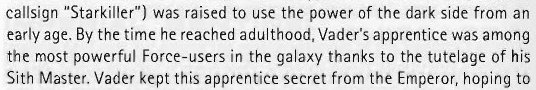
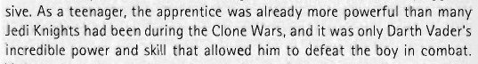
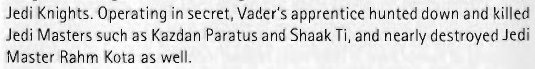
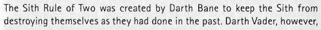
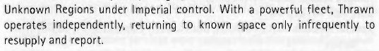
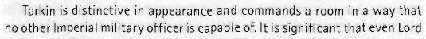
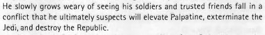
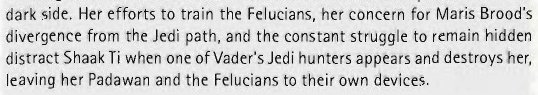
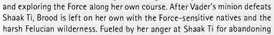

# Owner Material 037 — Star Wars D20 Drive folder (Core, Revised Core and Saga Edition): Sourcebooks/The Force Unleashed Campaign Guide.pdf [Star Wars Roleplaying Game Saga Edition (2007)] (scan pages 181–226)

- **Source:** Wizards of the Coast Star Wars Roleplaying Game books, web enhancements, Living Force campaign modules and articles (2000–2010), from the owner's "Star Wars D20" Drive folder (only the three edition subfolders; "General" was not read, as instructed). Secondary source (licensed Legends reference). Scan OCR'd on the box; the scan stays box-only and is **not** published.
- **Method:** every scanned page was OCR'd and machine-screened sentence by sentence for power-relevant statements (fights, kills, defeats, Force feats, rankings, superweapons) that name a character on our roster; each kept sentence is quoted verbatim from the OCR text and has a crop of the printed passage directly under it. Pages with nothing power-relevant are still listed with what is on them.
- **Citation:** "*The Force Unleashed Campaign Guide* (SWRPG Saga Edition), p.X" by printed page ("scan p.X" where no printed number applies). **Weight:** Licensed RPG material: a secondary source. Narrative text sums up Legends lore; game statistics are rules for players, not canon power levels, and rank lowest.

## scan p.181 (scan page 181)

Page contents: Jumptrooper stat block. Imperial Radiation Zone Trooper (Radtrooper) stat block. Stormtrooper Commander begins. (hand-read)

## scan p.182 (scan page 182)

Page contents: Stormtrooper Commander cont. COMPNOR Operatives: CompForce Assault Trooper; ISB Field Agent stat blocks. ISB Officer intro. (hand-read)

## scan p.183 (scan page 183)

Page contents: Imperial Security Bureau Officer stat block (Targeted Suspect). Epigraph (c729_183a): "What we say is principle, what we decide is regulation, what we do is law." - ISB Agent Drelfin. Imperial Secret Forces and Agents (Byss agents). Emperor's Hand begins. (hand-read)

### Stat block notes (game mechanics, not feats)

- Emperor's Hand: Every Emperor's Hand is a highly specialized individual, selected by the Emperor for ability with the Force and loyalty to Palpatine. Very few Imperial officers or officials dare refuse to help when an Emperor's Hand appears in their midst. Many don't believe they exist, until confronted with an authorization code that demands any and all aid, as if the Emperor himself is requesting it. And in many ways, he is. Each Emperor's Hand believes that he or she is the only one, a belief bestowed by the Emperor and encouraged by Darth Vader and the rest of Palpatine's inner circle. (Source: *The Force Unleashed Campaign Guide* (SWRPG Saga Edition), scan p.183)

## scan p.184 (scan page 184)

Page contents: Emperor's Hand stat block cont. Imperial Dungeoneer (secret prisons; locked-in heavy armor) stat block. Imperial Intelligence Agent begins. (hand-read)

## scan p.185 (scan page 185)

Page contents: Imperial Intelligence Agent stat block. Imperial Inquisitor stat block. Epigraph (c729_185a). Imperial Sentinel (Byss clones corrupted by the dark side). (hand-read)

### Stat block notes (game mechanics, not feats)

- Imperial Inquisitor (epigraph): "The galaxy is hungry for leadership. It is looking to Humans and those like us to be powerful and strong." - High Inquisitor Tremayne (Source: *The Force Unleashed Campaign Guide* (SWRPG Saga Edition), scan p.185)

## scan p.186 (scan page 186)

Page contents: Imperial Sentinel stat block (Force Resistance). Noghri Warriors and Assassins; Noghri Species Traits; Noghri Warrior stat block. (hand-read)

### Stat block notes (game mechanics, not feats)

- Noghri Warriors and Assassins: Early in the Dark Times, Lord Vader became aware of the decimated planet of Honoghr and its tough, gray-skinned sentient species, the Noghri. Under the guise of providing Imperial aid to restore Honoghr to its former glory, Vader was successful in indebting the Noghri clans to himself and the Empire. At his disposal is an elite force of Noghri warriors, skilled infiltrators and deadly assassins. They serve Vader willingly in repayment for his effort to save their world. In reality, the Noghri are dependent on the Empire for their very existence. (Source: *The Force Unleashed Campaign Guide* (SWRPG Saga Edition), scan p.186)
- Noghri Warriors and Assassins: They are offworld only when carrying out missions for Darth Vader, at which time Vader's agents always accompany them to facilitate travel and mission logistics and ensure their secrecy. (Source: *The Force Unleashed Campaign Guide* (SWRPG Saga Edition), scan p.186)

## scan p.187 (scan page 187)

Page contents: Noghri Infiltrator stat block. Imperial Personalities (Offscreen Adversary or Leader; Climactic Encounter; Regular Interaction). Darth Vader's Secret Apprentice begins. (hand-read)

- **Galen Marek; Darth Vader (Anakin Skywalker)** — entry/section: The Force Unleashed Campaign Guide (Saga): "By the time he reached adulthood, Vader's apprentice was among the most powerful Force-users in the galaxy thanks to the tutelage of his Sith Master." Source: *The Force Unleashed Campaign Guide* (SWRPG Saga Edition), scan p.187
  
- **Galen Marek; Darth Vader (Anakin Skywalker)** — entry/section: The Force Unleashed Campaign Guide (Saga): "As a teenager, the apprentice was already more powerful than many Jedi Knights had been during the Clone Wars, and it was only Darth Vader's incredible power and skill that allowed him to defeat the boy in combat." Source: *The Force Unleashed Campaign Guide* (SWRPG Saga Edition), scan p.187
  
- **Galen Marek; Kazdan Paratus; Shaak Ti; Rahm Kota** — entry/section: The Force Unleashed Campaign Guide (Saga): "Operating in secret, Vader's apprentice hunted down and killed Jedi Masters such as Kazdan Paratus and Shaak Ti, and nearly destroyed Jedi Master Rahm Kota as well." Source: *The Force Unleashed Campaign Guide* (SWRPG Saga Edition), scan p.187
  
- **Darth Bane**: "The Sith Rule of Two was created by Darth Bane to keep the Sith from destroying themselves as they nad done in the past." Source: *The Force Unleashed Campaign Guide* (SWRPG Saga Edition), scan p.187
  

### Stat block notes (game mechanics, not feats)

- Imperial Personalities: For example, if the characters work for Mon Mothma, they might witness direct confrontations between her and ISB Agent Wullf Yularen, who could, in turn, be interested in what the characters are up to. Although Yularen might not investigate personally, he could appear in a final scene to oversee a trap or an unusual situation. (Source: *The Force Unleashed Campaign Guide* (SWRPG Saga Edition), scan p.187)
- Darth Vader's Secret Apprentice: The Sith Rule of Two was created by Darth Bane to keep the Sith from destroying themselves as they had done in the past. Darth Vader, however, disregarded this rule when he began training his own apprentice to fight the Emperor. Taken as a boy from the planet Kashyyyk where his father, a Jedi on the run, had been hiding him, this apprentice (who would go by the callsign "Starkiller") was raised to use the power of the dark side from an early age. By the time he reached adulthood, Vader's apprentice was among the most powerful Force-users in the galaxy thanks to the tutelage of his Sith Master. Vader kept this apprentice secret from the Emperor, hoping to use the boy when the time was right to overthrow Darth Sidious, just as he would attempt to convince Luke Skywalker to do. (Source: *The Force Unleashed Campaign Guide* (SWRPG Saga Edition), scan p.187)
- Darth Vader's Secret Apprentice: Vader's apprentice was both strong in the Force and incredibly aggressive. As a teenager, the apprentice was already more powerful than many Jedi Knights had been during the Clone Wars, and it was only Darth Vader's incredible power and skill that allowed him to defeat the boy in combat. Vader's apprentice underwent a grueling training program from the time he was a young boy, and eventually he was sent on a number of incredibly dangerous assignments, including several missions to exterminate exiled Jedi Knights. Operating in secret, Vader's apprentice hunted down and killed Jedi Masters such as Kazdan Paratus and Shaak Ti, and nearly destroyed Jedi Master Rahm Kota as well. (Source: *The Force Unleashed Campaign Guide* (SWRPG Saga Edition), scan p.187)

## scan p.188 (scan page 188)

Page contents: Secret Apprentice cont.; Darth Vader's Secret Apprentice (as of the Battle of Callos) stat block (CL 14; feats Force Sensitivity, Force Training (3), Powerful Charge, Rapid Strike, Skill Focus (Use the Force), Strong in the Force, Unleashed, Weapon Focus (lightsabers)). Captain Jan Dodonna begins. (hand-read)

### Stat block notes (game mechanics, not feats)

- Darth Vader's Secret Apprentice: It would later be Master Kota and a young Imperial pilot named Juno Eclipse who would bring Vader's apprentice back from the brink of being lost to the dark side forever. Vader commanded his apprentice to rally the enemies of the Empire, including Bail Organa, Mon Mothma, and General Garm Bel Iblis, to form a coalition against the Empire. At the moment when he had finally gathered them all together, the apprentice found Darth Vader waiting to spring the trap. Eventually, Vader's apprentice would turn on both him and the Emperor, rescuing the captive leaders from the Death Star and fighting off the two Sith Lords with the help of Master Kota. (Source: *The Force Unleashed Campaign Guide* (SWRPG Saga Edition), scan p.188)
- Darth Vader's Secret Apprentice (stat block): Darth Vader's Secret Apprentice (as of the Battle of Callos) Medium human Jedi 7/Jedi Knight 3/Sith apprentice 3/Sith Lord 1 Destiny 3; Force 6; Dark Side 15 ... Talents Block, Dark Side Adept, Deflect, Juyo, Redirect Shot, Soresu, Telekinetic Prodigy, Telekinetic Savant, Weapon Specialization (lightsabers) Feats Force Sensitivity, Force Training (3), Powerful Charge, Rapid Strike, Skill Focus (Use the Force), Strong in the Force, Unleashed, Weapon Focus (lightsabers), Weapon Proficiency (lightsabers, simple weapons) (Source: *The Force Unleashed Campaign Guide* (SWRPG Saga Edition), scan p.188)
- Captain Jan Dodonna: During the Clone Wars, Captain Dodonna was one of the Republic Navy's finest Star Destroyer captains. His new, effective tactics, created with longtime friend Adar Tallon, had a far-reaching effect on Republic warfare and, later, Imperial naval forces. (Source: *The Force Unleashed Campaign Guide* (SWRPG Saga Edition), scan p.188)
- Captain Jan Dodonna: Dodonna has great misgivings about the new Empire. He resents the fact that his tactics and methods are being used for totalitarian purposes. He has retired from military service to his own moon, Brelor of the planet Commenor, courtesy of the Empire. Though he refuses to publicly criticize the new government, his friends believe it is only a matter of time before the Empire decides he is too old and too resistant to its methods of persuasion and retraining. (Source: *The Force Unleashed Campaign Guide* (SWRPG Saga Edition), scan p.188)

## scan p.189 (scan page 189)

Page contents: Jan Dodonna stat block (CL 8). Captain Juno Eclipse; Juno Eclipse (as of the Battle of Callos) stat block (CL 11). Armand Isard; Armand Isard stat block begins. (hand-read)

### Stat block notes (game mechanics, not feats)

- Jan Dodonna (stat block): Jan Dodonna CL 8 Medium Human noble 5/soldier 2/officer 1 ... Talents Battle Analysis, Born Leader, Coordinate, Deployment Tactics, Inspire Confidence Feats Armor Proficiency (light), Coordinated Attack, Linguist, Point Blank Shot, Skill Focus (Knowledge [tactics]), Skill Focus (Knowledge [technology]), Skill Training (Mechanics), Vehicular Combat, Weapon Proficiency (pistols, rifles, simple weapons) (Source: *The Force Unleashed Campaign Guide* (SWRPG Saga Edition), scan p.189)
- Captain Juno Eclipse: A gifted pilot and skilled mechanic, Captain Juno Eclipse is a multitalented Imperial officer whose skills in a cockpit earned her the leadership of Darth Vader's Black Eight Squadron. A model officer from Corulag, Captain Eclipse was the youngest student ever to be accepted into the Imperial Academy, where she excelled in a number of fields. Captain Eclipse led Black Eight Squadron for several years, with her service culminating at the Battle of Callos, where she and her squadronmates destroyed the planet under orders from Darth Vader himself. (Source: *The Force Unleashed Campaign Guide* (SWRPG Saga Edition), scan p.189)
- Captain Juno Eclipse: Following her time in Black Eight Squadron, Captain Eclipse was transferred to serve as the personal shuttle pilot of Darth Vader's secret apprentice. Charged with piloting and maintaining the Rogue Shadow, Captain Eclipse served with distinction and struck up a relationship with Vader's apprentice that would eventually lead to their working together against the Empire. Captain Eclipse was tortured aboard the Empirical, a secret research station in the Dominus system, and was branded a traitor to the Empire for aiding Vader's apprentice and piloting his ship. (Source: *The Force Unleashed Campaign Guide* (SWRPG Saga Edition), scan p.189)
- Juno Eclipse (stat block): Juno Eclipse (as of the Battle of Callos) CL 11 Medium human soldier 6/noble 1/ace pilot 3/officer 1 ... Talents Assault Tactics, Battle Analysis, Commanding Presence, Cover Fire, Expert Gunner, Inspire Confidence, Quick Trigger Feats Armor Proficiency (light, medium), Careful Shot, Linguist, Point Blank Shot, Precise Shot, Skill Focus (Pilot), Skill Focus (Use Computer), Skill Training (Knowledge [life sciences]), Skill Training (Persuasion), Vehicular Combat, Weapon Proficiency (pistols, rifles, simple weapons) (Source: *The Force Unleashed Campaign Guide* (SWRPG Saga Edition), scan p.189)
- Armand Isard: Armand Isard is the current Director of Imperial Intelligence. An ambitious man, he began his career in the Senate Bureau of Intelligence. With the Republic declining rapidly, Isard helped orchestrate the creation of Imperial Intelligence and became its first publicly known director. It is unknown how his relationship works with the members of the otherwise secretive Ubiqtorate—if he commands them, or they oversee him. Isard has been known to alert Inquisitor Tremayne about suitable targets and prisoners for interrogation. (Source: *The Force Unleashed Campaign Guide* (SWRPG Saga Edition), scan p.189)

## scan p.190 (scan page 190)

Page contents: Armand Isard stat block (CL 6). Commander Crix Madine; Crix Madine stat block (CL 8). Captain Gilad Pellaeon begins. (hand-read)

### Stat block notes (game mechanics, not feats)

- Commander Crix Madine: Commander Crix Madine is a young, confident officer of the Imperial Army. He is experienced beyond his years, due to his active development of Imperial special forces. Madine's current assignment is to develop new, elite commando units within the stormtrooper corps. Many think him arrogant, but all acknowledge his effectiveness and loyalty. He appears to be on the fast track for promotion and influential assignments. (Source: *The Force Unleashed Campaign Guide* (SWRPG Saga Edition), scan p.190)
- Crix Madine (stat block): Crix Madine CL 8 Medium Human scout 3/soldier 4/officer 1 ... Talents Acute Senses, Assault Tactics, Battle Analysis, Improved Stealth, Indomitable Feats Armor Proficiency (light), Martial Arts I, Point Blank Shot, Precise Shot, Shake It Off, Skill Focus (Stealth), Skill Focus (Survival), Weapon Proficiency (advanced melee weapons, heavy weapons, pistols, rifles, simple weapons) (Source: *The Force Unleashed Campaign Guide* (SWRPG Saga Edition), scan p.190)
- Captain Gilad Pellaeon: Gilad Pellaeon is a dedicated soldier of the Empire and a former captain in the Republic Navy during the Clone Wars, a young naval officer of great integrity and military prowess. He was so enthusiastic about joining the old Republic armed forces that he lied about his age to enter the prestigious Raithal Academy. After graduating with honors, he went on to receive commendations for fighting pirates, eventually taking part in the ongoing sweep against pirate activity throughout the galaxy. Pellaeon is known as a loyal and competent officer. In fact, he embodies the ideal Imperial officer. He is professional, well trained, and above the corruption, arrogance, and rampant ambition common among too many Imperial commanders. Pellaeon will have a long and eventful career spanning five decades. (Source: *The Force Unleashed Campaign Guide* (SWRPG Saga Edition), scan p.190)

## scan p.191 (scan page 191)

Page contents: Pellaeon cont.; Gilad Pellaeon stat block (CL 6). Captain Ozzik Sturn; stat block (CL 12). Grand Moff Wilhuff Tarkin begins. (hand-read)

### Stat block notes (game mechanics, not feats)

- Gilad Pellaeon (stat block): Gilad Pellaeon CL 6 Medium Human noble 3/soldier 3 ... Talents Armored Defense, Coordinate, Inspire Confidence, Penetrating Attack (heavy weapons) Feats Armor Proficiency (light, medium, heavy), Coordinated Attack, Point Blank Shot, Vehicular Combat, Weapon Proficiency (heavy weapons, pistols, simple weapons) (Source: *The Force Unleashed Campaign Guide* (SWRPG Saga Edition), scan p.191)
- Captain Ozzik Sturn: A cruel and dangerous Imperial officer, Ozzik Sturn believes himself to be an incredibly savvy big game hunter. Captain Sturn was assigned to oversee the population of Kashyyyk and the construction of skyhooks and other facilities that make it easier to transport Wookiee slaves offworld. Captain Sturn is a violent and sadistic officer who has thrived within the Empire thanks to his ruthlessness, and he seems to enjoy subjugating the population of Kashyyyk. In fact, Captain Sturn actually wears a sash made of Wookiee pelts across his chest, which serves to remind the natives of what happens when you rebel against the Empire. (Source: *The Force Unleashed Campaign Guide* (SWRPG Saga Edition), scan p.191)
- Captain Ozzik Sturn (stat block): Captain Ozzik Sturn CL 12 Medium human noble 8/officer 4 ... Talents Assault Tactics, Bolster Ally, Born Leader, Distant Command, Inspire Confidence, Shift Defense I Feats Cunning Attack, Far Shot, Improved Defenses, Linguist, Point Blank Shot, Skill Focus (Knowledge [tactics]), Skill Focus (Perception), Skill Focus (Persuasion), Strafe, Vehicular Combat, Weapon Proficiency (pistols, simple weapons, rifles) (Source: *The Force Unleashed Campaign Guide* (SWRPG Saga Edition), scan p.191)
- Grand Moff Wilhuff Tarkin: Grand Moff Wilhuff Tarkin is easily the Empire's second greatest architect and visionary, after the Emperor himself. For many years, he has supplied scholarly arguments for many of the Chancellor's, and subsequently the Emperor's, moves to consolidate power and wield it effectively across the galaxy. This reason, among many, allowed Tarkin to advance quickly in the eyes of the Emperor to become the first Moff after the establishment of the Empire. As Moff, he oversaw his home sector of Seswenna, as well as portions of the Outer Rim territories. From the beginning, he also spearheaded the Death Star project, working with the newly revealed Lord Vader to secure hundreds of thousands of Wookiee slaves. He reports directly to the Emperor and is one of the most well-informed officials in the Empire. However, it is unclear if Tarkin suspects the extent of the Emperor's dark side knowledge, or if he considers such power to be the province of Darth Vader only. (Source: *The Force Unleashed Campaign Guide* (SWRPG Saga Edition), scan p.191)

## scan p.192 (scan page 192)

Page contents: Tarkin cont.; Grand Moff Wilhuff Tarkin stat block (CL 9). Admiral Thrawn begins. (hand-read)

- **Grand Admiral Thrawn** — entry/section: The Force Unleashed Campaign Guide (Saga): "With a powerful fleet, Thrawn operates independently, returning to known space only infrequently to resupply and report." Source: *The Force Unleashed Campaign Guide* (SWRPG Saga Edition), scan p.192
  
- **Grand Moff Tarkin**: "Tarkin is distinctive in appearance and commands a room in a way that no other Imperial military officer is capable of." Source: *The Force Unleashed Campaign Guide* (SWRPG Saga Edition), scan p.192
  

### Stat block notes (game mechanics, not feats)

- Grand Moff Wilhuff Tarkin (Saga CL 9): CL 9 Human noble 7/soldier 1/officer 1 Destiny 1; Force 5; Dark Side 14 Init +4; Senses Perception +16 Languages Basic, Bocce, Dosh, High Galactic, Shyriiwook, Sullustese Defenses Ref 22 (flat-footed 22}, Fort 22, Will 26 hp 49; Threshold 22 Speed 6 squares Melee unarmed +7 (1d4+4) Ranged blaster pisto! +7 (3d6+4) Base Atk +7; Grp + (Source: *The Force Unleashed Campaign Guide* (SWRPG Saga Edition), scan p.192)
- Grand Moff Wilhuff Tarkin: Recently, the Emperor promoted Tarkin to the rank of Grand Moff, the first use of the title. This event marked the Emperor's full acceptance of the Tarkin Doctrine. As such, Tarkin has taken command of Oversector Outer, to tighten control of the Outer Rim territories, as well as continuing his other command duties. Tarkin is distinctive in appearance and commands a room in a way that no other Imperial military officer is capable of. It is significant that even Lord Vader must follow Tarkin's lead in most instances, a privilege not afforded to many Imperial commanders. Since Tarkin is entrusted with the construction of the Death Star, he naturally pursues any security threat to the project. He works to keep all knowledge of the Death Star hidden from the Imperial Senate and the general public. He is adept at covering his tracks and willing to go to any lengths to protect the project and the Empire itself. (Source: *The Force Unleashed Campaign Guide* (SWRPG Saga Edition), scan p.192)
- Grand Moff Wilhuff Tarkin (stat block): Grand Moff Wilhuff Tarkin CL 9 Medium Human noble 7/soldier 1/officer 1 ... Talents Battle Analysis, Born Leader, Demand Surrender, Deployment Tactics, Educated, Presence Feats Coordinated Attack, Improved Defenses, Linguist, Skill Focus (Knowledge [bureaucracy]), Skill Focus (Perception), Skill Focus (Persuasion), Skill Training (Pilot), Skill Training (Use Computer), Weapon Proficiency (heavy weapons, pistols, rifles, simple weapons) (Source: *The Force Unleashed Campaign Guide* (SWRPG Saga Edition), scan p.192)
- Admiral Thrawn: During the Dark Times, the future Grand Admiral is an anomaly within the Imperial military. First, he is an alien Imperial officer, a type of individual that has become almost unheard of since the establishment of the New Order. Second, it is obvious that the Emperor holds him in the highest regard. Admiral Thrawn's origins are unknown to his fellow officers and crew. They know he is a brilliant tactician and wholly objective figure. They do not know that he hails from the Chiss Ascendancy and was exiled from his own people. They also do not know that Thrawn is responsible for the disappearance of the Outbound Flight project many years ago, an event that first brought Thrawn to the Emperor's attention. In the Dark Times, the Emperor has assigned Admiral Thrawn to expand the borders of the Empire by bringing the remote and barbaric worlds of the Unknown Regions under Imperial control. With a powerful fleet, Thrawn operates independently, returning to known space only infrequently to resupply and report. (Source: *The Force Unleashed Campaign Guide* (SWRPG Saga Edition), scan p.192)

## scan p.193 (scan page 193)

Page contents: Admiral Thrawn stat block; Chiss sidebar and Chiss Species Traits. Inquisitor Tremayne begins. (hand-read)

### Stat block notes (game mechanics, not feats)

- Admiral Thrawn (stat block): Admiral Thrawn Medium Chiss noble 3/soldier 4/officer 1 ... Talents Armored Defense, Battle Analysis, Born Leader, Coordinate, Deployment Tactics Feats Armor Proficiency (light, medium, heavy), Linguist, Skill Focus (Gather Information), Skill Focus (Tactics), Weapon Proficiency (heavy weapons, pistols, rifles, simple weapons) (Source: *The Force Unleashed Campaign Guide* (SWRPG Saga Edition), scan p.193)
- Inquisitor Tremayne: Inquisitor Tremayne was well on his way to joining the dark side, even as a Jedi Knight fighting during the Clone Wars. His fellow Jedi and Jedi Masters were extremely concerned by his growing fascination with the dark side. With each mission, the brutality of war twisted the otherwise cultured Tremayne more and more. Before the Jedi could act, they—but not Tremayne—were eliminated by Order 66. Clearly, the Empire saw something in Tremayne that it could use: a Dark Jedi to help establish the New Order. Because Tremayne's abilities were far below Vader's natural talents, he would be used only to hunt down Jedi and Force-users across the galaxy. (Source: *The Force Unleashed Campaign Guide* (SWRPG Saga Edition), scan p.193)

## scan p.194 (scan page 194)

Page contents: Tremayne cont.; Inquisitor Tremayne stat block (CL 10). Lieutenant Maximilian Veers; stat block (CL 5). Special Agent Wullf Yularen begins. (hand-read)

### Stat block notes (game mechanics, not feats)

- Inquisitor Tremayne (Saga CL 10): CL 10 Medium Human Jedi 7/noble 1/Jedi Knight 1/Force adept 1 Destiny 1; Force 5; Dark Side 13 Init +13; Senses Perception +16 Languages Basic, Sith Defenses Ref 25 (flat-footed 22, Lightsaber Defense 26}, Fort 24, Will 25; Block, Deflect hp 97; Threshold 24 Speed 6 squares Melee lightsaber +12 (2d8+7) Ranged blaster pistol +11 (3d6+ (Source: *The Force Unleashed Campaign Guide* (SWRPG Saga Edition), scan p.194)
- Armand Isard (Saga CL 6): CL6 Medium Human noble 5/scout 1 (Source: *The Force Unleashed Campaign Guide* (SWRPG Saga Edition), scan p.194)
- Inquisitor Tremayne: Inquisitor Tremayne is excellent at his job. He is feared and effective. He takes his time questioning his subjects, and his methods are painful and terrible. He expects that his successful operations will soon bring about his promotion to Grand Inquisitor. In the meantime, he hunts for his current number-one quarry: Jedi Master Darrin Arkanian and his new apprentice, Corwin Shelvay. (Source: *The Force Unleashed Campaign Guide* (SWRPG Saga Edition), scan p.194)
- Inquisitor Tremayne (stat block): Inquisitor Tremayne CL 10 Medium Human Jedi 7/noble 1/Jedi Knight 1/Force adept 1 ... Talents Block, Deflect, Force Focus, Force Perception, Gauge Force Potential, Lightsaber Defense, Presence Feats Force Sensitivity, Force Training (2), Skill Focus (Persuasion), Skill Focus (Use the Force), Skill Training (Gather Information), Skill Training (Persuasion), Weapon Finesse, Weapon Proficiency (lightsabers, pistols, simple weapons) (Source: *The Force Unleashed Campaign Guide* (SWRPG Saga Edition), scan p.194)
- Lieutenant Maximilian Veers: Maximilian Veers is a young lieutenant, known as a strict disciplinarian who has a sharp mind and a critical tone. He is unimpressed by incompetent officers and crew, no matter what their rank. He is cunning and extremely loyal to the Empire. He is particularly skillful at using armored forces, notably walkers of all types. His prowess would ultimately be proven in the future Battle of Hoth. (Source: *The Force Unleashed Campaign Guide* (SWRPG Saga Edition), scan p.194)
- Lieutenant Maximilian Veers (stat block): Lieutenant Maximilian Veers CL 5 Medium Human noble 1/soldier 4 ... Talents Armored Defense, Battle Analysis, Born Leader Feats Armor Proficiency (light, medium, heavy), Linguist, Point Blank Shot, Skill Training (Mechanics), Weapon Proficiency (heavy weapons, pistols, simple weapons) (Source: *The Force Unleashed Campaign Guide* (SWRPG Saga Edition), scan p.194)
- Special Agent Wullf Yularen: Wullf Yularen is one of the ISB's brightest agents, destined to attain the rank of colonel and take the leading ISB position on the completed Death Star. Yularen started his Intelligence career as a field agent for the Senate Intelligence Bureau. Over a decade of service, Yularen investigated countless cases for, against, and about the Senate. He has observed nearly all the major Senators at one point or another, and as such has detailed information about them. The Senate Intelligence Bureau was known as an effective but rarely objective service, quite willing to back up any Senator's claim with the right intelligence for the right amount of cash. As the Senate grew more corrupt in its later years, Yularen left the service. However, he was then assigned to an anticorruption and anti-Separatist unit under the guidance of the Chancellor's office. Yularen soon came to respect the Chancellor and became a loyal follower and trusted agent for the Emperor's inner circle. Yularen joined the Republic Navy during the Clone Wars to distance himself from the intelligence business. When the intelligence services were unexpectedly reorganized into what would become Imperial Intelligence, Yularen found himself on the outside. His loyalty to the Chancellor made others view him as less objective than (Source: *The Force Unleashed Campaign Guide* (SWRPG Saga Edition), scan p.194)

## scan p.195 (scan page 195)

Page contents: Yularen cont.; Special Agent Wullf Yularen stat block (CL 6). Clone Wars Technology. Droids; Second-Degree; IT-O Interrogator begins. (hand-read)

### Stat block notes (game mechanics, not feats)

- Special Agent Wullf Yularen: the new combined intelligence service aspired to be. His awkward position was short-lived. With the sudden establishment of the Empire, the Emperor's inner circle orchestrated the creation of the ISB in opposition to the newly renamed Imperial Intelligence. As a loyal agent, Yularen was transferred to the service, an unusual move that would put him at odds with his former superiors for the rest of his career. Yularen remains a loyal servant. Though he has excellent connections to the inner circle, he remains an outsider. His reports are accurate, if slanted toward an Imperial viewpoint. He often carries out high-level assignments, particularly those involving Imperial Senators and other influential figures. Yularen is in his mid-thirties and sports a thick mustache. He is originally from Coruscant, his influential family providing him the political backing to enter the Senate Intelligence Bureau in the first place. He knows the halls of power well, and how to use them to his advantage. His insightful and perceptive nature makes him an excellent observer. Few Senators or other officials ever want him around. Yularen continues to root out corruption and sedition within the newly formed Empire, leading a task force of his own for Special investigations. He is also involved in investigating the signatories of the Petition of the 2000, a group of Senators who signed a document calling for the Chancellor to give up his expanded powers just before the end of the Clone Wars. (Source: *The Force Unleashed Campaign Guide* (SWRPG Saga Edition), scan p.195)
- Special Agent Wullf Yularen (stat block): Special Agent Wullf Yularen CL 6 Medium Human noble 4/scout 2 ... Talents Acute Senses, Educated, Inspire Haste Feats Linguist, Point Blank Shot, Precise Shot, Skill Focus (Gather Information), Skill Focus (Perception), Skill Training (Stealth), Weapon Proficiency (heavy weapons, pistols, rifles, simple weapons) (Source: *The Force Unleashed Campaign Guide* (SWRPG Saga Edition), scan p.195)

## scan p.196 (scan page 196)

Page contents: IT-O Interrogator droid (ISB; Inquisition) and stat block. Third-Degree droids; RA-7 Protocol Droid (ISB spy droids given as gifts; 3PO-series comparison). (hand-read)

## scan p.197 (scan page 197)

Page contents: RA-7 Protocol Droid stat block. Fourth-Degree droids. PROXY (one-of-a-kind holographic combat droid that tests Darth Vader's secret apprentice). (hand-read)

### Stat block notes (game mechanics, not feats)

- PROXY: The droid known as PROXY is a one-of-a kind creation designed to test Darth Vader's secret apprentice at all times. Though the droid is loyal to the apprentice, its programming requires it to attempt to kill the apprentice. PROXY is a combat droid outfitted with numerous advanced holographic projectors that can produce near-perfect images around its body. PROXY contains detailed files on a number of Jedi Knights and Sith Lords, and also has access to top secret Imperial data files. As a result, PROXY can mimic the appearance and fighting style of a number of historic figures, which it uses to ambush the apprentice on a regular basis. Though dueling with the apprentice regularly damages and disables PROXY, the droid excels at repairing itself and can recover from grievous damage in a matter of hours. (Source: *The Force Unleashed Campaign Guide* (SWRPG Saga Edition), scan p.197)

## scan p.198 (scan page 198)

Page contents: PROXY stat block (Medium droid (4th-degree) soldier 1/Jedi 9/independent droid 3). R-1 Recon Droid and stat block. Fifth-Degree droids. MSE-6 Repair Droid begins. (hand-read)

### Stat block notes (game mechanics, not feats)

- PROXY (stat block): Medium droid (4th-degree) soldier 1/Jedi 9/independent droid 3 ... Talents Indomitable, Lightsaber Defense (3), Modification Specialist, Repair Self, Targeting Package, Weapon Specialization (lightsabers) Feats Acrobatic Strike, Armor Proficiency (light, medium), Martial Arts I, Martial Arts II, Mighty Swing, Powerful Charge, Rapid Strike, Skill Training (Acrobatics), Weapon Focus (lightsabers), Weapon Proficiency (lightsabers, pistols, rifles, simple weapons) (Source: *The Force Unleashed Campaign Guide* (SWRPG Saga Edition), scan p.198)

## scan p.199 (scan page 199)

Page contents: MSE-6 Repair Droid cont. and stat block. Weapons: CR-1 Blast Cannon (Golan Arms); E-Web Missile Launcher begins. (hand-read)

## scan p.200 (scan page 200)

Page contents: Weapons table (neuronic whip; lightsaber pike; CR-1 blast cannon; E-Web missile launcher; flechette launcher; rail detonator gun). E-Web missile launcher cont. Flechette Launcher. Lightsaber Pike (Emperor's Shadow Guard; phrik alloy handle). (hand-read)

## scan p.201 (scan page 201)

Page contents: Neuronic Whip. Rail Detonator Gun. Vehicles: A5 Juggernaut and stat block. All Terrain Kashyyyk Transport (AT-KT) begins. (hand-read)

## scan p.202 (scan page 202)

Page contents: AT-KT stat block. All Terrain Construction Transport (AT-CT) and stat block. Command Speeder (Yulshos LAVr QH-7 Chariot) begins. (hand-read)

## scan p.203 (scan page 203)

Page contents: Command Speeder cont. and stat block. Mobile Command Base (Nen-Carvon PX-4) and stat block. TX-130T Fighter Tank begins. (hand-read)

## scan p.204 (scan page 204)

Page contents: Art labels (A5 Juggernaut, Command Speeder, TX-130T Fighter Tank); TX-130T Fighter Tank stat block. (hand-read)

## scan p.205 (scan page 205)

Page contents: Starfighters (Imperial swarm doctrine). A-7 Hunter (Kuat Drive Yards) and stat block. TIE Prototype (Sienar Fleet Systems) begins. (hand-read)

## scan p.206 (scan page 206)

Page contents: TIE Prototype cont. and stat block. Space Transports. Guardian-class Light Cruiser (Sienar) and stat block. Rogue Shadow begins. (hand-read)

### Stat block notes (game mechanics, not feats)

- Rogue Shadow: The personal transport of Darth Vader's secret apprentice, the Rogue Shadow is a one-of-a-kind vessel designed to transport Vader's agent covertly throughout the galaxy. Though the vessel has had a long string of unsuccessful pilots, the space transport is among one of the most sophisticated vessels in the galaxy. Having come across the schematics for Darth Maul's Sith Infiltrator, Lord Vader commissioned a similar vessel from Sienar Fleet Systems. (Source: *The Force Unleashed Campaign Guide* (SWRPG Saga Edition), scan p.206)

## scan p.207 (scan page 207)

Page contents: Rogue Shadow cont. (stygian crystal cloaking device) and stat block. Sentinel-class Shuttle begins. (hand-read)

### Stat block notes (game mechanics, not feats)

- Rogue Shadow: As with the Sith Infiltrator, only a single prototype of the Rogue Shadow was built before it was turned over to Vader and his apprentice. All the engineers and mechanics who knew of the project were killed to ensure their silence, and following its completion only a small number of people knew of the Rogue Shadow's existence. (Source: *The Force Unleashed Campaign Guide* (SWRPG Saga Edition), scan p.207)
- Rogue Shadow: All of this impressive equipment is housed in a rather nondescript shell; Vader commanded that the ship be given a ubiquitous appearance, and as such the Rogue Shadow is a powerful combat vessel hiding beneath the looks of a civilian personal transport. (Source: *The Force Unleashed Campaign Guide* (SWRPG Saga Edition), scan p.207)

## scan p.208 (scan page 208)

Page contents: Sentinel-class Landing Shuttle stat block. Capital Ships. Escort Carrier (Kuat Drive Yards) and stat block. Art labels: Tartan-class Patrol Cruiser, TIE Prototype, Sentinel-class Landing Shuttle. (hand-read)

## scan p.209 (scan page 209)

Page contents: Escort Carrier cont. (Tactical Fire). Gladiator-class Star Destroyer (Walex Blissex; Rendili StarDrive; Kuat Drive Yards; Tarkin Doctrine) and stat block. (hand-read)

## scan p.210 (scan page 210)

Page contents: Gladiator-class cont. (pirate Demolisher c. 15 BBY; Broadside-class cruiser; Tactical Fire). Tartan-class Patrol Cruiser (Damorian Manufacturing) and stat block. Venator-class Star Destroyer (Lira Blissex) begins. (hand-read)

## scan p.211 (scan page 211)

Page contents: Epigraph crop c729_211a.jpg (Darth Vader). (hand-read)

### Stat block notes (game mechanics, not feats)

- Victory-class Star Destroyer (epigraph): "Alert my Star Destroyer to prepare for my arrival." - Darth Vader (Source: *The Force Unleashed Campaign Guide* (SWRPG Saga Edition), scan p.211)

## scan p.212 (scan page 212)

Page contents: Victory I-class Star Destroyer stat block. (hand-read)

## scan p.213 (scan page 213)

Page contents: Chapter XI opener: Allies and Opponents (art page). (hand-read)

## scan p.214 (scan page 214)

Page contents: Chapter XI intro; Important Figures of the Dark Times (encounter likelihood). Bail Organa begins. (hand-read)

### Stat block notes (game mechanics, not feats)

- Important Figures of the Dark Times: Some characters by their very nature stick to certain territory, such as the Felucians and Kazdan Paratus. Others range around certain regions, including the Senators, Master Rahm Kota and his militia, and Wookiee berserkers. (Source: *The Force Unleashed Campaign Guide* (SWRPG Saga Edition), scan p.214)
- Bail Organa: Despite witnessing Palpatine's rise to power and the brutal creation of the New Order, Bail Organa continues to represent Alderaan in the Galactic Senate while quietly working to undermine the Emperor's power. Without openly joining the resistance, he covertly aids subversive elements fighting Imperial tyranny, even finding and aiding refugee Jedi. Toward the end of the Dark Times, he eventually works with Mon Mothma to form the basis for the Rebel Alliance. Throughout this period, Organa openly professes loyalty to the Empire. Although this strategy helps maintain the illusion that the Imperial Senate actually has influence over galactic affairs, it keeps him in a position to work within the bureaucracy and behind the scenes to aid the nascent resistance movements sprouting up across the galaxy. Organa uses his connections in the Senate to secretly oppose Palpatine's broad policies and several specific operations. When he learned of the Emperor's plot to assassinate Corellian Senator Garm Bel Iblis, Organa dispatched an Alderaanian agent to warn him; the Senator escaped the bomb, but the explosion killed his family and sent him into hiding to form his own resistance group and later organize clandestine military operations (Source: *The Force Unleashed Campaign Guide* (SWRPG Saga Edition), scan p.214)

## scan p.215 (scan page 215)

Page contents: Bail Organa cont. and stat block (CL 9). Mon Mothma begins. (hand-read)

### Stat block notes (game mechanics, not feats)

- Bail Organa: against Imperial targets. Through his position and contacts, Organa gained foreknowledge of the Emperor's decision to arrest Chandrilan Senator Mon Mothma for treason as an example to others; a bodyguard spirited her to safety ahead of the ISB agents sent to arrest her. While in hiding, both Garm Bel Iblis and Mon Mothma work with Organa through secret channels to form the foundation of what would become the Rebel Alliance. Organa uses his political position to covertly aid resistance groups, particularly those in the Core Worlds. Using a network of diplomatic operatives, he quietly leaks useful information to planetary rulers, dissidents in hiding, and insurgent fighters who might employ that information against the Emperor's plans. Organa also does what he can to secretly aid those who are fleeing Imperial persecution, particularly outlaw Jedi. He helps Yoda and Obi-Wan Kenobi escape from Coruscant in the wake of Palpatine's betrayal. When Organa or his agents find a Jedi in need, they offer what aid they can and attempt to hide the Jedi, either by using a carefully concealed location or by creating a new identity; for instance, Organa finds one Jedi a job as one of his personal advisors under the guise of the Trustant of the Caamasi Remnant on Alderaan. (Source: *The Force Unleashed Campaign Guide* (SWRPG Saga Edition), scan p.215)
- Bail Organa: Organa encourages Garm Bel Iblis and Mon Mothma in their efforts to establish a galaxywide resistance movement, though he spends much time fostering a balance between the two dynamic and often obstinate personalities. Toward the end of the Dark Times, they meet in secret with other representatives to sign the Corellian Treaty, forming a loose union of resistance groups that would become the Rebel Alliance. Organa's best hope remains his daughter Leia, whom he adopted after the death of her mother, Padmé Amidala. During the Dark Times, he and a close group of tutors (including Sabé) raise Leia and train her in both the diplomatic arts and the broad-minded thinking necessary to bring the galaxy out from beneath the Empire's oppressive boot. (Source: *The Force Unleashed Campaign Guide* (SWRPG Saga Edition), scan p.215)
- Bail Organa (stat block): Bail Organa CL 9 Medium Human noble 9 Destiny 2; Force 4 ... Talents Born Leader, Connections, Educated, Inspire Confidence, Presence Feats Dodge, Linguist, Melee Defense, Quick Draw, Skill Focus (Deception), Skill Focus (Knowledge [bureaucracy]), Skill Focus (Perception), Skill Training (Initiative), Skill Training (Pilot), Skill Training (Use Computer), Weapon Proficiency (pistols, simple weapons) (Source: *The Force Unleashed Campaign Guide* (SWRPG Saga Edition), scan p.215)
- Mon Mothma: Unlike Bail Organa, Mon Mothma speaks more openly against Imperial oppression and thus brings upon herself Palpatine's attention and, ultimately, reprisal. The Senator from Chandrila maintains the diplomatic tradition of her homeworld, which espouses outspoken and frank political discussion and even dissent. She opposes the military buildup before the Clone Wars and advocates that Palpatine relinquish his power when the conflict ends. Mon Mothma not only represents Chandrila's interests in galactic affairs, but speaks out for the rights of individual local systems as Imperial policies (Source: *The Force Unleashed Campaign Guide* (SWRPG Saga Edition), scan p.215)

## scan p.216 (scan page 216)

Page contents: Mon Mothma cont. and stat block. Garm Bel Iblis begins. (hand-read)

### Stat block notes (game mechanics, not feats)

- Mon Mothma: begin depriving them of their rights to self-governance. Her forthright views against the Empire bring Mon Mothma under closer scrutiny by the ISB, COMPNOR, and the Emperor himself, thus preventing her from dabbling in more effective covert efforts to undermine Imperial rule. She uses her official channels, Senatorial privilege, and political contacts to effect change, maintaining a belief that the system of government, no matter how broken, still has some small degree of effectiveness. During these years, she meets frequently with colleagues on Coruscant and their homeworlds, introduces fruitless measures to grant local systems relief from Imperial policies, and tries to place Senate oversights on Imperial operations. Mon Mothma also tutors Bail Organa's daughter, Leia, in diplomatic and political affairs, preparing her to succeed her father as Alderaan's representative in the Senate and eventually lead a galaxy-spanning resistance movement. Toward the end of the Dark Times, Palpatine finally loses patience with Mon Mothma's outspoken opposition and covert operations with resistance groups. He orders her arrest by ISB agents, but she narrowly escapes capture thanks to a tip from Bail Organa. She continues working in secret to undermine Imperial power, support and unite disparate insurgent groups, and forge an official alliance that openly opposes the Empire. (Source: *The Force Unleashed Campaign Guide* (SWRPG Saga Edition), scan p.216)
- Mon Mothma (stat block): Mon Mothma Medium Human noble 8 Destiny 2; Force 6 ... Talents Born Leader, Coordinate, Distant Command, Presence Feats Linguist, Skill Focus (Deception), Skill Focus (Gather Information), Skill Focus (Knowledge [bureaucracy]), Skill Focus (Perception), Skill Focus (Persuasion), Skill Focus (Use Computer), Skill Training (Knowledge [galactic lore]), Skill Training (Stealth), Weapon Proficiency (pistols, simple weapons) (Source: *The Force Unleashed Campaign Guide* (SWRPG Saga Edition), scan p.216)
- Garm Bel Iblis: Corellia's Senator frequently chafes against Imperial rule and subsequently becomes a victim of its vengeance. He ultimately loses his family, position, and influence, fleeing underground as an outlaw who rises to lead a growing band of resistance fighters. Garm Bel Iblis holds Corellian interests and independence at heart, trying to keep the system out of the folly of the Clone Wars, and later—upon seeing that Corellia could no longer fend off Imperial interference—secretly establishing and supporting political resistance groups throughout his system. Bel Iblis quickly realizes how ineffective Palpatine's rise to power makes the Imperial Senate. Though he uses his diplomatic privilege, political contacts, and administrative resources to work behind the scenes undermining the Emperor's policies and aiding insurgents, Bel Iblis does not conceal his disdain for Palpatine and the New Order. The charismatic Senator quickly draws unwanted attention from the Emperor, ISB, and COMPNOR. On Anchoron, he narrowly escapes an assassination attempt thanks to a tip from one of Bail Organa's secret emissaries; his wife and family die in the explosion, fueling Bel Iblis's resolve to fight Palpatine and his tyrannical Empire. (Source: *The Force Unleashed Campaign Guide* (SWRPG Saga Edition), scan p.216)

## scan p.217 (scan page 217)

Page contents: Garm Bel Iblis cont. and stat block (CL 8). Sabé and stat block (CL 6). (hand-read)

### Stat block notes (game mechanics, not feats)

- Garm Bel Iblis: The bomb plot offers Bel Iblis a means to escape; in the confusion he flees the scene and goes into hiding. Many believe he died in the explosion, a rumor Palpatine does not deny in an effort to intimidate opposition to his rule. Bel Iblis uses these circumstances to his advantage, secretly recruiting volunteers from Corellia for a private military resistance group that begins targeting key Imperial facilities in the Corellian sector. He sought aid from his former colleagues Bail Organa and Mon Mothma; despite their differences, they operate as the most cohesive insurgent group during the Dark Times. Ultimately the trio works through secret channels to form the foundation of what would become the Rebel Alliance. (Source: *The Force Unleashed Campaign Guide* (SWRPG Saga Edition), scan p.217)
- Garm Bel Iblis (stat block): Garm Bel Iblis CL 8 Medium Human noble 6/soldier 2 Destiny 1; Force 4 ... Talents Born Leader, Coordinate, Fearless Leader, Indomitable Feats Armor Proficiency (light), Careful Shot, Dodge, Improved Damage Threshold, Melee Defense, Point Blank Shot, Skill Training (Knowledge [tactics]), Toughness, Weapon Proficiency (pistols, rifles, simple weapons) (Source: *The Force Unleashed Campaign Guide* (SWRPG Saga Edition), scan p.217)
- Sabé: The former handmaiden and bodyguard for Padmé Amidala pursues a similar career after the Clone Wars, working as a diplomatic agent for Naboo's rulers and a clandestine operative for the resistance movement among various Imperial Senators and insurgent groups. After the Clone Wars, Sabé continues her service to the Naboo government as an aid to its representative to the Imperial Senate. Angered by what little she knew of her friend Padmé Amidala's death, Sabé identifies and cultivates contacts in the Senate and on sympathetic worlds who secretly opposed Palpatine's tyrannical rule and the Empire's oppressive policies. While walking the corridors of the bureaucracy she quietly aids the resistance, relaying messages between agents, gathering, analyzing, and disseminating intelligence, guarding against Imperial treachery, and counseling those who are seeking to channel aid to freedom fighters around the galaxy. As a diplomatic emissary, Sabé has official access to transportation, not only between Naboo and Coruscant but to any worlds that have business, negotiations, or ties with her homeworld. This mobility enables her to expand her secret resistance activities beyond the Senate chamber; she smuggles equipment to nascent insurgent cells, conveys intelligence about Imperial operations, and trains freedom fighters in combat and espionage. (Source: *The Force Unleashed Campaign Guide* (SWRPG Saga Edition), scan p.217)
- Sabé: During this time, she befriends Senator Bail Organa and becomes one of his principal agents carrying out operations behind the scenes. She makes many trips to Alderaan to check in on Amidala's daughter, now Organa's adopted daughter, Leia. Organa encourages Sabé to tutor Leia and her close companion Winter in a variety of subjects, from etiquette and bureaucracy to the more esoteric arts. Though Leia learns much from Sabé, Winter spends more time with her, improving skills that later serve her well as Leia's double and bodyguard. (Source: *The Force Unleashed Campaign Guide* (SWRPG Saga Edition), scan p.217)
- Sabé (stat block): Sabé CL 6 Medium Human noble 2/scoundrel 4 Force 1 ... Talents Bolster Ally, Disruptive, Walk the Line Feats Dodge, Improved Damage Threshold, Linguist, Skill Focus (Deception), Skill Focus (Perception), Weapon Finesse, Weapon Proficiency (advanced melee weapons, pistols, simple weapons) (Source: *The Force Unleashed Campaign Guide* (SWRPG Saga Edition), scan p.217)

## scan p.218 (scan page 218)

Page contents: Master Rahm Kota and stat block. Epigraph crop c729_218a.jpg. (hand-read)

- **Palpatine (Darth Sidious)**: "He slowly grows weary of seeing his soldiers and trusted friends fall in a conflict that he ultimately suspects will elevate Palpatine, exterminate the Jedi, and destroy the Republic." Source: *The Force Unleashed Campaign Guide* (SWRPG Saga Edition), scan p.218
  

### Stat block notes (game mechanics, not feats)

- Master Rahm Kota: When the Clone Wars break out and Palpatine reveals his massive armies of clone troopers, many express their concern at this explosive military escalation. Jedi Master Rahm Kota, promoted to a position as a general during the conflict, assembled his own hand-picked and personally trained militia unit entirely free of clone personnel. Kota's Militia deploys both as a combat unit in the field and as a special operations force against specialized targets. The decision costs Kota during the many battles in the Clone Wars. He slowly grows weary of seeing his soldiers and trusted friends fall in a conflict that he ultimately suspects will elevate Palpatine, exterminate the Jedi, and destroy the Republic. His choice to lead nonclone troops saves Kota from Order 66, since he has no clones under his command and thus no hostile military force betraying him; however, it dooms him and his soldiers to an existence as hunted renegades and known enemies of the Empire during the Dark Times. Kota and his militia flee into the Outer Rim and establish a string of small bases from which they sabotage and assault a number of Imperial facilities, including a TIE fighter construction installation above Nar Shaddaa. They live a dangerous existence, constantly on the run from Imperial forces and evading an ever-intensifying hunt for renegade Jedi. Despite his military leadership and expertise as a Jedi, Kota eventually falls prey to one of Vader's minions hunting down the last vestiges of the Jedi Knights. (Source: *The Force Unleashed Campaign Guide* (SWRPG Saga Edition), scan p.218)
- Master Rahm Kota (stat block): Master Rahm Kota Medium Human Jedi 7/soldier 3/Jedi Knight 3/Jedi Master 1 Destiny 1; Force 6 ... Talents Armored Defense, Block, Deflect, Force Perception, Greater Weapon Specialization (lightsabers), Juyo, Redirect Shot, Visions, Weapon Specialization (lightsabers) Feats Acrobatic Strike, Armor Proficiency (light), Force Sensitivity, Force Training (3), Powerful Charge, Rapid Strike, Skill Focus (Use the Force), Skill Training (Acrobatics), Skill Training (Use Computer), Weapon Focus (lightsabers), Weapon Proficiency (lightsabers, simple weapons) (Source: *The Force Unleashed Campaign Guide* (SWRPG Saga Edition), scan p.218)
- Master Rahm Kota (epigraph): "Vader thinks he's turned you... but I can sense your future." - Master Rahm Kota (Source: *The Force Unleashed Campaign Guide* (SWRPG Saga Edition), scan p.218)

## scan p.219 (scan page 219)

Page contents: Kota's Militia; Kota's Militia Soldier and Saboteur stat blocks. Kazdan Paratus (Aleena Jedi on Raxus Prime; spider arms; junk Jedi Temple) begins. (hand-read)

### Stat block notes (game mechanics, not feats)

- Kota's Militia: These citizens volunteer when the Clone Wars begin, drawn to Master Rahm Kota because he is one of the few generals leading nonclone forces. They undergo military training under his tutelage, including small-unit tactics and commando operations. The militia undertakes several special assignments and joins other nonclone units such as the Antarian Rangers for larger assaults. Like many of those units, they fall victim to Order 66 and share the same fate as their Jedi commanders: to become hunted outlaws labeled as traitors to the Empire. During the Dark Times, the militia rallies around Master Kota. The soldiers spend their time ensuring their safety, seeking new havens, establishing bases and contacts, working with allies, obtaining necessary supplies and transport, and staying one step ahead of Vader's agents. Once they stabilize their position, the militia members turn to Master Kota for inspiration in striking back at nearby Imperial installations in the Outer Rim. Most become casualties in these small assaults; they ultimately fall victim to the agents sent by Vader to hunt them down. (Source: *The Force Unleashed Campaign Guide* (SWRPG Saga Edition), scan p.219)
- Kazdan Paratus: Not all Jedi who survive Order 66 manage to escape unharmed. After being betrayed by clone troopers and branded a traitor by Palpatine, the Aleena Jedi Kazdan Paratus flees the carnage and ends up hiding amid the industrial wastelands on Raxus Prime. His accelerated Aleena metabolism reacted poorly to the prolonged stress of serving in the Clone Wars and the trauma of Order 66, sending Paratus into an emotional meltdown and a permanent state of insanity. The once courageous Jedi Knight spirals into a delusional existence of denial and fantasy. In the first throes of his insanity, Paratus nurtures an inferiority complex focused on his size. As a result, he attaches four prosthetic, mechanical spider arms to his back to provide him with greater size and mobility as needed. As he trains with his new attachments, Paratus enters the next phase of his descent into insanity. The Jedi Knight perpetuates a grand delusion that he is a member of the Jedi Council. Using Raxus Prime's abundant industrial debris and an army of mechanical constructs he creates from junk, Paratus builds an elaborate replica of the Jedi Temple. He populates it with "Jedi Masters" fashioned from debris, with whom he holds sessions as a member of the Jedi Council. Paratus spends his days prowling his Jedi Temple (on the floor, walls, and ceilings, thanks to his spider limbs), consulting the "library," and conducting training with imaginary Jedi Padawans (and honing his own skills). He modifies the animated constructs used to build the temple to become (Source: *The Force Unleashed Campaign Guide* (SWRPG Saga Edition), scan p.219)

## scan p.220 (scan page 220)

Page contents: Kazdan Paratus cont. and stat block. Shaak Ti begins. (hand-read)

### Stat block notes (game mechanics, not feats)

- Kazdan Paratus: mechanized guards who protect the temple against its "enemies"—anyone seeking to enter and destroy Paratus's hold over his imaginary Jedi Order. Most inhabitants of Raxus Prime who discover Paratus's deranged Jedi Temple steer clear of the Jedi. Paratus rarely ventures out of his lair, preferring his custom-made yet delusional environment to the trials of the real world. Those who trespass in his domain must face his automated army of junk guardians and, if they get very far, the wrath of the insane Jedi himself. (Source: *The Force Unleashed Campaign Guide* (SWRPG Saga Edition), scan p.220)
- Kazdan Paratus (stat block): Kazdan Paratus Small Aleena Jedi 9/Jedi Knight 5 Force 6 ... Talents Adept Negotiator, Block, Deflect, Redirect Shot, Resilience, Shien, Telekinetic Savant, Weapon Specialization (lightsabers) Feats Combat Reflexes, Force Sensitivity, Force Training (2), Improved Disarm, Melee Defense, Skill Focus (Mechanics), Skill Focus (Use the Force), Weapon Focus (lightsabers), Weapon Proficiency (lightsabers, simple weapons) (Source: *The Force Unleashed Campaign Guide* (SWRPG Saga Edition), scan p.220)
- Shaak Ti: This Togruta Jedi Master and influential member of the Jedi Council served with distinction as a Jedi High General during the Clone Wars. The Jedi revere Shaak Ti as one of the highest of their Order and among the most accomplished in lightsaber combat. Unfortunately for her, nothing could save her from Palpatine's treachery. She narrowly survived the carnage of Order 66 and fled to Felucia. She searched the planet for any signs of other Jedi who managed to escape, and ultimately disappeared into the wilderness to flee from Imperial forces and find a safe haven. The Jedi Master struggled to survive in Felucia's harsh environment and eventually made contact with the native population living amid the dense fungi jungles. She established a rapport with the Force-sensitive Felucians and began training their shamans in specific powers to help them oppose the Imperial troops and minions of Vader that are hunting down the Jedi and seeking to eradicate the native Force-users on the planet. (Source: *The Force Unleashed Campaign Guide* (SWRPG Saga Edition), scan p.220)

## scan p.221 (scan page 221)

Page contents: Shaak Ti cont. and stat block; epigraph crop c729_221a.jpg. Maris Brood begins. (hand-read)

- **Maris Brood; Shaak Ti; Darth Vader (Anakin Skywalker)**: "Her efforts to train the Felucians, her concern for Maris Brood's divergence from the Jedi path, and the constant struggle to remain hidden distract Shaak Ti when one of Vader's Jedi hunters appears and destroys her, leaving her Padawan and the Felucians to their own devices." Source: *The Force Unleashed Campaign Guide* (SWRPG Saga Edition), scan p.221
  
- **Darth Vader (Anakin Skywalker); Shaak Ti**: "After Vader's minion defeats Shaak Ti, Brood is left on her own with the Force-sensitive natives and the harsh Felucian wilderness." Source: *The Force Unleashed Campaign Guide* (SWRPG Saga Edition), scan p.221
  

### Stat block notes (game mechanics, not feats)

- Shaak Ti: During this time, Shaak Ti's new apprentice Maris Brood begins experimenting with the Force on her own and starts down the path toward the dark side. Her efforts to train the Felucians, her concern for Maris Brood's divergence from the Jedi path, and the constant struggle to remain hidden distract Shaak Ti when one of Vader's Jedi hunters appears and destroys her, leaving her Padawan and the Felucians to their own devices. (Source: *The Force Unleashed Campaign Guide* (SWRPG Saga Edition), scan p.221)
- Shaak Ti (stat block): Shaak Ti Medium Togruta Jedi 8/Jedi Knight 4/Jedi Master 2 Force 6 ... Talents Acrobatic Recovery, Ataru, Battle Meditation, Block, Deflect, Redirect Shot, Weapon Specialization (lightsabers) Feats Acrobatic Strike, Double Attack (lightsabers), Force Sensitivity, Force Training (2), Running Attack, Rapid Strike, Skill Focus (Use the Force), Weapon Finesse, Weapon Focus (lightsabers), Weapon Proficiency (lightsabers, simple weapons) (Source: *The Force Unleashed Campaign Guide* (SWRPG Saga Edition), scan p.221)
- Shaak Ti (epigraph): "Are you prepared to meet your fate?" - Shaak Ti (Source: *The Force Unleashed Campaign Guide* (SWRPG Saga Edition), scan p.221)
- Maris Brood: The last Padawan of Jedi Master Shaak Ti, Maris Brood fled to Felucia after serving the Republic during the later years of the Clone Wars and escaping the execution of Order 66. During her time on Felucia—while her Master focused on training the native shamans in the ways of the Force—Brood wandered off on her own, testing her skills against the planet's hostile wildlife and exploring the Force along her own course. After Vader's minion defeats Shaak Ti, Brood is left on her own with the Force-sensitive natives and the harsh Felucian wilderness. Fueled by her anger at Shaak Ti for abandoning her, horror at the carnage of her Master's death, and isolation on the dangerous planet of Felucia, Brood descends toward the dark side. She continues training the shamans in the Jedi arts but, colored by her rage, corrupts many of them into turning to the dark side. Brood establishes herself as the leader of the dark Felucian shamans and trains many rancors to do her bidding. Her most dangerous ally is the bull rancor, which she uses to fend off any intruders into her domain. (Source: *The Force Unleashed Campaign Guide* (SWRPG Saga Edition), scan p.221)

## scan p.222 (scan page 222)

Page contents: Maris Brood stat block; Felucians; Felucian Shamans and stat block. (hand-read)

### Stat block notes (game mechanics, not feats)

- Maris Brood (stat block): Maris Brood CL 7 Medium Zabrak Jedi 7 Force 5; Dark Side 12 ... Talents Block, Charm Beast, Command Beast, Deflect, Lightsaber Defense Feats Dual Weapon Mastery I, Dual Weapon Mastery II, Force Sensitivity, Force Training (2), Skill Focus (Use the Force), Weapon Finesse, Weapon Proficiency (lightsabers, simple weapons) (Source: *The Force Unleashed Campaign Guide* (SWRPG Saga Edition), scan p.222)

## scan p.223 (scan page 223)

Page contents: Note: faint text at the bottom of p223 is show-through of the p221 Shaak Ti epigraph (verified by crop c729_223a), not a separate quote. (hand-read)

### Stat block notes (game mechanics, not feats)

- Maris Brood (Saga CL 7): CL7 Medium Zabrak Jedi 7 (The Force Unleashed Campaign Guide) (Source: *The Force Unleashed Campaign Guide* (SWRPG Saga Edition), scan p.223)
- Drexl Roosh: Drexl Roosh is a Rodian thug and would-be crime lord who has set up shop on Raxus Prime. Like many Rodians, Drexl thinks far more of himself than the rest of the galaxy does. Drexl enjoys bossing around his minions and their Jawa assistants, and he always seems to be looking for a fight. Reckless and defiant, Drexl Roosh wants nothing more than to prove to the galaxy that he should be feared and admired. Drexl uses a jetpack for moving about Raxus Prime and also employs it in combat. (Source: *The Force Unleashed Campaign Guide* (SWRPG Saga Edition), scan p.223)
- Drexl Roosh (stat block): Drexl Roosh CL 5 Medium Rodian nonheroic 6/scoundrel 3 Force 3; Dark Side 8 ... Talents Fool's Luck, Skirmisher Feats Combat Reflexes, Point Blank Shot, Skill Training (Persuasion), Strafe, Weapon Focus (pistols), Weapon Proficiency (advanced melee weapons, pistols, rifles, simple weapons) (Source: *The Force Unleashed Campaign Guide* (SWRPG Saga Edition), scan p.223)

## scan p.224 (scan page 224)

Page contents: Drexl's Gang Member stat block cont.; Jawas (Raxus Prime clan; Drexl Roosh uses Jawa scavengers) and Jawa stat block; Ugnaughts (Gentes, slavery, Separatist raids, Geonosis foundries, Bespin haven) and Ugnaught stat block; Wookiee Berserkers (formed after Imperial blockade of Kashyyyk) begins. (hand-read)

## scan p.225 (scan page 225)

Page contents: Wookiee Berserkers cont. (mistrust of Humans, Human High Culture) and stat block; Beasts (Felucia): Bull Rancor (myth-like, Felucia's deepest jungles; lightsabers do not ignore its DR) stat block; Felucian Ripper stat block. (hand-read)

## scan p.226 (scan page 226)

Page contents: Back cover: "Before the Dark Times. Before the Empire." blurb; contents bullets (Dark Times campaign setting between Revenge of the Sith and A New Hope; content based on The Force Unleashed; new Force options; Galactic Empire minions and technology); requires Saga Edition Core Rulebook. (hand-read)

