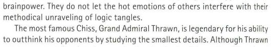
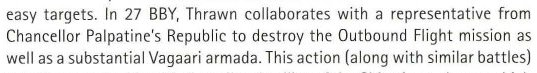
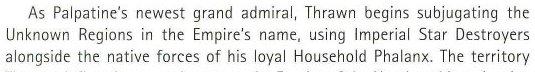
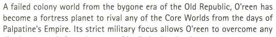

# Owner Material 037 — Star Wars D20 Drive folder (Core, Revised Core and Saga Edition): Sourcebooks/The Unknown Regions.pdf [Star Wars Roleplaying Game Saga Edition (2007)] (scan pages 121–180)

- **Source:** Wizards of the Coast Star Wars Roleplaying Game books, web enhancements, Living Force campaign modules and articles (2000–2010), from the owner's "Star Wars D20" Drive folder (only the three edition subfolders; "General" was not read, as instructed). Secondary source (licensed Legends reference). Scan OCR'd on the box; the scan stays box-only and is **not** published.
- **Method:** every scanned page was OCR'd and machine-screened sentence by sentence for power-relevant statements (fights, kills, defeats, Force feats, rankings, superweapons) that name a character on our roster; each kept sentence is quoted verbatim from the OCR text and has a crop of the printed passage directly under it. Pages with nothing power-relevant are still listed with what is on them.
- **Citation:** "*The Unknown Regions* (SWRPG Saga Edition), p.X" by printed page ("scan p.X" where no printed number applies). **Weight:** Licensed RPG material: a secondary source. Narrative text sums up Legends lore; game statistics are rules for players, not canon power levels, and rank lowest.

## scan p.121 (scan page 121)

Page contents: Insect Swarm CL 3; Leeches CL 2; Spiner Plant CL 8 and Spiner Plant Toxin CL 8. (hand-read)

## scan p.122 (scan page 122)

Page contents: Strangle Vines CL 6; Sucking Mud CL 1; Swamp Gas CL 4. (hand-read)

## scan p.123 (scan page 123)

Page contents: Chapter V opener: Threats (art). (hand-read)

## scan p.124 (scan page 124)

Page contents: Chapter V introduction: threats of the Unknown Regions; entry format (description, motivations/methods/history, use as enemies or allies, species sidebar, antagonist stat block); Chiss Ascendancy and Killiks tie to Swarm War / Legacy of the Force era. (hand-read)

## scan p.125 (scan page 125)

Page contents: The Chiss: Description (near-Human, sleeper-ship colony on Csilla 27,000+ years BBY; ice age c. 5,000 BBY; great library on Csilla; species traits see Legacy Era Campaign Guide p12); Motivations (ruling houses, clans, Aristocras; counterintelligence); caption "A Chiss scoundrel". (hand-read)

- **Grand Admiral Thrawn** — entry/section: The Unknown Regions (Saga): "The most famous Chiss, Grand Admiral Thrawn, is legendary for his ability to outthink his opponents by studying the smallest details." Source: *The Unknown Regions* (SWRPG Saga Edition), scan p.125
  

### Stat block notes (game mechanics, not feats)

- The Chiss — Description: The most famous Chiss, Grand Admiral Thrawn, is legendary for his ability to outthink his opponents by studying the smallest details. Although Thrawn possesses exceptional genius even by the standards of his species, his rational approach is shared by the ruling families that form the operating structure of the Chiss Ascendancy. (Source: *The Unknown Regions* (SWRPG Saga Edition), scan p.125)
- The Chiss — Description: So universal is this reliance on data that a Chiss faced with a truly unpredictable scenario (and not gifted with Thrawn's ability to learn on the fly) might simply flee. (Source: *The Unknown Regions* (SWRPG Saga Edition), scan p.125)

## scan p.126 (scan page 126)

Page contents: Chiss motivations cont. (clawcraft, Nuruodo/Csapla/Inrokini/Sabosen families; no-first-strike doctrine; Cheunh); Methods (CEDF, Household and Colonial Phalanxes, 28 colony worlds); History (Brotherhood of Darkness brings Chiss to Thule c. 1,000 BBY; Thrawn). (hand-read)

- **Palpatine (Darth Sidious); Grand Admiral Thrawn** — entry/section: The Unknown Regions (Saga): "In 27 BBY, Thrawn collaborates with a representative from Chancellor Palpatine's Republic to destroy the Outbound Flight mission as well as a substantial Vagaari armada." Source: *The Unknown Regions* (SWRPG Saga Edition), scan p.126
  

### Stat block notes (game mechanics, not feats)

- The Chiss — Methods: Its clawcraft starfighter squadrons, originally of Chiss manufacture, began incorporating TIE fighter design cues after Thrawn initiated resource sharing with Palpatine's Empire. (Source: *The Unknown Regions* (SWRPG Saga Edition), scan p.126)
- The Chiss — History: Circa 1,000 BBY, agents of Lord Kaan's Brotherhood of Darkness somehow make their way to the Unknown Regions, reaching the Ascendancy and bringing back a legion of Chiss that settle the dark side planet of Thule. Chiss born on Thule soon spread into the larger galaxy. No Chiss, however, earn special note until the arrival of Thrawn. (Source: *The Unknown Regions* (SWRPG Saga Edition), scan p.126)
- The Chiss — History: Mitth'raw'nuruodo, better known by his core name of Thrawn, challenges the Ascendancy's first-strike doctrine under the belief that it makes the Chiss easy targets. In 27 BBY, Thrawn collaborates with a representative from Chancellor Palpatine's Republic to destroy the Outbound Flight mission as well as a substantial Vagaari armada. This action (along with similar battles) puts Thrawn at odds with the ruling families of the Chiss Ascendancy, which banish him to a primitive world. There, a Star Destroyer finds him and brings him back to the Empire for Imperial naval training. (Source: *The Unknown Regions* (SWRPG Saga Edition), scan p.126)

## scan p.127 (scan page 127)

Page contents: Chiss history cont. (Yuuzhan Vong "Far-Outsiders"; Ssi-ruuk war; Vagaari war over Outbound Flight; Killik Joiners; Swarm War 36 ABY); Using the Chiss (stand-in for Empire; Household Phalanx more aggressive; Csilla data libraries); Chiss Species Traits sidebar. (hand-read)

- **Palpatine (Darth Sidious); Grand Admiral Thrawn**: "As Palpatine's newest grand admiral, Thrawn begins subjugating the Unknown Regions in the Empire's name, using Imperial Star Destroyers alongside the native forces of his loyal Household Phalanx." Source: *The Unknown Regions* (SWRPG Saga Edition), scan p.127
  

### Stat block notes (game mechanics, not feats)

- The Chiss — History: As Palpatine's newest grand admiral, Thrawn begins subjugating the Unknown Regions in the Empire's name, using Imperial Star Destroyers alongside the native forces of his loyal Household Phalanx. The territory Thrawn defines becomes known as the Empire of the Hand, and it maintains an uneasy standoff with the Chiss Ascendancy. Many Aristocras unofficially support Thrawn's renegade actions, under the belief that his proactive stance will keep them safe. (Source: *The Unknown Regions* (SWRPG Saga Edition), scan p.127)
- The Chiss — History: After the Battle of Endor, Thrawn's forces clash with the Ssi-ruuvi Imperium, allowing the CEDF to invade Ssi-ruuk territory once the reptilians strike back against Ascendancy worlds. (Source: *The Unknown Regions* (SWRPG Saga Edition), scan p.127)
- The Chiss — History: In 9 ABY, Thrawn returns to the civilized galaxy to rally the Empire's remnants, but he falls to an assassin's blade. Following the collapse of Thrawn's plot to return via cloning ten years later, his Empire of the Hand largely merges into the Ascendancy. Chiss dominion over the heart of the Unknown Regions becomes even more absolute. (Source: *The Unknown Regions* (SWRPG Saga Edition), scan p.127)
- Using the Chiss: The first surprise could come when they meet elements of Thrawn's Household Phalanx but mistake them for vessels of the CEDF. Thrawn's forces have a far more aggressive approach to discouraging outsiders. (Source: *The Unknown Regions* (SWRPG Saga Edition), scan p.127)
- Using the Chiss: Another potential scenario is the need to penetrate Thrawn's territory to locate a wanted Imperial officer currently serving in the Empire of the Hand. (Source: *The Unknown Regions* (SWRPG Saga Edition), scan p.127)

## scan p.128 (scan page 128)

Page contents: The Ebruchi: Description (pirates; humanoid, feeding tentacles; dress as rank); Ebruchi Species Traits sidebar (+2 Str, +2 Con, -2 Wis, -2 Cha; Conditional Bonus Feat Improved Damage Threshold; Iron Will; Unsettling; Ebruchese); Motivations (greed and fear). (hand-read)

## scan p.129 (scan page 129)

Page contents: Ebruchi motivations cont. (agoraphobia, pragmatism; outsiders join as Ebruchi); Methods (pack-hunter tactics, false feasts, hostages, outposts, shrapnel pistols, languages); History (devastated by Vagaari; at least five clans). (hand-read)

## scan p.130 (scan page 130)

Page contents: Ebruchi organization (clans, fleets, armadas, flotillas; no repulsorlifts); Using the Ebruchi; sidebar Captain Ness (book-original Ebruchi leader of the Burning Gear flotilla) with stat block CL 10 (noble 5/soldier 2/officer 3). (hand-read)

## scan p.131 (scan page 131)

Page contents: Killiks: Description (former spawnworld Alderaan; hives/nests, hive mind, Joiners via pheromones; palindromic hive names). (hand-read)

## scan p.132 (scan page 132)

Page contents: Killik Motivations; Killik Species Traits sidebar (size range, Medium traits: +2 Con, -2 Int, Joiners, Low-Light Vision, Hive Mind, Multiple Limbs, Natural Armor, Natural Weapons, Killik and Sy Bisti); history (three Force-users crash during Yuuzhan Vong invasion, Dark Nest Crisis 35 ABY, Swarm War); Methods begin. (hand-read)

## scan p.133 (scan page 133)

Page contents: Killik methods (membrosia; hive mounds — Castle Lands of Oroboro on Alderaan destroyed by Death Star; war hives Kolosolok, Rekker, Aebea, Qeeq, Gorog, Mollom, Jooj, Taat, Wuluw); History (Celestials, Centerpoint Station/Qolaraloq, Maw, Vultar; Killik Twilight; Dark Nest, Night Herald, Unseen Queen; Dark Nest Crisis, Swarm War); Using the Killiks. (hand-read)

### Stat block notes (game mechanics, not feats)

- Killiks — History: But in the midst of the Yuuzhan Vong war, a ship carrying three Force-users—one Jedi and two dark siders—crashes in Killik space. The Jedi, Raynar Thul, becomes a Joiner in the powerful Unu hive, and his Force abilities lead him to become the public face of a new, reunified Killik Colony. (Source: *The Unknown Regions* (SWRPG Saga Edition), scan p.133)

## scan p.134 (scan page 134)

Page contents: Using the Killiks cont. (new breeds; Swarm War campaigns, Sorcerers of Rhand); Killik Dartship sidebar (spitcrete, ramming, Shard-class capital ships, nest ships) with stat block CL 9 and Dartship Ram. (hand-read)

## scan p.135 (scan page 135)

Page contents: Lugubraa: Description (blind, heat spots and echolocation, tentacles, splitlings, elder geniuses ~age 50); caption "A Lugubraa"; Motivations (appetite, hordes, mercenary work, elder brokers). (hand-read)

## scan p.136 (scan page 136)

Page contents: Lugubraa Species Traits sidebar (+2 Str, -2 Dex, +2 Con, -2 Wis; Improved Damage Threshold; Darkvision; Natural Weapons; Lockbite; Lugubraa Learning; Lugubraal); Methods (sentries, soldiers, invasive biological weapon — Croke "Leech Legions"); History (Stratos Distribution; Croke Reach; Kaminoan-bred berserker variant). (hand-read)

## scan p.137 (scan page 137)

Page contents: Using the Lugubraa (Gamorrean analog; mandatory escorts; overpopulated worlds); sidebar Lorgrombo (book-original elder Lugubraa broker) with stat block CL 8 (nonheroic 15/noble 3). (hand-read)

## scan p.138 (scan page 138)

Page contents: Mnggal-Mnggal: Description (gray ooze on Mugg Fallow; shapeshifting; infects and animates hosts); Motivations (speaks in verse and riddles; malevolent; desires control); Methods begin; caption "Mnggal-Mnggal prepares to take a Human host." (hand-read)

### Stat block notes (game mechanics, not feats)

- Mnggal-Mnggal — Description: Mnggal-Mnggal is the whispered horror of the Unknown Regions—a shapeless, pitiless creature that toys with its living prey in the way that a felinx tortures a dying scurrier. (Source: *The Unknown Regions* (SWRPG Saga Edition), scan p.138)
- Mnggal-Mnggal — Description: It seems apparent that Mnggal-Mnggal is a single being and not a species, although at any given moment, it appears in thousands of places simultaneously across the galaxy. (Source: *The Unknown Regions* (SWRPG Saga Edition), scan p.138)
- Mnggal-Mnggal — Motivations: Mnggal-Mnggal speaks in verse, metaphor, and riddles, often using ancient languages or adopting forgotten conventions of speech. Some say that it is a deceiver and that every word it utters is either a lie or flattery. (Source: *The Unknown Regions* (SWRPG Saga Edition), scan p.138)
- Mnggal-Mnggal — Motivations: Mnggal-Mnggal desires control, and the entity has staked its claim to thousands of worlds in the great spiral galaxy that it has inhabited far longer than the ephemeral beings that are its playthings. Extinguishing individual lives appears to be a source of lazy amusement. (Source: *The Unknown Regions* (SWRPG Saga Edition), scan p.138)

## scan p.139 (scan page 139)

Page contents: Mnggal-Mnggal methods cont. (infection, seeds, vulnerabilities to fire/acid/poison); History (Celestials, Mugg Fallow, derelict fleet ring, Viis Empire, Croke and Lugubraa, Project Blackwing); Using Mnggal-Mnggal (zombie encounters, ingested seed, strike on Mugg Fallow). (hand-read)

### Stat block notes (game mechanics, not feats)

- Mnggal-Mnggal — History: Mnggal-Mnggal is an ancient creature that claims to have witnessed the golden age of the Celestials and their sudden withdrawal from the galaxy circa 30,000 BBY. (Source: *The Unknown Regions* (SWRPG Saga Edition), scan p.139)
- Mnggal-Mnggal — History: A fleet of derelict starships encircles the world in a dull metallic ring, each one steered into orbit by infected zombies and stored there as a macabre decoration. The collection contains vessels from every era of space travel, including rare Gree sailships and at least one fully laden treasure barge commissioned by Xim the Despot. (Source: *The Unknown Regions* (SWRPG Saga Edition), scan p.139)
- Using Mnggal-Mnggal: Mnggal-Mnggal is a clear-cut enemy. The entity is a cruel and evil killer, and its actions are not mitigated by the need to feed or reproduce. (Source: *The Unknown Regions* (SWRPG Saga Edition), scan p.139)

## scan p.140 (scan page 140)

Page contents: Mnggal-Mnggal lore at Csilla library, Chiss bounty; stat blocks: Mnggal-Mnggal (Medium beast 8; amorphous, flying fragment, Mnggal-Mnggal seed) and Mnggal-Mnggal Zombie CL 8 (beast 8). (hand-read)

### Stat block notes (game mechanics, not feats)

- Mnggal-Mnggal (stat block): Mnggal-Mnggal / Medium* beast 8 ... Feats Force Sensitivity, Running Attack, Trip (Source: *The Unknown Regions* (SWRPG Saga Edition), scan p.140)

## scan p.141 (scan page 141)

Page contents: The Rakata: Description (Infinite Empire c. 30,000 BBY; plague severs Force link; Bukesek, Ikalik, Droot breeds; priests and warriors; species traits see KOTOR Campaign Guide p18); Motivations (Rakatan Archipelago — Fitomp, Hilak, Makatak, Tulpaa; vivisection to rediscover the Force). (hand-read)

## scan p.142 (scan page 142)

Page contents: Rakata Methods (skipships of Makatak and Tulpaa Elders; mind traps; scaled-down Star Forges; mutated slave species — Malata Wookiees, Persappa rancors, Griwstrick sand panthers); History (Lehon, Infinite Empire, Force-drives; defeat of Gree and Kwa; plague and slave revolt 25,200 BBY; flight to Rakatan Archipelago). (hand-read)

## scan p.143 (scan page 143)

Page contents: Using the Rakata (archaeology adventures; disruptor fields; mind traps disgorging Sharu criminals and Kwa super-soldiers); sidebar Elder Ruthic (book-original Tulpaa leader, Gengh-Noghri guards, book-original Sith adviser Raspir) with stat block CL 7 (noble 4/soldier 3). (hand-read)

### Stat block notes (game mechanics, not feats)

- The Rakata — History: Lehon returns to prominence in 3956 BBY, after Darth Revan reactivates the Star Forge and triggers the Jedi Civil War. But the planet's population continues to dwindle, and by 1000 BBY, the Rakata are believed extinct. (Source: *The Unknown Regions* (SWRPG Saga Edition), scan p.143)
- Elder Ruthic (sidebar): Lurking in the shadows of her ruling temple is Raspir, a pure-blooded Sith released from a mind trap prison when Ruthic banished her opponents to the same device. Raspir once served Sith King Adas as a court magician. (Source: *The Unknown Regions* (SWRPG Saga Edition), scan p.143)

## scan p.144 (scan page 144)

Page contents: Sorcerers of Rhand: Description (Perann Nebula; book-original chronicler Succate's account of decayed forms); Motivations (faith in the Dark/entropy, future sight); Sorcerer of Rhand Species Traits sidebar (-2 Str, -2 Dex, +4 Int, +2 Wis, -2 Cha; Force Sensitivity; Dark-Infused; Repulsive Appearance; special qualities). (hand-read)

## scan p.145 (scan page 145)

Page contents: Sorcerers of Rhand methods (Nihil Retreat; Darksight; battle-meditation analog; Nihil smokestone, Pawns, shadow crowns; Darkshear); History per Succate (Knell of Muspilli and Taurannix Codex; Kanzer Exiles under Lord Ravager Korman Lao; Taung Warriors of the Shadow vs. Battalions of Zhell; Rhand and Rhandites); Lord Cronal/Blackhole; Using the Sorcerers of Rhand begins; caption "A Sorcerer of Rhand". (hand-read)

### Stat block notes (game mechanics, not feats)

- Sorcerers of Rhand — History: Prior to the Battle of Yavin, Lord Cronal, Director of Imperial Intelligence and one of Emperor Palpatine's trusted Hands, gains understanding of the Dark from the Sorcerers of Rand. Cronal renames himself Blackhole, signifying his desire to become an event horizon to draw all life into the Dark's abyss. Unlike the Sorcerers, Cronal augments his knowledge with Sith secrets from Korriban and the teachings of the Prophets of the Dark Side on Dromund Kaas. (Source: *The Unknown Regions* (SWRPG Saga Edition), scan p.145)
- Sorcerers of Rhand — History: In 5 ABY, after using his warrior-puppet Lord Shadowspawn to devastate the Inner Rim, Cronal attempts to seize control of Luke Skywalker during the Battle of Mindor. Skywalker thwarts his efforts and Cronal vanishes, later appearing in Imperial service in a greatly diminished capacity. (Source: *The Unknown Regions* (SWRPG Saga Edition), scan p.145)

## scan p.146 (scan page 146)

Page contents: Using the Sorcerers cont. (relics; reaching Nihil Retreat and Rhand); sidebar Blessed Toxmalb (book-original Rhandite Lorekeeper) with stat block CL 16 (noble 7/Force adept 5/Force disciple 4), Darkflies and Shadow Crown. (hand-read)

## scan p.147 (scan page 147)

Page contents: Ssi-ruuk: Description (Lwhekk, P'w'ecks, caste colors, warriors); caption "A Ssi-ruuk warrior"; Motivations (G'nnoch Holy Myth, four eggs, consecrated worlds, entechment; His Potency the Shreeftut; Conclave vs. Elders Council). (hand-read)

## scan p.148 (scan page 148)

Page contents: Ssi-ruuk Species Traits sidebar (+2 Str, -2 Wis; Skill Focus (Persuasion) conditional; Force Blind; Keen Smell; Natural Armor; Ssi-ruuvi); Methods (entechment; caste roles; ion paddle beamers; consecration; Shree-, Sh'ner-, Fw'Sen-class ships); History (cluster cleansed; expansion; Palpatine deal; Bakura Incident, Shriwirr). (hand-read)

### Stat block notes (game mechanics, not feats)

- Ssi-ruuk — Methods: During the invasion of Bakura, the Ssi-ruuk hope to use Luke Skywalker to drain life energy from a distance and entech thousands remotely. Later, they remain on the hunt for a replacement Force-user of comparable ability. (Source: *The Unknown Regions* (SWRPG Saga Edition), scan p.148)
- Ssi-ruuk — History: Palpatine contacts the Shreeftut and agrees to sacrifice colony worlds in exchange for the secrets of Ssi-ruuvi entechment technology. (Source: *The Unknown Regions* (SWRPG Saga Edition), scan p.148)
- Ssi-ruuk — History: Immediately following Palpatine's death at Endor, word reaches the victorious Rebel Alliance that the Ssi-ruuk have attacked the distant planet of Bakura. The subsequent battle, recorded in New Republic annals as the Bakura Incident, sees the defeat of the Ssi-ruuk and the capture of their flagship, the Shriwirr. (Source: *The Unknown Regions* (SWRPG Saga Edition), scan p.148)

## scan p.149 (scan page 149)

Page contents: Ssi-ruuk history cont. (Yuuzhan Vong plot, consecration of Bakura, P'w'eck revolt, military dictatorship); Using the Ssi-ruuk (capture for entechment; hunt for Force-user after Endor; Lwhekk predators). (hand-read)

### Stat block notes (game mechanics, not feats)

- Ssi-ruuk — History: Simultaneous with the Bakura Incident come a number of actions deep in the Unknown Regions, at least one of which involves a strike on elements belonging to Grand Admiral Thrawn's Household Phalanx. After Thrawn's counterattack triggers a shooting war (ensuring the Chiss Ascendancy that "first strike" protocol has technically been followed), an armada of the Chiss Expansionary Defense Force follows the Ssi-ruuk back to their home star cluster and decimates their holdings. (Source: *The Unknown Regions* (SWRPG Saga Edition), scan p.149)
- Ssi-ruuk — History: Taking advantage of the birth of a rainbow-colored Ssi-ruu known as the Keeramak, a disguised Yuuzhan Vong agent arranges for the motley mutant to lead Lwhekk's oppressed slaves under the banner of the P'w'eck Emancipation Movement. The Keeramak makes new contact with Bakura, this time promising peace. (Source: *The Unknown Regions* (SWRPG Saga Edition), scan p.149)
- Using the Ssi-ruuk: After the Battle of Endor, the Ssi-ruuk—which have seen the extent of Luke Skywalker's power—wish to line up a suitable replacement so they can entech users from a distance. (Source: *The Unknown Regions* (SWRPG Saga Edition), scan p.149)

## scan p.150 (scan page 150)

Page contents: The Tofs: Description (peripheral halo, satellite galaxy Firefist/"Companion Besh"; anachronistic sailing-ship culture); Tof Species Traits sidebar (+2 Str, -2 Dex, -2 Wis, +2 Cha; Large; Rapid Shot or Rapid Strike; conditional Mighty Swing; Tof Fearlessness; Tof); Motivations (pursuit of pleasure). (hand-read)

## scan p.151 (scan page 151)

Page contents: Tof motivations cont. (hedonism, drunkenness, catatonia when shaken); Methods (starsail galleons, longboats, Fotia's Fire, starfighters, the Supreme; melee preference; hereditary monarchy and 20 percent rule); History (waterworld Tof; Faruun, Maccabree, Nagai; Nagai invasion of the Skyriver after Endor). (hand-read)

## scan p.152 (scan page 152)

Page contents: Tof history end (Nagai retake homeworld with Mandalorian help); Using the Tofs; Royal Fortune Light Clipper sidebar with stat block CL 15. (hand-read)

### Stat block notes (game mechanics, not feats)

- Tofs — History: Excited by the prospect of new worlds to smash and happy to humiliate the Nagai, the Tofs strike at Trenwyth, Zeltros, and Saijo and make a pact with the Dark Lady Lumiya. The leader of the Tof assault, Prince Sereno, makes his temporary palace on Saijo, where he becomes a target for an Alliance counterattack. Luke Skywalker personally forces Sereno's surrender by holding two lightsabers to his throat. (Source: *The Unknown Regions* (SWRPG Saga Edition), scan p.152)

## scan p.153 (scan page 153)

Page contents: Vagaari: Description (two mouths, pureweed, fright masks; Miskara; living-shield blisters); caption "A Vagaari"; Motivations (narcissism, acting, nomadism, fleet upkeep). (hand-read)

## scan p.154 (scan page 154)

Page contents: Vagaari Methods (living shields, pseudograv projectors and "crawlspace", stasis collars, wolvkils, line creepers, schostri and schostri toxin cloud); Vagaari Species Traits sidebar (+2 Str, -2 Wis; conditional Skill Focus (Deception); Frightening Visage; Bioknowledge; Vagaari, Sy Bisti). (hand-read)

## scan p.155 (scan page 155)

Page contents: Vagaari History (Vagar Praxut in Kharmort's Miasma; Outbound Flight trap 27 BBY; 22 ABY strike; Yuuzhan Vong pact and biotech from 23 ABY); Using the Vagaari; Surfeik Cruiser sidebar (Arized-built) with stat block CL 16. (hand-read)

### Stat block notes (game mechanics, not feats)

- Vagaari — History: That changes with the arrival of Thrawn, who uses the Republic's Outbound Flight mission to lure the Vagaari into a trap and decimate their fleet in 27 BBY. The Vagaari spend the next 50 years rebuilding and plotting their revenge on the mongrel Chiss who dared to engineer their defeat. (Source: *The Unknown Regions* (SWRPG Saga Edition), scan p.155)
- Vagaari — History: In 22 ABY, the Vagaari strike back, attempting to steal the remains of Outbound Flight and kill the Chiss negotiators present at the wreck site. Luke Skywalker and Mara Jade Skywalker bring the Vagaari plot to a halt, but all is not lost for the Vagaari Empire. (Source: *The Unknown Regions* (SWRPG Saga Edition), scan p.155)

## scan p.156 (scan page 156)

Page contents: Surfeik Cruiser weapons (living shield blisters, projectile launcher, pseudograv projector); Vagaari Infiltrator with stat block CL 5 (nonheroic 6/scoundrel 3). (hand-read)

## scan p.157 (scan page 157)

Page contents: Chapter VI opener: Planets (art). (hand-read)

## scan p.158 (scan page 158)

Page contents: Chapter VI introduction: eight new book-original worlds for Saga Edition; entry contents; sidebar Knowledge Checks in the Unknown Regions (+10 DC for known-space characters). (hand-read)

## scan p.159 (scan page 159)

Page contents: 244Core: overview; gazetteer (arid, heavy gravity, corporate, capital Relaali Zone One); Knowledge (Bureaucracy/Galactic Lore/Social Sciences) DC tables (Eeook Mining and Reclamation, Tor-Ro-Bo Industries, Pricon Metals); History begins (Systino crime syndicate names it Sraato, fifty years before Jedi Civil War). (hand-read)

## scan p.160 (scan page 160)

Page contents: 244Core history cont. (Systino era ends in meteor storm; rediscovery 200 BBY by Tor-Ro-Bo and Eeook; book-original Omenada mediator Relaali; Chief Administrator and Corporate Committee; Yuuzhan Vong-era meteor storm; Eeook Corporation in Legacy era). (hand-read)

## scan p.161 (scan page 161)

Page contents: 244Core Locations (Eeookko, Relaali/Zone One, Skyscan 6, the Dump); Factions (Eeook Mining and Reclamation, Systino and the Sio, Tor-Ro-Bo Industries). (hand-read)

## scan p.162 (scan page 162)

Page contents: 244Core Adventure Ideas (Bad Timing, Industrial Espionage, Power Grab; high gravity see core p257); Hazards: Meteorite Storm CL 10, Meteor Shower CL 15. (hand-read)

## scan p.163 (scan page 163)

Page contents: Altiria/Anarris: overview; gazetteer (temperate; Altiri representative democracy, capital Cerdana; Anarrian dictatorship, capital Rastar); Knowledge (Galactic Lore/Social Sciences) DC tables; History (civilization c. 6,000 BBY; first meeting at sea; global war at time of Jedi Civil War; island wars). (hand-read)

## scan p.164 (scan page 164)

Page contents: Species of the Contested Planet sidebar: Altiri traits (Visually Striking, Bonus Trained Skill, Altirish and Basic) and Anarrian traits (Strength Surge, Bonus Feat, Anarrese and Basic); History cont. (second great war under Empire, regression before Yuuzhan Vong invasion, arms race). (hand-read)

## scan p.165 (scan page 165)

Page contents: Altiria/Anarris Locations (Cerdana; Priva moon and Shalla colony; Rastar; Secava moon and Kolrak; Shanuk Island); hazard Forgotten Minefield CL 13 begins. (hand-read)

## scan p.166 (scan page 166)

Page contents: Forgotten Minefield CL 13 cont.; Altiria/Anarris Factions (Altirian Republic; Anarrian Empire since Mandalorian Wars era); Adventure Ideas (Doomsday Mission, Strange Visitors, Let's Make a Deal with a Rakata merchant, Unlikely Allies). (hand-read)

## scan p.167 (scan page 167)

Page contents: Durace: overview (Old Republic cruiser Galaaron; ghost ships Nebula Stalker and Another Chance; curse legend); gazetteer (toxic and barren, no sapients); Knowledge (Galactic Lore) DC table; History (discovered c. 5,000 BBY in Great Hyperspace War era; CIS probe droid in Clone Wars; rumored Order 66 refuge; Inquisitors rumor). (hand-read)

## scan p.168 (scan page 168)

Page contents: Sidebar What Happened to Durace? (deliberately a mystery); History cont. (Outpost 17 under New Republic, destroyed in Yuuzhan Vong invasion; treasure legends); Environment (black soil, gales, quakes, acid rain, predators, deadly flora; Sith holocron references). (hand-read)

### Stat block notes (game mechanics, not feats)

- Durace — History: The planet falls into obscurity during the reign of Emperor Palpatine. The Emperor places little emphasis on exploring the Unknown Regions, and a planet like Durace does not have much to offer the massive war machine of the Empire. However, some of the local wildlife is quietly captured and shipped across the galaxy. Allegedly, the beasts that evolved to survive in the Forest of Broken Glass are very receptive to the ancient alchemical techniques of the Sith. Emperor Palpatine alters the more vicious creatures, making them even deadlier, and uses them to guard his secret projects throughout the galaxy. (Source: *The Unknown Regions* (SWRPG Saga Edition), scan p.168)
- Durace — History: The nature of the treasure changes with the telling of the story—sometimes the wreckage is said to hold enough valuable ore to pay off ten freighter loans, and sometimes the prize is the last lightsaber built by Grand Master Luke Skywalker. (Source: *The Unknown Regions* (SWRPG Saga Edition), scan p.168)

## scan p.169 (scan page 169)

Page contents: Durace Hazards: Scavenged Supplies CL 4; Storm Over Durace CL 9; Jagged Sinkhole CL 7; Carnivorous Plants of Durace CL 11. (hand-read)

## scan p.170 (scan page 170)

Page contents: Durace Locations (Pictograph Caverns, Diamond Desert, Forest of Broken Glass); Adventure Ideas (Hunters with book-original Duanna Falos; Ghost Camp; A Deadly Discovery with GB-3P0 and Lord Bolleon; Fields of Promise — alparas flowers, Alkaline Sea; For You, Half Price). (hand-read)

## scan p.171 (scan page 171)

Page contents: Giaca: overview (hyperspace tangle); gazetteer (temperate, no government, Station 3Z3); Knowledge (Life/Physical/Social Sciences) DC tables (basalt columns, active northern range, rumored ancient surveillance station); History (Rakatan outpost; Shor rediscovery 100 years before Jedi Civil War; Peroenia). (hand-read)

## scan p.172 (scan page 172)

Page contents: Giaca history cont. (Shor–Peroenia war 300 years; Station 300 expanded to Station 3Z3 twenty years before Clone Wars; colony by Endor, 50,000 by fall of Galactic Alliance); Locations: Station 3Z3, Maruuk's Nook. (hand-read)

## scan p.173 (scan page 173)

Page contents: Giaca Locations cont. (Glasspoint); Factions (Criminals and Rogues; the Peroenians, Tallpeak, Peroen-Se; the Shorak); Adventure Ideas (Initial Approach astrogation +5/+10 DC; Glasspoint Meeting). (hand-read)

## scan p.174 (scan page 174)

Page contents: Giaca Adventure Ideas cont. (Shorak Patrol; Surviving Giaca); creature Brintak CL 15 (Huge beast 15; poison, pounce, roar). (hand-read)

## scan p.175 (scan page 175)

Page contents: Iol: overview (airless, durasteel ore); gazetteer (corporate, capital Haven); Knowledge (Galactic Lore/Social Sciences) DC tables (Tangan Industries; book-original administrator Elexia Nis'tar); History (scout's claim hijacked by Tangan c. 4,500 BBY; three domed cities; Revanchist trade; Miners' Union; Imperial-era settlement). (hand-read)

### Stat block notes (game mechanics, not feats)

- Iol — History: During the time of the Mandalorian Wars and the Jedi Civil War, Iol is found by a group of ships wandering through the area. Led by a Jedi Knight known as the Revanchist, they negotiate with the administrator of the colony for a sizable amount of fuel and supplies in exchange for technology that the Revanchist has no need to keep. Although the transaction is not sanctioned by Tangan Industries, its board of directors turns a blind eye since they are the ultimate recipients of the technology. (Source: *The Unknown Regions* (SWRPG Saga Edition), scan p.175)

## scan p.176 (scan page 176)

Page contents: Iol Locations: Haven (five domes, governance, starport, repulsortrains; Elexia Nis'tar married to Durro Tangan); Menelath (book-original Chadra-Fan Tol Ferin). (hand-read)

## scan p.177 (scan page 177)

Page contents: Iol Locations cont. (Ralak Canyon; Shirkel, book-original Twi'lek Anoon'olan and Miners' Union leader Kai Lunn); Hazards: Building Decompression CL 14, Floating Away CL 5. (hand-read)

## scan p.178 (scan page 178)

Page contents: Iol Factions (Tangan Industries, Miners' Union, Merchants' Consortium); Adventure Ideas (Buried Alive; Power Play; A Simple Errand with book-original cantina owner Kin Thalin and crystals; Revolution). (hand-read)

### Stat block notes (game mechanics, not feats)

- Iol — A Simple Errand: He has heard stories that some of the crystals were taken long ago by the Revanchist and his fellow warriors to power their weapons. (Source: *The Unknown Regions* (SWRPG Saga Edition), scan p.178)

## scan p.179 (scan page 179)

Page contents: O'reen: overview (failed Old Republic colony turned fortress world); gazetteer (military dictatorship, capital Fort Maximus); Knowledge (Galactic Lore/Social Sciences) DC tables (the Magnus); History (post-Great Hyperspace War advance-warning colonies; fifth colony survives under a disgraced captain). (hand-read)

- **Palpatine (Darth Sidious)**: "A failed colony world from the bygone era of the Old Republic, O'reen has become a fortress planet to rival any of the Core Worlds from the days of Palpatine's Empire." Source: *The Unknown Regions* (SWRPG Saga Edition), scan p.179
  

## scan p.180 (scan page 180)

Page contents: O'reen history cont. (bloodless coup, Magnus title; citizen/civilian caste; corporate ship captured; supply raids; Clone Wars incident with Vornskr Company under Jedi General Morningfire, death of the Magnus, Senate quarantine; Yuuzhan Vong era); sidebar O'reenians (near-Human traits); Locations: Fort Maximus. (hand-read)

