# Owner Material 037 — Star Wars D20 Drive folder (Core, Revised Core and Saga Edition): Sourcebooks/Threats of the Galaxy.pdf [Star Wars Roleplaying Game Saga Edition (2007)] (scan pages 1–60)

- **Source:** Wizards of the Coast Star Wars Roleplaying Game books, web enhancements, Living Force campaign modules and articles (2000–2010), from the owner's "Star Wars D20" Drive folder (only the three edition subfolders; "General" was not read, as instructed). Secondary source (licensed Legends reference). Scan OCR'd on the box; the scan stays box-only and is **not** published.
- **Method:** every scanned page was OCR'd and machine-screened sentence by sentence for power-relevant statements (fights, kills, defeats, Force feats, rankings, superweapons) that name a character on our roster; each kept sentence is quoted verbatim from the OCR text and has a crop of the printed passage directly under it. Pages with nothing power-relevant are still listed with what is on them.
- **Citation:** "*Threats of the Galaxy* (SWRPG Saga Edition), p.X" by printed page ("scan p.X" where no printed number applies). **Weight:** Licensed RPG material: a secondary source. Narrative text sums up Legends lore; game statistics are rules for players, not canon power levels, and rank lowest.

## scan p.1 (scan page 1)

Page contents: Front cover: Star Wars Roleplaying Game — Threats of the Galaxy (Saga Edition); cover art of General Grievous with lightsabers; authors' names. (hand-read)

## scan p.2 (scan page 2)

Page contents: Title page: Threats of the Galaxy; designers Gary Astleford, Eric Cagle, Robert J. Schwalb, John Snead, Patrick Stutzman, Rodney Thompson. (hand-read)

## scan p.3 (scan page 3)

Page contents: Credits page: designers, developer Rodney Thompson, editors, managers, cartographer, interior artists; rules based on Saga Edition core rulebook and D&D; Wizards of the Coast addresses; ISBN 978-0-7869-4781-2; first printing March 2008; ©2008 Lucasfilm. (hand-read)

## scan p.4 (scan page 4)

Page contents: Table of contents: Introduction; Chapter I Characters (Adept through Warrior, with named entries Captain Typho, Aurra Sing, Bossk, Desann, Bail Organa, Darth Maul, Lumiya, Darth Bane, Zakarisz Ghent, Talon Karrde, Clone Commander CC-2224, Mandalorian Supercommando, etc.); Chapter II Creatures (Corellian Banshee Bird to Womp Rat); Chapter III Droids (Artillery Droid to Worker Droid). (hand-read)

## scan p.5 (scan page 5)

Page contents: Introduction chapter opener art: Yoda, Obi-Wan Kenobi, Padmé Amidala, Leia and planets; title "Introduction". (hand-read)

## scan p.6 (scan page 6)

Page contents: Introduction text: the richness of the galaxy; Threats of the Galaxy as companion volume to the Saga Edition offering creatures, droids, and people from nearly every era; Using This Book (Chapter One characters, Chapter Two creatures, Chapter Three droids); For the Gamemaster; For the Player (new species, gear, vehicles, talents, feats, droid options). Art of Luke Skywalker. (hand-read)

## scan p.7 (scan page 7)

Page contents: Building Great Encounters: the book as a toolbox; What You Need to Play sidebar (Saga Edition core rulebook, SE; Starships of the Galaxy, SG, optional); Environment (pick three elements: environmental hazard, interesting terrain, something for everyone); Environmental Hazards (weather, lava, steam jets, machinery, poison gas, pit traps); Terrain (cover, levels, illusion of space with limited movement); Something for Everyone. (hand-read)

- **Qui-Gon Jinn; Darth Maul** — entry/section: Threats of the Galaxy (Saga): "For example, when Qui-Gon Jinn fought Darth Maul on Naboo, their duel spread across a large area, though in truth their movement was somewhat restricted." Source: *Threats of the Galaxy* (SWRPG Saga Edition), scan p.7
  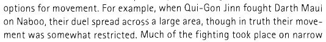
- **Darth Vader (Anakin Skywalker)**: "Although Anakin is more than a match for these minor soldiers, he's constantly dealing with the changing and very hazardous atmosphere, even losing his lightsaber to the well-timed stamp of a machine." Source: *Threats of the Galaxy* (SWRPG Saga Edition), scan p.7
  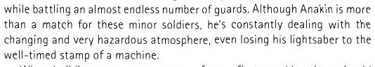
- **Qui-Gon Jinn**: "This duel covered a lot of ground, and the environment changed as it developed, but although there was a sense of space, the particular encounters took piace in controlled environments where the Jedi fought on the bridge, the tunnel, and finally the power generator area, where Qui-Gon was killed." Source: *Threats of the Galaxy* (SWRPG Saga Edition), scan p.7
  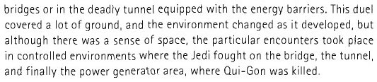

### Stat block notes (game mechanics, not feats)

- Environment: The action sequences in the films never take place in a 5-square-by-5-square room, and neither should yours. Consider the droid manufacturing plant on Geonosis from Attack of the Clones. Anakin and Padmé run through a massive industrial environment, weaving their way through dangerous machinery while battling an almost endless number of guards. Although Anakin is more than a match for these minor soldiers, he's constantly dealing with the changing and very hazardous atmosphere, even losing his lightsaber to the well-timed stamp of a machine. (Source: *Threats of the Galaxy* (SWRPG Saga Edition), scan p.7)
- Terrain: Terrain is also important for controlling the scope of the battlefield. Star Wars is full of huge, sweeping environments, and battle scenes are often doubly exciting because of all of the action going on in the background. The trick is to create the illusion of space by providing large areas, but with limited options for movement. For example, when Qui-Gon Jinn fought Darth Maul on Naboo, their duel spread across a large area, though in truth their movement was somewhat restricted. Much of the fighting took place on narrow bridges or in the deadly tunnel equipped with the energy barriers. This duel covered a lot of ground, and the environment changed as it developed, but although there was a sense of space, the particular encounters took place in controlled environments where the Jedi fought on the bridge, the tunnel, and finally the power generator area, where Qui-Gon was killed. (Source: *Threats of the Galaxy* (SWRPG Saga Edition), scan p.7)
- Something for Everyone: A character who is a skilled pilot might not have much to do when not battling TIE fighters in space, but an encounter in a starship hangar could give that character a chance to make use of his skills much as Anakin did when Padmé led her forces into the palace to liberate Naboo from the Trade Federation occupiers in The Phantom Menace. (Source: *Threats of the Galaxy* (SWRPG Saga Edition), scan p.7)

## scan p.8 (scan page 8)

Page contents: Adversaries: Numbers (four to eight opponents; individual CLs 4 or 5 below heroes' level; encounter CL within 1 or 2 of party level); Variety (mix CLs and types; officer CL 8, commando squad leader CL 10, mercenary captain CL 5); Function (obstacles, minor encounters, major encounters); Common Abilities sidebar defining Darkvision, Low-Light Vision, and Scent (SE 73). (hand-read)

## scan p.9 (scan page 9)

Page contents: Chapter I Characters opener art: Darth Sidious, Darth Vader, Boba Fett, General Grievous. (hand-read)

## scan p.10 (scan page 10)

Page contents: Chapter I introduction: character archetypes from Jedi Masters to Sith Lords, swoop gangs, soldiers, traders, medics; generic statistics usable as villains, contacts, allies, minions; generic characters not tied to a species (use Human plus one trained skill and a bonus feat, or adapt ability modifiers and size); some entries include unique named characters from the films and Expanded Universe. (hand-read)

## scan p.11 (scan page 11)

Page contents: Adept, Force: Force Adept CL 8 stat block (soldier 7/Force adept 1; vibroaxe; Damage Reduction 10, Equilibrium; battle strike, Force slam, move object, surge); description of Force adepts as non-Jedi/Sith Force traditions, this one a violent dark-side melee adept; Force Adept Encounters (cabals, mystics p59, varactyls p126, accompanying Dark Jedi or Sith apprentices); Dathomiri Witch introduction (female Human Force-users of Dathomir, clan edict "Never concede to evil," Nightsisters as dark-side exception). (hand-read)

## scan p.12 (scan page 12)

Page contents: Dathomiri Witch CL 10 stat block (scout 7/Force adept 3; Charm Beast, Command Beast, Flight, Force Talisman; Dathomiri rancor companion); Dathomiri Witch Encounters (riding rancors); Tribal Shaman description (healers, "healers of words" mediators) and Tribal Shaman CL 9 stat block (noble 5/scout 2/Force adept 2; farseeing, mind trick, vital transfer); Tribal Shaman Encounters. (hand-read)

## scan p.13 (scan page 13)

Page contents: Assassin CL 10 stat block (scoundrel 7/soldier 3; vibroblade, blaster pistol and rifle; Sneak Attack +3d6, Dastardly Strike, Sniper); description (assassins kill for money; snipers versus close killers; the Assassins Guild offers protection, membership needs only a sponsor); Assassin Encounters (minimize collateral damage; may lead teams, use assassin droids, espionage droids, kouhuns p113; retreat when outmatched). (hand-read)

## scan p.14 (scan page 14)

Page contents: Datadagger sidebar (simple weapon hidden in a code cylinder, SE 134; +5 Stealth to conceal; Tiny, cost 500, 1d4, illegal); Malkite Poisoner CL 13 stat block (scoundrel 9/noble 4; datadagger, dioxis, knockout drops, paralytic poison); Malkite Poisoner description (Malkii poison masters operating in deep cover); Malkite Poisoner Talent Tree sidebar: Malkite Techniques (once per encounter apply toxin; 1d20 + heroic level vs. Fortitude; 1d6 + half heroic level and -1 condition step; Treat Injury DC 10 + heroic level), Modify Poison, Numbing Poison, Undetectable Poison (+5 DC), Vicious Poison (+2 attack). (hand-read)

## scan p.15 (scan page 15)

Page contents: Bodyguard CL 6 stat block (soldier 5/nonheroic 3; Draw Fire, Harm's Way, Tough as Nails); description (paid protector who puts the client's priorities first, dresses inconspicuously); Bodyguard Encounters (with nobles on Coruscant, Neimoidia, Hapes; on retainer or temporary); Captain Typho introduction. (hand-read)

### Stat block notes (game mechanics, not feats)

- Captain Typho: Born on Naboo and raised in the shadow of the Royal Naboo Court, Gregar Typho grew up wanting to serve the Queen as one of her guard. He finally got his chance and completed his training at many of the same offworld academies attended by his uncle, Captain Panaka. Typho joined the Palace Guard and served with pride in that capacity until the Trade Federation blockaded the planet. (Source: *Threats of the Galaxy* (SWRPG Saga Edition), scan p.15)

## scan p.16 (scan page 16)

Page contents: Captain Typho CL 8 stat block (Medium Human soldier 5/noble 3; Born Leader, Distant Command, Draw Fire, Harm's Way, Tough as Nails; languages Basic, Gunganese, High Galactic, Huttese; blaster pistol, blast vest, comlink). (hand-read)

- **Padmé Amidala**: "Had the use of decoys not been put into place, Padmé would have surely died when her Naboo Royal Cruiser was destroyed on a landing pad on Coruscant on the day of the Military Creation Act vote." Source: *Threats of the Galaxy* (SWRPG Saga Edition), scan p.16
  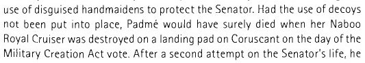

### Stat block notes (game mechanics, not feats)

- Captain Typho: During the fateful battle, Typho fought alongside his uncle, showing courage and resolve in the heat of battle. Despite his exceptional training, he became injured and lost his left eye. The serious wound did not slow down the young soldier. Recognized for his valor and his uncompromising loyalty, Typho was promoted to captain and assigned as Amidala's Head of Security when Padmé stepped down from the throne and became Senator of the Chommell Sector. Although many accused Typho of using his family connections to gain the distinguished position, they did not realize that it was not his uncle who made the decision. Following his uncle's lead, Typho did his best to implement stronger security measures and adopted many of Panaka's practices, including the use of disguised handmaidens to protect the Senator. Had the use of decoys not been put into place, Padmé would have surely died when her Naboo Royal Cruiser was destroyed on a landing pad on Coruscant on the day of the Military Creation Act vote. After a second attempt on the Senator's life, he was told to remain behind and keep up appearances by guarding the decoy, Dormé, as if she were the Senator, while Padmé returned to Naboo with the Padawan Anakin Skywalker. (Source: *Threats of the Galaxy* (SWRPG Saga Edition), scan p.16)
- Captain Typho: After the outbreak of the Clone Wars, Typho stayed close to Amidala's side, choosing to apply tighter security during the conflict. He traveled with her aboard her yacht and stayed at her apartments on Coruscant and Naboo. Four months into the war, Yoda was aboard Padmé's starship when he sensed a disturbance in the Force coming from the planet Ilum. Yoda suggested they on a rescue mission to the icy planet. Typho sternly disapproved, stating that the risks were too high. Despite his objections, the captain was coerced through the Force by Yoda to proceed with the rescue. (Source: *Threats of the Galaxy* (SWRPG Saga Edition), scan p.16)
- Captain Typho: Captain Typho continued to serve under Amidala throughout the Clone Wars, defending her against assassination attempts on Coruscant and Naboo. Following the end of the war, a troubled Padmé prepared to depart to Mustafar to confront her husband about the death of the younglings at the Jedi Temple. Typho tried to go with her, but she insisted on traveling with only C-3PO. The next time Typho saw her was at her funeral. Remaining in the Naboo security force and choosing not to side with the Empire, Typho worked to establish a spy network to keep watch over the Imperial occupation, even as the Empire wanted to keep an eye on the Naboo Royal Security forces. Months after Amidala's passing, he worked with Ferus Olin to remove the Imperial presence from Naboo, even though the victory was only temporary. (Source: *Threats of the Galaxy* (SWRPG Saga Edition), scan p.16)
- Captain Typho: Captain Typho is a highly skilled and able soldier whose loyalties lie strictly with Naboo and its leadership. Stern yet sincere, he is not afraid to express his thoughts and opinions to get the job done and is always looking out for Amidala's best interests. His dedication to Padmé and Naboo is unswerving. He is an expert shot, despite the loss of his eye, and a capable pilot. (Source: *Threats of the Galaxy* (SWRPG Saga Edition), scan p.16)

## scan p.17 (scan page 17)

Page contents: Bounty Hunter CL 12 stat block (nonheroic 3/scout 4/bounty hunter 5; familiar foe +2, Hunter's Mark, Hunter's Target, Nowhere to Hide; stun grenades); description (ambiguous gray area between heroes and villains; serve Hutts, Outer Rim, the Emperor); Bounty Hunter Encounters (notorious hunter leading 2-3 minions; tenuous alliances; pairing with assassins); Aurra Sing introduction. (hand-read)

### Stat block notes (game mechanics, not feats)

- Aurra Sing: If cold detachment is a rule for bounty hunters, Aurra Sing is the exception. Born to a spice addict on Nar Shaddaa, she had Force potential, a trait a mysterious Jedi known only as the Dark Woman discovered. Freed from the horrors of her birth world, she spent several years studying at the Jedi Temple in Coruscant, but her life would take another turn. (Source: *Threats of the Galaxy* (SWRPG Saga Edition), scan p.17)

## scan p.18 (scan page 18)

Page contents: Aurra Sing CL 12 stat block (Medium near-Human scoundrel 3/Jedi 2/scout 4/bounty hunter 3; Destiny 1; 5 lightsabers, slugthrower rifle, 2 blaster pistols, Rhen-Orm Biocomputer, ion-repulsorlift swoop, Corellian blockade runner); Bossk introduction. (hand-read)

- **Bossk**: "He failed, and Solo destroyed his ship, stranding the bounty hunter on the wretched planet and leading to the grudge that Bossk would carry for the rest of his days." Source: *Threats of the Galaxy* (SWRPG Saga Edition), scan p.18
  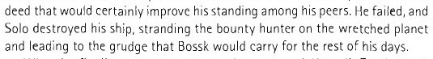

### Stat block notes (game mechanics, not feats)

- Aurra Sing: While she was on a mission to Ord Namurt, star pirates captured young Sing, telling their prisoner that the Dark Woman had sold her to them. Sing was enraged and clung to the hate filling her heart, giving her the resolve to spend the rest of her life hunting Jedi. She learned much from the pirates. She became a pilot, a navigator, a killer, and a fighter. Her expertise worried the cutthroats and they thought she might turn against them, so at the first opportunity, they sold her to a Hutt named Wallanooga, who soon after turned her over to the Anzati, a breed of alien vampires, to settle an old debt. These new masters saw in Sing a useful tool, and trained and altered her body to suit their purposes. When their modifications were complete, they set her loose on the galaxy, at which point she promptly returned to the Hutt and killed him in cold blood. Free for the first time, Aurra Sing did what she could to survive. She became a ruthless killer and bounty hunter, specializing in Jedi, whom she blamed for all of the ills in her life. With her training, talents with the Force, and augmentations given to her by her former Masters, she scoured countless worlds in her search for her former mistress to get the revenge she so desperately craved. (Source: *Threats of the Galaxy* (SWRPG Saga Edition), scan p.18)
- Bossk: Born to the cruel Cradossk, leader of the Bounty Hunters Guild on Trandosha, Bossk made a name for himself hunting escaped Wookiee slaves, a dangerous profession for just about any species aside from the Trandoshans. Bossk expanded his targets to include non-Wookiees, giving him fame and credibility as a skilled bounty hunter. It was during these early years that Bossk had his first encounter with Han Solo and his partner Chewbacca. After cornering the pair on a planet that served as a refuge for escaped Wookiees, he tried to take Solo's partner alive, a deed that would certainly improve his standing among his peers. He failed, and Solo destroyed his ship, stranding the bounty hunter on the wretched planet and leading to the grudge that Bossk would carry for the rest of his days. When he finally escaped on the newly purchased Hound's Tooth, Bossk returned to his homeworld to find the Bounty Hunters Guild in tatters. Bossk murdered his father and devoured his remains, just as the guild collapsed into two warring factions. The savagery of Bossk's act catapulted him to head of the Guild Reform Committee—those younger bounty hunters committed to the destruction of their rivals, the true guild, which they believed had long outlived its usefulness. (Source: *Threats of the Galaxy* (SWRPG Saga Edition), scan p.18)
- Rhen-Orm Biocomputer: The Anzati surgically implanted a biocomputer in Aurra Sing's skull to expand her range of awareness and sense those who have uncommon "luck." The computer processes information received from a long antenna that protrudes from her forehead. The result of this implant is that when Aurra Sing makes a Survival check to track an opponent, she adds her quarry's Force Point total as an equipment bonus to her checks. A Rhen-Orm Biocomputer must be installed by a character who has the Cybernetic Surgery feat, and is counted as a cybernetic prosthesis. (Source: *Threats of the Galaxy* (SWRPG Saga Edition), scan p.18)

## scan p.19 (scan page 19)

Page contents: Bossk CL 12 stat block (Medium Trandoshan scout 5/soldier 3/bounty hunter 4; darkvision; limb regeneration; blaster rifle, flamethrower, grenade launcher with stun grenades, sporting blaster pistol, padded flight suit, Hound's Tooth); Hound's Tooth CL 12 stat block (Colossal space transport, quad laser cannons, medium concussion missiles, ion cannon; crew 1 Bossk, 4 prisoners). (hand-read)

### Stat block notes (game mechanics, not feats)

- Bossk: As the guild disintegrated, Darth Vader handpicked Bossk and other hunters to hunt down the Millennium Falcon. Although Bossk's fellows saw this as a great opportunity to bring in Han Solo—the bounty on his head was quite steep—Bossk wanted Chewbacca. His efforts ultimately failed as setback after setback, most of which were orchestrated by Boba Fett, brought him to the brink of ruin, culminating with a stint in prison. (Source: *Threats of the Galaxy* (SWRPG Saga Edition), scan p.19)
- Hound's Tooth: Bossk flies a modified YV-666 light freighter. Its hangar holds a small scout ship called the Nashtah Pup, a modified Z-95 Headhunter (SG 160). (Source: *Threats of the Galaxy* (SWRPG Saga Edition), scan p.19)

## scan p.20 (scan page 20)

Page contents: Jango Fett CL 15 stat block (Medium Human scout 3/scoundrel 3/soldier 3/gunslinger 3/bounty hunter 2/elite trooper 1; Destiny 1; 2 blaster pistols, flamethrower gauntlet, rocket dart launcher, saberdart launcher, whipcord, Mandalorian armor, jet pack with missile launcher, antisecurity blades, Slave I SG 85). (hand-read)

- **Jango Fett** — entry/section: Threats of the Galaxy (Saga): "WwANGO FETT Bounty hunter, assassin, and mercenary, in his day Jango Fett was one of the most feared individuals in the galaxy." Source: *Threats of the Galaxy* (SWRPG Saga Edition), scan p.20
  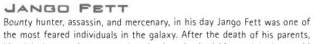
- **Count Dooku; Jango Fett** — entry/section: Threats of the Galaxy (Saga): "After chasing Komari Vosa, the former apprentice of Count Dooku, across the galaxy, Jango Fett finally caught up with her and killed her; this was no smal!" Source: *Threats of the Galaxy* (SWRPG Saga Edition), scan p.20
  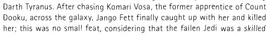
- **Count Dooku; Jango Fett**: "After chasing Komari Vosa, the former apprentice of Count Dooku, across the galaxy, Jango Fett finally caught up with her and killed her; this was no smal! feat, considering that the fallen Jedi was a skilled lightsaber duelist and a master of the Force." Source: *Threats of the Galaxy* (SWRPG Saga Edition), scan p.20
  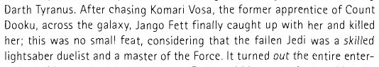

### Stat block notes (game mechanics, not feats)

- Jango Fett (Saga CL 15): CL 15 Medium Human scout 3/scoundrel 3/soldier 3/qunslinger 3/bounty hunter 2/elite trooper 1 Destiny 1; Force 8; Dark Side 8 Init +16; Senses low-light vision; Perception +16 Languages Basic, Bocce, Huttese Defenses Ref 37 [flat-footed 33), Fort 33, Will 29 hp 104; Threshold 33 Speed 6 squares, fly 6 squares (jetpack) Melee combat g (Source: *Threats of the Galaxy* (SWRPG Saga Edition), scan p.20)
- Jango Fett: Bounty hunter, assassin, and mercenary, in his day Jango Fett was one of the most feared individuals in the galaxy. After the death of his parents, Mandalorian warriors adopted, trained, and raised him, a debt he would repay when he led them during the Mandalorian Civil War. (Source: *Threats of the Galaxy* (SWRPG Saga Edition), scan p.20)
- Jango Fett: Perhaps the most important event in Jango Fett's long career was meeting Darth Tyranus. After chasing Komari Vosa, the former apprentice of Count Dooku, across the galaxy, Jango Fett finally caught up with her and killed her; this was no small feat, considering that the fallen Jedi was a skilled lightsaber duelist and a master of the Force. It turned out the entire enterprise had been a test to see if Jango Fett would be a worthy candidate to become a template for a new clone army. Tyranus offered an incredible sum of money, but Fett's true desire was an unmodified clone to raise himself, a clone he would name Boba. Jango Fett spent the next decade devising training regimens for the clones, instructing them in Mandalorian culture and fighting techniques while seeing to the education and training of his "son." During this time, Jango also undertook a variety of missions on behalf of Tyranus and occasionally others, including bounty hunting. (Source: *Threats of the Galaxy* (SWRPG Saga Edition), scan p.20)
- Jango Fett's Special Equipment: Jango Fett is a walking arsenal, armed with a staggering amount of firepower. Although much of his gear is self-explanatory, functioning as described in the Saga Edition core rulebook or in his statistics block, a few items deserve special mention. Saberdart Launcher: Jango Fett is armed with a Kamino saberdart launcher. The darts themselves deal little damage, but the poison they carry is lethal. When a living creature is damaged by a Kamino saberdart, the poison in the dart makes an attack roll (1d20+15) against the target's Fortitude Defense. If the attack succeeds, the poison deals 2d6 points of damage and the target moves -2 steps along the condition track. If the attack fails, the target takes half damage and moves -1 step along the condition track. If the target reaches the end of the condition track, it dies instead of falling unconscious. The poison attacks each round until the target is cured with a successful DC 25 Treat Injury check. Jet Pack: Jango Fett's jet pack integrates a missile launcher and a magnetic grappling hook that functions as a liquid cable dispenser. Antisecurity Blades: These electronic devices allow Jango Fett to bypass force fields and jam security devices with bursts of high-frequency harmonic interference waves. They function as a security kit and grant a +2 equipment bonus to Mechanics checks made to disable devices. (Source: *Threats of the Galaxy* (SWRPG Saga Edition), scan p.20)

## scan p.21 (scan page 21)

Page contents: Brute CL 1 stat block (nonheroic 3; blaster carbine, tough-looking clothes); description (crude, unsubtle gang members or crime soldiers motivated by greed, power, fear, loyalty; despise authority; can represent militia or raw conscripts without Dark Side Score); Brute Encounters (pairs or groups; swayed by intimidation, persuasion, bribes; best at lower levels, scale up or pair with powerful leaders or droids). (hand-read)

## scan p.22 (scan page 22)

Page contents: Bureaucrat CL 1 stat block (nonheroic 3; Knowledge bureaucracy +12; blaster pistol, code cylinder, datapad); description (minor officials, cogs in the political machine, often self-important or ambitious); Bureaucrat Encounters (obstacles or fonts of information; rarely end in violence; protected by security droids, mercenaries, bodyguards; first to head for the exit). (hand-read)

## scan p.23 (scan page 23)

Page contents: Commando CL 6 stat block (nonheroic 8/soldier 4; Indomitable, Tough as Nails; commando armor); description (soldiers for hostile environments, stealth, demolitions, hit-and-run); Commando Encounters (teams of two to four under an officer; ambushes; supplemental forces for high-level heroes); Squad Leader introduction (officer training, snap decisions, few casualties). (hand-read)

## scan p.24 (scan page 24)

Page contents: Commando Squad Leader CL 10 stat block (nonheroic 8/soldier 5/officer 3; Assault Tactics, Burst Fire, command cover, share talent); Elite Commando description ("one-man army" veterans) and Elite Commando CL 14 stat block (soldier 14; Battle Analysis, Cover Fire, Demolitionist, Juggernaut; battle armor, detonite). (hand-read)

## scan p.25 (scan page 25)

Page contents: Con Artist CL 3 stat block (nonheroic 3/scoundrel 2; Disruptive; Deception +13, Persuasion +13; cheater, code cylinder); description (small-time crooks versus long-con grifters); Con Artist Encounters (lesson "Trust no one you don't know"; long-con teams; avoid violence, protect themselves with blackmail and befuddlement). (hand-read)

## scan p.26 (scan page 26)

Page contents: Crime Lord CL 12 stat block (noble 7/scoundrel 2/crime lord 3; Attract Minion, Born Leader, Connections, Inspire Fear I; antique vibroblade, enforcers); description (refined, cosmopolitan crime lord, cold and cruel beneath charm; duels with antique vibroblade); Crime Lord Encounters (upper society, sabacc, legal methods first then goons; may act as patron or recruiter). (hand-read)

## scan p.27 (scan page 27)

Page contents: Black Sun Vigo: description of Black Sun (piracy and smuggling; a single boss and nine Vigos, old Tionese term for "nephew"); this brutish Vigo prefers force; two Black Sun Vigo CL 14 stat blocks (Medium Rodian soldier 6/scoundrel 1/crime lord 7 with heavy blaster pistols; Medium Bith scoundrel 7/crime lord 5/gunslinger 2); Bith Species Traits sidebar (+2 Int, -2 Con; Medium; speed 6; Evolved Intellect; Heightened Awareness; Meditative Trance; language Bith). (hand-read)

## scan p.28 (scan page 28)

Page contents: Black Sun Vigo Encounters (end-of-adventure "boss"; rules through fear; heavies, specialists, fast ships and fighter fleets); Hutt Crime Lord description (ambition, ruthlessness, greed, ego; stun baton for slaves and failed minions) and Hutt Crime Lord CL 11 stat block (Large Hutt noble 5/scoundrel 2/crime lord 4; speed 1; Force resistance; Demand Surrender); Hutt Crime Lord Encounters (proxies, fortress with traps, pets such as rancors, entry as gladiator for hire). (hand-read)

## scan p.29 (scan page 29)

Page contents: Dark Jedi CL 7 stat block (Jedi 7; Deflect, Lightsaber Defense, Power of the Dark Side; battle strike, dark rage, Force slam); description (between Jedi and Sith; former Jedi who fell, some trained by other Dark Jedi, some granted the Force artificially); Dark Jedi Encounters. (hand-read)

### Stat block notes (game mechanics, not feats)

- Dark Jedi Encounters: The potential for Dark Jedi to be located anywhere in the galaxy is high. Since a large number of them live by themselves to follow their dark pursuits, one could choose just about any planet to make his home and settle in. Whether they decide to live an urban lifestyle or establish themselves in the wilderness, Dark Jedi will locate a haven and make themselves difficult to detect, if they so choose. Historically, they have been found in such locales as the forests of Dathomir, the hidden caverns of Wayland, the Separatist fleet under the command of Count Dooku, and the halls of the Imperial capital serving the Emperor himself, enforcing the will of their master throughout the galaxy. (Source: *Threats of the Galaxy* (SWRPG Saga Edition), scan p.29)

## scan p.30 (scan page 30)

Page contents: Dark Jedi combat tactics (focus on Force-using heroes, retreat leaving associates); The Reborn (artificially Force-imbued Dark Jedi foot soldiers of the Empire Reborn; orange cloaks, red-bladed lightsabers); The Reborn CL 2 stat block (Medium Human nonheroic 6; battle strike; lightsaber, orange cloak). (hand-read)

- **Kyle Katarn**: "By deceiving Kyle Katarn into giving away the location of the Valley of the Jedi and the Force nexus located there, Hethrir increased his powers fourfold by absorbing energy from ancient Jedi and Sith spirits." Source: *Threats of the Galaxy* (SWRPG Saga Edition), scan p.30
  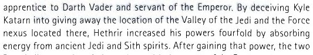
- **Jaden Korr**: "Striving to continue Desann's work, the cultists eventually made their way to Korriban, where they were defeated within the ancient Sith tombs in the Valley of the Dark Lords by Jaden Korr and a band of Jedi from Skywalker's academy." Source: *Threats of the Galaxy* (SWRPG Saga Edition), scan p.30
  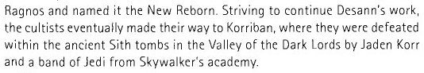

### Stat block notes (game mechanics, not feats)

- The Reborn: The Reborn is the achievement of the dream of artificially imbuing the ability to perceive and manipulate the Force into beings that didn't have it before. Working as Dark Jedi warriors, the Reborn serve as the foot soldiers of the faction known as the Empire Reborn, dedicated to returning the ideals of Emperor Palpatine back to the galaxy at large. (Source: *Threats of the Galaxy* (SWRPG Saga Edition), scan p.30)
- The Reborn: The Reborn originated with Desann, one of Luke Skywalker's former students at the Jedi Praxeum who fell to the dark side, and Hethrir, a former apprentice to Darth Vader and servant of the Emperor. By deceiving Kyle Katarn into giving away the location of the Valley of the Jedi and the Force nexus located there, Hethrir increased his powers fourfold by absorbing energy from ancient Jedi and Sith spirits. After gaining that power, the two Dark Jedi were able to imbue others with the power of the Force and use them as warriors to threaten the New Republic and Skywalker's New Jedi Order. (Source: *Threats of the Galaxy* (SWRPG Saga Edition), scan p.30)
- The Reborn: Dispatched by Desann and the Empire Reborn, the Reborn worked in conjunction with units of the Imperial Army to perform various missions across the galaxy. Desann used these missions not only to further the cause of the Empire Reborn but also to help train the Reborn for Desann's ultimate goal: the death of Skywalker and the destruction of his Jedi. They were stopped by Kyle Katarn and Rogue Squadron. (Source: *Threats of the Galaxy* (SWRPG Saga Edition), scan p.30)
- The Reborn: A short time later, those Reborn who survived the assault assembled under the leadership of Tavion Axmis, Desann's apprentice. With the assistance of the Imperial Remnant, Tavion created a Sith cult called the Disciples of Ragnos and named it the New Reborn. Striving to continue Desann's work, the cultists eventually made their way to Korriban, where they were defeated within the ancient Sith tombs in the Valley of the Dark Lords by Jaden Korr and a band of Jedi from Skywalker's academy. (Source: *Threats of the Galaxy* (SWRPG Saga Edition), scan p.30)

## scan p.31 (scan page 31)

Page contents: Dark Jedi Master CL 17 stat block (Jedi 9/Jedi Knight 5/Jedi Master 3; Destiny 1; Block, Deflect, Redirect Shot, Telekinetic Power/Savant; Force grip, Force lightning, Force slam, Force thrust; Devastating Power, Quicken Power); description (every Dark Jedi is a tragedy; a fallen Jedi Master is a tragedy beyond compare); New Dark Side Talent sidebar: Drain Knowledge (Dark Side talent tree SE 101; spend a Force Point, Use the Force vs. Will Defense; gain training or Skill Focus for one day; target -1 persistent condition step; alternatively sift for specific information with Perception; +1 Dark Side Score). (hand-read)

## scan p.32 (scan page 32)

Page contents: Dark Jedi Master Encounters (not bound by the Rule of Two; Dark Jedi apprentices; some serve the Sith as Imperial Inquisitors or Hands of the Emperor); Jerec biography; Jerec CL 19 stat block (Medium Miraluka Jedi 10/Jedi Knight 2/Jedi Master 2/noble 5; Destiny 2; Force sight; Drain Knowledge; lightsaber, vibroblade); Miraluka Species Traits sidebar (+2 Int, -2 Dex; Medium; speed 6; Force Sight, cannot detect Yuuzhan Vong or ysalamiri p131; Conditional Bonus Feat Force Training; languages Basic and Miralukese). (hand-read)

- **Jerec** — entry/section: Threats of the Galaxy (Saga): "During the Rebellion against the Empire, Jerec served as an Imperial Inquisitor, hunting down his former comrades and destroying them wherever he found them." Source: *Threats of the Galaxy* (SWRPG Saga Edition), scan p.32
  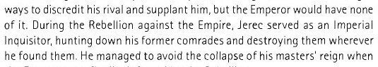
- **Darth Vader (Anakin Skywalker)**: "Loathing Darth Vader, he sought ways to discredit his rival and supplant him, but the Emperor would have none of it." Source: *Threats of the Galaxy* (SWRPG Saga Edition), scan p.32
  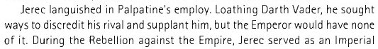

### Stat block notes (game mechanics, not feats)

- Jerec (Saga CL 19): CL 19 Medium Miraluka Jedi 10/Jedi Knight 2/Jedi Master 2/noble 5 Destiny 2; Force 7; Dark Side 16; Strong in the Force Init +17; Senses Force sight; Perception +17; Force Perception Languages Basic, Bocce, High Galactic, Huttese, Miralukese, Zabrak Defenses Ref 36 (flat-footed 33, Lightsaber Defense 38), Fort 35, Will 36; Block, Def (Source: *Threats of the Galaxy* (SWRPG Saga Edition), scan p.32)
- Dark Jedi Master Encounters: Dark Jedi Masters are excellent high-level villains for just about any era. Since Dark Jedi are not bound by the Rule of Two that limits the number of Sith in the galaxy, Dark Jedi Masters can coexist with the Emperor and any of his apprentices (Darth Maul, Darth Tyranus, or Darth Vader). Dark Jedi Masters have their own Dark Jedi apprentices, and there's no limit to the number of cronies they might employ. Although many Dark Jedi Masters have grand designs of their own, hatching evil plots in the shadows of the galaxy, some, such as Jerec (see below), are actually in the employ of the Sith, serving as Imperial Inquisitors, Hands of the Emperor, or in just about any other capacity the Dark Lord of the Sith can conceive. (Source: *Threats of the Galaxy* (SWRPG Saga Edition), scan p.32)
- Jerec: As a Jedi, Jerec learned the fundamentals of the Force, and more important, he learned the value and power of knowledge. When the opportunity arose for him to lead a team of Jedi into the Unknown Regions in search of lost artifacts, he took it, never suspecting (or caring, if he did suspect) the growing trouble in the Republic. While he was away, the Clone Wars raged, the Republic collapsed, and the Emperor emerged as the undisputed master of the galaxy. So when Jerec returned, nearly reaching Coruscant, he was shocked to find himself captured by an Imperial Inquisitor. His story might have ended there, had it not been for his willingness to set aside his loyalties and embrace the dark side of the Force. Jerec languished in Palpatine's employ. Loathing Darth Vader, he sought ways to discredit his rival and supplant him, but the Emperor would have none of it. During the Rebellion against the Empire, Jerec served as an Imperial Inquisitor, hunting down his former comrades and destroying them wherever he found them. He managed to avoid the collapse of his masters' reign when the Emperor was finally defeated by the Rebellion. (Source: *Threats of the Galaxy* (SWRPG Saga Edition), scan p.32)

## scan p.33 (scan page 33)

Page contents: Dark Side Adept CL 6 stat block (nonheroic 3/noble 5; Dark Presence, Power of the Dark Side, Presence; dark rage, mind trick, surge); Primitive Dark Side Adept (Force as magic or will of the gods, savage Force-users ruling tribes or serving warlords); Dark Side Adept Encounters (minions of darker Force-users; primitive adepts protected or shunned, dominating predators). (hand-read)

### Stat block notes (game mechanics, not feats)

- Dark Side Adept: This dark side adept represents the hangers-on, sycophants, and ambitious bureaucrats who curried the Emperor's favor after the disintegration of the Senate. The Emperor intended to train a new breed of noble, one completely subservient to the dark side, to replace the planetary governors who were hoping to have a more direct hand in his control over the galaxy. Many of his subjects were drawn from the fawning Senators and other officials who had long been loyal to Palpatine's government and continued to serve their Emperor after the demise of the Republic. Each would-be servant received rudimentary instruction in the Emperor's vision of the Force until the corruption in their bodies matched that in their spirits. (Source: *Threats of the Galaxy* (SWRPG Saga Edition), scan p.33)

## scan p.34 (scan page 34)

Page contents: Primitive dark side adepts as major villains hiring mercenaries, bounty hunters, assassins; Primitive Dark Side Adept CL 9 stat block (scout 7/Force adept 2; force pike, slugthrower rifle, fetish); Desann biography; Desann CL 9 stat block (Medium Chistori scout 2/Jedi 5/Force adept 2; Destiny 1; DR 2; rage; Cold-Blooded; lightsaber, Doomgiver as Imperial I-class Star Destroyer). (hand-read)

### Stat block notes (game mechanics, not feats)

- Desann: Saga CL 9 Medium Chistori scout 2/Jedi 5/Force adept 2 (Source: *Threats of the Galaxy* (SWRPG Saga Edition), scan p.34)
- Desann: Desann suffered terribly among his own people, for they had never encountered the Force or users of the Force. When his powers began to become evident, he was cast out and ridiculed as a freak, abused by friends and family alike. Desann escaped his world when he was discovered by Luke Skywalker, who recognized his potential. Under the guidance of the Jedi Master, Desann finally found the acceptance he craved. Nonetheless, fear and anger were his constant companions, and he had a tendency to bully the other students at Skywalker's academy. Rather than making friendships, he sabotaged the family he had found and became an outsider. The situation finally deteriorated beyond repair when he accidentally killed a student who had the gall to stand up for himself in the face of Desann's cruelty. (Source: *Threats of the Galaxy* (SWRPG Saga Edition), scan p.34)
- Desann: Rather than face the consequences of his actions, Desann fled the Jedi Praxeum on Yavin 4 and continued his training on his own, experimenting with the Force and using his powerful emotions to compensate for his lack of experience. He dabbled, fumbled, and eventually learned to harness the hatred and anger necessary to master the dark side. Although many of his abilities find their origins in the fundamentals presented to him by his former master, Desann is largely self-taught when it comes to the dark mysteries of the Force. When Desann had learned enough, he sought out the remnants of the Empire and sold his services to a splinter group known as the Empire Reborn. Commanding a powerful ship and supported by a fleet of starfighters, Desann would prove a potent foe for the New Jedi Order. (Source: *Threats of the Galaxy* (SWRPG Saga Edition), scan p.34)

## scan p.35 (scan page 35)

Page contents: New Species: Chistori (obscure saurian humanoids, fierce and warlike; Personality; Physical Description 1.9 m, blue or purple scales; Homeworld unknown; Language; Example Names Desann, Cydon Prax; Adventurers as bounty hunters, soldiers, assassins; Force almost unknown to them); Chistori Species Traits sidebar (+2 Str, -2 Dex; Medium; speed 6; Cold-Blooded -5 Fort in extreme cold; Armor Plating DR 2; Rage once per day, +2 melee attack and damage, lasts 5 + Con modifier rounds, then -1 persistent step; language Chistori). (hand-read)

- **Desann** — entry/section: Pull quote: ""Come, join me. You know in your heart you'll never be one of them." —Desann" Source: *Threats of the Galaxy* (SWRPG Saga Edition), scan p.35
  

### Stat block notes (game mechanics, not feats)

- Desann Encounters: Desann makes an excellent villain for mid-level campaigns set after the fall of the Galactic Empire. Desann is almost always accompanied by either a Dark Jedi or a cadre of his Reborn (page 29). During the turmoil following the Galactic Civil War, Desann can be found in many parts of the galaxy on his quest to secure more successful methods for creating his armies of dark side Force-users. Though he is not as powerful as many Jedi Masters, Desann is a dangerous foe nonetheless. He is a skilled warrior who has large amounts of resources at his disposal. Desann might also be encountered with mercenaries and other soldiers, particularly those loyal to the Imperial Remnant. Additionally, Desann has the backing of Imperial Admiral Fyyar, and he can bring down the resources of the Empire (including legions of stormtroopers) on those who get in his way. (Source: *Threats of the Galaxy* (SWRPG Saga Edition), scan p.35)
- New Species: Chistori: Example Names: Desann, Cydon Prax. (Source: *Threats of the Galaxy* (SWRPG Saga Edition), scan p.35)

## scan p.36 (scan page 36)

Page contents: Diplomat CL 3 stat block (nonheroic 6/noble 1; Presence; Deception, Perception, Persuasion +16; comlink with holo capability, diplomat's robes); description (representatives of planets, sectors, corporations before Jedi arbitrators or the Senate; some ambitious or corrupt); Diplomat Encounters (large entourages, security personnel, physicians, bodyguards; cloistered negotiations). (hand-read)

## scan p.37 (scan page 37)

Page contents: Doctor CL 1 stat block (nonheroic 3; Cybernetic Surgery, Surgical Expertise; Treat Injury +13; MDS-50 medisensor); description (hospital, country, military doctors, vile surgeons); Doctor Encounters (keep heroes on their feet; medical droids; military protection); MDS-50 Medisensor sidebar (swift action, reveals hit points, condition track, presence of disease, poison, radiation; Cost 75; Weight 0.1 kg). (hand-read)

## scan p.38 (scan page 38)

Page contents: Emergency Crew Member CL 1 stat block (nonheroic 4; Coordinated Attack; Mechanics +12; combat jumpsuit, fire extinguisher, heat sensor); description (part firefighter, part technician, part warrior; defend boarded ships); Heat Sensor sidebar (100 m range, +2 equipment bonus to Perception to detect hidden heat sources; Cost 250; Weight 0.2 kg); Emergency Crew Encounters (teams of four to six led by a specialist). (hand-read)

- **No single roster character (rules/setting/general)** — entry/section: Pull quote: ""We'll take you in." —Coruscant fire ship pilot" Source: *Threats of the Galaxy* (SWRPG Saga Edition), scan p.38
  

## scan p.39 (scan page 39)

Page contents: Engineer CL 2 stat block (nonheroic 3/scoundrel 1; Gimmick; Tech Specialist SG 21; Mechanics +14, Use Computer +14); description (technology specialists and combat engineers); Engineer Encounters (teams with technicians, droids, astromechs; Combat Engineers Battalion of the Grand Army of the Republic; noncombatants). (hand-read)

- **No single roster character (rules/setting/general)** — entry/section: Pull quote: ""We'll get to work on him right away." —Unknown Alliance technician" Source: *Threats of the Galaxy* (SWRPG Saga Edition), scan p.39
  

## scan p.40 (scan page 40)

Page contents: Gambler CL 4 stat block (scoundrel 4; Fool's Luck, Gambler; Deception +14; hold-out blaster, expensive clothes); description (cunning and smooth, mingles with high society, Lady Luck); Gambler Encounters (casinos on Coruscant, Rodia, Ord Mantell; sabacc, jubilee wheel; trade information; avoid violence). (hand-read)

- **Han Solo; Lando Calrissian** — entry/section: Pull quote: ""He's a card player, gambler, scoundrel. You'd like him." —Han Solo" Source: *Threats of the Galaxy* (SWRPG Saga Edition), scan p.40
  

## scan p.41 (scan page 41)

Page contents: Infiltrator CL 9 stat block (scout 5/scoundrel 4; Hidden Movement, Improved Stealth, Total Concealment; Acrobatics +17, Stealth +17; security kit, syntherope, droid caller); description (burglars, bag men, security testers; avoid combat); Infiltrator Encounters (calling cards; teams of slicers, technicians, commandos; ASN-121 assassin droid, Mark VII seeker droid). (hand-read)

## scan p.42 (scan page 42)

Page contents: Information Broker CL 5 stat block (nonheroic 3/scoundrel 4; Gimmick, Knack; Gather Information +14; pocket scrambler, holocam); description (infochants trading secrets for credits and favors; neutral; slicers, smugglers); Information Broker Encounters (thugs and bodyguards; cooperatives of slicers, spies, outlaw techs led by a veteran infochant). (hand-read)

## scan p.43 (scan page 43)

Page contents: Jedi Knight CL 12 stat block (Jedi 7/Jedi Knight 5; Battle Meditation, Soresu, Redirect Shot; lightsaber self-built); description (members knighted by the Jedi Council; backbone of the Order; seniority; decline in public favor; Jedi purge). (hand-read)

### Stat block notes (game mechanics, not feats)

- Jedi Knight: During the days of the Old Republic, the Jedi were far more common, and their exploits were often lauded by the public. As time passed and their numbers thinned, the supposed shortcomings of the Jedi Order became more apparent. Though they were capable warriors, the Knights were too few to wage wars alone on behalf of the Republic. When that scarcity was combined with careful smear campaigns engineered by the minions of Palpatine, average citizens began to look upon the Jedi Knights with less favor. A Jedi is often distinguished by his simple robes and his lightsaber, which is the weapon of a Jedi Knight. Following the Jedi purge, most surviving Jedi went underground. Many of those who refused to hide were destroyed by the Emperor's servants. Even those Jedi who sought to conceal their identities were hard pressed to avoid the Empire's concerted effort to find them and wipe them out. (Source: *Threats of the Galaxy* (SWRPG Saga Edition), scan p.43)

## scan p.44 (scan page 44)

Page contents: Jedi Knight Encounters (contemplative warriors, violence as last resort, close to melee, deflect fire, withdraw against overwhelming odds); Jedi Refugee (survivors of the purge acting covertly or overtly); Jedi Refugee CL 12 stat block (Jedi 7/scoundrel 2/Jedi Knight 3; Clear Mind, Dastardly Strike, Force Haze, Shii-Cho; Force disarm, Force stun). (hand-read)

- **Obi-Wan Kenobi** — entry/section: Pull quote: ""For over a thousand generations the Jedi Knights were the guardians of peace and justice in the Old Republic." —Obi-Wan Kenobi" Source: *Threats of the Galaxy* (SWRPG Saga Edition), scan p.44
  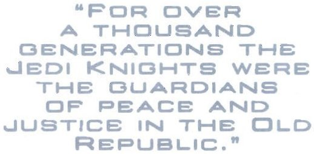
- **Palpatine (Darth Sidious)**: "Despite the deft machinations of Emperor Palpatine, a few Jedi survived this purge and continued to live on in the galaxy." Source: *Threats of the Galaxy* (SWRPG Saga Edition), scan p.44
  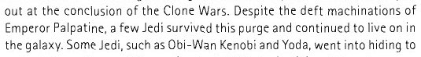

### Stat block notes (game mechanics, not feats)

- Jedi Refugee: With the fall of the Republic and the rise of the Empire, the Jedi found themselves on the wrong side of galactic authority and were all but wiped out at the conclusion of the Clone Wars. Despite the deft machinations of Emperor Palpatine, a few Jedi survived this purge and continued to live on in the galaxy. Some Jedi, such as Obi-Wan Kenobi and Yoda, went into hiding to protect themselves until it was time to fulfill their destinies. Others, however, chose not to stand by and watch as the galaxy descended farther into darkness, and took a more active hand in defending the galaxy against evil. (Source: *Threats of the Galaxy* (SWRPG Saga Edition), scan p.44)
- Jedi Refugee: Other Jedi refugees take a more active hand, such as Jedi Master Rahm Kota, who formed his own militia to take the fight to the Empire. These Jedi seek out like-minded individuals and launch overt attacks against Imperial installations and resources, inflicting as much damage as possible in an attempt to show the galaxy that the monolithic Empire can be defeated. These Jedi are almost constantly on the run, because they take no pains to hide their abilities or affiliation from the prying eyes of the Empire. With Darth Vader and the Emperor's agents always close on their heels, these Jedi refugees strike hard and fast before retreating back into the shadows until the Jedi hunters let down their guard once more. (Source: *Threats of the Galaxy* (SWRPG Saga Edition), scan p.44)

## scan p.45 (scan page 45)

Page contents: Jedi Refugee Encounters (mentors and allies in the Dark Times or Rebellion era; wary of infiltration; with soldiers, pilots and fast vehicles); Jedi Duelist (lightsaber specialists; this one an Ataru master; lightsaber practice as meditation); Jedi Duelist Encounters (supported by Jedi using Force slam and Force thrust); Jedi Duelist CL 13 stat block (Jedi 7/Jedi Knight 6; Ataru, Greater Weapon Focus and Specialization). (hand-read)

### Stat block notes (game mechanics, not feats)

- Imperial Knight: The Imperial Knights are a members of a Force-using tradition that arises during the time of Darth Krayt, some 130 years following the Battle of Yavin. Like Jedi Knights, the Imperial Knights were trained in the ways of the Force, including the use of lightsabers. Unlike the Jedi, however, Imperial Knights swore fealty to the Emperor of the period, Roan Fel, above all else. As such, members of the New Jedi Order did not recognize the Imperial Knights as true Jedi. (Source: *Threats of the Galaxy* (SWRPG Saga Edition), scan p.45)

## scan p.46 (scan page 46)

Page contents: Imperial Knight traits (silver-bladed lightsabers, red battle armor, cortosis weave gauntlets); Imperial Knight CL 10 stat block (Human Jedi 7/Jedi Knight 3; Armored Defense, Improved Armored Defense, Equilibrium; battle armor, cortosis gauntlet); Cortosis Gauntlet sidebar (ready an action, opposed unarmed melee attack vs. lightsaber attack, deactivates the lightsaber for 2 minutes; Severing Strike interaction; Cost 1,500; Weight 1 kg); Imperial Knight Encounters tactics. (hand-read)

- **Mohrgan** — entry/section: Pull quote: ""Imperial Knights! Save your Emperor!" —Mohrgan" Source: *Threats of the Galaxy* (SWRPG Saga Edition), scan p.46
  

### Stat block notes (game mechanics, not feats)

- Imperial Knight: When a Sith Lord proclaimed himself Emperor, the Imperial Knights who survived the coup worked with the former Emperor in an effort to bring down the usurper. Though only a small number of Imperial Knights are thought to have survived the coup, it is possible that others managed to do so. (Source: *Threats of the Galaxy* (SWRPG Saga Edition), scan p.46)
- Imperial Knight Encounters: During the time of Darth Krayt, Imperial Knights acted as the sworn protectors of Emperor Roan Fel. As such, they are rarely encountered away from the Emperor. Following the coup by Darth Krayt that put the Sith Lord on the galactic throne, the Imperial Knights who remained behind might be found anywhere, working to put a stop to the new Emperor's rule. (Source: *Threats of the Galaxy* (SWRPG Saga Edition), scan p.46)

## scan p.47 (scan page 47)

Page contents: Jedi Master CL 15 stat block (Jedi 7/Jedi Knight 5/Jedi Master 3; Damage Reduction 10, Force Focus, Soresu; Distant Power, Quicken Power; vital transfer); description (patience, perseverance, faith; must fully train a Padawan to become a Master). (hand-read)

- **Darth Vader (Anakin Skywalker)**: "This perceived insult, combined with Anakin's overwhelming arrogance, was instrumental in bringing the young Jedi to the dark side of the Force." Source: *Threats of the Galaxy* (SWRPG Saga Edition), scan p.47
  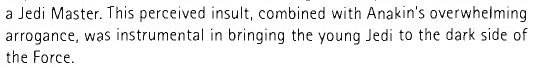

### Stat block notes (game mechanics, not feats)

- Jedi Master: For most of the history of the Jedi tradition, only Jedi Masters were placed on the Jedi Council. This state of affairs changed during the Rise of the Empire, when Anakin Skywalker was appointed to the Council by Emperor Palpatine. Although the Council respected Palpatine's insistence that Skywalker be made a member, it refused to grant the young knight status as a Jedi Master. This perceived insult, combined with Anakin's overwhelming arrogance, was instrumental in bringing the young Jedi to the dark side of the Force. (Source: *Threats of the Galaxy* (SWRPG Saga Edition), scan p.47)

## scan p.48 (scan page 48)

Page contents: Jedi Master Encounters (missions from the Council, traveling with Padawans, "aggressive negotiations"); Jedi Sage Master (scholars and keepers of knowledge, field research such as excavating Sith temples, gauging Padawan potential, Knowledge skills replaceable); Jedi Sage Master CL 15 stat block (Jedi 7/Jedi Knight 5/Jedi Master 3; Destiny 1; Adept Negotiator, Gauge Force Potential, Master Negotiator, Skilled Advisor, Visions; sever Force); Jedi Sage Master Encounters (self-defense, disarming, negotiation). (hand-read)

## scan p.49 (scan page 49)

Page contents: Jedi Battlemaster CL 15 stat block (Jedi 8/Jedi Knight 5/Jedi Master 2; Juyo, Greater Weapon Focus and Specialization); description (lightsaber masters; "aggressive negotiations" as last resort); Jedi Battlemaster Encounters (fast attacks, feints, tactical withdrawals; defers negotiation to others); Jedi Sentinel Master (Old Republic sentinels resisting the dark side, hunting rogue Jedi; yellow-bladed lightsabers; viewed with wariness). (hand-read)

## scan p.50 (scan page 50)

Page contents: Jedi Sentinel Master description continued; Jedi Sentinel Master Encounters (mentor or patron; judge, jury, and executioner); Jedi Sentinel Master CL 16 stat block (Jedi 7/Jedi Knight 5/Jedi Master 4; Dark Side Scourge, Dark Side Sense, Resist the Dark Side; sever Force (2)); The Presence of a Master sidebar (GM advice on including a Jedi Master without overshadowing the heroes). (hand-read)

- **Luke Skywalker** — entry/section: Pull quote: ""I'm not looking for a friend, I'm looking for a Jedi Master." —Luke Skywalker" Source: *Threats of the Galaxy* (SWRPG Saga Edition), scan p.50
  

### Stat block notes (game mechanics, not feats)

- The Presence of a Master: The rank of Master is conferred on Jedi who prove themselves to be not only excellent teachers but true masters of the Force. Though not every Master becomes a member of the Jedi Council, Jedi Masters are regarded as the ultimate authority on matters concerning the Force. The presence of a Jedi Master should be a momentous event in a campaign, because a Master's wisdom and knowledge is usually unparalleled. Even experienced Jedi Knights who have years of service under their belts pause to show a Jedi Master the proper respect, and those who come to the rank at a young age (such as Obi-Wan Kenobi) are both rare and revered. (Source: *Threats of the Galaxy* (SWRPG Saga Edition), scan p.50)

## scan p.51 (scan page 51)

Page contents: Jedi Padawan CL 5 stat block (Jedi 5; Deflect, Equilibrium, Telekinetic Savant; Weapon Finesse); description (apprenticeship by travel and observation; braid; one Padawan at a time); Jedi Padawan Encounters (near the Master; sometimes alone; targets for kidnappers). (hand-read)

- **Yoda** — entry/section: Pull quote: ""Truly wonderful, the mind of a child is." —Yoda" Source: *Threats of the Galaxy* (SWRPG Saga Edition), scan p.51
  

## scan p.52 (scan page 52)

Page contents: Jensaarai Defender CL 8 stat block (Jedi 5/soldier 3; Armored Defense, Attune Armor, Improved Armored Defense; ceremonial armor +7); description (Force-using warriors from Suarbi 7/5 founded by rebel Jedi in the waning days of the Republic, blending Sith teachings and Jedi philosophy; custom ceremonial armor resembling creatures); Jensaarai Encounters (secretive, defend their people, disdain for Jedi, pet vornskrs). (hand-read)

## scan p.53 (scan page 53)

Page contents: Martial Artist CL 7 stat block (soldier 7; Expert Grappler, Melee Smash, Stunning Strike, Unbalance Opponent; Martial Arts I-III; combat gloves, force pike); description (bodies as weapons; Force-using martial arts schools outside the Jedi tradition monitored by Jedi and Sith); Martial Arts and Simple Weapons sidebar (unarmed attacks count as simple weapons; combat gloves enable Weapon Specialization (simple weapons)); Martial Artist Encounters (like brutes p20 but capable; bodyguards, commandos). (hand-read)

## scan p.54 (scan page 54)

Page contents: Martial artists as crime-lord gladiators or freedom fighters slipping past scanners; Master of Teras Kasi (devastating unarmed damage); Master of Teras Kasi CL 14 stat block (soldier 7/elite trooper 7; DR 3; Teras Kasi Basics, Teras Kasi Mastery, Unarmed Counterstrike, Unarmed Parry); Master of Teras Kasi Talent Tree sidebar for the elite trooper (Ignore Damage Reduction; Teras Kasi Basics extra die; Teras Kasi Mastery full attack as standard action; Unarmed Counterstrike; Unarmed Parry with cumulative -2). (hand-read)

- **Joclad Danva** — entry/section: Pull quote: ""The art of Teräs Käsi is about control and mastery of one's self." —Joclad Danua [sic, printed for Danva], Jedi Knight" Source: *Threats of the Galaxy* (SWRPG Saga Edition), scan p.54
  

## scan p.55 (scan page 55)

Page contents: Medic CL 3 stat block (nonheroic 6/soldier 1; Battle Analysis; Treat Injury +14; 2 FastFlesh medpacs); FastFlesh Medpac sidebar (single use, no further medpac benefit for 24 hours, +5 equipment bonus to first aid; Cost 600; Weight 0.5 kg); description (rudimentary combat training); Medic Encounters (one per dozen soldiers; protected by the unit; covering fire). (hand-read)

## scan p.56 (scan page 56)

Page contents: Mercenary Soldier CL 3 stat block (nonheroic 6/soldier 1; Combined Fire; company insignia); description (loyal only to credits; organized like military units); Mercenary Scout (trailblazers and rangers); Mercenary Scout CL 3 stat block (nonheroic 3/scout 2; Improved Stealth; sporting blaster rifle with targeting scope). (hand-read)

## scan p.57 (scan page 57)

Page contents: Mercenary Heavy Infantry (backbone, vanguard, grizzled veterans); Mercenary Heavy Infantry CL 4 stat block (soldier 4; Devastating Attack (rifles); heavy blaster rifle, battle armor); Famous Mercenary Companies sidebar (Ailon Nova Guard, Black Curs, First Sun Mobile Regiment, Laramus Base Irregulars, Mistryl Shadow Guard, Red Moons, Sabaoth Squadron). (hand-read)

- **Leia Organa Solo** — entry/section: Pull quote: ""If money is all you love, then that's what you'll receive." —Princess Leia" Source: *Threats of the Galaxy* (SWRPG Saga Edition), scan p.57
  

### Stat block notes (game mechanics, not feats)

- Famous Mercenary Companies: The Expanded Universe is full of famous and infamous soldiers-for-hire. Perhaps the most widespread use of these military groups came during the Rebellion against the Galactic Empire. As the casualties mounted, the Rebel Alliance turned to hiring mercenary companies to shore up its flagging numbers. Since the Galactic Empire had restrictions against hiring mercenaries, many companies signed on to fight alongside the Rebellion, while some remained neutral in the conflict. Ailon Nova Guard: An ancient and distinguished unit, the Ailon Nova Guard consisted largely of non-Human warriors. Having long worked for the Galactic Republic, the Guard believed Senator Palpatine to be an ally, an individual who shared its belief in the survival of the fittest. However, their exploitation by the Emperor and the endless suicide missions he sent them on taught them the error of that way of thinking, so after the Battle of Endor, they helped to wipe out Imperial remnants. (Source: *Threats of the Galaxy* (SWRPG Saga Edition), scan p.57)
- Famous Mercenary Companies: Sabaoth Squadron: In the years leading up to the Clone Wars, the Sabaoth Squadron worked for Count Dooku to strengthen Separatist defenses and combat the pirates who were harassing the Separatist worlds. (Source: *Threats of the Galaxy* (SWRPG Saga Edition), scan p.57)

## scan p.58 (scan page 58)

Page contents: Mercenary Encounters (contracts; reliability and reputation; cautious tactics; organization with foot soldiers, heavy infantry, scouts, support staff; as allies, as a vehicle for PC adventures, as villain support; green mercs work for anyone); Mercenary Talent Tree sidebar for the soldier class (part of the Mercenary tree in The Force Unleashed Campaign Guide: Combined Fire +2 damage; Mercenary's Determination double speed for a Force Point; Mercenary's Grit convert penalty to bonus for 1 round; Mercenary's Teamwork +2 damage per ally, max +10). (hand-read)

## scan p.59 (scan page 59)

Page contents: Mercenary Captain CL 5 stat block (soldier 2/noble 3; Battle Analysis, Born Leader, Distant Command; Dual Weapon Mastery I); description (ex-soldiers, disenfranchised nobles, disgraced warriors); Mercenary Captain Encounters (personality shapes the unit; negotiates short, well-paid jobs). (hand-read)

## scan p.60 (scan page 60)

Page contents: Mystic CL 4 stat block (nonheroic 6/scout 3; Force Perception, Visions; farseeing, mind trick, rebuke; fetish, pouches of strange powders); description (isolated cultures using the Force as gifts of the gods or magic; prophets, sorcerers, exiles); Mystic Encounters (advisors, hermits, mystical orders, exiles turning to the dark side). (hand-read)

