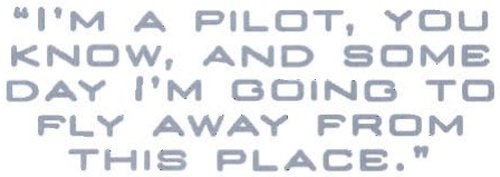
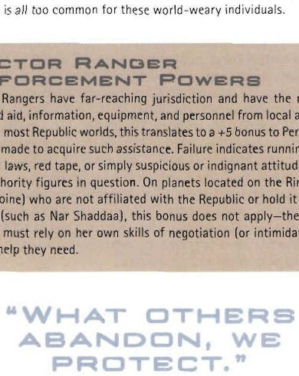
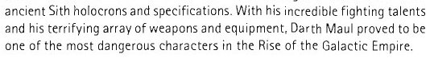
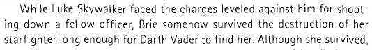
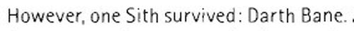
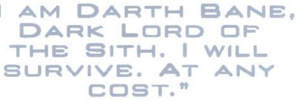
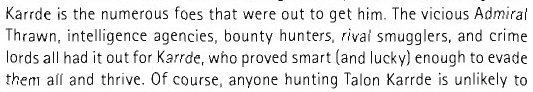
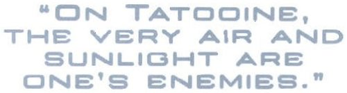

# Owner Material 037 — Star Wars D20 Drive folder (Core, Revised Core and Saga Edition): Sourcebooks/Threats of the Galaxy.pdf [Star Wars Roleplaying Game Saga Edition (2007)] (scan pages 61–120)

- **Source:** Wizards of the Coast Star Wars Roleplaying Game books, web enhancements, Living Force campaign modules and articles (2000–2010), from the owner's "Star Wars D20" Drive folder (only the three edition subfolders; "General" was not read, as instructed). Secondary source (licensed Legends reference). Scan OCR'd on the box; the scan stays box-only and is **not** published.
- **Method:** every scanned page was OCR'd and machine-screened sentence by sentence for power-relevant statements (fights, kills, defeats, Force feats, rankings, superweapons) that name a character on our roster; each kept sentence is quoted verbatim from the OCR text and has a crop of the printed passage directly under it. Pages with nothing power-relevant are still listed with what is on them.
- **Citation:** "*Threats of the Galaxy* (SWRPG Saga Edition), p.X" by printed page ("scan p.X" where no printed number applies). **Weight:** Licensed RPG material: a secondary source. Narrative text sums up Legends lore; game statistics are rules for players, not canon power levels, and rank lowest.

## scan p.61 (scan page 61)

Page contents: Officer CL 8 stat block (nonheroic 6/soldier 3/officer 3; Assault Tactics, Battle Analysis, Cover Fire, Deployment Tactics; command cover, share talent); description (field leader commanding alongside troops; rank not tied to level); Officer Encounters (squad of 6-10 or platoon of 20-30 soldiers; leading specialists). (hand-read)

## scan p.62 (scan page 62)

Page contents: Intelligence Officer (processes intelligence, expert interrogators, heavily protected); Intelligence Officer CL 10 stat block (noble 7/officer 3; Born Leader, Demand Surrender, Shift Defense I-II, Weaken Resolve); Intelligence Officer Encounters (interrogation of captured heroes; Imperial suicide orders; protocol, Viper probe and interrogation droids); The Chain of Command sidebar (officers and squad leaders make allies more dangerous through aid another and shared talents; GM should monitor difficulty). (hand-read)

## scan p.63 (scan page 63)

Page contents: Outlaw Tech CL 4 stat block (scoundrel 2/scout 2; Hyperdriven, Jury-Rigger; Mechanics and Use Computer +15; hacked code cylinder, security kit); description (technology and criminal tendencies, charismatic, keeps up on latest tech); Outlaw Tech Encounters (freelance or syndicates; fight from cover; avoid hand-to-hand). (hand-read)

## scan p.64 (scan page 64)

Page contents: Pilot CL 5 stat block (nonheroic 4/scout 4; Acute Senses, Improved Initiative; Vehicular Combat; R2 series astromech, vehicle or starship); description (fighter pilots, ship captains, tank commanders; risk-takers and mechanics); Pilot Encounters (hangars, cantinas; unit rank; protective of their vessels; can turn a ship's interior into a nightmare; crews and astromechs). (hand-read)

- **Darth Vader (Anakin Skywalker)** — entry/section: Pull quote: ""I'm a pilot, you know, and some day I'm going to fly away from this place." —Anakin Skywalker" Source: *Threats of the Galaxy* (SWRPG Saga Edition), scan p.64
  

## scan p.65 (scan page 65)

Page contents: Ace Pilot (starfighter as extension of will); Ace Pilot CL 14 stat block (scoundrel 7/ace pilot 7; Elusive Dogfighter, Keep It Together, Relentless Pursuit, Spacehound, Starship Raider, Stellar Warrior; vehicle dodge +3); New Feat sidebar: A Few Maneuvers (prerequisites Dodge, Vehicular Combat; +2 dodge bonus to vehicle Reflex Defense for Colossal or smaller; missile or torpedo missing by 5 or more self-destructs); Ace Pilot Encounters (legendary reputations attract would-be "top guns"). (hand-read)

- **Wedge Antilles; Corran Horn; Luke Skywalker** — entry/section: Pull quote: ""You're good, Corran, but you're no Luke Skywalker." —Wedge Antilles" Source: *Threats of the Galaxy* (SWRPG Saga Edition), scan p.65
  

## scan p.66 (scan page 66)

Page contents: Elite Pilot CL 10 stat block (scoundrel 4/soldier 3/ace pilot 3; Armored Defense, Elusive Dogfighter, Vehicular Evasion; armored flight suit); description (more common veterans; squadrons such as Rogue Squadron and Saber Squadron of the 181st Imperial Fighter Group); Elite Pilot Encounters (starfighter combat; squadrons escort, patrol, guard; protect their aces; friendly rivalries). (hand-read)

## scan p.67 (scan page 67)

Page contents: Pirate CL 6 stat block (nonheroic 6/scout 2/scoundrel 2; Jury-Rigger, Sneak Attack +1d6; vibroaxe); description (from bloodthirsty crews to pirates with codes; some never kill, some strike only Imperial ships); The Blazing Claw sidebar (symbol of piracy, a fiery talon, romanticized on holovids; to deep-space crews it means the threat of death); Privateer (letters of marque and reprisal; veneer of legitimacy). (hand-read)

## scan p.68 (scan page 68)

Page contents: Privateer CL 9 stat block (nonheroic 4/soldier 3/scoundrel 5; Hyperdriven, Spacehound, Starship Raider; all-temperature cloak); Pirate Encounters (ambushes from asteroid belts; cripple engines and sensors; demand surrender, board; prisoners ransomed, sold or stranded; furloughs; many pirates sided with the Rebellion; the Rebel Alliance hired privateer fleets). (hand-read)

## scan p.69 (scan page 69)

Page contents: Pirate Captain CL 11 stat block (scoundrel 5/noble 4/ace pilot 2; Demand Surrender, Presence, Vehicular Evasion; capital ship); description (flamboyant rogues to grim brutes; disgraced nobles, ex-slaves, fugitives; keep the crew happy to avoid mutiny); Pirate Captain Encounters (captain shapes the crew; commands a freighter or larger with starfighter support). (hand-read)

## scan p.70 (scan page 70)

Page contents: Police Officer stat block (nonheroic 6; Pin; stun baton, combat jumpsuit); description (keep the peace; authority varies by world; bribery; stats usable for security guards and private defense contractors); Police Officer Encounters (light armor, blasters on stun, cruiser weapons; work in pairs, backup in 1d10 minutes; droid partners on wealthier worlds). (hand-read)

## scan p.71 (scan page 71)

Page contents: Veteran Politician CL 11 stat block (nonheroic 6/noble 9; Born Leader, Connections, Presence, Weaken Resolve, Wealth); description (bureaucrats, ambassadors, judges, princes, ministers); Senators across the Republic, Empire and New Republic eras; Moffs; dissolution of the Senate; New Senate. (hand-read)

### Stat block notes (game mechanics, not feats)

- Veteran Politician (the Senate): The Senate has always been a critical component of the galactic government, but during the dark days leading up to the Clone Wars, the Senate was rife with corruption, so much so that it languished and proved unable to attend to any threat at all. This weakness enabled the charismatic Senator Palpatine to seize the position of Supreme Chancellor, after which he steadily worked to consolidate his power. With the outbreak of the Clone Wars and the formation of the Grand Army of the Republic, Palpatine installed regional governors, called Moffs, to oversee the galaxy's sectors and exert control over unruly populations, nominally to shore up their defenses against the Separatists. This act further weakened the Senate, reducing it to the point of utter uselessness. Through the support of his growing military presence and the authority he vested in the Moffs, the Supreme Chancellor was eventually able to dissolve the Senate and reform the outmoded Republic into the Galactic Empire. After the conclusion of the Civil War, and the apparent death of the Emperor, the ways of the Galactic Republic were restored and a new Senate was formed. (Source: *Threats of the Galaxy* (SWRPG Saga Edition), scan p.71)

## scan p.72 (scan page 72)

Page contents: Veteran Politician Encounters (shielded by bodyguards; better as allies or charges; "faceless villains" using mercenaries, assassins and bounty hunters); Bail Organa bio; Bail Organa CL 9 stat block (Medium Human noble 9; Born Leader, Connections, Educated, Inspire Confidence, Presence; blaster pistol, comlink, datapad). (hand-read)

### Stat block notes (game mechanics, not feats)

- Bail Organa: Noted as one of the principal architects of the Rebellion, Bail Organa—the adopted father of Leia Organa—long championed the cause of freedom and was a staunch supporter of democracy. At first, Bail Organa was one of Chancellor Palpatine's close allies, for both were disgusted by the stagnancy pervading the Galactic Senate, but as Palpatine's power grew and the Senate's role waned, Organa's suspicions and fears came to the forefront. His association with his former ally weakened, and soon he became Palpatine's active opponent, fighting against the formation of the clone army and later against Palpatine's naked grabs for power. It was during this time that Bail Organa joined forces with the Jedi High Council, many members of which shared Organa's concerns about the Clone Wars and Palpatine's growing strength. In the end, Bail Organa's efforts and those of his allies, Mon Mothma and others, failed and the Galactic Empire was born. Organa continued to serve in the Senate, hoping to bring about change from within. The Emperor would eventually force his hand as the cruelties and evil of the Empire grew unchecked. After the Empire wiped out hundreds of protestors, Bail Organa was resolved to topple the regime and helped form the Alliance to Restore the Republic, which eventually became known as the Rebel Alliance. (Source: *Threats of the Galaxy* (SWRPG Saga Edition), scan p.72)

## scan p.73 (scan page 73)

Page contents: Saboteur CL 8 stat block (scoundrel 4/soldier 4; Demolitionist, Knack, Gimmick); description (destroy or subtly disable machinery so it fails at the worst moment; secret weapons such as Clone Wars clone soldiers or the two Death Stars; technician plus spy or commando; work alone or with a few companions). (hand-read)

## scan p.74 (scan page 74)

Page contents: Saboteur Encounters (factories and research labs; commando saboteurs vs. infiltrator saboteurs posing as employees); Twi'lek Saboteur (infiltration and subtle sabotage, manipulating people, avoid armor); Twi'lek Saboteur CL 6 stat block (scoundrel 4/soldier 2; deceptive); Twi'lek Saboteur Encounters (forgettable technician; corporate sabotage demonstrated before the Queen of Naboo; vets clients). (hand-read)

## scan p.75 (scan page 75)

Page contents: Sector Ranger CL 7 stat block (soldier 4/scout 2/scoundrel 1; Evasion, Hyperdriven, Improved Armored Defense; combat jumpsuit); description (Corps of Rangers from the Old Republic; region-wide jurisdiction; careful evidence; little change under the Empire; can commandeer local police or Republic or Imperial vessels); Sector Ranger Encounters (pairs or groups of four with ship and droids; diverse companions). (hand-read)

## scan p.76 (scan page 76)

Page contents: Special Enforcement Officer (SEOs: elite Sector Rangers, trackers, investigators, interrogators, often undercover; outrank regular rangers); Special Enforcement Officer CL 13 stat block (scout 5/noble 4/bounty hunter 4; Expert Tracker, Hunter's Mark, Nowhere to Hide); Special Enforcement Officer Encounters (aliases; overlook lesser transgressions; can call on Republic fleets and police; work alongside Jedi with mutual friction); Sector Ranger Enforcement Powers sidebar (+5 Persuasion to demand local aid on Republic worlds; not on the Rim, e.g. Tatooine, or Nar Shaddaa). (hand-read)

- **No single roster character (rules/setting/general)** — entry/section: Pull quote: ""What others abandon, we protect." —Sector Ranger motto" Source: *Threats of the Galaxy* (SWRPG Saga Edition), scan p.76
  

## scan p.77 (scan page 77)

Page contents: Security Personnel CL 2 stat block (nonheroic 6; blast helmet and vest, binder cuffs); description (law enforcement and private security forces of corporate czars, crime lords, ambassadors and politicians; rank structure); Security Specialist (elite guard, last line of defense); Security Specialist CL 5 stat block (soldier 5; Melee Smash, Stunning Strike; battle armor, riot shield). (hand-read)

## scan p.78 (scan page 78)

Page contents: Security Personnel Encounters (patrols in pairs or teams; patrol and security droids, battle droids rare after the Clone Wars; Trade Federation and Separatist droid security; security specialists lead teams); Riot Shield sidebar (energy shield opaque outside, transparent inside; DR 5, 20 hp, break DC 25; +5 cover vs. ranged when fighting defensively; usable as stun baton; cost 500, 6 kg, Military); Royal Handmaiden; Royal Handmaiden CL 6 stat block (Human noble 3/soldier 3; Battle Analysis, Bolster Ally, Harm's Way, Inspire Confidence; handmaiden's outfit). (hand-read)

- **Padmé Amidala** — entry/section: Pull quote: ""We are brave, your highness." —Padme" Source: *Threats of the Galaxy* (SWRPG Saga Edition), scan p.78
  

### Stat block notes (game mechanics, not feats)

- Royal Handmaiden: The Royal Handmaidens are an exclusive security force charged to protect the elected Naboo monarch, most notably Queen (and later Senator) Amidala. The Royal Handmaidens were all young, about the same age as Amidala, and very similar in appearance, allowing them to step in as decoys to keep their mistress safe. (Source: *Threats of the Galaxy* (SWRPG Saga Edition), scan p.78)

## scan p.79 (scan page 79)

Page contents: Ship Captain CL 13 stat block (soldier 3/scoundrel 7/officer 3; Assault Tactics, Battle Analysis, Stellar Warrior, Tactical Edge; capital starship); description (commanding officer independent of rank); Ship Captain Encounters (frigate or larger; command crews, ground teams and starfighters; fame or infamy of Imperial captains). (hand-read)

### Stat block notes (game mechanics, not feats)

- Ship Captain: On the deck of a ship, the captain is the ultimate authority of the vessel (unless, of course, Darth Vader happens to be on board). (Source: *Threats of the Galaxy* (SWRPG Saga Edition), scan p.79)

## scan p.80 (scan page 80)

Page contents: Ship Gunner CL 7 stat block (nonheroic 4/scoundrel 3/soldier 3; Devastating Attack, Weapon Specialization (heavy weapons); blaster cannon, armored flight suit); description (LAAT/i composite-beam laser, Incom T-47 airspeeder blaster cannon; walkers); Ship Gunner Encounters (crew positions; fill in as pilots; heavy infantry when vehicle disabled). (hand-read)

## scan p.81 (scan page 81)

Page contents: Sith Apprentice CL 13 stat block (scoundrel 7/Sith apprentice 6; battle strike, dark rage, Force lightning; Force Fortification, Power of the Dark Side, Swift Power); description (Rule of Two; apprentices as treacherous minions); Sith Apprentice Encounters (vicious, hate the Jedi, single-minded weakness); Darth Maul bio begins. (hand-read)

- **Darth Maul** — entry/section: Pull quote: ""At last we will have revenge." —Darth Maul" Source: *Threats of the Galaxy* (SWRPG Saga Edition), scan p.81
  

### Stat block notes (game mechanics, not feats)

- Sith Apprentice: During the Rise of the Empire and after, as set down by Darth Bane (page 84), there are only two Sith at any one time: a Master and his apprentice. These apprentices are the products of their training, twisted into cruel monsters of depthless evil. Although apprentices are useful minions, a Sith Lord must always be watchful for treachery, because the need for revenge burns hot in every Sith's heart, and it is just a matter of time before an apprentice seizes the opportunity to murder his Master and claim his mantle. (Source: *Threats of the Galaxy* (SWRPG Saga Edition), scan p.81)
- Darth Maul: When Darth Sidious discovered the Force potential in a young Zabrak, he snatched the child away and subjected him to an intense training ordeal designed to strip away his humility and compassion. Soon after, Sidious abandoned the youngster on an isolated world, telling him that he would have to find some way to survive in the hostile climate for a month until he returned. Alone and pursued by vicious assassin droids, the Zabrak suffered (Source: *Threats of the Galaxy* (SWRPG Saga Edition), scan p.81)

## scan p.82 (scan page 82)

Page contents: Darth Maul CL 15 stat block (Medium Zabrak Jedi 7/Sith apprentice 8; double-bladed lightsaber; Dark Scourge, Stolen Form (Jar'Kai, Juyo, Niman); 3 Dark Eye probe droids, Bloodfin, Scimitar); New Sith Talent sidebar: Stolen Form (gain one Lightsaber Forms talent; prerequisite any one Force technique, Weapon Focus (lightsabers)); Razalon FC-20 Speeder Bike sidebar (quiet, U-shape, +2 equipment bonus to Pilot) with Bloodfin stat block (CL 15, 180 km/h, cost 4,000 new). (hand-read)

- **Darth Maul** — entry/section: Threats of the Galaxy (Saga): "With his incredible fighting talents and his terrifying array of weapons and equipment, Darth Maul proved to be one of the most dangerous characters in the Rise of the Galactic Empire." Source: *Threats of the Galaxy* (SWRPG Saga Edition), scan p.82
  

### Stat block notes (game mechanics, not feats)

- Darth Maul (Saga CL 15): CL 15 Medium Zabrak Jedi 7/Sith apprentice 8 Destiny 1; Force 6; Dark Side 14 Init +16; Senses Perception +9 Languages Basic, Huttese, Ryl, Zabrak Defenses Ref 34 (flat-footed 30, Lightsaber Defense 35), Fort 31, Will 30; Block hp 152; Threshold 31 Speed 6 squares Melee double-bladed lightsaber +20 (2d8+12) or Melee double-bladed lig (Source: *Threats of the Galaxy* (SWRPG Saga Edition), scan p.82)
- Darth Maul (continued): terribly until he was too weakened, too exhausted to continue fighting. Just as he surrendered to the relentless droids, Sidious returned and provoked the apprentice into attacking him. When the Zabrak finally gave into his anger and hatred, he succumbed to the dark side of the Force and transformed into a slave of evil, becoming Darth Maul. Darth Maul is part assassin, part spy, and all killer. His unique talents and his enduring hatred of the Jedi made him the perfect tool for eliminating Darth Sidious's enemies. Furthermore, Darth Maul revealed his talent as a skilled technician when he constructed a wide range of Sith devices from ancient Sith holocrons and specifications. With his incredible fighting talents and his terrifying array of weapons and equipment, Darth Maul proved to be one of the most dangerous characters in the Rise of the Galactic Empire. (Source: *Threats of the Galaxy* (SWRPG Saga Edition), scan p.82)
- Razalon FC-20 Speeder Bike: One device the Sith apprentice Darth Maul relied on was a Razalon Speeder Bike, a small, lightweight vehicle noted for its quiet operation. (Source: *Threats of the Galaxy* (SWRPG Saga Edition), scan p.82)

## scan p.83 (scan page 83)

Page contents: Sith Lord CL 18 stat block (noble 7/Sith apprentice 8/Sith Lord 4; Force lightning (4); Devastating Power, Multitarget Power, Quicken Power); description (Sith learned from other Sith; hatred and savage brutality); Fallen Jedi Sith Lord (first renegade dark Jedi exiled, conquered the Sith species and declared themselves Lords of the Sith). (hand-read)

## scan p.84 (scan page 84)

Page contents: Fallen Jedi Sith Lord CL 18 stat block (Jedi 7/Jedi Knight 4/Sith apprentice 5/Sith Lord 2; Djem So, Shien, Wicked Strike; short lightsaber); Lumiya, Dark Lady of the Sith bio begins. (hand-read)

- **Luke Skywalker; Darth Vader (Anakin Skywalker)**: "While Luke Skywalker faced the charges leveled against him for shooting down a fellow officer, Brie somehow survived the destruction of her starfighter long enough for Darth Vader to find her." Source: *Threats of the Galaxy* (SWRPG Saga Edition), scan p.84
  

### Stat block notes (game mechanics, not feats)

- Lumiya, Dark Lady of the Sith: Before the Dark Lady of the Sith came into being, there was a promising Imperial intelligence cadet named Shira Elan Colla Brie. Trained to fight for the Empire, she worked hard to become an expert pilot, a skilled combatant, and above all a spy. It was during her training she caught the eye of Darth Vader. Recognizing her talents and her knack with the Force, Vader guided her training, helping her to learn the power of the dark side of the Force. Her first assignment was to infiltrate the Rebellion and work her way into the Rogue Squadron. Her charisma, beauty, and piloting skills made her a popular member of the team, and so it didn't take long before she met Luke Skywalker. She worked hard to ingratiate herself with the Rebels, secretly feeding information to Darth Vader and the Empire. Everything changed, though, on a secret mission to strike against an Imperial fleet to recover a powerful alien that was thought to be able to assist the Rebellion's efforts to communicate with their allies across the galaxy. As part of the mission, Shira, Skywalker, and others were to pilot TIE fighters. In the ensuing dogfight, Luke's computer went out, and so he relied on the Force to pick out his targets, which ultimately led to the destruction of Brie's ship. While Luke Skywalker faced the charges leveled against him for shooting down a fellow officer, Brie somehow survived the destruction of her starfighter long enough for Darth Vader to find her. Although she survived, she was terribly injured, necessitating the replacement of her limbs and organs with cybernetic replacements. When she emerged from the bacta tank, she was a woman changed, more machine than Human, and so it was that the Dark Lady of the Sith was born. Lumiya, as she now called herself, trained further with Vader, learning the ways of the Force and even some Sith techniques. She eventually traveled to Ziost—a terrible planet of grave importance to the Sith—to continue her training on her own terms, but soon afterward she learned that both Darth Vader and the Emperor were dead after the Battle of Endor. Filled with hatred for Luke Skywalker and the so-called Alliance, she vowed she would get revenge regardless of the cost. (Source: *Threats of the Galaxy* (SWRPG Saga Edition), scan p.84)

## scan p.85 (scan page 85)

Page contents: Lumiya, Dark Lady of the Sith CL 19 stat block (Human soldier 5/scoundrel 3/ace pilot 3/Force adept 3/Sith apprentice 3/Sith Lord 2; lightwhip, custom armor, four cybernetic prosthetics with palm blasters); Lightwhip sidebar (reach 2 squares, can pin and trip; cost 5,000, 2d4, Rare); Darth Bane bio. (hand-read)

- **Darth Bane**: "However, one Sith survived: Darth Bane." Source: *Threats of the Galaxy* (SWRPG Saga Edition), scan p.85
  

### Stat block notes (game mechanics, not feats)

- Palm Blasters: Palm Blasters—The Dark Lady's prosthetic arms conceal blasters, the barrels of which open in the palms of her hands. As a swift action, she can "draw" the blasters and fire them as if they were blaster pistols. A power pack contained inside her body powers these weapons. (Source: *Threats of the Galaxy* (SWRPG Saga Edition), scan p.85)
- Darth Bane: Long have the Jedi carried the shame of the Sith, for it was the Jedi's inability to wipe out the infection within their ranks that allowed the first renegades to flee into exile, to form a twisted society, and to brew the utter wickedness that would eventually spread throughout the galaxy. Ever since that moment of mercy, the Sith have been a plague, leading to two full-blown Sith wars. It wasn't until the Battle of Ruusan that the Jedi believed the Sith threat was at an end, for in this climactic battle, the Sith and the Jedi who fought them were utterly destroyed by a weapon of cataclysmic proportions. Believing they had ended the threat, even at such a great cost, the Jedi put the matter to rest. However, one Sith survived: Darth Bane. An apprentice of a powerful Sith Lord, he managed to escape the devastation and fled the ruins of the world. During his flight, the specter of an ancient Dark Lord forced his vessel to crash-land on Onderon's moon, Dxun. There he encountered the orbalisks, which quickly swarmed over his body, changing him into something more than Human. As he grappled with the transformation and the realization that he was the last of his kind, he was struck by an epiphany. The Sith's gravest weakness was that they inevitably turned against one another. The divisiveness that seemed always to result would prevent the Sith from getting the revenge they so craved. It was then, on this small moon, covered with parasites that fused themselves to his body, that Darth Bane decreed, as the last of the Sith, henceforth there would be only two: a Master and an apprentice. (Source: *Threats of the Galaxy* (SWRPG Saga Edition), scan p.85)

## scan p.86 (scan page 86)

Page contents: Darth Bane CL 20 stat block (Human Jedi 7/Jedi Knight 5/Sith apprentice 3/Sith Lord 5; Strong in the Force; orbalisk armor DR 10 vs. lightsabers); Orbalisk Armor sidebar (Dxun parasites; DR 10 even against lightsabers); Sith Lord Encounters (calculating plotters after Ruusan; minions, apprentices, dark side thralls). (hand-read)

- **Darth Bane** — entry/section: Pull quote: ""I am Darth Bane, Dark Lord of the Sith. I will survive. At any cost." —Darth Bane" Source: *Threats of the Galaxy* (SWRPG Saga Edition), scan p.86
  

### Stat block notes (game mechanics, not feats)

- Darth Bane (Saga CL 20): CL 20 Medium Human Jedi 7/Jedi Knight 5*/Sith apprentice 3/Sith Lord 5 Destiny 3; Force 10; Dark Side 22; Strong in the Force Init +20; Senses Perception +21 Languages Basic, Bocce, Ryl, Sith Defenses Ref 38 (flat-footed 33), Fort 36, Will 39; Block, Deflect hp 194: DR 10 (applies to lightsabers); Threshold 36 Immune fear Speed 6 squ (Source: *Threats of the Galaxy* (SWRPG Saga Edition), scan p.86)
- Darth Bane (footnote): * Darth Bane was a member of the Brotherhood of Shadow, a dark side organization made up of renegade Jedi. While this group studied the dark side extensively, it passed down many of the fighting forms of the Jedi to its students. (Source: *Threats of the Galaxy* (SWRPG Saga Edition), scan p.86)
- Orbalisk Armor: When on the moon Dxun, Darth Bane stumbled upon a dormant colony of orbalisks. These parasitic creatures, exclusive to Dxun, feed by attaching themselves to a host. As a byproduct of their parasitism, the orbalisks form a dense plating that protects their host—an armor of exceptional strength even against lightsabers. (Source: *Threats of the Galaxy* (SWRPG Saga Edition), scan p.86)

## scan p.87 (scan page 87)

Page contents: Slicer CL 5 stat block (scoundrel 5; Gimmick, Master Slicer, Trace; lectroticker, portable computer); description (HoloNet experts; work for organizations or independently; interpersonal skills); Slicer Encounters (stay hidden, use proxies; can turn a location into a tangle of hazards; teams with assassins, commandos, infiltrators, outlaw techs and spies). (hand-read)

## scan p.88 (scan page 88)

Page contents: Zakarisz Ghent CL 10 stat block (Human scoundrel 10; Fool's Luck, Knack, Gimmick, Master Slicer, Trace; portable computer); New Slicer Gear sidebar: Computer Spikes (single-use, swift action Use Computer to improve access, +2 per 1,500 credits, illegal), HiBaka 2000 Mem-Stik (hides in a blaster power pack slot, +10 Stealth; 50 credits), Lectroticker (bypasses electronic locks, Mechanics +2 per 1,500 credits, illegal). (hand-read)

### Stat block notes (game mechanics, not feats)

- Zakarisz Ghent: Zakarisz Ghent is a legendary slicer and associate of the famous smuggler Talon Karrde (page 89). Ghent was extremely intelligent and had a preternatural gift when it came to computers and codes. The first hint of Ghent's technical brilliance came when he cracked a near-impossible Imperial code in two months on his own. Although a genius when it comes to slicing or deciphering codes, Ghent is hopelessly naive, absent-minded, and disinterested in anything that wasn't programmed in Binary. Ghent's slicing has proven key during several crucial times in the New Republic era. His skills helped acquit Admiral Ackbar from false charges of bribery during the Thrawn Crisis. He helped uncover an Imperial Intelligence infiltration of the New Republic headquarters. After the death of Thrawn, Ghent joined up with New Republic Intelligence, eventually rising to the position of Chief of Cryptography. Finally, Ghent unlocked hidden holograms inside R2-D2, revealing Luke Skywalker's mother to be Padmé Amidala and chronicling the way in which she died. (Source: *Threats of the Galaxy* (SWRPG Saga Edition), scan p.88)

## scan p.89 (scan page 89)

Page contents: Smuggler CL 7 stat block (scoundrel 4/scout 2/noble 1; Barter, Connections, Hyperdriven, Knack; Corellian YT-1300, illicit cargo); description (move goods or people without taxes or interference; charm and piloting; some refuse drugs, weapons or slaves); Smuggler Encounters (cantinas, docks, high society; ships as home; shun combat; crews with slicers, gamblers, mercenaries, technicians). (hand-read)

## scan p.90 (scan page 90)

Page contents: Talon Karrde CL 12 stat block (Human scoundrel 7/crime lord 5; Attract Minion, Impel Ally I and II, Stellar Warrior; modified Action VI Transport Wild Karrde); VCX-350 Light Freighter sidebar (CEC transport used by smugglers after the fall of the Empire) with CEC VCX-350 stat block (CL 10, Colossal, cost 300,000). (hand-read)

- **Grand Admiral Thrawn**: "The vicious Admiral Thrawn, intelligence agencies, bounty hunters, rival smugglers, and crime lords all had it out for Karrde, who proved smart (and lucky) enough to evade them aff and thrive." Source: *Threats of the Galaxy* (SWRPG Saga Edition), scan p.90
  

### Stat block notes (game mechanics, not feats)

- Talon Karrde (Saga CL 12): CL 12 Medium Human scoundrel 7/crime ford 5 Force 5 Init +13; Senses Perception +17 Languages Basic, Bocce, Huttese, Shyriiwook Defenses Ref 27 (flat-footed 25), Fort 23, Will 27 hp 80; Threshold 23 Speed 6 squares Melee unarmed +9 (1d4+7' Ranged heavy blaster pistol +11 (3d8+6) or Ranged heavy blaster pistol +9 (4d8+6) with Rapid Sh (Source: *Threats of the Galaxy* (SWRPG Saga Edition), scan p.90)
- Talon Karrde: Talon Karrde is a notorious information broker and the creator of the famous Smugglers' Alliance. His ship, a heavily modified Action VI Transport called the Wild Karrde, serves as his base of operations. Although Karrde started out in smuggling, gathering intelligence and information was both his passion and his specialty. Eventually, Karrde's organization grew to such a degree that it was believed to harbor more secrets than both the Republic or the Empire had any reason to suspect. Karrde strove to remain a neutral party, regardless of whom he worked for, although he was known to have aided such famous individuals as Han Solo and Luke Skywalker. Talon Karrde is an educated and sophisticated individual with great business acumen and a strong sense of loyalty to those who work under him. Despite his illicit businesses and his penchant for dealing with disreputable people, Talon Karrde had a deep underlying sense of honor that always pushed him to eventually do the right thing. (Source: *Threats of the Galaxy* (SWRPG Saga Edition), scan p.90)
- Talon Karrde Encounters: Talon Karrde was most active during the time of the New Republic, although heroes could encounter a younger version of him around the time of the Battle of Yavin. One of Karrde's traits was surrounding himself with capable and loyal allies who would protect him from harm, including fellow smuggler Zakarisz Ghent (page 87) and Mara Jade (he later became the "father of the bride" at her wedding to Luke Skywalker). During the early years of the New Republic, Karrde could also be encountered with his two pet vornskrs (page 128) named Sturm and Drang—he learned that by docking their tails, the Force-sensing beasts could be domesticated, making loyal and affectionate companions and fierce protectors. Given his line of work, the most dangerous aspect of encountering Talon Karrde is the numerous foes that were out to get him. The vicious Admiral Thrawn, intelligence agencies, bounty hunters, rival smugglers, and crime lords all had it out for Karrde, who proved smart (and lucky) enough to evade them all and thrive. Of course, anyone hunting Talon Karrde is unlikely to catch him off guard, since his massive network of informants and spies alerts him to any potential danger long before it can manifest itself. (Source: *Threats of the Galaxy* (SWRPG Saga Edition), scan p.90)
- VCX-350 Light Freighter: The VCX-350 is a Corellian Engineering Corporation space transport often used by smugglers after the fall of the Galactic Empire. Designed for long-range travel and boasting the newest technology, the VCX-350 light freighter can be found in almost any smuggler fleet, including Talon Karrde's. (Source: *Threats of the Galaxy* (SWRPG Saga Edition), scan p.90)

## scan p.91 (scan page 91)

Page contents: Soldier CL 2 stat block (nonheroic 6; Coordinated Attack; vibroblade, blaster rifle, frag grenades); description (volunteers and draftees; Rebel sector forces; post-Clone Wars Imperial recruits); SpecForce Heavy Weapons Specialist (Alliance Special Forces, about ten divisions; 6th regiment HWS; highest casualty rates). (hand-read)

- **Obi-Wan Kenobi** — entry/section: Pull quote: ""It's an invasion army." —Obi-Wan Kenobi" Source: *Threats of the Galaxy* (SWRPG Saga Edition), scan p.91
  

## scan p.92 (scan page 92)

Page contents: SpecForce Heavy Weapons Specialist CL 5 stat block (nonheroic 6/soldier 3; Burst Fire, Suppression Fire; heavy repeating blaster, missile launcher, battle armor); New Feat sidebar: Suppression Fire (prerequisites Strength 13, Burst Fire, Weapon Proficiency (heavy weapons); aid another that exceeds Will Defense forces the target to end its next turn in cover; mind-affecting fear); Soldier Encounters (squads of four to six, companies of two to five squads; LAAT/i gunship; SpecForces units of three to eight; ex-Imperials and refugees; pathfinders, urban combat specialists). (hand-read)

## scan p.93 (scan page 93)

Page contents: Soldier Commander CL 6 stat block (nonheroic 6/soldier 3/officer 1; Assault Tactics, Battle Analysis, Cover Fire); description (Echo Base delaying action, AT-AT ground assault commanders; sergeants to field marshals); Soldier Commander Encounters (central position, crossfire, Assault Tactics each round); Clone Commander CC-2224 bio begins. (hand-read)

### Stat block notes (game mechanics, not feats)

- Clone Commander CC-2224: At the start of the Clone Wars, CC-2224 was just another clone commander charged with leading the newly unveiled clone troopers against the Separatist Movement. Specifically designed by his handlers on Kamino to fill a leadership position, CC-2224 consistently showed a penchant for individual thought and independence, making him stand out from the other commanders. As was often the case, those clones that showed special qualities quickly caught the attention of the watchful Kaminoans, who selected him for special training. (Source: *Threats of the Galaxy* (SWRPG Saga Edition), scan p.93)

## scan p.94 (scan page 94)

Page contents: Clone Commander CC-2224 "Cody" stat block (soldier 7/officer 5; Force 3, Dark Side 5; languages Basic, High Galactic, Mando'a; heavy blaster rifle, frag and ion grenades; talents Assault Tactics, Battle Analysis, Deployment Tactics, Field Tactics, Harm's Way, Armored Defense, Improved Armored Defense; possessions include clone trooper armor with helmet package, jetpack, encrypted comlink with holo capability, utility belt with medpac). (hand-read)

### Stat block notes (game mechanics, not feats)

- Clone Commander CC-2224 (cont.): Even with his unusual personality qualities, CC-2224 might have passed by unnoticed were it not for his association with famous Jedi. As commander of the 7th Sky Corps, his first assignment was to work alongside Jedi Master Mace Windu and then after the Battle of Skor II, he was reassigned to General Obi-Wan Kenobi. Working alongside the famed Jedi Knight was a task CC-2224 had anticipated, but complications in the Clone Wars as well as special missions to thwart the plans of Count Dooku kept General Kenobi and his partner Anakin Skywalker from the clone force, leaving command to fall more or less on 2224's shoulders. It was during this time that CC-2224 was removed from command temporarily to undergo a special training program designed to augment field commanders that showed a flair for independent action. The process utterly awakened 2224's personality and he soon after took the name Cody and personal affectations began to show up in his actions and his armor, as well his installation of a jetpack on his clone armor. Elevated to the rank of clone marshal commander, he returned to command and worked closely with Obi-Wan, this time more extensively. A friendship formed between the pair, but even the camaraderie that had developed would not be enough for Cody to ignore Order 66 when it came. When he received the instructions, it was with some reluctance that he gave the command to fire on his former friend, setting aside his respect and loyalty for his Jedi ally. (Source: *Threats of the Galaxy* (SWRPG Saga Edition), scan p.94)
- Clone Commander CC-2224 Encounters: When it comes to clone trooper commanders, Cody is the exception rather than the rule. For most commanders, you can just use the clone trooper commander in the Saga Edition core rulebook (SE 281). However, Cody and others like him such as Commanders Bly and Gree work well as elite soldier commanders and function as high-ranking clone commanders who oversee several companies. Before Order 66, any of the characters might work alongside Jedi heroes fighting in the Clone Wars against the Separatist movement, and afterward, of course, the same heroes might find themselves fighting for their lives against their old allies. Cody fills the same position as other soldier commanders in combat, using his tactical knowledge to position his troops in the best ways possible and exploiting terrain with Field Tactics and positioning with Deployment Tactics. Cody, however, is a far more competent commander than his less individualistic counterparts and adapts to new battlefield developments as needed to ensure victory. (Source: *Threats of the Galaxy* (SWRPG Saga Edition), scan p.94)

## scan p.95 (scan page 95)

Page contents: Elite Soldier CL 10 stat block (soldier 7/elite trooper 3; heavy blaster rifle, battle armor); description (best warriors, small elite units, bodyguards); Elite Soldier Encounters (best gear; teamed with commandos, soldiers and soldier commanders; "terror squads"). Illustration only, no pull quote. (hand-read)

## scan p.96 (scan page 96)

Page contents: Elite Soldier Encounters cont. (droids as expendable decoys); SpecForce Elite Soldier (first implemented by Crix Madine as the Alliance Special Forces Unit, continued as New Republic Special Forces; stealthy commandos); SpecForce Elite Soldier Encounters (leader of squads with soldiers and commandos; may be teamed with melee combatants such as Luke Skywalker's Jedi from the Praxeum); SpecForce Elite Soldier CL 13 stat block; New Soldier Talent sidebar: Hard Target (Commando talent tree; catch a second wind as a reaction instead of a swift action; prerequisite Tough as Nails). (hand-read)

### Stat block notes (game mechanics, not feats)

- SpecForce Elite Soldier: First implemented by Crix Madine as the Alliance Special Forces Unit, and then continued later as New Republic Special Forces, the elite unit known as SpecForces is one of the most dangerous military units in the galaxy. (Source: *Threats of the Galaxy* (SWRPG Saga Edition), scan p.96)
- SpecForce Elite Soldier Encounters: The SpecForce elite soldier also benefits from the ability to find cover and take the full attack action (allowing him to make two attacks at only a minor penalty), so in some encounters the SpecForce elite soldier would benefit from being teamed up with melee combatants (such as some of Luke Skywalker's Jedi from the Praxeum), who do not detract from the SpecForce agent's efficiency thanks to the Precise Shot feat. (Source: *Threats of the Galaxy* (SWRPG Saga Edition), scan p.96)

## scan p.97 (scan page 97)

Page contents: Spy CL 7 stat block (scoundrel 2/scout 5; vibrodagger, blaster pistol); description (collecting information others don't want him to have; infiltration by impersonation, false identity or espionage droid; force or threats, blackmail, kidnapping; security staff); Spy Encounters (rival governments and corporations, private contractors; ability to remain unnoticed; signs of a spy's presence). No pull quote. (hand-read)

## scan p.98 (scan page 98)

Page contents: Bothan Spy (Bothan Spy Network formed centuries ago to protect Bothan interests; sells information; Bothan spies instrumental in uncovering information about both Death Stars, freely given to the Rebels; paranoia and fierce loyalty); Bothan Spy CL 8 stat block (Bothan scoundrel 2/scout 6); Bothan Spy Encounters (small teams; bribery, blackmail, impersonation); The Bothan Spynet sidebar (DC 25 Gather Information check to make contact; spynet agent makes Gather Information check on hero's behalf; +1 bonus per 350 credits, e.g. +5 for 1,750 credits, +20 for 7,000 credits; not limited to local vicinity; credits count as bribe money). (hand-read)

## scan p.99 (scan page 99)

Page contents: Swoop Gang Leader CL 7 stat block (scoundrel 7; vibrodagger, heavy blaster pistol, modified Raptor speeder bike); description (thugs, hoods, common criminals; leaders clawed their way to the top); Swoop Gang Leader Encounters (two to four malcontents; some gangs span multiple worlds); Ikas-Adno R-2000 Raptor Speeder Bike description and Modified R-2000 Raptor stat block (CL 7; speed 12 squares, max 750 km/h; laser cannon; cost 10,000 new/7,000 used). (hand-read)

## scan p.100 (scan page 100)

Page contents: Swoop Gang Member CL 2 stat block (nonheroic 4/scoundrel 1; used Nebulon-Q swoop racer); description (idle youth, gang as family, painted bikes, gang blazons, tattoos); Swoop Gang Member Encounters (safety in numbers, territory, theft and vandalism, swoop bars); Mobquet Nebulon-Q Swoop Racer description (-5 equipment penalty to Pilot checks) and Nebulon-Q Swoop CL 2 stat block (max 600 km/h; cost 5,500 new/1,050 used). (hand-read)

## scan p.101 (scan page 101)

Page contents: Technician CL 1 stat block (nonheroic 2/scoundrel 4; Tech Specialist); description (maintain and modify technology; some work for smugglers, pirates and crime lords); Technician Encounters (teams of two to four or crews of a dozen; astromech, labor, power and protocol droids; criminal technicians installing hidden cargo holds; military technicians; Separatist technicians maintaining combat droids and droid tri-fighters during the Clone Wars). No pull quote. (hand-read)

## scan p.102 (scan page 102)

Page contents: Trader CL 1 stat block (nonheroic 4; Bocce); description (Trade Federation, corporate cartels, trading guilds; junk dealers to Incom starship salesmen; illicit dealers and fences); Trader Encounters (small operations, guilds, corporations; Trade Federation during the Rise of the Empire with Senate representatives and droid armies, key component of the Separatist Movement). (hand-read)

## scan p.103 (scan page 103)

Page contents: Elite Warrior CL 15 stat block (nonheroic 3/soldier 8/elite trooper 5; heavy blaster rifle, Corellian powersuit); description (professional soldiers, veteran squads, legendary fighting outfits); Mandalorian Supercommando (elite warriors of many species trained since their founder Mandalore; origins possibly a reptilian species; six key principles: Mandalorian armor, Mando'a, self-defense, raising heirs, supporting the clan, answering the Mandalore's call to war). (hand-read)

### Stat block notes (game mechanics, not feats)

- Mandalorian Supercommando: The Mandalorians are a breed of elite warriors, drawn from a variety of species and trained in the fighting arts passed down through countless generations of warriors since the time of their founder, Mandalore. Known by their distinctive armor, made famous by such bounty hunters as Jango Fett and his son Boba Fett (and which served as inspiration for the clone troopers' armor during the Clone Wars), Mandalorian Supercommandos often strike terror in the hearts of those who must face them. (Source: *Threats of the Galaxy* (SWRPG Saga Edition), scan p.103)

## scan p.104 (scan page 104)

Page contents: Mandalorian Supercommando CL 16 stat block (Human soldier 7/elite trooper 9; force pike, light repeating blaster with vibrobayonet and grenade launcher, Mandalorian battle armor); Elite Warrior Encounters (lead commando teams; poisonous worlds, vanguard, shock troops; Mandalorian clans among the best; mercenaries who may switch sides for better pay); Mandalorian Armor sidebar (rare iron alloy resisting lightsabers; equipment bonus to Fortitude Defense 1 higher than normal (print confirmed by crop; OCR read "7"); damage reduction applies against lightsabers; favorable circumstances on Persuasion to intimidate during the Mandalorian Wars; costs 30,000 credits more). (hand-read)

### Stat block notes (game mechanics, not feats)

- Elite Warrior Encounters: In fact, so effective are the Mandalorian warriors that the Emperor based the Imperial Guard on their fighting techniques and style of armor. (Source: *Threats of the Galaxy* (SWRPG Saga Edition), scan p.104)

## scan p.105 (scan page 105)

Page contents: Chapter II: Creatures title page (art only). (hand-read)

## scan p.106 (scan page 106)

Page contents: Chapter II introduction (the Living Force; most life nonsentient; banthas on nearly every civilized world; womp rats and mynocks spread across the stars; primal creatures indifferent to factions: "What does a rancor care?"); Intelligent Creatures (Dathomiri rancor and Mantellian Savrip between beast and sapient; intelligent beasts as NPC allies). (hand-read)

## scan p.107 (scan page 107)

Page contents: Corellian Banshee Bird CL 2 stat block (small beast 3; banshee's wail: 1d20+6 vs. Will Defense of targets within 12 squares, -1 step on condition track, mind-affecting); description (avian predator, pets of the wealthy on Corellia, claustrophobic, kept in aviaries); Corellian Banshee Bird Encounters (wild on Corellia; companions of nobles; used by hunters and bounty hunters to flush prey; favorite pet of crime lords). (hand-read)

## scan p.108 (scan page 108)

Page contents: Corellian Sand Panther CL 7 stat block (medium beast 8; ambush +2d6 vs. flat-footed; claw poison 1d20+9 vs. Fortitude, DC 15 Treat Injury to cure); description (desert felines, light yellow coats, rare albino and silver; hunting illegal for centuries on Corellia; poachers; furs for the wealthiest elite); Corellian Sand Panther Encounters (solitary or small family groups; patient stalkers; surprise encounters; crime lords' "hunting games"; never pets). (hand-read)

## scan p.109 (scan page 109)

Page contents: Dragonsnake CL 12 stat block (large beast 13; swimming 12 squares; ambush); description (deadliest predator on Dagobah; lies motionless; drags prey underwater; solitary, territorial lairs near shore); Dragonsnake Encounters (snatch prey from shore; attack anything that moves including small droids; spit out indigestible objects with surprising force; attack landspeeders and low-flying starships). (hand-read)

## scan p.110 (scan page 110)

Page contents: Gundark CL 10 stat block (medium beast 10; four slams and bite; constrict 2d6+13 via Crush and Pin); description (four arms, wide ears; semisentient and protected even after the Empire's rise; black market trade to gladiatorial arenas and hunters; matriarchal family units, males build homes and defend them); Gundark Encounters (ambush and grapple; arena fan followings; use clubs). (hand-read)

## scan p.111 (scan page 111)

Page contents: Katarn CL 8 stat block (medium beast 8; maternal rage: +2 melee attack and damage, +2 Fortitude and Will, -2 Reflex, lasts 5 + Con modifier rounds, then -1 persistent step); description (predator of Kashyyyk; lizardlike quadruped with leg spurs for tree climbing; females deliver pups in the canopy; important in Wookiee mythology: once hunted the Wookiees, now the hunted); Katarn Encounters (intelligent stalkers; ambush; tales of katarn befriending other beings). (hand-read)

## scan p.112 (scan page 112)

Page contents: Kintan Strider CL 5 stat block (large beast 6; fast healing 5; tree branch as mace); description (extinct on its home planet; guard beasts of Hutt crime lords and gladiatorial opponents; face in chest; uses branches as weapons; known as a Dejarik piece and the Kintan strider death gambit); Kintan Strider Encounters (Nikto hunting nearly wiped them out; Hutts shipped survivors offplanet; crime lords' execution pits and real-life Dejarik). Illustration only, no pull quote. (hand-read)

## scan p.113 (scan page 113)

Page contents: Knobby White Spider stat block (huge beast 9; sting poison 1d20+10 vs. Fortitude, immobilizes at end of condition track, DC 15 Treat Injury); description (landspeeder-sized arachnid of Dagobah's swamps; mobile root of the gnarltree that takes root at Huge size and becomes a new gnarltree within three months; radial symmetry, ring of eight eyes); Knobby White Spider Encounters (mobile phase five to seven years; voracious, nearly fearless, tireless). (hand-read)

- **Luke Skywalker** — entry/section: Pull quote: ""There's something alive down there." —Luke Skywalker" Source: *Threats of the Galaxy* (SWRPG Saga Edition), scan p.113
  

## scan p.114 (scan page 114)

Page contents: Kouhun CL 2 stat block (diminutive beast 3; poison 1d20+10 vs. Fortitude for 4d6 and -1 step, DC 25 Treat Injury; Stealth +25); description (pale centipedelike arthropods from Indoumodo attracted to warmth; favorite of assassins; poisoning resembles heart attack; dyes change color for +3 Stealth in victim's dwelling); Kouhun Encounters (almost exclusively with assassins; escaped colonies in Coruscant's underlevels; delivered by droid or mail; enter through vents, home in on body heat, freeze when light turns on). (hand-read)

## scan p.115 (scan page 115)

Page contents: Greater Krayt Dragon CL 16 stat block (colossal desert beast 17; tremorsense 100 squares; camouflage; devour 1d8+22 per round then 1d6 acid); description (100-meter desert titan of Tatooine swimming through dunes with ten limbs; bones prized as building material; eats banthas and dewbacks); Greater Krayt Dragon Encounters (dragon pearls worth over 100,000 credits each, 2d4+2 per dragon; always encountered singly; attacks landspeeders and Jawa sandcrawlers; hunters on swoops). (hand-read)

## scan p.116 (scan page 116)

Page contents: Canyon Krayt Dragon (smaller, prowls mountains bordering the Jundland Wastes; fears only greater dragons; traps banthas, eopies and rontas; 1d4+4 dragon pearls); Canyon Krayt Dragon Encounters (cliffs and canyons; ignores most Medium creatures unless provoked; Sand People hunt juveniles for meat, materials and hide canopies); Canyon Krayt Dragon CL 14 stat block. (hand-read)

## scan p.117 (scan page 117)

Page contents: Mantellian Savrip CL 6 stat block (large beast 6; ferocious reroll, bite poison 1d20+10, primitive, survivor); description (large reptilian humanoids of Ord Mantell up to 4 meters; live up to five hundred years; Savrip language of roars and growls; sentient though considered semisentient; original natives driven into the wilderness by Old Republic colonists; bounties on hides into the Rebellion era; big game hunters from as far as Rodia; tens of thousands of Savrips killed). (hand-read)

## scan p.118 (scan page 118)

Page contents: Savrip history cont. (territorial tribes; fight to the death; clubs, traps and snares; blood sports and gladiatorial arenas; heraldic symbols; powerful Dejarik piece); Mantellian Savrip Encounters (deafening roar and charge; nearly sixty percent of those who flee escape; camouflaged pit traps on escape routes; underground fighting rings); Mantellian Savrips as Heroes species traits (+4 Str, -2 Dex, +4 Con, -4 Int, -4 Wis, -4 Cha; Large; speed 8; +2 natural armor; claw 1d6; poison 1d20 + character level; primitive; rage once per day +2 for 5 + Con modifier rounds, then -1 persistent step; speaks Savrip only). (hand-read)

## scan p.119 (scan page 119)

Page contents: Massiff stat block (medium desert beast 4; darkvision, scent; Pin); description (bulky armored predators from Geonosis, also on Tatooine; domesticated by Geonosians as sentries; carried on Geonosian ships; eat vermin and carrion); Massiff Encounters (guard Geonosian encampments; wealthy Geonosians bet on fights; guard Tusken Raider camps; guard ships and hunt stowaways; excellent trackers). Sidebar region is an illustration (OCR noise). (hand-read)

- **Sharad Hett** — entry/section: Pull quote: ""On Tatooine, the very air and sunlight are one's enemies." —Sharad Hett" Source: *Threats of the Galaxy* (SWRPG Saga Edition), scan p.119
  

## scan p.120 (scan page 120)

Page contents: Mynock CL 1 stat block (small space-dwelling beast 2; survive in vacuum, harmed by atmosphere; fly through space); description (silicon-based, evolved in vacuum, from the rings of Ord Mynock; magnetically charged wings; feed on stellar radiation and starship power plants; quarantine of infested ships); Mynock Encounters (asteroid fields; attach to hulls, chew power cables; dislodge by entering atmosphere or EVA with blasters, pry bars or compressed air; swarms of half a dozen attack crew). (hand-read)

