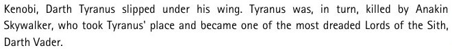
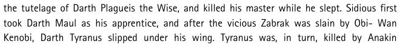
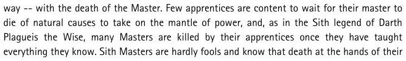
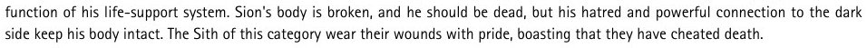
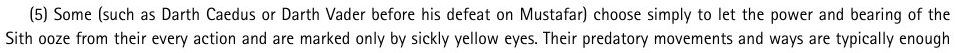
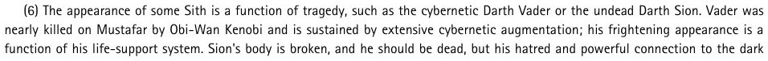
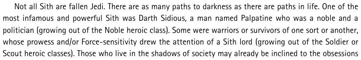
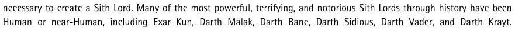
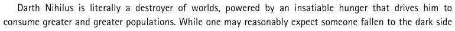
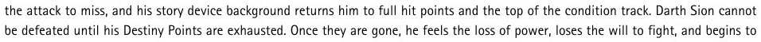

# Owner Material 037 — Star Wars D20 Drive folder (Core, Revised Core and Saga Edition): Web Articles.pdf [Star Wars Roleplaying Game Saga Edition (2007)] (scan pages 1–60)

- **Source:** Wizards of the Coast Star Wars Roleplaying Game books, web enhancements, Living Force campaign modules and articles (2000–2010), from the owner's "Star Wars D20" Drive folder (only the three edition subfolders; "General" was not read, as instructed). Secondary source (licensed Legends reference). Scan OCR'd on the box; the scan stays box-only and is **not** published.
- **Method:** every scanned page was OCR'd and machine-screened sentence by sentence for power-relevant statements (fights, kills, defeats, Force feats, rankings, superweapons) that name a character on our roster; each kept sentence is quoted verbatim from the OCR text and has a crop of the printed passage directly under it. Pages with nothing power-relevant are still listed with what is on them.
- **Citation:** "*Web Articles* (SWRPG Saga Edition), p.X" by printed page ("scan p.X" where no printed number applies). **Weight:** Licensed RPG material: a secondary source. Narrative text sums up Legends lore; game statistics are rules for players, not canon power levels, and rank lowest.

## scan p.1 (scan page 1)

Page contents: Title page: Saga Edition Web Articles V1.0 2011-01-23, a fan compilation of Saga Edition web articles (25 to Rescue; Behind the Threat: The Sith 1-5; Power Beyond Belief; Bounty Postings 1-7; Customizing Star Wars Minis 1-13; Jedi Counseling 98-115; Creatures of KOTOR 1-3; Message to Spacers 1-10; Mythmaking in Star Wars 1-5; Planet Hoppers 1-4; Point Blank RPG; Saga Edition Conversion Guide; Saga Edition Preview; Star Wars: The Musical Experience 1-3; Tips & Tactics Vol. 3 1-3; Web Enhancements 1-5 incl. The Nazren; Web Enhancements: KOTOR 1-9; Web Enhancements: Clone Wars; Miniatures previews; errata; Force Power cards; character sheet). (hand-read)

## scan p.2 (scan page 2)

Page contents: Compiler's introduction (articles collected after the wizards.com site closed; A4 layout, single column; dead links possible; release dates, "coming next" comments and miniature cards deleted; blue-box background for new rules; added or updated photos such as Mykal, Captain Dallan Morvis, Elbee (T1-LB), Arkanian Legacy, Shasa, The Last Resort and Moomo Williwaw; Customizing Star Wars Minis included for completeness). Compiler name and contact details omitted (private). (hand-read)

## scan p.3 (scan page 3)

Page contents: Contents part 1 (About the Authors; 25 to Rescue p8; Behind the Threat: The Sith parts 1-5 p13-23 (Portrayal, The Becoming, Design, The Teeth in the Darkness, Minions); Power Beyond Belief p25; Bounty Postings p27 (Norn Noth, Racer on the Run; Harno, Rogue Big-Game Hunter; Tyrnnia Masak, Pit Fighter; Dool Pundar, Pirate Lord; Meekah, Hazard Peaderon (the Blood Tach); Regera Girawin; Eldewn and Elsae Sarvool, Twin Runaways); Customizing Star Wars Minis p42 (Tools and Precautions through Creating Inquisitor Valin Draco, "He Doesn't Like You...", Snowtrooper on Blizzard Force Speeder Bike, Repainting the 181st Imperial Pilot); Jedi Counseling 98-115 p62; Creatures of KOTOR p114). (hand-read)

## scan p.4 (scan page 4)

Page contents: Contents part 2 (Message to Spacers 1-10 p120: KDY Space Platform, Cardan-class Space Station, YZ-775 Transport, Loronar E-9 Explorer, Baas-class Space Station, Starfeld Industries Z-10 Seeker, Cygnus Spaceworks Alpha-class XG-1 Star Wing, Crusader-class Corvette, Herakion-class Transport, Suwantek Systems TL-1800 Transport; Mythmaking in Star Wars p142: The Code, Archetypes Parts II-III, Monomyth Structures Parts I-II; Planet Hoppers 1-4 p152: Cathar, Coruscant(?), Rwind(?), Kaikielius(?) [OCR garbled]; Point Blank RPG p161; Saga Edition Conversion Guide p164; Saga Edition Preview p178: Classes and Character Creation, Learn a Few Maneuvers, Use the Force Luke, Prepare for Ground Assault, Advanced Combat Training, Droids Droids Droids, Skirmish at the Sarlacc Pit, Starship and Vehicle Combat; Star Wars: The Musical Experience p206). (hand-read)

## scan p.5 (scan page 5)

Page contents: Contents part 3 (Music From Beyond the Outer Rim p212; Tips & Tactics Vol. 3 p214; Web Enhancements 1-5 p219: Encounter Design 101, Devaronians, University of Sanbra Guide: The Pau'ans, The Nazren; Web Enhancement KOTOR 1-9 p238: The Sandcrawl, Captain Dallan Morvis, Elbee (T1-LB), Heirloom Items, Karrak Tetsu Sorcerer of Tund, Arkanian Legacy, Shasa, The Last Resort, Moomo Williwaw, Urban Bombardier Speeder Bike; Web Enhancement Clone Wars 1: Polis Massa p249; Star Wars Miniatures Previews p250: Alliance and Empire 1-7, Clone Wars 1-5, Fringe Stat Pack, Galaxy at War 1-6 p280-290, KOTOR Miniatures 1-7 p292-304, Legacy of the Force 1-5 p306+, New Republic Stat Pack, The Force Unleashed 1 p322). (hand-read)

## scan p.6 (scan page 6)

Page contents: Contents part 4 (The Force Unleashed Previews 2-7 p324-336: Maris Brood and Kazdan Paratus; Darth Revan and Rebel Vanguard; Juno Eclipse and Star Destroyer Officer; Wookiee Warrior and Wedge Antilles, Red Two; Luke's Snowspeeder and Luke Skywalker, Hoth Pilot Unleashed; Amanin Scout and 2-1B; Errata p339: Clone Wars, Saga Edition, KOTOR, Scum & Villainy, Starships of the Galaxy p352, The Force Unleashed p353). (hand-read)

## scan p.7 (scan page 7)

Page contents: About the Authors (professional bios: Eric Cagle, Matthew Grau, Sterling Hershey, Jack Irons, Gary M. Sarli, Owen K.C. Stephens, Patrick Stutzman; credits include the Saga Edition core rulebook, Ultimate Adversaries, Threats of the Galaxy, The Clone Wars Campaign Guide, Star Wars Gamer, Star Wars Miniatures scenarios; personal family details omitted). (hand-read)

## scan p.8 (scan page 8)

Page contents: 25 to Rescue: A Star Wars Roleplaying Game Encounter by Sterling Hershey (CL 6 encounter; Separatists besiege Christophsis during the Clone Wars and capture 25 technicians and civilians; heroes must rescue them before a starship transports them offworld; uses the Christophsis map from the Clone Wars Starter Set; era adaptations: Old Republic (Sith or Mandalorians, Taris), Dark Times/Rebellion (stormtroopers, slavers), New Jedi Order (Yuuzhan Vong and Peace Brigade), Legacy (Krayt's Empire, Dac); Followers and Squads from the Clone Wars Campaign Guide, each hero gains a temporary follower; starship arrives at start of round 3; loading zone disabled by DC 25 Use Computer or 50 damage). (hand-read)

### Stat block notes (game mechanics, not feats)

- Using This Encounter: The invasion of Christophsis occurs during the events of the animated movie Star Wars: The Clone Wars. However, this encounter takes place in the midst of the fighting, far from the activities of the Anakin, Obi-Wan, and other major characters. (Source: *Web Articles* (SWRPG Saga Edition), scan p.8)
- Using This Encounter: Legacy Era: Replace the Separatists with Imperial troops and Sith from Darth Krayt's Empire, and replace the clones with Jedi, Imperial Knights, or Galactic Alliance personnel. Dac (Mon Calamari) or any other world suffering Krayt's oppression is an appropriate location. (Source: *Web Articles* (SWRPG Saga Edition), scan p.8)

## scan p.9 (scan page 9)

Page contents: Read-Aloud Text (prisoners escorted by battle droids across a bridge over a depression of green crystals); Perception DC 15 reveals not all 25 prisoners are in view, DC 20 identifies standard, security and rocket B1 droids; Clone Trooper Squad CL 4 stat block begins (large Human nonheroic 6; blaster rifle 3d8 with 1-square splash; Careful Shot). (hand-read)

## scan p.10 (scan page 10)

Page contents: Clone Trooper Squad stats cont. and Squad Traits (melee area attack in reach; ranged 1-square splash; area attacks +2 dice; cannot be grabbed); Clone Trooper Squad Tactics (follower of a hero via Follower Actions, CWCG p35); B1-Series Battle Droid (5) and tactics (escort prisoners, will not fire through them); B1 Rocket Pack Equipped (3) (fly 6, spotlight) and tactics; OOM Series Battle Droid (4) security droids and tactics; B2-Series Heavy Super Battle Droid Squad description and CL 5 stat block begins. (hand-read)

## scan p.11 (scan page 11)

Page contents: B2 Heavy Super Battle Droid Squad stats cont. (Keep Them at Bay; 4 missiles) and tactics; B2-Series Super Battle Droid Commander description (built-in command functions, limited autonomy) and CL 4 stat block (nonheroic 6/soldier 1/droid commander 1; Droid Defense; cost 6,000) and tactics. (hand-read)

## scan p.12 (scan page 12)

Page contents: Prisoners (nonheroic technicians and civilians; squads of four); Prisoner Squad CL 3 stat block; Prisoner Tactics (follow droids until escorts destroyed or a hero is adjacent with no droids; become hero's follower); Conclusion (ends when all prisoners are loaded or escorted off the map; optional starship chase); Features of the Area (debris-strewn streets; light smoke d20 roll 11-20 grants concealment on bridges, ramps and walkways and attacks 1d20+5 vs. Fortitude for 1d3 damage and -1 condition step). (hand-read)

## scan p.13 (scan page 13)

Page contents: Behind the Threat: The Sith 1-5 by Matthew Grau, Part 1: Portrayal (Sith as cult of passion; series explores developing Sith characters in five eras; complements Threats of the Galaxy); The Sith Code (verbatim: "Peace is a lie, there is only passion. Through passion, I gain strength. Through strength, I gain power. Through power, I gain victory. Through victory, my chains are broken. The Force shall free me."); Sith as predators who turn on each other; Jedi master inner space to serve others, Sith dominate outer space to serve themselves; Eras of the Sith begins. (hand-read)

- **Darth Vader (Anakin Skywalker); Count Dooku** — entry/section: Saga Edition Web Articles: "Tyranus was, in turn, killed by Anakin Skywalker, who took Tyranus’ place and became one of the most dreaded Lords of the Sith, Darth Vader." Source: *Web Articles* (SWRPG Saga Edition), scan p.13
  
- **Palpatine (Darth Sidious); Darth Maul; Obi-Wan Kenobi; Count Dooku**: "Sidious first took Darth Maul as his apprentice, and after the vicious Zabrak was slain by Obi- Wan Kenobi, Darth Tyranus slipped under his wing." Source: *Web Articles* (SWRPG Saga Edition), scan p.13
  

### Stat block notes (game mechanics, not feats)

- The Knights of the Old Republic Era: Four thousand years before the Galactic Empire, Darth Revan brought the Sith into the light after visiting Sith worlds and basking in the power of the dark side. Revan and his apprentice, Darth Malak, brought about the bloody Jedi Civil War. They established the new Sith Empire and nearly wiped out the Jedi. Since the Sith are prevalent and operate openly in this era, it is easy to play games involving Sith characters. (Source: *Web Articles* (SWRPG Saga Edition), scan p.13)
- The Rise of the Empire Era: The Rule of Two characterized this era, as Darth Sidious completed his apprenticeship under the tutelage of Darth Plagueis the Wise, and killed his master while he slept. Sidious first took Darth Maul as his apprentice, and after the vicious Zabrak was slain by Obi-Wan Kenobi, Darth Tyranus slipped under his wing. Tyranus was, in turn, killed by Anakin Skywalker, who took Tyranus' place and became one of the most dreaded Lords of the Sith, Darth Vader. During this era, Darth Sidious' schemes required obfuscation and no lesser amount of treachery. His plans hinged on the Jedi's belief that the Sith were extinct. Although Sidious may have sheltered and dispatched Dark Jedi to satisfy his plans, he would not train them in the ways of the Sith. Under canon, it is difficult to justify characters during this era who are true Sith. Dark Jedi characters, on the other hand, fit easily into the growing Sith menace. However, you could create a splinter sect of the Sith that has remained hidden in other parts of the galaxy, like that of Darth Millennial and his Dark Force religion. (Source: *Web Articles* (SWRPG Saga Edition), scan p.13)
- The Rebellion Era: After Darth Sidious created the Galactic Empire, dissolved the Senate, and usurped control of the galaxy, he eased the Rule of Two a bit. He created the Secret Order of the Empire and brought dark side Force practitioners into the fold to be his prophets. He and Vader trained many dark side Adepts, using Dark Jedi as their most trusted and dangerous of servants, including the Emperor's Hand. However, the Rule of Two is kept intact in its strictest sense as neither Sidious or Vader passed on the true legacy and ways of the Sith. (Source: *Web Articles* (SWRPG Saga Edition), scan p.13)

## scan p.14 (scan page 14)

Page contents: Crafting the Sith: Falling to the Dark Side (pursuit of power; unresolved hurt, anger, fear, hatred; desire for balance; altruism; curiosity; sketch the crucial event); class progression Jedi to Sith Apprentice to Sith Lord prestige classes; Use the Force trained via Force Sensitivity and Skill Training, Intelligence increase, or starting trained skill; Jedi levels need not mean Jedi Order training; seven levels required for Sith Apprentice; Beliefs (law of the jungle; perpetual conflict pushes the strong toward perfection). (hand-read)

### Stat block notes (game mechanics, not feats)

- The Rebellion Era (cont.): As in the Rise of the Empire era, true Sith are rare. Dark Jedi, however, are even more prevalent and can operate openly in the service of the Emperor. Again, other Sith with different views might exist in the shadows of the galaxy, but they would have to remain concealed. Most likely, Darth Sidious would view them as a threat to be extinguished (an interesting plot device in its own right). However, Darth Vader did have at least one secret apprentice . . . (Source: *Web Articles* (SWRPG Saga Edition), scan p.14)
- The New Jedi Order Era: Although the Rule of Two prevented Vader from taking on a true apprentice, he did pass his teachings to pupils, notably the Dark Lady of the Sith, Lumiya. She trained several apprentices during this era, but they are not truly Sith because Lumiya herself does not become full-fledged Sith until her training by Vergere in the Legacy era. In The New Jedi Order era, the Sith are all but extinct. It is only through the training of Vergere that Lumiya becomes a true Dark Lady of the Sith. Dark Jedi characters would be more appropriate. (Source: *Web Articles* (SWRPG Saga Edition), scan p.14)
- The Legacy Era: During the Confederation-Galactic Alliance War, the Dark Lady Lumiya resurrected the Rule of Two and found herself the perfect apprentice -- the grandson of Darth Vader. Jacen Solo followed in his ancestor's footsteps and became Darth Caedus. While Caedus was busy trying to gather power, he drew all the attention of the Jedi to him. Meanwhile, hidden on the ancient Sith planet Korriban, Darth Krayt gathered other Dark Jedi to his cause and once again founded an Order of the Sith. This time, however, it was based on Krayt's Rule of One -- there would be only one Order, under which there would be many Sith. Eventually, the Sith returned in numbers and brought the galaxy to its knees. During the time of Darth Caedus, Sith are even more rare than they were in the Rebellion era. Again, Dark Jedi would be more appropriate as characters. However, after Darth Krayt emerges with his new Sith Order, the Sith once again become plentiful in the galaxy, more so than in any other era but those of the ancient past. (Source: *Web Articles* (SWRPG Saga Edition), scan p.14)
- Falling to the Dark Side: For example, Darth Sidious was never officially trained as a Jedi, instead spreading his web of intrigue as a noble. (Source: *Web Articles* (SWRPG Saga Edition), scan p.14)

## scan p.15 (scan page 15)

Page contents: Beliefs cont. (embrace passions as fuel for power); Apprenticeship (years of cruelty and manipulation; eradicate fear and compassion; under the Rule of Two one apprentice must be more than a match for several Jedi; apprenticeship ends with killing someone loved; then title of Sith Lord and new name); first talents from Armor Specialist, Duelist, Lightsaber Combat, Alter, Control, Sense, Dark Side or Sith trees. (hand-read)

### Stat block notes (game mechanics, not feats)

- Apprenticeship: Most apprenticeships conclude the day the student is willing and able to commit the ultimate act of "selflessness" and devotion to the Sith -- killing or destroying someone that he loves. This action demonstrates his embodiment of unattached strength, power, and mercilessness. For example, Darth Vader sacrificed Mace Windu and, ultimately, the Jedi Order. Darth Caedus murdered his aunt, Mara Jade Skywalker. Once this act is complete, the apprentice may take on the title of Sith Lord and his new name. (Source: *Web Articles* (SWRPG Saga Edition), scan p.15)
- Apprenticeship: What are your character's first talents? Do they come from the Armor Specialist talent tree, reflecting a Sith who appreciates a striking suit of armor (such as Darth Revan or Darth Krayt)? Do they come from the Duelist or Lightsaber Combat trees, reflecting a Sith who appreciates the elegance of his lightsaber (such as Darth Tyranus or Darth Vader)? Do they from the Alter, Control, or Sense trees, reflecting a Sith who deeply connects with the power of the Force (again, such as Darth Tyranus or Darth Vader)? Do they come from the Dark Side or Sith trees, reflecting an apprentice who strongly embraces the power of the dark side (such as Darth Sidious)? (Source: *Web Articles* (SWRPG Saga Edition), scan p.15)

## scan p.16 (scan page 16)

Page contents: Choose a Sith name and the state of the relationship with the Master; attitude toward the Jedi; General Appearance (Sith stand out: black robes, bones of victims, wild hair; yellow eyes rimmed with red, permanent with greater dark side use; full-body black or red-and-black Sith tattoos, painful, often facial); those hiding in plain sight are the exception; Six Categories begins. (hand-read)

- **Darth Plagueis**: "Few apprentices are content to wait for their master to die of natural causes to take on the mantle of power, and, as in the Sith legend of Darth Plagueis the Wise, many Masters are killed by their apprentices once they have taught everything they know." Source: *Web Articles* (SWRPG Saga Edition), scan p.16
  

### Stat block notes (game mechanics, not feats)

- Part 2: The Becoming: To symbolize the giving up of his old life, a Sith apprentice takes on a new name. In all eras after Darth Bane, the Sith take on the honorific Darth, a title that caused jealousy and infighting in ancient times. Darth is often thought to be a contraction of Dark Lord of the Sith, the first recorded use of which was in the ancient times of Darth Revan and Darth Malak. Some believe it derives from the Rakata, an ancient race of corrupt creatures whose horrifying Infinite Empire was a tool of the dark side, possibly meaning "emperor" or "immortal." The name given to a Sith Lord by his master is often something associated with the dark passions he or she revels. Bane, Krayt (as in the terrifying dragons of Tatooine), Maul, Plagueis (as in plague), Sidious (as in insidious), and Tyranus (as in tyranny) are examples of things that appeal to the Sith. (Source: *Web Articles* (SWRPG Saga Edition), scan p.16)
- Part 2: The Becoming: In the days of the Rule of Two, the relationship of apprentice and Master can end only one way -- with the death of the Master. Few apprentices are content to wait for their master to die of natural causes to take on the mantle of power, and, as in the Sith legend of Darth Plagueis the Wise, many Masters are killed by their apprentices once they have taught everything they know. Sith Masters are hardly fools and know that death at the hands of their pupils is a very real possibility, but they view this as a necessary danger to keep the Sith lineage strong. (Source: *Web Articles* (SWRPG Saga Edition), scan p.16)
- Part 2: The Becoming: All Sith share a deep hatred of the Jedi. They view the light side order as their ancient enemies, the one force that has stood in their way time and time again and the one thing capable of defeating them. The Sith look forward to a day when they can truly wipe the Jedi from the galaxy once and for all, something Darth Sidious and Darth Vader thought they had accomplished. (Source: *Web Articles* (SWRPG Saga Edition), scan p.16)
- General Appearance: Those forced to hide in plain sight are the exception, pretending to be as normal, upstanding, and even kindly as possible (such as Darth Sidious or Darth Tyranus). Of course, their true nature stirs unseen, always plotting. A dark side practitioner may relish in the shadow play, building his lies and illusions, until it reaches just the right pitch to drop the pretense and reveal his allegiance. Ultimately, Sith do not prefer to hide what they are. (Source: *Web Articles* (SWRPG Saga Edition), scan p.16)
- Six Categories (1): (1) Some Sith inspire fear from inside a suit of dreadful armor, such as the faceless Darth Revan or the Yuuzhan Vong encasement of Darth Krayt. Though they are certainly awe-inspiring on their own, the armor of these Sith is a recognizable symbol of their might. (Source: *Web Articles* (SWRPG Saga Edition), scan p.16)
- Six Categories (2): (2) Some Sith (such as Darth Maul or Darth Talon) undergo the painful process of extensive Sith tattooing, wearing the markings as a badge of pride to inspire terror. Although few who encounter the Sith may remember the details of his face or manner of dress, the tattoos will forever be burned in their minds. (Source: *Web Articles* (SWRPG Saga Edition), scan p.16)
- Six Categories (3): (3) Some choose to (or are forced to) embrace a deathlike visage, such as Darth Sidious or Darth Nihl. Nearly every culture has a taboo about death, and most maintain some fear of it, so these Sith are instantly associated with that fear. (Source: *Web Articles* (SWRPG Saga Edition), scan p.16)

## scan p.17 (scan page 17)

Page contents: Mix and match categories; details of clothes, eyes, tattoos, eccentricities. New Feat: Dreadful Countenance -- "Marked as Sith, your appearance inspires awe, dread, and fear in all who view it. Prerequisite: Charisma 13, must be a member of the Sith tradition. Benefit: Whenever you make a Persuasion check or a Use the Force check to activate a fear effect, you may reroll the check, but you must keep the second result, even if it is worse." (hand-read)

- **Darth Sion** — entry/section: Saga Edition Web Articles: "Sion's body is broken, and he should be dead, but his hatred and powerful connection to the dark side keep his body intact." Source: *Web Articles* (SWRPG Saga Edition), scan p.17
  
- **Jacen Solo (Darth Caedus); Darth Vader (Anakin Skywalker)**: "(5) Some (such as Darth Caedus or Darth Vader before his defeat on Mustafar) choose simply to let the power and bearing of the Sith ooze from their every action and are marked only by sickly yellow eyes." Source: *Web Articles* (SWRPG Saga Edition), scan p.17
  
- **Darth Vader (Anakin Skywalker); Obi-Wan Kenobi**: "Vader was nearly killed on Mustafar by Obi-Wan Kenobi and is sustained by extensive cybernetic augmentation; his frightening appearance is a function of his life-support system." Source: *Web Articles* (SWRPG Saga Edition), scan p.17
  

### Stat block notes (game mechanics, not feats)

- Six Categories (4): (4) Some Sith choose to (or are forced to) embrace the otherworldly in their appearance, such as the ghostly Darth Nihilus or the undead Darth Sion. Many people fear the unknown, and stories of ghosts and monsters are carried in cultures across the galaxy -- a fact that these Sith prey upon. (Source: *Web Articles* (SWRPG Saga Edition), scan p.17)
- Six Categories (5): (5) Some (such as Darth Caedus or Darth Vader before his defeat on Mustafar) choose simply to let the power and bearing of the Sith ooze from their every action and are marked only by sickly yellow eyes. Their predatory movements and ways are typically enough to inspire awe and dread in those who encounter them. (Source: *Web Articles* (SWRPG Saga Edition), scan p.17)
- Six Categories (6): (6) The appearance of some Sith is a function of tragedy, such as the cybernetic Darth Vader or the undead Darth Sion. Vader was nearly killed on Mustafar by Obi-Wan Kenobi and is sustained by extensive cybernetic augmentation; his frightening appearance is a function of his life-support system. Sion's body is broken, and he should be dead, but his hatred and powerful connection to the dark side keep his body intact. The Sith of this category wear their wounds with pride, boasting that they have cheated death. (Source: *Web Articles* (SWRPG Saga Edition), scan p.17)
- Six Categories: As inspiration, you might wish to take a look at the famous Sith found in Threats of the Galaxy. Darth Bane (pages 84-85), Darth Maul (pages 80-81), and the Dark Lady Lumiya (pages 83-84). (Source: *Web Articles* (SWRPG Saga Edition), scan p.17)

## scan p.18 (scan page 18)

Page contents: Part 3: Design (game mechanics of Sith characters; not all Sith are fallen Jedi: Noble, Soldier, Scout, Scoundrel origins); Meeting the Requirements for Sith apprentice prestige class (7th level, trained Use the Force, Force Sensitivity, Weapon Proficiency (lightsaber), Dark Side Score equal to Wisdom, member of Sith tradition); routes via a Jedi level, non-class feats, Human bonus feat and skill; Force Training feat only through character-level feats; Choosing a Class (Noble for manipulation, Scout for independence and Shake It Off, Scoundrel for shadow warriors, Soldier for predators). (hand-read)

- **Palpatine (Darth Sidious)** — entry/section: Saga Edition Web Articles: "One of the most infamous and powerful Sith was Darth Sidious, a man named Palpatine who was a noble and a politician (growing out of the Noble heroic class)." Source: *Web Articles* (SWRPG Saga Edition), scan p.18
  

### Stat block notes (game mechanics, not feats)

- Part 3: Design: One of the most infamous and powerful Sith was Darth Sidious, a man named Palpatine who was a noble and a politician (growing out of the Noble heroic class). ... Darth Vader, the scourge of the Jedi, was in fact a powerful and respected one himself until the lure of the dark side claimed him. (Source: *Web Articles* (SWRPG Saga Edition), scan p.18)

## scan p.19 (scan page 19)

Page contents: Choosing a Species (Bothans under the Rule of Two, Skill Focus (Gather Information) and Bothan SpyNet; Quarren embittered by homeworld devastation; Rodians as hunters with Heightened Awareness and low-light vision, poor deceivers; Sullustans curious and reckless, darkvision; Trandoshans with darkvision, Limb Regeneration, Natural Armor, Toughness; Twi'leks with +2 Charisma and Deceptive; Zabrak with Heightened Awareness and Superior Defenses; Humans bulk of the Sith); Possible Paths: Sith Manipulator (Noble start; Linguist, Force Sensitivity, Wealth; Strong in the Force, Presence, Weaken Resolve, mind trick; Sith apprentice at 7th with Force Deception, force lightning, rebuke; corruption destiny then destruction or discovery). (hand-read)

- **Palpatine (Darth Sidious); Darth Vader (Anakin Skywalker); Darth Malak; Darth Bane** — entry/section: Saga Edition Web Articles: "Many of the most powerful, terrifying, and notorious Sith Lords through history have been Human or near-Human, including Exar Kun, Darth Malak, Darth Bane, Darth Sidious, Darth Vader, and Darth Krayt." Source: *Web Articles* (SWRPG Saga Edition), scan p.19
  

### Stat block notes (game mechanics, not feats)

- Choosing a Species: The adventurous nature of the Zabrak likewise can be drawn to explore the mysteries of the dark side, and their adaptation to living in a tough environment serves them well as Sith warriors (as evidenced by Darth Maul). Their Heightened Awareness and Superior Defenses abilities are of particular use. (Source: *Web Articles* (SWRPG Saga Edition), scan p.19)
- Choosing a Species: Still, Humans make up the bulk of the Sith. The natural chaos of their emotions is capable of producing the warping passion necessary to create a Sith Lord. Many of the most powerful, terrifying, and notorious Sith Lords through history have been Human or near-Human, including Exar Kun, Darth Malak, Darth Bane, Darth Sidious, Darth Vader, and Darth Krayt. Furthermore, their bonus feat and bonus trained skill give them more room to play when developing on their way to the dark (Source: *Web Articles* (SWRPG Saga Edition), scan p.19)

## scan p.20 (scan page 20)

Page contents: The Sith Warrior path (Soldier start; armor and weapon proficiencies, Force Sensitivity, Armored Defense; Weapon Focus and Proficiency (lightsaber), Penetrating Attack; Power of the Dark Side, dark rage; Sith apprentice at 7th with Deflect, Dual Weapon Mastery I or Power Attack, force slam); The Fallen Jedi path (Jedi start; Force Training with surge, Deflect; mind trick, move object, Force Perception; farseeing, Visions; Sith apprentice at 7th with Dark Scourge, force grip, negate energy; corruption or destruction destiny). (hand-read)

## scan p.21 (scan page 21)

Page contents: Part 4: The Teeth in the Darkness: Technology (lightsaber; Jedi ritual crystals yellow, blue, green; Sith artificially grow crystals so all Sith lightsabers are red); double-bladed lightsaber and Dual Weapon Mastery I-III, Weapon Finesse, dark rage; Sith lanvarok (wrist-mounted disc launcher, KOTOR Campaign Guide p68-69); Sith travel light (robes, cloak, lightsaber, utility belt gear); starfighters (Aethersprite, Eta-2 Actis, Ginivex, Sith Interceptor, Sith Infiltrator; Starships of the Galaxy page refs); speeder bikes; Sith by era (KOTOR era warriors common; Rule of Two eras need stealth and guile). (hand-read)

### Stat block notes (game mechanics, not feats)

- Technology: Some instead hunt far and wide for their crystal, with results (such as Mace Windu's violet lightsaber) that are the stuff of legends. (Source: *Web Articles* (SWRPG Saga Edition), scan p.21)
- Technology: The double-bladed lightsaber is the notorious weapon wielded by Darth Maul during the Rise of the Empire era. These tricky weapons take time to master, but they can make one man fight as two. Some mistakenly believe that Darth Maul created the weapon, when in fact it was first unleashed under the fury of the Sith Lord Exar Kun in ancient times. Those Sith Lords who lean toward the savagery of physical violence may find themselves drawn to the artistry and deadliness of the double-bladed lightsaber. (Source: *Web Articles* (SWRPG Saga Edition), scan p.21)
- Technology: Those in the favor of Count Dooku might also receive one of the rare and exotic Ginivex-class starfighters. During the Knights of the Old Republic era, the Sith had their own starfighters, known as Sith Interceptors. Only one craft was designed for the Sith in the Rise of the Empire, Rebellion, and The New Jedi Order eras -- a prototype that is owned by Darth Sidious and carefully guarded. The Sith Infiltrator is truly a craft worthy of the tradition of the Sith Lords. (Source: *Web Articles* (SWRPG Saga Edition), scan p.21)

## scan p.22 (scan page 22)

Page contents: Rule of Two eras favor Noble or Scoundrel balanced with Jedi and Soldier or Scout; Advancement Paths (Sith apprentice talent trees: Armor Specialist, Duelist, Lightsaber Combat, Sith; Dreadful Countenance feat; Force techniques every other level from 2nd; Sith Lord prestige class needs 12th level and one Force technique, purged of fear, Force secrets cost Force Points, Dun Moch; Force disciple prestige class needs 12th level, farseeing and three Force adept levels, immune to mind-affecting, prophetic visions; Jedi Master route needs Jedi tradition membership, fearless, meditative focus; education destiny grants +5 to one class skill). (hand-read)

### Stat block notes (game mechanics, not feats)

- Sith by era: The Legacy era begins with the Rule of Two and follows the same maxims as the previous three eras. However, once Darth Krayt takes his rightful place in the universe, the Sith flood out again. Warriors again are common, as they were in the Knights of the Old Republic era. (Source: *Web Articles* (SWRPG Saga Edition), scan p.22)

## scan p.23 (scan page 23)

Page contents: Part 5: Antiheroes (GM advice on Sith in the playing group): All-Sith Groups (shared philosophy; in-fighting inevitable; agree on rivalries and build competition into the plot); Groups With One Sith (others treated as lackeys; deal with the devil; work out ahead of time); era determines group type (KOTOR and Legacy all-Sith openly; Rule of Two eras one Sith with Dark Jedi or adepts); Group Origins; Adventure Hooks (give challenges and goals; respect canon in Rule of Two eras); Knights of the Old Republic Era hook begins (quest for the legacy of the Sith). (hand-read)

## scan p.24 (scan page 24)

Page contents: KOTOR era hook: ancient holocron from a captured Jedi outpost reveals the lost moon Oricon where the ancient Sith Darth Vitus (adventure-original) experimented with Sith alchemy; monsters descended from his experiments and his compound. Rise of the Empire hook: hunt beginning on the trail of Sarn Vals, a Quarren Jedi Knight (adventure-original), after a disturbance in the Corporate Sector. Rebellion hook: Vader's pet team infiltrates a secret starfighter facility on Rentean. NJO hook: Sith who never followed the Rule of Two build an army on the Outer Rim. Legacy hook: all-Sith Jedi Hunters during the Sith-Imperial War seek a Jedi conclave, which sets a trap. (hand-read)

### Stat block notes (game mechanics, not feats)

- Rise of the Empire Era: In an era exemplified by the Rule of Two, it will be challenging to create adventures that don't violate canon. As we know from the Star Wars films, Darth Sidious rules the Sith in this era, with only three apprentices that we know of -- first Darth Maul, then Darth Tyranus, then Darth Vader. However, we also know that Darth Vader had a secret apprentice, and it's possible for Sith groups in different parts of the galaxy to have reason to keep their existence a secret, even from other Sith. As a specific example, your group could be composed of a secret Sith apprentice trained by Darth Vader to hunt the last of the remaining Jedi (effectively using the basis for the Star Wars: The Force Unleashed video game). This kind of adventure would take place after Order 66 had been executed and the Empire had been born. (Source: *Web Articles* (SWRPG Saga Edition), scan p.24)
- Rebellion Era: The Jedi are all but gone, so a secret Sith apprentice might lead special strike teams against the Rebel Alliance. Most likely, such teams will be composed of Dark Jedi or elite Stormtroopers. You still have the option of creating groups in the fringes of the Empire that want nothing to do with the plans of Darth Sidious. As a specific example, your group might be one of Darth Vader's pet teams, led by his secret apprentice. Since the Jedi are no longer a threat, Vader has given the group the most sensitive and distasteful missions in the Empire. (Source: *Web Articles* (SWRPG Saga Edition), scan p.24)
- The New Jedi Order Era: You need clever ideas to create workable Sith adventures for this era, since canon limits it greatly. Any Sith would have to have been hidden for some time or Dark Jedi who stumbled across holocrons or something similar. Their activities must remain secret; canon shows that the Dark Lady Lumiya is the closest thing to Sith encountered in this era by the New Republic. However, Lumiya herself encounters Sith on Korriban during the Legacy era, and they most certainly would be active during the Yuuzhan Vong war. As a specific example, your group could consist of several Sith who never subscribed to the Rule of Two but were unable to operate openly due to the enormous power and long reach of Darth Sidious. (Source: *Web Articles* (SWRPG Saga Edition), scan p.24)
- Legacy Era: [...] the Sith emerge en masse under Darth Krayt. Groups can occupy any number of roles in the new Empire and can operate openly and with authority. There is resistance to be crushed and old secrets to be unearthed. As a specific example, your group could repeat history and be Jedi Hunters during the Sith-Imperial War. This time, however, instead of being one Sith and a group of Dark Jedi (or troopers), your group consists only of Sith characters. A Jedi conclave has been striking out against the forces of Emperor Fel and Darth Krayt from a secret hiding place, which your characters have been tasked with finding. (Source: *Web Articles* (SWRPG Saga Edition), scan p.24)

## scan p.25 (scan page 25)

Page contents: Power Beyond Belief: Using Ultra-Powerful Sith Lords in Saga Edition by Sterling Hershey (KOTOR-era Sith Lords who cheat death and consume worlds; KOTOR Campaign Guide approach combines story devices, Destiny Points and existing talents, feats and powers); Using Powers as Story Devices (unique, limited in scope, cinematic, rarely used directly against heroes; allow high-DC checks or Force/Destiny Point to escape); Using Destiny Points (auto crit, auto miss, act out of turn, gain 3 Force Points described as unique powers; enemy defeated once Destiny Points are whittled away); Examples in Play (spoiler warning for KOTOR II). (hand-read)

- **Darth Nihilus** — entry/section: Saga Edition Web Articles: "Darth Nihilus is literally a destroyer of worlds, powered by an insatiable hunger that drives him to consume greater and greater populations." Source: *Web Articles* (SWRPG Saga Edition), scan p.25
  
- **Darth Nihilus**: "Nor would Nihilus tolerate such a rival and competitor for his sustenance." Source: *Web Articles* (SWRPG Saga Edition), scan p.25
  

### Stat block notes (game mechanics, not feats)

- Examples in Play: Darth Nihilus is literally a destroyer of worlds, powered by an insatiable hunger that drives him to consume greater and greater populations. While one may reasonably expect someone fallen to the dark side to employ Force lightning against a foe, no one expects a fleet of starships commanded by Sith Lords consuming entire planets. Nor would Nihilus tolerate such a rival and competitor for his sustenance. Given the Sith Lord's unique background, it is not the type of ability that would be taught to an apprentice. From a game mechanics point of view, there is little need to spend time developing rules and restrictions for such a unique power. It is a story device. From the GM's perspective, Darth Nihilus consumes a world when the plot requires it. (Source: *Web Articles* (SWRPG Saga Edition), scan p.25)

## scan p.26 (scan page 26)

Page contents: Alternative Mechanics (new Force power implies others can learn it; Special Quality for narrowly defined unchanging powers; Eternal Hatred example); Heroes and Powerful Abilities (define extent before play; story devices hardest, Destiny Points most limiting, Special Qualities most adaptable; dark side abilities must carry a cost such as disfigurement penalizing ability scores including Charisma); ultra-powerful characters are rare but excellent villains. (hand-read)

- **Darth Sion** — entry/section: Saga Edition Web Articles: "Darth Sion cannot be defeated until his Destiny Points are exhausted." Source: *Web Articles* (SWRPG Saga Edition), scan p.26
  

### Stat block notes (game mechanics, not feats)

- Examples in Play (cont.): However, lesser aspects of his terrible hunger might be used directly against the heroes. These abilities are better emulated by the use of Force talents, powers, secrets, and techniques. In this case, the GM should describe the use of such a talent, like Drain Force, in a manner that suggests that it is powered by his unnatural hunger. (Source: *Web Articles* (SWRPG Saga Edition), scan p.26)
- Examples in Play: As another example, Darth Sion embodies the unbeatable enemy. He's a Sith so vile that he channels his own anger through the Force to keep himself alive even though he should be dead. Thanks to his intense anger and pain, he literally holds his decaying body together through the dark side of the Force. Darth Sion's continued existence is best described as a story device, rather than as a specialized Force power that requires constant rolls to keep Sion whole. However, even though the character may believe that his ability to escape death is nearly infinite, it is actually limited by his Destiny Points in an unusual way. When taking a final hit that would normally kill him, he spends a Destiny Point to cause the attack to miss, and his story device background returns him to full hit points and the top of the condition track. Darth Sion cannot be defeated until his Destiny Points are exhausted. Once they are gone, he feels the loss of power, loses the will to fight, and begins to question his existence. From this point, he is susceptible to the Exile's attempts to persuade him to give up his life as a much-desired escape from his painful existence. (Source: *Web Articles* (SWRPG Saga Edition), scan p.26)
- Alternative Mechanics: For an example of a Special Quality that covers part of Darth Sion's abilities, here is one based on his similar ability in the Star Wars Miniatures Game: Eternal Hatred: Whenever this character would be killed, make a DC 10 Wisdom check; if successful, this character is restored to full hit points and returned to the top of the condition track instead of being defeated (Source: *Web Articles* (SWRPG Saga Edition), scan p.26)

## scan p.27 (scan page 27)

Page contents: Bounty Postings 1-7 by Eric Cagle (series of bounty targets for Saga Edition): 1 Oorn Noth, Racer on the Run; 2 Harno, Rogue Big Game Hunter; 3 Tyrnia Masak, Pit Fighter; 4 Dool Pundar, Pirate Lord; 5 Meekah Hozard, Leader of the Blood Tachs; 6 Regera Girawn, Force Witch; 7 Eldewn and Elsae Sarvool, Twin Runaways. (hand-read)

## scan p.28 (scan page 28)

Page contents: Oorn Noth: Racer on the Run (article-original NPC): History (youngest son of an Iridonian Zabrak nobleman; racing pilot with ship Five Coins; after a crash in the Sullust system takes SoroSuub sponsorship giving 75% of winnings to the company; throws races, is threatened, then wins a final race in a cutting-edge ship equivalent to an Eta-2 Actis Interceptor and jumps to hyperspace; ship renamed Last Laugh; on the run, smuggling on the side); Psych Profile (young, brash, arrogant thrill-seeker; still heir to family wealth); Adventure Seeds (racing circuit bounty; offers piloting then sabotages life support; father Donloor Noth hires heroes to bring him home alive). (hand-read)

## scan p.29 (scan page 29)

Page contents: Starship Modifications sidebar (blue box, re-OCR): with Starships of the Galaxy, replace Weapon Focus (heavy weapons) with Starship Tactics (afterburn maneuver); replace Oorn's ship with a SoroSuub Patrol Fighter modified to remove weapons, Hyperdrive x2 to x3, Sublight Drive (Speed 6); speed fly 16 squares (max. velocity 1,300 km/h), fly 6 squares (starship scale). (hand-read)

## scan p.30 (scan page 30)

Page contents: Harno: Rogue Big Game Hunter (article-original Rodian NPC): History (from a Rodian clan with game preserves; rival Neevat accused him of drugging prey; Harno accidentally killed Neevat in a fight and fled; poached Kashyyyk fauna for Trandoshan clients; Wookiees and his Trandoshan clients both placed bounties); Psych Profile (dedicated to the hunt; quiet in the field, loud braggart in civilization; turns the tables on pursuers; keeps trophies to restore his name on Rodia); Adventure Seeds (encountered on big-game worlds; rival hunters from Kashyyyk or Trandosha; hires heroes to haul illegal cargo). (hand-read)

## scan p.31 (scan page 31)

Page contents: Harno Saga Edition statistics: CL 8 Medium Rodian scout 5/soldier 2; Force 1, Dark Side 6; Ref 23, Fort 21, Will 18; hp 70; heavy blaster rifle with scope and bayonet, 3 stun grenades; talents Expert Tracker, Keen Shot, Improved Stealth, Weapon Specialization (rifles); feats Deadeye, Precise Shot, Sniper, Shake It Off, Skill Focus (Survival); Survival +14. (hand-read)

## scan p.32 (scan page 32)

Page contents: Tyrnia Masak: Pit Fighter (article-original Human NPC): History (grew up in Nar Shaddaa slums; taken as payment for her mother's debt by Quarren crime lord Durrsk; trained as a gladiator by a Force adept fighting master; renowned for stubbornness and indestructibility; after Durrsk killed her mother she murdered him and a young Hutt in the arena and escaped; bounties from the Hutts and Durrsk's family; dark side users seek her); Psych Profile (quiet and laconic, berserker in combat, low self-esteem); Adventure Seeds (illegal fighting matches; bodyguard to a Rodian crime lord; prey of a Sith apprentice but redeemable). (hand-read)

## scan p.33 (scan page 33)

Page contents: Tyrnia Masak Saga Edition statistics: CL 6 Medium Human soldier 6; Force 3, Dark Side 10; Ref 18, Fort 22, Will 18; hp 86; unarmed +10 (1d6+7); Force powers battle strike, dark rage (2); talents Damage Reduction 10, Power of the Dark Side, Tough as Nails; feats Extra Second Wind, Force Sensitivity, Force Training, Improved Damage Threshold, Martial Arts I-II; combat gloves, blaster pistol. (hand-read)

## scan p.34 (scan page 34)

Page contents: Dool Pundar: Pirate Lord (article-original Neimoidian NPC): History (Trade Federation battleship captain who before the blockade of Naboo mutinied with allies, faked a distress signal, hid in a nebula, used reprogrammed battle droids to purge loyalists out the airlock; lightning raids on busy hyperspace lanes; Trade Federation bounty; Republic and Trade Federation fleets have failed to capture him; fleet equivalent of a Corellian Corvette, several YT-1300s and over a hundred Vulture droid starfighters); Psych Profile (brilliant tactician, brave for a Neimoidian, ruthless with a sense of style, unpredictable); Adventure Seeds (battleship Profit uses stolen ID codes to lure ships; ambushes a Trade Federation convoy while heroes watch). (hand-read)

## scan p.35 (scan page 35)

Page contents: Dool Pundar Saga Edition statistics: CL 16 Medium Neimoidian noble 7/officer 5/crime lord 4; Force 2, Dark Side 12; Ref 28, Fort 27, Will 33; hp 99; heavy blaster pistol, hold-out blaster, stun baton; talents Assault Tactics, Born Leader, Demand Surrender, Deployment Tactics, Distant Command, Inspire Fear I-III, Notorious, Outmaneuver, Presence; many Skill Focus feats; Deception, Knowledge (tactics) and Persuasion +22. Starship Modifications sidebar (blue box, re-OCR): replace Skill Training (Gather Information) with Tactical Genius and Weapon Focus (pistol) with Starship Tactics; maneuvers attack formation zeta nine, howlrunner formation, overwhelming assault, strike formation; commands a Trade Federation Battleship, smaller capital ships and over a hundred Vulture droid starfighters. (hand-read)

## scan p.36 (scan page 36)

Page contents: Meekah Hozard, Leader of the Blood Tachs (article-original Duros NPC): History (grew up in the Taris Undercity slums; cornered by rich Human youths on speeder bikes, killed their leader with a hidden knife and three more, founded the non-Human swoop gang the Blood Tachs; raids on the upper levels; bounty placed); Psych Profile (cunning, violent temper, hates Humans, sees himself as a bandit king); Meekah Hozard by Era (KOTOR swoop circuit on Coruscant, Nar Shaddaa or Taris; Rise of the Empire hired by Separatists; Rebellion works for either side; NJO gang becomes an army and fights the Yuuzhan Vong); Adventure Seeds (desert-planet bandits; ambush at a derailed maglev while guarding a Human ambassador; heroes infiltrate the gang). (hand-read)

## scan p.37 (scan page 37)

Page contents: Meekah Hozard Saga Edition statistics: CL 10 Medium Duros scout 3/scoundrel 7; Force 2, Dark Side 10; Ref 26, Fort 22, Will 21; hp 74; heavy blaster pistol, stun baton; Sneak Attack +2d6, Skirmisher, Fool's Luck; Pilot +19; Aratech 74-Z speeder bike (or modified R-2000 Raptor speeder bike from Threats of the Galaxy p98). (hand-read)

## scan p.38 (scan page 38)

Page contents: Regera Girawn, Force Witch (article-original near-Human NPC): History (noblewoman of Kruskan in the far Outer Rim; Sith acolytes hid a holocron there 3,000 years before Yavin; it exploded in her hands, scarring her and awakening Force visions of leading dark disciples; deposed, she later dominated a Republic exploration ship's crew; roams seeking Force-sensitives, feeds on dark side sites; slew two Jedi and their Padawans); Psych Profile (no allegiance to the Sith; regal; scarred face and mind; driven by visions; lures bounty hunters into traps; acolytes and bodyguards); Regera Girawn by Era (KOTOR on Korriban; Rise of the Empire with Separatists gathering Force-sensitive younglings; Rebellion on the fringes with her own agenda; NJO leader of a dark side group); Adventure Seeds (trap to capture a hero she foresaw as an acolyte; return to her home planet's dark side tomb). (hand-read)

### Stat block notes (game mechanics, not feats)

- Regera Girawn by Era: Rebellion Era: During the Rebellion Era, Regera works on the fringes, taking advantage of the chaos caused by the war between the Empire and the Rebels. While impressed with the power of the Emperor and Darth Vader, she has a different agenda that often runs up against that of the Empire. (Source: *Web Articles* (SWRPG Saga Edition), scan p.38)

## scan p.39 (scan page 39)

Page contents: Regera Girawn Saga Edition statistics: CL 14 Medium near-Human noble 2/scoundrel 5/Force adept 5/Force disciple 2; Force 8, Dark Side 16; Ref 29, Fort 27, Will 33; hp 85; immune mind-affecting; lightsaber (Force talisman); powers farseeing, Force grip, Force lightning (2), Force slam, mind trick, negate energy, rebuke; Force secret Devastating Power; techniques Improved Sense Force, Improved Telepathy; indomitable, prophet; Corellian corvette Awakened Eye (or Citadel-class cruiser from Starships of the Galaxy p70). (hand-read)

## scan p.40 (scan page 40)

Page contents: Eldewn and Elsae Sarvool, Twin Runaways (article-original NPCs; bounty notice "capture without harm" only): History (twin children of a wealthy Human merchant on Romin in the Mid Rim; Jedi Ofar Tan-Doov (article-original) found them powerful in the Force and arranged to take them to the Coruscant Temple, but a hidden thermal detonator planted by a crime lord killed him; the twins escaped by pod to find their parents murdered; living as nine-year-old street urchins, angry at the Jedi and the crime lord, who has his own bounty on them; the Jedi vow to find them); Psych Profile (smart, suspicious, manipulative, habitual liars, no close ties); by Era (KOTOR fleeing Jedi and the Sith of Korriban; Rise of the Empire among war refugees; Rebellion hunted by the Empire; NJO); Adventure Seeds (stowaways on a tramp freighter; Romin orphan uprising, bounty requires bringing them in unharmed). (hand-read)

### Stat block notes (game mechanics, not feats)

- Eldewn and Elsae by Era: Rise of the Empire: Eldewn and Elsae can be found on any of the numerous planets devastated by war, hiding in the throngs of refugees and war victims fleeing from the conflict between the Separatists and the Republic. Count Dooku (or another Sith Lord) could be one of the many people who have placed a bounty on their heads in hopes of capturing the twins for their own nefarious plans. (Source: *Web Articles* (SWRPG Saga Edition), scan p.40)
- Eldewn and Elsae by Era: The New Jedi Order: Left to their own devices, Eldewn and Elsae could eventually become a destabilizing factor in the delicate reconstruction of the Republic. Their backstory fits nicely with the goals and methods of The New Jedi Order, and Luke Skywalker himself could send bounty hunters (as well as his own students) to bring the children back to safety for training. (Source: *Web Articles* (SWRPG Saga Edition), scan p.40)

## scan p.41 (scan page 41)

Page contents: Eldewn and Elsae Sarvool Saga Edition statistics (identical, always together): CL 2 Medium Human nonheroic 3/scoundrel 2; Destiny 1; Force 3, Strong in the Force; Dark Side 4; Ref 17, Fort 12, Will 15; hp 20; knife, blaster pistol; Force thrust, mind trick, move object (Use the Force +15); Telekinetic Savant; stolen sliced credit chip (300 credits). (hand-read)

## scan p.42 (scan page 42)

Page contents: Customizing Star Wars Minis 1-13 by Jack Irons (series contents: Tools and Precautions; Color and Paint; Basic Painting Techniques; Simple Repositioning; Moderate Repositioning Techniques; Advanced Repositioning Techniques I-II; Additions to Customs; Creating Inquisitor Valin Draco; "He Doesn't Like You..."; Snowtrooper on Blizzard Force Speeder Bike Parts 1-2; Repainting the 181st Imperial Pilot). (hand-read)

## scan p.43 (scan page 43)

Page contents: Customizing Minis 1: Tools and Precautions by Jack Irons (minors get parental permission; a custom is a modified miniature for RPG characters, distinguishing duplicates or art; tools: hobby knife (cut away from body, sharp blade), cutting surface (self-healing or taped corrugated cardboard), putties (epoxy "green stuff", contour putty), oven-baked craft clay on foil not a cooking sheet, super glue or plastic model glue sparingly, acrylic paint (no oil-based), three good brushes (large, small, very fine; no plastic bristles); well-lit ventilated space, breaks every 45-60 minutes looking 10+ feet away; sculpting tools, old toothbrush spatter, needle-nose pliers, hand drill for pinning, snipping pliers). (hand-read)

## scan p.44 (scan page 44)

Page contents: Customizing Minis 2: Color and Paint by Jack Irons (use acrylic paint, water-based; protect work area; three bowls: rinse water, thinning water, dry mixing bowl; five basic colors red, blue, yellow, black, white plus silver; color wheel primaries, complementary and tertiary colors; white for pastels, black to deepen; brown from orange plus a little yellow and black; mix small amounts lightest first; step-by-step mixing procedure; practice). (hand-read)

## scan p.45 (scan page 45)

Page contents: Color mixing guidelines (basic colors black, white, gray; primaries; complementary purple, orange, green; tertiary dark purple, aqua blue, lime green, golden yellow, fiery orange, cedar red; add white to lighten, a little black to darken). (hand-read)

## scan p.46 (scan page 46)

Page contents: Customizing Minis 3: Basic Painting Techniques by Jack Irons (match Booster Pack style; three steps basic painting, washes, dry brushing; base coat in black instead of stripping; thin layers; wash of black with twice as much water, brown wash for aged look; dry brushing a lighter color for highlights and dirt effects; general tips: change rinse water, let layers dry, practice, repaint if needed). (hand-read)

## scan p.47 (scan page 47)

Page contents: Customizing Minis 4: Simple Repositioning by Jack Irons (hot water method for thin elements and bent lightsabers; microwave-safe cup and regular cup with ice, fork; WARNING sidebar on superheated microwaved water exploding, link to forum thread; 30-40 seconds in boiling water, plastic "memory" reverts shape, bend and set 30 seconds in cold water; poses may revert over time; useful for varying battle droids). (hand-read)

## scan p.48 (scan page 48)

Page contents: Customizing Minis 5: Moderate Repositioning Techniques by Jack Irons (cut and paste technique for droids and armored figures; cut at joints or armor seams; test pose; small drop of super glue; largest pieces first; swap arms between figures; changing angles by cutting wedges; touch up paint; joints may break if dropped, reglue). (hand-read)

## scan p.49 (scan page 49)

Page contents: Customizing Minis 6: Advanced Repositioning Techniques by Jack Irons (pinning with staple wire pins: tools super glue, hobby knife, pointed sculpting tool, hand drill, needle-nose pliers; guide holes, drill out, cut 1/8 to 1/4 inch pin, insert halfway, trim, test pose, glue, hold until set, then touch up paint). (hand-read)

## scan p.50 (scan page 50)

Page contents: Customizing Minis 7: Advanced Repositioning Techniques II by Jack Irons (extra-long pins 1/4 to 3/8 inch plus contour or epoxy putty filler for impossible angles; fill gaps, shape and texture putty (hair, fur), sand and paint; plan complex jobs with sketches; do all cuts at once, prepare all pins, glue largest first one connection at a time; eventually pin without guide holes). (hand-read)

## scan p.51 (scan page 51)

Page contents: Customizing Minis 8: Additions to Customs by Jack Irons (save leftover parts; transplant blasters, lightsabers, jet packs, armor; glue whole hand with lightsaber for better hold; 1/16-inch colored acrylic rods, toothpicks or paper clips as lightsabers; red rod as blaster fire; clear rods for flying figures; putty vs. two-part epoxy benefits and drawbacks (putty shrinks, baking toxins, use foil; epoxy hardens after an hour, sticky, costlier); build elements from basic shapes). (hand-read)

## scan p.52 (scan page 52)

Page contents: Additions cont. (sculpt missing necks with epoxy; epoxy capes from a flat plane with crescent clasp; paper capes and banners stiffened with half water, half white glue; experiment). (hand-read)

## scan p.53 (scan page 53)

Page contents: Customizing Minis 9: Creating Inquisitor Valin Draco by Jack Irons (combine Dark Jedi #7 Champions of the Force and Bodyguard Droid #28 Revenge of the Sith; trim gun to a fist and loincloth to a point; pull off droid cape and head; epoxy coil to unify cape; trim cape to fit; epoxy gauntlet cuffs; teardrop shapes for baggier trousers; epoxy belt with angled line and two pouches). (hand-read)

### Stat block notes (game mechanics, not feats)

- Creating Inquisitor Valin Draco: For our first customizing project, we'll create Imperial Inquisitor Valin Draco, one of the villains from the new Star Wars: Dawn of Defiance campaign. (Dawn of Defiance is a series of free adventures in a continuous storyline designed to take heroes from 1st level to 20th level and to give players and GMs an iconic Star Wars Roleplaying Game Saga Edition experience. For more details, check out the campaign home page.) Darth Vader... the Emperor ... Darth Maul -- just a few of the memorable villains that help define the Star Wars legend. Great villains are key to what makes the setting so interesting and to an engrossing roleplaying game. Inquisitor Draco is a crafty and powerful villain from the Dawn of Defiance campaign and can be used as an ongoing threat in your game. A baddie of this stature deserves the recognition of having his own custom. (Source: *Web Articles* (SWRPG Saga Edition), scan p.53)

## scan p.54 (scan page 54)

Page contents: Valin Draco custom cont. (epoxy coil tips on chest and shoulders; ball knee armor; pin cape to back; fill hood gaps; paint deep maroon (red plus purple and black) on legs, torso, upper arms, inside cape; red outer cape, hood, gloves; dark red belt and glove stripes; red belt boxes, clasp, knee markings, red "X" on hand circles). (hand-read)

## scan p.55 (scan page 55)

Page contents: Customizing Minis 10: "He Doesn't Like You..." by Jack Irons (repose the Universe-set Ponda Baba: cut arms at shoulders, cut torso from legs under the jacket overhang, wedge the arms, pin shoulders and torso, rotate torso slightly, right arm aimed forward to fire, left arm slightly back). (hand-read)

### Stat block notes (game mechanics, not feats)

- "He Doesn't Like You...": Ponda Baba became a miniature in the Universe set, and his sculpt lends itself well to customizing. All you need for the job is the Ponda Baba fig and the basic tools (see article 1). We're going to change the Aqualish thug's pose so that instead of looking like he's standing at a bar, he looks like he's about to fire his blaster at Luke Skywalker. (Source: *Web Articles* (SWRPG Saga Edition), scan p.55)

## scan p.56 (scan page 56)

Page contents: 126 words, 3 paragraphs | headings/entries: 

### Stat block notes (game mechanics, not feats)

- "He Doesn't Like You...": Once the filler is dry, touch up those parts with paint (see articles 2 and 3). The jacket is a light orange color with a light wash of black and a dry brush of pale yellow. For the pants, you can paint the area black and then dry-brush that area with light brown and dark brown. Ponda Baba is now ready for his meeting with Obi-Wan Kenobi -- and the Jedi master's lightsaber! (Source: *Web Articles* (SWRPG Saga Edition), scan p.56)

## scan p.57 (scan page 57)

Page contents: Customizing Minis 11: Snowtrooper on Blizzard Force Speeder Bike Part 1 by Jack Irons (advanced vehicle-and-rider project: Scout Trooper on Speeder Bike (Rebel Storm) plus Snowtrooper with E-Web Blaster (Champions of the Force or Battle of Hoth Scenario Pack); straighten with hot water; pull off arms "just like a Wookiee"; separate the Scout Trooper from the bike; cut Snowtrooper from base; trim seat; cut E-Web barrel from tripod and fire control; reglue arm posts). (hand-read)

### Stat block notes (game mechanics, not feats)

- Snowtrooper on Blizzard Force Speeder Bike (Part 1): The Battle of Hoth is one the greatest conflicts in the Star Wars universe. The struggling Rebel forces defended the Hoth base against the massive forces of the Empire. General Veers directed the Imperial troops of Blizzard Force from his personal AT-AT Blizzard 7. The AT-ATs and ground troops were led into battle by the AT-ST Blizzard Scout 7, but who scouted ahead and spearheaded the entire assault in front of all of Blizzard Force? None other than the brave Snowtrooper on the Blizzard Force Speeder Bike. (Source: *Web Articles* (SWRPG Saga Edition), scan p.57)

## scan p.58 (scan page 58)

Page contents: Snowtrooper custom Part 1 cont. (pin shoulders, Snowtrooper bottom, E-Web barrel bracket and fire control; guide holes in the Snowtrooper body, bike seat hole, under the bike 1/4 inch in front of the transparent post, left side of the engine opposite the air intake). (hand-read)

## scan p.59 (scan page 59)

Page contents: Customizing Minis 12: Snowtrooper on Blizzard Force Speeder Bike Part 2 by Jack Irons (glue E-Web barrel under the bike parallel to the forks and fire control on the engine; black primer on the entire bike; dry-brush light gray on engine, E-Web barrel, handles; gray pedals, fork bars, supports; several thin white coats on arms, body, rear coverings, front fins; light tan dry-brush on the survival kit). (hand-read)

## scan p.60 (scan page 60)

Page contents: Snowtrooper custom Part 2 cont. (glue Snowtrooper upright to seat, arms at shoulders, white touch-up, pedals to feet and pedal bar; straighten with hot water; use in place of any Scout Trooper on Speeder Bike); Variations: 1 a regular Snowtrooper body swap with epoxy or clay skirt; 2 keep the E-Web whole and make an extra Scout Trooper with E-Web Blaster; 3 paint a Scout Trooper on Speeder Bike black with green visor eyes for a Storm Commando on Stealth Speeder Bike. (hand-read)

