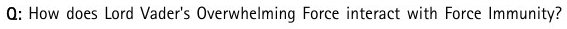
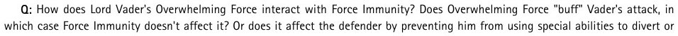
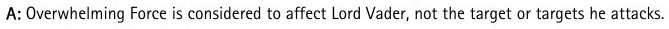
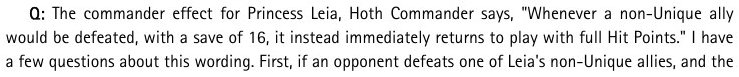
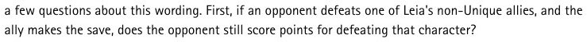
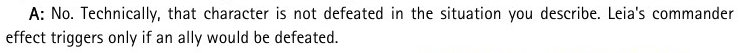
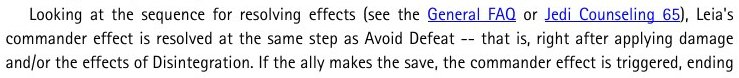
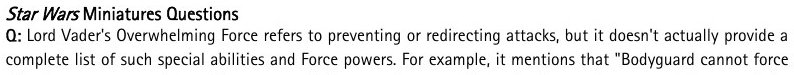
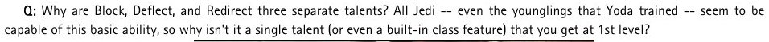
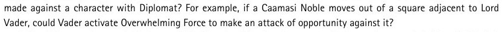

# Owner Material 037 — Star Wars D20 Drive folder (Core, Revised Core and Saga Edition): Web Articles.pdf [Star Wars Roleplaying Game Saga Edition (2007)] (scan pages 61–120)

- **Source:** Wizards of the Coast Star Wars Roleplaying Game books, web enhancements, Living Force campaign modules and articles (2000–2010), from the owner's "Star Wars D20" Drive folder (only the three edition subfolders; "General" was not read, as instructed). Secondary source (licensed Legends reference). Scan OCR'd on the box; the scan stays box-only and is **not** published.
- **Method:** every scanned page was OCR'd and machine-screened sentence by sentence for power-relevant statements (fights, kills, defeats, Force feats, rankings, superweapons) that name a character on our roster; each kept sentence is quoted verbatim from the OCR text and has a crop of the printed passage directly under it. Pages with nothing power-relevant are still listed with what is on them.
- **Citation:** "*Web Articles* (SWRPG Saga Edition), p.X" by printed page ("scan p.X" where no printed number applies). **Weight:** Licensed RPG material: a secondary source. Narrative text sums up Legends lore; game statistics are rules for players, not canon power levels, and rank lowest.

## scan p.61 (scan page 61)

Page contents: Customizing Minis 13: Repainting the 181st Imperial Pilot by Jack Irons (the Imperial Entanglements 181st pilot wears the Elite AT-AT Driver uniform; links to updated stat cards (front and back) for using him as an Elite AT-AT Driver instead; white, black, red, silver paint; wash fig first; batch painting; black base coat; white chest armor leaving 1/8 inch above belt, shoulder hose sections; white belt lines front, back and around the waist, buckle unpainted; red pinstripes along arms and outer legs). (hand-read)

### Stat block notes (game mechanics, not feats)

- Repainting the 181st Imperial Pilot: The reputation of the 181st Imperial Fighter Group is that of an elite unit of the best pilots in the Empire. However, that was not always the case. Before Captain Soontir Fel took over command the reputation of the 181st was not quite so stellar and in fact the unit had the nick-name "One-Eighty-Worst". Poor discipline was normal for most pilots of the unit before Captain Fel arrived and it seems that one of these slackers has made his appearance in the Imperial Entanglements miniatures set. Not only does he seem to lack disipline but he showed up wearing the wrong pilot uniform. Like Captain Fel, we are going to get him into shape and make him look like a proud member of the elite 181st by using some simple painting steps. (Source: *Web Articles* (SWRPG Saga Edition), scan p.61)

## scan p.62 (scan page 62)

Page contents: 181st Imperial Pilot repaint cont. (dark gray hoses, mask section and button dots; Imperial logo on shoulders and helmet: silver circles with black "X" and center line; white and silver buttons; silver buckle; optional acrylic gloss on helmet, gloves and boots in thin coats; from "One-Eighty-Worst" to the elite 181st). (hand-read)

## scan p.63 (scan page 63)

Page contents: Jedi Counseling 98-115 by Gary M. Sarli (rules Q&A for the Star Wars Miniatures Game and Roleplaying Game; Saga Edition counseling begins in part 105; contents: 98 Questions; 99 Bounty Hunters; 100 Saga Edition overview; 101 New Damage System; 102 Heroic Classes and Q&As on Twin Attack; 103 Defense, Offense and Mini Names; 104 Last Word on Saga Edition and Commander Effects; 105-106 Saga Edition Q&A; 107 Trigger Happy; 108 Readied Actions and Jedi Spirits; 109 Free Actions Aren't Free; 110 Dark Side Variant Rules; 111 Atonement Ain't Easy; 112 Proficient in Proficiencies; 113 Jedi Mind Tricks: Let's You and Him Fight!; 114 Contextual Healing; 115 Dry Docks and Hangar Bays). (hand-read)

## scan p.64 (scan page 64)

Page contents: Jedi Counseling 98 (RPG): roll initiative when the GM calls for it; initiative matters only when sequence matters; calling initiative implies combat ("roll for initiative" vs. "what do you do?"); GM may call it to simulate fog of war (friendly fire example) but sparingly; best when a hostile action is declared; coordinated party actions use delay to the lowest initiative (16, 15, 11, 8 -> 8); room breach example with stun grenade and readied actions; Improved Initiative benefit; enemy readied actions interrupt regardless. (hand-read)

## scan p.65 (scan page 65)

Page contents: Jedi Counseling 98 cont.: recommends JD Wiker's "Initiative Cards"; Minis Q: "resolve after Bodyguard" clause on Shields, Dark Armor, Damage Reduction: the FAQ is incorrect; these abilities reduce only damage taken by the character who has them; Destroyer Droid/Twi'lek Bodyguard/Clone Trooper 20-damage worked sequence; error arose from Shields wording change between Clone Strike and Revenge of the Sith and an overlooked FAQ revision. (hand-read)

## scan p.66 (scan page 66)

Page contents: Jedi Counseling 99 (Bounty Hunters set special): anyone can work as a bounty hunter without the prestige class; Imperial Peace-Keeping Certification (IPKC, "bounty hunter's license") one year, Imperial Enforcement Office application, background check, 500 credits; Hero's Guide sympathy rule of thumb for passing; Target Permit (about 1% of bounty, ~100 credits, nonrefundable), Capture Permit (flat 25%), System Permits (50-500 credits/month) and Sector/Oversector Permits (1,000-10,000 credits/month); Core Worlds rarely issue them, Corellia more tolerant than Coruscant; illegal bounties from crimelords; 1st-level bounty hunter prestige class gets a free one-year license; bounty guideline = character level x Reputation bonus x 500 credits (nonheroic levels count half). (hand-read)

## scan p.67 (scan page 67)

Page contents: Jedi Counseling 99 cont.: Hero's Guide sympathy-adjusted Reputation formula (example 6 - 2 + 5 = 9); illegal bounties about half; under 500 credits not worth posting; Minis: Boba Fett, Bounty Hunter's Flamethrower 20 does not get Twin Attack (only literal attacks); Penetration 10 does not apply to Droid Starfighter in Walking Mode's Missiles 40; Boushh is not Princess Leia for Unique purposes. (hand-read)

### Stat block notes (game mechanics, not feats)

- Jedi Counseling 99: This is a rough guideline, and circumstances can change things quite a bit. For example, Luke Skywalker had a bounty on his head for hundreds of thousands of credits despite being of a relatively low level. Of course, a prospective bounty hunter would certainly earn that money. He'd not only have to capture Luke, but also overcome dozens, hundreds, or even thousands of Rebels who stand in his (Source: *Web Articles* (SWRPG Saga Edition), scan p.67)
- Jedi Counseling 99: A: It is absolutely true that Boba and Jango Fett are closely linked to the Mandalorian tradition. This was described in detail in the article "The History of the Mandalorians" in Star Wars Insider #80 (March/April 2005). In fact, the word "Mandalorian" was first used in reference to Boba Fett's armor. As such, I can understand how this might be confusing. However, in the Star Wars Miniatures Game, the term "Mandalorian" is used to refer to a particular faction from a very specific time in galactic history. The Mandalorians in the Bounty Hunters set hail from the ranks of the Mandalorian Crusaders and Neo-Crusaders during the Old Sith Wars, a series of conflicts that includes the Great Sith War, the Cleansing of the Nine Houses, the Mandalorian Wars, and the War of the Star Forge. All of these conflicts occurred thousands of years before the events portrayed in the Star Wars trilogies, and as such they're almost a "prehistory" of how the Star Wars universe came to be. In the following millennia, Mandalorians were most often mercenaries (including a few bounty hunters), at least until the Mandalorian Civil War between the True Mandalorians under Jaster Mareel and the Death Watchmen led by Vizsla. That being the case, the Mandalorian faction, as depicted in the Star Wars Miniatures Game, has little in common with post-Mandalorian Civil War notables such as Boba and Jango Fett. Despite being a part of the same lineage and cultural heritage, the gulf of time between them is simply too vast. Thus, Boba and Jango Fett are not members of the Mandalorian faction for the same reason that Darth Vader is not a member of the Sith faction. Although he is indeed a Sith, he has no real connection to the ancient Sith of a nigh-forgotten age. (Source: *Web Articles* (SWRPG Saga Edition), scan p.67)
- Jedi Counseling 99: A: No, Boushh does not count as Princess Leia for any purpose. Princess Leia did indeed disguise herself as the Ubese bounty hunter when she brought Chewbacca to Jabba's palace in Return of the Jedi. However, the real Boushh was a bounty hunter for quite some time before that, and this miniature is meant to represent him, not Leia. Boushh took many contracts from the Black Sun crime syndicate during the Galactic Civil War, but he was ultimately caught trying to swindle the syndicate out of money. Prince Xizor's bodyguard/assassin droid, Guri, made short work of Boushh, but his fate was not widely known. Xizor kept Boushh's equipment in case it proved useful one day. Eventually, he gave it to Princess Leia to use as a disguise so she could get through Imperial security checkpoints and meet Xizor at his palace on Coruscant. (Leia, being such a high-profile member of the Rebel Alliance, almost certainly would have been recognized and detained, but "Boushh" could pass through without a second glance.) When Leia escaped from Xizor's palace, as described in Shadows of the Empire, she kept the Boushh disguise and later used it during her attempt to rescue Han Solo. (Source: *Web Articles* (SWRPG Saga Edition), scan p.67)

## scan p.68 (scan page 68)

Page contents: Jedi Counseling 100: Saga Edition overview (subtitle "When 100 columns old you reach, look as good you will not."); relaunch March 2007, 288-page revised core rulebook covering all six films, written by Christopher Perkins, Owen K.C. Stephens and Rodney Thompson, developed by Gary M. Sarli and Andy Collins, art direction Paul Hebron; still d20; double-sided battle map; chapters: Abilities (unchanged), Species (Devaronians added), Heroic Classes (Jedi, noble, scoundrel, scout, soldier; Force adept, fringer, tech specialist reborn as talents), Skills (condensed, Deception replaces Bluff/Disguise/Forgery, Use the Force, no skill ranks), Feats, The Force (Force Points, Force powers with recharge, any class can equal a Jedi, Dark Side tweaks). (hand-read)

## scan p.69 (scan page 69)

Page contents: Saga Edition overview cont.: Heroic Traits (Reputation removed, Destiny added); Equipment (autofire, area weapons, stun); Combat (swift action, hit points replace vitality/wound points, miniatures integrated); Vehicle Combat (CRs, Starship Battles mechanics); Droids (building rules); Prestige Classes (bounty hunter, Jedi Master, Sith Lord, Force adept); Galactic Gazetteer; Gamemastering (Challenge Rating replaces Challenge Code; nonheroic class replaces diplomat, expert, thug; battle-map scenarios); Eras of Play; Allies and Opponents. Minis: Rebel Captain's commander effect applies to Rebel-faction followers named "Trooper"; Lord Vader's Lightsaber Assault vs. Lightsaber Sweep both intended. (hand-read)

## scan p.70 (scan page 70)

Page contents: Jedi Counseling 100 Minis cont.: Lord Vader's Overwhelming Force is a buff that works against Force Immunity; Nym plus Mas Amedda's Booming Voice does not extend Disruptive (not a commander effect); Disruptive both blocks enemies within 6 squares from being affected by enemy commander effects and suppresses their own commander effects; examples with Grand Admiral Thrawn, Talon Karrde, Elite and Heavy Stormtroopers, and Grand Moff Tarkin's 1-3 activations (thrawn, talon-karrde, grand-moff-tarkin, nym, mas-amedda: rules-only mentions). (hand-read)

- **Darth Vader (Anakin Skywalker)**: "Q: How does Lord Vader's Overwhelming Force interact with Force Immunity?" Source: *Web Articles* (SWRPG Saga Edition), scan p.70
  
- **Darth Vader (Anakin Skywalker)**: "Does Overwhelming Force "buff" Vader's attack, in which case Force Immunity doesn't affect it?" Source: *Web Articles* (SWRPG Saga Edition), scan p.70
  
- **Darth Vader (Anakin Skywalker)**: "A: Overwhelming Force is considered to affect Lord Vader, not the target or targets he attacks." Source: *Web Articles* (SWRPG Saga Edition), scan p.70
  

### Stat block notes (game mechanics, not feats)

- Jedi Counseling 100: Regardless, there are times when you might not want to attack a particular enemy. For example, you might not want to attack all adjacent enemies if one or more of them have Self Destruct. In addition, you might want to leave an already-activated enemy intact so that it provides you with cover against other attacks. In fact, sometimes an enemy is more valuable if left standing as long as possible (such as Nute Gunray, whose commander effect is harmful to his own squad). Given all this, Lord Vader was designed to have the flexibility of choosing between making two targeted attacks with Lightsaber Assault or an untargeted Lightsaber Sweep against all adjacent enemies. (Source: *Web Articles* (SWRPG Saga Edition), scan p.70)

## scan p.71 (scan page 71)

Page contents: Jedi Counseling 101: Saga Edition's New Damage System (relaunch in May); vitality/wound points too lethal over a career: scoundrel Con 12, one blaster rifle hit per encounter, 10% crit chance, ~2% instant-kill crits, 13.333 encounters per level -> 39.1% chance of dumb-luck death before 20th level, under 14% that a party of four all survive; table Odds of Instant Death During a Character's Career by wound points (14: 4.8/9.4/13.8%; 13: 18/32.7/44.8%; 12: 39.1/62.9/77.4%; 11: 63/86.3/94.9%; 10: 82.5/96.9/99.5%; 9: 93.9/99.6/99.98%; 8: 98.5/99.98/100%) and half-life in hits. (hand-read)

## scan p.72 (scan page 72)

Page contents: Jedi Counseling 101 cont.: Our Alternative: Hit Points; quoted Saga Edition rules text: "Hit points (sometimes abbreviated "hp") represent two things in the game world: the ability to take physical punishment and keep going, and the ability to turn a serious blow into a graze or near miss. As you become more experienced, you become more adept at parrying strikes, dodging attacks, and rolling with blows such that you minimize or avoid significant physical trauma, but all this effort slowly wears you down. Rather than trying to keep track of the difference between attacks and how much physical injury you take, hit points are an abstract measure of your total ability to survive damage."; abstraction across character, Krayt dragon, tank, wall; 100-hp soldier vs. 10-hp stormtrooper ("virtual hit points"); Damage Threshold and Condition Track (penalties -1, -2, -5, -10; five steps = unconscious/disabled; catch breath; 0 hp below threshold = unconscious, above = possibly killed; threshold rises with level, Jedi Master vs. Sith Lord). (hand-read)

## scan p.73 (scan page 73)

Page contents: Jedi Counseling 102: Saga Edition's Heroic Classes: five classes (Jedi, noble, scoundrel, scout, soldier) from nine; Jedi guardian/consular merged; fringer absorbed into scout talents; Force adept becomes a concept and prestige class; tech specialist abilities to scoundrel and soldier, expanded Mechanics and Use Computer; new ability every level; Skills: trained skills at 1st level by class (noble 6 + Int, Jedi 2 + Int), single Use the Force skill; skill bonus = 1/2 level + ability modifier + 5 if trained; Skill Focus +5; equipment and circumstance bonuses; Skill Training feat for class skills of any class. (hand-read)

### Stat block notes (game mechanics, not feats)

- Jedi Counseling 102: First, the Jedi guardian and Jedi consular have been combined into a single class -- Jedi. We decided that the division wasn't necessary given the more flexible talent choices available to each class (see Talents, below). Also, even very thoughtful, meditative Jedi such as Yoda are extremely capable combatants. (Source: *Web Articles* (SWRPG Saga Edition), scan p.73)

## scan p.74 (scan page 74)

Page contents: Jedi Counseling 102 cont.: bonus feat every even level (Skill Training and Skill Focus on every list); talent at 1st and every odd level; talent trees: Jedi (Jedi Guardian, Jedi Consular, Jedi Sentinel, Lightsaber Combat), Noble (Influence, Inspiration, Leadership, Lineage), Scoundrel (Fortune, Misfortune, Slicer, Spacer), Scout (Awareness, Camouflage, Fringer, Survivor), Soldier (Armor Specialist, Brawler, Commando, Weapon Specialist); Minis Twin Attack Q&A: stacks with Double/Triple/Quadruple Attack (pairs at one target); works with Extra Attack (Gonk Droid, General Windu), attacks of opportunity, immediate attacks (Imperial Officer); ISP Speeder under Mon Mothma's commander effect gets +10 Damage on only one of the two attacks; character-wide modifiers apply to both. (hand-read)

### Stat block notes (game mechanics, not feats)

- Jedi Counseling 102: A: The ISP Speeder will get the +10 Damage on only one of the two attacks. This is a little tricky, but any modifiers that adjust a single attack (such as Mon Mothma's commander effect, which is described as producing one attack at +10 Damage) will affect only one of the two attacks produced by Twin Attack. After all, they are separate attacks. (Source: *Web Articles* (SWRPG Saga Edition), scan p.74)

## scan p.75 (scan page 75)

Page contents: Twin Attack Q&A cont.: combined fire +4 and Spotter apply to only one attack; Prince Xizor's Pheromones cancelling the first attack does not stop the second; Bodyguard may take only one attack's damage; Draw Fire diverts both attacks; if the first attack defeats the target or it becomes illegal, the second attack is lost. (hand-read)

## scan p.76 (scan page 76)

Page contents: Jedi Counseling 103: Defense, Offense and Mini Names: Reflex, Fortitude and Will Defenses replace Defense and saving throws (save +5 vs DC 15 = attack +5 vs DC 16); frag grenade at six stormtroopers resolved with one attack roll, no scatter, misses take half damage; skill checks vs. Defenses (Force slam vs Fortitude, Weaken Resolve vs Will, Deception, Persuasion, Use Computer vs a computer's Will Defense); Defense = 10 + heroic level (or armor bonus) + class bonus + ability modifier + misc; class bonuses don't stack (10th-level soldier R21/F22/W20 vs soldier 5/scout 5 R22/F22/W20); damage threshold = Fortitude Defense, Improved Damage Threshold +5, size bonuses (Krayt dragon), armor Fortitude bonus; offense: heroes not just Jedi are better than fodder, all heroes add 1/2 heroic level to damage. (hand-read)

## scan p.77 (scan page 77)

Page contents: Jedi Counseling 103 cont.: fewer iterative attacks (two-weapon, Double/Triple Attack feats); level damage lags threshold so high-level fights last longer; Minis Unique-name rules of thumb: 1 titles and ranks are not names; 2 each with a unique proper name may share a squad; 3 sharing a name without both having a unique one cannot; "Counts as [name]" entries cover exceptions. (hand-read)

### Stat block notes (game mechanics, not feats)

- Jedi Counseling 103: Yes, there are times that a character could potentially violate these rules of thumb, but we'll always include a "Counts as [name]" entry in such cases. For example, if we ever made a character named Senator Organa, we would say either "Counts as Bail Organa" or "Counts as Princess Leia" to prevent any possible confusion. Similarly, if we made a character named "Commander Skywalker," we would point out that it "Counts as Luke Skywalker" to prevent any possible confusion with Anakin Skywalker. Let's consider a few examples to see how these rules of thumb work in practice. Lord Vader and Darth Vader: Ignoring the title of "Lord," the proper name "Vader" matches part of "Darth Vader." Given that only one card has a proper name that doesn't appear on the other ("Darth"), they can't be in the same squad. General Kenobi and Obi-Wan Kenobi: Ignoring the rank of "General," the proper name "Kenobi" matches part of "Obi-Wan Kenobi." Because only one card has a proper name that doesn't appear on the other ("Obi-Wan"), they can't be in the same squad. Darth Tyranus and Darth Sidious: Even if you don't consider "Darth" to be a title (and, in many ways, it is), both cards have a proper name that the other lacks. One card has the proper name "Tyranus," and the other has the proper name "Sidious." Therefore, these characters can be in the same squad. Jaina Solo and Jacen Solo: These characters share a proper name ("Solo"). However, both cards have a proper name that the other lacks -- one has "Jaina," the other "Jacen." Therefore, they can be in the same squad. (Source: *Web Articles* (SWRPG Saga Edition), scan p.77)

## scan p.78 (scan page 78)

Page contents: Jedi Counseling 103 cont.: Nym's commander effect ("Non-Unique followers with Mercenary within 6 squares gain Double Attack") applies only to characters with the Mercenary ability, not "Mercenary" in the name ("named/name contains" language from Champions of the Force). (hand-read)

### Stat block notes (game mechanics, not feats)

- Jedi Counseling 103: Grand Moff Tarkin and Imperial Governor Tarkin: Ignoring the titles ("Grand Moff" and "Imperial Governor"), we're left with a single proper name on each card ("Tarkin"). These names match, of course. In addition, neither card has a proper name that the other lacks. Therefore, they can't be in the same squad. (Source: *Web Articles* (SWRPG Saga Edition), scan p.78)

## scan p.79 (scan page 79)

Page contents: Jedi Counseling 104: The Last Word on Saga Edition: not "dumbing down" but streamlining for cinematic speed (two-roll area attacks, no iterative attacks, encourage movement) and less bookkeeping (no skill ranks, uniform Defense advancement, talents on odd and bonus feats on even levels) so time goes to advancement choices; varied same-class parties ("all Jedi, all the time"); easier GM NPC creation. Photo of Chewbacca and C-3PO at the hologame table captioned "I do wish this game was faster . . ." (hand-read)

### Stat block notes (game mechanics, not feats)

- Jedi Counseling 104 (photo caption): "I do wish this game was faster . . ." (Source: *Web Articles* (SWRPG Saga Edition), scan p.79)

## scan p.80 (scan page 80)

Page contents: Jedi Counseling 104 cont.: Saga Edition is not a ploy to sell miniatures; rules can be abstracted; squares used because most use grids, avoids redundant units, convert as preferred; Minis: Komari Vosa's Control Minds (+2 Attack to combined fire) stacks with Bastila Shan's Battle Meditation (explicitly stacks) and Baron Fel's commander effect (changes combined fire to +6) but not other "+X Attack when combining fire" effects. (hand-read)

### Stat block notes (game mechanics, not feats)

- Jedi Counseling 104: Komari Vosa's Control Minds (+2 Attack when combining fire) stacks with Bastila Shan's Battle Meditation (which explicitly stacks) and with Baron Fel's commander effect (which changes combined fire to +6 instead of +4), but not with other "+X Attack when combining fire" effects. (Source: *Web Articles* (SWRPG Saga Edition), scan p.80)

## scan p.81 (scan page 81)

Page contents: Jedi Counseling 104 cont.: Princess Leia, Hoth Commander's commander effect (non-Unique ally that would be defeated returns with full Hit Points on save 16): no victory points scored, resolved at the Avoid Defeat step; "when defeated" effects such as Self-Destruct (with Nom Anor's commander effect) and Mon Mothma's immediate attack don't trigger (25% less often, but allies stay 33% longer); only Hit Points and location (setup area) change; activation, Force Points, E522 Assassin Droid's Programmed Target and Yoda of Dagobah's Light Tutor designations persist. (hand-read)

- **Leia Organa Solo**: "Q: The commander effect for Princess Leia, Hoth Commander says, "Whenever a non-Unique ally would be defeated, with a save of 16, it instead immediately returns to play with full Hit Points." | have a few questions about this wording." Source: *Web Articles* (SWRPG Saga Edition), scan p.81
  
- **Leia Organa Solo**: "First, if an opponent defeats one of Leia's non-Unique allies, and the ally makes the save, does the opponent still score points for defeating that character?" Source: *Web Articles* (SWRPG Saga Edition), scan p.81
  
- **Leia Organa Solo**: "Leia's commander effect triggers only if an ally would be defeated." Source: *Web Articles* (SWRPG Saga Edition), scan p.81
  
- **Leia Organa Solo**: "Looking at the sequence for resolving effects (see the General FAQ or Jedi Counseling 65), Leia's commander effect is resolved at the same step as Avoid Defeat -- that is, right after applying damage and/or the effects of Disintegration." Source: *Web Articles* (SWRPG Saga Edition), scan p.81
  

### Stat block notes (game mechanics, not feats)

- Jedi Counseling 104: Princess Leia, Hoth Commander's commander effect (a non-Unique ally that would be defeated returns with full Hit Points on a save of 16): no victory points are scored and "when defeated" effects such as Self-Destruct (with Nom Anor's commander effect) or Mon Mothma's immediate attack don't trigger; only Hit Points and location change, so E522 Assassin Droid's Programmed Target and Yoda of Dagobah's Light Tutor designations persist. (Source: *Web Articles* (SWRPG Saga Edition), scan p.81)

## scan p.82 (scan page 82)

Page contents: Jedi Counseling 105 (first Saga Edition Q&A): area attack errata: modified attack roll must be 10+ to have any effect; targets with cover take no damage on a miss (line from burst center or autofire attacker); can't aim to ignore cover; autofire deadly at close range in the open, worthless vs. covered or distant snipers; Block vs. Whirlwind Attack works like Deflect vs. autofire (half on hit, none on miss); Dual Weapon Mastery (one-handed, two heavy blaster pistols 6d8) vs. Double/Triple Attack (two-handed, heavy blaster rifle 3d10, Burst Fire 5d10, vehicle weapons); both can be combined. (hand-read)

## scan p.83 (scan page 83)

Page contents: Jedi Counseling 105 cont.: Double/Triple Attack and multiple weapons may target the same or different targets; Rapid Strike, Rapid Shot, Burst Fire usable with any multiple attacks; Rapid Shot requires Strength (recoil), Rapid Strike Dexterity (agility) intentionally; Minis: Lord Vader's Overwhelming Force clarified ("attacks (or damage from attacks) cannot be prevented or redirected"; overrides Pheromones, Force Alter, Draw Fire, Evade, Parry, Shields, Lightsaber Block/Parry/Reflect, Damage Reduction, Dark Armor, Vonduun Crab Armor, Bodyguard, Molecular Shields); Penetration only vs. Damage Reduction; Black Sun characters gain Grenades 20 from Prince Xizor's commander effect; Mistryl Shadow Guard's light whip is not a lightsaber; Komari Vosa should have Melee Attack (errata). (hand-read)

- **Darth Vader (Anakin Skywalker)**: "Star Wars Miniatures Questions Q: Lord Vader's Overwhelming Force refers to preventing or redirecting attacks, but it doesn't actually provide a complete list of such special abilities and Force powers." Source: *Web Articles* (SWRPG Saga Edition), scan p.83
  

## scan p.84 (scan page 84)

Page contents: Jedi Counseling 105 cont.: ISP Speeder should have Order 66 (errata); Jango Fett, Bounty Hunter's Sniper doesn't apply to Missiles (targeted attacks only); Nym's Rapport applies to characters with the Mercenary special ability. (hand-read)

## scan p.85 (scan page 85)

Page contents: Jedi Counseling 106: Build Lightsaber at Jedi 7th level is a reminder; any character with seven heroic levels, Force Sensitivity and lightsaber proficiency can build one (Core p40); Block, Deflect and Redirect are separate talents because combined they'd be a no-brainer, and separation gives individuality (duelist Block; diplomat or infiltrator Deflect; battlefield commander with clone troopers Deflect and Redirect); cinematic parrying without mechanical benefit; lightsaber form talents unique to the Jedi Knight prestige class by design, "master of a form" is a subjective in-universe label. (hand-read)

- **Yoda**: "All Jedi -- even the younglings that Yoda trained -- seem to be capable of this basic ability, so why isn't it a single talent (or even a built-in class feature) that you get at 1st level?" Source: *Web Articles* (SWRPG Saga Edition), scan p.85
  

### Stat block notes (game mechanics, not feats)

- Jedi Counseling 106: Q: Why are Block, Deflect, and Redirect three separate talents? All Jedi -- even the younglings that Yoda trained -- seem to be capable of this basic ability, so why isn't it a single talent (or even a built-in class feature) that you get at 1st level? (Source: *Web Articles* (SWRPG Saga Edition), scan p.85)

## scan p.86 (scan page 86)

Page contents: Jedi Counseling 106 cont.: Jedi form talents reflect meditative discipline; Sith talents (Dark Scourge, Wicked Strike) reflect passion, so Jedi and Sith are different, not better; Force Sensitivity not required to multiclass into Jedi; a non-Force-sensitive Jedi-class character can't use Use the Force talents or Force Point Jedi talents and wouldn't be called a "Jedi" in-universe (kung fu vs. Shaolin analogy); Antarian Ranger, martial artist examples; GM approval of multiclassing; droids can multiclass into Jedi after 1st level; Starship Battles setup area procedure (place Class 1 and 2 ships closest first). (hand-read)

### Stat block notes (game mechanics, not feats)

- Jedi Counseling 106: Remember that the Jedi class isn't only about the Force -- it's broader, encompassing all the Jedi arts. Thus, a non-Force-sensitive duelist might study under a Jedi and take levels in the Jedi class, becoming more skillful with a lightsaber despite having no ability to use the Force (and thus no access to some of the class's best talents, such as Deflect and Block). In fact, a character like General Grievous fits this profile very well, and it would be perfectly valid to create his character with levels in Jedi to reflect his years of study under Count Dooku. (Source: *Web Articles* (SWRPG Saga Edition), scan p.86)
- Jedi Counseling 106: A: Yes. In fact, in Shadows of the Empire, Darth Vader had some customized ASP labor droids that were modified to serve as lightsaber-sparring partners. Such droids could be represented in the game by having at least some levels in the Jedi class to pick up lightsaber combat talents. (Source: *Web Articles* (SWRPG Saga Edition), scan p.86)

## scan p.87 (scan page 87)

Page contents: Starship Battles Q&A cont. (Setup Areas and Examples of Movement diagrams): then Class 3 ships; no intentional spacing; opponent may demand tighter arrangement; no diagonal facing (four facings only); Class 1 and 2 ships can't turn in place or after moving (turn is part of moving 1 square); displaced fighters go to the closest legal square, never off the map. (hand-read)

## scan p.88 (scan page 88)

Page contents: Starship Battles Q&A cont.: a fighter stops on entering a square adjacent to an enemy fighter but may move out next round (at least 1 square); moving through a larger ship's square adjacent to an enemy fighter is illegal (can't stop inside another ship). (hand-read)

## scan p.89 (scan page 89)

Page contents: Jedi Counseling 107: Trigger Happy: one attack roll abstracts multiple trigger pulls; ammunition counts attacks not trigger pulls (sniper single shots, soldier bursts, gunslinger flurry); Rapid Strike with Whirlwind Attack and Rapid Shot with autofire don't work (single target only); Far Shot, aiming with a targeting scope and accurate weapons stack: non-accurate weapon PB +0/S -2/M -5/L -10; Far Shot or scope aim PB +0/S +0/M -2/L -5; both PB +0/S +0/M +0/L -2. (hand-read)

## scan p.90 (scan page 90)

Page contents: Jedi Counseling 107 cont.: accurate weapon (sporting blaster rifle) PB +0/S +0/M -5/L -10; Far Shot or scope aim M +0/L -5; both L +0 (sniper with accurate scoped weapon who aims has no long-range penalty); 6-square cone: from a grid intersection, 90-degree arc, old alternating diagonal count, illustration (GM Screen forthcoming); Starship Battles: ships fire all weapons per round (gunnery crews); broadside and spine weapons fire in a ship-base-wide lane (2 squares for Class 1-2) at one target; may fire one target per side. (hand-read)

## scan p.91 (scan page 91)

Page contents: Starship Battles cont.: no two targets on one side; attack order: all Point Defense first, then each ship's other weapons; Slave I (Jango Fett) Seismic Mines PD +4 is the same +4, and it gets Point Defense against all fighters within 2 squares with Incoming Fighters; Darth Vader's TIE Advanced x1 really has Evasion (useful vs. Incoming Fighters and the Emperor's Will on Palpatine's Shuttle); Command counters can't go on destroyed ships but can on unlaunched fighters. (hand-read)

## scan p.92 (scan page 92)

Page contents: Jedi Counseling 108: Readied Actions and Jedi Spirits: readying is a standard action (errata); an action rendered impossible is lost (readied withdraw, attacks of opportunity, readied move to total cover, reaction talents); justification: actions evolve over the round, momentum can't be reversed (baseball checked swing), the readier also forgoes an attack, outcome unchanged; photo caption "The Rebels aboard the Tantive IV ready themselves for company." (hand-read)

## scan p.93 (scan page 93)

Page contents: Jedi Counseling 108 cont.: readied actions are visible (aimed blaster, primed weapon, western showdown draw, bouncing on the balls of the feet), so opponents can respond (ready a charge); Minis: Light Spirit (Obi-Wan Kenobi, Jedi Spirit, Alliance and Empire) errata quoted in full: "This character can move through enemy characters, and enemy characters can move through it, as long as no character ends its move in the same space as another character. This character does not count as the nearest enemy, and does not count as adjacent to other characters. This character is not affected by commander effects."; Savage characters ignore him; Force Renewal 1 granted to Yoda of Dagobah (Force Renewal 2) doesn't stack; ignores terrain (walls, doors, pits) except ending inside solid objects; can't move off the battle grid. (hand-read)

### Stat block notes (game mechanics, not feats)

- Jedi Counseling 108: Thus, Obi-Wan Kenobi, Jedi Spirit can't block or otherwise restrict the movement of enemies or allies because they can move through him without any trouble, though they must still end in a legal square (and not the same square Obi-Wan is in). Similarly, he won't interfere with the targeting and attacks of enemies because he never counts as the nearest enemy or as adjacent. (Source: *Web Articles* (SWRPG Saga Edition), scan p.93)

## scan p.94 (scan page 94)

Page contents: Jedi Counseling 108 cont.: range to a Light Spirit character is counted normally (only it ignores terrain); Obi-Wan Kenobi, Jedi Spirit requires a Unique allied character with a Force rating in the squad; he counts as a Living character (Living distinguishes organic from mechanical; being one with the Force is another form of life). (hand-read)

## scan p.95 (scan page 95)

Page contents: Jedi Counseling 109: Free Actions Aren't Free: Improved Sense Surroundings can't be rerolled endlessly as free actions ("The GM puts reasonable limits on what counts as a free action"; 10,000 one-word free actions reciting the epic history of the Rodian hunter clans disallowed); sense surroundings is tied to a single Perception check, which costs an action unless a reaction; Quick Draw lightsaber question; red sidebar Variant Rule: Free Actions Aren't Free: "Each round, a character can perform a number of free actions equal to 1 plus his Charisma modifier or Intelligence modifier (whichever is more), with a minimum of one free action allowed each round. This encourages characters with a higher Charisma or Intelligence -- the leaders and planners -- to coordinate the group even when they don't have any talents that can come into play. Conversely, it encourages the heavy-hitters to "shut up and shoot" instead of trying to overplan their actions, thereby keeping the tempo of the fight moving along." (hand-read)

## scan p.96 (scan page 96)

Page contents: Jedi Counseling 109 cont.: drawing a weapon includes activating a lightsaber or vibroblade or switching off a blaster safety (not when picking up or using Stealth sleight of hand); serenity can't give a natural 20 on vehicle weapons ("your attack roll" means personal hand-held weapons; Core p144 vs. p167 formulas; battle strike likewise); Minis: Nym plus Trandoshan Mercenary's Double Claw Attack and Double Attack don't stack (two attacks; Extra Attack is cumulative); Han Solo in Stormtrooper Armor's Charging Fire and Mobile Attack never combine; Charging Fire ("replaces turn") can't combine with "replaces attacks" abilities (2007 Starter Set rulebook p49). (hand-read)

### Stat block notes (game mechanics, not feats)

- Jedi Counseling 109: Originally, this was part of the justification for why Luke had to turn off his targeting computer to use the Force and blow up the Death Star. With the targeting computer off, the proton torpedoes basically became improvised ranged weapons, and he was limited to a very short-range shot (within the same starship-scale square) due to the lack of computer assistance. However, Luke could use his personal ranged attack bonus and thus qualify for using a Destiny Point (or even battle strike, which we originally considered making his first Force power). (Source: *Web Articles* (SWRPG Saga Edition), scan p.96)

## scan p.97 (scan page 97)

Page contents: Jedi Counseling 109 cont.: mutually exclusive abilities need declaring only when they alter the sequence of play, but "replaces turn" abilities such as Charging Fire must be declared at the start of the turn; worked example: Charging Fire user takes a critical hit from a Stormtrooper's attack of opportunity and shortens the move to 5 squares to attack that Stormtrooper. (hand-read)

## scan p.98 (scan page 98)

Page contents: Jedi Counseling 110: Dark Side Variant Rules: author apologizes for the confusing Jedi Counseling 109 serenity answer and retracts it (Careful Shot and Rapid Shot already work with vehicles per Starships of the Galaxy); new errata: "When using a vehicle weapon, you cannot apply any effect that causes an automatic natural 20 or automatic critical hit (such as spending a Destiny Point or using serenity), unless a rule specifies that it can be used with vehicle weapons."; reasons to be tempted by the dark side (situational benefit of evil acts such as killing a captive, dark side powers, Corruption destiny, a Sith Lord's temptation class feature); red sidebars (re-OCR from image): Variant Rule: Calling on the Dark Side: "If your Dark Side Score is less than your Wisdom, you can call on the dark side to gain a temporary Force Point. If the Force Point is not used before the end of the encounter, it is lost. Calling on the dark side is a major transgression (see page 94 of the Saga Edition Core Rulebook). Only heroic characters can call on the dark side."; Variant Rule: The Measure of Evil: "When you commit a dark side transgression, your Dark Side Score increases by a random amount: 1d6-3 for major transgressions, 1d6-4 for moderate transgressions, and 1d6-5 for minor transgressions. (This never reduces your Dark Side Score, even if the result is less than zero.)"; Variant Rule: The Threshold of Evil: "When your Dark Side Score increases, roll 2d4 and add your new Dark Side Score. If the result exceeds your Wisdom by 5 or more points, your Dark Side Score increases to your Wisdom score, and you turn to the dark side." (hand-read)

## scan p.99 (scan page 99)

Page contents: Jedi Counseling 110 cont.: temporary Force Points (Fringe Savant) can't be recovered with Force Point Recovery; Minis: Muun Tactics Broker (The Force Unleashed 54/60): Tactics Broker can't be switched off, removed characters count as defeated (no Avoid Defeat; Self Destruct and Impulsive Shot trigger), suppressed by Never Tell Me The Odds, doesn't stack, final roll after Recon or Anticipation is a 1 (not on tie-breakers); Golan Arms DF.9 Anti-Infantry Battery (The Force Unleashed 6/60) Emplacement: entire space on own half, not the middle row of odd maps (Revenge of the Sith Starter Set map), not across doors (treated as walls at setup), can set up in Gambit scoring areas. (hand-read)

## scan p.100 (scan page 100)

Page contents: Jedi Counseling 111: Atonement Ain't Easy: atonement costs 1 Force Point as a swift action, then GM-adjudicated meditation, reflection and absolution (at least an adventure on stage, or a week to years between adventures), sincerity required, 1 point at a time; sacrificed Force Points can't be recovered; transgression guidelines via five questions (sentient living target, at your mercy, serious harm, unnecessary for protection, deliberate): all yes = major (murder, torture, slavery, rape); one no = moderate (assassinating an Imperial warlord about to exterminate a planet, tormenting a droid, unnecessary fight); two no = minor (self-defense killing, reckless injury); three or more no = no transgression (destroying objects, hunting for food); "When in doubt, go with your gut instinct." (hand-read)

## scan p.101 (scan page 101)

Page contents: Jedi Counseling 111 cont.: Severing Strike is not a transgression in itself (protects from a lethal blow, like medical amputation), but maiming a helpless enemy is torture ("by lightsaber, scalpel, or angry Wookiee"); move object damages doors (DR applies, 0 hp pulls it free); Force thrust vs. door break DC (Strength bonus + 10 + 5 for stability); Minis: Force Push (The Force Unleashed insert) direction rules (each square farther away), resolve damage then push and stun per character, pushing into pits uses errata: "If a character is involuntarily moved onto a pit square, stop its movement in the nearest square adjacent to the pit and make a save of 11. On a successful save, the character remains adjacent to the pit. On a failure, it is defeated. Characters with abilities that allow them to enter pit squares (such Flight) make a save of 6 instead." (hand-read)

## scan p.102 (scan page 102)

Page contents: Jedi Counseling 111 cont.: Force Push 3 or 5 on an adjacent enemy damages and stuns the acting character but doesn't push it; a transporting character (Desert Skiff, Troop Cart) carrying the acting character isn't pushed. (hand-read)

## scan p.103 (scan page 103)

Page contents: Jedi Counseling 112: Proficient in Proficiencies: unarmed attacks and natural weapons are simple, light melee weapons (Weapon Focus reference an error; Weapon Finesse applies; combat gloves are both); droid weapon mounts allow unarmed bludgeoning but the mounted weapon needs proficiency (R2 unit with blaster pistol at -5; no heuristic processor = can't use); Weapon Familiarity treats the weapon as in the group for all purposes (Wookiee soldier Weapon Focus/Specialization (rifles) applies to bowcasters); proficiency with one weapon in a group qualifies for Weapon Focus (Spacehound scoundrel and starship weapons, not E-web); "Weapon Proficiency (group)" prerequisites require the feat. (hand-read)

## scan p.104 (scan page 104)

Page contents: Jedi Counseling 112 cont.: errata: p82 Burst Fire prerequisites "Proficient with heavy weapons, proficient with weapon." with -10 penalty without Strength 13 for non-vehicle weapons (X-wing pilot example); p88 Rapid Shot drops Strength prerequisite (-5 without Str 13 for non-vehicle weapons); p88 Rapid Strike drops Dexterity prerequisite (-5 without Dex 13 for non-light weapons); Minis: Greater Mobile Attack allows full move and multiple attacks, not with Charging Fire (replaces turn), works with Force point speed and Master Speed; card text and glossary both apply, card wins only on direct contradiction; Caamasi Noble's Diplomat can't be hit by Lightsaber Sweep while a non-Diplomat enemy is in line of sight. (hand-read)

## scan p.105 (scan page 105)

Page contents: Jedi Counseling 112 cont.: Lightsaber Sweep may hit the Diplomat once other enemies are defeated mid-sweep; Blaster Barrage and Furious Assault fix legal targets at the start and targets must stay legal (e.g., Princess Leia, Rebel Hero's commander effect breaking line of sight); Furious Assault requires moving at least 1 square. (hand-read)

### Stat block notes (game mechanics, not feats)

- Jedi Counseling 112: Q: Speaking of Blaster Barrage and Furious Assault, is the opposite true? If a legal target somehow becomes illegal once the process has started -- perhaps because of Princess Leia, Rebel Hero's commander effect moving the attacker and breaking line of sight -- could you still attack that previously legal target? A: No. The target must be legal at the beginning of the process (as mentioned above), but it must also be legal at the time the attack itself is resolved. (Source: *Web Articles* (SWRPG Saga Edition), scan p.105)

## scan p.106 (scan page 106)

Page contents: Jedi Counseling 113: Jedi Mind Tricks: Let's You and Him Fight!: mind trick suggestions can't obviously endanger the target, so a stormtrooper won't attack other stormtroopers (court-martial), but an indirect suggestion works ("That bounty hunter is actually a Rebel terrorist, and he's carrying a bomb!"); Teras Kasi Mastery (Threats of the Galaxy p53) + Double Attack + Mighty Swing combine, extra die only on the first attack; Hot Wire + Trace can't substitute Mechanics for Gather Information; Force disciples immune even to helpful mind-affecting effects (optional house rule to toggle as swift action); lightwhip (Threats of the Galaxy p84) and guard shoto/lightsaber tonfa (The Force Unleashed Campaign Guide p96) are lightsabers. (hand-read)

### Stat block notes (game mechanics, not feats)

- Jedi Counseling 113: Q: There are a lot of custom lightsabers in Star Wars, but my group can't decide if they all fall under the lightsaber weapon group. For example, would Lumiya's lightwhip or the lightsaber tonfa used in The Force Unleashed video game be considered lightsabers or exotic weapons? A: Both the lightwhip (page 84, Threats of the Galaxy) and the guard shoto, also known as the lightsaber tonfa (page 96, The Force Unleashed Campaign Guide, due out later this year), are part of the lightsaber weapon group. (Source: *Web Articles* (SWRPG Saga Edition), scan p.106)

## scan p.107 (scan page 107)

Page contents: Jedi Counseling 113 cont.: weapon groups are broad; exotic only for bizarre designs (flamethrower arcs liquid); Weapon Familiarity flavor (Wookiee bowcasters, Gungan atlatls); E-web weight correct (dedicated ~15 kg power generator and heavy tripod); Minis: Republic Commando Training Sergeant (Legacy of the Force) Order 66 combined fire +10 Damage applies to him only as attacker (not his own ally); doesn't stack with Clone Commander Bacara (Champions of the Force); Han Solo in Carbonite (The Force Unleashed) costs half the frozen Han rounded up, the choice (Han Solo of Hoth 33, Han Solo in Stormtrooper Armor 25) is fixed and revealed at setup, can't be moved, Large Han Solo on Tauntaun placed in nearest legal space, Light Spirit/Light Tutor/Force Spirit can't affect it (an object). (hand-read)

### Stat block notes (game mechanics, not feats)

- Jedi Counseling 113: Q: Does the +10 Damage with combined fire from this commander effect stack with other commander effects that provide +10 Damage, such as that of Clone Commander Bacara (Champions of the Force)? A: No. Commander effects that provide a bonus to the same statistic don't stack. You apply only the largest bonus. (Source: *Web Articles* (SWRPG Saga Edition), scan p.107)
- Jedi Counseling 113: Q: When using Han Solo in Carbonite (The Force Unleashed), its cost is half as much as the chosen character whose name contains Han Solo (the "frozen" character). Do we round up or down if the chosen character has an odd number for the cost? A: When calculating the cost of Han Solo in Carbonite, round fractions up. [...] Once chosen, the frozen Han Solo cannot be changed for any reason. [...] A: No. Han Solo in Carbonite cannot be moved or pushed by any means. (Source: *Web Articles* (SWRPG Saga Edition), scan p.107)

## scan p.108 (scan page 108)

Page contents: Jedi Counseling 114: Contextual Healing: D&D 4th Edition healing surges vs. Saga healing; existing options (second wind, medpacs, surgery 1 hour/10 minutes with Surgical Expertise, vital transfer recharged by 1-minute rest, not on yourself per errata); two vital transfer users can heal everyone; GM advised to change rules conservatively; Optional Rule: Old Wounds (from The Gem of Alderaan, eighth Dawn of Defiance adventure; FastFlesh medpacs Threats of the Galaxy p54): Critical Care (Trained Only; medpac and surgery kit): one minute, DC 20 Treat Injury heals character level + excess, -5 per previous attempt in 24 hours; failure deals damage equal to damage threshold (death at 0 hp unless a Force Point is spent). (hand-read)

## scan p.109 (scan page 109)

Page contents: Jedi Counseling 114 cont.: critical care on yourself at -5; Variant Rule: Multiple Second Winds (1 + class Fortitude bonus + Con modifier per day, minimum 1; Extra Second Wind/Tough as Nails add the base number; once per encounter); Optional Rule: The Edge of Exhaustion (extra second wind for -1 persistent condition step until surgery or 8 hours rest); Variant Rule: Vital Sacrifice (healer can't benefit from vital transfer for 24 hours); Variant Rule: Vital Limits (benefit once per 24 hours unless a Force Point is spent on activation); Equilibrium removes persistent conditions and moves to the top of the track; condition penalties reduce damage threshold; Minis: Overwhelming Force allows Lord Vader's attack of opportunity or Lightsaber Sweep against a Diplomat (Caamasi Noble) since non-targeted; Flight and Force Leap aren't overridden (attack of opportunity never provoked). (hand-read)

- **Darth Vader (Anakin Skywalker)**: "For example, if a Caamasi Noble moves out of a square adjacent to Lord Vader, could Vader activate Overwhelming Force to make an attack of opportunity against it?" Source: *Web Articles* (SWRPG Saga Edition), scan p.109
  

### Stat block notes (game mechanics, not feats)

- Jedi Counseling 114: Q: Can Overwhelming Force allow a non-targeted attack, such as an attack of opportunity or Lightsaber Sweep, to be made against a character with Diplomat? For example, if a Caamasi Noble moves out of a square adjacent to Lord Vader, could Vader activate Overwhelming Force to make an attack of opportunity against it? A: Yes. (Source: *Web Articles* (SWRPG Saga Edition), scan p.109)

## scan p.110 (scan page 110)

Page contents: Jedi Counseling 114 cont.: Force Leap likewise doesn't provoke (FAQ: "Because [characters with Flight] ignore enemy characters while moving, they do not provoke attacks of opportunity."); prerequisites (Melee Attack adjacency, line of sight) aren't bypassed by Overwhelming Force; Strafe Attack works with Flight (specific text, rolled just before entering the space); Galloping Attack with Flight (via Tow Cable) still attacks adjacent enemies. (hand-read)

## scan p.111 (scan page 111)

Page contents: Jedi Counseling 115: Dry Docks and Hangar Bays: Starships of the Galaxy design rules can't reproduce every existing ship; built for a typical hero and "a typical new starship from a typical production facility" (Table 3-8, p52); a hero's light freighter compares to a YT-1300, but the YT-1300 has extra emplacement points (Corellian Engineering Corporation's edge; Kuat Drive Yards mass production); no macroeconomics ("Most of us are just here to shoot stormtroopers."); GMs may write custom stats, use Gear Templates (KotOR Sourcebook p76) or proprietary stock ships; removed systems return 1/4 value; errata: passenger conversion holds passengers equal to the ship's cost modifier; cargo pods can't be converted to emplacement points; non-launching vehicles (Imperial-class Star Destroyer's AT-ATs and AT-STs) carried as cargo, about 1 minute to make combat ready. (hand-read)

## scan p.112 (scan page 112)

Page contents: Jedi Counseling 115 cont.: cargo-stored vehicles need about 100 tons (50 cubic meters) per unit of hangar space; freighters converted to warships are vetoed by Nonstandard Modifications (p39: "particularly unusual combinations may be forbidden altogether"); modified freighters (Millennium Falcon, Outrider, Wild Karrde, Ebon Hawk) and the Gallofree GR-75 never became pocket battleships; guidelines: no similar stock system (hyperdrive on a starfighter), >50% speed/hp/shields or >100% weapons/passengers/hangar, emplacement points from cargo equal to cost modifier; Minis: Invisibility: adjacent characters may use attacks and targeted abilities, invisible characters still grant cover (competitive game balance); multiple Mines don't stack ("minefield" analogy), Large characters save once, non-movement entry (Grand Admiral Thrawn's commander effect, disembarking, Force Push) doesn't trigger Mines. (hand-read)

### Stat block notes (game mechanics, not feats)

- Jedi Counseling 115: Q: What if a character enters an adjacent square without actually moving into it, such as by Grand Admiral Thrawn's commander effect, disembarking a transport, or being subject to Force Push? Would the character still trigger Mines? A: No. None of these examples are technically "movement," so they don't fit the criteria necessary to trigger Mines. (Source: *Web Articles* (SWRPG Saga Edition), scan p.112)

## scan p.113 (scan page 113)

Page contents: Jedi Counseling 115 cont.: Force Bubble applies to a single instance of taking damage; it can't be used against a character with Force Immunity (counts as responding to the attack). (hand-read)

## scan p.114 (scan page 114)

Page contents: Knights of the Old Republic: Creatures of KOTOR 1-3 by Eric Cagle: series intro (new KOTOR-era creatures beyond the KOTOR Campaign Guide for Saga Edition); contents 1: Firaxa & Gizka; 2: Horned Kath Hound & Iriaz; 3: Viper Kinrath & Mykal. (hand-read)

## scan p.115 (scan page 115)

Page contents: Firaxa (firaxan shark) of Manaan: territorial predator, spawn of the Progenitor in the Hrakert Rift, possibly related to the Selkath (whom they ignore); encounters near surface-dweller activity, Selkath guides; Firaxa CL 8 Large aquatic beast 9: Init +5; Ref 17, Fort 20, Will 13; hp 130, Threshold 25; sonic vulnerability; swim 8; bite +10 (1d8+17, incl. 5 Power Attack); 3x3, reach 2; Str 26 Dex 13 Con 30 Int 2 Wis 16 Cha 8; blood in the water (+1 die vs. damaged targets), scent, sonic vulnerability (+1 die). (hand-read)

## scan p.116 (scan page 116)

Page contents: Gizka: ubiquitous tiny reptiles, fecund, eat wiring and food stores, radiation immune, squeeze into tiny openings, nutritious "universal flavor" meat, undomesticable; encounters as distractions; Gizka CL 1 Tiny beast 1 (Ref 16, Fort 12, Will 13; hp 5; bite -2 (1d3-2); gnaw ignores DR of unattended items; squeeze as Diminutive) and Gizka Pack CL 3 Small beast pack 1 (hp 10; bite 1d4-2; pack traits; squeeze as Tiny). (hand-read)

## scan p.117 (scan page 117)

Page contents: Horned Kath Hound of Dantooine (aggressive kath hound variant, KotOR Campaign Guide p223; alphas of kath hound packs, criminals' guard animals): CL 6 Medium beast 7, Ref 15, Fort 14, Will 10, hp 52, Threshold 14, gore +6 (1d6+10) and 2 claws +6 (1d4+10) incl. 3 Power Attack, Bantha Rush, Jump +12; Iriaz: Dantooine herd herbivores hunted for pelts and horns; CL 3 Medium beast 4, Ref 14, Fort 11, Will 12, hp 22, speed 8, gore +5 (1d6+4) or +7 (1d6+6) with Powerful Charge, sprint (double speed once per encounter, then -1 condition step). (hand-read)

## scan p.118 (scan page 118)

Page contents: Viper Kinrath (Dantooine and Kashyyyk insectile creature; regular kinrath swap the sting for a slam without poison; blind, heat and smell senses; unique pungent odor used by hunters; eggs contain red lightsaber crystals hunted by Padawans; hive queens): CL 7 Large beast 8, Init +7, Ref 17, Fort 16, Will 11, hp 84, Threshold 21, slam +10 (1d6+8), sting +10 (1d6+8 plus poison), reach 2 with sting; blind; poison 1d20+8 vs. Fortitude, 2d6 and -1 condition step, each round until DC 18 Treat Injury. (hand-read)

## scan p.119 (scan page 119)

Page contents: Mykal (Kashyyyk aerial predators, nests hundreds of meters up, delicacy eggs, keep kinrath in check, shot on sight by Wookiees): CL 4 Medium airborne beast 5, Init +10 (reroll keep second), Ref 16, Fort 13, Will 11, hp 37, Threshold 18, fly 8, bite +6 (1d6+3), Running Attack, Weapon Finesse; confusing swoop (charge damage prevents attacks of opportunity against it until end of target's next turn). (hand-read)

## scan p.120 (scan page 120)

Page contents: Message to Spacers 1-10 by Rodney Thompson & Patrick Stutzman: series intro (new starships and space stations with statistics); contents: 1 XQ2 Space Platform; 2 Cardan-Class Space Station; 3 YZ-775 Transport; 4 Loronar E-9 Explorer; 5 Baas-class Space Station; 6 Starfeld Industries Z-10 Seeker; 7 Cygnus Spaceworks Alpha-class XG-1 "Star Wing"; 8 Crusader-class Corvette; 9 Heraklon-class Transport; 10 Suwantek Systems TL-1800 Transport. (hand-read)

