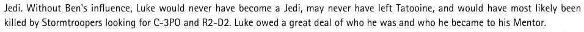
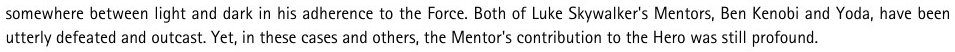
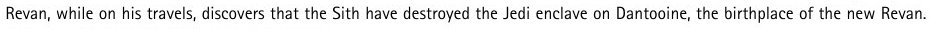
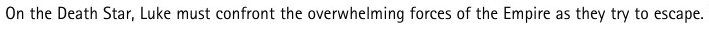
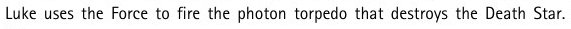

# Owner Material 037 — Star Wars D20 Drive folder (Core, Revised Core and Saga Edition): Web Articles.pdf [Star Wars Roleplaying Game Saga Edition (2007)] (scan pages 121–180)

- **Source:** Wizards of the Coast Star Wars Roleplaying Game books, web enhancements, Living Force campaign modules and articles (2000–2010), from the owner's "Star Wars D20" Drive folder (only the three edition subfolders; "General" was not read, as instructed). Secondary source (licensed Legends reference). Scan OCR'd on the box; the scan stays box-only and is **not** published.
- **Method:** every scanned page was OCR'd and machine-screened sentence by sentence for power-relevant statements (fights, kills, defeats, Force feats, rankings, superweapons) that name a character on our roster; each kept sentence is quoted verbatim from the OCR text and has a crop of the printed passage directly under it. Pages with nothing power-relevant are still listed with what is on them.
- **Citation:** "*Web Articles* (SWRPG Saga Edition), p.X" by printed page ("scan p.X" where no printed number applies). **Weight:** Licensed RPG material: a secondary source. Narrative text sums up Legends lore; game statistics are rules for players, not canon power levels, and rank lowest.

## scan p.121 (scan page 121)

Page contents: XQ2 Space Platform by Rodney Thompson (captions: "The XQ2 Space Platform, as depicted in the Star Wars: X-wing Alliance computer game." and "The XQ1 Space Platform, as depicted in the Star Wars: X-wing Alliance computer game."): waypoint station at the atmosphere's edge for heavy-traffic worlds (Brentaal), passenger staging, modular; cylindrical core, three angled hangars (20 Colossal ships each, or one CR90 corvette), upper landing platform, ventral bay; control tower uses electronic surveillance; three turbolaser and two point-defense batteries, up to 36 defensive starfighters in three squadrons; successor to the XQ1, built at the start of the Galactic Civil War; Bengel Shipbuilders overextended (leased Kuat Drive Yards and Corellian Engineering Corporation yards) and went bankrupt; Tenloss Corporation bought it. (hand-read)

## scan p.122 (scan page 122)

Page contents: XQ2 Space Platform cont.: XQ3 design sold to Xizor Transport Systems, angering Tenloss; XQ2s across the Corporate Sector and Core (Sel Zonn Station above Brentaal); blue sidebar Bengel Shipbuilders (re-OCR from image): XQ1 built in the Dynali Sector for tectonically active Ord Thoden, adopted throughout the Corporate Sector after CSA scouts saw it, enlarged for small capital ships; Bengel Shipbuilders XQ2 Platform CL 16 Colossal (station): Ref 10, Fort 70, +15 armor, hp 2,500, DR 20, SR 200, Threshold 570; 3 turbolaser batteries (4d10x5) and 2 point-defense laser cannon batteries (3d10x2); crew 1,598, passengers 10,000; cargo 100,000 tons; 36 starfighters, 20 cargo shuttles; Restricted, 30,000,000 (18,000,000 used). (hand-read)

## scan p.123 (scan page 123)

Page contents: Cardan-class Space Station by Patrick Stutzman: Imperial defense platform in five sizes, Mark I (research and agricultural sites) to Mark V (fleet-stopping, classified sites); modular sections each with a TIE squadron, Coruscant-like architecture; shipyards drydock an Imperial-class Star Destroyer plus four more capital ships (repair edge over the Golan Defense Platform); nearby Acclamator II assault ships or Tartan-class patrol cruisers respond; up to eight TIE squadrons on some Mark Vs. (hand-read)

## scan p.124 (scan page 124)

Page contents: Cardan-class cont.: tactical fire (forgo attacks: allies within 3 squares gain +5 DR and +1 Fortitude); conceived late in the Clone Wars, KDY prototypes, deployed under the Empire; Mark I first, later larger versions vs. crime rings; informed the Super Star Destroyer and second Death Star; common in Mid and Outer Rim and at the Perlemian Trade Route/Hydian Way crossroads; KDY Cardan I CL 8 (Ref 6, Fort 58, hp 600, SR 150; 2 light turbolaser and 2 point-defense light ion batteries; crew 1,200, 12 TIE Fighters, 2 Lambda shuttles) and Cardan III CL 12 (Ref 7, Fort 62, hp 1,200, SR 175; 3 light turbolaser, 3 PD light ion, 2 proton torpedo launchers 9d10, 2 tractor beams grapple +93; crew 2,400, 24 TIEs, 4 Lambdas); Military, not for sale. (hand-read)

## scan p.125 (scan page 125)

Page contents: Cardan V CL 20: Ref 8, Fort 66, +13 armor, hp 1,800, DR 20, SR 200, Threshold 566; 4 medium turbolaser (6d10), 4 PD medium laser (5d10x2), 4 PD medium ion (5d10x2 ion), 4 proton torpedo launchers (9d10), 2 tractor beams (grapple +93); crew 4,800, passengers 1,200; cargo 35,000 tons; 48 TIE Fighters, 6 Lambda-class shuttles; Military. (hand-read)

## scan p.126 (scan page 126)

Page contents: YZ-775 Transport by Patrick Stutzman: CEC's largest light freighter, a half step to capital ships (CR90, Corellian Gunship); 52 m, cockpit twice a YT-1300's, crew 8, two-deck configurations (cargo up or down); double turbolaser not originally Empire-approved, double laser cannons, proton torpedoes; history: post-Clone Wars demand for armed ships, CEC negotiated authorizations with the Imperial Bureau of Shipyards and Construction; YZ-775s served the Rebellion and New Republic; Outer Rim systems use them as patrol and customs vessels despite CEC denials. (hand-read)

## scan p.127 (scan page 127)

Page contents: CEC YZ-775 Transport CL 12 Colossal (frigate): Ref 13, Fort 34, +11 armor, hp 650, DR 15, SR 90, Threshold 134; fly 12 (950 km/h), 3 starship; double turbolasers (5d10x5), 2 double laser cannons (5d10x2, autofire), 2 proton torpedoes (9d10x2); crew 8, passengers 14; cargo 400 tons; 6 months; 24 torpedoes; hyperdrive x1 (backup x12); Licensed, 500,000 (350,000 used). (hand-read)

## scan p.128 (scan page 128)

Page contents: Loronar E-9 Explorer by Patrick Stutzman: long-range scout for four crew, streamlined for atmosphere; bridge, crew quarters in the neck, lounge with autochef and holographic game table, three-deck cargo bay with ventral elevator (optional CS-1 cargo sled 12,000 credits), maintenance crawlways via the gunwell; two laser cannons, often upgraded (seizure by the Empire); history: unarmed at the end of the Clone Wars, armed, then legal battle with the Imperial Bureau of Shipyards and Construction, rebranded armed scout; used by explorers, mercenaries, pirates, and as yachts. (hand-read)

## scan p.129 (scan page 129)

Page contents: Loronar E-9 Explorer CL 7 Colossal space transport: Ref 15, Fort 24, +13 armor, hp 150, DR 15, SR 45, Threshold 74; fly 12, 4 starship; 2 laser cannons (4d10x2); Perception/Use Computer +12 with sensors; crew 4, passengers 4; cargo 30 tons; 2 years; Licensed, 325,000 (200,000 used); CS-1 cargo sled sidebar (Loronar and Mobquet Swoops and Speeders; four-person cab, 1,000 kg open bed, blaster cannon mods): Loronar/Mobquet CS-1 Cargo Sled CL 1 Huge speeder, Ref 12, Fort 15, hp 70, DR 5, speed 8 (225 km/h), crew 1, passengers 3, cargo 1 ton; Licensed, 12,000 (6,500 used). (hand-read)

## scan p.130 (scan page 130)

Page contents: Baas-class Space Station by Patrick Stutzman: Imperial Outer Rim supply depot, 900 m; top control center and quarters; upper flight deck six hangars (to Gargantuan, TIE complement), lower five (Colossal), ten docking ports; ten cargo levels above and below with double-wide corridors; engineering, life support and shield generator at the "south pole"; 18 personnel and 6 cargo turbolifts (35 tons); designed by Durastar Construction of Malastare, prototype built in 25 standard days, company went out of business after neglecting other clients; seen in the Rainos Cluster, rumored at Endor for the second Death Star; post-Empire claimed by pirates, smugglers, governments (wars over ownership). (hand-read)

## scan p.131 (scan page 131)

Page contents: Baas-class Space Station CL 7 Colossal (cruiser): Ref 6, Fort 48, +11 armor, hp 900, DR 20, SR 200, Threshold 248; no weapons; crew 250, passengers 100 plus 50 Imperial troops; cargo 1,000,000 tons; 2 years; 4 TIE fighters; Military. (hand-read)

## scan p.132 (scan page 132)

Page contents: Starfeld Industries Z-10 Seeker by Patrick Stutzman: scout and trade vessel turned courier/fast light freighter; "tight design" with no emplacement points (-5 Mechanics and double time to install systems); superb maneuverability, high-grade sensors tied to targeting (-2 if sensors down, weapon damage shuts sensors), weak hull, no shields; 5 tons cargo plus 2 heavy cargo pods (45 tons) with ejection system; poor sales during the Separatist crisis, rebranded for couriers mid-war; suppliers such as Miradyne Computer Systems failed, proprietary BlasTech parts; stock Z-10s rare; short-hop deliveries. (hand-read)

## scan p.133 (scan page 133)

Page contents: Z-10 Seeker cont.: smugglers pose as small-time couriers; personal transports; Starfeld Z-10 Seeker CL 5 Gargantuan space transport: Init +1, Ref 17, Fort 24, +6 armor, hp 90, DR 10, Threshold 44, fly 16 (1,000 km/h), 3 starship; light laser cannon +2 (3d10x2, autofire); Dex 22; Perception/Use Computer +12 with sensors; crew 1, passengers 2; cargo 45 tons; 2 months; hyperdrive x1; Licensed, 86,000 (69,000 used). (hand-read)

## scan p.134 (scan page 134)

Page contents: Cygnus Spaceworks Alpha-class XG-1 "Star Wing" by Patrick Stutzman: Imperial assault gunboat modeled on the Lambda-class shuttle, five-point silhouette; shields, hyperdrive, 16 concussion missiles (or 12 proton torpedoes, 8 heavy concussion missiles/shieldbusters, 4 heavy space mines); RCS-6 flight computer from defunct Miradyne (Cygnus support); slower than TIE fighters, less maneuverable than X-wings, effective vs. Y-wings and small capital ships; history: only hyperdrive fighter, later escorted by TIE Avengers, phased out for the TIE Defender, revived against Admiral Zaarin. (hand-read)

### Stat block notes (game mechanics, not feats)

- Message to Spacers 7: Several years later, the Empire elected to phase the XG-1 out of service, since plans to deploy the newly-developed TIE Defender throughout the fleet to replace it were already in place. However, Admiral Zaarin's move against the production facilities for the TIE Avenger and Defender forced the Alpha-class out of retirement to stop the incursion. Upgraded with current technology, the gunboat piloted by the Imperial pilot named Maarek Stele defeated both the Rneekii pirates and Admiral Zaarin's TIE Defenders, proving that the ship was still fully capable of serving the Empire. (Source: *Web Articles* (SWRPG Saga Edition), scan p.134)

## scan p.135 (scan page 135)

Page contents: XG-1 cont.: five per Star Destroyer, missions vs. orbital stations and small capital ships, scouting, ion cannons for customs; Alpha-class XG-1 "Star Wing" CL 10 Gargantuan starfighter: Init +5, Ref 16, Fort 26, +7 armor, hp 130, DR 10, SR 30, Threshold 46; fly 16 (1,050 km/h), 4 starship; laser cannons (5d10x2), ion cannons (6d10x2 ion), medium concussion missiles (9d10x2, 4-square splash); crew 1 (skilled); 16 missiles; hyperdrive x1 (backup x10); Military (likely 125,000). (hand-read)

## scan p.136 (scan page 136)

Page contents: Crusader-class Corvette by Patrick Stutzman: anti-starfighter corvette heavily armed for its size; point-defense lasers (+1 vs. missiles and torpedoes); very fast sublight drives; automated systems reduce crew; power failures, aft hull stress, false damage reports; tactical fire (adjacent allies +1 attack vs. Gargantuan or smaller); history: Mandal Hypernautics design offered to the Empire after the Clone Wars, two bought and sent to the Maw Installation; designer Danar Len left; sold to the Mandalorians and governments; updated for Tyber Zann; later used by Admiral Daala from the Maw. (hand-read)

### Stat block notes (game mechanics, not feats)

- Message to Spacers 8: Several years later, Mandal Hypernautics was approached by an individual named Tyber Zann looking for several ship designs to add to his growing fleet. While perusing what the company had to offer, the Crusader-class corvette was one of many that caught his eye. Despite hearing that the ship had been used by the Mandalorians, he offered to pay a sizable sum to put it into production for his own fleet and with updated systems to take advantage of recent technological developments. The design team gathered together again, upgraded the systems for the ship and submitted the revamped design. The new version of the ship received much praise from Zann and the executives of Mandal Hypernautics, and production began immediately. (Source: *Web Articles* (SWRPG Saga Edition), scan p.136)
- Message to Spacers 8: Many years after Zann's fleet fell, the Crusader-class corvette would gain galaxy-wide notice again, when Admiral Daala emerged from the Maw installation and initiated her series of attacks on the New Republic. She included the two corvettes originally assigned by the Empire in her fleet. Her success with the ships proves to the Imperial Remnant that the ships are highly effective as anti-starfighter support vessels, and they renegotiate with Mandal Hypernautics to purchase a fair number of the corvettes for use in their own fleet. (Source: *Web Articles* (SWRPG Saga Edition), scan p.136)

## scan p.137 (scan page 137)

Page contents: Crusader-class cont.: Mandalorian use in the Dark Times, independent patrols, warlords struggle to obtain them, Imperial Remnant patrol ships; Crusader-class Corvette CL 16 Colossal (frigate): Ref 16, Fort 36, +12 armor, hp 950, DR 15, SR 120, Threshold 136; fly 4 starship; 2 point-defense laser cannon batteries +14 (6d10x2) and 3 point-defense laser cannons +6 (4d10x2); crew 80 (skilled); cargo 3,600 tons; 1 year; hyperdrive x1; Restricted, 5.2 million (2.6 million used). (Text layer also carries stray hidden lines "Skills: Due to their arboreal background, Amanin may choose" / "Languages: Amanese." not visible on the page image.) (hand-read)

## scan p.138 (scan page 138)

Page contents: Heraklon-class Transport by Patrick Stutzman: Republic-era primary freighter of the Dark Wars; bridge and quarters fore, engineering aft, bulk or partitioned holds; up to 450 steerage or 150 luxury passengers, cruise liners in the Core and Inner Rim; no defenses (Sadon Shipwrights recommends hired escorts); improved Dionaa-class successor before the Mandalorian Wars; crash of the Zhug brothers at Iziz in 3,951 BBY hurt sales until a safety campaign; smugglers' hidden pockets; pirates add concealed hangars and use them as mobile bases. (hand-read)

### Stat block notes (game mechanics, not feats)

- Message to Spacers 9: An incident that brought the Heraklon-class vessel into the limelight was when the Zhug brothers sought to enter the port of Iziz in 3,951 BBY. Despite their efforts, Colonel Tobin's blockade prevented their entry by shooting down the ship and forcing it to crash on the nearby moon of Dxun. (Source: *Web Articles* (SWRPG Saga Edition), scan p.138)

## scan p.139 (scan page 139)

Page contents: Sadon Shipwrights Heraklon-class Transport CL 7 Colossal (frigate): Init -5, Ref 11, Fort 33, +11 armor, hp 540, DR 15, Threshold 133; fly 12 (725 km/h), 3 starship; no weapons; crew 20, passengers 450 (steerage) or 150 (luxury); cargo 75,000 tons; 3 months; hyperdrive x3; Licensed, 1,250,000 (600,000 used). (hand-read)

## scan p.140 (scan page 140)

Page contents: Suwantek Systems TL-1800 Transport by Patrick Stutzman: poor man's freighter with modular 100-ton cargo pods (up to 4 in space; -5 Pilot per extra pod in atmosphere); low-maintenance Y-v-6 sublight drive and StarBurn 4 hyperdrive; two forward fire-linkable Sienar laser cannons (TIE Interceptor generation); faulty Portal Delta navicomputer later replaced with Fabritech; Suwantek, Sienar subsidiary, success with TL-1200; marketed as cheaper YT-1300 alternative; adopted by the Imperial Security Bureau for covert transport; used by Outer Rim merchants, mercenaries, pirates. (hand-read)

## scan p.141 (scan page 141)

Page contents: Suwantek TL-1800 Transport CL 6 Colossal space transport: Init -2, Ref 15, Fort 26, +12 armor, hp 120, DR 15, SR 30, Threshold 76; fly 12 (800 km/h), 2 starship; 2 laser cannons +2 (4d10x2); crew 1-2, passengers 7; cargo 110 tons; 3 months; hyperdrive x2 (backup x10); Licensed, 41,500 (15,000 used). (hand-read)

## scan p.142 (scan page 142)

Page contents: Mythmaking in Star Wars by Matthew Grau (series start): An Introduction (Joseph Campbell's monomyth, George Lucas's deliberate use, series plan: Hero, archetypes, hero's journey stages, using the monomyth to design games); The Masters (Campbell's The Hero With A Thousand Faces, Christopher Vogler's The Writer's Journey); The Hero: heroes act, live on the razor's edge, are identifiable, and flawed. (hand-read)

### Stat block notes (game mechanics, not feats)

- Mythmaking in Star Wars: The Hero: What we discover in the monomyth is that, regardless of culture, all of our heroes have things in common. This is absolutely true in Star Wars. The Exile, Obi-Wan Kenobi, Vader's secret apprentice, Luke Skywalker, Han Solo, Cade Skywalker, and a host of other heroes from the many eras of Star Wars all fit the following criteria which make them fit the label hero. (Source: *Web Articles* (SWRPG Saga Edition), scan p.142)
- Mythmaking in Star Wars: The Hero: Most apparently, heroes do things. They do not accomplish great things by sitting around and talking about or contemplating things. Certainly, thought and counsel are important factors in making good decisions, particularly when sizable or difficult consequences hang in the balance, but action is what is required of the hero in order to overcome the things that face him. Obi-Wan does not sit in his hut on the edge of the Dune Sea contemplating what Leia's message might mean to the galaxy. Anakin Skywalker does not wonder what General Grievous will do with the captured Chancellor Palpatine. They spring into action, because that is what is needed. (Source: *Web Articles* (SWRPG Saga Edition), scan p.142)
- Mythmaking in Star Wars: The Hero: As our (the audience's) window into the story, there is always something with which we can identify about our heroes. There are things about them that are universal, whether it be their personal traits or history, or their motivations. We can see something of ourselves in them. Luke Skywalker begins his journey as a young farmer who seeks something grander than what he has and, as an adoptee, some answers about the family he never knew. Starkiller, Vader's secret apprentice, struggles with his sense of self - should he follow the ways of his corrupt "father" or should he follow his heart as he is drawn to the light. Obi-Wan Kenobi is a patriot, fighting for a way of life in which he deeply believes. Life and family, personal identity, conviction - these are but a few examples, but ones with which we, regardless of culture or age, can identify. Through that identification, we can experience the story more fully for we understand it more fully, regardless of trappings. (Source: *Web Articles* (SWRPG Saga Edition), scan p.142)
- Mythmaking in Star Wars: The Hero: Furthermore, no hero is perfect. As there are traits or history or motivations that are universal, each hero also has some kind of understandable flaw. After all, we are all flawed and it allows us to further identify with our heroes if they suffer the same human frailties as the rest of us. As they say, we might like or even lust after perfect people, but we fall in love with those who are flawed - not in spite of the flaws, but because of them. Luke Skywalker is brash and impatient, like many other young men his age. Starkiller is, fundamentally, the product of an abusive household and his ideas of how the world works are simply off. Obi-Wan Kenobi is an idealist and an optimist, sometimes blinded to the corruption and treachery right under his nose. We all suffer from being young at one point, many have had to deal with the tragedy of abuse, and most people want to see the best in others. Their flaws are ours. (Source: *Web Articles* (SWRPG Saga Edition), scan p.142)

## scan p.143 (scan page 143)

Page contents: Mythmaking cont.: heroes are separate, sacrifice, growth (character level as a tool), willing or unwilling heroes, anti-heroes, heroes come in groups (Eastern myth); Archetypes, Part I begins: The Use of Archetypes (Carl Jung, collective unconscious). (hand-read)

### Stat block notes (game mechanics, not feats)

- Mythmaking in Star Wars: The Hero: Despite their universal characteristics, heroes are always separate. There is something in who they are, perhaps their destiny, that sets them apart from those around them. Han Solo is a smuggler, but also a former Imperial officer who fled the Empire after being exposed to its corruption. He is a criminal, but one with a heart of gold, and this makes him different from the blood-thirsty scoundrels that are a part of his world. Cade Skywalker never fully fit into a life of bounty hunting and piracy, as he was a former Jedi and heir to the Skywalker legacy. His predecessor Luke grew up on Tatooine, a desert planet on the Outer Rim, dreaming of becoming a pilot and leaving the provincial world his fellows found comfortable. Little does he know he is set apart further as the only son of Darth Vader. In every case, the destiny that draws heroes to great things does not let them simply fit in with the world. (Source: *Web Articles* (SWRPG Saga Edition), scan p.143)
- Mythmaking in Star Wars: The Hero: Sacrifice is essential to heroism and there is always some element of it in the hero's journey. Heroes must give of something of themselves, something of which they love, or simply suffer mind, body, and soul in order to overcome the great odds that face them. Their journeys are not those of everyday mortals and as such the things they have at risk are so much greater. Princess Leia suffers the loss of her homeworld Alderaan and the cold-blooded murder of every man, woman, and child on that peaceful planet. Starkiller must give his life in battle with the Emperor in order to save the existence of the nascent Rebel Alliance. Luke Skywalker loses his aunt, uncle, and mentor to the Empire, nearly loses his friends, and loses a hand in order to finally bring down Darth Vader and Emperor Palpatine. When the game is great, so are the stakes and sometimes the heroes lose. However, triumph is nothing without setbacks and joy is nothing without tragedy. (Source: *Web Articles* (SWRPG Saga Edition), scan p.143)
- Mythmaking in Star Wars: The Hero: Through their journey, heroes grow. They are never the same after their adventure. These changes are not simply cosmetic either, though such changes may be a part. They are fundamental, the kind of things that change the very core of who the heroes are. Luke Skywalker transforms from a whiny kid from a backwater planet with big dreams into a full-blown Jedi Knight who resurrects a nearly extinct tradition. Starkiller grows from his roots as a child raised in the ways of the Sith to turn his back on his ways and become a Jedi and an integral part in the formation of the Rebel Alliance. Cade Skywalker transforms from a young Jedi and witness to terrible tragedy to a self-serving bounty hunter back into a Jedi with powerful healing abilities. (Source: *Web Articles* (SWRPG Saga Edition), scan p.143)
- Mythmaking in Star Wars: The Hero: Though obviously called by destiny, heroes may be willing or unwilling to answer. All heroes, as we'll explore in the third article in this series, have a moment of pause before they launch on their adventure and this is different from being unwilling. For example, Luke Skywalker has a moment on Tatooine where he questions whether leaving his family to follow Obi-Wan is something he should do. Ultimately, after his family is killed by Stormtroopers, he willingly leaves. On the other hand, Han Solo was dragged into Luke and Leia's story against his will. He was firmly committed to his life of crime and simply picked up Luke and Obi-Wan because he needed to pay off Jabba the Hutt. Next thing he knows, his ship is being pulled into the Death Star and the rest is history. (Source: *Web Articles* (SWRPG Saga Edition), scan p.143)
- Mythmaking in Star Wars: The Hero: Some heroes don't immediately appear to be what most would consider to be heroes on the surface. They are anti-heroes, characters that perform heroic actions while not being heroic themselves. Again, Han Solo is an example of this. He braves death to rescue Princess Leia aboard the Death Star, going above and beyond the call of the simple mercenary, even though it appears his only motivation is financial gain. Cade Skywalker might be another example, who is drawn to heroics despite having embraced a life of bounty hunting and piracy. On the flip side, Starkiller would not be an example of an anti-hero. He begins his story arc as a villain, who undergoes a change of heart as he is exposed to the greater universe. When he becomes a hero, he becomes a hero. (Source: *Web Articles* (SWRPG Saga Edition), scan p.143)
- Mythmaking in Star Wars: The Hero: While in many myths of the West the heroes are loners (or close to it), heroes of the East most often come in groups. Star Wars more closely follows the myths of the East in the this regard - heroes always come in groups. In the Knights of the Old Republic era, the reformed Revan travelled with Carth Onasi, Bastila Shan, Mission Vao, and others. During the Rise of the Empire era, Obi-Wan Kenobi and Anakin Skywalker fought with Padme Amidala, Ahsoka Tano, R2-D2, Commander Cody, Captain Rex, and others. During the Rebellion, Luke Skywalker fought with Leia Organa, Han Solo, Chewbacca, R2-D2, C-3PO, and more. Even Starkiller, though supposedly a lone Sith apprentice, had his people - the droid Proxy, Juno Eclipse, and eventually Rahm Kota. This norm works perfectly with the Star Wars roleplaying game, where players gather with groups of characters, all who are intended to be the heroes. (Source: *Web Articles* (SWRPG Saga Edition), scan p.143)

## scan p.144 (scan page 144)

Page contents: Mythmaking: Archetypes, Part I cont.: the Mentor (Wise Old Man/Woman; teacher, conscience, internal codes, damaged mentors, dark mentors, parental figures), the Threshold Guardian (tests the Hero before the next threshold), the Herald (catalyst that pushes the Hero onto his path). (hand-read)

- **Luke Skywalker**: "Without Ben's influence, Luke would never have become a Jedi, may never have left Tatooine, and would have most likely been killed by Stormtroopers looking for C-3PO and R2-D2." Source: *Web Articles* (SWRPG Saga Edition), scan p.144
  
- **Luke Skywalker; Obi-Wan Kenobi; Yoda**: "Both of Luke Skywalker's Mentors, Ben Kenobi and Yoda, have been utterly defeated and outcast." Source: *Web Articles* (SWRPG Saga Edition), scan p.144
  
- **Obi-Wan Kenobi**: "Only if Obi-Wan can defeat the Sith hammer can he go on to deal with what waits for him in the Clone Wars." Source: *Web Articles* (SWRPG Saga Edition), scan p.144
  

### Stat block notes (game mechanics, not feats)

- Mythmaking in Star Wars: Archetypes, Part I: Originally referred to as the Wise Old Man/Woman by Joseph Campbell, this archetype is perhaps more easily known as the Mentor. The characters that teach, guide, or protect the Heroes or provide them with important gifts are Mentors. They are designed to help prepare the Hero for the trials ahead, or to guide the Hero through them. Though they may arrive later, Mentors usually appear early in the story when the Hero needs the most guidance. They also motivate the Hero to action and help him overcome his fears. One example of this is the relationship between Ben Kenobi and Luke Skywalker. Young Luke meets Ben just as his destiny begins to unfold. If it were not for Ben, Luke may have given into his fears and stayed on Tatooine - even after the death of his Aunt and Uncle. Ben takes on the role of Mentor in many ways. He tells Luke about his father Anakin, gives the boy his first lightsaber, and begins to tutor him in the ways of the Jedi. Without Ben's influence, Luke would never have become a Jedi, may never have left Tatooine, and would have most likely been killed by Stormtroopers looking for C-3PO and R2-D2. Luke owed a great deal of who he was and who he became to his Mentor. (Source: *Web Articles* (SWRPG Saga Edition), scan p.144)
- Mythmaking in Star Wars: Archetypes, Part I: Sometimes, as an aspect of their instruction, Mentors must act as the Hero's conscience as he wavers in his own judgment or wrestles with his own emotions. The relationship between Obi-Wan Kenobi and Anakin Skywalker is an excellent example of this. Anakin's impulsive nature and deep personal anger consistently move him to make poor decisions, or at least not decisions befitting a Jedi, during his years as an apprentice. Obi-Wan was always there to correct his action or thinking, to guide him in the ways of the Jedi Code and teach him to be mindful of the living Force. Even after Anakin became a Jedi Knight, he still looked to his master for guidance, on some level knowing that his own internal moral compass did not point true north. (Source: *Web Articles* (SWRPG Saga Edition), scan p.144)
- Mythmaking in Star Wars: Archetypes, Part I: There are those Heroes who are already on their journey, whose Mentor comes from the inside - oftentimes in the manifestation of a code. In Star Wars, both the Jedi Code and the Code of the Sith immediately spring to mind. Once Darth Malak betrays Revan, he becomes the Dark Lord, beholden to none. What guides him in his conquest is the Code of the Sith, which preaches passion, strength, and power. Obi-Wan Kenobi, a Mentor to others, draws his strength from the Jedi Code, which practices control, inner peace, and harmony. Whenever these types of characters need guidance, they can look to their own internal mentor to help them find their way. (Source: *Web Articles* (SWRPG Saga Edition), scan p.144)
- Mythmaking in Star Wars: Archetypes, Part I: Mentors don't have to be put together Heroes in their own right. It is perfectly okay for them to be damaged or broken in some kind of way. Jolee Bindo acts, in his own way, as a Mentor to the amnesiac Revan, though he is a rebellious Jedi, occasionally blathering, and somewhere between light and dark in his adherence to the Force. Both of Luke Skywalker's Mentors, Ben Kenobi and Yoda, have been utterly defeated and outcast. Yet, in these cases and others, the Mentor's contribution to the Hero was still profound. (Source: *Web Articles* (SWRPG Saga Edition), scan p.144)
- Mythmaking in Star Wars: Archetypes, Part I: Following that line of thinking, Mentors can also be dark in nature. In Star Wars, many of these kinds of mentors are villains in their own right. Chancellor Palpatine, before his disfigurement, was such a Mentor to Anakin Skywalker. Not outright evil, at least not on the surface, the Chancellor had been a Mentor to the young Jedi since Anakin was a boy and his guidance was most certainly dark at times. Ultimately, it was designed to mentor the young Jedi down the path of the dark side. Then you have have relationships such as that of Darth Vader and Starkiller, wherein Vader's tutelage was that of a Sith Lord and dark and cruel as it comes. (Source: *Web Articles* (SWRPG Saga Edition), scan p.144)
- Mythmaking in Star Wars: Archetypes, Part I: Many times the Mentor also functions as a parental figure. Ben Kenobi became a father-figure to Luke Skywalker, Qui-gon Jinn the same to a young Obi-Wan Kenobi, and Chancellor Palpatine the same to Anakin Skywalker. These are but a few examples, though this type of Mentor-Hero relationship runs through Star Wars. (Source: *Web Articles* (SWRPG Saga Edition), scan p.144)
- Mythmaking in Star Wars: Archetypes, Part I: These characters manifest in many ways in Star Wars. On the benign end, Owen Lars was a Threshold Guardian to young Luke Skywalker. Owen was firmly against Luke leaving the farm, for reasons of his nephew's safety. He was a living test to see if Luke was willing to embrace his destiny, even though it was not in his upbringing or convenient for him to do so. The Jedi Council acts as a Threshold Guardian to Anakin Skywalker. First, the Council tries to keep the young boy from training, then they keep him as an apprentice for a good long time, then they refuse to confer on him the title of Jedi Master, and then they try to keep him from a seat on the Council itself. They test him at many points along the way. Imagine how swiftly and dangerously Anakin would have fallen to the dark side if it weren't for the Council's vigilance. (Source: *Web Articles* (SWRPG Saga Edition), scan p.144)
- Mythmaking in Star Wars: Archetypes, Part I: On the other hand, there are more violent manifestations of this archetype. Darth Maul is a Threshold Guardian to Obi-Wan Kenobi. Only if Obi-Wan can defeat the Sith hammer can he go on to deal with what waits for him in the Clone Wars. Darth Tyrannus tests Anakin Skywalker to see if he is indeed ready to walk down the path of being the Chancellor's apprentice. Calo Nord opposes Revan to see if she is ready to take her place as a Hero of the Jedi. The droid Proxy continuously tests Starkiller to make certain that he is worthy of the title Sith. Eventually, the secret apprentice must destroy the droid to cross the threshold into his rejection of the dark side. (Source: *Web Articles* (SWRPG Saga Edition), scan p.144)

## scan p.145 (scan page 145)

Page contents: Mythmaking cont.: Heralds (examples); Archetypes, Part II: Archetypes Continued (review of Jung), the Shadow (villain as mirror, seductive Shadows), the Shapeshifter (inconsistent characters, the outsider), the Trickster (comic relief) begins. (hand-read)

### Stat block notes (game mechanics, not feats)

- Mythmaking in Star Wars: Archetypes, Part I: Every Hero in Star Wars has his or her own personal Herald. Young Anakin Skywalker would have been content to remain Watto's slave if not for Qui-gon Jinn entering his life. The older Jedi discovers the boy's natural power in the Force and brings him out into the greater universe. Luke Skywalker begins on his path not because of the droids, but because of a message by Princess Leia Organa. Compelled by her plight, he goes off to meet his Mentor and ultimately realize his destiny. Bastila Shan is a Herald for the amnesiac Revan, the bond they share drawing the former Sith Lord on a path that will crush the Sith Empire. Starkiller's Herald might not be so obvious - Juno Eclipse. It is her appearance in his life that sparks the first feelings that blossom into love, one of the primary reasons the secret apprentice starts to question his path with the Sith. (Source: *Web Articles* (SWRPG Saga Edition), scan p.145)
- Mythmaking in Star Wars: Archetypes, Part II: The Shadows in Star Wars are so often Sith. Luke Skywalker fought against his Shadow in Darth Vader, who represented the brutality and oppression against which the young Hero fought. However, Vader also wanted to be with the son who had been taken from him - a normal and very human emotion. He was also an example to Luke of what the young Jedi could become if he gave in to his anger and hate. Revan's Shadow was Darth Malak, ruler of the Sith Empire and scourge of the galaxy. There was little in Malak that one could call humanizing, but his traits of greed and envy are common to the human condition. Most importantly, he was the mirror to Revan, a reminder of what he once was and could easily become again. (Source: *Web Articles* (SWRPG Saga Edition), scan p.145)
- Mythmaking in Star Wars: Archetypes, Part II: Shadows may also be seductive. Anakin Skywalker fought against his Shadow in Chancellor Palpatine. Unknown to Anakin, Palpatine was a Sith Lord that embraced everything that the Jedi rejected and was bringing democracy to its knees. However, Palpatine also treated the boy like a son (or at least a nephew) for more than a decade, protecting and guiding him. In the end, Palpatine used Anakin's fears and desires against him, luring him to the dark side with promises of power over life and death. (Source: *Web Articles* (SWRPG Saga Edition), scan p.145)
- Mythmaking in Star Wars: Archetypes, Part II: Always seeming to be changing are the Shapeshifters. They are never consistent for very long. Their chaotic natures are designed to bring about further suspense in the story, as well as to create doubt for the hero. Oftentimes, the role of the Shapeshifter is taken on by characters for stretches of the story, to fulfill the aforementioned dramatic purpose. Anakin Skywalker, even as an adult, had traits of a Shapeshifter. One never knew which Anakin he would get - the noble Jedi, the angry boy, the loving husband, the rebellious apprentice. Sometimes in conversation, he would cycle through several of these manifestations. Princess Leia Organa, with regards to her relationship with Han Solo, was a Shapeshifter. Was she going to thank him or pick a fight? Was she going to insult him or kiss him? Their relationship was rocky and uncertain, causing dramatic tension between the characters - until they finally fall in love and things stabilize. (Source: *Web Articles* (SWRPG Saga Edition), scan p.145)
- Mythmaking in Star Wars: Archetypes, Part II: Characters that typify the outsider are also often Shapeshifters. The outsider is a character than comes from an unusual, sometimes tragic, background, who remains aloof from the other characters. They dispense wisdom, but are also not necessarily to be relied upon. Han Solo is a perfect example. He is a former Imperial officer turned outlaw smuggler, who pretends to be mean and self-serving while hiding his heart of gold. At varying times, he is mercenary, kind, arrogant, caring, and more. Until his capture and incarceration by Boba Fett, Han Solo is a moving target in terms of his personality. (Source: *Web Articles* (SWRPG Saga Edition), scan p.145)
- Mythmaking in Star Wars: Archetypes, Part II: R2-D2 and C-3PO are perhaps the most famous examples of Tricksters, spanning two eras of Star Wars. Even in the most tense of situations, C-3PO's finicky nature comes through, most often in humorous complaints - or at least humorous to us. R2-D2's comedy is of a more physical nature. Whether it be being swallowed by a swamp beast on Dagobah and spit back out, spraying Battle Droids with oil and lighting them on fire as they slip and slide about, or simply revving up his partner in crime, R2-D2 is almost always amusing. Of course, both characters are heart-felt and invested in the drama that surrounds them. (Source: *Web Articles* (SWRPG Saga Edition), scan p.145)

## scan p.146 (scan page 146)

Page contents: Mythmaking cont.: Tricksters as catalysts; Using Archetypes (Mentors for one or two Heroes, Shadow as villain with humanizing traits, Threshold Guardians and Heralds built into adventures, Shapeshifters arise naturally, players as Tricksters or Heralds); Monomyth Structure, Part I: Stages of the Monomyth (Lucas's use, first act and first half of the second act, purpose of Act I). (hand-read)

### Stat block notes (game mechanics, not feats)

- Mythmaking in Star Wars: Archetypes, Part II: Tricksters can be catalysts for needed change in others. Jar-Jar Binks, though a bumbling buffoon most of the time, had a profound influence in the fate of Naboo. It is he that warned his people of the Trade Federation's invasion, who guided the Jedi to the palace to rescue Princess Amidala, and who ultimately arranged the meeting that resulted in alliance between the Naboo and the Gungans. His antics put him in the right places at the right times to cause changes that were for the good of all. HK-47, though dark and bloodthirsty, sometimes played the role of the Trickster for Revan and his companions. The droid's condescending and humorous attitude towards organic life was not only funny, it was a reminder of who Revan once was. He helped Revan stay the course of redemption, reinforcing that change. (Source: *Web Articles* (SWRPG Saga Edition), scan p.146)

## scan p.147 (scan page 147)

Page contents: Monomyth stages: 1. The Call to Adventure (ordinary world intruded on), 2. Refusal of the Call (hesitation at the magnitude), 3. Supernatural Aid (mentor gives an object or advice; order may be reversed), with examples from A New Hope, The Phantom Menace and Knights of the Old Republic. (hand-read)

### Stat block notes (game mechanics, not feats)

- Mythmaking in Star Wars: Monomyth Structure, Part I: For example, Luke Skywalker is a simple farm boy, born and raised on Tattooine. His everyday life involves little excitement, aside from racing and shooting wildlife. However, one day his uncle Ben Lars picks up new droids for the farm. As part of his ordinary world, Luke is sent to clean them and get them ready for use. The cleaning process sets off a holographic transmission inside the little droid R2-D2 - a princess calling for help, imploring a man with a name similar to a hermit Luke knows. Luke is compelled by the damsel in distress and now wants to find "Ben" Kenobi. This pushes him onto the path of the greater adventure that is A New Hope. (Source: *Web Articles* (SWRPG Saga Edition), scan p.147)
- Mythmaking in Star Wars: Monomyth Structure, Part I: Ben Kenobi was once a young padawan known as Obi-Wan Kenobi. His ordinary world as a boy was a more exciting place than Luke's, traveling the galaxy as the apprentice of Jedi Knight Qui-Gon Jinn. One day, he is asked to go with his master to enter into negotiations with the Trade Federation, who has implemented a trade blockade on the planet of Naboo. This is all routine for young Obi-Wan. However, shortly after he and his master arrive, the Trade Federation attempts to assassinate them. This one moment starts a chain reaction in which Obi-Wan is called into the greater adventure that is The Phantom Menace. (Source: *Web Articles* (SWRPG Saga Edition), scan p.147)
- Mythmaking in Star Wars: Monomyth Structure, Part I: Thousands of years before either Skywalker or Kenobi were born, the amnesiac Revan believes himself to be a part of the Galactic Republic. Fighting against the Sith is part of his everyday world. However, the Sith attack the Endar Spire, forcing Revan to flee the ship with Carth Onasi. This one event changes everything for Revan, who starts on the path of Knights of the Old Republic while marooned on the planet Taris. (Source: *Web Articles* (SWRPG Saga Edition), scan p.147)
- Mythmaking in Star Wars: Monomyth Structure, Part I: When Ben asks Luke to come with him to Alderaan, the boy balks. He uses the excuse that he has to stay and help his uncle, when really the world Ben is proposing is much too big for the simple farm boy. (Source: *Web Articles* (SWRPG Saga Edition), scan p.147)
- Mythmaking in Star Wars: Monomyth Structure, Part I: Obi-Wan and Qui-Gon are not interested in getting into the politics of the blockade or the war the Trade Federation is threatening. They just want to survive Naboo, rescue the captive Queen Amidala, and get back to Coruscant. The pair refuses to get drawn in any more than that. (Source: *Web Articles* (SWRPG Saga Edition), scan p.147)
- Mythmaking in Star Wars: Monomyth Structure, Part I: Revan only wants to rescue the captive Jedi Bastila Shan and get off of Taris. His only desire is to survive and get back to the Republic. (Source: *Web Articles* (SWRPG Saga Edition), scan p.147)
- Mythmaking in Star Wars: Monomyth Structure, Part I: Luke Skywalker unknowingly seeks his mentor, Ben Kenobi. Luke's only intention is to bring Ben his droids and find out what R2-D2's mysterious message is about. However, once the two are together, Ben enchants Luke with stories of the Jedi Knights, gives the boy his father's lightsaber, and gives him his first lessons in the Force. As we know, this pivotal point is exactly what Luke needs to survive what lays in store for him. (Source: *Web Articles* (SWRPG Saga Edition), scan p.147)
- Mythmaking in Star Wars: Monomyth Structure, Part I: Obi-Wan's aid is less dramatic. His mentor, Qui-Gon Jinn travels with him and the padawan spends much time checking in with his master for guidance. It is, however, Qui-Gon's teachings that allow him to survive the rocky road of The Phantom Menace. (Source: *Web Articles* (SWRPG Saga Edition), scan p.147)
- Mythmaking in Star Wars: Monomyth Structure, Part I: Once Revan escaped from Taris, he was brought to Dantooine. The Jedi enclave there took Revan in, teaching him in the ways of the Force (or reawakening the teachings). The lessons that Revan learned from the enclave are the only thing that could have prepared him for his ultimate confrontation with Darth Malak. (Source: *Web Articles* (SWRPG Saga Edition), scan p.147)

## scan p.148 (scan page 148)

Page contents: Monomyth stages cont.: 4. The Crossing of the First Threshold (threshold guardian), 5. Belly of the Whale (Jonah; Hero transformed); Act II (Part): 6. The Road of Trials (escalating obstacles); Subplots (humanizing personal plots); 7. Midpoint (everything changes); examples from A New Hope, The Phantom Menace, The Empire Strikes Back and Knights of the Old Republic. (hand-read)

- **Revan**: "Revan, while on his travels, discovers that the Sith have destroyed the Jedi enclave on Dantooine, the birthplace of the new Revan." Source: *Web Articles* (SWRPG Saga Edition), scan p.148
  

### Stat block notes (game mechanics, not feats)

- Mythmaking in Star Wars: Monomyth Structure, Part I: Luke, having lost everything he's known, must still pass through the hornet's nest that is the seedier side of Mos Eisley and survive Stormtrooper attack to leave the planet. By proving that he can survive and handle himself in the face of imminent danger, Luke is worthy of joining Ben on his adventure. (Source: *Web Articles* (SWRPG Saga Edition), scan p.148)
- Mythmaking in Star Wars: Monomyth Structure, Part I: Obi-Wan and Qui-Gon don't just get to leave Naboo with ease. They are forced to infiltrate the city and fight their out past the forces of the invading Trade Federation. By facing an army, rescuing the Queen Amidala, and surviving, Obi-Wan proves that his ready for the coming of the Sith. (Source: *Web Articles* (SWRPG Saga Edition), scan p.148)
- Mythmaking in Star Wars: Monomyth Structure, Part I: Revan must fight against ancient Rakatan war droids in the crypt on Dantooine. By destroying these deadly droids, he proves that he is strong enough to learn the secret of the Star Maps - and ultimately the one to walk the path of destroying the Star Forge. (Source: *Web Articles* (SWRPG Saga Edition), scan p.148)
- Mythmaking in Star Wars: Monomyth Structure, Part I: Luke takes his first steps towards becoming a Jedi and a man of action. Obi-Wan is transformed into a man worthy of being a Jedi Knight. Revan becomes a Jedi Knight, growing from being a lost amnesiac (and former Sith Lord). (Source: *Web Articles* (SWRPG Saga Edition), scan p.148)
- Mythmaking in Star Wars: Monomyth Structure, Part I: Luke Skywalker, after his escape from Tattooine, is trained by Obi-Wan is the ways of the Force and lightsaber combat. Hurdle one is learning new skills while mastering himself. As that is happening, they travel to Alderaan, as directed by Princess Leia. Hurdle two is getting there. He arrives to find the planet destroyed and is promptly captured by the Empire. Hurdle three is survival and escape. Then, he discovers that Princess Leia is being held captive on the Death Star. Hurdle four is pushing deep into the lion's den. Finally, he and his companions must stage a daring escape now that enemy knows they are there. Hurdle five, escape and survive again. (Source: *Web Articles* (SWRPG Saga Edition), scan p.148)
- Mythmaking in Star Wars: Monomyth Structure, Part I: Obi-Wan and Qui-Gon must take their damaged ship to Tattooine, deal with unfriendly locals who will not accept their currency, help the young Anakin Skywalker win the podraces, repair their ship, and ultimately face the new threat of the Sith through Darth Maul. (Source: *Web Articles* (SWRPG Saga Edition), scan p.148)
- Mythmaking in Star Wars: Monomyth Structure, Part I: Revan's journey is long and arduous. He must endure the trials of three planets before things really heat up, including the hostile sand people of Tattooine, the corporate greed and oppression of the Czerka Corporation on Kashyyyk, and the litigious détente of Republic and Sith on Manaan. Each planet functions as its own Road of Trials, each building to a conclusion that catapults Revan on the path to the next. (Source: *Web Articles* (SWRPG Saga Edition), scan p.148)
- Mythmaking in Star Wars: Monomyth Structure, Part I: In A New Hope, Luke and Ben's personal relationship as apprentice and master grows. In The Phantom Menace, the rescue and training of young Anakin Skywalker become an important element. In The Empire Strikes Back, the love affair between Leia and Han blossoms. In Knights of the Old Republic, Revan's memories begin to return as visions, driving him towards the revelation of his identity and the cover up that went with it. (Source: *Web Articles* (SWRPG Saga Edition), scan p.148)
- Mythmaking in Star Wars: Monomyth Structure, Part I: Luke Skywalker and his companions finally believe that they have escaped Darth Vader and the Death Star. It is false comfort, however, as the Empire planted a homing beacon on the Millennium Falcon and is not tracking them to a primary rebel base. (Source: *Web Articles* (SWRPG Saga Edition), scan p.148)
- Mythmaking in Star Wars: Monomyth Structure, Part I: Obi-Wan and Qui-Gon discover that the Trade Federation blockade is hardly the real threat. The Sith have returned to the galaxy. (Source: *Web Articles* (SWRPG Saga Edition), scan p.148)
- Mythmaking in Star Wars: Monomyth Structure, Part I: Revan, while on his travels, discovers that the Sith have destroyed the Jedi enclave on Dantooine, the birthplace of the new Revan. Their light has been extinguished from the galaxy. (Source: *Web Articles* (SWRPG Saga Edition), scan p.148)

## scan p.149 (scan page 149)

Page contents: Monomyth Structure, Part II: Stages of the Monomyth, Continued (review); Act II (Part): 8. Mother as Goddess (union or total love), 9. Woman as Temptress (lure of the dark side), 10. Atonement with the Father (confronting the ultimate power), 11. Apotheosis (death and transformation), with film and KOTOR examples. (hand-read)

- **Luke Skywalker**: "On the Death Star, Luke must confront the overwhelming forces of the Empire as they try to escape." Source: *Web Articles* (SWRPG Saga Edition), scan p.149
  

### Stat block notes (game mechanics, not feats)

- Mythmaking in Star Wars: Monomyth Structure, Part II: In A New Hope, Luke Skywalker has a crush on Princess Leia that intensifies when they meet face to face in the Death Star's detention block. This forces him to man up ways he had not previously. Fortunately, he does not know she's his sister yet. (Source: *Web Articles* (SWRPG Saga Edition), scan p.149)
- Mythmaking in Star Wars: Monomyth Structure, Part II: In The Phantom Menace, Obi-Wan Kenobi experiences the love Shmi Skywalker has for her young son, Anakin. She is willing to let him go off into the galaxy to have a better life and make a difference, even though she can't come with and will most likely never see him again. (Source: *Web Articles* (SWRPG Saga Edition), scan p.149)
- Mythmaking in Star Wars: Monomyth Structure, Part II: In Knights of the Old Republic, Revan experiences the love of Elora for her Jedi husband Sunry. She continues to love him, even though he was having an affair with a Dark Jedi and was also guilty of killing her in cold blood. If love like this can exist, then Revan can be redeemed. (Source: *Web Articles* (SWRPG Saga Edition), scan p.149)
- Mythmaking in Star Wars: Monomyth Structure, Part II: Luke Skywalker must deal with his first experience with the Dark Side of the Force on the Death Star, through Darth Vader. Though it does not immediately tempt him, it is the shades of things to come. (Source: *Web Articles* (SWRPG Saga Edition), scan p.149)
- Mythmaking in Star Wars: Monomyth Structure, Part II: Obi-Wan Kenobi has his first true experience with the Dark Side, as Darth Maul attacks on Tatooine. Though Obi-Wan isn't tempted immediately, Maul represents the thing against which he must be wary. (Source: *Web Articles* (SWRPG Saga Edition), scan p.149)
- Mythmaking in Star Wars: Monomyth Structure, Part II: Revan travels to the Sith homeworld of Korriban and experiences the pull of the Dark Side through the Sith Academy and in the tombs of the Dark Lords. It is a world of his own creation, calling for him to return. (Source: *Web Articles* (SWRPG Saga Edition), scan p.149)
- Mythmaking in Star Wars: Monomyth Structure, Part II: On the Death Star, Luke must confront the overwhelming forces of the Empire as they try to escape. He witnesses the confrontation between Ben Kenobi and Darth Vader, as the former apprentice exacts a decades-old vendetta. (Source: *Web Articles* (SWRPG Saga Edition), scan p.149)
- Mythmaking in Star Wars: Monomyth Structure, Part II: As Obi-Wan and Qui-Gon finally overcome the trials of Tattooine in order to get back into the real story afoot, Darth Maul appears without warning and attacks. He is the most dangerous foe they have ever fought, and also represents a much bigger threat to the galaxy. (Source: *Web Articles* (SWRPG Saga Edition), scan p.149)
- Mythmaking in Star Wars: Monomyth Structure, Part II: Revan finally finishes facing the shades and tombs of the Dark Lords of Korriban to find the final Star Map. He now knows the secret location of the Star Forge. (Source: *Web Articles* (SWRPG Saga Edition), scan p.149)
- Mythmaking in Star Wars: Monomyth Structure, Part II: Luke quickly becomes no stranger to death. He is transformed by the death of Ben Kenobi (though he is transformed into spirit) and by the threat of his own death. He is no longer the brash farm boy — he is becoming something else. (Source: *Web Articles* (SWRPG Saga Edition), scan p.149)
- Mythmaking in Star Wars: Monomyth Structure, Part II: Obi-Wan is confronted by a manifestation of death - Darth Maul. His experience with the Sith changes him. (Source: *Web Articles* (SWRPG Saga Edition), scan p.149)

## scan p.150 (scan page 150)

Page contents: Monomyth stages cont.: 12. The Ultimate Boon; Act III (climax and quick denouement); 13. Refusal of the Return (new ordinary world), 14. The Magic Flight (chase), 15. Rescue from Without, 16. Crossing of the Return Threshold, 17. Master of Two Worlds, with film and KOTOR examples. (hand-read)

### Stat block notes (game mechanics, not feats)

- Mythmaking in Star Wars: Monomyth Structure, Part II: Revan is confronted by his own death, or at least the death of his identity as a Dark Lord of the Sith. He finally makes a choice - be who he was or who he has become. (Source: *Web Articles* (SWRPG Saga Edition), scan p.150)
- Mythmaking in Star Wars: Monomyth Structure, Part II: R2-D2 and Princess Leia in hand, Luke heads back with the plans to the Death Star to save the day. (Source: *Web Articles* (SWRPG Saga Edition), scan p.150)
- Mythmaking in Star Wars: Monomyth Structure, Part II: All the pieces fall into place for Obi-Wan. All that is left is to help Queen Amidala return to Naboo to rescue her people from the predations of the Trade Federation. (Source: *Web Articles* (SWRPG Saga Edition), scan p.150)
- Mythmaking in Star Wars: Monomyth Structure, Part II: Revan discovers the location of the Star Forge and how to get there. (Source: *Web Articles* (SWRPG Saga Edition), scan p.150)
- Mythmaking in Star Wars: Monomyth Structure, Part II: Luke Skywalker joins the Rebel Alliance as a starfighter pilot. This is a far cry from the farm boy he recently was, but he is also no longer a special hero as he was on the Death Star. (Source: *Web Articles* (SWRPG Saga Edition), scan p.150)
- Mythmaking in Star Wars: Monomyth Structure, Part II: Obi-Wan is no longer just the padawan, nor is the intrepid adventurer that has travelled with Qui-Gon. He is now being relied upon to behave as a Jedi Knight and a full-blown warrior. (Source: *Web Articles* (SWRPG Saga Edition), scan p.150)
- Mythmaking in Star Wars: Monomyth Structure, Part II: Revan is no longer an amnesiac soldier, nor is he the heroic adventurer. He is now a Jedi Knight, being relied upon by the Jedi Council to destroy everything he built as a Dark Lord. (Source: *Web Articles* (SWRPG Saga Edition), scan p.150)
- Mythmaking in Star Wars: Monomyth Structure, Part II: Luke and his friends flee the Death Star, but they are chased by Tie Fighters. They must fend off the Tie Fighters until they can get clear and plot a hyperspace route. (Source: *Web Articles* (SWRPG Saga Edition), scan p.150)
- Mythmaking in Star Wars: Monomyth Structure, Part II: Obi-Wan and his friends must break through the Trade Federation blockade in order to get to Naboo. (Source: *Web Articles* (SWRPG Saga Edition), scan p.150)
- Mythmaking in Star Wars: Monomyth Structure, Part II: Revan and his companions must break through the Sith lines guarding the Star Forge and the planet Rakata. (Source: *Web Articles* (SWRPG Saga Edition), scan p.150)
- Mythmaking in Star Wars: Monomyth Structure, Part II: Strangely, Darth Vader is actually the thing that rescues Luke and his friends. He lets them go, for he has planted a tracking device on the Millennium Falcon that will lead him to the Rebel's base. (Source: *Web Articles* (SWRPG Saga Edition), scan p.150)
- Mythmaking in Star Wars: Monomyth Structure, Part II: The Gungans are Obi-Wan's rescue. In order for the small band of Naboo security volunteers and the Jedi to infiltrate the palace and capture Nute Gunray, they need the Gungan army to draw out the Trade Federation's army. (Source: *Web Articles* (SWRPG Saga Edition), scan p.150)
- Mythmaking in Star Wars: Monomyth Structure, Part II: Revan receives his rescue from the Rakatans that still hold the old ways. They help him disarm the field that prevents ships from reaching the Star Forge. (Source: *Web Articles* (SWRPG Saga Edition), scan p.150)
- Mythmaking in Star Wars: Monomyth Structure, Part II: Similar to the Refusal of the Call, Luke Skywalker becomes a rull-of-the-mill starfighter pilot for the Rebel Alliance, Obi-Wan becomes an agent of the Jedi Council, and Revan becomes a Jedi Knight in service to the Council, not even a general. (Source: *Web Articles* (SWRPG Saga Edition), scan p.150)

## scan p.151 (scan page 151)

Page contents: Monomyth stages end: 17. Master of Two Worlds examples; 18. Freedom to Live (no longer afraid of failure or death), examples from A New Hope, The Phantom Menace, KOTOR. Remainder of page blank. (hand-read)

- **Luke Skywalker**: "Luke uses the Force to fire the photon torpedo that destroys the Death Star." Source: *Web Articles* (SWRPG Saga Edition), scan p.151
  
- **Revan; Darth Malak**: "Revan rejects his old ways to destroy Darth Malak and the Star Forge." Source: *Web Articles* (SWRPG Saga Edition), scan p.151
  

### Stat block notes (game mechanics, not feats)

- Mythmaking in Star Wars: Monomyth Structure, Part II: Luke begins to use the Force in the trenches of the Death Star. Obi-Wan masters his fear while facing Darth Maul. Revan masters himself, balancing the Light Side he is with the Dark Side he was. (Source: *Web Articles* (SWRPG Saga Edition), scan p.151)
- Mythmaking in Star Wars: Monomyth Structure, Part II: Luke uses the Force to fire the photon torpedo that destroys the Death Star. By doing so, he also begins to resurrect the Jedi tradition. (Source: *Web Articles* (SWRPG Saga Edition), scan p.151)
- Mythmaking in Star Wars: Monomyth Structure, Part II: Obi-Wan conquers his fear and baits Darth Maul into thinking he is defeated — he then kills his assailant. In doing so, he cripples the Sith for the moment and becomes the first guardian against their return. (Source: *Web Articles* (SWRPG Saga Edition), scan p.151)
- Mythmaking in Star Wars: Monomyth Structure, Part II: Revan rejects his old ways to destroy Darth Malak and the Star Forge. He brings an end to the Sith Empire, the very thing he built. (Source: *Web Articles* (SWRPG Saga Edition), scan p.151)

## scan p.152 (scan page 152)

Page contents: Planet Hoppers 1-4 by Eric Cagle (title page, re-OCR from image; no text layer): "Come along with Planet Hoppers to take a virtual tour of the planets, moons, and other points of interest in the Star Wars galaxy. Learn about the geography, politics, creatures, and sentient beings that make these places perfect for adventure." Contents: 1: Cathar, 2: Cona, 3: Phindar, 4: Skako. (hand-read)

## scan p.153 (scan page 153)

Page contents: Planet Hoppers 1: Cathar, Casualty of the Mandalorian Wars: Expansion Region, temperate, 1 moon, 24-hour day, 259-day year, 99% Cathar, tribal, no capital, imports luxury goods and technology; Knowledge (galactic lore) DC 10-25 (clans, blood hunt vs. kiltik, slavers take females, subspecies and notable Jedi); Cathar culture (Juhani and Myr Rho subspecies), Mandalorian near-annihilation over three thousand years before Yavin, repopulation around the Clone Wars; clans led by elders, city-trees, mate for life; Ecology: savannahs, two shallow seas, the Vast Veldt, city-trees with friezes; kiltik beetlelike beasts, periodic hunts, thought wiped out after the Mandalorian Wars. (hand-read)

## scan p.154 (scan page 154)

Page contents: Kiltik CL 13 Huge beast: Init +14, Ref 32, Fort 34, Will 25, hp 203, DR 5, Threshold 34, speed 8, bite +17 (2d6+14) or +19 (2d6+21) with Powerful Charge, Str 25, Con 30, Int 1; feats Power Attack, Powerful Charge, Trip; Climb +19; Cathar Adventure Seeds: evacuating Cathar during the Mandalorian assault; a framed Cathar noble's son on a blood hunt in the Vast Veldt among kiltik. (hand-read)

## scan p.155 (scan page 155)

Page contents: Planet Hoppers 2: Cona, Salt Junkies and Star Dragons: Inner Rim, arid/jungle, 28-hour day, 298-day year, 60% Arcona, hive collective, capital Tylcarros, exports chemicals/metals/minerals, imports water; Knowledge (galactic lore) DC 10-30 (old Republic member, mining corporations paid in water, rumored "Star Dragons"); Knowledge (social sciences) DC 20-25 (salt addiction turns Arcona eyes gold, draconian salt laws); Arcona Mineral Harvest Corporation, industrial espionage; Ecology: no axial tilt, deserts and ammonia jungles (non-Arcona move -1 condition step per session without a mask), water from plants; New Species: Arcona (scaleless reptilian, poor eyesight, hive "we"). (hand-read)

## scan p.156 (scan page 156)

Page contents: Arcona salt flaw (hallucinations, eyes green to gold); blue sidebar Arcona Species Traits: -2 Wis, +2 Cha, Medium, Great Fortitude (+2 species bonus to Fortitude), Scent (within 10 squares ignore concealment and cover for Perception, no poor-visibility tracking penalty), Languages Arconese, Basic; Cona Adventure Seeds: salt smuggling blackmail by an Arcona trade official; missing Nemlor Minerals workers in the jungle ("to discover the truth." verified on image); safari hunting Duinuogwuin (Star Dragons) for an eccentric Arcona. (hand-read)

## scan p.157 (scan page 157)

Page contents: Planet Hoppers 3: Phindar, Nice Place for a Mindwipe: Outer Rim, tropical, no moons, 28-hour day, 401-day year, 95% Phindian, Syndicat (pre-44 BBY) then democracy, capital Laressa; Knowledge (galactic lore) DC 15-25 and (social sciences) DC 15-25 (long arms, exaggeration and sarcasm, Syndicat bacta stranglehold, renewal mindwipes, renewed slaves); renewal invented a hundred years before the Clone Wars; Syndicat overthrown in 44 BBY; CIS attack on Phindar Station in 20 BBY; Ecology: jungles, swamps, poisonous plants, green oceans; The Renewal Process begins. (hand-read)

### Stat block notes (game mechanics, not feats)

- Planet Hoppers 3: Phindar: The Phindians, with the help of Jedi Knight Qui-Gon Jinn and his then-Padawan Obi-Wan Kenobi, overthrew the Syndicat in 44 BBY. Reform happened quickly, and the Phindians elected a governor to represent the planet. The Confederacy of Independent Systems attacked the orbital base known as Phindar Station in 20 BBY, further pushing Phindar toward unity with the Republic (and later New Republic). (Source: *Web Articles* (SWRPG Saga Edition), scan p.157)
- Planet Hoppers 3: Phindar: Before its collapse by the Jedi Qui-Gon Jinn and Obi-Wan Kenobi, the Syndicat had been remarkably successful in keeping the secret of renewal. Using advanced technological techniques, the process is relatively quick and noninvasive, leaving no scarring or other physical evidence. However, anyone who interacts with a renewal victim quickly concludes that something is amiss. (Source: *Web Articles* (SWRPG Saga Edition), scan p.157)

## scan p.158 (scan page 158)

Page contents: Renewal process mechanics (attack 1d20+10 vs. Will every two hours, -1 condition step and +5 per success; three successes permanently wipe identity memories, retaining skills and powers; DC 30 Treat Injury reverses steps; rumored reverse use); New Species: Phindians (1.6-1.9 m, dark skin with white splotches, yellow or gold eyes, very long arms, sarcasm); Species Traits: +2 Int, -2 Cha, Medium, conditional Skill Focus (Mechanics), Skill Training (Knowledge [technology]), Phindian and Basic; Adventure Seeds: the Syndicat as mid-level criminals who mindwipe rather than kill; smuggling weapons to resistance cells; bacta for an injured diplomat. (hand-read)

## scan p.159 (scan page 159)

Page contents: Planet Hoppers 4: Skako, A World Under Pressure: Core, temperate (urban), 2 moons, 27-hour day, 370-day year, 100% Skakoan, corporate, planetwide capital, exports technology; Knowledge (galactic lore) DC 10-20 (Techno Union, ecumenopolis, dense atmosphere needs pressure suits); Knowledge (social sciences) DC 10-20 (logical, schematic writing, dislike Humans, fear of decompression); Techno Union subsidiaries Baktoid Armor Workshop, Hoersch-Kessel Driveworks, Balmorran Arms; Ecology and Points of Interest: methane atmosphere, drab city, giant vines, octuptarra (inspired octuptarra tri-droids), Power Mounds, Book of the Boolmide, Gates of Grontessiant. (hand-read)

### Stat block notes (game mechanics, not feats)

- Planet Hoppers 4: Skako: Skako, and thus the Skakoans, are among the most influential members of the Techno Union, a huge megacorporation with several well-known subsidiaries such as Baktoid Armor Workshop, Hoersch-Kessel Driveworks, Inc., and Balmorran Arms. Preceding the Clone Wars, the Skakoan foreman Wat Tambor pledged to support the Separatists under Count Dooku, resulting in the expulsion of the Techno Union from representation in the Galactic Senate. After the time of the Empire, the Imperials dismantled the Techno Union, and the xenophobic Skakoans pulled away from the rest of the galaxy. (Source: *Web Articles* (SWRPG Saga Edition), scan p.159)

## scan p.160 (scan page 160)

Page contents: New Species: Skakoan (logical, droidlike, engineers and businessmen, pressure suits); blue sidebar re-OCR (col.py MISSING): Skakoan Species Traits: -2 Dex, +2 Int, Medium, Armor Proficiency (light), Mechanical Savant (once per encounter a standard-action Mechanics or Use Computer check as a swift action), conditional Skill Focus (Mechanics), Special Equipment (without a pressure suit 1d6 damage per round and suffocation; begin with a light pressure suit), Languages Basic, Skakoform (written)/Skakoverbal (spoken); Skakoan Pressure Suits: light (as armored flight suit, Speed -2), medium (as battle armor, -1), heavy (as armored spacesuit, -1); Adventure Seeds: sabotaged pressure regulators during Techno Union talks; rescuing a Force-sensitive non-Skakoan child after the Empire fell. (hand-read)

## scan p.161 (scan page 161)

Page contents: Point Blank RPG: A Star Wars Roleplaying Game Clone Wars Battle by Sterling Hershey: late Clone Wars attack on a Separatist base on Garia (Brak Sector, near the Corellian Run); disabled AT-TE at the droid command center entrance, commando droids incoming; Using These Encounters (Clone Wars Campaign Guide mass combat, era variants: Old Republic, Dark Times/Rebellion, New Jedi Order with Yuuzhan Vong, Legacy Era); Attack Summary and Setup: four phases, three encounters; heroes join one of two clone battalions from an Acclamator-class ship, mass combat roles (CWCG p100). (hand-read)

### Stat block notes (game mechanics, not feats)

- Point Blank RPG: Clone Wars Battle: Legacy Era: This battle could take place between the Galactic Alliance and the Empire before Darth Krayt's takeover. Replace the Separatists with Galactic Alliance troops, and replace the clones with Imperial Knights and stormtroopers. Coruscant or another world invaded by the Empire is an appropriate location. The AT-TE could be replaced with an advanced walker or large vehicle. (Source: *Web Articles* (SWRPG Saga Edition), scan p.161)

## scan p.162 (scan page 162)

Page contents: Bombardment Read-Aloud Text (turbolasers and LAAT/i gunships, shield ignites; Admiral Jonoin orders attack via the southern valley to shut down the droid control center); shield blocks fire but allows slow passage (DC 15 Knowledge [technology] or DC 5 Knowledge [tactics]); Encounter 1: Ground Assault (CL 5): mass combat on the Tactical Schematic map vs. two disadvantaged heavy super battle droid units, regroup if repelled; Clone Trooper Battalion with BARC Speeder Contingent (3): CWCG p97 stats plus twin light blaster cannons (Atk +8, 5d10). (hand-read)

## scan p.163 (scan page 163)

Page contents: B2-Series Heavy Super Battle Droid Battalion (2): CL 9 Colossal ground unit (droid nonheroic 6/soldier 1), Ref 13, Fort 15, Will 11, hp 168 (126 disadvantaged), DR 15, Threshold 65, Attrition 126/84/42, half damage from nonarea attacks; unarmed (1d3+2)x2, wrist blasters 3d8x2 (Rapid Shot 4d8x2), missile launcher 6d6x2, 4 missiles; tactics (missiles first); Ground Assault Conclusion; Encounter 2: Point Blank (CL 10) read-aloud (rockets hit AT-TEs, Admiral Jonoin orders aid to the immobile lead walker); Teth Courtyard map (Clone Wars Map Pack: The Attack on Teth, optional Teth Monastery), backup clones, commando droid reinforcements at round 3. (hand-read)

## scan p.164 (scan page 164)

Page contents: Saga Edition Conversion Guide by Gary M. Sarli: converting Revised Core characters (inexact science); The Basics: hit points (vitality plus twice first-level class max vitality; nonheroic 1d4+Con per level), defenses (10 + heroic level or armor + ability + class bonus + size), damage threshold; Species: Table 1: Species (Geonosian, Jawa, Kaminoan, Noghri, Tusken Raider traits; Geonosian line partly garbled in text layer, read from col.py re-OCR and image); speed conversion chart (18-20 m = 10 squares down to 2 m = 1 square); climb/swim speeds give rerolls or take 10. (hand-read)

## scan p.165 (scan page 165)

Page contents: Conversion cont.: species Skills (reroll, conditional bonus feat, take 10 under stress), Other Abilities (Iron Will to +2 Will, Toughness or Improved Damage Threshold); Droids (abilities 13/12/11/10/9 or 15/14/13/12/10, hit points and threshold by size, speed, unarmed damage, systems compared with R2, 3PO, B1); Classes and Prestige Classes (talents, merged classes); Other Prestige Classes (requirements: skill ranks to training plus minimum level ranks - 3; hit points; no starting feats; defense bonuses high +4, medium +2, low +0). (hand-read)

## scan p.166 (scan page 166)

Page contents: Conversion cont.: prestige class defense bonus total +6 (reduction example); class features (avoid skill bonuses; rerolls, take 10); Table 2: Classes and Prestige Classes (Force adept to scout and Force adept; fringer to scout; Jedi consular/guardian to Jedi and Jedi Knight; tech specialist to scoundrel; dark side devotee/marauder to Force adept; Jedi ace and starship ace to ace pilot; Jedi investigator to Jedi and bounty hunter; Sith acolyte/warrior to Sith apprentice; diplomat/expert/thug to nonheroic; notes on isolated-world Force adepts and gunslinger scoundrels); Table 3: Class Features begins (fringer, Force adept, Jedi consular). Tinted alternating table rows flagged MISSING by col.py are present in the text layer (false positives). (hand-read)

## scan p.167 (scan page 167)

Page contents: Table 3: Class Features cont.: Jedi consular, Jedi guardian, noble, scoundrel, scout, soldier and tech specialist features mapped to Saga talents and feats (e.g., Deflect, Redirect Shot, Draw Fire, Force Treatment, Coordinate, Connections, Ignite Fervor, Wealth, Knack/Lucky Shot, Sneak Attack, Evasion, Extreme Effort, Uncanny Dodge, Tech Specialist feat and scoundrel tech talents); prestige features: bounty hunter (Sneak Attack, Familiar Foe), crime lord (Connections, Attract Minion, Inspire Fear), dark side devotee (Embrace the Dark Side, Force Talisman). (hand-read)

## scan p.168 (scan page 168)

Page contents: Table 3 cont.: dark side marauder, elite trooper (Devastating Attack, Greater Devastating Attack, Weapon Specialization), Jedi ace (Expert Gunner, Vehicle Dodge, Vehicular Evasion, Force Pilot), Jedi investigator (Connections, Nowhere to Hide, Familiar Foe), Jedi Master (Force Secret), officer (Tactical Edge, Deployment Tactics, Shift Defense), starship ace (Expert Gunner, Juke); footnote to Saga Edition Web Enhancement 1 "The Tech Specialist"; Skills: convert ranks of at least half character level to trained skills (Table 4), Skill Training feat. (hand-read)

## scan p.169 (scan page 169)

Page contents: Table 4: Skills: old skills mapped to Saga skills/feats/talents (e.g., Appraise to Knowledge [technology], Astrogate and Computer Use to Use Computer, Balance/Escape Artist/Tumble to Acrobatics, Bluff/Disguise/Forgery/Sleight of Hand to Deception, Demolitions to Mechanics plus Demolitionist, Diplomacy/Intimidate to Persuasion, Entertain to Gambler, Knowledge specialties to galactic lore, life, physical or social sciences, bureaucracy, tactics, technology, Move Silently/Hide to Stealth, Profession to Pilot, Read/Write and Speak Language to Linguist, Sense Motive to Will Defense and/or Perception, Spot/Search/Listen to Perception). (hand-read)

## scan p.170 (scan page 170)

Page contents: Table 4 cont.: Old Force Skills to Force powers and talents (Affect Mind and Fear to mind trick, Battlemind to battle strike, Drain Energy and Illusion n/a, Empathy to Force Perception/Force Persuasion, Enhance Ability/Senses to Use the Force/Force Perception, Farseeing, Force Defense to rebuke, Force Grip, Force Lightning, Force Stealth to Clear Mind, Force Strike to Force slam/thrust, Friendship to Force Persuasion/Charm Beast, Heal Another/Self to vital transfer, Move Object, See Force to Use the Force); remaining skill rows; text layer duplicates the table; Feats intro (skill bonus feats become Skill Focus; Table 5). (hand-read)

## scan p.171 (scan page 171)

Page contents: Table 5: Feats (page text layer garbled; full re-OCR from image): old feats mapped to Saga mechanics, e.g., Acrobatic to Skill Focus (Acrobatics), Advanced Martial Arts to Martial Arts III, Alertness to Skill Focus (Perception), Ambidexterity to Dual Weapon Mastery I, Armor Proficiency (powered) n/a, Athletic to Skill Focus (Climb/Jump), Blind-Fight to Keen Shot, Combat Expertise to Melee Defense, Exotic Weapon Proficiency to Exotic Weapon Proficiency or Weapon Proficiency (lightsabers), Force-Sensitive to Force Sensitivity, Great Fortitude/Iron Will/Lightning Reflexes to Improved Defenses, Improved Critical to Triple Crit, Improved Initiative to Initiative, Improved Two-Weapon Fighting to Dual Weapon Mastery III, Influence to Connections, Multishot to Burst Fire, Quickness to Toughness, Shot on the Run/Spring Attack to Running Attack, Stamina to Extra Second Wind; Fame, Frightful Presence, Headstrong, Heroic Surge, Infamy, Low Profile, Defensive Martial Arts n/a. (hand-read)

## scan p.172 (scan page 172)

Page contents: Table 5 cont.: Starship Dodge to Vehicle Dodge, Starship Operation to Vehicular Combat, Stealthy/Surgery to Skill Focus, Toughness to Improved Damage Threshold, Track-type to Expert Tracker, Trustworthy to Skill Focus (Deception/Persuasion/Gather Information), Two-Weapon Fighting to Dual Weapon Mastery II, Weapon Group Proficiencies to Weapon Proficiency groups, Zero-G Training to Spacehound; Old Force Feats (Alter/Control/Sense to Use the Force or Force talent trees, Attuned to Equilibrium, Burst of Speed/Force Speed to Surge, Compassion to vital transfer, Force Flight to Flight [Dathomiri Witch], Force Mastery to Quicken Power, Force Mind/Knight Mind/Master Mind to Battle Meditation, Force Whirlwind to Improved Move Light Object, Knight/Master Defense and Lightsaber Defense to Lightsaber Defense, Malevolent to battle strike or rebuke, Mind Trick, Rage to dark rage, etc.); Equipment; Weapons: range by weapon group, accurate/inaccurate (Table 6). (hand-read)

## scan p.173 (scan page 173)

Page contents: Conversion cont.: exotic weapon ranges by similar weapon; Table 6: Accurate and Inaccurate Weapons by Range Increment (heavy, pistols, rifles, simple, thrown); Autofire Capability (multifire to single-shot plus autofire; autofire to autofire-only); Threat Range (uniform crit rate); Damage: explosives (drop bonus; d6 dice = max/6, DF-D1 flechette launcher 5d8 to 6d6), blasters 3 dice by max+min chart (A-280 3d8+3 to 3d10, DY-225 3d8-2 to 3d6), slugthrowers and powered melee 2 dice (great force pike 3d8 to 2d12, vibrorapier 2d6+2 to 2d8), nonpowered weapons 1 die. Shaded table rows flagged MISSING by col.py are text-layer rows or blank shading. (hand-read)

## scan p.174 (scan page 174)

Page contents: Conversion cont.: nonpowered weapon chart (1d3 to 1d12); Armor: armor bonus = old DR (+1 at DR 3+, +2 at 5+, +3 at 7+), full-body equipment bonus to Fortitude (+1 to +4), Max Dex (12 - armor bonus)/2; Other Equipment (bonuses over +2 rare; camouflage poncho, camo scout armor, shadowsuit reroll Stealth), electronic devices Int 10 + 2 x bonus; Vehicles and Starships: Size (Table 7), Speed by max velocity (2 to 16 squares, walkers Gargantuan+ one step slower), starship-scale speed (1 to 6 squares). (hand-read)

## scan p.175 (scan page 175)

Page contents: Conversion cont.: starship speed without max velocity = 1/2 old space speed; hit points (starships 200+ HP x3, under 200 x1, other vehicles x2); DR by size (+5 for ground vehicles with 150+ hp, max 20); SR = Shield Points/2 rounded to multiple of 5; Strength formulas by size; Constitution only for living vehicles (Yuuzhan Vong technology, coralskipper immunities); Dexterity ranges (10-13 freighters/dreadnoughts/heavy walkers up to 24-26 speeder bikes, swoops, interceptors); Intelligence 10 + best fire control (minimum 12 ground, 14 airspeeders/starships); vehicle size table (printed with the heading "TABLE 6: ACCURATE AND INACCURATE WEAPONS BY RANGE INCREMENT", evidently the Table 7: Vehicle Sizes referenced on p174) mapping character/starship/station scale to new size and modifier. (hand-read)

## scan p.176 (scan page 176)

Page contents: Conversion cont.: vehicle weapons (starship damage unchanged; #d10 to #d10x2, #d8 to #d10, drop modifiers), autofire rules (turbolasers, heavy/single laser cannons, ion cannons, tractor beams, launchers single-shot), capital ships half batteries; grapple (pilot BAB + Str + special size modifier); armor bonus (starships 200+ hp: hp/500 - size modifier; others hp/50 - size modifier); Reflex, Fortitude, damage threshold formulas; Creatures: beast class levels, hit point adjustments by creature class (herd animal, parasite, predator, scavenger, vermin), BAB level x 3/4, size Reflex/attack chart, natural attacks (Saga pp. 274-275), natural armor, defenses. (hand-read)

## scan p.177 (scan page 177)

Page contents: Conversion cont. (Creatures): damage threshold (Fortitude + size bonus), speed, skills (one trained skill typical), other abilities; end of Saga Edition Conversion Guide. (hand-read)

## scan p.178 (scan page 178)

Page contents: Saga Edition Preview by Rodney Thompson: contents page (no text layer; read from image): 1: Classes and Character Creation; 2: "I Know a Few Maneuvers..."; 3: Use the Force, Luke!; 4: Prepare for Ground Assault; 5: Advanced Combat Training; 6: Droids, Droids, Droids; 7: Skirmish at the Sarlacc Pit; 8: Starship and Vehicle Combat. (hand-read)

### Stat block notes (game mechanics, not feats)

- Saga Edition Preview (contents): 3: Use the Force, Luke! (Source: *Web Articles* (SWRPG Saga Edition), scan p.178)

## scan p.179 (scan page 179)

Page contents: Classes and Character Creation by Rodney Thompson: Saga Edition due in May (author's planned character Chalkazza, a Wookiee bounty hunter); five classes (Jedi, noble, scoundrel, scout, soldier; fringer and tech specialist folded in, Jedi guardian/consular merged, Force adept now a prestige class); Talent Trees (talents at odd levels, trees by theme, d20 Modern-like, Rodian smuggler example, prestige classes less specialized); More Character Options (hit points with condition track, see Jedi Counseling 101; triple Hit Die at 1st level so heroes can fight stormtroopers). (hand-read)

## scan p.180 (scan page 180)

Page contents: The Force Is With You (single Jedi class with consular, guardian, sentinel and lightsaber combat trees; Force adepts built from other classes, e.g., an urban scoundrel Force-user from Chandrila); Sample Talent Tree: Jedi Sentinel (Clear Mind, Dark Side Sense, Dark Side Scourge, Force Haze, Resist the Dark Side); Sample Stat Block: Chalkazza, Wookiee Bounty Hunter CL 1 (scout 1, hp 26, vibroblade, bowcaster, Acute Senses, Shake It Off; author's character, S only). Garbled text-layer fragment in the Chandrila paragraph ("The new 'edition of the wiles areaily expands") is an OCR artifact of "The new edition ... greatly expands". (hand-read)

### Stat block notes (game mechanics, not feats)

- The Force Is With You: In the Star Wars movies, we see that Yoda is part Jedi consular and part Jedi guardian, and now players can create characters that are similar hybrids. Similarly, you can create a Jedi who behaves more like Yoda from the classic trilogy -- focusing more on the Force than the lightsaber -- and you can do it with a great diversity of character options. (Source: *Web Articles* (SWRPG Saga Edition), scan p.180)
