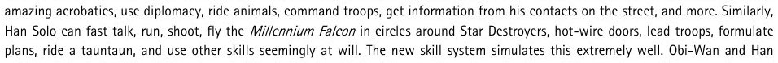
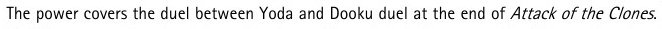
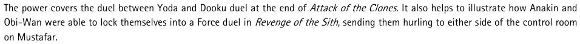
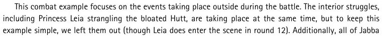
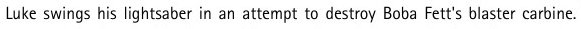
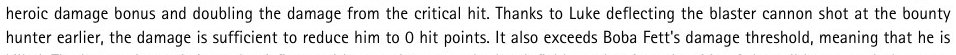
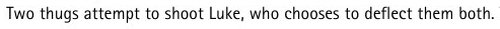
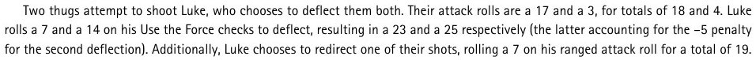
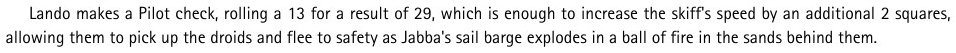
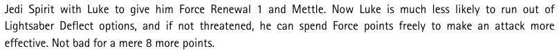

# Owner Material 037 — Star Wars D20 Drive folder (Core, Revised Core and Saga Edition): Web Articles.pdf [Star Wars Roleplaying Game Saga Edition (2007)] (scan pages 181–240)

- **Source:** Wizards of the Coast Star Wars Roleplaying Game books, web enhancements, Living Force campaign modules and articles (2000–2010), from the owner's "Star Wars D20" Drive folder (only the three edition subfolders; "General" was not read, as instructed). Secondary source (licensed Legends reference). Scan OCR'd on the box; the scan stays box-only and is **not** published.
- **Method:** every scanned page was OCR'd and machine-screened sentence by sentence for power-relevant statements (fights, kills, defeats, Force feats, rankings, superweapons) that name a character on our roster; each kept sentence is quoted verbatim from the OCR text and has a crop of the printed passage directly under it. Pages with nothing power-relevant are still listed with what is on them.
- **Citation:** "*Web Articles* (SWRPG Saga Edition), p.X" by printed page ("scan p.X" where no printed number applies). **Weight:** Licensed RPG material: a secondary source. Narrative text sums up Legends lore; game statistics are rules for players, not canon power levels, and rank lowest.

## scan p.181 (scan page 181)

Page contents: Classes and Character Creation cont.: Improvements All Around (streamlined high-level play, high-level NPCs in 5 to 10 minutes); future previews announced. (hand-read)

## scan p.182 (scan page 182)

Page contents: "I Know a Few Maneuvers..." by Rodney Thompson (title echoes Han Solo's line from A New Hope; no character named in the text): skill system revamp; Consolidation (Craft removed; Search, Spot, Listen and Sense Motive folded into Perception; GM examples for Perception, Persuasion, Deception; broader participation); Trained/Untrained (no skill ranks; research on maxed-out vs. leftover skills). (hand-read)

## scan p.183 (scan page 183)

Page contents: "I Know a Few Maneuvers..." cont.: trained skills (Trained Only uses, flat bonus); skill bonus formula 1/2 level + ability + 5 trained + 5 Skill Focus; untrained use at higher level (Use Computer door example); anyone can do anything (Obi-Wan Kenobi and Han Solo examples); tauntaun chase through an icy canyon on Hoth, Echo Base; What Kind of Bonus Was That Again? (only Skill Focus, training, level, ability; no synergy or feat/species bonuses); Specialization Through Other Means. (hand-read)

- **Han Solo**: "Similarly, Han Solo can fast talk, run, shoot, fly the M///ennium Falcon in circles around Star Destroyers, hot-wire doors, lead troops, formulate plans, ride a tauntaun, and use other skills seemingly at will." Source: *Web Articles* (SWRPG Saga Edition), scan p.183
  

### Stat block notes (game mechanics, not feats)

- I Know a Few Maneuvers...: At this point, you might be wondering why these changes were made. The simple answer is this: Anyone can do anything in Star Wars if the scene calls for it. For example, over the course of the saga, we see Obi-Wan Kenobi fly ships, deceive people, perform amazing acrobatics, use diplomacy, ride animals, command troops, get information from his contacts on the street, and more. Similarly, Han Solo can fast talk, run, shoot, fly the Millennium Falcon in circles around Star Destroyers, hot-wire doors, lead troops, formulate plans, ride a tauntaun, and use other skills seemingly at will. The new skill system simulates this extremely well. Obi-Wan and Han might not be trained in all the relevant skills, but their untrained bonus allows them to attempt those actions with some chance of success. (Source: *Web Articles* (SWRPG Saga Edition), scan p.183)

## scan p.184 (scan page 184)

Page contents: "I Know a Few Maneuvers..." cont.: specialization by talents and rerolls (Wookiee Persuasion reroll to intimidate; scout Initiative reroll; take 10 under pressure); 20th-Level Characters in 1/20th the Time (fast NPC skill modifiers); cinematic feel. (hand-read)

## scan p.185 (scan page 185)

Page contents: Use the Force, Luke! by Rodney Thompson: Force revamp (single skill plus limited-use powers); New Skill: Use the Force (Force Sensitivity required); quoted rulebook entry USE THE FORCE (CHA): Activate Force Power, Force Trance, Move Light Object, Search Your Feelings, Sense Force, Sense Surroundings, Telepathy. (hand-read)

### Stat block notes (game mechanics, not feats)

- Use the Force, Luke! (article title): USE THE FORCE, LUKE! (Source: *Web Articles* (SWRPG Saga Edition), scan p.185)

## scan p.186 (scan page 186)

Page contents: Use the Force, Luke! cont.: Telepathy distance DCs (15 same planet to 30 different region); Special (Force Sensitivity; take 10, not 20); "Unlimited Power!" section (text layer: "Unlimited Powers)!"): Force Training feat, suite of powers, spent powers regained by resting one minute, talents, Force Points, natural 20; Jedi tactical choices between powers and lightsaber; sample Force power rebuke (reaction; redirect, turn back on 5+, double-rebuke Force Point). (hand-read)

## scan p.187 (scan page 187)

Page contents: Use the Force, Luke! cont.: rebuke models Episode II and III duels; Force Talents (Alter, Control, Dark Side, Sense trees; selectable by any Force-sensitive character); Alternate Force Traditions (urban scoundrel Force-user example; Jensaarai and Witches of Dathomir talent trees in the core book); sample Jensaarai Defender CL 9 (human Jedi 5/soldier 3, lightsaber, Mighty Swing, battle strike, Force slam, surge, Armored Defense, Attune Armor, ceremonial armor). (hand-read)

- **Count Dooku; Yoda** — entry/section: Saga Edition Web Articles: "The power covers the duel between Yoda and Dooku duel at the end of Attack of the Clones." Source: *Web Articles* (SWRPG Saga Edition), scan p.187
  
- **Obi-Wan Kenobi; Darth Vader (Anakin Skywalker)** — entry/section: Saga Edition Web Articles: "It also helps to illustrate how Anakin and Obi-Wan were able to lock themselves into a Force duel in Revenge of the Sith, sending them hurling to either side of the control room on Mustafar." Source: *Web Articles* (SWRPG Saga Edition), scan p.187
  

### Stat block notes (game mechanics, not feats)

- Use the Force, Luke! (rebuke): Rebuke is one of the new powers added to Saga Edition that helps the game more closely model events seen in Episodes II and III. The power covers the duel between Yoda and Dooku duel at the end of Attack of the Clones. It also helps to illustrate how Anakin and Obi-Wan were able to lock themselves into a Force duel in Revenge of the Sith, sending them hurling to either side of the control room on Mustafar. (Source: *Web Articles* (SWRPG Saga Edition), scan p.187)

## scan p.188 (scan page 188)

Page contents: Prepare for Ground Assault by Rodney Thompson: Saga combat goals (fast rounds, long Jedi duels, cannon fodder drops quickly); Enter the Swift Action (up to three per round, aim two swift actions, recover three swift actions); Attacks and Damage (vs. Reflex Defense, one attack per round, Rapid Shot and Mighty Swing replace iterative attacks, +1/2 heroic level to damage); Defend Yourself! (Reflex, Fortitude, Will defenses replace saves; damage threshold). (hand-read)

## scan p.189 (scan page 189)

Page contents: Prepare for Ground Assault cont.: defenses = 10 + heroic level + ability + class bonus (soldier +1 Ref, +2 Fort), armor replaces level bonus; Armor Specialist talents (Armored Defense, Improved Armored Defense); The Condition Track (third step -5; Jedi Consular Persuasion push, noble bolster, recover action, Jedi Guardian Force point two steps; persistent conditions); Healing, Unconsciousness, and Death (8 hours rest heals character level; second wind; Treat Injury first aid and surgery; unconscious at 0 hp or bottom of track; death if damage also exceeds threshold; DC 10 Con checks; bacta tank); More to Come. (hand-read)

### Stat block notes (game mechanics, not feats)

- Prepare for Ground Assault: Of course, some characters, such as Jango and Boba Fett, might want to wear armor throughout their career. To do so effectively, they'll need to spend character resources. The soldier has an Armor Specialist talent tree that allows him to wear armor, gaining benefits while sacrificing talent slots. For example, here are a pair of talents from this talent tree: (Source: *Web Articles* (SWRPG Saga Edition), scan p.189)

## scan p.190 (scan page 190)

Page contents: Advanced Combat Training by Rodney Thompson: Aiding Another (attack bonus with line of sight; suppressing fire -2); Aiming (two swift actions ignore cover; Careful Shot, Deadeye; section heading lost in text layer); Critical Hits (natural 20 auto crit, double damage); Order the Retreat and Keep Moving! (withdraw action, half speed, no attack of opportunity on first square); Running Attack feat (replaces Shot on the Run and Spring Attack); moving between cover. (hand-read)

## scan p.191 (scan page 191)

Page contents: Advanced Combat Training cont.: All-New Autofire (swift action to switch, 2x2 area at -5, half damage on miss, 10 shots; Burst Fire +2 dice vs. single target, not reduced by Evasion); Stun and Ion Damage (compare to threshold, -2 steps, half damage to hp, stun within 6 squares; ion vs. droids, vehicles, cybernetics); Reserve Shield Rules (shield rating like DR, reduced by 5 when exceeded; droideka SR 20; recharging); High-Level Combat (one attack, nonheroic cannon fodder vs. 20th-level Sith Lords); next preview droids. (hand-read)

## scan p.192 (scan page 192)

Page contents: Droids, Droids, Droids by Rodney Thompson: heroic droids; Droid Traits (droid as species): Abilities (no Con), Automatic Languages, Behavioral Inhibitors, The Force (Force Points and Destiny, no Force Sensitivity), Ion Damage Vulnerability, Maintenance (100 hours then 1 hour recharge, Endurance), Memory (reprogramming, memory wipe), Nonliving immunities, Disabled, Destroyed, Repair (Mechanics, -5 self), Shut Down, Skills (untrained only Acrobatics, Climb, Jump, Perception unless heuristic processor), Systems; Playing an Existing Model begins. (hand-read)

### Stat block notes (game mechanics, not feats)

- Droids, Droids, Droids: When we revamped the rules for droids for the Star Wars Roleplaying Game Saga Edition, one of our primary goals was to make it easier to play heroic droid characters. Just as C-3PO and R2-D2 are present throughout the Star Wars saga, players should have the option of bringing their own interesting droids into the campaign's story. (Source: *Web Articles* (SWRPG Saga Edition), scan p.192)

## scan p.193 (scan page 193)

Page contents: Droids, Droids, Droids cont.: Playing an Existing Model (R2 units, 3PO series; image captions: LOM Protocol Droid, RA-T Protocol Droid, 3D-4X Administrative Droid, TTS-15 Tutorial Droid; 1-2 nonheroic levels plus 1 heroic level, or 3 nonheroic / 1 heroic); Playing a New Model (custom stock model, combat droid instead of B1/B2); Tinkering With Your Droid (Mechanics for hardware, Use Computer vs. Will Defense for software). (hand-read)

## scan p.194 (scan page 194)

Page contents: Sample Droid: Droideka (Geonosians and Collicoids of Colla IV; wheel mode, two heavy repeating blasters, bronzium shell, shield, mini-reactor; not playable): Droideka Series Destroyer Droid CL 4 (Large 4th-degree nonheroic 12, Ref 16, hp 40, SR 20, Threshold 18, Speed 2 walking/10 wheeled, blaster cannons 3d8, Rapid Shot 4d8, Burst Fire 5d8, Military, 21,000 credits); Next Time: the skirmish at the Great Pit of Carkoon from Return of the Jedi. (hand-read)

## scan p.195 (scan page 195)

Page contents: Skirmish at the Sarlacc Pit by Rodney Thompson: Saga Edition combat walkthrough of the Great Pit of Carkoon (Return of the Jedi), exterior fight only (Leia enters in round 12); Dramatis Personae stat lines (Luke Skywalker, Han Solo, Chewbacca, Lando Calrissian, Princess Leia, Boba Fett, Jabba the Hutt's Thugs nonheroic 2); Luke's Acrobatics flip; Surprise Round (Luke, Lando, R2-D2); initiative rolls and Initiative Table. (hand-read)

- **Leia Organa Solo**: "The interior struggles, including Princess Leia strangling the bloated Hutt, are taking place at the same time, but to keep this example simple, we left them out (though Leia does enter the scene in round 12)." Source: *Web Articles* (SWRPG Saga Edition), scan p.195
  

### Stat block notes (game mechanics, not feats)

- Skirmish at the Sarlacc Pit: Now that you've seen previews of basic and advanced combat, let's put it all together to see how a scene might unfold. This preview breaks down the skirmish at the Great Pit of Carkoon from Return of the Jedi, when Luke Skywalker rescued his friends from the clutches of the vile gangster Jabba the Hutt. This combat example focuses on the events taking place outside during the battle. The interior struggles, including Princess Leia strangling the bloated Hutt, are taking place at the same time, but to keep this example simple, we left them out (though Leia does enter the scene in round 12). Additionally, all of Jabba the Hutt's thugs use the generic thug statistics from the Star Wars Roleplaying Game. Saga Edition rulebook and don't differentiate between the species. (Source: *Web Articles* (SWRPG Saga Edition), scan p.195)
- Skirmish at the Sarlacc Pit: Luke Skywalker: Scout 1/Jedi 7/ace pilot 2/Jedi Knight 1, 99 hit points, Reflex Defense 26, damage threshold 25, lightsaber +14 (2d8+11) (Source: *Web Articles* (SWRPG Saga Edition), scan p.195)
- Skirmish at the Sarlacc Pit: Han Solo: Scoundrel 5/soldier 2/ace pilot 3/gunslinger 2, 77 hit points, Reflex Defense 28, damage threshold 25, unarmed +10 (1d4+7) (Source: *Web Articles* (SWRPG Saga Edition), scan p.195)
- Skirmish at the Sarlacc Pit: Chewbacca: Scout 6/scoundrel 4, 110 hit points, Reflex Defense 24, damage threshold 27, unarmed +11 (1d6+9) (Source: *Web Articles* (SWRPG Saga Edition), scan p.195)
- Skirmish at the Sarlacc Pit: Lando Calrissian: Scoundrel 8, 50 hit points, Reflex Defense 22, damage threshold 19, unarmed +7 (1d4+5) (Source: *Web Articles* (SWRPG Saga Edition), scan p.195)
- Skirmish at the Sarlacc Pit: Princess Leia: Noble 8/soldier 2, 63 hit points, Reflex Defense 23, damage threshold 23, unarmed +9 (1d4+6) (Source: *Web Articles* (SWRPG Saga Edition), scan p.195)
- Skirmish at the Sarlacc Pit: Boba Fett: Scout 3/soldier 5/bounty hunter 5/elite trooper 2, 122 hit points, Reflex Defense 34, damage threshold 33, blaster carbine +18 (3d8+7), blaster pistol +18 (3d6+7), whipcord +18 (grab) (Source: *Web Articles* (SWRPG Saga Edition), scan p.195)
- Skirmish at the Sarlacc Pit: Jabba the Hutt's Thugs: Nonheroic 2, 9 hit points, Reflex Defense 10, damage threshold 11, vibro-axe +2 (2d10+2) or blaster pistol +1 (3d6) (Source: *Web Articles* (SWRPG Saga Edition), scan p.195)
- Skirmish at the Sarlacc Pit: Luke begins the combat encounter when he jumps off of the plank above the Sarlacc pit. He makes an Acrobatics check, rolling a 12 for a result of 20 (well above the required DC 15 to move past a threatening enemy), and finishes his flip on the opposite side of the Weequay thug that had attempted to push him off. Surprise Round (Source: *Web Articles* (SWRPG Saga Edition), scan p.195)
- Skirmish at the Sarlacc Pit: The action begins with Luke, Lando, and R2-D2 acting on the surprise round, since they're the only ones aware of the surprise Luke has planned. (Source: *Web Articles* (SWRPG Saga Edition), scan p.195)
- Skirmish at the Sarlacc Pit: Luke Skywalker rolls a 16 on Initiative, for a total of 29. (Source: *Web Articles* (SWRPG Saga Edition), scan p.195)
- Skirmish at the Sarlacc Pit: Chewbacca rolls a 19 on Initiative, for a total of 25. (Source: *Web Articles* (SWRPG Saga Edition), scan p.195)
- Skirmish at the Sarlacc Pit: Boba Fett rolls an 8 on Initiative, for a total of 24. (Source: *Web Articles* (SWRPG Saga Edition), scan p.195)
- Skirmish at the Sarlacc Pit: Lando Calrissian rolls a 14 on Initiative, for a total of 20. (Source: *Web Articles* (SWRPG Saga Edition), scan p.195)
- Skirmish at the Sarlacc Pit: Han Solo rolls a 5 on Initiative, but takes a -2 penalty from his persistent condition, for a total of 19. Jabba the Hutt's Thugs roll a 10 on Initiative, for a total of 16. (Source: *Web Articles* (SWRPG Saga Edition), scan p.195)

## scan p.196 (scan page 196)

Page contents: Skirmish cont.: surprise round (R2-D2 fires Luke's lightsaber, Luke kills a Klatoonian thug, Lando grabs the Nikto pilot); Round 1 (Luke's Double Attack kills Human and Weequay thugs, Boba Fett to the sail barge, Nikto misses Lando); Round 2 (Luke frees Chewbacca, Chewbacca frees Han, sail barge gunner's natural 20 vs. Lando, Destiny Point, splash half damage, Nikto drags Lando over the side, Boba Fett jetpacks to the skiff, Lando recover and failed Climb, Han finds a vibro-axe). (hand-read)

### Stat block notes (game mechanics, not feats)

- Skirmish at the Sarlacc Pit: Luke readies an attack with his lightsaber against the Klatoonian thug adjacent to him, once he receives his lightsaber. R2-D2 fires Luke's lightsaber to him on initiative count 27 as a readied action (rolling a 9 on his ranged attack, which even with a -5 penalty for range results in a 13, well more than the Reflex Defense of 10 needed to hit Luke's square). This moves Luke's Initiative score down to 27 as it triggers his readied action. Next round, R2 moves belowdeck to help C-3PO. (Source: *Web Articles* (SWRPG Saga Edition), scan p.196)
- Skirmish at the Sarlacc Pit: Luke ignites his lightsaber with a swift action and his readied attack begins. He rolls a 12 on his attack roll (for a total of 21). This hits the thug, and Luke rolls a total of 19 points of damage, depleting the thug's hit points and exceeding his damage threshold, killing him. The thug tumbles over the side of the skiff and into the waiting mouth of the Sarlacc. (Source: *Web Articles* (SWRPG Saga Edition), scan p.196)
- Skirmish at the Sarlacc Pit: Lando initiates a grab attack against the Nikto pilot of the skiff. He rolls a 12, which gives him a total of 14 after applying the -5 penalty for grabbing, and successfully grabs the pilot. (Source: *Web Articles* (SWRPG Saga Edition), scan p.196)
- Skirmish at the Sarlacc Pit: Luke chooses to take a full round to use the Double Attack feat against a Human thug and a Weequay thug. Applying a -5 penalty to both attack rolls, he rolls an 11 and a 13, for totals of 20 and 22 respectively, more than enough to hit each thug. His damage rolls are 20 and 16, which is enough to kill both thugs. The attacks send them tumbling off the side of the skiff, providing even more food for the Sarlacc below. (Source: *Web Articles* (SWRPG Saga Edition), scan p.196)
- Skirmish at the Sarlacc Pit: Chewbacca, still bound, takes no action. (Source: *Web Articles* (SWRPG Saga Edition), scan p.196)
- Skirmish at the Sarlacc Pit: Boba Fett moves onto the deck of Jabba's sail barge. (Source: *Web Articles* (SWRPG Saga Edition), scan p.196)
- Skirmish at the Sarlacc Pit: Lando continues to grab the Nikto pilot. (Source: *Web Articles* (SWRPG Saga Edition), scan p.196)
- Skirmish at the Sarlacc Pit: Han, still bound, takes no action. (Source: *Web Articles* (SWRPG Saga Edition), scan p.196)
- Skirmish at the Sarlacc Pit: The Nikto pilot attempts to make an attack against Lando, taking a -2 penalty to his attack roll for being grabbed. He rolls a 17, for a total attack bonus of 16. The blaster shot fires off harmlessly into the air. (Source: *Web Articles* (SWRPG Saga Edition), scan p.196)
- Skirmish at the Sarlacc Pit: Luke moves to Chewbacca and undoes his binders. (Source: *Web Articles* (SWRPG Saga Edition), scan p.196)
- Skirmish at the Sarlacc Pit: Chewbacca removes Han's binders. (Source: *Web Articles* (SWRPG Saga Edition), scan p.196)
- Skirmish at the Sarlacc Pit: A delaying thug on Jabba's sail barge fires a blaster cannon at Lando, rolling a natural 20 and dealing 50 points of damage. Since this would normally kill Lando outright, he spends a Destiny Point to make the attack miss. The attack misses, but because the blaster cannon is a splash weapon, Lando still takes half damage. That reduces his hit points by half (to 25) and exceeds his damage threshold, moving him -1 step down the condition track. The attack roll also exceeds the Nikto pilot's Reflex Defense, dealing 25 points of damage to him. Since Lando spent a Destiny Point to have the attack miss, the GM rules that the dying Nikto drags Lando over the side of the skiff, falling into the Sarlacc's gullet and leaving Lando hanging onto the side of the skiff. Additionally, the blaster cannon damages the skiff itself, moving it -1 step down the condition track. (Source: *Web Articles* (SWRPG Saga Edition), scan p.196)
- Skirmish at the Sarlacc Pit: Boba Fett uses his jetpack to fly from the sail barge to the skiff. (Source: *Web Articles* (SWRPG Saga Edition), scan p.196)
- Skirmish at the Sarlacc Pit: Lando uses two swift actions to begin the recover action, then attempts a Climb check to pull himself up onto the skiff. Lando rolls a 9, for a total of 14, just shy of the DC 15 needed to pull himself back up. (Source: *Web Articles* (SWRPG Saga Edition), scan p.196)
- Skirmish at the Sarlacc Pit: Han makes a Perception check to search for some kind of weapon he can use. He rolls a 12, for a total of 24, locating a vibro-axe that has been discarded on the deck of the skiff. (Source: *Web Articles* (SWRPG Saga Edition), scan p.196)

## scan p.197 (scan page 197)

Page contents: Skirmish cont.: Round 3 (Luke's natural 20 destroys Boba Fett's blaster carbine; Chewie shields Han; Fett's whipcord grabs Luke; Lando recovers; Luke redirects the blaster cannon shot with a Force point into Fett for 87 damage; second skiff arrives); Round 4 (Luke's Jump to the second skiff and readied attack; Chewbacca moves; Fett prone and recovering; Han picks up a vibro-axe, "Boba Fett? Boba Fett? Where?"; thug grab attempt killed). (hand-read)

- **Luke Skywalker; Boba Fett**: "Luke swings his lightsaber in an attempt to destroy Boba Fett's blaster carbine." Source: *Web Articles* (SWRPG Saga Edition), scan p.197
  

### Stat block notes (game mechanics, not feats)

- Skirmish at the Sarlacc Pit: Luke swings his lightsaber in an attempt to destroy Boba Fett's blaster carbine. He rolls a natural 20, automatically striking the weapon and dealing double damage. The 44 points of damage he deals is more than enough to destroy the weapon even without the lightsaber's ability to ignore DR, slicing it neatly in half. (Source: *Web Articles* (SWRPG Saga Edition), scan p.197)
- Skirmish at the Sarlacc Pit: A blaster shot from the Sail Barge strikes Chewie, dealing 12 points of damage to the Wookiee. Chewbacca attempts to protect his friend by knocking him prone. Han does not resist, and the two fall to the deck of the skiff. (Source: *Web Articles* (SWRPG Saga Edition), scan p.197)
- Skirmish at the Sarlacc Pit: Boba Fett uses his whipcord to make a grab attack against Luke. He rolls a 13, for a total of 31, which is well above Luke's Reflex Defense, so Luke is grabbed. (Source: *Web Articles* (SWRPG Saga Edition), scan p.197)
- Skirmish at the Sarlacc Pit: Lando completes his recover action with a swift action, and calls out to Han or Chewie for help. Given the difficulty he faces in climbing, he doesn't want to risk falling if he fails a check by 5 or more, since the Sarlacc waits below to devour him. Han allows Chewie to continue to cover him from blaster fire. (Source: *Web Articles* (SWRPG Saga Edition), scan p.197)
- Skirmish at the Sarlacc Pit: The thug on the Sail Barge fires the blaster cannon at Luke, rolling a total of 12, which would not normally strike Luke. However, Luke uses the opportunity to redirect the shot at Boba Fett. He rolls a 2 on his Use the Force check, which still results in an 18 and allows him to deflect the blaster cannon's shot. Luke then makes a ranged attack roll (at a -2 penalty from being grabbed) and rolls an 18. Though this is a good roll, Luke knows that Boba Fett is likely to be a tough target to strike, so he spends a Force point, rolls 2d6 (getting a 2 and a 6), and adds 6 to the result, for a total attack of 34. This is exactly what he needs to strike Boba Fett with the blaster cannon's shot, so damage is rolled. The blaster cannon shot deals an incredible 87 points of damage to Boba Fett, moving him -1 step down the condition track and knocking him prone. Again, the blaster cannon damages the skiff itself, moving it another -1 step down the condition track. (Source: *Web Articles* (SWRPG Saga Edition), scan p.197)
- Skirmish at the Sarlacc Pit: A second skiff arrives, loaded with 5 thugs and a pilot. Each of the thugs fires at Luke, but none of them roll high enough to beat his Reflex Defense, and he remains unharmed. (Source: *Web Articles* (SWRPG Saga Edition), scan p.197)
- Skirmish at the Sarlacc Pit: Luke tries to jump onto the approaching skiff. He makes a Jump check and rolls 12, for a total of 19. Since the DC to make the 2-square jump was an 18, Luke makes it --but only barely. Rather than risk losing a chance to attack some of the thugs, Luke readies an action to use his lightsaber to attack any thug that comes within his threatened area. (Source: *Web Articles* (SWRPG Saga Edition), scan p.197)
- Skirmish at the Sarlacc Pit: Chewbacca begins moving across the skiff toward Lando while still protecting Han and warning him about Boba Fett. (Source: *Web Articles* (SWRPG Saga Edition), scan p.197)
- Skirmish at the Sarlacc Pit: Boba Fett drops prone to gain a +5 bonus to Reflex Defense against the attacks coming from the Sail Barge's blaster cannon, and uses two swift actions to begin the recover action. (Source: *Web Articles* (SWRPG Saga Edition), scan p.197)
- Skirmish at the Sarlacc Pit: Lando continues to call for help, hoping that Han or Chewie will use the aid another action to help him climb. (Source: *Web Articles* (SWRPG Saga Edition), scan p.197)
- Skirmish at the Sarlacc Pit: Han picks up a vibro-axe. "Boba Fett? Boba Fett? Where?” (Source: *Web Articles* (SWRPG Saga Edition), scan p.197)
- Skirmish at the Sarlacc Pit: More thugs fire at Luke, but his lightsaber blade whirls to fend off attacks, so none comes close enough to harm him. (Source: *Web Articles* (SWRPG Saga Edition), scan p.197)
- Skirmish at the Sarlacc Pit: One thug attempts to get close enough to grab Luke. This triggers Luke's readied action, and he rolls a 19 on his attack roll (for a total of 33) and a 22 for damage, killing the thug and sending him into the Great Pit of Carkoon. (Source: *Web Articles* (SWRPG Saga Edition), scan p.197)

## scan p.198 (scan page 198)

Page contents: Skirmish cont.: Round 5 (Chewbacca fights defensively; Fett's wrist blaster misses; Lando's Fortune's Favor; Han spends a Destiny Point for an automatic critical with the vibro-axe killing Boba Fett, jetpack misfire into the Sarlacc, EU note that Fett survived as "somewhat indigestible"; Luke's kick); Round 6 (Chewbacca and Han aid Lando's Climb, Lando's natural 1 saved by Fortune's Favor; Luke kills a Weequay thug). (hand-read)

- **Luke Skywalker**: "Thanks to Luke deflecting the blaster cannon shot at the bounty hunter earlier, the damage is sufficient to reduce him to 0 hit points." Source: *Web Articles* (SWRPG Saga Edition), scan p.198
  

### Stat block notes (game mechanics, not feats)

- Skirmish at the Sarlacc Pit: Chewbacca chooses to fight defensively and opts to take no attacks, granting himself a +5 dodge bonus to Reflex Defense as he tries to protect Han. (Source: *Web Articles* (SWRPG Saga Edition), scan p.198)
- Skirmish at the Sarlacc Pit: Boba Fett stands up, takes a swift action to finish recovering and fires a shot at Luke with his wrist blaster. Unfortunately, he rolls only a 4, for a total of 22, not enough to exceed Luke's Reflex Defense. (Source: *Web Articles* (SWRPG Saga Edition), scan p.198)
- Skirmish at the Sarlacc Pit: Lando decides to use his Fortune's Favor talent. He spends a Force Point and applies a +5 bonus on his skill checks for the duration of the encounter, hoping that it will prevent him from falling into the Sarlacc pit even if he rolls badly on a Climb check. Han decides to spend a Destiny Point to make an attack roll against Boba Fett, given their history and the dire nature of the situation. This automatically grants Han a critical hit against Boba Fett with the vibro-axe, dealing 36 points of damage after adding his heroic damage bonus and doubling the damage from the critical hit. Thanks to Luke deflecting the blaster cannon shot at the bounty hunter earlier, the damage is sufficient to reduce him to 0 hit points. It also exceeds Boba Fett's damage threshold, meaning that he is killed. The bounty hunter's jetpack misfires and he streaks across the battlefield, crashes into the side of the sail barge, and plummets into the waiting mouth of the Sarlacc. (However, Expanded Universe sources would claim that Fett spent a Force Point to keep from dying, and that the Sarlacc found him "somewhat indigestible.") (Source: *Web Articles* (SWRPG Saga Edition), scan p.198)
- Skirmish at the Sarlacc Pit: The thugs remaining on the skiff fire at Luke, and all miss. (Source: *Web Articles* (SWRPG Saga Edition), scan p.198)
- Skirmish at the Sarlacc Pit: Luke makes an unarmed attack against a thug, rolling a 6 for a total of 17, and dealing 11 points of damage. Luke's kick sends the thug tumbling off the side of the skiff and into the Sarlacc's beak. (Source: *Web Articles* (SWRPG Saga Edition), scan p.198)
- Skirmish at the Sarlacc Pit: Chewbacca moves to the edge of the skiff and successfully uses the aid another action to grant Lando a +2 bonus on his next Climb Lando attempts a Climb check but rolls a natural 1, for a total of 14. Thanks to his use of the Fortune's Favor talent, Lando doesn't fall into the Sarlacc pit. (Source: *Web Articles* (SWRPG Saga Edition), scan p.198)
- Skirmish at the Sarlacc Pit: Han moves to the edge of the skiff and successfully uses the aid another action to grant Lando a +2 bonus on his next Climb check. The thugs remaining on the skiff fire at Luke, and all miss. (Source: *Web Articles* (SWRPG Saga Edition), scan p.198)
- Skirmish at the Sarlacc Pit: Luke rolls a 9 on an attack against a Weequay thug for a total of 23, dealing 19 points of damage. The thug flies off the side of the skiff to be consumed by the Sarlacc below. (Source: *Web Articles* (SWRPG Saga Edition), scan p.198)

## scan p.199 (scan page 199)

Page contents: Skirmish cont.: Round 7 (Chewbacca and Han aid Lando's Climb; Luke's Double Attack kills two thugs; blaster cannon pushes the skiff to -5 on the condition track, spilling Han, Chewie and Lando, who catch themselves with DC 15 Climb); Round 8 (Han climbs back; Lando fails; Luke uses surge to leap 10 squares to the sail barge, kicks a Weequay into the sands of Tatooine; cannon misses). (hand-read)

### Stat block notes (game mechanics, not feats)

- Skirmish at the Sarlacc Pit: Chewbacca successfully uses the aid another action to grant Lando a +2 bonus on his next Climb check. (Source: *Web Articles* (SWRPG Saga Edition), scan p.199)
- Skirmish at the Sarlacc Pit: Lando rolls a 13 on his Climb check for a total of 27, which lets him climb most of the way up to the skiff with the help of his friends. (Source: *Web Articles* (SWRPG Saga Edition), scan p.199)
- Skirmish at the Sarlacc Pit: Han successfully uses the aid another action to grant Lando a +2 bonus on his next Climb check, which should get him up onto the deck of the sail barge. (Source: *Web Articles* (SWRPG Saga Edition), scan p.199)
- Skirmish at the Sarlacc Pit: The thugs on the skiff with Luke move in to attack him with vibro-axes. They all miss. (Source: *Web Articles* (SWRPG Saga Edition), scan p.199)
- Skirmish at the Sarlacc Pit: With multiple thugs in range, Luke uses the Double Attack feat to strike two adjacent thugs. With attack rolls of 6 and 15 resulting in a 15 and a 24 respectively, each thug is struck. Damage rolls of 18 and 22 are enough to kill the two thugs, who fall into the sands of the Great Pit of Carkoon. (Source: *Web Articles* (SWRPG Saga Edition), scan p.199)
- Skirmish at the Sarlacc Pit: The thug on the sail barge manning the blaster cannon sees Lando being pulled up onto the skiff and fires at the vehicle. The blaster cannon shot severely damages the skiff, bumping it -1 step further down the condition track. Since this puts the skiff at the -5 step on the track, it tilts and wavers, spilling Han over the side and causing Lando to lose the progress he had made. Fortunately, Han, Chewie, and Lando all make the DC 15 Climb check (accounting for favorable circumstances) to catch themselves and keep them from falling down into the Sarlacc pit. (Source: *Web Articles* (SWRPG Saga Edition), scan p.199)
- Skirmish at the Sarlacc Pit: Chewbacca uses the aid another action to grant Han a +2 bonus on his next Climb check. (Source: *Web Articles* (SWRPG Saga Edition), scan p.199)
- Skirmish at the Sarlacc Pit: Lando delays, waiting for Han to be pulled up. (Source: *Web Articles* (SWRPG Saga Edition), scan p.199)
- Skirmish at the Sarlacc Pit: Han makes a Climb check, rolling a 19 and pulling himself back up onto the skiff safely. (Source: *Web Articles* (SWRPG Saga Edition), scan p.199)
- Skirmish at the Sarlacc Pit: Lando makes a Climb check, rolling a 3 for a result of 13, making no progress. (Source: *Web Articles* (SWRPG Saga Edition), scan p.199)
- Skirmish at the Sarlacc Pit: At this point, no more thugs remain on the skiff (and thugs inside the sail barge are delaying), so Luke uses his surge Force power to leap over to the side of the sail barge. Luke rolls a 16 on his Use the Force check for a total of 28, granting himself a +30 bonus on his Jump check. Luke rolls a 10 for a total of 47, allowing him to jump 15 meters (or 10 squares), which just gets him to the side of the sail A Weequay thug with a readied action opens a hatch on the side of the sail barge and moves out to attack Luke, but misses. Luke finishes his action by making an unarmed attack against the Weequay (which provokes an attack of opportunity from the Weequay, who misses), rolling a 14 for a total of 25. Luke deals 11 points of damage, tossing him down into the sands of Tatooine. The thug manning the blaster cannon aboard the sail barge fires at the skiff again, doing minimal damage to the vehicle and none to Han, Chewbacca, or Lando. (Source: *Web Articles* (SWRPG Saga Edition), scan p.199)

## scan p.200 (scan page 200)

Page contents: Skirmish cont.: Round 9 (Han extends a vibro-axe while Chewbacca holds his feet; Lando's Climb DC 20; Luke kills the gunner, deflects and redirects shots, kills a Gamorrean with an attack of opportunity; Sarlacc tentacle grabs Lando); Round 10 (Chewbacca hands Han a blaster pistol, Han aims at the tentacle; Lando: "No, wait, I thought you were blind!"; Luke's Double Attack drops a Weequay and a Human). (hand-read)

- **Luke Skywalker**: "Two thugs attempt to shoot Luke, who chooses to deflect them both." Source: *Web Articles* (SWRPG Saga Edition), scan p.200
  
- **Luke Skywalker**: "Luke rolls a 7 and a 14 on his Use the Force checks to deflect, resulting in a 23 and a 25 respectively (the latter accounting for the -5 penalty for the second deflection)." Source: *Web Articles* (SWRPG Saga Edition), scan p.200
  

### Stat block notes (game mechanics, not feats)

- Skirmish at the Sarlacc Pit: Chewbacca delays to give Han time to help Lando. (Source: *Web Articles* (SWRPG Saga Edition), scan p.200)
- Skirmish at the Sarlacc Pit: Han leans over the side of the skiff to extend a vibro-axe to Lando, aiding him on his Climb check. (Source: *Web Articles* (SWRPG Saga Edition), scan p.200)
- Skirmish at the Sarlacc Pit: Chewbacca takes his action to hold Han's feet as he hangs off the side of the skiff. (Source: *Web Articles* (SWRPG Saga Edition), scan p.200)
- Skirmish at the Sarlacc Pit: Now that Lando is further down into the Sarlacc pit, the DC of his Climb check has increased to 20. (Source: *Web Articles* (SWRPG Saga Edition), scan p.200)
- Skirmish at the Sarlacc Pit: Lando attempts to Climb once more, rolling a 7. This results in a Climb check total of 19, not enough to (Source: *Web Articles* (SWRPG Saga Edition), scan p.200)
- Skirmish at the Sarlacc Pit: make any progress, but not causing Lando to slip further down, either. (Source: *Web Articles* (SWRPG Saga Edition), scan p.200)
- Skirmish at the Sarlacc Pit: Luke moves the rest of the way up the side of the sail barge and attacks the gunner manning the blaster (Source: *Web Articles* (SWRPG Saga Edition), scan p.200)
- Skirmish at the Sarlacc Pit: cannon. Luke rolls a 15 for a total of 29, dealing 20 points of damage to the thug and killing him with a (Source: *Web Articles* (SWRPG Saga Edition), scan p.200)
- Skirmish at the Sarlacc Pit: Two thugs attempt to shoot Luke, who chooses to deflect them both. Their attack rolls are a 17 and a 3, for totals of 18 and 4. Luke rolls a 7 and a 14 on his Use the Force checks to deflect, resulting in a 23 and a 25 respectively (the latter accounting for the -5 penalty for the second deflection). Additionally, Luke chooses to redirect one of their shots, rolling a 7 on his ranged attack roll for a total of 19. This strikes a thug and deals 16 points of damage, killing the thug. The second thug flees in fear. (Source: *Web Articles* (SWRPG Saga Edition), scan p.200)
- Skirmish at the Sarlacc Pit: A Gamorrean thug attempts to move around behind Luke while the Jedi is distracted, provoking an attack of opportunity as he moves out of one of Luke's threatened squares. Luke rolls a 10 on his attack of opportunity and cuts the Gamorrean down with 26 points of damage from his lightsaber. (Source: *Web Articles* (SWRPG Saga Edition), scan p.200)
- Skirmish at the Sarlacc Pit: Sensing that food is close, the Sarlacc attempts to grab Lando with one of its tentacles. Since Lando is hanging from the side of the skiff, he loses his Dexterity bonus to Reflex Defense, and the Sarlacc's roll of 18 is more than enough to grab the gambler by the leg. Round 10 (Source: *Web Articles* (SWRPG Saga Edition), scan p.200)
- Skirmish at the Sarlacc Pit: Han delays until Chewbacca can hand him a blaster pistol from the deck of the skiff. (Source: *Web Articles* (SWRPG Saga Edition), scan p.200)
- Skirmish at the Sarlacc Pit: Chewbacca holds onto Han's feet as he hands the blaster pistol over. (Source: *Web Articles* (SWRPG Saga Edition), scan p.200)
- Skirmish at the Sarlacc Pit: Han takes the gun from Chewbacca as a move action and uses two swift actions to aim at the tentacle, keeping Lando from (Source: *Web Articles* (SWRPG Saga Edition), scan p.200)
- Skirmish at the Sarlacc Pit: Lando delays, waiting for Han to shoot the Sarlacc's tentacle. "No, wait, I thought you were blind!" (Source: *Web Articles* (SWRPG Saga Edition), scan p.200)
- Skirmish at the Sarlacc Pit: Luke delays to prepare for more enemies to arrive. (Source: *Web Articles* (SWRPG Saga Edition), scan p.200)
- Skirmish at the Sarlacc Pit: Some thugs come up from the inside of the sail barge and move near Luke, firing their blasters and missing. (Source: *Web Articles* (SWRPG Saga Edition), scan p.200)
- Skirmish at the Sarlacc Pit: Luke stops delaying and uses the Double Attack feat on a Weequay and a Human that have moved into his threatened area. Luke rolls a 9 and an 18, resulting in attack totals of 18 and 27 respectively, both of which strike the thugs. The lightsaber deals 22 and 18 points of damage, split between the two thugs, dropping them both with a few quick strikes. (Source: *Web Articles* (SWRPG Saga Edition), scan p.200)

## scan p.201 (scan page 201)

Page contents: Skirmish cont.: Round 11 (Han shoots the Sarlacc tentacle free of Lando while Chewbacca holds his feet; Lando climbs; Luke sunders a thug's vibro-axe); Round 12 (Princess Leia arrives, "Get the gun!", moves to the deck cannon; Chewbacca starts jury-rigging the skiff; Han aids Lando onto the deck; thugs withdraw; a natural 20 hits Luke's artificial hand; Luke cuts the shooter down). (hand-read)

### Stat block notes (game mechanics, not feats)

- Skirmish at the Sarlacc Pit: Chewbacca continues to hold onto Han's feet. (Source: *Web Articles* (SWRPG Saga Edition), scan p.201)
- Skirmish at the Sarlacc Pit: Han fires his blaster pistol, rolling a 10 for a total of 22, which is enough to hit the Sarlacc's tentacle. The shot deals 27 points of damage, causing the tentacle to release Lando's leg and retract back into the pit. (Source: *Web Articles* (SWRPG Saga Edition), scan p.201)
- Skirmish at the Sarlacc Pit: Lando makes a Climb check, rolling a 17 for a result of 27. He makes it most of the way up to the skiff's deck. (Source: *Web Articles* (SWRPG Saga Edition), scan p.201)
- Skirmish at the Sarlacc Pit: Luke attacks one thugs vibro-axe, rolling a 14 for a total of 28. This is well more than the number needed to attack the weapon (21), and the Jedi deals 23 points of damage to the weapon, slicing it in half. (Source: *Web Articles* (SWRPG Saga Edition), scan p.201)
- Skirmish at the Sarlacc Pit: Princess Leia moves up onto the deck of the sail barge, then follows Luke's instructions to "Get the gun!" and moves over to a large blaster cannon mounted on the deck. (Source: *Web Articles* (SWRPG Saga Edition), scan p.201)
- Skirmish at the Sarlacc Pit: Chewbacca begins making repairs to the skiff. He moves over to one of the damaged repulsors and prepares to jury-rig some repairs. Han successfully uses the aid another action to assist Lando on his Climb check. (Source: *Web Articles* (SWRPG Saga Edition), scan p.201)
- Skirmish at the Sarlacc Pit: Lando rolls a 9 on his Climb check for a total of 21, allowing him to climb the rest of the way up onto the deck of the skiff. Two remaining thugs take the withdraw action to run away from Luke. (Source: *Web Articles* (SWRPG Saga Edition), scan p.201)
- Skirmish at the Sarlacc Pit: One thug continues to fire at Luke, rolling a natural 20 on his attack roll. The critical hit deals 16 points of damage to Luke as a blaster bolt strikes him on his artificial hand. (Source: *Web Articles* (SWRPG Saga Edition), scan p.201)
- Skirmish at the Sarlacc Pit: Luke moves to the thug that just shot him and makes an attack with his lightsaber. With an attack roll of 7 that results in a 21, Luke cuts down the thug with 25 points of damage. (Source: *Web Articles* (SWRPG Saga Edition), scan p.201)

## scan p.202 (scan page 202)

Page contents: Skirmish cont.: Round 13 (R2-D2 and C-3PO fall into the sand; Leia turns the cannon; Chewbacca's Jury-Rigger reroll repairs the skiff +2 steps; Han takes cover; Lando to the pilot's position; Luke grabs a rope); Round 14 (Leia grabs Luke; Chewbacca on the magnetic grapplers; Luke fires the cannon into the sail barge and swings across with Leia; Lando's Pilot check, pick up the droids, Jabba's sail barge explodes); Next Time: starship and vehicle combat. (hand-read)

- **Lando Calrissian**: "Lando makes a Pilot check, rolling a 13 for a result of 29, which is enough to increase the skiff's speed by an additional 2 squares, allowing them to pick up the droids and flee to safety as Jabba's sail barge explodes in a ball of fire in the sands behind them." Source: *Web Articles* (SWRPG Saga Edition), scan p.202
  

### Stat block notes (game mechanics, not feats)

- Skirmish at the Sarlacc Pit: R2-D2 and C-3PO move onto the deck of the sail barge and fall off the side, landing safely in the sand after taking 10 points of falling damage. (Source: *Web Articles* (SWRPG Saga Edition), scan p.202)
- Skirmish at the Sarlacc Pit: Princess Leia manipulates the blaster cannon, rotating it around to point at the sail barge's deck. (Source: *Web Articles* (SWRPG Saga Edition), scan p.202)
- Skirmish at the Sarlacc Pit: Chewbacca makes a Mechanics roll to jury-rig the skiff so they can escape. He rolls a 10, but even with his +10 Mechanics bonus, he knows he won't make the DC 25 needed for jury-rigged repairs. Fortunately, Chewbacca has the Jury-Rigger talent, so he uses it to reroll his Mechanics check, this time rolling an 18, resulting in a total of 28. The skiff moves +2 steps up the condition track to the -1 position, which should be good enough for the heroes to escape. (Source: *Web Articles* (SWRPG Saga Edition), scan p.202)
- Skirmish at the Sarlacc Pit: Han moves over to take cover on the skiff. (Source: *Web Articles* (SWRPG Saga Edition), scan p.202)
- Skirmish at the Sarlacc Pit: Lando moves to the skiff pilot's position and prepares to take off. (Source: *Web Articles* (SWRPG Saga Edition), scan p.202)
- Skirmish at the Sarlacc Pit: Luke moves over to grab a rope hanging from the canopy of the sail barge, motioning for Leia to join him. (Source: *Web Articles* (SWRPG Saga Edition), scan p.202)
- Skirmish at the Sarlacc Pit: Princess Leia moves over to the rope as well, grabbing hold of Luke. (Source: *Web Articles* (SWRPG Saga Edition), scan p.202)
- Skirmish at the Sarlacc Pit: Chewbacca moves to take control of the skiff's magnetic grapplers. (Source: *Web Articles* (SWRPG Saga Edition), scan p.202)
- Skirmish at the Sarlacc Pit: Lando delays, waiting on his companions. (Source: *Web Articles* (SWRPG Saga Edition), scan p.202)
- Skirmish at the Sarlacc Pit: Luke fires the blaster cannon at the sail barge, sending powerful bolts of energy into the vehicle's core. Then he and Leia swing on the rope across the Great Pit of Carkoon, landing safely on the skiff where their friends await. (Source: *Web Articles* (SWRPG Saga Edition), scan p.202)
- Skirmish at the Sarlacc Pit: Lando makes a Pilot check, rolling a 13 for a result of 29, which is enough to increase the skiff's speed by an additional 2 squares, allowing them to pick up the droids and flee to safety as Jabba's sail barge explodes in a ball of fire in the sands behind them. Next Time (Source: *Web Articles* (SWRPG Saga Edition), scan p.202)

## scan p.203 (scan page 203)

Page contents: Starship and Vehicle Combat by Rodney Thompson: starships integrated with character combat; The Basics (standard/move/swift actions, no attacks of opportunity, fire with BAB plus Intelligence-based targeting; Strength, Dexterity, Intelligence of vehicles; Reflex and Fortitude Defense, heroic level replaces armor; SR, DR, damage threshold, condition track, disabled/destroyed); Special Combat Actions (dogfights with opposed Pilot checks; attack run +2 attack/-2 Reflex; three swift actions to raise shields by 5 or reroute power +1 step). (hand-read)

### Stat block notes (game mechanics, not feats)

- Starship and Vehicle Combat: From the opening scenes of A New Hope, starships have played an integral role in the Star Wars saga. For players of the Star Wars Roleplaying Game, starships represent a chance to get into the cockpit of an X-wing and perform the same kinds of amazing feats that Luke Skywalker did when he blew up the Death Star. For the Saga Edition rules, we revised and streamlined starship combat to integrate it better with the combat rules for ground vehicles and for characters. (Source: *Web Articles* (SWRPG Saga Edition), scan p.203)

## scan p.204 (scan page 204)

Page contents: Starship and Vehicle Combat cont.: Character-Scale Crossover (vehicle weapons are heavy weapons; Weapon Focus, Double Attack, Rapid Shot, Burst Fire, Point Blank Shot apply; line of sight over viewscreens, Adept Negotiator, Darth Vader's force grip on Admiral Ozzel before the Battle of Hoth); ace pilot prestige class talent trees for ground vehicles, airspeeders and starships. (hand-read)

### Stat block notes (game mechanics, not feats)

- Starship and Vehicle Combat: Many abilities make use of "line of sight" as a method of determining targeting. Some talents, such as the Adept Negotiator talent from the Jedi Consular talent tree, require the hero to have "line of sight" to the target. Seeing a character over a viewscreen now counts as "line of sight," which explains how Darth Vader was able to use force grip on Admiral Ozzel while communicating with him shortly before the Battle of Hoth. (Source: *Web Articles* (SWRPG Saga Edition), scan p.204)

## scan p.205 (scan page 205)

Page contents: Starship and Vehicle Combat cont.: The 181st Fighter Squadron example: 181st Squadron Pilot CL 12 (Human soldier 7/ace pilot 5, Init +19, Pilot +19, Dogfight Gunner, Expert Gunner, Relentless Pursuit, Vehicular Combat) and 181st Squadron TIE Interceptor CL 16 (Huge starfighter, Ref 29, hp 90, DR 10, fly 16 squares/5 starship scale, laser cannons 6d10+9 x2, Penetrating Attack footnote, unique); Next Time: final preview, Saga Edition rulebook available. (hand-read)

## scan p.206 (scan page 206)

Page contents: Title page (no text layer; OCR and image): "Star Wars: The Musical Experience, Part 1-3" by Patrick Stutzman; contents: 1: Producing a Soundtrack for your Games; 2: Bringing Balance to the Music; 3: Music from the Outer Rim. (hand-read)

## scan p.207 (scan page 207)

Page contents: Producing a Soundtrack for Your Games by Patrick Stutzman (Musical Experience part 1): mute the Obi-Wan/Darth Maul duel to feel the music's role; themes tied to characters (Imperial March/Darth Vader); style ("Duel of the Fates" vs. "Anakin's Dream"); Fast Tracks: chases and combat (ground battles, lightsaber duels, starship battles); chase music characteristics. (hand-read)

### Stat block notes (game mechanics, not feats)

- Producing a Soundtrack for Your Games: If you listen to any movie soundtrack, whether it's from Star Wars, The Godfather, or even Braveheart, basic themes can be heard throughout the entire score. These themes connect with a particular character, location, or event in the story and may appear multiple times throughout the movie. These themes often spring to mind when we think about that character or place long after the film is done. For example, think of the "Imperial March," first introduced in The Empire Strikes Back. Odds are that as you listen to the music in your mind, a scene involving Darth Vader is also playing in your mind. The film score effectively ties the theme to the character and lets us know what is happening in the movie while we watch it. (Source: *Web Articles* (SWRPG Saga Edition), scan p.207)
- Producing a Soundtrack for Your Games: In addition to themes, the style of music plays an integral part in the scene. The lightsaber battle we watched earlier has "Duel of the Fates" playing in the background. As we watch Obi-Wan fight for his life against Darth Maul, the fast-paced strings and brass combined with the haunting lines from the chorus pull us to the edge of our seats. The scene would be totally different, not to mention unacceptable, if a slow and melodic theme like "Anakin's Dream" from Revenge of the Sith was playing instead. (Source: *Web Articles* (SWRPG Saga Edition), scan p.207)
- Producing a Soundtrack for Your Games: Take a moment and play your copy of Star Wars: Episode I The Phantom Menace. Fast-forward to the lightsaber battle between Obi-Wan Kenobi and Darth Maul near the end and watch it. Now that you have your fill of excitement, rewind the battle and watch it again, but this time, mute your television or speakers. (Source: *Web Articles* (SWRPG Saga Edition), scan p.207)

## scan p.208 (scan page 208)

Page contents: Producing a Soundtrack cont.: track lists for chase music (Escape from Naboo, Zam the Assassin/The Chase Through Coruscant [start at 1:03 on second line, read from image], General Grievous, The Millennium Falcon/Imperial Cruiser Pursuit, Rescue from Cloud City/Hyperspace, The Battle of Endor III), ground combat, Jedi/lightsaber duel and starship combat music; Finding Your Music sidebar (Special Edition 1997 original trilogy, Episode I Ultimate Edition 2000, Episodes II and III, Amazon.com); album-cover image. (hand-read)

### Stat block notes (game mechanics, not feats)

- Producing a Soundtrack for Your Games: "Zam the Assassin/The Chase Through Coruscant" (Attack of the Clones, track 3, start at 1:03) (Source: *Web Articles* (SWRPG Saga Edition), scan p.208)
- Producing a Soundtrack for Your Games: "General Grievous" (Revenge of the Sith, track 5) (Source: *Web Articles* (SWRPG Saga Edition), scan p.208)
- Producing a Soundtrack for Your Games: "Grievous and the Droids" (Revenge of the Sith, track 7, start at 1:12) (Source: *Web Articles* (SWRPG Saga Edition), scan p.208)
- Producing a Soundtrack for Your Games: "Panaka and the Queen's Protectors” (The Phantom Menace, track 12) (Source: *Web Articles* (SWRPG Saga Edition), scan p.208)
- Producing a Soundtrack for Your Games: "Ben Kenobi's Death/TIE Fighter Attack" (A New Hope, CD2, track 9, start at 1:32) (Source: *Web Articles* (SWRPG Saga Edition), scan p.208)

## scan p.209 (scan page 209)

Page contents: Bringing Balance to the Music by Patrick Stutzman (Musical Experience part 2): music as a complementary element; Master Yoda's "Control! You must learn control!"; three disruptive aspects; Volume (John Williams; set below speaking level; game-store courtesy); Style (match the scene; Mozart sonata mood study; prepare playlists or CDs with start/stop notes); Quantity (don't loop one track; don't use too little); conclusion. Headings "Volume" and "Style" dropped by the text layer, restored from OCR. (hand-read)

### Stat block notes (game mechanics, not feats)

- Bringing Balance to the Music: Undeniably, adding music can bring your game to a whole new level. It can evoke emotions and moods while bringing a more cinematic feel to the stories that you and your players create. However, it's important to know how much music is appropriate. As Master Yoda said, "Control! You must learn control!" Knowing where to apply that control will help keep the music a blessing and not a curse. To that end, we'll focus on three aspects of music that could make it disruptive --volume, style, and quantity --and we'll look at how we can keep it from causing trouble. (Source: *Web Articles* (SWRPG Saga Edition), scan p.209)

## scan p.210 (scan page 210)

Page contents: Bringing Balance cont.: (Not So) Fast Tracks: celebrations (Hail to the Winner, Anakin Skywalker; The Parade; Throne Room/End Title; Victory Celebration/End Title), alien encounters (Jar Jar's Introduction and the Swim to Otoh Gunga; The Dune Sea of Tatooine/Jawa Sandcrawler; Arrival on Dagobah; Ewok Feast/Part of the Tribe), enemy encounters (Enter Darth Maul; Zam the Assassin; Grievous Speaks to Lord Sidious; Imperial Attack; Imperial Starfleet Deployed/City in the Clouds; Shuttle Tydirium Approaches Endor), establishment views (Mos Espa Arena Band; Cantina Band; Jabba's Baroque Recital; Jedi Rocks); album-cover image. (hand-read)

### Stat block notes (game mechanics, not feats)

- Bringing Balance to the Music: "Hail to the Winner, Anakin Skywalker" (The Phantom Menace Ultimate Edition, CD1, track 34, end at 0:40) (Source: *Web Articles* (SWRPG Saga Edition), scan p.210)
- Bringing Balance to the Music: "Jar Jar's Introduction and the Swim to Otoh Gunga" (The Phantom Menace, track 4, end at 1:22) (Source: *Web Articles* (SWRPG Saga Edition), scan p.210)
- Bringing Balance to the Music: "Enter Darth Maul" (The Phantom Menace Ultimate Edition, CD1, track 16) (Source: *Web Articles* (SWRPG Saga Edition), scan p.210)
- Bringing Balance to the Music: "Zam the Assassin" (Attack of the Clones, track 3, end at 0:24) (Source: *Web Articles* (SWRPG Saga Edition), scan p.210)
- Bringing Balance to the Music: "Grievous Speaks to Lord Sidious" (Revenge of the Sith, track 13, end at 0:51) (Source: *Web Articles* (SWRPG Saga Edition), scan p.210)
- Bringing Balance to the Music: "Jabba's Baroque Recital" (Return of the Jedi, CD1, track 13) (Source: *Web Articles* (SWRPG Saga Edition), scan p.210)

## scan p.211 (scan page 211)

Page contents: Bringing Balance cont.: landscape view music (Swimming to Otoh Gunga; Departing Coruscant; Return to Tatooine; Mos Eisley Spaceport; The City in the Clouds). (hand-read)

## scan p.212 (scan page 212)

Page contents: Music from Beyond the Outer Rim by Patrick Stutzman (Musical Experience part 3): importing non-Star Wars music; purists cry "Never!"; tips: strictly instrumental (lyrics are bad, except choral foreign/created language like "Duel of the Fates"), avoid familiar themes (Star Trek II: The Wrath of Khan, Captain Kirk), similar sound and feel (John Williams' Harry Potter, Indiana Jones, Jurassic Park; Danny Elfman, James Horner, Graeme Revell; Romantic-period classical: Schubert, Tchaikovsky, Beethoven); videogame music (Star Wars Republic Commando soundtrack on a fan site). Heading styled "Music FROM BEYOND THE OUTER RIM". (hand-read)

## scan p.213 (scan page 213)

Page contents: Music from Beyond the Outer Rim cont.: Other Tracks: analysis of the Dragonheart soundtrack (Randy Edelman) by category with time references: celebrations (None; word dropped by text layer, restored from OCR), chases (Einon; A Refreshing Swim), ground battles (Bowen's Decoy; Kyle, The Wheat Boy; Flight To Avalon), lightsaber duels (Bowen's Ride), starship battles (Flight to Avalon), aliens (The Last Dragon Slayer), enemies (Einon; Bowen's Decoy; The Connection; Finale), establishments (Mexican Standoff), landscapes (Wonders Of An Ancient Glory; Re-Baptism). The "archive box below" is not on the page. (hand-read)

## scan p.214 (scan page 214)

Page contents: Title page: "Tips & Tactics Vol. 3 1-3" by Owen K.C. Stephens: third edition of the column (first covered the previous RPG, second the Miniatures Game); covers Saga Edition and the Miniatures Game every two weeks; contents: 1: The Starfighter Shuffle; 2: Multiple Attacks; 3: Synergy. (hand-read)

## scan p.215 (scan page 215)

Page contents: The Starfighter Shuffle by Owen K.C. Stephens: making an ace pilot beyond trained Pilot (author's example player and hero); starship-specific feats and talents (Vehicular Combat, Skill Focus (Pilot), scoundrel Spacer talent tree); dual-use feats (Point Blank Shot, Burst Fire, Far Shot, Rapid Shot, Precise Shot; Firing Into a Dogfight, Core Rulebook p171; Weapon Focus (heavy weapons); soldier Weapon Specialist tree); ace pilot prestige class at 7th level, vehicle dodge; using Star Wars Miniatures Starship Battles rules instead (more ship stats, fleet engagements, character-scale ignored); GM-set victory conditions (Millennium Falcon escaping Hoth example). (hand-read)

## scan p.216 (scan page 216)

Page contents: Starfighter Shuffle cont.: representing heroic pilots in Starship Battles (pick close ships such as Luke Skywalker's X-wing; boost attack values only; class-based movement); SE-to-SB ability emulation list (Force Pilot -> Force Sense; Vehicular Combat -> Evasions; Systems Operator -> Sensor Array; bounty hunter -> Bounty Hunter; noble/officer -> Advanced Communication Array or Sith Command +2); non-pilot players fly typical X-wings. Multiple Attacks (Tips & Tactics 2): drawbacks of old iterative attacks; Saga single attack norm, Rapid Shot/Rapid Strike; Double Attack, Triple Attack, Dual Weapon Mastery I-III (four attacks at -10 with a double-bladed lightsaber); only high-attack-bonus Jedi/soldiers, around 6th level. Text layer drops "made." after "a few changes need to be" (restored from OCR). (hand-read)

### Stat block notes (game mechanics, not feats)

- Tips & Tactics: The Starfighter Shuffle: The simplest way to represent heroic characters is to pick ships that are close representations of the character's ship and abilities. For example, if most nonheroic pilots are in X-wings, you can give the heroic pilot an X-wing Starfighter Ace, a Rogue Squadron X-wing, or even Luke Skywalker's X-wing. (Source: *Web Articles* (SWRPG Saga Edition), scan p.216)
- Tips & Tactics: The Starfighter Shuffle: Using the miniatures rules also lets you give characters who aren't pilots something to do. For example, if a heroic ace pilot is handed Luke Skywalker's X-wing to represent his character, other players can assume that their heroes are in the background and temporarily play typical pilots flying typical X-wings. Thus, while Leia, R2-D2, and C-3PO watch from the Rebel Base, their players can run typical pilots who help Luke take on the Death Star. (Source: *Web Articles* (SWRPG Saga Edition), scan p.216)

## scan p.217 (scan page 217)

Page contents: Multiple Attacks cont.: Dual Weapon Mastery vs. Double Attack (no free hand), Triple Attack, Multiattack Proficiency talents (elite trooper, Jedi Knight); never risk multiple attacks if exposed; Activating Multiple Attacks in the Miniatures Game (cover chokepoints; keep activations: cheap units, Rodian Black Sun Vigo, Jabba the Hutt's Fringe add-on, San Hill's commander effect and Separatist Reserves 20, R2-D2 Astromech Droid, Lobot). Synergy (Tips & Tactics 3): Squad Synergy in the Minis Game (Rebel Captain/Rebel Troopers; Luke Skywalker, Hero of Yavin, 35 points: Deadly Attack, Flurry Attack, Double Attack, Twin Attack, Lightsaber Deflect, Force 3). (hand-read)

### Stat block notes (game mechanics, not feats)

- Tips & Tactics: Multiple Attacks / Synergy: Jabba the Hutt is particularly good for this tactic, as you can add 30 points of Fringe characters after you see your opponent's squad. This means that you know exactly how many units the opposing squad has, and you can choose enough low-point figures to beat that number (or give up and choose a high-point Fringe character). (Source: *Web Articles* (SWRPG Saga Edition), scan p.217)
- Tips & Tactics: Multiple Attacks / Synergy: You can also affect your activations in other ways. One cunning tactic is to base a squad on San Hill. His commander effect causes you to activate only one character each phase. This slows down your entire game, allowing you to have activations left even if your opponent has more characters in his squad. Even better, if you roll a 1 for initiative, you can use San Hill's Separatist Reserves 20 ability. Combine this tactic with characters that can bring further reinforcements or that can help manipulate the battlefield (such as R2-D2, Astromech Droid or Lobot, who also has a reserve), and you'll dramatically increase the chance of making the most of your Double Attack. (Source: *Web Articles* (SWRPG Saga Edition), scan p.217)
- Tips & Tactics: Multiple Attacks / Synergy: For an example of good synergy, let's start with Luke Skywalker, Hero of Yavin. This character costs 35 points, making him a major investment for a 100- or 150-point squad, but he can be worth every point. The character is already impressive, with numerous abilities that you can build from. Most important, it has the following abilities: • Deadly Attack and Flurry Attack (meaning that it scores a critical hit on a 19 or 20, and when it does so, it may make an immediate attack) • Double Attack (allowing two attacks if the character doesn't move) • Twin Attack (allowing a second attack against the same target every time the character attacks) • Lightsaber Deflect (causing half of all nonmelee attacks against the character to miss with the expenditure of a Force point) • Force: 3 These combine to make a character who deals good damage, can move in and out of cover quickly, and is able to avoid damage from ranged attacks. That's a good start, but we can improve on it. (Source: *Web Articles* (SWRPG Saga Edition), scan p.217)

## scan p.218 (scan page 218)

Page contents: Synergy cont.: Obi-Wan Kenobi, Jedi Spirit gives Luke Force Renewal 1 and Mettle; Princess Leia's commander effect gives Luke six attacks per round; protect core characters with Bodyguard (Twi'lek Bodyguard, Mistryl Shadow Guard); keep a notebook of tactics. Group Synergy in the Roleplaying Game: soldier (heavy armor; Commando talents Battle Analysis, Cover Fire, Draw Fire, Harm's Way), noble (Inspiration and Coordinate trees; skill aid; healing; intimidation), scoundrels and scouts (skills outside combat: Stealth, Survival, Acrobatics, Climb, Jump, Mechanics), pilot, medpacs, mixed weapons and equipment. (hand-read)

- **Luke Skywalker**: "Now Luke is much less likely to run out of Lightsaber Deflect options, and if not threatened, he can spend Force points freely to make an attack more effective." Source: *Web Articles* (SWRPG Saga Edition), scan p.218
  

### Stat block notes (game mechanics, not feats)

- Tips & Tactics: Synergy: The fact that the character has Force points leads to some interesting options. You can team Obi-Wan Kenobi, Jedi Spirit with Luke to give him Force Renewal 1 and Mettle. Now Luke is much less likely to run out of Lightsaber Deflect options, and if not threatened, he can spend Force points freely to make an attack more effective. Not bad for a mere 8 more points. (Source: *Web Articles* (SWRPG Saga Edition), scan p.218)
- Tips & Tactics: Synergy: Since Luke is more likely to score a critical hit than most characters, and since he gains an extra attack when he does, it's worth trying to give him more opportunities to make that happen. Adding Princess Leia to the squad makes use of her commander effect, choosing one Rebel follower to make an immediate attack at +4 to hit and +10 damage each round. If Luke uses his Double Attack and gains an extra attack from Leia, he gets to use Twin Attack with each of those attacks. Thus, he's making six attacks per round, and in each case, he has a better-than-average chance of scoring a critical and an extra attack. (Source: *Web Articles* (SWRPG Saga Edition), scan p.218)

## scan p.219 (scan page 219)

Page contents: Section title page (no text layer; OCR): "Web Enhancements": 1: The Tech Specialist; 2: Encounter Design 101; 3: Devaronians; 4: Pau'ans; 5: Nazren; note "Force Cards & Character Sheet is placed in the end of the document" (ampersand OCR'd as "€"); "1-5". (hand-read)

## scan p.220 (scan page 220)

Page contents: The Tech Specialist by Rodney Thompson & Gary M. Sarli (web enhancement; rules cut from the core rulebook; sample Zabrak engineer and Mon Calamari outlaw tech): New Talent Tree: The Outlaw Tech (scoundrel): Fast Repairs (temporary hp equal to the jury-rig Mechanics result), Hot Wire (Mechanics for Use Computer access), Quick Fix (once per encounter jury-rig a non-disabled object or vehicle), Personalized Modifications (+1 attack/+2 damage with a powered weapon); blue sidebar "Encrypted Transmission: The Outlaw Tech Talent Tree" (design notes; Misfortune talent tree synergy). (hand-read)

## scan p.221 (scan page 221)

Page contents: Tech Specialist cont.: New Feat: Tech Specialist (prerequisite trained Mechanics; one trait per item, no repeats; pay one-tenth cost or 1,000 credits, 1 day per 1,000 credits, DC 20 Mechanics, no take 10/20, failure loses credits; assistants reduce time and aid; market value base plus double modification cost; bonus feat for noble and scoundrel). Text layer drops "once." and "check." line ends (restored from OCR). (hand-read)

## scan p.222 (scan page 222)

Page contents: Tech Specialist Modifications table: Armor (Agile Armor, Fortifying Armor, Protective Armor), Device (Enhanced Strength, Improved Durability, Mastercraft Device), Droid (Enhanced Dexterity, Enhanced Intelligence, Enhanced Strength), Vehicle (Enhanced Dexterity, Improved Speed, Improved Shields), Weapon (Improved Accuracy, Improved Damage, Selective Fire). The Improved Durability, Mastercraft Device, Improved Damage and Selective Fire benefit cells are cut off mid-sentence in the source itself (checked against the page image). (hand-read)

## scan p.223 (scan page 223)

Page contents: Tech Specialist cont.: Sample Character: The Outlaw Tech CL 7 (Medium Mon Calamari scoundrel 7; Fast Repairs, Knack, Quick Fix, Personalized Modifications; Tech Specialist feat; Mechanics +17, Use Computer +17; heavy blaster pistol with improved accuracy, mastercraft datapad and tool kit); Sample Character: The Engineer CL 7 (Medium Zabrak noble 6/scoundrel 1; languages end "Sullustese, Zabrak" (last word dropped by text layer, restored from OCR); Coordinate, Inspire Haste, Trace, Wealth; Linguist, Tech Specialist; Knowledge (technology) +16, Mechanics +16, Use Computer +16; masterwork datapad and portable computer). Generic samples, S only. (hand-read)

## scan p.224 (scan page 224)

Page contents: Encounter Design 101 by Rodney Thompson (web enhancement): encounter design as art; Step 1: Determine Opponents (CL meaning, CL 1 stormtrooper vs four 1st-level heroes; four to six enemies at CL 1-2 below average party level; only enemies within 5 levels count; sum CLs / 3 within one level of party level; single opponent CL equal to party level); Mixing Challenge Levels (support enemies, keep heroes guessing); Choosing Diverse Enemies (stormtroopers plus Imperial officer and probe droids; thugs, Twi'lek bartender, nek battle dog; noble with soldiers; vehicles, speeder bikes and landspeeders). (hand-read)

## scan p.225 (scan page 225)

Page contents: Encounter Design 101 cont.: dark side marauders, dark Force adept and thralls on speeder bikes; base/minor/major difference rule of thumb; Altering Challenge Through Gear (E-Web in a stormtrooper's hands; grenade launcher, flamethrower; Boba Fett-style gear on a bounty hunter; +1 CL if equipment raises attack, damage or Reflex by 50%; E-Web area attack); Step 2: Determine Locale (irregular shapes, multiple rooms, altitudes, evocative details; outdoor terrain, alien flora and fauna, snow lizard lair, giant fireflies shifting concealment); Environmental Hazards: conditional (alarm and blast door). (hand-read)

### Stat block notes (game mechanics, not feats)

- Encounter Design 101: By the same token, adding weapons or equipment to an opponent is an excellent way to add diversity to an encounter. If every stormtrooper in the encounter has a rifle, they all act the same way and use the same tactics. If, however, one stormtrooper is firing an E-Web, this changes that opponent's behavior and encourages the heroes to change theirs as well. Likewise, if the Gamemaster puts a grenade launcher or a flamethrower in the hands of one of the stormtroopers, the fight becomes very different indeed. A standard bounty hunter might be tough, but when outfitted with the kinds of weapons and armor worn by Boba Fett, the enemy becomes much more challenging. (Source: *Web Articles* (SWRPG Saga Edition), scan p.225)

## scan p.226 (scan page 226)

Page contents: Encounter Design 101 cont.: conditional hazards (time triggers, melting ice), partial hazards (the Sarlacc in the Great Pit of Carkoon; half-flooded room, jagged ground, electrified plating), total hazards (dioxis, flooded chamber); hazard CL = equivalent enemy CL -2/-1/+0 (poison gas cloud example CL 3/4/5); Step 3: Determine Obstacles and Other Challenges (construction droid swinging a girder); Reverse Engineering (stormtroopers on a 3-meter platform vs Force slam, spotlight droid, separated probe droids vs ion grenades; challenge, don't stymie); Low-Challenge Enemies as Hazards (begins). Tan-tinted image box (no text). (hand-read)

## scan p.227 (scan page 227)

Page contents: Encounter Design 101 cont.: low-level goons around a Sith apprentice for 10th-level heroes (Battle of Geonosis: Mace Windu vs Jango Fett while others fought droids); Providing Cover Spots; Spreading Out the Enemies; Putting It All Together: 7th-level Rebellion-era party infiltrating an Imperial Detention Facility (two CL 5 ISB agents, CL 5 Imperial Officer, CL 3 crab droid scout; encounter CL 6; partial numbing-gas hazard CL 3 raises it to 7; barricades every 3 squares; Use Computer/Mechanics DC to shut off the gas). (hand-read)

### Stat block notes (game mechanics, not feats)

- Encounter Design 101: For example, a party of 10th-level heroes comes up against the Sith apprentice they have been pursuing for several adventures. The Gamemaster wants the Sith apprentice to be the focus of the encounter, but a four-on-one fight, even against a Sith, might be anticlimactic. To enhance the encounter, the Gamemaster adds a dozen low-level stormtroopers. They pose little direct threat to the heroes, but they're an obstacle that must be overcome on the way to defeating the real enemy. In addition, they give non-Jedi party members something to do while the Jedi engages the Sith apprentice in a climactic duel. A similar situation occurred in the Battle of Geonosis, when Mace Windu ran straight for Jango Fett while others focused on taking out the droids. (Source: *Web Articles* (SWRPG Saga Edition), scan p.227)

## scan p.228 (scan page 228)

Page contents: Devaronians by Rodney Thompson (cut from the core rulebook): species description (early interstellar travel; wandering males, home-staying females who run Devaron); Personality; Physical Description (hairless red horned males like devils of myth; furred hornless females; 1.6-1.8 m); Homeworld Devaron; Languages Devaronese and Basic; Example Names; Adventurers (males scoundrels/scouts, joined the Rebellion over travel restrictions; females nobles/scouts); Devaronian Species Traits box (+2 Dex, -2 Wis, -2 Cha males / +2 Int, +2 Wis, -2 Dex females, "agile." dropped by text layer and restored by re-OCR; Medium; speed 6; Conditional Bonus Feat Skill Focus (Deception); Natural Curiosity +1 insight to attack; Automatic Languages); image caption "Male and female Devaronian". (hand-read)

### Stat block notes (game mechanics, not feats)

- Devaronians: Example Names: Dmaynel Kiph, Elassar Targon, Jubal, Kapp Dendo, Tyrn Jiton, Lak Jit, Oxbel, Saricia, Sires Vant, Trynic, Ulicx Vinaq, Vilmarh Grahrk. (Source: *Web Articles* (SWRPG Saga Edition), scan p.228)

## scan p.229 (scan page 229)

Page contents: Devaronians cont.: Devaron planet stats (Colonies; temperate; 2 moons; 24-hour day; 390-day year; matriarchy; capital Montellian Serat; exports hyperdrive technology); Knowledge (Social Sciences) and Knowledge (Galactic Lore) DC tables (DC 20 ends "outsiders rarely visit the world." - last word dropped by text layer, restored from OCR; Montellian Serat as old as the lowest levels of Coruscant); Devaronian Drifter CL 2 (nonheroic 3/scoundrel 1, Sneak Attack +1d6, Deception +14). Generic NPC, S only. (hand-read)

## scan p.230 (scan page 230)

Page contents: The University of Sanbra Guide to Intelligent Life: The Pau'ans by Rodney Thompson: biology and history (links to the Utai of Utapau; civilization dated ~57,000 years BBY; climate change and move underground; carnivores); Species Characteristics (natural leaders; Personality friendly to outsiders; Physical Description; Homeworld Utapau; Languages Utapese and Basic; Example Names Timon Medon, Tion Medon, Lampay Fay; Adventurers as leaders and officers); Species Traits (+2 Wis, +2 Cha, -2 Str; Medium; speed 6; Authority +1 to insight/morale bonuses; Low-Light Vision; Conditional Bonus Feat Skill Focus (Persuasion); Basic and Utapese). (hand-read)

### Stat block notes (game mechanics, not feats)

- The University of Sanbra Guide to Intelligent Life: The Pau'ans: Example Names: Timon Medon, Tion Medon, Lampay Fay (Source: *Web Articles* (SWRPG Saga Edition), scan p.230)

## scan p.231 (scan page 231)

Page contents: Pau'ans cont.: Average Height and Weight table (1.9 m, 70 kg) and Age table (child 1-16 ... venerable 700+; "AGE" heading dropped by text layer, restored from OCR); Temperament (kind to outsiders; symbiosis with the Utai; leadership from youth; Corporate Sector recruitment, Corporate Sector Authority annual delegation); image caption "Tion Medon of Utapau."; History and Culture (progenitor settlers, genetic split into Utai and Pau'ans, rumor that Utapau was the original Jedi homeworld; move underground; city-states). (hand-read)

### Stat block notes (game mechanics, not feats)

- The University of Sanbra Guide to Intelligent Life: The Pau'ans (image caption): Tion Medon of Utapau. (Source: *Web Articles* (SWRPG Saga Edition), scan p.231)

## scan p.232 (scan page 232)

Page contents: Pau'ans cont.: Clone Wars Separatist occupation, Republic liberation, Imperial control and resistance; Politics (Master of Port Administration and advisory council; laws "from place to place." - last word restored from OCR; Utapauan Committee; Utapauan Security Force; METOSP); Technology Level (99% wind power; spaceports; varactyls and dactillions); Trade and Technology (welcome traders; luxury, high tech, sculpture; Trade Federation embargo; Rendili StarDrive Dreadnaughts destroyed; Empire seized assets); image caption "Obi-Wan Kenobi's Ship descends into an Utapauan sinkhole." (hand-read)

### Stat block notes (game mechanics, not feats)

- The University of Sanbra Guide to Intelligent Life: The Pau'ans (image caption): Obi-Wan Kenobi's Ship descends into an Utapauan sinkhole. (Source: *Web Articles* (SWRPG Saga Edition), scan p.232)

## scan p.233 (scan page 233)

Page contents: Pau'ans cont.: healing-water fad ("Utapau, lost home of the Jedi!") possibly drawing General Grievous and the Separatists; Pau'ans in the Galaxy (advisors to Republic Senators and Core nobles, Caamasi advisors; mistreated by Imperial nobles; noble/officer and Jedi Consular builds); Utapau planet stats ("Utapau" heading dropped by text layer, restored from OCR; Outer Rim; 9 moons; 27-hour day; 351-day year; 30% Pau'ans, 70% Utai; oligarchy; capital Pau City; exports architecture, water); Knowledge (Bureaucracy), (Galactic Lore) (DC 30 "birthplace of the Jedi Order." - last word restored from OCR) and (Social Science) DC tables. (hand-read)

### Stat block notes (game mechanics, not feats)

- The University of Sanbra Guide to Intelligent Life: The Pau'ans: About thirty years before the rise of the Empire, Utapau gained a bit of notoriety following the discovery of supposed healing powers in the waters of the planet. Though the Pau'ans were reluctant to draw much attention to the world, their natural friendliness led them to allow an offworld water mining company to harvest and sell water drawn from lakes deep underground. The miners marketed the water as coming from "Utapau, lost home of the Jedi!" and claimed that it had miraculous healing powers, attracting attention from around the galaxy. The lucrative sales dried up when people realized that the water had no special abilities whatsoever. However, some Pau'ans later speculated that this series of events drew the planet to the attention of General Grievous and the Separatists, setting the stage for their invasion during the Clone Wars. (Source: *Web Articles* (SWRPG Saga Edition), scan p.233)

## scan p.234 (scan page 234)

Page contents: The University of Sanbra Guide to Intelligent Life: The Nazren by Eric Cagle (from The First to Strike, Episode V of the Dawn of Defiance campaign): Nizon dustbowl homeworld; Imperial enslavement in the Centares mines; University of Sanbra studies a century before the Empire and after liberation by Alderaanian-resistance insurgents; population loss and renewed spirit; Species Characteristics (tall, strong, not warlike; clothing with hooks and cords); Personality; Physical Description (Wookiee height, hairless hide, noseless, brow ridge, knobs to a visible spine - last word restored from OCR); Homeworld Nizon; Languages Basic, Nazren; Example Names Karzen, Martook, Naktok, Razmor, Sartok (generic species names, S only); Adventurers (nomadic, some Force healers). (hand-read)

## scan p.235 (scan page 235)

Page contents: Nazren cont.: Species Traits (+2 Str, +2 Con, -2 Dex, -2 Cha; Medium "due to their size." - last word restored from crop OCR; speed 6; Nazren Resilience once per encounter reduce condition-track steps by 1; Basic and Nazren); Temperament (patient, family consensus, slow to act, relish freedom, despise injustice); History and Culture (myth of the "wanderer" cataclysm, asteroid belt, end of decadent wars, seminomadic clans; the city Ahdjok; Imperial roundups and shipment to Centares; seminomadic paragraph ends "moving in." in the source). (hand-read)

## scan p.236 (scan page 236)

Page contents: Nazren cont.: Politics (tribal elder councils; biennial gatherings; Martyr's Plaza dome in Ahdjok with three statues incl. the great prophet Sulkot (author-original, S only) and the planetary communication center tracking asteroids; Mount Antas turbolaser battery and shield generator finished by the Nazren; elected "mayor" of Ahdjok); Technology (backwater; breath masks; moisture vaporators; scavenged Imperial tech, repulsorlifts; trade in minerals; Nazren labor at a handsome price); Nazren in the Galaxy (unknown world, escaped slaves, bodyguards and laborers). (hand-read)

## scan p.237 (scan page 237)

Page contents: Nazren cont.: Nizon planet stats ("Nizon" heading dropped by text layer, restored from OCR; Outer Rim; arid; 2 moons; 28-hour day; 398-day year; tribal; capital Ahdjok; exports metals, minerals, slaves* - footnote: slavery no longer applies after The First to Strike, Dawn of Defiance Episode V); Knowledge (galactic lore) and Knowledge (social sciences) DC 15/20/25 tables (DC numbers and "DC RESULT" headers dropped by text layer, restored from OCR). (hand-read)

## scan p.238 (scan page 238)

Page contents: Title page (no text layer, OCR): "Web Enhancement: Knights of the Old Republic 1-9" contents: 1 The Sandcrawler; 2 Captain Dallan Morvis; 3 Elbee (T1-LB); 4 Heirloom Items; 5 Karnak Tetsu, Sorcerer of Tund; 6 Arkanian Legacy; 7 Sasha; 8 The Last Resort and the Moomo Williwaw; 9 Urban Bombardier Speeder Bike. (hand-read)

## scan p.239 (scan page 239)

Page contents: The Sandcrawler: Czerka Corporation Multi-Environment Tracked Transport (M-ETT) description; stat block CL 3 Colossal ground vehicle (tracked) (Ref 13, Fort 26, +15 armor; hp 250, DR 15, Threshold 76; speed 4 squares, 40 km/h; Fighting Space 16x16; Str 43; crew 10, passengers 60; cargo 3 tons; consumables 2 months; carried craft 2 landspeeders; Licensed; 110,000 (40,000 used)). Photo of a sandcrawler (no caption). (hand-read)

## scan p.240 (scan page 240)

Page contents: Captain Dallan Morvis (KotOR web enhancement): biography (T records); stat block CL 11 Medium Human noble 7/officer 4 (Force 2, Dark Side 2; Init +11; Perception +16; 12 languages; Ref 25, Fort 22, Will 27; hp 43; blaster pistol +10 (3d6+5); Coordinate +3, Shift Defenses I; Talents Coordinate (3), Presence, Shift Defenses I, Wealth; Feats incl. Linguist (2), Republic Military Training, Skill Focus x3; Knowledge (bureaucracy) +18, Knowledge (tactics) +18; possessions blaster pistol, officer's uniform, encrypted comlink, code cylinder, credit chip). Admiral Sommos mentioned in passing. (hand-read)

### Stat block notes (game mechanics, not feats)

- Captain Dallan Morvis: With a father who founded the Coruscant Financial Exchange and a mother serving as the Senator from Chandrila, Dallan Morvis has been groomed for big things. But unlike the typical upper-cruster thrust into the Naval Academy at Coruscant, Morvis strives to become an asset to the Admiralty. (Source: *Web Articles* (SWRPG Saga Edition), scan p.240)
- Captain Dallan Morvis: Upon graduation, he takes an assignment as a junior liaison between Admiral Sommos's staff and the Vanjervalis design team. That assignment leads to his first bridge posting as a lieutenant on then-Captain Karath's frigate, Reciprocity. Seeing in Karath a leader on the rise, Morvis followed him to Courageous -- and to war against the Mandalorians. (Source: *Web Articles* (SWRPG Saga Edition), scan p.240)
- Captain Dallan Morvis: But on Courageous, Morvis finds a rival in the junior officer Carth Onasi. Onasi shares Karath's hardscrabble beginnings and penchant for quick and sometimes reckless decision-making -- neither of which apply to the high-born, calculating Morvis. Morvis delights in making life difficult for Onasi, and when fugitive Padawan Zayne Carrick joins them on their escape from Serroco, Morvis shows no sympathy for Onasi's new friend. (Source: *Web Articles* (SWRPG Saga Edition), scan p.240)
- Captain Dallan Morvis: But because of Onasi and Carrick, Morvis barely escapes what might have been a career-ending disaster aboard the Arkanian Legacy. There, Morvis urges Karath to bargain for Republic control of the exogorths -- weaponized space slugs capable of decimating star systems -- suggesting the Republic use them to create a firewall of scorched systems between itself and the Mandalorians. Onasi and Carrick bring the affair to a premature end, leaving Morvis to face the music on Coruscant. (Source: *Web Articles* (SWRPG Saga Edition), scan p.240)
- Captain Dallan Morvis: This time, Morvis does turn to his political connections, not only escaping punishment but also winning a captaincy aboard Karath's successor vessel, the Swiftsure. Morvis, thus, continues to show his talents as a survivor willing to do anything to protect his position --a hidden element of Karath's character he seeks to imitate and cultivate. (Source: *Web Articles* (SWRPG Saga Edition), scan p.240)
