# Owner Material 037 — Star Wars D20 Drive folder (Core, Revised Core and Saga Edition): Web Articles.pdf [Star Wars Roleplaying Game Saga Edition (2007)] (scan pages 241–300)

- **Source:** Wizards of the Coast Star Wars Roleplaying Game books, web enhancements, Living Force campaign modules and articles (2000–2010), from the owner's "Star Wars D20" Drive folder (only the three edition subfolders; "General" was not read, as instructed). Secondary source (licensed Legends reference). Scan OCR'd on the box; the scan stays box-only and is **not** published.
- **Method:** every scanned page was OCR'd and machine-screened sentence by sentence for power-relevant statements (fights, kills, defeats, Force feats, rankings, superweapons) that name a character on our roster; each kept sentence is quoted verbatim from the OCR text and has a crop of the printed passage directly under it. Pages with nothing power-relevant are still listed with what is on them.
- **Citation:** "*Web Articles* (SWRPG Saga Edition), p.X" by printed page ("scan p.X" where no printed number applies). **Weight:** Licensed RPG material: a secondary source. Narrative text sums up Legends lore; game statistics are rules for players, not canon power levels, and rank lowest.

## scan p.241 (scan page 241)

Page contents: Elbee (T1-LB) (KotOR web enhancement; title mis-read by text layer as "EvLBEE (TI-LB)", verified from image): biography (T record; source spells Jarael as "Jarel"); stat block T1-LB CL 2 Large droid (5th-degree) nonheroic 2/scoundrel 2 (Force 3; Init +2; Ref 17, Fort 18, Will 11; hp 22; Threshold 23; speed 8; unarmed +9 (1d4+7); Bantha Rush, Dastardly Strike; Str 24; Skill Focus (Endurance), Endurance +12; walking locomotion, basic processor, 2 hand appendages, internal storage 5 kg; duranium armor plating). (hand-read)

### Stat block notes (game mechanics, not feats)

- Elbee (T1-LB): Elbee, otherwise known as T1-LB, is an old bulk-loading droid with a lot of light-years on it. Like the majority of its line, Elbee labors in obscurity until it witnesses the First WatchCircle plotting to murder their Padawans. Lucien Draay uses the Force to hurl the droid over a cliff, but Elbee survives. After Zayne Carrick recovers the droid, Camper repairs it, upgrading its brain and giving it a speech processor. The droid does not adjust well and often refuses to move, likely in fear of repeating its near destruction at the cliff. Jarel and Zayne have discovered that Elbee is best motivated by reverse psychology and references to Lucien Draay. (Source: *Web Articles* (SWRPG Saga Edition), scan p.241)

## scan p.242 (scan page 242)

Page contents: Heirloom Items: concept (T record for Ulic Qel-Droma/Exar Kun example); Creating Heirloom Items (created when a destiny is fulfilled, per Saga Edition Core Rulebook p112, or on death in pursuit of destiny instead of Force Spirit/Noble Sacrifice/Vengeance); effects Extra Modifications (equipment bonus to destiny bonus; Tech Specialist, Starships of the Galaxy p21), Legendary Icon (favorable circumstances on Charisma-based checks except Use the Force), Steeped in the Dark Side (destiny bonus = half Dark Side Score, +1 DSS), Symbol of the Light (reaction destiny penalty = target's DSS); Sample Heirloom Items: Freedon Nadd's Short Lightsaber, Ludo Kressh's War Sword, Onasi Blaster (T records). (hand-read)

- **Ulic Qel-Droma; Exar Kun**: "It has become legendary because it is strongly associated with the power and destiny of its owner and is closely tied to that person's successes; for example, Ulic Qel-Droma's lightsaber and Exar Kun's battle armor were both integral in helping those characters fulfill their destiny." Source: *Web Articles* (SWRPG Saga Edition), scan p.242
  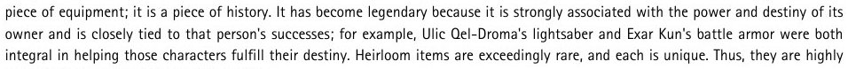
- **Freedon Nadd**: "Freedon Nadd's Short Lightsaber: Legendary icon short lightsaber with a rubat crystal (Small lightsaber, 2d8 damage, legendary icon)." Source: *Web Articles* (SWRPG Saga Edition), scan p.242
  
- **Ludo Kressh**: "Ludo Kressh's War Sword: Sith alchemical war sword, steeped in the dark side (Medium simple weapon, 1d8 damage, can spend a Force Point to gain bonus to damage equal to Dark Side Score, steeped in the dark side)." Source: *Web Articles* (SWRPG Saga Edition), scan p.242
  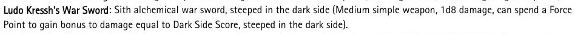

### Stat block notes (game mechanics, not feats)

- Heirloom Items: Over the course of galactic history, certain items, including weapons and armor, have been made famous by the person they belong to. The personal blaster rifle of a hero of the Mandalorian Wars or a lightsaber wielded by a dreaded Sith Lord is more than just another piece of equipment; it is a piece of history. It has become legendary because it is strongly associated with the power and destiny of its owner and is closely tied to that person's successes; for example, Ulic Qel-Droma's lightsaber and Exar Kun's battle armor were both integral in helping those characters fulfill their destiny. Heirloom items are exceedingly rare, and each is unique. Thus, they are highly sought-after by collectors and heroes alike. (Source: *Web Articles* (SWRPG Saga Edition), scan p.242)
- Heirloom Items: Onasi Blaster: Blaster pistol with improved accuracy and improved damage destiny bonus (Small blaster pistol, 3d6+2 damage, +1 equipment bonus to attack rolls). (Source: *Web Articles* (SWRPG Saga Edition), scan p.242)

## scan p.243 (scan page 243)

Page contents: Karnak Tetsu, Sorcerer of Tund: history of the Sorcerers of Tund (T records; text layer mangles italic "Sith'ari" as "S/thar/in", corrected from page image); stat block Karnak Tetsu (Dark Wars) CL 15 Medium Sith noble 7/Force adept 5/Force disciple 3 (Force 10, Force Boon; Destiny 2; Dark Side 18; Use the Force +20; Ref 27, Fort 27, Will 35; hp 53; immune fear; Fear, Horror, Illusion, Insanity; 24 Force powers incl. Force lightning, Force scream, sever Force; Force Secrets Distant Power, Multitarget Power; Force Techniques Dominate Mind, Force Power Mastery (wound); Str 6, Wis 18; Sith Offshoot, prophet; Sith Alchemy; possessions blaster pistol, Sith talisman, Tundan robes); Sith Offshoot special quality (T record). (hand-read)

### Stat block notes (game mechanics, not feats)

- Karnak Tetsu, Sorcerer of Tund: The secret of the universe -- its professed possession is no small claim. But beyond Republic space, an entire people allege just that. Karnak Tetsu is one of these Sorcerers of Tund, descendants of the Sith race. (Source: *Web Articles* (SWRPG Saga Edition), scan p.243)
- Karnak Tetsu, Sorcerer of Tund: Even though the original Sith were steeped in sortilege, sentient sacrifices, and wars, they lived spiritually serene lives, never doubting conflict's integral role to existence. Only with their introduction to methodic Rakatan malice did these Sith truly embrace the dark side. However, Sith priests interpreted the death of their Sith'ari in the Rakatan conflict as a sign to reject this concept. These heretics were banished from the Sith homeworld, following their instincts to the Force-soaked world Tund. (Source: *Web Articles* (SWRPG Saga Edition), scan p.243)
- Karnak Tetsu, Sorcerer of Tund: This pureblooded Sith society combines science, ontology, and magic. Convinced by their Rakatan interactions that all sentients are Force-sensitive, the Sorcerers of Tund proclaim that the omnipresence of the Force (or "the Unity") illuminates the deception of dualities and multiplicity. Their cosmology views life as perfectly harmonious and the existence of true opposites as an illusion. (Source: *Web Articles* (SWRPG Saga Edition), scan p.243)
- Karnak Tetsu, Sorcerer of Tund: The sorcerers have interactions with early Jedi, who view them as merely another Force sect, like the Jal Shey or Zeison Sha. However, following the Restoration -- and Karnak Tetsu's reign of terror -- Jedi label the sorcerers’ hermetica as unqualified heresy. Unsurprisingly, the sorcerers are reticent in accepting outlanders, believing that only true Sith can grasp their truth. On one occasion, however, they welcome the few remaining Massassi and Kissai, descended from outcasts much like themselves. (Source: *Web Articles* (SWRPG Saga Edition), scan p.243)
- Karnak Tetsu, Sorcerer of Tund: The leader of the Sorcerers of Tund during the years following the Great Sith War is the enigmatic Karnak Tetsu. (Source: *Web Articles* (SWRPG Saga Edition), scan p.243)
- Karnak Tetsu, Sorcerer of Tund: Sith Offshoot -- As a descendant of the original Sith people, Karnak Tetsu has access to talents of the Sith tradition in the Force Disciple prestige class. (Source: *Web Articles* (SWRPG Saga Edition), scan p.243)

## scan p.244 (scan page 244)

Page contents: Arkanian Legacy: Adascorp headquarters ship (research labs, hospital, arboretum, conservatory, art museum; 100,000 employees and families); Lord Arkoh Adasca and Project Black Harvest exogorths (T record); stat block CL 15 Colossal (cruiser) capital ship (Ref 16, Fort 40, +14 armor; hp 1500; DR 20; SR 100; Threshold 240; fly 2; 4 light and 12 medium turbolaser cannon batteries +11; Str 90; crew 5,000 skilled; passengers 100,000; cargo 10,000 tons; 2 years; 24 fighters, Lord Adasca's personal shuttle, 8 shuttles; hyperdrive x2 (backup x8); Military, rare; not for sale); battery stats (light 3d10x5, medium 5d10x5). (hand-read)

### Stat block notes (game mechanics, not feats)

- Arkanian Legacy: The Arkanian Legacy is also directly associated with Lord Arkoh Adasca; the craft was officially launched at a ceremony in which he took control of his inheritance and Adascorp. Ironically, the ship is ravaged at the same moment that Arkoh's grandest scheme disintegrates, when the exogorths of Project Black Harvest feast upon it. The remains of the ship remain derelict in the Omonoth system. (Source: *Web Articles* (SWRPG Saga Edition), scan p.244)

## scan p.245 (scan page 245)

Page contents: Shasa (KotOR web enhancement; title "SHASA" from OCR, listed as "Sasha" on the p238 contents page): biography (T record); stat block Shasa (Jedi Civil War) CL 8 Medium Selkath noble 7/Force adept 1 (Force 4; Destiny 1; Dark Side 1; Perception +11; Ref 17, Fort 16, Will 20; hp 44; speed 6 walking, 4 swimming; fira sword +5 (1d6+4); natural weapon poison, Force Power Adept (Force whirlwind), Inspire Confidence, Progenitor's Call, Waveform; 6 Force powers; Force Point Recovery; expert swimmer; Use the Force +16; possessions fira sword, blaster pistol, datapad, comlink). (hand-read)

### Stat block notes (game mechanics, not feats)

- Shasa: The Sith Empire dupe Shasa and other young Selkath as part of an effort to gain control of Manaan during the Jedi Civil War. Fortunately for her, she and the other Selkath youths are rescued by Revan during his efforts to suppress Sith activities on the planet. Having learned a valuable lesson in the ways of the galaxy, and having natural ability with the Force, she dedicates her life to the establishment of an order that will protect Manaan. This new organization quickly becomes known as the Order of Shasa, which trains Force-sensitive Selkath and survives for thousands of years. (Source: *Web Articles* (SWRPG Saga Edition), scan p.245)

## scan p.246 (scan page 246)

Page contents: The Last Resort: Camper's ship (T records; text wrapped around an image, rebuilt from OCR; "7he" corrected to "The"); stat block CL 6 Colossal space transport (Ref 12, Fort 24, +12 armor; hp 100; DR 15; SR 10; Threshold 76; fly 12/3; heavy laser cannon +1 (5d10x2); Str 39; crew 2, passengers 10; cargo 40 tons; 4 months; hyperdrive x4; Unique; Emplacement Points 2). (hand-read)

### Stat block notes (game mechanics, not feats)

- The Last Resort: The Last Resort is the home, workshop, and laboratory of Gorman Vandrayk, better known as "Camper." Never a first-class ship, even when it was a new Amalgamated Hyperdyne 578-R Space Transport, The Last Resort deteriorates even further as it sits idle on the planet Taris. Camper is hiding on Taris from his former employers, and he is willing to let a collection of tents and awnings conceal the ship, obscuring its true form. He tinkers with some systems, such as configuring a powerful cannon at the expense of his hyperdrive and shields, and he neglects others completely. The cargo deck level becomes his workshop, housing several "Camper special" compartments and serving as temporary home to the droid Elbee. (Source: *Web Articles* (SWRPG Saga Edition), scan p.246)
- The Last Resort: When Camper and fellow Arkanian offshoot Jarael are forced to use the ship for its true function, the poor condition of the life-support systems nearly kills him, thanks to the mold and allergens that had grown within the system over the years. The current location of The Last Resort is unknown. It was last seen leading the exogorths into Wild Space, following the failed Project Black Harvest. (Source: *Web Articles* (SWRPG Saga Edition), scan p.246)

## scan p.247 (scan page 247)

Page contents: Moomo Williwaw: the Moomo brothers' ship, a modified Pelagia Duplex Command Assault Gunship commissioned by Baron Karoll "The Mad" Cilarnus (T records); stat block CL 12 Colossal space transport (Ref 14, Fort 26, +12 armor; hp 130; DR 15; SR 20; Threshold 76; fly 12 (870 km/h)/3; 2 heavy laser cannons plus one of laser cannons, light laser cannons, medium blaster cannon, medium double blaster cannons, light blaster cannon, proton torpedoes, light concussion missile launchers, all +8; Str 43; crew 4 expert, passengers 6; cargo 5 tons; 1 week; Unique; Emplacement Points 1); weapon stats (heavy laser 6d10x2; laser 4d10x2; light laser 3d10x2; medium blaster 4d10x2 (text layer "4410x2"); medium double blaster 5d10x2; light blaster 3d10x2; concussion missiles 7d10x2 4-square splash; proton torpedoes 9d10x2 4-square splash). (hand-read)

### Stat block notes (game mechanics, not feats)

- Moomo Williwaw: The Moomo Williwaw -- one of the most unusual ships in the galaxy -- is operated by the unusually dense Moomo brothers. Originally a Pelagia Duplex Command Assault Gunship, this craft is crazily modified at the request of Baron Karoll "The Mad" Cilarnus, who is highly impressed by the ship's performance during the Sith War. Due to financial difficulty, the Baron never takes possession of the craft, and no military would purchase a vessel armed with so many weapons that some of its gunners are in danger from its own turrets. (Source: *Web Articles* (SWRPG Saga Edition), scan p.247)
- Moomo Williwaw: The Moomo brothers save the ship from the scrap heap, agreeing with each other just long enough to purchase the craft. Unbelievably, they add even more weaponry to the ship "just in case" they need it. A few torpedoes are even welded on, just for show (but real nonetheless). Many of the weapons are controlled from the cockpit on their side of the ship, but two turrets are manned. The ship now serves as their base of operation and storehouse for their considerable personal armory. The ship's unique dual cockpits are intended to direct the gunnery turrets on each side of the ship. However, the Moomo Brothers typically take position in each of the cockpits, then fight over helm control as the ship careens through space. (Source: *Web Articles* (SWRPG Saga Edition), scan p.247)

## scan p.248 (scan page 248)

Page contents: Urban Bombardier Speeder Bike: military Aratech Urban Navigator variant from the Mandalorian Wars, weapons array replaces the sidecar; stat block CL 1 Large air vehicle (speeder) (Init +12; Ref 17, Fort 13, +1 armor; hp 35; DR 5; Threshold 18; fly 12 (500 km/h); laser cannon +1 (1d8x2) or light concussion missiles +3 (1d10x2, 1-square splash); Dex 24; crew 1 skilled; cargo 10 kg; 1 day; payload 4 missiles; Restricted; 18,000 (8,500 used)). (hand-read)

## scan p.249 (scan page 249)

Page contents: Web Enhancement Clone Wars 1: Polis Massan by Gary Astleford: Polis Massa asteroid colony; origins in the Subterrel sector; research into the extinct Eellayin and hope to clone them with Kaminoan techniques; Personality; Physical Description; Homeworld Polis Massa; Languages Massan; Example Names Osh Scal, Maneeli Tuun (generic, S only); Adventurers; Species Traits (-2 Str, +2 Wis; Small; speed 6; Conditional Bonus Feat Skill Focus (Treat Injury); Darkvision; Limited Telepathy within 10 squares, Telepathy untrained; Mute; Basic (understand only), Massan). (hand-read)

## scan p.250 (scan page 250)

Page contents: Star Wars Miniatures Previews: contents list of web previews (Alliance and Empire 1-7; Clone Wars 1-5 ("Clone Wars Preview 1: By Sterling Hershey"); Fringe Stat Pack; Galaxy at War 1-6; Knights of the Old Republic 1-7; Legacy of the Force 1-5; New Republic Stat Pack; The Force Unleashed 1-7). Lines naming characters recorded verbatim as T records. (hand-read)

### Stat block notes (game mechanics, not feats)

- Star Wars Miniatures Previews (contents list): Alliance and Empire Preview 1: Death Star Trooper and Han Solo in Stormtrooper Armor (Source: *Web Articles* (SWRPG Saga Edition), scan p.250)
- Star Wars Miniatures Previews (contents list): Alliance and Empire Preview 2: Trandoshan Mercenary and Obi-Wan Kenobi, Jedi Spirit (Source: *Web Articles* (SWRPG Saga Edition), scan p.250)
- Star Wars Miniatures Previews (contents list): Alliance and Empire Preview 4: Imperial Governor Tarkin and Wookiee Freedom Fighter (Source: *Web Articles* (SWRPG Saga Edition), scan p.250)
- Star Wars Miniatures Previews (contents list): Alliance and Empire Preview 6: Mara Jade, Jedi and Death Star Gunner (Source: *Web Articles* (SWRPG Saga Edition), scan p.250)
- Star Wars Miniatures Previews (contents list): Alliance and Empire Preview 7: Jawa Trader and Lando Calrissian, Dashing Scoundrel (Source: *Web Articles* (SWRPG Saga Edition), scan p.250)
- Star Wars Miniatures Previews (contents list): Clone Wars Preview 4: Darth Sidious Hologram and Human Soldier of Fortune (Source: *Web Articles* (SWRPG Saga Edition), scan p.250)
- Star Wars Miniatures Previews (contents list): Galaxy at War Miniatures Preview 1: Commander Ahsoka and Obi Wan Kenobi Jedi General (Source: *Web Articles* (SWRPG Saga Edition), scan p.250)
- Star Wars Miniatures Previews (contents list): Galaxy at War Miniatures Preview 2: Hondo Ohnaka and Asajj Ventress Strike Leader (Source: *Web Articles* (SWRPG Saga Edition), scan p.250)
- Star Wars Miniatures Previews (contents list): Galaxy at War Miniatures Preview 4: Wat Tambor, Techno Union Foreman and 501st Clone Trooper (Source: *Web Articles* (SWRPG Saga Edition), scan p.250)
- Star Wars Miniatures Previews (contents list): Knights of the Old Republic Miniatures Preview 2: Rakghoul and Master Lucien Draay (Source: *Web Articles* (SWRPG Saga Edition), scan p.250)
- Star Wars Miniatures Previews (contents list): Knights of the Old Republic Miniatures Preview 3: Tusken Raider Scout and Darth Sion (Source: *Web Articles* (SWRPG Saga Edition), scan p.250)
- Star Wars Miniatures Previews (contents list): Knights of the Old Republic Miniatures Preview 5: Captain Panaka and Echani Handmaiden (Source: *Web Articles* (SWRPG Saga Edition), scan p.250)
- Star Wars Miniatures Previews (contents list): Knights of the Old Republic Miniatures Preview 7: Jar Jar Binks and Han Solo, Smuggler (Source: *Web Articles* (SWRPG Saga Edition), scan p.250)
- Star Wars Miniatures Previews (contents list): Legacy of the Force Preview 1: Republic Commando Training Sergeant and Shado Vao (Source: *Web Articles* (SWRPG Saga Edition), scan p.250)
- Star Wars Miniatures Previews (contents list): Legacy of the Force Preview 2: Cade Skywalker, Bounty Hunter and Deliah Blue (Source: *Web Articles* (SWRPG Saga Edition), scan p.250)
- Star Wars Miniatures Previews (contents list): Legacy of the Force Preview 4: Deena Shan and Han Solo, Galactic Hero (Source: *Web Articles* (SWRPG Saga Edition), scan p.250)
- Star Wars Miniatures Previews (contents list): Legacy of the Force Preview 5: Darth Krayt and Kyle Katarn, Jedi Battlemaster (Source: *Web Articles* (SWRPG Saga Edition), scan p.250)
- Star Wars Miniatures Previews (contents list): The Force Unleashed Preview 1: Emperor's Shadow Guard and Vader's Apprentice, Unleashed (Source: *Web Articles* (SWRPG Saga Edition), scan p.250)
- Star Wars Miniatures Previews (contents list): The Force Unleashed Preview 2: Maris Brood and Kazdan Paratus (Source: *Web Articles* (SWRPG Saga Edition), scan p.250)
- Star Wars Miniatures Previews (contents list): The Force Unleashed Preview 3: Darth Revan and Rebel Vanguard (Source: *Web Articles* (SWRPG Saga Edition), scan p.250)
- Star Wars Miniatures Previews (contents list): The Force Unleashed Preview 4: Juno Eclipse and Star Destroyer Officer (Source: *Web Articles* (SWRPG Saga Edition), scan p.250)
- Star Wars Miniatures Previews (contents list): The Force Unleashed Preview 5: Wookiee Warrior and Wedge Antilles, Red Two (Source: *Web Articles* (SWRPG Saga Edition), scan p.250)
- Star Wars Miniatures Previews (contents list): The Force Unleashed Preview 6: Luke's Snowspeeder and Luke Skywalker, Hoth Pilot Unleashed (Source: *Web Articles* (SWRPG Saga Edition), scan p.250)
- Star Wars Miniatures Previews (contents list): The Force Unleashed Preview 7: Amanin Scout and 2-1B (Source: *Web Articles* (SWRPG Saga Edition), scan p.250)

## scan p.251 (scan page 251)

Page contents: Alliance and Empire Preview 1: Death Star Trooper and Han Solo in Stormtrooper Armor by Gary M. Sarli and Sterling Hershey: Death Star Trooper background (T records, Tarkin); miniatures notes; stat card (Imperial; cost 6; HP 10; Def 14; Atk +6; Dmg 10); Saga stats (refers to Rebellion Era Sourcebook p43): Death Star Trooper CL 2 Medium Human nonheroic 3/soldier 1 (Force 1, Dark Side 3; Init +3; Perception +7; Ref 14, Fort 13, Will 11; hp 46; baton +3 (1d6), blaster pistol +5 (3d6); Point Blank Shot*; Demolitionist; possessions baton, blaster pistol, comlink, utility belt, blast helmet and vest; * Human bonus feat or trained skill). (hand-read)

### Stat block notes (game mechanics, not feats)

- Alliance and Empire Preview 1: Death Star Trooper: During the construction of the Death Star, Grand Moff Tarkin trained a select fighting force specifically for the fearsome battlestation. Taken from the best Imperial Navy troopers, the new Death Star Troopers were multitalented individuals who fulfilled many combat and noncombat duties throughout the station. They received advanced combat and independent command training. (Source: *Web Articles* (SWRPG Saga Edition), scan p.251)
- Alliance and Empire Preview 1: Death Star Trooper: The Death Star Troopers were an elite fighting force loyal to the Imperial Navy and Tarkin, as opposed to the stormtroopers who had their own command structure and were loyal to the Emperor. Elite Death Star Troopers served in the command areas, while standard troopers were found throughout the station. Their distinctive uniforms became a symbol of power. After the Death Star's destruction, the uniform spread to other Imperial Navy troops throughout the fleet. (Source: *Web Articles* (SWRPG Saga Edition), scan p.251)

## scan p.252 (scan page 252)

Page contents: Han Solo in Stormtrooper Armor: narrative and miniatures tactics (T records); stat card (Rebel; cost 25; HP 80; Def 19; Atk +8; Dmg 20; Unique, Furious Assault, Stealth; commander effect Charging Fire); Saga stats Han Solo (Episode IV) CL 9 Medium Human scoundrel 5/soldier 2/ace pilot 1/gunslinger 1 (Destiny 1; Force 5; Init +16; Perception +10; Basic, Huttese, Shyriiwook; Ref 25, Fort 22, Will 22; hp 61; heavy blaster pistol +9 (4d8+8) with Rapid Shot; Keep It Together, Full Throttle, Quick Draw, Stellar Warrior; Sneak Attack +1d6, Spacehound, Trigger Work, Weapon Specialization (pistols); Pilot +14; possessions heavy blaster pistol with targeting scope, tool kit, modified YT-1300 transport (Millennium Falcon - text layer "Mi//ennium")); disguised altered stats (Perception +12, low-light vision; Ref 22; blaster rifle +6 (3d8+4) or +4 (4d8+4) with Rapid Shot). (hand-read)

### Stat block notes (game mechanics, not feats)

- Alliance and Empire Preview 1: Han Solo in Stormtrooper Armor: The Corellian smuggler had a problem: He owed a Hutt crime lord a lot of money for a lost shipment of spice. In a dirty spacer's cantina in Mos Eisley, though, Han Solo thought he had found the solution. His Wookiee copilot told him that an old desert hermit and some kid from a moisture farm needed a ride to Alderaan, and the old man said they needed it now -- "no questions asked." Sensing desperation, Han pressed for enough money to solve his problems. The deal was made, and things were finally looking up. (Source: *Web Articles* (SWRPG Saga Edition), scan p.252)
- Alliance and Empire Preview 1: Han Solo in Stormtrooper Armor: Mere hours later, Han Solo found himself wearing captured stormtrooper armor and walking into the detention block of an Imperial space station to rescue an Alderaanian princess. After a furious shootout in the cell bay, the princess --who had more than a bit of attitude, by the way --led them to an escape that involved the heavenly smell of rotting garbage and wet Wookiee fur. As much as Han's mercenary streak would have liked to keep the armor and pawn it with the nearest black-market fence, he knew he'd never get that stench out of the armor's body glove. (Source: *Web Articles* (SWRPG Saga Edition), scan p.252)
- Alliance and Empire Preview 1: Han Solo in Stormtrooper Armor: In the Star Wars Miniatures Game, Han Solo in Stormtrooper Armor allows your squad to use the tactics of mobility to its advantage. Furious Assault combines the best features of Charging Fire and Blaster Barrage, and it doesn't require a Force Point to activate. Given this, Han Solo can be maneuvered into position to take maximum advantage of the enemy, clearing out large numbers of "mooks" unless they are carefully positioned to maximize cover and minimize the number of legal targets. (Source: *Web Articles* (SWRPG Saga Edition), scan p.252)
- Alliance and Empire Preview 1: Han Solo in Stormtrooper Armor: When disguised (wearing stormtrooper armor and wielding a blaster rifle), Han Solo has the following altered statistics: (Source: *Web Articles* (SWRPG Saga Edition), scan p.252)
- Alliance and Empire Preview 1: Han Solo in Stormtrooper Armor: But destiny had other plans. (Source: *Web Articles* (SWRPG Saga Edition), scan p.252)
- Alliance and Empire Preview 1: Han Solo in Stormtrooper Armor: Better, his commander effect lets him bring his followers along, a wave of fast-moving blaster fire that consistently outmaneuvers the enemy. Finally, Stealth gives him a little more survivability in a hostile environment, using fast-moving followers as mobile cover. Still, his biggest weakness compared to the other versions of Han Solo is the lack of Accurate Shot. Without his customized heavy blaster pistol and encumbered by the clumsy armor, he's just not as fast and accurate as he would normally be. Let's face it, though: Accurate Shot would be a brutal combination with Furious Assault because almost everything in line of sight would be a legal target. (Source: *Web Articles* (SWRPG Saga Edition), scan p.252)

## scan p.253 (scan page 253)

Page contents: Alliance and Empire Preview 2: Trandoshan Mercenary and Obi-Wan Kenobi, Jedi Spirit by Gary M. Sarli and Sterling Hershey (title text layer "JUJED!I" = "JEDI"): Trandoshan Mercenary background (T record for Delta Squad), miniatures tactics; stat card (Fringe; cost 9; HP 20; Def 15; Atk +4; Dmg 20; Double Claw Attack, Mercenary, Regeneration 10, Rend +10); Saga stats Trandoshan Mercenary CL 2 Medium Trandoshan nonheroic 6 (Init +7; darkvision; Ref 15, Fort 10, Will 10; hp 21; limb regeneration; unarmed +7 (1d8+3); heavy blaster rifle +4 (3d10); Martial Arts I and II, Toughness; possessions blast vest, heavy blaster rifle, comlink). (hand-read)

### Stat block notes (game mechanics, not feats)

- Alliance and Empire Preview 2: Trandoshan Mercenary: Trandoshan mercenaries are very common in almost any era, and they were particularly active during the Clone Wars. For example, Delta Squad (Republic Commandos Boss, Fixer, Scorch, and Sev) ran afoul of Trandoshan mercenaries that had captured the Prosecutor, an Acclamator-class assault ship, and later found them supporting Separatist operations on Kashyyyk. While most Trandoshan mercenaries have no trouble finding work, it's not uncommon to find some who turn to slaving as a means of supplementing their income. (Source: *Web Articles* (SWRPG Saga Edition), scan p.253)

## scan p.254 (scan page 254)

Page contents: Obi-Wan Kenobi, Jedi Spirit: epigraphs (Q records: Tarkin, Obi-Wan); narrative and miniatures tactics (T records); stat card (Rebel; cost 8; Unique, Speed 2, Light Spirit full text); Saga stats Obi-Wan Kenobi, Jedi Spirit CL -- Medium Human Force Spirit Jedi 7/Jedi Knight 5/Jedi Master 3 (Destiny 2; Force 7; Init +15; Perception +9; Basic, Shyriiwook; Will 30; speed none, instantaneous travel; farseeing (2); Force Point Recovery (2); Int 14, Wis 15, Cha 16; Incorporeal; Force Perception; Use the Force +19). (hand-read)

- **Grand Moff Tarkin; Obi-Wan Kenobi; Darth Vader (Anakin Skywalker)** — entry/section: Saga Edition Web Articles: "Obi-Wan Kenobi, Jedi Spirit "Surely he must be dead by now." -- Grand Moff Tarkin "If you strike me down,|shall become more powerful than you can possibly imagine." -- Obi-Wan Kenobi With a mighty slash of his red blade, Darth Vader, Lord of the Sith, finally struck down his former master turned nemesis, Obi-Wan Kenobi." Source: *Web Articles* (SWRPG Saga Edition), scan p.254
  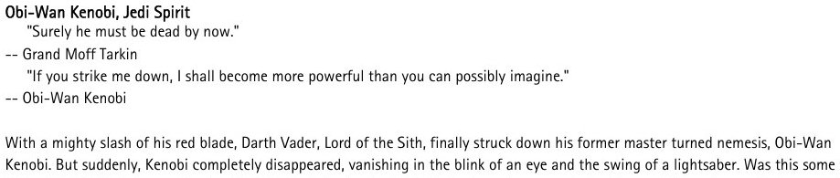
- **Grand Moff Tarkin; Obi-Wan Kenobi** — entry/section: Alliance and Empire Preview 2: Obi-Wan Kenobi, Jedi Spirit (epigraph): ""Surely he must be dead by now." —Grand Moff Tarkin" Source: *Web Articles* (SWRPG Saga Edition), scan p.254
  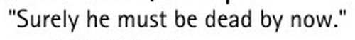
- **Obi-Wan Kenobi; Darth Vader (Anakin Skywalker)** — entry/section: Alliance and Empire Preview 2: Obi-Wan Kenobi, Jedi Spirit (epigraph): ""If you strike me down, I shall become more powerful than you can possibly imagine." —Obi-Wan Kenobi" Source: *Web Articles* (SWRPG Saga Edition), scan p.254
  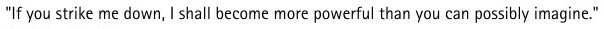
- **Obi-Wan Kenobi; Darth Vader (Anakin Skywalker)**: "What had Kenobi said about becoming more powerful than Vader could possibly imagine?" Source: *Web Articles* (SWRPG Saga Edition), scan p.254
  
- **Obi-Wan Kenobi**: "Bringing Obi-Wan into range for Light Spirit to be effective also brings him into range for the enemy to attempt to defeat him outright, assuming the foe has the Force points to spend." Source: *Web Articles* (SWRPG Saga Edition), scan p.254
  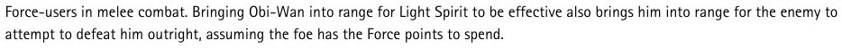

### Stat block notes (game mechanics, not feats)

- Alliance and Empire Preview 2: Obi-Wan Kenobi, Jedi Spirit: With a mighty slash of his red blade, Darth Vader, Lord of the Sith, finally struck down his former master turned nemesis, Obi-Wan Kenobi. But suddenly, Kenobi completely disappeared, vanishing in the blink of an eye and the swing of a lightsaber. Was this some new Jedi trick? Did Vader's eyes deceive him? The Dark Lord poked disbelievingly at the master's clothing and lightsaber -- all that remained of the Jedi. What had Kenobi said about becoming more powerful than Vader could possibly imagine? There was much to consider --later. First, the Rebels had to be dealt with, once Kenobi's friends were allowed to escape the Death Star. (Source: *Web Articles* (SWRPG Saga Edition), scan p.254)
- Alliance and Empire Preview 2: Obi-Wan Kenobi, Jedi Spirit: In the Star Wars Miniatures Game, Obi-Wan Kenobi, Jedi Spirit is truly a unique piece. It has no stats other than Cost and three abilities, and its Light Spirit ability dictates its use on the battle grid. As a Light Spirit, this piece ignores all terrain. It can't open doors, be damaged in any way, or provide cover. It doesn't count as a legal target. At the start of the game, you choose a Unique allied character with a Force rating. When Obi-Wan is within four squares, the selected character gains the special abilities Force Renewal 1 and Mettle. (Source: *Web Articles* (SWRPG Saga Edition), scan p.254)
- Alliance and Empire Preview 2: Obi-Wan Kenobi, Jedi Spirit: With a speed of only 2, Obi-Wan will often lag behind the beneficiary of Light Spirit. Maneuvering is key when they engage enemy Force-users in melee combat. Bringing Obi-Wan into range for Light Spirit to be effective also brings him into range for the enemy to attempt to defeat him outright, assuming the foe has the Force points to spend. (Source: *Web Articles* (SWRPG Saga Edition), scan p.254)

## scan p.255 (scan page 255)

Page contents: Alliance and Empire Preview 3: Human Force Adept and Stormtrooper on Repulsor Sled by Gary M. Sarli and Sterling Hershey: Human Force Adept background (other Force traditions) and miniatures tactics; stat card (Fringe; cost 10; HP 40; Def 15; Atk +4; Dmg 10; Melee Attack; Force 3, Force Alter, Force Weapon); note that Force adept is a prestige class in Saga Edition; Low-Level Force User CL 3 Medium Human scout 3 (Destiny 1; Force 6; Init +6; Perception +7; Ref 15, Fort 16, Will 15; hp 40; quarterstaff +4 (1d6+3); Equilibrium; Battle Strike (2); Shake It Off; Use the Force +12; possessions quarterstaff, credit chip, comlink, basic clothing). Generic, S only. (hand-read)

## scan p.256 (scan page 256)

Page contents: Stormtrooper on Repulsor Sled: Aratech 64-Y Swift 3 Repulsor Sled background (vs. swoops and the 74-Z speeder bike; drop net) and miniatures tactics (Mobile Attack, Flight, Net Gun activation control); stat card (Imperial; cost 14; HP 20; Def 18; Atk +5; Dmg 20; Flight, Mobile Attack, Net Gun, Speed 12); Saga stats CL 4 Large ground vehicle (speeder) (Init +10; Ref 14, Fort 13, +1 armor; hp 32; DR 5; Threshold 18; speed 12 (800 km/h); medium blaster cannon +7 (3d10), drop net +7 (6d10 ion, grapple +13); crew 1 expert; cargo 4 kg; 1 day; Military; 8,000 (1,800 used)); Drop Net rule (2x2 area within 12 squares, ion damage, functions as net per Saga Edition rulebook p130 - text layer "Saga Fdition"). (hand-read)

## scan p.257 (scan page 257)

Page contents: Alliance and Empire Preview 4: Imperial Governor Tarkin and Wookiee Freedom Fighter by Gary M. Sarli and Sterling Hershey: Tarkin background and miniatures tactics (T records; text layer italic errors "A//iance", "Aebe/ Storm" corrected; dropped "cover." restored from OCR); stat card (Imperial; cost 22; HP 50; Def 14; Atk +5; Dmg 10; Unique, Doctrine of Fear; commander effect Extra Attack for allied commanders); Saga stats Imperial Governor Wilhuff Tarkin CL 7 Medium Human noble 7 (Destiny 1; Force 5; Dark Side 13; Perception +14; Basic, High Galactic, Shyriiwook, Sullustese; Ref 18, Fort 17, Will 20; hp 45; blaster pistol +5 (3d6+3); Coordinated Attack; Born Leader, Demand Surrender, Educated, Presence; Knowledge (Bureaucracy) +15, Persuasion +15; possessions Imperial uniform, rank cylinders, comlink, credit chip, blaster pistol). (hand-read)

### Stat block notes (game mechanics, not feats)

- Imperial Governor Wilhuff Tarkin (Saga CL 7): CL 7 Human noble 7 Destiny 1; Force 5; Dark Side 13 Init +4; Senses Perception +14 Languages Basic, High Galactic, Shyriiwook, Sullustese Defenses Ref 18 (flat-footed 18), Fort 17, Will 20 hp 45; Threshold 17 Speed 6 squares Melee unarmed +5 (1d4+3) or Ranged &gt; blaster pistol +5 (3d6+3) Base Atk +5; Grp +5 Special Actions Coordin (Source: *Web Articles* (SWRPG Saga Edition), scan p.257)
- Alliance and Empire Preview 4: Imperial Governor Tarkin: Imperial Governor Tarkin hailed from the Outer Rim world of Eriadu. He was the first to be granted the title of Grand Moff, overseeing most of the Outer Rim territories. Tarkin was an early and extremely influential leader in the Emperor's service. Completely dedicated to the ideals of the New Order, he formed many philosophies ultimately adopted by the Empire. His most famous contribution was what would become known as the Tarkin Doctrine or the Doctrine of Fear. Its central idea was to rule through the fear of force, rather than through force itself. The culmination of this philosophy was the Death Star. (Source: *Web Articles* (SWRPG Saga Edition), scan p.257)
- Alliance and Empire Preview 4: Imperial Governor Tarkin: In the Star Wars Miniatures Game, Imperial Governor Tarkin is a commander's commander. Tarkin's commander effect grants a bonus not to followers, but to allied commanders. (The Alliance and Empire rules insert defines a commander this way: "A character with a printed commander effect is sometimes referred to as a commander. Commanders can also include characters who gain commander effects from another source.") Compared to Grand Moff Tarkin from the Rebel Storm set, this version of Tarkin has twice the cost, 10 more hit points, the same defense, a slightly better attack score, equal damage, a new special ability, and the aforementioned commander effect. (Source: *Web Articles* (SWRPG Saga Edition), scan p.257)
- Alliance and Empire Preview 4: Imperial Governor Tarkin: Imperial Governor Tarkin's extra hit points will come in handy when trying to maximize his Doctrine of Fear ability, which requires him to be within 6 squares of an enemy -- likely exposing him to a greater number of attacks. Of course, since Tarkin's commanders must stay within 6 squares to benefit from his commander effect, he'll probably get help from his underlings, or at least use them for cover. (Source: *Web Articles* (SWRPG Saga Edition), scan p.257)
- Alliance and Empire Preview 4: Imperial Governor Tarkin: The Star Wars Roleplaying Game: Saga Edition statistics below reflect Tarkin in his early years as an Imperial Governor. He also serves as an example of a character more focused on skill use than on combat. (Source: *Web Articles* (SWRPG Saga Edition), scan p.257)

## scan p.258 (scan page 258)

Page contents: Wookiee Freedom Fighter: background (Imperial enslavement of Kashyyyk, guerrilla war in the sublevels; T record for the Palpatine paragraph) and miniatures tactics; stat card (Rebel; cost 14; HP 50; Def 14; Atk +7; Dmg 10; Charging Assault +10, Demolish, Momentum); Saga stats Wookiee Freedom Fighter CL 3 Medium Wookiee soldier 3 (Force 3; Init +6; Ref 14, Fort 18, Will 13; extraordinary recuperation; hp 50; bayonet +7* (1d8+12*), +11* with Powerful Charge; blaster rifle +3 (3d8+1); frag grenade; rage; Melee Smash, Penetrating Attack (simple); possessions blaster rifle with mounted bayonet, 2 grenades, bandolier, comlink, explosive charge; * includes 1 point in Power Attack). (hand-read)

### Stat block notes (game mechanics, not feats)

- Alliance and Empire Preview 4: Wookiee Freedom Fighter: After the rise of Emperor Palpatine's New Order, a wave of pro-Human legislation swept across the galaxy. Nonhumans were relegated to the status of second-class citizens at best, and slaves at worst. The latter was the fate of the proud natives of Kashyyyk -- the Wookiees. When their world was subjugated by the Empire, the Wookiees found themselves fighting the very clones that had defended them from the onslaught of Separatist battle droids during the Clone Wars. (Source: *Web Articles* (SWRPG Saga Edition), scan p.258)

## scan p.259 (scan page 259)

Page contents: Alliance and Empire Preview 5: Rebel Commando Strike Leader and Advance Agent, Officer by Gary M. Sarli and Sterling Hershey (title text layer "PREVIEW S" = 5): Rebel Commando Strike Leader background (SpecForce, Endor shield generator) and miniatures tactics (paragraph ends "is a must." - last word restored from OCR); stat card (Rebel; cost 18; HP 50; Def 15; Atk +7; Dmg 20; Grenades 20, Stealth; commander effect for Stealth commandos); Saga stats CL 4 Medium Human nonheroic 6/soldier 2 (Force 1; Init +10; Ref 15, Fort 16, Will 12; hp 50; vibroblade +7 (2d6+2), blaster rifle +7 (3d8+1), frag grenade; Demolitionist; Stealth +15; possessions blast helmet and vest, blaster rifle, 2 frag grenades, detonite, Rebel commando uniform, comlink, credit chip). Generic, S only. (hand-read)

## scan p.260 (scan page 260)

Page contents: Advance Agent, Officer: Yuuzhan Vong advance agents background and Nom Anor (T records); miniatures tactics ("a//" = "all" in text layer); stat card (Yuuzhan Vong; cost 11; HP 30; Def 14; Atk +5; Dmg 10; Force Immunity, Melee Attack, Stealth, Thud Bug; commander effect Cunning Attack); Saga stats Advance Agent, Officer CL 4 Medium Yuuzhan Vong nonheroic 6/noble 1/officer 1 (Dark Side 12; Perception +10; 9 languages; Ref 14, Fort 13, Will 17; hp 31; Force immunity; amphistaff spear/quarterstaff/whip/spit, thud bug +5 (2d6 plus special); technophobic; Born Leader, Deployment Tactics; continues p261). (hand-read)

### Stat block notes (game mechanics, not feats)

- Alliance and Empire Preview 5: Advance Agent, Officer: Nom Anor was one such Yuuzhan Vong, an agent provocateur who specialized in political maneuvering, such as working behind the scenes to help engineer the collapse of the Empire after Palpatine's death. He also engaged in more overt rabble-rousing, such as when he led the Red Knights of Life, an extremist group on Rhommamool with an anti-droid, anti-Jedi, and anti-technology ideology. Just prior to the Yuuzhan Vong invasion, Nom Anor had managed to escalate tensions between Rhommamool and her sister planet Osarian to the point of open war. Nom and other advance agents specialize in propaganda, lies, and treachery, and their efforts helped the Yuuzhan Vong invasion bring unimaginable horrors to the galaxy. (Source: *Web Articles* (SWRPG Saga Edition), scan p.260)
- Alliance and Empire Preview 5: Advance Agent, Officer: Second, the Advance Agent, Officer has Stealth, making it a natural complement to Nom Anor. Nom's commander effect granting "super stealth" and Self-Destruct 20 applies to all of them, making them a potent combination. (Source: *Web Articles* (SWRPG Saga Edition), scan p.260)
- Alliance and Empire Preview 5: Advance Agent, Officer: Put them all together with other notable Yuuzhan Vong from this set and the Universe set, and you have an extremely dangerous squad on your hands. One of its biggest challenges, however, is keeping figures relatively close (to get the most out of the commander effect's limited range) while still staying far enough apart to avoid getting caught in each other's "Nom bomb." (Source: *Web Articles* (SWRPG Saga Edition), scan p.260)

## scan p.261 (scan page 261)

Page contents: Advance Agent, Officer cont.: skills (Deception +16, +21 disguised as Human), possessions amphistaff, ooglith masquer, thud bug; Poison rule (amphistaff, Saga Edition rulebook p121 - text layer "Saga Fa/tion"; -1 persistent step; spit up to 10 squares once per 24 hours); New Ranged Weapon: Thud Bug (nang hul - italic mis-read "nang Au/in"; knocks prone, dormant state, returns on a miss, destroyed by Deflect per Saga Edition rulebook p41; table: n/a cost, 2d6+special, rate S, 0.5 kg, bludgeoning, Illegal, rare); New Equipment: Ooglith Masquer (n/a; illegal, rare; +5 equipment bonus on Deception to disguise as Human; full-round action, -3 condition steps; the sentence "(These steps may be recovered normally" is cut off in the source). (hand-read)

## scan p.262 (scan page 262)

Page contents: Alliance and Empire Preview 6: Mara Jade, Jedi and Death Star Gunner by Gary M. Sarli and Sterling Hershey (title text layer "6&6: MARA UADE" = "6: MARA JADE", verified by OCR): Mara Jade background and miniatures tactics (T records); stat card (New Republic; cost 45; HP 110; Def 20; Atk +12; Dmg 10; Unique, Cunning Attack, Deadly Attack, Lightsaber, Stealth, Twin Attack; Force 4, Lightsaber Assault, Lightsaber Block); Saga stats Mara Jade Skywalker, Jedi CL 14 Medium Human scoundrel 5/Jedi 9 (Destiny 2; Force 5; Dark Side value blank in the source; Init +9; Perception +15; Ref 28, Fort 27, Will 28; hp 110; lightsaber +15 (2d8+9) or two at +10 with Double Attack; blaster pistol +14 (3d6+7); Battlestrike (2), Force Slam, Force Thrust, Mind Trick, Move Object, Surge, Vital Transfer; Block, Deflect, Redirect Shot, Skirmisher; Use the Force +14; possessions lightsaber, blaster pistol, comlink, credit chip). (hand-read)

- **Mara Jade Skywalker** — entry/section: Saga Edition Web Articles: "Sarli and Sterling Hershey Mara Jade, Jedi Mara Jade is one of the most popular characters from the Star Wars Expanded Universe." Source: *Web Articles* (SWRPG Saga Edition), scan p.262
  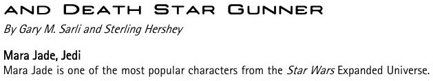

### Stat block notes (game mechanics, not feats)

- Alliance and Empire Preview 6: Mara Jade, Jedi: Mara Jade is one of the most popular characters from the Star Wars Expanded Universe. First introduced in Timothy Zahn's Heir to the Empire novel series, Mara developed from Emperor's Hand and Imperial enemy to a reluctant ally, and, by the time of the New Jedi Order, to Mara Jade Skywalker and a Jedi. (Source: *Web Articles* (SWRPG Saga Edition), scan p.262)
- Alliance and Empire Preview 6: Mara Jade, Jedi: Mara started off as an Emperor's Hand, trained personally by Palpatine and afforded great latitude in carrying out his specific missions throughout the Empire. Her personal and public powers evaporated with the death of the Emperor, and she eventually fell in with Talon Karrde and his band of smugglers. This eventually brought her into contact with the New Republic and, specifically, Luke Skywalker. Though enemies at first, over the course of many years and adventures, the two grew closer together and eventually married. (Source: *Web Articles* (SWRPG Saga Edition), scan p.262)
- Alliance and Empire Preview 6: Mara Jade, Jedi: In the Star Wars Miniatures Game, Mara Jade, Jedi depicts the New Republic version of this complex character. As might be expected, she is much more powerful than her former Imperial faction self. While she retains Cunning Attack, Emperor's Hand is gone. She gains Deadly Attack, Lightsaber, Stealth, and Twin Attack. She gets an additional Force Point. Blaster Barrage is gone, replaced with Lightsaber Assault and Lightsaber Block. She has considerably more Hit Points and increased Attack and Defense scores. (Source: *Web Articles* (SWRPG Saga Edition), scan p.262)
- Alliance and Empire Preview 6: Mara Jade, Jedi: Though Mara has potent Force Powers, she doesn't rely completely on their use. Thus, she retains her strongest abilities when facing off against the Yuuzhan Vong faction, the prime enemy of the New Republic. (Source: *Web Articles* (SWRPG Saga Edition), scan p.262)

## scan p.263 (scan page 263)

Page contents: Death Star Gunner: background (turbolaser gunners, blast vest and HUD helmet, "blaster shotguns", explosive charges) and miniatures tactics vs. Heavy Stormtrooper (bullets: no Heavy Weapon restriction; Splash 10; Gunner ability with Mounted Weapon figures such as the AT-ST); stat card (Imperial; cost 11; HP 30; Def 14; Atk +6; Dmg 20; Gunner, Splash 10); Saga stats Death Star Gunner CL 2 Medium Human nonheroic 6 (Init +5; low-light vision; Perception +9; Ref 14, Fort 11, Will 9; hp 27; blast cannon +6 (3d8*, 1-square splash**); Exotic Weapon Proficiency (blast cannon); Mechanics +14, Use Computer +14; possessions blast vest and helmet with helmet package, blast cannon, utility belt, 3 explosive charges). Generic, S only. (hand-read)

## scan p.264 (scan page 264)

Page contents: New Weapon: Golan Arms Blast Cannon ("blaster shotgun"): -5 without Exotic Weapon Proficiency; range penalties applied to damage; +1d8 adjacent; splash 1-square vs nonadjacent (Splash Weapons, Saga Edition rulebook p155 - text layer "Saga Fdition"); power pack every 5 shots; table: exotic, 2,000 credits, 3d8 (special), rate S, 6 kg, energy, Military, rare. (hand-read)

## scan p.265 (scan page 265)

Page contents: Alliance and Empire Preview 7: Jawa Trader and Lando Calrissian, Dashing Scoundrel by Gary M. Sarli and Sterling Hershey (title text layer "UAWA" = "JAWA"): Jawa Trader, unattributed epigraph "Utinni!"; Jawa scavengers and traders, Jawa Trade Language; miniatures notes (improved Jawa from the Rebel Storm set - text layer "Rebe/ Storm"; trusted "less" in italics); stat card (Fringe; cost 9; HP 10; Def 12; Atk +4; Dmg 10; Cunning Attack, Evade, Ion Gun +20); Saga stats Jawa Trader CL 1 Small Jawa nonheroic 4 (darkvision; Ref 12, Fort 10, Will 9; hp 10; speed 4; ion pistol +4 (3d6 ion); Dodge, Point Blank Shot; Deception +7, Mechanics +6; possessions Jawa robes, ion pistol, belt with pouches of random technology, credits). Generic, S only. (hand-read)

## scan p.266 (scan page 266)

Page contents: Lando Calrissian, Dashing Scoundrel: unattributed epigraph "It's all in the cards." (kept as T); history (winning the Millennium Falcon, losing it to Han Solo, winning Cloud City from Dominic Raynor with Lobot's secret loan; dropped "labor." restored from OCR; italic "fa/con" = Falcon) and miniatures tactics (T records); stat card (Fringe; cost 18; HP 50; Def 17; Atk 8; Dmg 20; Unique, Evade, Mobile Attack, Opportunist); Saga stats Lando Calrissian (Episode V) CL 7 Medium Human scoundrel 7 (Destiny 1; Force Points 4; Dark Side 1; Init +5; Perception +9; Basic, Shyriiwook, Sullustese; Ref 21, Fort 18, Will 19; hp 46; blaster pistol +8 (3d6+3); Dastardly Strike, Fool's Luck, Fortune's Favor, Gambler; Deception +15; possessions blaster pistol, comlink, expensive clothes). (hand-read)

### Stat block notes (game mechanics, not feats)

- Alliance and Empire Preview 7: Lando Calrissian, Dashing Scoundrel: It's all in the cards. (Source: *Web Articles* (SWRPG Saga Edition), scan p.266)
- Alliance and Empire Preview 7: Lando Calrissian, Dashing Scoundrel: A few years before the Battle of Yavin, Lando Calrissian won the Millennium Falcon in a game of sabacc on Cloud City when a gambler couldn't cover his debt. Not too long after, again in Cloud City, Lando lost the Falcon to Han Solo when he used a marker good for any ship on his second-hand starship lot (not knowing that Han was aware that the Falcon was parked there at the time). (Source: *Web Articles* (SWRPG Saga Edition), scan p.266)
- Alliance and Empire Preview 7: Lando Calrissian, Dashing Scoundrel: Years later, after fighting in the Battle of Nar Shaddaa and the Battle of Taanab, Lando found himself a game of sabacc against the Baron-Administrator of Cloud City, Dominic Raynor. The pot was enormous. Lando bet 4 million credits (loaned to him secretly by Lobot, using pooled funds from the Ugnaughts who desperately wished to get rid of Raynor) and his used starship lot against Raynor's post as Baron-Administrator, and Lando won. (Source: *Web Articles* (SWRPG Saga Edition), scan p.266)
- Alliance and Empire Preview 7: Lando Calrissian, Dashing Scoundrel: The gambler, smuggler, and occasional mercenary suddenly found himself in a respectable position of authority, looking after the well-being of the inhabitants of Cloud City while pulling down a good income from the Tibanna gas mines. Everything was finally working out after years of struggle, years of gaining and losing fortunes, and Lando felt as if he could relax and enjoy the fruits of his labor. (Source: *Web Articles* (SWRPG Saga Edition), scan p.266)
- Alliance and Empire Preview 7: Lando Calrissian, Dashing Scoundrel: And that's when Vader showed up. (Source: *Web Articles* (SWRPG Saga Edition), scan p.266)
- Alliance and Empire Preview 7: Lando Calrissian, Dashing Scoundrel: In the Star Wars Miniatures Game, Lando Calrissian, Dashing Scoundrel is decent for a mid-range Unique follower -- certainly not a "beatstick," but good for supplemental harassing attacks. Mobile Attack and Opportunist produce a nice synergy if you use him as one of your last activations in a round: Move to get a good shot, attack a character that has already activated, and then get back into cover with the rest of your movement. Given that you can move both before and after the attack, you can usually keep Lando out of harm's way without having to use an early activation the following round (or simply leaving him exposed). (Source: *Web Articles* (SWRPG Saga Edition), scan p.266)
- Alliance and Empire Preview 7: Lando Calrissian, Dashing Scoundrel: Even if an enemy moves to get a shot at Lando, Evade will help keep him alive twice as long -- unless the enemy can get adjacent. But that's usually easy enough to avoid as long as you keep Lando more than 6 squares from an enemy. Combined with his respectable Hit Points and Defense, Lando can probably survive for quite a while. Often, your opponent won't want to devote the effort necessary to take him down, given that he's a difficult target and probably fairly low in priority compared to your heavy hitters. Just keep Lando on the edges of the fray, and he can harass enemy characters and thin out the ranks of the cannon fodder for a good chunk of the skirmish. (Source: *Web Articles* (SWRPG Saga Edition), scan p.266)

## scan p.267 (scan page 267)

Page contents: Clone Wars Preview 1 by Sterling Hershey (page title reads "CLONE WARS PREVIEW 1: BY STERLING HERSHEY"): Yoda on Kybuck - the Clone Wars animated series moment, kybucks of Kashyyyk, miniatures tactics (T records; the web-capture artifacts "[script removed]" appear in the source text and page image); stat card (Republic; cost 51; HP 160; Def 20; Atk +14; Dmg 20; Unique, Speed 10, Melee Attack, Double Attack, Galloping Attack; Force 5, Lightsaber Block, Master Speed). Image: Yoda on Kybuck miniature, no caption. (hand-read)

- **Yoda**: "Galloping Attack enables the unit to make the most of Yoda's devastating attack bonus." Source: *Web Articles* (SWRPG Saga Edition), scan p.267
  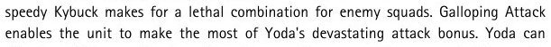

### Stat block notes (game mechanics, not feats)

- Clone Wars Preview 1: Yoda on Kybuck: Yoda riding the Kybuck was a memorable moment in the original Clone Wars animated series. Certainly it was one of the most surprising, as no one could have predicted seeing the diminutive Jedi Master riding any sort of steed in the battle. Yet ride he did, plunging into combat against invading battledroids on Coruscant. (Source: *Web Articles* (SWRPG Saga Edition), scan p.267)
- Clone Wars Preview 1: Yoda on Kybuck: In the Star Wars Miniatures Game, combining the Force-wielding Yoda with the speedy Kybuck makes for a lethal combination for enemy squads. Galloping Attack enables the unit to make the most of Yoda's devastating attack bonus. Yoda can attack multiple enemies in a single turn and have enough movement left over to escape immediate danger or seek cover. If a particularly opportune series of targets presents itself, Yoda can boost his movement even more through the use of Master Speed -- up to five times in a single game, if he forgoes using Lightsaber Block. [script removed] [script removed] (Source: *Web Articles* (SWRPG Saga Edition), scan p.267)
- Clone Wars Preview 1: Yoda on Kybuck: Comparing this unit with previous incarnations of Yoda in the Star Wars Miniatures Game, this unit costs the least, with the exception of Yoda of Dagobah. It has the most Hit Points and a Defense comparable to most of the others. He has the potential for the most attacks, thanks to Galloping Attack, though Double Attack is in line with previous versions. Notably, Yoda on Kybuck has no commander effects and only two Force Powers. Finally, he has the most Force Points of any unit other than Yoda, Jedi Master. (Source: *Web Articles* (SWRPG Saga Edition), scan p.267)

## scan p.268 (scan page 268)

Page contents: General Grievous, Droid Army Commander: background and miniatures comparison with other Grievous versions (T records; italic "a//droid" = "all droid"); stat card (Separatists; cost 57; HP 100; Def 19; Atk +8; Dmg 20; Unique, Cyborg, Melee Attack, Triple Attack, Jedi Hunter, Blaster 20; commander effect: droid followers +4 Attack, +4 Defense, Twin Attack). Image: Grievous miniature, no caption. (hand-read)

### Stat block notes (game mechanics, not feats)

- Clone Wars Preview 1: General Grievous, Droid Army Commander: As the devastating Clone Wars spread throughout the galaxy, the skull-like visage of General Grievous became a feared sight to the citizens of the Republic. At the head of his droid armies, Grievous executed brilliant strategies that gave the Confederacy of Independent Systems many victories in battle. His skill in wielding multiple lightsabers enabled him to cut down even the most capable attackers, including Jedi. As a cyborg, he gained the benefits and penalties of both flesh and machine. However, the Republic simply regarded him as an evil assailant, bereft of compassion. (Source: *Web Articles* (SWRPG Saga Edition), scan p.268)
- Clone Wars Preview 1: General Grievous, Droid Army Commander: In the Star Wars [script removed][script removed] Miniatures Game, this version of General Grievous greatly enhances his droid army thanks to an upgraded commander effect. His droid followers become more deadly and harder to hit thanks to +4 bonuses to Attack and Defense. They also gain Twin Attack, allowing them to double their firepower while remaining mobile. These are all distinct improvements over the Supreme Commander version that allowed Double Attack and only upgraded their attacks. While these upgrades are excellent, they really shine when you realize that the new commander effect applies to all droid followers on the battle grid, not just those within 6 squares. (Source: *Web Articles* (SWRPG Saga Edition), scan p.268)
- Clone Wars Preview 1: General Grievous, Droid Army Commander: There is a cost to this additional power, however, when compared to other incarnations. First of all, this is easily the most expensive version of the General, with the exception of Grievous's Wheel Bike. He retains his 100 Hit Points, and his Defense remains comparable. However, he really pays for it in his Attack bonus, which drops from +10 or +12 down to +8. This is somewhat mitigated by the addition of the Jedi Hunter ability, but it's still clearly a loss. On the plus side, the inclusion of Blaster 20 gives Grievous a ranged attack, which was previously only available on the Wheel Bike version. Finally, this is the only version that does not have a single Force point. However, the new bonuses more than make up for these drops in his abilities and provide him with the tools to wield his droid army with greater effectiveness. (Source: *Web Articles* (SWRPG Saga Edition), scan p.268)

## scan p.269 (scan page 269)

Page contents: Clone Wars Preview 2: ARC Trooper Sniper by Sterling Hershey: ARC troopers trained by Jango Fett (T record); miniatures comparison with the ARC Trooper from the Clone Strike set (italic "C/one Strike"); stat card (Republic; cost 16; HP 30; Def 17; Atk +10; Dmg 20; Order 66, Accurate Shot, Deadeye, Sniper). Image: ARC trooper sniper miniature, no caption. (hand-read)

### Stat block notes (game mechanics, not feats)

- Clone Wars Preview 2: ARC Trooper Sniper: The Advanced Recon Commandos, or ARC troopers, are elite clone trooper units personally trained by the Mandalorian Jango Fett. Unlike regular clone troopers, the ARC troopers have not had their personalities and independent natures inhibited in the growing process. These highly trained units specialize in daring commando raids against Separatist targets. However, due to their small numbers, they are called upon sparingly and reserved for the most critical missions. (Source: *Web Articles* (SWRPG Saga Edition), scan p.269)

## scan p.270 (scan page 270)

Page contents: Clone Wars Preview 3: Trandoshan Scavenger and Quarren Isolationist by Sterling Hershey: Trandoshan Scavenger background and miniatures notes; stat card (Fringe; cost 11; HP 30; Def 16; Atk +7; Dmg 20; Melee Attack, Mighty Swing, Regeneration 10); Saga stats Trandoshan Scavenger CL 4 Medium Trandoshan nonheroic 6 (darkvision; Perception +8; Basic, Dosh; Ref 16, Fort 12, Will 10; hp 33; vibrosword +7 (2d8+2) or (3d8+2) with Mighty Swing; Bantha Rush; possessions light battle armor (+5 armor, +2 equipment), vibrosword, pack with assorted equipment). Generic, S only. Image: miniature, no caption. (hand-read)

## scan p.271 (scan page 271)

Page contents: Quarren Isolationist (text layer "lsolationist"): Dac/Mon Calamari history, Quarren-Mon Calamari civil war in the Clone Wars; miniatures notes (Melee Reach 2); stat card (Fringe; cost 9; HP 30; Def 14; Atk +6; Dmg 20; Melee Attack, Melee Reach 2); Saga stats Quarren Isolationist CL 2 Medium Quarren nonheroic 5 (Perception +2; Basic and Quarrenese; Ref 14, Fort 13, Will 11; hp 28; speed 6, swim 4; trident +6 (1d8+4); Swim +9 (may reroll); possessions trident). Generic, S only. (hand-read)

## scan p.272 (scan page 272)

Page contents: Clone Wars Preview 4: Darth Sidious Hologram and Human Soldier of Fortune by Sterling Hershey: Darth Sidious Hologram - HoloNet and holoprojector background, miniatures notes (T records); stat card (Sith; cost 11; HP 20; Def 20; Atk/Dmg —; Unique; commander effect: allies within 6 squares gain Force Renewal 1). (hand-read)

### Stat block notes (game mechanics, not feats)

- Clone Wars Preview 4: Darth Sidious Hologram: Darth Sidious, Sith master of manipulation, extends his reach far and wide throughout the galaxy during his rise to power. To most of his allies and underlings, he appears only in holographic form. Thanks to the wonders of the HoloNet, the dark lord can appear on virtually any planet or starship that has access to this galactic communications network and a working holoprojector. (Source: *Web Articles* (SWRPG Saga Edition), scan p.272)
- Clone Wars Preview 4: Darth Sidious Hologram: In the Star Wars Miniatures Game, Darth Sidious Hologram provides a never-ending source of Force points to allies within 6 squares of the unit. While useful for replenishing Force-wielding allies, it also grants Force points to those who do not normally have them (other than droids). Though these units do not have any Force powers to spend their points on, they can still use the points for rerolling or extending their movement. The unit itself is not tremendously durable, nor can it attack on its own, but its high Defense increases its chances of remaining in play for several rounds. Players should further increase its defenses by keeping it in cover or out of line of sight to the enemy. (Source: *Web Articles* (SWRPG Saga Edition), scan p.272)

## scan p.273 (scan page 273)

Page contents: Human Soldier of Fortune: mercenary background and miniatures notes (Mercenary, Deadeye); stat card (Fringe; cost 14; HP 40; Def 17; Atk +8; Dmg 20; Deadeye, Mercenary); Saga stats Human Soldier of Fortune CL 4 Medium Human nonheroic 8/soldier 2 (Init +11; Perception +10; Ref 16, Fort 17, Will 12; hp 41; blaster rifle +8 (3d8+1) or (4d8+1) with Deadeye; Devastating Attack (rifles); Mechanics +9; possessions light battle armor, blaster rifle, comlink). Generic, S only. (hand-read)

## scan p.274 (scan page 274)

Page contents: Clone Wars Preview 5: Heavy Clone Trooper and Super Battle Droid by Sterling Hershey (title "PREVIEW S" = 5): Heavy Clone Trooper - light repeating blaster, comparison with Heavy Stormtrooper and Heavy Rebel Trooper; stat card (Republic; cost 13; HP 20; Def 14; Atk +9; Dmg 30; Order 66, Heavy Weapon); Saga stats (no Saga Edition statistics heading on this page, confirmed by OCR) Heavy Clone Trooper CL 2 Medium Human nonheroic 9 (Init +10; low-light vision; Perception +10; Ref 17, Fort 13, Will 9; hp 41; light repeating blaster autofire/braced/Burst Fire options, 3d8 or 5d8; Burst Fire; possessions clone trooper armor (+6 armor, +2 equipment), light repeating blaster rifle, comlink). Generic, S only. (hand-read)

## scan p.275 (scan page 275)

Page contents: Super Battle Droid: B2 series background; miniatures notes (pair with General Grievous, Droid Army Commander - T record); stat card (Separatists; cost 10; HP 20; Def 12; Atk +2; Dmg 20; Droid, Charging Fire, Synchronized Fire); Saga stats: "See page 199 in the Saga Edition Core Rulebook for the B2 Series Super Battle Droid" - the heading and sentence are printed twice on the page (confirmed by OCR). (hand-read)

### Stat block notes (game mechanics, not feats)

- Clone Wars Preview 5: Super Battle Droid: In the Star Wars Miniatures Game, this Super Battle Droid is statistically identical to the previously released versions of the same unit. With its very poor Attack rating, it's critical to field this unit with supporting synchronized fire units and/or beneficial commander effects. For example, the unit's effectiveness is vastly improved when deployed with General Grievous, Droid Army Commander, who grants it +4 to Defense and Attack and the ability Twin Attack. This makes the unit's low cost a better deal, thanks to the potential of dealing 40 points of damage on a successful Twin Attack. (Source: *Web Articles* (SWRPG Saga Edition), scan p.275)

## scan p.276 (scan page 276)

Page contents: Fringe Stat Pack: Roleplaying Statistics for Star Wars Miniatures by Sterling Hershey: intro (Saga stats for miniatures of any era); Duros Scoundrel (Legacy of the Force set) CL 3 Medium Duros nonheroic 3/scoundrel 2 (Force 3; Perception +9; Ref 14, Fort 12, Will 15; hp 15; blaster pistol with Improved Accuracy +4 (3d6+1); Find Openings, Vehicular Surge, Tech Specialist (Starships of the Galaxy / Rebellion Era Campaign Guide); Pilot +7; possessions include YT-1300 freighter, tool kit, datapad); Ewok Scout (Imperial Entanglements set) CL 3 Small Ewok nonheroic 3/scout 2 (Force 3; Ewokese speak only; Ref 16, Fort 14, Will 12; hp 21; small axe +4 (1d6+3), knife; Dual Weapon Mastery I, Forest Stalker, Keen Scent, Surefooted; Stealth +13, Survival +12). Generic, S only. (hand-read)

## scan p.277 (scan page 277)

Page contents: Fringe Stat Pack cont.: Jedi Crusader (Revanchists of the Mandalorian Wars led by Darth Revan and Darth Malak - T record; Jedi Academy set) CL 11 Medium Human Jedi 7/Jedi Knight 4 (Force 7; Dark Side 1; Ref 26, Fort 23, Will 25; hp 85; lightsaber +15 (2d8+11); Crucitorn, Makashi riposte, Extended Move Object; Ataru, Makashi; Accelerated Strike, Relentless Attack; refs Jedi Academy Training Manual (italic "Jea/") and KotOR Campaign Guide); Mercenary Commander (Imperial Entanglements set) CL 5 Medium Human nonheroic 6/soldier 1/officer 2 (Force 4; Dark Side 2; Military Sign; Ref 16, Fort 17, Will 19; hp 48; blaster carbine +7 (3d8+1) or (4d8+1) with Deadeye; Assault Tactics, Tough as Nails, Fast Surge; command cover). Generic, S only. (hand-read)

### Stat block notes (game mechanics, not feats)

- Fringe Stat Pack: Jedi Crusader: In the Knights of the Old Republic era, the Jedi Crusaders are also known as the Revanchists. They actively participate in the Mandalorian Wars against the orders and wishes of the Jedi Council. By the end of the war, most Jedi Crusaders are battle hardened and highly skilled combatants. After the war, many fall to the dark side and become Sith converts, along with their leaders, Darth Revan and Darth Malak. The Jedi Crusader is from the Jedi Academy set. (Source: *Web Articles* (SWRPG Saga Edition), scan p.277)

## scan p.278 (scan page 278)

Page contents: Fringe Stat Pack cont.: Sith Apprentice (any era; Jedi Academy set) CL 10 Medium Human noble 5/soldier 2/Sith apprentice 3 (Force 8; Dark Side 13; Ref 22, Fort 24, Will 23; hp 80; lightsaber +13 (2d8+9), throw lightsaber +9; dark rage, fear, Force grip, rebuke; Devastating Attack, Demand Surrender, Weaken Resolve; Use the Force +17); Twi'lek Black Sun Vigo (Imperial Entanglements set; text ends without period "Imperial Entanglements set") CL 7 Medium Twi'lek nonheroic 6/scout 1/scoundrel 1/crime lord 3 (Force 6; Dark Side 4; Ref 18, Fort 18, Will 21; hp 37; blaster pistol +8 (3d6+2); Assured Attack, Impel Ally I, Inspire Fear I, Tactical Superiority, Imperceptible Liar; refs Scum and Villainy and Rebellion Era Campaign Guide - text layer "Aebellion"). Generic, S only. (hand-read)

## scan p.279 (scan page 279)

Page contents: Fringe Stat Pack cont.: Whiphid Tracker (Toola; Imperial Entanglements set) CL 6 Large Whiphid nonheroic 3/scout 5 (Force 5; Dark Side 1; Perception +12; Ref 16, Fort 17 (22 vs. extreme cold), Will 18; hp 38; claw +7 (1d6+3) or (2d6+3) with Mighty Swing; bow +6 (1d6+2); "Special Actions Cunning Attac" - truncated in the source (OCR agrees); Acute Senses, Expert Tracker, Improved Stealth; Survival +12; possessions bow, 20 arrows, belt, belt pouch; ref The Force Unleashed Campaign Guide). Generic, S only. (hand-read)

## scan p.280 (scan page 280)

Page contents: Galaxy at War Miniatures Preview 1: Commander Ahsoka and Obi Wan Kenobi Jedi General by Jack Irons (title checked on page image): intro; Commander Ahsoka background (assigned to Anakin by Yoda; Ventress, Grievous; Aayla Secura and Luminara Unduli) and miniatures tactics (Qui-Gon Jinn, Jedi Trainer; Dark Woman; Jarel [Jarael]; K'Kruhk; "Mas Adedda" [sic, Mas Amedda]; Wookiee Berserker) - T records, "Ansoka" [sic] in both text layer and OCR; Saga stats Commander Ahsoka CL 6 Medium "Toguta" [sic] Jedi 5/noble 1 (Destiny 3; Force 6; Dark Side 0; Perception 8; Basic, Togruti, Binary [understand], Kel Dor, Zabrak; Ref 20, Fort 17, Will 17; Elusive Target, Lightsaber Block, Lightsaber Deflect; hp 67; lightsaber +9 (2d8+2); Pack Hunter (+2 damage vs flanked), Sneaky, Spacial [sic] Awareness (passive echolocation, 10 squares); Move Object, Surge, Shien Deflection; Born Leader; Acrobatics +11, Use the Force +10; possessions lightsaber). (hand-read)

- **General Grievous; Asajj Ventress** — entry/section: Saga Edition Web Articles: "This trouble included going face to face with some of the most powerful villains leading the Separatists, including Asajj Ventress and General Grievous." Source: *Web Articles* (SWRPG Saga Edition), scan p.280
  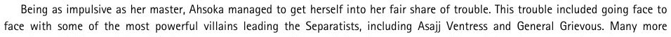

### Stat block notes (game mechanics, not feats)

- Commander Ahsoka Tano (Saga CL 6): CL 6 Toguta Jedi 5/Noble 1 Destiny 3; Force 6; Dark Side 0 Init +6; Senses Perception 8 Languages Basic, Togruti, Binary [understand], Kel Dor, Zabrak Defenses Ref 20 (Flatfooted 17), Fort 17, Will 17, Elusive Target, Lightsaber Block, Lightsaber Deflect hp 67; Threshold 17 Speed 6 squares Melee Lightsaber +9 (2d8+2) Ranged by Weapo (Source: *Web Articles* (SWRPG Saga Edition), scan p.280)
- Galaxy at War Miniatures Preview 1: Commander Ahsoka: The young Togruta Jedi, called Ansoka [sic], was assigned to Anakin Skywalker as his Padawan by Master Yoda in an effort to teach him responsibility. Although the two were often at odds at the beginning, they eventually formed a strong master/apprentice relationship. (Source: *Web Articles* (SWRPG Saga Edition), scan p.280)
- Galaxy at War Miniatures Preview 1: Commander Ahsoka: Being as impulsive as her master, Ahsoka managed to get herself into her fair share of trouble. This trouble included going face to face with some of the most powerful villains leading the Separatists, including Asajj Ventress and General Grievous. Many more experienced Jedi met their end facing these opponents and her surviving these encounters showed that she was as talented as she was impulsive. (Source: *Web Articles* (SWRPG Saga Edition), scan p.280)
- Galaxy at War Miniatures Preview 1: Commander Ahsoka: During this time Ahsoka sometimes found herself working with other Jedi Masters besides Anakin. Both Aayla Secura and Luminara Unduli passed on great wisdom and knowledge to the young Togruta and they learned something from her in return. She didn't learn from only the Jedi but also from the clones she worked with as well. Being around the clones troopers of the Republic gave Ahsoka the military background and confidence that she would need time and time again to lead them into battle. (Source: *Web Articles* (SWRPG Saga Edition), scan p.280)
- Galaxy at War Miniatures Preview 1: Commander Ahsoka: Commander Ahsoka in the miniatures game represents the developing leader the young Padawan is becoming. Her cost is low considering her high hit points, defense, abilities, Force powers and commander effect. This low cost makes her a great piece to fit into many Republic squads. The Rolling Cleave ability she has and grants reflects her agility and use of the Shien lightsaber form. (Source: *Web Articles* (SWRPG Saga Edition), scan p.280)
- Galaxy at War Miniatures Preview 1: Commander Ahsoka: Although she has a commander effect, her attack is 9 so she benefits from Qui-Gon Jinn, Jedi Trainer's commander effect. This boosts her attack to a decent 13 and greatly increases her chances of hitting high defense pieces. Considering some of the other followers that benefit from his commander effect, like the Dark Woman and Jarel, her commander effect is an effective boost for them as well. (Source: *Web Articles* (SWRPG Saga Edition), scan p.280)
- Galaxy at War Miniatures Preview 1: Commander Ahsoka: Another piece that benefits from her commander effect is Master K'Kruhk. Using his Force Leap ability you can position him behind enemies without taking attacks of opportunity. If he successfully takes down his first target then he can rolling cleave to a second target. Although a risky move, he has the ability to possibly negate nonmelee attacks with his Lightsaber Deflect ability and even possibly death with his Avoid Defeat ability. (Source: *Web Articles* (SWRPG Saga Edition), scan p.280)
- Galaxy at War Miniatures Preview 1: Commander Ahsoka: When using clones or other low cost range pieces her commander effect still works. However it is important to position correctly during the move phase to ensure that the benefits of the extra move and attack are not lost. In addition to range pieces, other pieces like the Wookiee Berserker, with their Momentum ability, greatly benefit from her commander effect as well. Because of the limited range of the effect, depending on the build of the squad, it might be wise to add Mas Adedda or Mouse Droids to extend it. (Source: *Web Articles* (SWRPG Saga Edition), scan p.280)

## scan p.281 (scan page 281)

Page contents: Obi Wan Kenobi Jedi General (Galaxy at War Preview 1 cont.): background (defeating "Darth Mual" [sic], Grievous and his apprentice; Soresu; clone armor; jet pack) and miniatures tactics (Surprise Move, Flight; Captain Rex; "Mas Ammeda" [sic]) - T records; Saga stats Obi-Wan Kenobi CL 16 Medium Human Jedi 8/soldier 1/Jedi Knight 5/officer 1/Jedi Master 1 (Destiny 5; Force 7; Dark Side 0; Init +15; Perception +11; Basic, Shyriiwook [understand], Binary [understand]; Ref 31, Fort 31, Will 35; Block, Deflect, Soresu; hp 142; immune fear; lightsaber +19 (2d8+12) or +14/+14 with Double Attack; Force powers incl. Circle of Shelter, High Ground Defense, Saber Swarm, Force Cloak; Force Regimens incl. Vo'ren's First and Second Cadence; Sokan, Soresu, Grand Leader; Force Regimen Mastery, Triple Crit; Use the Force +25; possessions incl. Jedi ornamental armor, jet pack; footnote: fulfilled the Education destiny, Saga core p114 - T record). (hand-read)

- **General Grievous; Obi-Wan Kenobi** — entry/section: Saga Edition Web Articles: "Obi Wan Kenobi Jedi General Although not the most powerful Jedi of the Republic during the Clone Wars, Obi Wan Kenobi is the hero responsible for defeating Darth Mual, General Grievous and his apprentice when he turned to the Dark Side of the Force." Source: *Web Articles* (SWRPG Saga Edition), scan p.281
  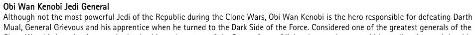
- **Obi-Wan Kenobi** — entry/section: Obi Wan Kenobi Jedi General: "He again has Soresu Style Mastery and Mettle to prevent taking damage but, unlike the previous version, he has limited Force points and doesn't have Master of the Force 2." Source: *Web Articles* (SWRPG Saga Edition), scan p.281
  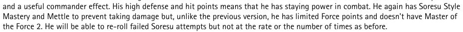

### Stat block notes (game mechanics, not feats)

- Obi-Wan Kenobi (Saga CL 16): CL 16 Medium Human Jedi 8/Soldier 1/Jedi Knight 5/Officer1/Jedi Master1 Destiny 5; Force 7; Dark Side 0 Init +15; Senses Perception +11 Languages Basic, Shyriiwook [understand], Binary [understand] Defenses Ref 31 (Flatfooted 29), Fort 31, Will 35; Block, Deflect, Soresu hp 142; Threshold 31 Immune fear effects Speed 6 squares Melee (Source: *Web Articles* (SWRPG Saga Edition), scan p.281)
- Galaxy at War Miniatures Preview 1: Obi Wan Kenobi Jedi General: Although not the most powerful Jedi of the Republic during the Clone Wars, Obi Wan Kenobi is the hero responsible for defeating Darth Mual [sic], General Grievous and his apprentice when he turned to the Dark Side of the Force. Considered one of the greatest generals of the Clone War, his keen instincts, quiet leadership and mastery of the Soresu form of lightsaber combat served him well and turned the tide of many battles thought to be lost. (Source: *Web Articles* (SWRPG Saga Edition), scan p.281)
- Galaxy at War Miniatures Preview 1: Obi Wan Kenobi Jedi General: During parts of the Clone Wars, Obi-Wan wore armor into battle not only for protection but to identify with the clone troopers he led. He did not see his troops as disposable pieces to be thrown into battle, but treated them with respect and listened to their advice while making battle plans. This respect was mutual and the clones under his command served him well until the fateful Order 66 was issued. (Source: *Web Articles* (SWRPG Saga Edition), scan p.281)
- Galaxy at War Miniatures Preview 1: Obi Wan Kenobi Jedi General: Although he disliked flying, Obi-Wan was a very capable pilot and was known to use a jet pack when it suited his needs. With or without the jet pack, the Jedi was known to use the tactic of dropping in the middle of his enemies to take them off guard and to gain the advantage of surprise. He used this tactic at the start of his final fight against the cyborg leader of the Separatist, General Grievous. (Source: *Web Articles* (SWRPG Saga Edition), scan p.281)
- Galaxy at War Miniatures Preview 1: Obi Wan Kenobi Jedi General: The newest version of Obi-Wan has a higher cost than the last Kenobi but he comes with a nice blend of stats, abilities, Force powers and a useful commander effect. His high defense and hit points means that he has staying power in combat. He again has Soresu Style Mastery and Mettle to prevent taking damage but, unlike the previous version, he has limited Force points and doesn't have Master of the Force 2. He will be able to re-roll failed Soresu attempts but not at the rate or the number of times as before. (Source: *Web Articles* (SWRPG Saga Edition), scan p.281)
- Galaxy at War Miniatures Preview 1: Obi Wan Kenobi Jedi General: Players will want to use Force points for Soresu re-rolls only when it is absolutely necessary because of the single Force power Obi-Wan has this time, Surprise Move. This power, along with his Flight ability, allows Obi-Wan a clear advantage in placement during the game. At the start of a game, it would be possible to move Obi-Wan a total of twenty spaces and place him in gambit the very first round on most maps. (Source: *Web Articles* (SWRPG Saga Edition), scan p.281)
- Galaxy at War Miniatures Preview 1: Obi Wan Kenobi Jedi General: Although it is a good way to secure the center of the map, a better use of these abilities is to have Obi-Wan use the surprise move to advance your position while keeping him out of line of sight of your opponent. Early in the round have your shooters take advantage of his commander effect and then take cover. During his turn have Obi-Wan advance on the field so that when your melee pieces advance on your opponent's they will be able to take advantage of it as well. (Source: *Web Articles* (SWRPG Saga Edition), scan p.281)
- Galaxy at War Miniatures Preview 1: Obi Wan Kenobi Jedi General: Since his commander effect works on allies be sure to chose commanders that benefit from his effect while enhancing your other followers, for example Captain Rex. With Obi-Wan's effect, Rex can now attack a total of six times with the possibility of dealing 120 points of damage in one turn. By adding Mas Ammeda or Mouse Droids it will allow all your pieces with Order 66 to move, make all their attacks, then move back into full cover and not have to be with six of either commander. (Source: *Web Articles* (SWRPG Saga Edition), scan p.281)
- Galaxy at War Miniatures Preview 1: Obi Wan Kenobi Jedi General: Obi-Wan Kenobi is considered to have fulfilled the Education destiny (see page 114 of the Saga Edition core rulebook) (Source: *Web Articles* (SWRPG Saga Edition), scan p.281)

## scan p.282 (scan page 282)

Page contents: Galaxy at War Miniatures Preview 2: Hondo Ohnaka and Asajj Ventress Strike Leader by Jack Irons (title checked on page image: text layer "ASAUGYU" = "ASAJJ"): intro repeated; Hondo Ohnaka background (captured Dooku, Anakin and Obi-Wan) and miniatures tactics (Thrawn; Corellian Pirate) - T records; Saga stats Hondo Ohnaka CL 10 Medium Weequay scoundrel 5/noble 3/crime lord 2 (Destiny 3; Force 6; Dark Side 3; Perception +6; Basic, Sriluurian; Ref 24, Fort 21, Will 24; hp 72; heavy blaster +8 (3d8+5); Pheromones; Demand Surrender, Fools Luck, Knack, Notorious, Presence, Surprise Strike, Tactical Superiority; Persuasion +17; possessions blaster pistol, holdout blaster, concealed carry holster). (hand-read)

### Stat block notes (game mechanics, not feats)

- Galaxy at War Miniatures Preview 2: Hondo Ohnaka: There are not many in the galaxy that can say they captured a Sith Lord alive. Far fewer can say they captured not only a Sith Lord but two of the greatest Jedi of the Clone War. Only Hondo Ohnaka can say that he, and his pirate crew, did that not once, but twice. (Source: *Web Articles* (SWRPG Saga Edition), scan p.282)
- Galaxy at War Miniatures Preview 2: Hondo Ohnaka: The Weequay pirate captain had a mix of traits that served him well but were also his undoing. He was very cunning and when he had the upper hand in a situation he took advantage of it. This included changing deals to suit his goal of making money to using a concoction to knock out those who thought they were his allies. (Source: *Web Articles* (SWRPG Saga Edition), scan p.282)
- Galaxy at War Miniatures Preview 2: Hondo Ohnaka: His greed and scheming ways rubbed off on his crew and affected his plans at the worst possible times. After capturing Dooku, Anakin and Obi-Wan and attempting to ransom them, his plans fell apart due to the back-stabbing nature of his crew. (Source: *Web Articles* (SWRPG Saga Edition), scan p.282)
- Galaxy at War Miniatures Preview 2: Hondo Ohnaka: However, he was not ruthless and seemed to operate under his own code of honor. The escaped Jedi captured the pirate captain but freed him after they realized that Dooku had already gotten away. Hondo in return told his men not to harm the Jedi and allowed them to go their way. (Source: *Web Articles* (SWRPG Saga Edition), scan p.282)
- Galaxy at War Miniatures Preview 2: Hondo Ohnaka: Hondo Ohnaka's abilities in the miniatures game work well together and his stats are in the mid-range. With 70 hit points he can take a hit from most pieces but will not stand up long against multiple attacks. However, his defense is good and if you keep him in cover it is high enough to avoid most low to mid cost shooters. (Source: *Web Articles* (SWRPG Saga Edition), scan p.282)
- Galaxy at War Miniatures Preview 2: Hondo Ohnaka: His best option for offense is to move him at the end of a round so that he can set up a shot on a choice target, preferably a commander or a mid-range piece with lower hit points or who has already been damaged. Early in the next round you will want to activate him in order to take full advantage of his abilities. You will only be able to take one shot but it is at +14 but for 50 damage if he doesn't move. Placing him in a squad with commanders who can switch unit locations, such as Thrawn, can help Hondo get all his attack bonuses and keep him out of harm's way. (Source: *Web Articles* (SWRPG Saga Edition), scan p.282)
- Galaxy at War Miniatures Preview 2: Hondo Ohnaka: He grants a good ability with his commander effect that is useful in any game. It is not limited by range so his followers will be able to move away from him and let him stay in cover. However it is limited to only followers with Pirate in their name and at this time the only piece this applies to is the Corellian Pirate who already has that ability. Makes you wonder if we will be seeing more of his crafty pirate crew soon...... (Source: *Web Articles* (SWRPG Saga Edition), scan p.282)

## scan p.283 (scan page 283)

Page contents: Asajj Ventress Strike Leader (Galaxy at War Preview 2 cont.): background (Dooku's mission to kill Anakin; Jabba and Rotta; "Ahkosa" [sic]; Yoda and the Toydarians; rescue of Nute Gunray; Luminara Unduli; Senate Commando Captain Fro Argyus, Dooku's spy, killed by Asajj) and miniatures tactics (Niman Style, Evade, Master Speed, Twin Attack, Sith Rage, Force Grip; Jensaarai Defender; Chagrian Mercenary Commander) - T records; one paragraph names the person who ran the GenCon Mass Battle event, so that paragraph gets no T record and the name is left out here; Saga stats Asajj Ventress, Strike Leader CL 14 Medium Rattataki (near-Human) Jedi 2/scout 3/melee duelist 3/Sith apprentice 2 (Destiny 8; Force 10; Dark Side 16; Init 16; Perception +10; Basic, "Hutteese"; Ref 33, Fort 26, Will 29; hp 96; lightsaber +18 (2d8+12), Rapid Strike and Dual Weapon Mastery options; Master of Movement; Dark Rage, Draw Closer, Force Grip, Pushing Slash, Rising Whirlwind, Surge (2); Improved Dark Rage; Master of Elegance; possessions incl. two dueling lightsabers with interconnecting "groves"). Stray characters "g . / a / &" in the text layer are bleed from the miniature photo. (hand-read)

- **Asajj Ventress** — entry/section: Saga Edition Web Articles: "Asajj Ventress, Strike Leader CL 14 Medium Rattataki (near-Human) Jedi 2/Scout 3/Melee Duelist 3/Sith Apprentice 2 Destiny 8; Force 10; Darkside 16 Init 16; Senses Perception +10 g ." Source: *Web Articles* (SWRPG Saga Edition), scan p.283
  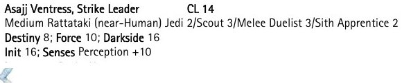

### Stat block notes (game mechanics, not feats)

- Galaxy at War Miniatures Preview 2: Asajj Ventress Strike Leader: Frustration was a feeling that this Rattataki Dark Jedi knew all too well. This feeling was caused by the loss of her Jedi master when she was young, not being allowed to be a true Sith and her continued failure to complete her mission, given to her by Count Dooku, of killing Anakin Skywalker. (Source: *Web Articles* (SWRPG Saga Edition), scan p.283)
- Galaxy at War Miniatures Preview 2: Asajj Ventress Strike Leader: This feeling only grew as the Clone Wars continued. When she tried to cause Jabba the Hutt to believe that his son Rotta was kidnapped by the Republic her plan fell apart due to Jedi Anakin Skywalker and his young Padawan Ahkosa [sic]. In her attempt to sway the Toydarians, she was stopped by Master Yoda and only three Clonetroopers even though she had an entire battalion of droids at her command. She was continually frustrated by having to work with Battle Droids who failed her at almost every turn. (Source: *Web Articles* (SWRPG Saga Edition), scan p.283)
- Galaxy at War Miniatures Preview 2: Asajj Ventress Strike Leader: She did succeed in making a critical strike against the Republic when she recovered Nute Gunray from the Republic's possession. Asajj battled with Luminara Unduli and Ahsoka, who was guarding the Neimoidan leader, throughout the ship he was a prisoner aboard. With the help of the Senate Commando Captain Fro Argyus, who was secretly a spy for Count Dooku, they were able to escape with Nute Gunray. Asajj repaid Captain Argyus for his help by killing him once they were safely away. (Source: *Web Articles* (SWRPG Saga Edition), scan p.283)
- Galaxy at War Miniatures Preview 2: Asajj Ventress Strike Leader: The fact that she can evade increases her chances of getting adjacent to the enemy with most of her hit points. She can use Force Points to re-roll failed Evade saves and use Master Speed to close the distance quicker. (Source: *Web Articles* (SWRPG Saga Edition), scan p.283)
- Galaxy at War Miniatures Preview 2: Asajj Ventress Strike Leader: Twin Attack assures that she will get at least two attacks off on a target and if she doesn't move then a possible four attacks. When making twin double attacks against heavy hitters it is nice that she has Sith Rage to boost her damage output to a possible 120 points a turn. Force Grip gives her the ability to deal unpreventable damage to characters who have a high defense or abilities that normally negate damage. (Source: *Web Articles* (SWRPG Saga Edition), scan p.283)
- Galaxy at War Miniatures Preview 2: Asajj Ventress Strike Leader: Unlike other past versions, she does not have the Loner ability but this works well with her commander effect. Considering that most of the Separatists faction consists of droids, her ability better benefits pieces from the Fringe faction such as the Jensaarai Defender. Since the Defender has Force points it would be able to re-roll attacks at critical points in the game to increase the chances of her commander effect happening. By pairing her with Chagrian Mercenary Commander a piece that would normally deal only 20 points of damage could inflict a possible 80 points of damage with a roll of 19 or 20. (Source: *Web Articles* (SWRPG Saga Edition), scan p.283)

## scan p.284 (scan page 284)

Page contents: Galaxy at War Miniatures Preview 3: Battle Droid Sergeant and Commando Droid Captain by Jack Irons: intro; Galaxy at War set announcement (based on the Clone Wars cartoon, in stores October 27th); Battle Droid Sergeant background and miniatures tactics (Roger Roger; HK-50, ASN and IG-86 assassin droids; General Grievous, Droid Army Commander - T record; Super Battle Droid Commander; Battle Droid Officer; Chameleon Droid); Saga stats Battle Droid Sergeant CL 3 Medium droid (4th-degree) nonheroic 6/soldier 1 (low-light vision; Ref 11, Fort 12, Will 10; hp 20; blaster rifle +6 (3d8); "Base Attack 5+" as printed; Battle Analysis; Knowledge (tactics) +6; heuristic processor; availability Military; cost 4,200). Generic, S only. (hand-read)

### Stat block notes (game mechanics, not feats)

- Galaxy at War Miniatures Preview 3: Battle Droid Sergeant: Of course if you are building a Separatist droid squad you will want to include other commanders to grant droids other abilities and increase their threat. This piece's low cost allows it to be placed in squads with other commanders like General Grievous, Droid Army Commander, the Super Battle Droid Commander or the classic Battle Droid Officer and still have plenty of room to fill the squad's ranks with many droids, such as the Chameleon Droid. (Source: *Web Articles* (SWRPG Saga Edition), scan p.284)

## scan p.285 (scan page 285)

Page contents: Commando Droid Captain (Galaxy at War Preview 3 cont.): BX series commando droids background; miniatures tactics (Double Attack commander effect usable by 4-LOM, Bounty Hunter and HK-47; Mouse Droid; Battle Droid Sergeant's Roger Roger; Gha Nachkt's Rapport - T record); Saga stats Commando Droid Captain CL 7 Medium droid (4th-degree) nonheroic 6/soldier 4/droid commander 1 (Force 3; Init +13; Perception +12; Ref 21, Fort 18, Will 20; hp 42; blaster rifle +12 (3d8+2) or +7/+7; "Base Attack 9+" as printed; Automated Attack (rifles), Battle Analysis, Cover Fire; Double Attack (rifles), Sniper; Stealth +13; possessions blaster rifle, electrobinoculars; availability Military; cost 18,800). Generic, S only. (hand-read)

### Stat block notes (game mechanics, not feats)

- Galaxy at War Miniatures Preview 3: Commando Droid Captain: The cost of the piece is reflected in the fact that he has the commander effect that grants Double Attack to other droid followers. This is not limited to just non-unique pieces or those with Commando Droid in their name. So unique droids like 4-LOM, Bounty Hunter and HK-47 can benefit from this commander effect as well. Since it is a commander effect the Mouse Droid can be used to extend the range. On top of that, the Commando Droid Captain also benefits from special abilities that affect non-unique droid allies, such as the Battle Droid Sergeant's Roger Roger ability and Gha Nachkt's Rapport ability. (Source: *Web Articles* (SWRPG Saga Edition), scan p.285)

## scan p.286 (scan page 286)

Page contents: Galaxy at War Miniatures Preview 4: Wat Tambor, Techno Union Foreman and 501st Clone Trooper by Jack Irons (title checked on page image: text layer "SOIST" = "501ST"): intro; Wat Tambor background (Skakoan pressure suit; Geonosis droid factory; CIS board; Dooku; killed by Vader on Mustafar) and miniatures comparison with the Revenge of the Sith set version (Droid Mark, Repair 20, Twin Attack, Evade, Immediate Droid Reserves 20; Asajj Ventress; Skakoan traits in Planet Hoppers) - T records; Saga stats Wat Tambor, Techno Union Foreman CL 10 Medium Skakoan noble 3/soldier 4/military engineer 3 (Destiny 4; Force 5; Init +11; Perception +11; 12 languages incl. Skakoform, Skakoverbal; Ref 29, Fort 26, Will 24; hp 70; speed 3; blaster pistol +9 (3d6+5); Field Created Weapon, Savant, Repairs on the Fly, Quick Modifications; Starship Designer, Tech Specialist; Mechanics +19, Use Computer +19; possessions blaster pistol, heavy pressure suit). (hand-read)

### Stat block notes (game mechanics, not feats)

- Galaxy at War Miniatures Preview 4: Wat Tambor, Techno Union Foreman: A key member of the Separatists, Wat Tambor was the leader of the Techno Union and was in charge of the production of Battle Droids used by his organization. Because of the harsh atmosphere that Skakoans breath, Wat Tambor had to wear a pressurized environment suit in order to survive on most other planets. (Source: *Web Articles* (SWRPG Saga Edition), scan p.286)
- Galaxy at War Miniatures Preview 4: Wat Tambor, Techno Union Foreman: Besides the droid factory on Geonosis, Wat Tambor oversaw production of droids on planets across the galaxy. This power of industry gave him a position on the executive board of the Confederacy of Independent Systems. He was the first of the board to support Count Dooku's plan of going to war with the Republic and the last council member to die by the hand of Darth Vader during the slaughter on Mustafar. (Source: *Web Articles* (SWRPG Saga Edition), scan p.286)
- Galaxy at War Miniatures Preview 4: Wat Tambor, Techno Union Foreman: Like the previous Wat Tambor, in the Revenge of the Sith set, this version has the Unique, Droid Mark and Repair 20 special abilities. However he cost eight points more and for that increase there is more functionality. His hit points are more than double his previous version, he has higher defense, attack and damage stats which means that he will be able to stay in battle longer and deal more damage than before. He is a follower so he benefits from commander effects, such as that from the new Asajj Ventress. (Source: *Web Articles* (SWRPG Saga Edition), scan p.286)
- Galaxy at War Miniatures Preview 4: Wat Tambor, Techno Union Foreman: When it comes to dealing damage he also has the Twin Attack ability which doubles his chances of hitting his target. Along with Droid Mark which can be used to prevent attacks against him, Wat Tambor also has the evade ability. So if your opponent makes their save against having to target Wat's chosen droid and makes a successful attack against him, he still has a chance to avoid all the damage with a successful save. (Source: *Web Articles* (SWRPG Saga Edition), scan p.286)
- Galaxy at War Miniatures Preview 4: Wat Tambor, Techno Union Foreman: However, the biggest change over the previous version is the inclusion of Immediate Droid Reserves 20. Having a one-in-five chance of working every time initiative is rolled is really good odds for a reserves ability. It is not something that you can count on happening in every game, but when it does it can completely change the final outcome. If you happen to get it twice in one game then it is as if Wat Tambor cost is only 3 points. Details of of the Skakoan species traits for the RPG can be found in the Planet Hoppers. (Source: *Web Articles* (SWRPG Saga Edition), scan p.286)

## scan p.287 (scan page 287)

Page contents: 501st Clone Trooper (Galaxy at War Preview 4 cont.): 501st Legion background ("Lead by Clone Commander Rex" as printed; trained on Coruscant; "Vader's Fist") and miniatures notes (Order 66 with Emperor Palpatine, Sith Lord; Double Attack; Squad Assault) - T records; RPG stats: "(Use the RPG Stats for the 501st Trooper found in The Force Unleashed Campaign Guide on page 192)" (trailing "m" is image bleed). (hand-read)

### Stat block notes (game mechanics, not feats)

- Galaxy at War Miniatures Preview 4: 501st Clone Trooper: Lead by Clone Commander Rex and serving under Anakin Skywalker, the 501st Clone Troopers had been a part of the Clone War from the first battle on Geonosis. Clones that were part of the 501st Legion received additional special training on Coruscant and not on Kamino like most clones. (Source: *Web Articles* (SWRPG Saga Edition), scan p.287)
- Galaxy at War Miniatures Preview 4: 501st Clone Trooper: 501st Clone Troopers were known for their ability to get missions done that were considered a loss cause. They had a fierce sense of duty and loyalty that helped them overcome situations that would have been the end for other soldiers. They continued their service to Anakin even after he fell to the Dark Side and became known throughout the galaxy as the most fearsome legion of Stormtroopers in the Empire, gaining the title "Vader's Fist". (Source: *Web Articles* (SWRPG Saga Edition), scan p.287)
- Galaxy at War Miniatures Preview 4: 501st Clone Trooper: As with other Republic trooper pieces, the 501st Trooper has the Order 66 ability that allows it to receive commander effects that are specific to that ability as well as being able to be in Imperial squads with Emperor Palpatine, Sith Lord. They also have Double Attack, giving them the option to possible inflict more damage at the cost of not moving. (Source: *Web Articles* (SWRPG Saga Edition), scan p.287)

## scan p.288 (scan page 288)

Page contents: Galaxy at War Miniatures Preview 5: Clone Trooper with Repeating Blaster and Elite Senate Guard by Jack Irons (title text layer "PREVIEW S" = 5): intro; Clone Trooper with Repeating Blaster background and miniatures tactics (Quadruple Attack; swap tricks with Captain Panaka, Mas Amedda and the new Obi Wan - T record); Saga stats Clone Trooper with Repeating Blaster CL 4 Medium Human "nonherioc 6/ solider 2" [sic] (Init +9; Perception +4; Ref 18, Fort 15, Will 10; hp 37; rotary blaster cannon (braced) +8 (3d8+1) or +3 (5d8+1) with Burst Fire; Devastating Attack (heavy weapon); possessions clone trooper armor, rotary blaster cannon, comlink); footnote "Found on page 40-41 in Star Wars: Galaxy of War" [as printed; i.e. Galaxy at War]. Generic, S only. (hand-read)

### Stat block notes (game mechanics, not feats)

- Galaxy at War Miniatures Preview 5: Clone Trooper with Repeating Blaster: By itself, the Clone Trooper can take four attacks to deal a possible 80 points of damage. This piece really shines when combined in squads that enhance it and other followers. By using Captain Panaka, Mas Amedda and the new Obi Wan from this set, you can swap the Clone Trooper in place of a piece that has moved to an advantageous spot and then proceed to take five attacks for a possible 100 points of damage. At the start of the next round, use Mas Amedda to swap him back out of harm's way and prepare this line of attack for the next round. (Source: *Web Articles* (SWRPG Saga Edition), scan p.288)

## scan p.289 (scan page 289)

Page contents: Elite Senate Guard (Galaxy at War Preview 5 cont.): background (protecting the Supreme Chancellor and Senators; blue uniforms) and miniatures tactics (Bodyguard, Heavy Weapon, Double Attack; Grand Master Yoda's and the new Obi-Wan's commander effects - T record); Saga stats Elite Senate Guard CL 8 Medium Human "nonherioc 6/ solider 4" [sic]/noble 2 (Force 2; Init +19; Perception +18; Basic, High Galactic; Ref 21, Fort 21, Will 20; +7 armor; hp 79; speed 4; stun bayonet +12 (2d8+7); heavy blaster rifle +13 (3d10+3) or +12 (4d10+3) with Deadeye; Commanding Presence, Harm's Way, Presence; possessions ceremonial armor, heavy blaster rifle with stun bayonet, comlink); New Equipment: Stun Bayonet (rules for mounted use, functions as stun baton when detached, simple weapon for Martial Arts I + rifle proficiency; energy cell; table: advanced melee, 500 credits, 1d6, stun 2d8, 2 kg, bludgeoning and energy, Restricted). Generic, S only. (hand-read)

### Stat block notes (game mechanics, not feats)

- Galaxy at War Miniatures Preview 5: Elite Senate Guard: Because of it's status as a follower, the Elite Senate Guard is able to benefit from many commander effects. Grand Master Yoda's commander effect gives a nice boost to their attack and defense scores, giving them a defense of 24 in cover that many ranged pieces will have a hard time hitting. The new Obi-Wan grants an additional attack, making the best use of the Heavy Weapon limitation. And there are other pieces in the new set that will boost that attack value even higher..... (Source: *Web Articles* (SWRPG Saga Edition), scan p.289)

## scan p.290 (scan page 290)

Page contents: Galaxy at War Miniatures Preview 6: Aqualish Technician and Treadwell Droid by Jack Irons (title "6&6" in text layer and OCR reads "6" on the page image): intro; Aqualish Technician background (Ando; subspecies) and miniatures tactics (Melee Attack, It's a Trap!, Bloodthirsty; Ithorian Commander); Saga stats headed "Aqualish Tech Specialist" CL 2, Aqualish scoundrel 1/scout 1 (Force 1; Init +7; Perception +6; Ref 15, Fort 16, Will 13; hp 30; Breathe Underwater; sporting blaster rifle +1 (3d6+1); Expert Swimmer; Security Slicer, Surveillance; Mechanics +14; possessions electrobinoculars, tool kit, sporting blaster rifle). Generic, S only. (hand-read)

## scan p.291 (scan page 291)

Page contents: Treadwell Droid (Galaxy at War Preview 6 cont.): WED Treadwell by Cybot Galactica (treads, up to eight tool appendages, telescoping neck); miniatures notes (Droid; It's a Trap!; Targeting); Saga stats WED Treadwell Repair Droid CL 0 (text layer "CLO") Small droid (2nd-degree) nonheroic 2 (Perception +6; Ref 14, Fort 8, Will 10; hp 5; tracked speed 6; electroshock probe -1 (1d8-2 ion); Mechanics +14, Use Computer +12; 4 tool appendages, diagnostics package; possessions electric arc welder, fusion lantern, tool kit; availability Licensed; cost 3,000 credits). Generic, S only. (hand-read)

## scan p.292 (scan page 292)

Page contents: Knights of the Old Republic Miniatures Preview 1: GenoHaradan Assassin and Czerka Scientist by Sterling Hershey (title text layer "GENOHWARADAN" = "GENOHARADAN" per OCR): GenoHaradan secret guild background; miniatures notes (Cloaked, Cunning Attack, Loner, Mobile Attack, Poisoned Blade); stat card (Fringe; cost 21; HP 60; Def 20; Atk +8; Dmg 10); Saga stats GenoHaradan Assassin CL 7 Medium Human scout 3/soldier 4 (Destiny 1; Force 4; Dark Side 4; Init +11; Perception +9 (may reroll); Ref 22, Fort 20, Will 18; hp 62; vibroblade +8 (2d6+5 poison); blaster rifle +10 (3d8+5); Keen Shot, Weapon Specialization (rifles); possessions vibroblade, blaster rifle, comlink); Poisoned Blade footnote (1d20+10 vs Fortitude, 4d6 and -1 condition step, DC 25 Treat Injury to cure). Generic, S only. (hand-read)

## scan p.293 (scan page 293)

Page contents: Czerka Scientist (KotOR Preview 1 cont.): Czerka Corporation scientists background; miniatures notes (Blaster Rifle Upgrade grants Jolt, Blaster Upgrade grants Twin Attack); stat card (Fringe; cost 13; HP 10; Def 13; Atk +1; Dmg 10); Saga stats Czerka Scientist CL 2 Medium Human nonheroic 5/noble 1 (Dark Side 2; Perception +10; Basic, Binary, Bocce, Durese; Ref 11, Fort 11, Will 15; hp 15; knife +2 (1d4-1); Inspire Confidence; Tech Specialist; Knowledge (life sciences) +16, Knowledge (physical sciences) +16; possessions knife, comlink, datapad, tool kit, utility belt). Generic, S only. (hand-read)

## scan p.294 (scan page 294)

Page contents: Knights of the Old Republic Miniatures Preview 2: Rakghoul and Master Lucien Draay by Sterling Hershey and Gary M. Sarli (title T record): Rakghoul background (Undercity of Taris, rakghoul disease, serum) and miniatures tactics; stat card (Fringe; cost 16; HP 30; Def 17; Atk +5; Dmg 10; Savage, Melee Attack, Ambush, Rakghoul Disease, Triple Attack); Saga stats Rakghoul CL 4 Medium beast 4 (Init +9; Perception +7; Ref 17, Fort 13, Will 10; hp 26; claw +5/+5 (1d4+4), bite +5 (1d6+4); Str 14, Dex 16, Con 17, Int 1, Wis 10, Cha 2; Jump +9); Rakghoul Disease rule (+8 vs Fortitude on bite, then every five minutes, transform after three successes; DC 25 Treat Injury with rakghoul serum). (hand-read)

## scan p.295 (scan page 295)

Page contents: Master Lucien Draay (KotOR Preview 2 cont.): background (son of Krynda and Barrison Draay; First WatchCircle of the Jedi Covenant; Padawan massacre on Taris; framing Zayne Carrick) and miniatures tactics (comparison with Count Dooku (Clone Strike), Darth Revan (The Force Unleashed), Vader, Darth Bane) - T records; stat card (Old Republic; cost 48; HP 130; Def 20; Atk +15; Dmg 20; Unique, Melee Attack, Double Attack, Lightsaber Duelist; Force 1, Force Renewal, Lightsaber Block/Deflect/Riposte, Master of the Force 2); Saga stats Lucien Draay CL 15 Medium Human noble 3/Jedi 5/Jedi Knight 5/Jedi Master 2 (Destiny 3; Force 7; Dark Side 5; Init +14; Arkanian, Basic, Feeorin, High Galactic, Miralukese, Togruti; Ref 30, Fort 30, Will 30; hp 121; lightsaber +19 (2d8+13) with Rapid Strike/Double Attack options; Riposte, WatchCircle Initiate, Shii-Cho; Quicken Power; possessions incl. personal space yacht); footnote T record (text layer "\f you" and "Saga Fdition" corrected). (hand-read)

- **Zayne Carrick; Lucien Draay**: "Convinced that Zayne is indeed the future Dark Lord, Lucien obsessively hunts his former student in pursuit of his personal vendetta against the Sith that destroyed his childhood." Source: *Web Articles* (SWRPG Saga Edition), scan p.295
  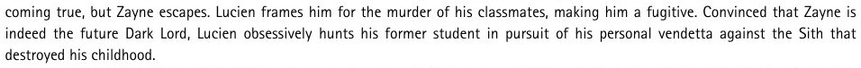
- **Darth Vader (Anakin Skywalker); Darth Bane**: "While he certainly won't outfight Lord Vader or Darth Bane, Draay is capable of putting up a good fight." Source: *Web Articles* (SWRPG Saga Edition), scan p.295
  

### Stat block notes (game mechanics, not feats)

- Lucien Draay (Saga CL 15): CL 15 Human noble 3/Jedi 5/Jedi Knight 5/Jedi Master 2 Destiny 3; Force 7; Dark Side 5 Init +14; Senses Perception +14 Languages Arkanian, Basic, Feeorin, High Galactic, Miralukese, Togruti Defenses Ref 30 (flat-footed 28), Fort 30, Will 30; Block, Deflect, Elusive Target hp 121; Threshold 30 Immune fear effects Speed 6 squares Melee (Source: *Web Articles* (SWRPG Saga Edition), scan p.295)
- Knights of the Old Republic Miniatures Preview 2: Master Lucien Draay: Born into a prestigious family with a substantial fortune and respected Jedi heritage, Lucien is son to Krynda Draay (a talented but distant seer) and Barrison Draay (a Jedi warrior who dies in the Great Sith War). His mother neglects him in favor of students who, like her, demonstrate clairvoyant aptitude, but Lucien takes after his father. Krynda makes Lucien the guardian of her young seers circle, becoming First WatchCircle of Krynda's Jedi Covenant, sworn to prevent the Sith's return by any means necessary. (Source: *Web Articles* (SWRPG Saga Edition), scan p.295)
- Knights of the Old Republic Miniatures Preview 2: Master Lucien Draay: While assigned to Taris, the WatchCircle members take new Padawans for training, including Lucien's apprentice, Zayne Carrick. During their Jedi trials, the WatchCircle seers get a vision of galactic turmoil and their own deaths; one of their own students appears destined to become the next Dark Lord. With grim determination, the WatchCircle slaughters its students to prevent their vision from coming true, but Zayne escapes. Lucien frames him for the murder of his classmates, making him a fugitive. Convinced that Zayne is indeed the future Dark Lord, Lucien obsessively hunts his former student in pursuit of his personal vendetta against the Sith that destroyed his childhood. (Source: *Web Articles* (SWRPG Saga Edition), scan p.295)
- Knights of the Old Republic Miniatures Preview 2: Master Lucien Draay: In the Star Wars Miniatures Game, Master Lucien Draay is the best "beatstick" available to the Old Republic faction. Lightsaber Block, Lightsaber Riposte, and Master of the Force 2 give him the ability to use both Lightsaber Block and Lightsaber Riposte against a single attack. Rounding out his anti-Sith Lord credentials, Draay has Lightsaber Duelist, giving him that much extra longevity against lightsaber-wielding maniacs: Only Count Dooku (Clone Strike) and Darth Revan (The Force Unleashed) manage a higher Defense against these foes. While he certainly won't outfight Lord Vader or Darth Bane, Draay is capable of putting up a good fight. (Source: *Web Articles* (SWRPG Saga Edition), scan p.295)
- Knights of the Old Republic Miniatures Preview 2: Master Lucien Draay: These talents appear in the Knights of the Old Republic Campaign Guide. If you don't have that book, replace with Djem So (page 218, Saga Edition Core Rulebook) and Resilience (page 40, Saga Edition Core Rulebook). (Source: *Web Articles* (SWRPG Saga Edition), scan p.295)

## scan p.296 (scan page 296)

Page contents: Knights of the Old Republic Miniatures Preview 3: Tusken Raider Scout and Darth Sion by Sterling Hershey (title T record): Tusken Raider background and miniatures notes (fourth Tusken Raider type; compares with Tusken Raider on Bantha, Universe set); stat card (Fringe; cost 11; HP 30; Def 15; Atk +8; Dmg 20; Melee Attack, Evade, Stealth); Saga stats Tusken Raider Scout CL 4 Medium Tusken Raider nonheroic 4/scout 3 (Dark Side 4; Perception +3 (may reroll); Tusken; Ref 15, Fort 15, Will 13; Evasion; hp 30; gaderffii +8 (1d8+3); Bantha Rush, Power Attack; Ride +8, Stealth +13, Survival +8; possessions gaderffii, desert garb and mask). Generic, S only. (hand-read)

## scan p.297 (scan page 297)

Page contents: Darth Sion (KotOR Preview 3 cont.): background (Lord of Pain; defeated by the Jedi Exile) and miniatures tactics (Eternal Hatred) - T records; stat card (Sith; cost 69; HP 110; Def 17; Atk +11; Dmg 20; Unique, Melee Attack, Double Attack, Lightsaber Duelist; Force 5, Eternal Hatred, Lightsaber Riposte, Sith Rage); Saga stats Darth Sion CL 19 Medium Human soldier 7/Sith apprentice 7/Sith Lord 5 (Destiny 4; Force 7; Dark Side 14; Init +17; Perception +16; Basic, Sith; Ref 35, Fort 35, Will 34; hp 177; lightsaber +25 (2d8+16) or +20/20 [as printed] with Double Attack; blaster pistol +22 (3d6+9); Dark Healing Field, Improved Dark Healing, Affliction; Force powers incl. Force whirlwind, slow, wound; Devastating/Distant/Multitarget/Shaped Power; Improved Force Slam/Trance/Wound; possessions lightsaber, blaster pistol). (hand-read)

- **Darth Sion** — entry/section: Saga Edition Web Articles: "Darth Sion Few Sith Lords hold mastery over pain or hatred like Darth Sion, Lord of Pain." Source: *Web Articles* (SWRPG Saga Edition), scan p.297
  
- **Darth Sion** — entry/section: Saga Edition Web Articles: "When defeated, Sion may spend 2 Force to attempt to return to life -- with full Hit Points -- on a save of 6." Source: *Web Articles* (SWRPG Saga Edition), scan p.297
  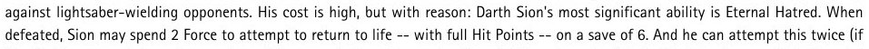
- **Meetra Surik**: "However, in the end, despite his anger, hatred, and manipulation of dark side energy, the Lord of Pain could not defeat the Jedi Exile." Source: *Web Articles* (SWRPG Saga Edition), scan p.297
  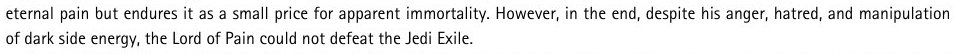

### Stat block notes (game mechanics, not feats)

- Edition Statistics Darth Sion (Saga CL 19): CL 19 Medium Human soldier 7/Sith apprentice 7/Sith Lord 5 Destiny 4; Force 7; Dark Side 14 Init +17; Senses Perception +16 Languages Basic, Sith Defenses Ref 35 (flat-footed 32), Fort 35, Will 34 hp 177; Threshold 35 Immune fear effects Speed 6 squares Melee lightsaber +25 (2d8+16) or Melee lightsaber +20/20 (2d8+16) with Double Att (Source: *Web Articles* (SWRPG Saga Edition), scan p.297)
- Knights of the Old Republic Miniatures Preview 3: Darth Sion: Few Sith Lords hold mastery over pain or hatred like Darth Sion, Lord of Pain. His visage is terrible to behold: a decomposing body held together by dark side energies channeled by Sion himself, sustaining his life through the Force, powered by anger and hatred. He is in eternal pain but endures it as a small price for apparent immortality. However, in the end, despite his anger, hatred, and manipulation of dark side energy, the Lord of Pain could not defeat the Jedi Exile. (Source: *Web Articles* (SWRPG Saga Edition), scan p.297)
- Knights of the Old Republic Miniatures Preview 3: Darth Sion: In the Star Wars Miniatures Game, Darth Sion is powerful and resilient. He is a decent melee combatant with Double Attack and a +11 Attack score. His Defense score is a bit low for a character of his cost, but Lightsaber Duelist bolsters him significantly against lightsaber-wielding opponents. His cost is high, but with reason: Darth Sion's most significant ability is Eternal Hatred. When defeated, Sion may spend 2 Force to attempt to return to life -- with full Hit Points -- on a save of 6. And he can attempt this twice (if the first is successful), as long as he retains enough Force for each attempt. When it works, this is like bringing one 110-hit point character to a skirmish initially, then gaining one or two more in the form of reinforcements while the opposing squad gets weaker and weaker over the course of the battle. (Source: *Web Articles* (SWRPG Saga Edition), scan p.297)

## scan p.298 (scan page 298)

Page contents: Knights of the Old Republic Miniatures Preview 4: Mandalorian Marauder and Old Republic Guard by Gary M. Sarli (title's final word "GUARD" dropped by text layer, restored from OCR): Mandalorian Marauder background (hunter tradition; stealth field generators, KotOR Campaign Guide p74) and miniatures notes (compared with Mandalorian Blademaster, Bounty Hunters set); stat card (Mandalorian; cost 15; HP 40; Def 18; Atk +9; Dmg 20; Melee Attack, Parry, Stealth); Saga stats Mandalorian Marauder CL 6 Medium Human nonheroic 3/scout 5 (Destiny 1; Force 3; Dark Side 2; low-light vision; Basic, Mando'a; Ref 20, Fort 19, Will 15; hp 38; dire vibroblade +9 (2d6+8); heavy blaster pistol +7 (3d8+2); Improved Stealth, Hidden Movement, Total Concealment; possessions Neo-Crusader light armor, dire vibroblade, heavy blaster pistol, utility belt). Generic, S only. (hand-read)

## scan p.299 (scan page 299)

Page contents: Old Republic Guard (KotOR Preview 4 cont.): Armies of the Republic background (Revan as first field marshal; Mandalorian Neo-Crusaders) - T record; miniatures notes (cheap alternative to Old Republic Soldier, Champions of the Force; Soldier ability with Old Republic Commander and Old Republic Captain commander effects); stat card (Old Republic; cost 5; HP 10; Def 14; Atk +5; Dmg 10); Saga stats Old Republic Guard CL 1 Medium Human nonheroic 3 (Init +7; Ref 15, Fort 11, Will 10; hp 7; bayonet +3 (1d8+2); blaster rifle +4 (3d8); frag grenade +3 (4d6); Republic Military Training; possessions Republic light armor, blaster rifle with bayonet, 2 frag grenades, encrypted comlink, utility belt with medpac); footnote (feat on p35 of KotOR Campaign Guide; replace with Point Blank Shot). Generic, S apart from the Revan paragraph. (hand-read)

### Stat block notes (game mechanics, not feats)

- Knights of the Old Republic Miniatures Preview 4: Old Republic Guard: The Armies of the Republic were made up of local militias and sector forces that reported to their individual generals rather than any central command structure other than minimally coordinated direction from the Defense Ministry. Revan was the first field marshal whose command encompassed all these separate units, a move that made the Republic more able to resist the vast legions of the Mandalorian Neo-Crusaders. However, Army troopers are still dependent on the Navy to move them from theater to theater, meaning that troopers often spend more time as guards on a capital ship than as troopers on the ground. (Source: *Web Articles* (SWRPG Saga Edition), scan p.299)

## scan p.300 (scan page 300)

Page contents: Knights of the Old Republic Miniatures Preview 5: Captain Panaka and Echani Handmaiden by Sterling Hershey (title "5S" in text layer reads "5" on the page image) - T records for title and three Panaka paragraphs; stat card (Republic; cost 23; HP 70; Def 16; Atk +8; Dmg 10; Unique, Bodyguard, Opportunist; commander effect: 2 Medium allies within 6 squares can switch positions); Saga stats Captain Panaka CL 11 Medium Human soldier 7/elite trooper 2/officer 2 (Destiny 1; Force 5; Init +14; Basic, Binary, Huttese; Ref 28, Fort 27, Will 27; hp 107; DR 1; unarmed +14 (1d6+8); S-5 heavy blaster pistol (ascension gun) +17 (3d8+5 or special); blaster pistol +17 (3d6+5); Battle Analysis, Deployment Tactics, Draw Fire, Harm's Way; command cover, share talent; Martial Arts I; possessions S-5, Naboo Royal Pistol, Security Officer uniform with blast vest, encrypted comlink); equipment note: Theed Arms S-5 heavy blaster pistol (ascension gun) (liquid cable lifts 500 kg, range 8 squares, two 20-meter cables, 20 shots, 10 microdarts 1d2 plus paralytic poison per Saga Core p255, range 6 squares). (hand-read)

### Stat block notes (game mechanics, not feats)

- Knights of the Old Republic Miniatures Preview 5: Captain Panaka: Queen Amidala's dedicated guardian Captain Panaka served as her protector and advisor during the Trade Federation invasion of Naboo. Panaka, along with his team of Royal Palace Guards, excelled at providing personal security for Naboo's leadership. He was a strong, quick and tactically minded professional soldier. His leadership and abilities saw him through the dark days of the invasion, and he played a pivotal role in Queen Amidala's daring attack on the Naboo Palace. (Source: *Web Articles* (SWRPG Saga Edition), scan p.300)
- Knights of the Old Republic Miniatures Preview 5: Captain Panaka: In the Star Wars Miniatures Game, Captain Panaka retains his Bodyguard ability. However, Panaka brings more to the battle grid than operating as a simple Hit Point sink for more powerful characters. His Opportunist ability raises his offensive capability, and his commander effect increases his tactical effectiveness. Like Grand Admiral Thrawn, Captain Panaka can switch the positions of two allied characters at the end of his turn. (Source: *Web Articles* (SWRPG Saga Edition), scan p.300)
- Knights of the Old Republic Miniatures Preview 5: Captain Panaka: Comparing Captain Panaka to Amidala's other bodyguard, Captain Typho (from the Clone Strike set), Panaka has a slightly higher cost in exchange for 10 more Hit Points, a slightly lower Defense, and an additional special ability. Both share the same Attack and Damage scores as well as the Bodyguard ability. However, they have different commander effects. Panaka can boost a squad's tactical maneuverability, while Typho gives Naboo Soldiers the Bodyguard ability, providing additional protection to an important ally. (Source: *Web Articles* (SWRPG Saga Edition), scan p.300)
