# Owner Material 037 — Star Wars D20 Drive folder (Core, Revised Core and Saga Edition): Web Articles.pdf [Star Wars Roleplaying Game Saga Edition (2007)] (scan pages 301–360)

- **Source:** Wizards of the Coast Star Wars Roleplaying Game books, web enhancements, Living Force campaign modules and articles (2000–2010), from the owner's "Star Wars D20" Drive folder (only the three edition subfolders; "General" was not read, as instructed). Secondary source (licensed Legends reference). Scan OCR'd on the box; the scan stays box-only and is **not** published.
- **Method:** every scanned page was OCR'd and machine-screened sentence by sentence for power-relevant statements (fights, kills, defeats, Force feats, rankings, superweapons) that name a character on our roster; each kept sentence is quoted verbatim from the OCR text and has a crop of the printed passage directly under it. Pages with nothing power-relevant are still listed with what is on them.
- **Citation:** "*Web Articles* (SWRPG Saga Edition), p.X" by printed page ("scan p.X" where no printed number applies). **Weight:** Licensed RPG material: a secondary source. Narrative text sums up Legends lore; game statistics are rules for players, not canon power levels, and rank lowest.

## scan p.301 (scan page 301)

Page contents: Echani Handmaiden (KotOR Preview 5 cont.): background (sisters serving Atris on Telos IV; Brianna, the Last Handmaiden, joined the Jedi Exile) - T record; miniatures tactics (Double Attack with Twin Attack, Greater Mobile Attack, Evade; final word "grid." dropped by text layer, restored from OCR); stat card (Fringe; cost 23; HP 40; Def 15; Atk +7; Dmg 10); Saga stats Echani Handmaiden CL 5 Medium female Human scout 1/soldier 4 (Force 3; Init +10; Ref 21, Fort 17, Will 15; hp 46; unarmed +5 (1d6+4); staff +5 (1d6+5); blaster pistol +7 (3d6+3) with Rapid Shot and Dual Weapon Mastery I options; Devastating Attack (pistols), Evasion, Melee Smash; Echani Training, Martial Arts I; possessions Handmaiden's staff, two blaster pistols, Handmaiden's robes). Generic unit, S apart from background paragraph. (hand-read)

### Stat block notes (game mechanics, not feats)

- Knights of the Old Republic Miniatures Preview 5: Echani Handmaiden: The Echani Handmaidens are a group of sisters who serve Jedi Master Atris on Telos IV after the end of the Jedi Civil War. They are trained in the well-respected Echani combat techniques. Their physical appearance is strikingly similar, except for the Last Handmaiden, Brianna, who had a different mother than her sisters. She eventually joined the Jedi Exile in her pursuit of the Sith Lords, which ultimately turned her against her sisters and Jedi Master Atris. (Source: *Web Articles* (SWRPG Saga Edition), scan p.301)

## scan p.302 (scan page 302)

Page contents: Knights of the Old Republic Miniatures Preview 6: Sith Marauder and ASN Assassin Droid by Gary M. Sarli: Sith Marauder description and miniatures tactics (compared with Dark Side Enforcer and Jedi Weapon Master, Champions of the Force); stat card (Sith; cost 22; HP 80; Def 18; Atk +11; Dmg 20; Melee Attack, Double Attack; Force 2, Lightsaber Deflect, Lightsaber Sweep); Saga stats Sith Marauder CL 8 Medium Human Jedi 7/Sith apprentice 1 (Destiny 1; Force 5; Dark Side 8; Init +11; Basic, Huttese, Sith; Ref 22, Fort 22, Will 19; Block, Deflect; hp 84; lightsaber +13 (2d8+12) or +11 (3d8+12); dark rage; Wicked Strike, Resilience; Whirlwind Attack; possessions self-built lightsaber, Sith robes, utility belt). Generic, S only. (hand-read)

## scan p.303 (scan page 303)

Page contents: ASN Assassin Droid (KotOR Preview 6 cont.): ASN-121 background (Malkite Poisoners; customized versions, Threats of the Galaxy p135; used by Zam Wesell against Senator Amidala - T record) and miniatures tactics (Kouhun Infestation from Zam Wesell, Clone Strike; Programmed Target from E522 Assassin Droid, Bounty Hunters; Flight; Recon) ; stat card (Fringe; cost 27; HP 50; Def 18; Atk +8; Dmg 20; Droid, Flight, Kouhun Infestation, Programmed Target); Saga stats ASN-121 Assassin Droid CL 5 Medium droid (4th-degree) soldier 5 (Force 4; darkvision, low-light vision; Ref 18, Fort 19, Will 17; hp 54; fly 12; claw +7 (1d4+4); sniper blaster +8 (3d8+4); Demolitionist; availability Illegal; cost 5,730); Anti-Security Stealth System rule (swift action, total concealment against sensor scans). (hand-read)

### Stat block notes (game mechanics, not feats)

- Knights of the Old Republic Miniatures Preview 6: ASN Assassin Droid: Customized for each individual buyer, no two ASN-121s are quite alike. For example, some versions are miniaturized but more highly skilled assassins designed for heavier fighting (page 135, Threats of the Galaxy), ideal for targets employing larger numbers of organic guards. An ASN-121 similar to the one shown here was used by Zam Wesell to deliver two poisonous kouhuns to Senator Amidala's suite on Coruscant just prior to the start of the Clone Wars. (Source: *Web Articles* (SWRPG Saga Edition), scan p.303)
- Knights of the Old Republic Miniatures Preview 6: ASN Assassin Droid: In the Star Wars Miniatures Game, the ASN Assassin Droid reprises two abilities that haven't been seen in a while: Kouhun Infestation (Zam Wesell, Clone Strike) and Programmed Target (E522 Assassin Droid, Bounty Hunters). Both make the ASN particularly good at hitting a high-value target on your opponent's squad. (Source: *Web Articles* (SWRPG Saga Edition), scan p.303)

## scan p.304 (scan page 304)

Page contents: Knights of the Old Republic Miniatures Preview 7: Jar Jar Binks and Han Solo, Smuggler by Gary M. Sarli (title text layer "SHAR YJAR" = "JAR JAR" per OCR) - T records for title, unattributed epigraph "Yousa follow me now, okie-day?" (kept as T per Lando precedent), and Jar Jar paragraphs (Otoh Gunga, Battle of Naboo, Senate motion creating the Grand Army; miniatures tactics with Draw Fire and Bombad Gungan); stat card (Republic; cost 18; HP 60; Def 17; Atk +2; Dmg 10; Unique, Gungan, Melee Attack, Bombad Gungan, Draw Fire); Saga stats Jar Jar Binks CL 6 Medium Gungan nonheroic 6/scoundrel 3/soldier 1 (Force 3; low-light vision; Basic, Gunganese; Ref 21, Fort 19, Will 15; Dodge, Mobility; hp 61; swim 4; unarmed +8 (1d4+3); cesta +8 (2d4+4); energy ball +9; Disruptive, Draw Fire, Walk the Line; hold breath; Swim +10; possessions cesta, 2 energy balls). (hand-read)

### Stat block notes (game mechanics, not feats)

- Knights of the Old Republic Miniatures Preview 7: Jar Jar Binks (epigraph): "Yousa follow me now, okie-day?" (Source: *Web Articles* (SWRPG Saga Edition), scan p.304)
- Knights of the Old Republic Miniatures Preview 7: Jar Jar Binks: Somehow, the fate of the galaxy has done exactly that. Two Jedi followed Jar Jar Binks to Otoh Gunga, then followed his lead to reach occupied Theed and rescue a captive queen. A Gungan army followed him as a bombad general during the Battle of Naboo. The Gungan people followed his lead as Senator. The Galactic Senate followed his motion to create the Grand Army of the Republic to combat the Separatist threat. (Source: *Web Articles* (SWRPG Saga Edition), scan p.304)
- Knights of the Old Republic Miniatures Preview 7: Jar Jar Binks: Most likely, he is as surprised as anyone. (Source: *Web Articles* (SWRPG Saga Edition), scan p.304)
- Knights of the Old Republic Miniatures Preview 7: Jar Jar Binks: In the Star Wars Miniatures Game, Jar Jar Binks is essentially a walking gimmick that forces your opponent to fight on your terms. Position him where he is within 6 squares of allies you want to protect and within 6 squares of one or more enemies. If any of these allies are attacked, you can use Draw Fire to force that enemy to target Jar Jar instead. At that point, Bombad Gungan can come into play, potentially redirecting the attack at a character of your choice within 6 squares. You only have a 50% chance to successfully use Draw Fire, and only a combined 25% chance to successfully use both Draw Fire and Bombad Gungan, but this is enough that your opponent will be forced to plan around it. (Source: *Web Articles* (SWRPG Saga Edition), scan p.304)
- Knights of the Old Republic Miniatures Preview 7: Jar Jar Binks: Ideally, position Jar Jar so that he is adjacent to as many enemies as possible. If any attempt to attack him, they'll trigger Bombad Gungan. If they attempt to move so that he won't be the only legal target, they'll trigger an attack of opportunity from him. Granted, his attacks of opportunity are as weak as they come, but it all adds up, and weaker enemies (such as Battle Droids) will be particularly vulnerable to the chaos he brings to the fight. (Source: *Web Articles* (SWRPG Saga Edition), scan p.304)

## scan p.305 (scan page 305)

Page contents: Han Solo, Smuggler (KotOR Preview 7 cont.): background and miniatures tactics (compared with original Han Solo, Rebel Storm; Opportunist +20 vs Cunning Attack) - T records; stat card (Rebel; cost 27; HP 70; Def 16; Atk +10; Dmg 20; Unique, Accurate Shot, Opportunist +20); Saga stats Han Solo (prior to Episode IV) CL 9 Medium Human scoundrel 5/soldier 2/ace pilot 1/gunslinger 1 (Destiny 1; Force 5; Init +11; Basic, Huttese, Shyriiwook; Ref 25, Fort 22, Will 22; Dodge; hp 61; heavy blaster pistol +8 (4d8+4); Millennium Falcon docking gun, quad laser cannon, concussion missile; Close Scrape, Fool's Luck, Dastardly Strike, Spacehound, Trigger Work; starship maneuvers angle deflector shields, skim the surface (Pilot +16); possessions heavy blaster pistol with targeting scope, tool kit, Millennium Falcon (Starships of the Galaxy p156)); replacement footnote (A Few Maneuvers, Threats of the Galaxy p64 -> Running Attack; Close Scrape, Starships of the Galaxy p17 -> Keep It Together; Starship Tactics, SotG p20 -> Weapon Focus (pistols)). (hand-read)

- **Han Solo** — entry/section: Han Solo, Smuggler: "In the Star Wars Miniatures Game, Han Solo, Smuggler is essentially a slightly different take on the original Han Solo (Rebel Storm) rather than a significantly different or more powerful version representative of his later years." Source: *Web Articles* (SWRPG Saga Edition), scan p.305
  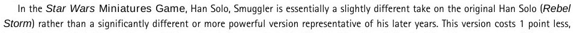

### Stat block notes (game mechanics, not feats)

- Knights of the Old Republic Miniatures Preview 7: Han Solo, Smuggler: A long time before he becomes a hero of the fledgling Rebel Alliance, Han Solo is a smuggler who works from one side of the galaxy to the other. Before winning the Millennium Falcon from Lando Calrissian at the Cloud City Sabacc Tournament, and even before he sacrifices a promising career in the Imperial Navy to save a Wookiee slave named Chewbacca, Solo makes a living on the unseen fringes of galactic life. (Source: *Web Articles* (SWRPG Saga Edition), scan p.305)
- Knights of the Old Republic Miniatures Preview 7: Han Solo, Smuggler: The game statistics shown below represent Solo at the height of his career, after his adventures in the Corporate Sector and the Tion Hegemony, but before he was forced to dump a load of Jabba the Hutt's spice on a smuggling run. (Source: *Web Articles* (SWRPG Saga Edition), scan p.305)
- Knights of the Old Republic Miniatures Preview 7: Han Solo, Smuggler: In the Star Wars Miniatures Game, Han Solo, Smuggler is essentially a slightly different take on the original Han Solo (Rebel Storm) rather than a significantly different or more powerful version representative of his later years. This version costs 1 point less, has 10 fewer Hit Points, and has a Defense 1 point lower, but his Attack is 2 points higher (making him more competitive in an environment that features an ever-higher number of enemies with Defenses of 20 or more). (Source: *Web Articles* (SWRPG Saga Edition), scan p.305)
- Knights of the Old Republic Miniatures Preview 7: Han Solo, Smuggler: Overall, this shifts his balance more toward striking rather than staying power, especially since he has Opportunist +20 (+4 Attack, +20 Damage) rather than Cunning Attack (+4 Attack, +10 Damage). Still, if you pit the original Han Solo against Han Solo, Smuggler in a head-to-head battle, Han Solo, Smuggler wins about 80% of the time. Despite going last every round to take advantage of Opportunist +20, that extra damage and higher Attack bonus more than make up for the lower Defense and Hit Points. (Source: *Web Articles* (SWRPG Saga Edition), scan p.305)

## scan p.306 (scan page 306)

Page contents: Legacy of the Force Preview 1: Republic Commando Training Sergeant and Shado Vao by Gary M. Sarli and Sterling Hershey (title T record): Cuy'val Dur background (Jango Fett's 100 sergeants, Kamino, Mando'a, "the deluxe models", clone advisors such as CC-01/425 with Delta Squad) - T records for Jango Fett and CC-01/425 paragraphs; miniatures tactics (unlimited-range commander effect; Order 66; Aerial Clone Trooper Commander, Clone Trooper Grenadiers, ARC Troopers; Shields 2, Synchronized Fire; Republic Commando Scorch - T record; four Commandos plus Sergeant = 97 points); stat card (Republic; cost 30; HP 30; Def 15; Atk +10; Dmg 20; Order 66, Delta Fire Support, Delta Shield Support (Shields 2 bracket ends "10])" per OCR, dropped by text layer); commander effect +10 Damage on Order 66 combined fire and Grenades 30). (hand-read)

### Stat block notes (game mechanics, not feats)

- Legacy of the Force Preview 1: Republic Commando Training Sergeant: Jango Fett recruited 100 sergeants -- three-quarters of whom were Mandalorian -- to help train the clone commandos. Known as Cuy'val Dur (Mando'a for "those who no longer exist"), these sergeants had to leave everything behind -- work, home, and family --and voluntarily become sequestered on Kamino for the duration of the secret training program. Furthermore, since no one knew how long it would be before the secret clone army became public knowledge, the sergeants could not know how long it would be before they could ever leave. (Source: *Web Articles* (SWRPG Saga Edition), scan p.306)
- Legacy of the Force Preview 1: Republic Commando Training Sergeant: Some might wonder why anyone would volunteer for such a task. Perhaps they simply needed the money, perhaps the Mandalorians volunteered out of a personal loyalty to Jango Fett, or perhaps it was simply convenient to "disappear" for several years to escape troubles best left behind. (Source: *Web Articles* (SWRPG Saga Edition), scan p.306)
- Legacy of the Force Preview 1: Republic Commando Training Sergeant: Because of the extreme secrecy that surrounded the clones both before and during the Clone Wars, it is not clear if any sergeants were deployed in an official combat support role during battle. If they were, they probably would have used their extreme familiarity with the commandos to act as clone advisors (such as CC-01/425, who advised Delta Squad on some missions). In this role, they would have assisted with coordinating attacks, monitoring telemetry data from the squad (such as life support, power supply, shield strength, and so on), and keeping the squad advised of new intelligence and sensor data as it became available. (Source: *Web Articles* (SWRPG Saga Edition), scan p.306)
- Legacy of the Force Preview 1: Republic Commando Training Sergeant: Adding Shields 2 turns the Commandos into "tanks" comparable to Destroyer Droids, capable of taking a lot of punishment before being defeated, and Synchronized Fire (combined with the extra +10 Damage from combined fire, granted by the commander effect) makes them multiply the overall value of your squad. Republic Commando Scorch actually gains the most, benefiting from every ability and commander effect provided by the Training Sergeant. It's worth noting that the four Republic Commandos plus the Training Sergeant add up to 97 points, so this combination can be a squad in itself or a nucleus around which to build a larger "shooter" squad of 150 or even 200 points. (Source: *Web Articles* (SWRPG Saga Edition), scan p.306)

## scan p.307 (scan page 307)

Page contents: Republic Commando Training Sergeant Saga stats (LotF Preview 1 cont.): CL 5 Medium Human nonheroic 4/soldier 3/officer 1 (Force 4; Dark Side 3; Init +11; low-light vision; Basic, Mando'a; Ref 21, Fort 16, Will 18; hp 31; speed 4; vibroblade +7 (2d6+2); blaster carbine +9 (3d8+2); frag grenade +9 (4d6+2); Assault Tactics, Battle Analysis, Indomitable; possessions Corellian powersuit with helmet package, blaster carbine, heavy blaster pistol, grenade launcher, 4 frag grenades, thermal detonator, 2 vibroblades, encrypted wrist-mounted holo-capable long-range comlink, utility belt). Generic, S only. (hand-read)

## scan p.308 (scan page 308)

Page contents: Shado Vao (LotF Preview 1 cont.): attributed epigraph (Q record, crop test ok ratio 1.0) and background/miniatures paragraphs (Ossus Jedi Temple attack, Wolf Sazen, Cade Skywalker; "Ossus." dropped by text layer, restored from OCR) - T records; stat card (New Republic; cost 48; HP 100; Def 22; Atk +13; Dmg 20; Unique, Melee Attack, Double Attack, Greater Mobile Attack; Force 2, Force Renewal 1, Lightsaber Block/Deflect/Precision/Riposte, Master of the Force 2); Saga stats Shado Vao CL 10 Medium Twi'lek Jedi 7/Jedi Knight 3 (Destiny 2; Force 7; Dark Side 0; Init +8; low-light vision; Basic, Ryl, Huttese; Ref 25, Fort 26, Will 24; hp 100; lightsaber +12 (2d8+7); double-bladed lightsaber +9/+9 with Dual Weapon Mastery I; Block, Deflect, Force Focus, Force Perception, Visions; possessions double-bladed lightsaber, Jedi robes). (hand-read)

- **Shado Vao; Darth Talon** — entry/section: Legacy of the Force Preview 1: Shado Vao: ""Your plan has a flaw. It assumes you can kill me." —Shado Vao to Darth Talon" Source: *Web Articles* (SWRPG Saga Edition), scan p.308
  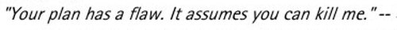
- **Wolf Sazen**: "He survived a devastating Sith attack on the Jedi Temple on Ossus, piloting a ship that carried the last Jedi survivors, including many Padawans and Jedi Master Wolf Sazen." Source: *Web Articles* (SWRPG Saga Edition), scan p.308
  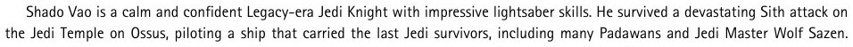

### Stat block notes (game mechanics, not feats)

- Shado Vao (Saga CL 10): CL 10 Twi'lek Jedi 7/Jedi Knight 3 Destiny 2; Force 7; Dark Side 0 Init +8; Senses low-light vision, Use the Force +17 Languages Basic, Ryl, Huttese Defenses Ref 25 (flat-footed 22), Fort 26, Will 24 hp 100; Threshold 26 Speed 6 squares Melee lightsaber +12 (2d8+7) or Melee double-bladed lightsaber +9/+9 (2d8+7) with Dual Weapon Mast (Source: *Web Articles* (SWRPG Saga Edition), scan p.308)
- Legacy of the Force Preview 1: Shado Vao: Shado Vao is a calm and confident Legacy-era Jedi Knight with impressive lightsaber skills. He survived a devastating Sith attack on the Jedi Temple on Ossus, piloting a ship that carried the last Jedi survivors, including many Padawans and Jedi Master Wolf Sazen. Years later, he would join Master Sazen in a search for Sazen's former Padawan Cade Skywalker, who went missing at the battle on Ossus. (Source: *Web Articles* (SWRPG Saga Edition), scan p.308)
- Legacy of the Force Preview 1: Shado Vao: The ensuing adventures and skirmishes gave Vao many opportunities to display his lightsaber combat skills. One of his favorite tactics is to suddenly ignite the second blade of his double-bladed lightsaber well into a skirmish. (Source: *Web Articles* (SWRPG Saga Edition), scan p.308)
- Legacy of the Force Preview 1: Shado Vao: He is calm and cool even in the heat of battle, and often engages his enemy in a verbal duel as well as a physical one. (Source: *Web Articles* (SWRPG Saga Edition), scan p.308)
- Legacy of the Force Preview 1: Shado Vao: In the Star Wars Miniatures Game, Shado Vao is an impressive melee combatant for the New Republic faction. His Greater Mobile Attack ability combined with Double Attack makes him highly mobile on the battlefield, able to advance, strike with Double Attack, and retreat in the same activation. His Force Powers improve his defenses significantly; Master of the Force allows him to use two powers in a single turn, and Force Renewal keeps his powers available throughout the game. His excellent Attack and Defense scores make Vao dangerous to any enemy. At 48 points, his cost is similar to that of other highly rated Jedi and in the same range as many of his Legacy-era Sith opponents. (Source: *Web Articles* (SWRPG Saga Edition), scan p.308)

## scan p.309 (scan page 309)

Page contents: Legacy of the Force Preview 2: Cade Skywalker, Bounty Hunter and Deliah Blue by Sterling Hershey (title T; text layer "DELIAH" confirmed, OCR misreads "DBELIAH"): Cade background (125 years after Palpatine; Ossus; Kol Skywalker; pirate gang; Deliah Blue and Jariah Syn) and miniatures tactics (Dark Horse Legacy comics; Force Push 3, Force Heal 40; Bounty Hunter +4, Double Attack, Splash 10, Twin Attack; Fringe faction) - T records; stat card (Fringe; cost 61; HP 110; Def 20; Atk +12; Dmg 20; Force 5). (hand-read)

### Stat block notes (game mechanics, not feats)

- Legacy of the Force Preview 2: Cade Skywalker, Bounty Hunter: About 125 years after the fall of Emperor Palpatine, Cade Skywalker is the last of the Skywalkers. Like his predecessors, the Force is strong in him. And, like many of them, he struggles to find his way between the dark and light sides. He's temperamental, often selfish, and he tries to forget his lineage after the devastating Sith attack on the Jedi Temple at Ossus. He lost his father, Kol Skywalker, and used an extraordinary healing power that tapped into the dark side of the Force to save his dying Master. (Source: *Web Articles* (SWRPG Saga Edition), scan p.309)
- Legacy of the Force Preview 2: Cade Skywalker, Bounty Hunter: Fearing the temptation of the dark side, Cade abandoned the Jedi way and fell in with a pirate gang that rescued him from the debris of Ossus. Cade became an effective bounty hunter over the next seven years, working with his companions, Deliah Blue and Jariah Syn. However, Cade would soon discover that a Skywalker's destiny is not so easily cast aside, as the remaining Jedi and the new Sith took interest in his lineage and abilities. (Source: *Web Articles* (SWRPG Saga Edition), scan p.309)
- Legacy of the Force Preview 2: Cade Skywalker, Bounty Hunter: In the Star Wars Miniatures Game, Cade Skywalker, Bounty Hunter represents Cade in the early stories of Dark Horse's Star Wars: Legacy comic book series. During this time, Cade conceals his abandoned Jedi past, preferring to use his specialized blaster over a telltale lightsaber. However, he retains his impressive Force Powers and high number of Force points. These are most effectively used with Force Push 3 and the highest-rated version of Force Heal (40) seen so far in the game. (Source: *Web Articles* (SWRPG Saga Edition), scan p.309)
- Legacy of the Force Preview 2: Cade Skywalker, Bounty Hunter: His Hit Points, Attack score, and Defense score are lower than those of other miniatures of about the same cost, but his attacks are bolstered by a devastating combination of Special Abilities: Bounty Hunter +4, Double Attack, Splash 10, and Twin Attack. Few opponents can stand up to such an assault for long, and lesser foes should avoid grouping together to avoid his Splash damage. Fittingly, Cade is a member of the Fringe faction, reflecting his history of shifting alliances. (Source: *Web Articles* (SWRPG Saga Edition), scan p.309)

## scan p.310 (scan page 310)

Page contents: Cade Skywalker, Bounty Hunter Saga stats (as of Legacy Vol. 1: Broken) CL 10 Medium male Human Jedi 1/scout 5/soldier 1/bounty hunter 2 (Destiny 1; Force 5, Strong in the Force; Dark Side 5; Init +11 (may reroll); Basic, Huttese, Shyriiwook; Ref 26, Fort 25, Will 21; hp 96; unarmed +8 (1d6+5); lightsaber +8 (2d8+6); double-barreled blaster carbine +9 (3d8+6) or +4/+4 with Double Attack; Acute Senses, Deflect, Hunter's Mark, Power of the Dark Side; dark transfer, Force disarm, Force thrust, move object; familiar foe +1; possessions double-barreled blaster carbine (tech specialist mod), data chips, the Mynock, blast vest (+2 armor) ["armor)" dropped by text layer, restored from OCR]); lightsaber footnote (T record); boxed Force power dark transfer [Dark Side] (heal 2x/3x/4x character level at DC 15/20/25; -1 persistent condition step; Force Point to avoid, Destiny Point to revive within 1 round at DC 25) - band y0.49-0.71 confirmed in text layer. (hand-read)

### Stat block notes (game mechanics, not feats)

- Legacy of the Force Preview 2: Cade Skywalker, Bounty Hunter (stat footnote): Cade does not carry his own lightsaber at this time but occasionally uses others when the need arises. (Source: *Web Articles* (SWRPG Saga Edition), scan p.310)

## scan p.311 (scan page 311)

Page contents: Deliah Blue (LotF Preview 2 cont.): background (Zeltron mechanic, the Mynock, team with Cade and Jariah Syn) and miniatures tactics (Bounty Hunter +4, Cunning Attack, Mounted Gunner allies, Mobile Attack) - T records; stat card (Fringe; cost 33; HP 60; Def 17; Atk +7; Dmg 20; Unique, Accurate Shot, Bounty Hunter +4, Cunning Attack, Gunner +10, Industrial Repair 30, Mobile Attack); Saga stats Deliah Blue (as of Legacy Vol. 1: Broken) CL 8 Medium female Zeltron scoundrel 4/scout 4 (Destiny 1; Force 4; Dark Side 1; Init +6 (may reroll); Basic, Huttese, Shyriiwook; Ref 22, Fort 20, Will 20; hp 55; blaster pistol +9 (3d6+4); wrist launcher +8 (knockout darts, 1d20+5 vs Fortitude, unconscious 1d4+2 rounds); Hyperdriven, Spacehound, Keen Shot; Zeltron empathy; Mechanics +16, Persuasion +17); boxed Zeltron Species Traits (-2 Con, -2 Wis, +4 Cha; Medium; speed 6; conditional bonus feat Skill Focus (Persuasion); Zeltron Empathy; Intuitive Initiative; Basic) - band y0.74-0.89 confirmed in text layer. (hand-read)

### Stat block notes (game mechanics, not feats)

- Legacy of the Force Preview 2: Deliah Blue: Deliah Blue is Cade Skywalker's Zeltron mechanic, fellow bounty hunter, and sometime lover. The Zeltrons are known for their hedonistic and fun-loving ways, and while Deliah is no exception, she is more adventurous than many. She uses her natural Zeltron empathic abilities to her advantage whether chasing a bounty or chasing Cade. Deliah is also a capable mechanic, well known for her skill in keeping Cade's troublesome ship, the Mynock, flying. Deliah, Cade, and Jariah Syn worked as a bounty hunter team until Cade felt compelled to pursue his own path after encountering the Sith and the Jedi, leaving the other two to fend for themselves for a time. (Source: *Web Articles* (SWRPG Saga Edition), scan p.311)
- Legacy of the Force Preview 2: Deliah Blue: In the Star Wars Miniatures Game, Deliah Blue is a member of the Fringe faction. Compared to other pieces in her cost range, she has comparable Defense and Damage scores, but her Hit Points are lower. She also has a lower Attack score -- until you factor in Bounty Hunter +4 and Cunning Attack. Like all bounty hunters, she is much more effective against other Unique characters. However, she is best deployed with squads featuring minis that have the Mounted Gunner ability, because she can heal and combine fire with them. And since she should stay close by, she might as well use these allies for cover while employing Mobile Attack. (Source: *Web Articles* (SWRPG Saga Edition), scan p.311)

## scan p.312 (scan page 312)

Page contents: Legacy of the Force Preview 3: Dug Fringer and Mandalorian Trooper by Sterling Hershey and Gary M. Sarli: Dug background (opening "Dugs are a" garbled in text layer as "uae zs", read from page image; Malastare, Gran) and miniatures tactics (Close-Quarters Fighting, Cunning Attack, Wall Climber); stat card ("Faction: Dug Fringer" [sic, verified on image]; cost 11; HP 30; Def 15; Atk +5; Dmg 10); Saga stats Dug Fringer CL 3 Small Dug scout 3 (Dark Side 1; Init +8; Basic, Dug; Ref 20, Fort 14, Will 13; hp 33; blaster pistol +4 (3d6+1); Long Stride, Surefooted; Stealth +13; possessions blaster pistol); boxed Dug Species Traits (+2 Dex, -2 Wis, -2 Cha; Small; speed 4; conditional Skill Focus (Acrobatics); Dug Agility; Lightning Reflexes; Dug) - band y0.71-0.84 confirmed in text layer. Generic, S only. (hand-read)

## scan p.313 (scan page 313)

Page contents: Mandalorian Trooper (LotF Preview 3 cont.): Neo-Crusaders background (Mandalore the Ultimate, Revan and Malak, Malachor V, Canderous Ordo as Mandalore) - T record; miniatures tactics (non-melee alternative to Mandalorian Warrior; Cunning Attack, Deadeye, Stealth); stat card (Mandalorian; cost 14; HP 40; Def 16; Atk +8; Dmg 10); Saga stats Mandalorian Trooper CL 3 Medium Human nonheroic 9 (Init +6; Mando'a; Ref 18, Fort 13, Will 10; hp 40; vibroblade +7 (2d6+2); blaster rifle +8 (3d8) or (4d8) with Deadeye; Endurance +10, Stealth +11; possessions light Mandalorian Neo-Crusader armor, blaster rifle with targeting scope, vibroblade, comlink); armor table: Mandalorian Neo-Crusader armor, light (-2), 3,000 credits, +6 Ref, +2 Fort, max Dex +3, 42 kg, Military, Rare. (hand-read)

### Stat block notes (game mechanics, not feats)

- Legacy of the Force Preview 3: Mandalorian Trooper: Four millennia before the Battle of Yavin, Mandalore the Ultimate unleashed the Neo-Crusaders, ravaging the fringes of the galaxy before the Jedi Revan and Malak led a counterattack, in defiance of the wishes of the Jedi Council. At Malachor V, vast numbers of Mandalorians -- along with countless Republic troops and Jedi - were killed by a devastating superweapon that left the planet crushed and broken. The surviving Mandalorians scattered throughout the galaxy, living on as mercenaries, bodyguards, and at times little more than brigands and bandits. Eventually, the scattered clans would be reunited by Canderous Ordo (who had taken up the mantle of Mandalore), and their warrior tradition would live on. (Source: *Web Articles* (SWRPG Saga Edition), scan p.313)

## scan p.314 (scan page 314)

Page contents: Legacy of the Force Preview 4: Deena Shan and Han Solo, Galactic Hero by Sterling Hershey and Gary M. Sarli (title T): Deena Shan background and miniatures tactics (Disruptive, Stealth) - T records; stat card (Rebel; cost 12; HP 30; Def 18; Atk +5; Dmg 10; Unique, Disruptive, Stealth); Saga stats Deena Shan CL 5 Medium female Human scoundrel 1/scout 4 (Destiny 1; Force 3; Init +3; Perception +9 (may reroll); Basic, Bocce; Ref 18, Fort 16, Will 18; hp 36; blaster pistol +5 (3d6+2); Acute Senses, Disruptive, Improved Stealth; Deception +15, Persuasion +15; possessions blaster pistol, comlink). (hand-read)

### Stat block notes (game mechanics, not feats)

- Legacy of the Force Preview 4: Deena Shan: Deena Shan is a young woman torn between the excitement of the Rebellion and doubts about her position within it. Deena's early mundane duties left her wondering if she had made the right choice in joining up. But an unexpected encounter with Millennium Falcon and the heroes of Yavin quickly chased away the boredom. Afterward, Deena found herself serving in Rebel undercover operations, using her looks and persuasive skills against unsuspecting Imperial officers. Unfortunately, she wasn't prepared for an emotional clash between her feelings and her duties. Though capable, her internal struggles continue to plague her throughout her Rebel career. (Source: *Web Articles* (SWRPG Saga Edition), scan p.314)
- Legacy of the Force Preview 4: Deena Shan: In the Star Wars Miniatures Game, Deena Shan is an unusual piece. She is one of the lowest-cost units to have the Disruptive special ability, making her a good counter to lesser enemy units that have Commander Effects. While just as effective against stronger units, she won't last as long against them. In any case, her Stealth ability should get her close enough to be effective, provided that she is deployed with other units to draw enemy fire from her. She compares well to other Rebel faction units of the same cost, with a higher Defense score but lesser damage capabilities. She is best used in squads that complement her Disruptive ability. (Source: *Web Articles* (SWRPG Saga Edition), scan p.314)

## scan p.315 (scan page 315)

Page contents: Han Solo, Galactic Hero (LotF Preview 4 cont.): background (40 ABY, Corellia secession, Luke and Jacen, Galactic Alliance Guard) and miniatures tactics (Disruptive, Never Tell Me The Odds vs Thrawn; compared with Boba Fett, Bounty Hunter; Greater Mobile Attack bullet tactics; Talon Karrde initiative control) - T records (bullets rendered "•"; "does"/"rarely" marked [sic]); stat card (New Republic; cost 50; HP 90; Def 19; Atk +10; Dmg 20; Unique, Accurate Shot, Cunning Attack, Disruptive, Double Attack, Evade, Greater Mobile Attack, Never Tell Me The Odds); Saga stats Han Solo (early Legacy Era) CL 19 Medium Human scoundrel 5/soldier 3/ace pilot 5/gunslinger 5/officer 1 (Destiny 3; Force 7; Dark Side 2; Init +20; Basic, Huttese, Rodese, Shyriiwook; Ref 34, Fort 31, Will 35; hp 98; heavy blaster pistol +17 (3d8+13) with Rapid Shot/Double Attack options; quad laser cannons; concussion missiles; Combined Fire, Deceptive Shot, Draw Fire, Fool's Luck, Full Throttle, Keep It Together; maneuvers angle deflector shields, overwhelming assault, skim the surface; trusty sidearm +2, vehicle dodge +2; possessions heavy blaster pistol with targeting scope, tool kit, modified YT-1300 (Millennium Falcon)); footnote "Described in Starships of the Galaxy". (hand-read)

- **Boba Fett**: "Even better, this version of Han is one of the best nonmelee followers in the game -- not the equal of Boba Fett, Bounty Hunter, but a fair match for almost anyone else." Source: *Web Articles* (SWRPG Saga Edition), scan p.315
  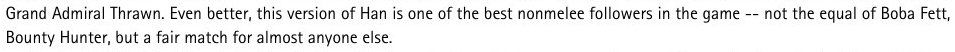

### Stat block notes (game mechanics, not feats)

- Legacy of the Force Preview 4: Han Solo, Galactic Hero: Forty years after the Battle of Yavin, Han Solo finds himself torn between his family and his loyalties to his homeworld. Corellia has seceded from the Galactic Alliance, and the tensions have escalated to the brink of all-out war. Meanwhile, his brother-in-law Luke and son Jacen stand firmly on the side of the Galactic Alliance. (Source: *Web Articles* (SWRPG Saga Edition), scan p.315)
- Legacy of the Force Preview 4: Han Solo, Galactic Hero: Worse, Jacen shows an increasingly dictatorial streak with the Galactic Alliance Guard, which he treats as his personal army. The galaxy is hurtling toward a terrible future that relives the worst of the past, and Han once more dons the mantle of the reluctant hero, trying to stand for what is right. But now, more than ever, what is "right" is not so easy to see. (Source: *Web Articles* (SWRPG Saga Edition), scan p.315)
- Legacy of the Force Preview 4: Han Solo, Galactic Hero: In the Star Wars Miniatures Game, Han Solo, Galactic Hero is potentially game-changing for the New Republic faction. Disruptive and Never Tell Me The Odds are not new abilities, but they have the same devastating effect on enemy squads featuring Grand Admiral Thrawn. Even better, this version of Han is one of the best nonmelee followers in the game -- not the equal of Boba Fett, Bounty Hunter, but a fair match for almost anyone else. (Source: *Web Articles* (SWRPG Saga Edition), scan p.315)
- Legacy of the Force Preview 4: Han Solo, Galactic Hero: Greater Mobile Attack is outstanding. It allows Han to make two attacks every round even while moving in and out of line of sight. • First, find a corner that is fairly defensible. An intersection of two hallways with a good line of sight over the middle of the map is ideal, especially if there is no other way to break line of sight within 6 squares of Han's sniping position. • On Han's turn, move up to get line of sight on an enemy, attack twice with Double Attack, and then use your remaining movement to pull back out of line of sight. Because of Accurate Shot, Han can target almost anyone regardless of cover, so the only way to avoid his attacks is to stay out of line of sight altogether. • If enemies does [sic] move up to try to reach Han, they rarely [sic] be able to do so and attack in a single turn. As long as you don't lose initiative on the following round, Han will be able to hit that character with Cunning Attack on your first activation. (Source: *Web Articles* (SWRPG Saga Edition), scan p.315)
- Legacy of the Force Preview 4: Han Solo, Galactic Hero: For best results, pair Han up with some initiative control -- for example, Talon Karrde (from the Bounty Hunters set) -- which will help you get the most out of Never Tell Me The Odds, Cunning Attack, and Greater Mobile Attack. (Source: *Web Articles* (SWRPG Saga Edition), scan p.315)

## scan p.316 (scan page 316)

Page contents: Legacy of the Force Preview 5: Darth Krayt and Kyle Katarn, Jedi Battlemaster by Sterling Hershey and Gary M. Sarli (title "S&S" in text layer and heading "Darth Kra"/"Darth carrie" garbled; "5", "Darth Krayt", "Darth Krayt is" verified on page image) - T records for title, background (new Emperor, abandoned Rule of Two, ailment, pursuit of Cade Skywalker), miniatures tactics and spoiler note; stat card (Sith; cost 76; HP 130; Def 21; Atk +14; Dmg 20; Unique, Pilot, Melee Attack, Deadly Attack, Triple Attack, Vonduun Crab Armor 6; Force 2, Force Renewal 1, Force Lightning 2, Lightsaber Sweep; commander effect followers within 6 gain Extra Attack); Saga stats Darth Krayt CL 18 Medium Human Jedi 7/Jedi Knight 4/Sith Apprentice 4/Sith Lord 3 (Destiny 3; Force 8; Dark Side 19; Init +11; Basic, Bocce, Sith, Tusken; Ref 24, Fort 30, Will 26; hp 124; lightsaber +20 (2d8+9/x3) with Dual Weapon Mastery II/Double Attack options; Force lightning (2), dark rage; Devastating Power, Quicken Power; Jar'Kai, Niman, Visions; Triple Crit (lightsabers); possessions Vonduun Crab Armor, two self-built lightsabers, Yuuzhan Vong bioengineered replacement arm, Yuuzhan Vong creature eye ["eye" dropped by text layer, restored from OCR]). (hand-read)

- **Darth Krayt**: "In the Star Wars Miniatures Game, Darth Krayt is a formidable unit." Source: *Web Articles* (SWRPG Saga Edition), scan p.316
  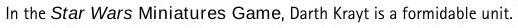

### Stat block notes (game mechanics, not feats)

- Darth Krayt (Saga CL 18): CL 18 Medium Human Jedi 7/Jedi Knight 4/Sith Apprentice 4/Sith Lord 3 Destiny 3; Force 8; Dark Side 19 Init +11; Senses Use the Force +23 Languages Basic, Bocce, Sith, Tusken Defenses Ref 24 (flat-footed 22), Fort 30, Will 26; Block, Deflect, Lightsaber Defense, Melee Defense, Jar'Kai, Niman hp 124; Threshold 30 Immune fear effects S (Source: *Web Articles* (SWRPG Saga Edition), scan p.316)
- Legacy of the Force Preview 5: Darth Krayt: Darth Krayt is the new Emperor of the resurgent Empire in the Star Wars: Legacy comic book series. He created a new Sith order by abandoning the centuries-old Rule of Two. His seizure of the Imperial throne was not a complete success; the previous Emperor survived the takeover, as did a number of Jedi Knights. However, Darth Krayt is far older than anyone suspects, and he suffers from an insidious ailment that threatens to consume him. He's in dire need of powerful healing. As such, he's obsessed with pursuing and turning Cade Skywalker to the dark side because the young man possesses a unique gift that might heal the Dark Lord. (Source: *Web Articles* (SWRPG Saga Edition), scan p.316)
- Legacy of the Force Preview 5: Darth Krayt: In the Star Wars Miniatures Game, Darth Krayt is a formidable unit. His scores are higher than most of the Sith faction, and his Vonduun Crab Armor helps mitigate any damage he sustains. As in the comics, Darth Krayt is more effective in combat when allies are close at hand. His commander effect significantly increases the offensive capabilities of his followers when they are within 6 squares, at the cost of some overall squad maneuverability. (Source: *Web Articles* (SWRPG Saga Edition), scan p.316)
- Legacy of the Force Preview 5: Darth Krayt (stat block note): Spoiler warning: This stat block might touch on secrets about Darth Krayt that were revealed in recent issues of the Star Wars: Legacy comic book. (Source: *Web Articles* (SWRPG Saga Edition), scan p.316)

## scan p.317 (scan page 317)

Page contents: Kyle Katarn, Jedi Battlemaster (LotF Preview 5 cont.): background (Death Star plans, Arc Hammer dark troopers, Valley of the Jedi, Jerec, Luke's praxeum, battlemaster on the High Council) and miniatures tactics (compared with Luke Skywalker, Jedi Master, Universe set; Force Grip, Force Lightning, Grenades 40) - T records; stat card (New Republic; cost 54; HP 140; Def 20; Atk +14; Dmg 20; Unique, Disruptive, Grenades 40, Lightsaber Duelist, Melee Attack, Triple Attack; Force 4, Force Grip 1, Force Lightning 1, Lightsaber Assault, Lightsaber Riposte); Saga stats Kyle Katarn CL 19 Medium Human soldier 5/scoundrel 1/Jedi 3/Jedi Knight 7/Jedi Master 3 (Destiny 4; Force 8; Dark Side 4; Init +17; Basic, Binary; Ref 35, Fort 33, Will 34; hp 146; lightsaber +23 (2d8+17, Devastating Attack) with Double/Triple Attack; blaster rifle +21 (3d8+9); thermal detonator +21 (8d6+9); Ataru, Djem So, Shii-Cho, Tough as Nails; fearless; possessions self-built lightsaber, blaster rifle (rarely carried), thermal detonator, utility belt, Jedi robes, encrypted comlink). (hand-read)

- **Luke Skywalker; Kyle Katarn** — entry/section: Saga Edition Web Articles: "Over the decades, Kyle Katarn joined Luke Skywalker's Jedi praxeum, eventually becoming a legendary Jedi battlemaster and member of the High Council of the New Jedi Order." Source: *Web Articles* (SWRPG Saga Edition), scan p.317
  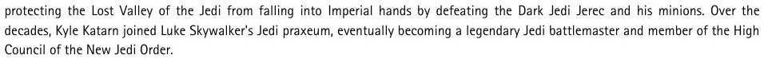
- **Jerec**: "Later, he discovered his Force sensitivity and learned the ways of the Jedi, protecting the Lost Valley of the Jedi from falling into Imperial hands by defeating the Dark Jedi Jerec and his minions." Source: *Web Articles* (SWRPG Saga Edition), scan p.317
  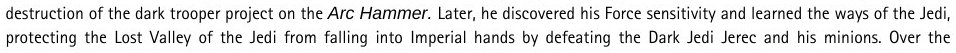

### Stat block notes (game mechanics, not feats)

- Edition Statistics Kyle Katarn (Saga CL 19): CL 19 Medium Human soldier 5/scoundrel 1/Jedi 3/Jedi Knight 7/Jedi Master 3 Destiny 4; Force 8; Dark Side 4 Init +17; Senses Perception +16 Languages Basic, Binary Defenses Ref 35 (flat-footed 32), Fort 33, Will 34; Block (Shii-Cho), Deflect (Shii-Cho) hp 146; Threshold 33 Speed 6 squares Melee lightsaber +23 (2d8+17, Devastating Att (Source: *Web Articles* (SWRPG Saga Edition), scan p.317)
- Legacy of the Force Preview 5: Kyle Katarn, Jedi Battlemaster: Kyle Katarn was a former Imperial soldier who became an elite Rebel agent, participating in the capture of the Death Star plans and the destruction of the dark trooper project on the Arc Hammer. Later, he discovered his Force sensitivity and learned the ways of the Jedi, protecting the Lost Valley of the Jedi from falling into Imperial hands by defeating the Dark Jedi Jerec and his minions. Over the decades, Kyle Katarn joined Luke Skywalker's Jedi praxeum, eventually becoming a legendary Jedi battlemaster and member of the High Council of the New Jedi Order. (Source: *Web Articles* (SWRPG Saga Edition), scan p.317)
- Legacy of the Force Preview 5: Kyle Katarn, Jedi Battlemaster: In the Star Wars Miniatures Game, Kyle Katarn, Jedi Battlemaster is definitely one of the best "beatsticks" for the New Republic faction. His Defense and Attack are second only to Luke Skywalker, Jedi Master (from the Universe set), and he has more Hit Points than any other New Republic character. Lightsaber Duelist and Lightsaber Riposte make him particularly effective against enemies with lightsabers, and Triple Attack allows him to get the most out of his abilities. (Source: *Web Articles* (SWRPG Saga Edition), scan p.317)
- Legacy of the Force Preview 5: Kyle Katarn, Jedi Battlemaster: Interestingly, he has both Force Grip and Force Lightning, both of which are new to the faction. Although these are not dominant abilities, they add a bit of unexpected flexibility to your squad. Even when he runs out of Force Points, Grenades 40 allows him to remain a serious threat at a distance. (Source: *Web Articles* (SWRPG Saga Edition), scan p.317)

## scan p.318 (scan page 318)

Page contents: New Republic Stat Pack: Roleplaying Statistics for Star Wars Miniatures by Sterling Hershey (title small-caps "NEw" artifact): intro (New Republic era stats not presented elsewhere); Bothan Commando (Imperial Entanglements set) CL 5 Medium Bothan nonheroic 7/scout 3 (Force 4; Init +6 (can reroll); Basic, Bothese; Ref 16, Fort 15, Will 16; hp 41; combat gloves +8 (1d4+3); heavy blaster rifle +8 (3d10+1); possessions incl. 2 blocks of detonite); Chiss Mercenary (Imperial Entanglements set; Thrawn mention - T record) CL 5 Medium Chiss nonheroic 6/soldier 3 (Force 4; low-light vision; Cheunh; Ref 15, Fort 16, Will 13; hp 40; blaster pistol +8 (3d6+1); heavy blaster rifle +9 (3d10+3), Burst Fire option; Devastating Attack (rifles)). Generic, S apart from Thrawn sentence paragraph. (hand-read)

### Stat block notes (game mechanics, not feats)

- New Republic Stat Pack: Chiss Mercenary: The Chiss are not widely known until after Grand Admiral Thrawn's reinvigoration of the Empire and his attacks on the New Republic. The Chiss later become embroiled in galactic politics. While Chiss mercenaries are not often encountered, they are highly effective. This character may also be used for other Chiss military characters. This mini is from the Imperial Entanglements set. (Source: *Web Articles* (SWRPG Saga Edition), scan p.318)

## scan p.319 (scan page 319)

Page contents: New Republic Stat Pack cont.: Corellian Security Officer (CorSec; Legacy of the Force set) CL 4 Medium Human nonheroic 6/scout 1/enforcer 1 (Force 4; Perception +16; Ref 16, Fort 15, Will 16; hp 40; stun baton +5 (1d6+3 [2d6+3 stun]); blaster pistol +5 (3d6+1); Evasion, Slowing Stun; resources; footnote: See The Force Unleashed Campaign Guide); Peace Brigade Thug (Yuuzhan Vong-era collaborators; Jedi Academy set) CL 1 Medium Human nonheroic 3 (hp 10; unarmed +2 (1d4) [text layer "144", corrected by OCR]; vibrodagger +2 (2d4); blaster pistol +2 (3d6); Pin; Persuasion +10; possessions incl. anti-Jedi propaganda). Generic, S only. (hand-read)

## scan p.320 (scan page 320)

Page contents: New Republic Stat Pack cont.: Praetorite Vong Priest (Jedi Academy set; "set." dropped by text layer, restored from OCR) CL 5 Medium Yuuzhan Vong nonheroic 2/noble 5 (Basic, Yuuzhan Vong; Ref 15, Fort 17, Will 19; hp 37; Force immunity; coufee +4 (1d4+2); Cast Suspicion, Coordinate, Inspire Confidence; Persuasion +15; possessions coufee, villip; footnote: See the Legacy Era Campaign Guide); Rebel Commando Pathfinder (2nd Regiment, Rebel Alliance Special Forces; Imperial Entanglements set) CL 8 Medium Human scout 7/pathfinder 1 (Force 7; Init +10; Ref 21, Fort 22, Will 19; hp 57; vibrodagger +6 (2d4+6); heavy blaster pistol +6 (3d8+4); frag grenade +6; Forceful Blast, Hidden Movement, Trailblazer, Escort Fighter; Stealth +15; footnotes: See the Rebellion Era Campaign Guide; See Galaxy at War). Generic, S only. (hand-read)

## scan p.321 (scan page 321)

Page contents: New Republic Stat Pack cont.: Yuuzhan Vong Shaper (NJO and Legacy eras; Legacy of the Force set) CL 9 Medium Yuuzhan Vong nonheroic 6/noble 1/shaper 6 (Perception +18; Basic, Yuuzhan Vong; Ref 17, Fort 19, Will 23; hp 46; Force immunity; unarmed +7 (1d4+2); Expert Shaper, Precision Implant, Strength Implant, Inspire Confidence; shaper lore +3, shaper hand; Biotech Specialist, Biotech Surgery; Treat Injury +18; possessions shaper hand (biotech toolkit), villip; footnote: See the Legacy Era Campaign Guide). Generic, S only. (hand-read)

## scan p.322 (scan page 322)

Page contents: The Force Unleashed Preview 1: Emperor's Shadow Guard and Vader's Apprentice, Unleashed by Gary M. Sarli and Sterling Hershey (title T): Shadow Guard background (based on Palpatine's Royal Guard; rumored corrupted Jedi; black armor; lightsaber pike; Shadow Guard Initiate) and miniatures tactics (compared with Royal Guard; Stealth; Lightsaber Block with the Emperor sharing Force) - T records for Palpatine/Emperor paragraphs; stat card (Imperial; cost 23; HP 90; Def 19; Atk +8; Dmg 20; Cunning Attack, Deadly Attack, Melee Attack, Stealth; Force 1, Lightsaber Block); Saga stats Imperial Shadow Guard Initiate CL 10 Medium Human nonheroic 6/Soldier 6/Elite Trooper 1/Force Adept 1 (Force 3; Dark Side 7; Init +17; low-light vision; Ref 21, Fort 22, Will 24; hp 63; speed 4; lightsaber pike +12 (3d8+7); unarmed +13 (1d6+6); heavy blaster pistol +11 (3d8+4); Damage Reduction 10, Empower Weapon, Equilibrium, Power of the Dark Side; Exotic Weapon Proficiency (lightsaber pike); possessions Shadow Guard armor (+7), lightsaber pike, heavy blaster pistol, encrypted miniaturized long-range holo comlink, utility belt with medpac); footnotes (includes 1 point of Power Attack; +1 damage die for Empower Weapon). (hand-read)

### Stat block notes (game mechanics, not feats)

- The Force Unleashed Preview 1: Emperor's Shadow Guard: The Emperor's Shadow Guard is a new fighting force based on Emperor Palpatine's elite Royal Guard. Completely mute and rarely seen in public, they are dispatched on special missions as directed by the Emperor himself. It is rumored by some that the Shadow Guard are actually corrupted Jedi whose minds have been altered -- but as with all rumors, one must consider the source. (Source: *Web Articles* (SWRPG Saga Edition), scan p.322)
- The Force Unleashed Preview 1: Emperor's Shadow Guard: The Shadow Guards can be much more aggressive, especially with their superior hit points and Stealth ability to survive a few hits while closing with their opponents. Their Lightsaber Block power is a nice addition to their defense, but it is limited to one use unless they are in a squad where they can occasionally use Force points from another character able to share them -- such as the Emperor, appropriately enough. (Source: *Web Articles* (SWRPG Saga Edition), scan p.322)

## scan p.323 (scan page 323)

Page contents: Vader's Apprentice, Unleashed (TFU Preview 1 cont.): background (raised by Vader; missions after Order 66) and miniatures tactics (compared with Lord Vader and Darth Vader, Jedi Hunter; Force Lightning 4 and 5; Emperor Palpatine from Rebel Storm or Rebels and Imperials) - T records; stat card (Imperial; cost 48; HP 130; Def 20; Atk +13; Dmg 20; Unique, Melee Attack, Double Attack; Force 2, Force Renewal 1, Force Lightning 4, Force Lightning 5); Saga stats Vader's Apprentice (early apprenticeship) CL 10 Medium Human Jedi 7/Jedi Knight 3 (Destiny 2; Force 5; Dark Side 15; Init +11; Ref 23, Fort 23, Will 24; hp 93; lightsaber +15 (2d8+10), Rapid Strike and Powerful Charge options; corruption, Force grip, Force lightning, repulse; Improved Force thrust; Juyo, Soresu, Telekinetic Savant, Redirect Shot; Unleashed, Strong in the Force; possessions lightsaber, dark clothing, comlink). (hand-read)

- **Galen Marek; Darth Vader (Anakin Skywalker)** — entry/section: Saga Edition Web Articles: "By the time the Secret Apprentice reached adulthood, Vader's training had made him one of the most powerful Forcewielders in the galaxy." Source: *Web Articles* (SWRPG Saga Edition), scan p.323
  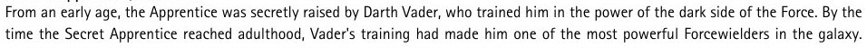
- **Galen Marek; Darth Vader (Anakin Skywalker)** — entry/section: Saga Edition Web Articles: "After Order 66, Vader sent the Secret Apprentice on missions to destroy the last of the Jedi, and he became one the most lethal weapons Vader had at his disposal." Source: *Web Articles* (SWRPG Saga Edition), scan p.323
  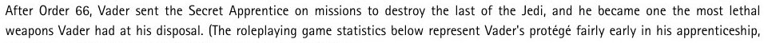

### Stat block notes (game mechanics, not feats)

- The Force Unleashed Preview 1: Vader's Apprentice, Unleashed: From an early age, the Apprentice was secretly raised by Darth Vader, who trained him in the power of the dark side of the Force. By the time the Secret Apprentice reached adulthood, Vader's training had made him one of the most powerful Forcewielders in the galaxy. After Order 66, Vader sent the Secret Apprentice on missions to destroy the last of the Jedi, and he became one the most lethal weapons Vader had at his disposal. (The roleplaying game statistics below represent Vader's protégé fairly early in his apprenticeship, before he manifests his true potential by unleashing the Force.) (Source: *Web Articles* (SWRPG Saga Edition), scan p.323)
- The Force Unleashed Preview 1: Vader's Apprentice, Unleashed: In the Star Wars Miniatures Game, Vader's Apprentice, Unleashed fills an interesting niche. While he can act as a low-cost "beat stick" -- he is not much behind the likes of Lord Vader or Darth Vader, Jedi Hunter, at least in terms of basic statistics -- he has only Double Attack to augment his actual attacks. Thus, he can't stand against top-tier melee uniques without substantial backup. (Source: *Web Articles* (SWRPG Saga Edition), scan p.323)
- The Force Unleashed Preview 1: Vader's Apprentice, Unleashed: Instead, Vader's Apprentice, Unleashed has a value that builds during the game. His Force powers cost too much to activate early in the game, so normally he will have to let Force Renewal build up for at least a few rounds before he can use his best abilities. Given that Force Lightning 4 and 5 have the ability to deal damage comparable to an AT-AT and leave the targets activated (with the higher version affecting multiple targets), this can be a coup de grace that brings a skirmish to a quick end. (Source: *Web Articles* (SWRPG Saga Edition), scan p.323)
- The Force Unleashed Preview 1: Vader's Apprentice, Unleashed: Even better, if Vader's Apprentice, Unleashed can be given a source of extra Force Points (such as Emperor Palpatine from Rebel Storm or Rebels and Imperials), he can use this tactic much earlier in the game, crippling an opponent's central character and potentially changing the flow of the entire fight. (Source: *Web Articles* (SWRPG Saga Edition), scan p.323)

## scan p.324 (scan page 324)

Page contents: The Force Unleashed Preview 2: Maris Brood and Kazdan Paratus by Gary M. Sarli and Sterling Hershey (title T): Maris Brood background (Order 66, Shaak Ti, Felucia, shamans, beasts, guard shotos, Vader's secret apprentice) and miniatures tactics (Force Push, Force Repulse) - T records; stat card (Fringe; cost 49; HP 110; Def 19; Atk +9; Dmg 20; Unique, Melee Attack, Double Attack, Twin Attack; Force 2, Force Renewal 1, Force Push 2, Force Repulse 2, Lightsaber Assault); Saga stats Maris Brood CL 6 Medium Zabrak Jedi 6 (Destiny 1; Force 4; Dark Side 6; Init +10; Basic, Zabrak; Ref 19 (Lightsaber Defense 20), Fort 16, Will 19; hp 64; short lightsaber +8 (2d6+3) or two at +6; Block, Charm Beast, Lightsaber Defense; Dual Weapon Mastery I and II; possessions 2 short lightsabers (later rebuilt as guard shotos), field kit, medpac). (hand-read)

### Stat block notes (game mechanics, not feats)

- Maris Brood (Saga CL 6): CL 6 Zabrak Jedi 6 Destiny 1; Force 4; Dark Side 6 Init +10; Senses Perception +10 Languages Basic, Zabrak Defenses Ref 19 (flat-footed 17, Lightsaber Defense 20), Fort 16, Will 19 hp 64; Threshold 16 Speed 6 squares Melee short lightsaber +8 (2d6+3) or Melee short lightsaber +6 (2d6+3) and short lightsaber +6 (2d6+3) or Melee unarm (Source: *Web Articles* (SWRPG Saga Edition), scan p.324)
- The Force Unleashed Preview 2: Maris Brood: After Padawan Maris Brood narrowly escaped the slaughter of Order 66, she was found by Jedi Master Shaak Ti, who took her into hiding on the planet of Felucia. While Shaak Ti focused on training the native shamans in the ways of the Force, Brood wandered off on her own, testing her skills against the planet's hostile wildlife and exploring the Force along her own path. Learning from her exposure to the Felucian shamans, Maris Brood has already begun to master non-Jedi techniques that allow her to commune directly with wild beasts (even including giants such as the rancor). (Source: *Web Articles* (SWRPG Saga Edition), scan p.324)
- The Force Unleashed Preview 2: Maris Brood: The roleplaying game statistics below reflect Maris Brood before she took to using a pair of guard shotos, as she did upon crossing paths with Vader's secret apprentice. However, her simmering anger and frustration over being hunted by the Empire has already begun to pull her toward the dark side. (Source: *Web Articles* (SWRPG Saga Edition), scan p.324)
- The Force Unleashed Preview 2: Maris Brood: In the Star Wars Miniatures Game, Maris Brood is one of the relatively few high-power Fringe Force-users. Her combination of Double Attack, Twin Attack, and Lightsaber Assault give her the punch and flexibility to act as a heavy-hitting melee fighter. Her best abilities, however, are Force Push and Force Repulse, either of which she can use from the first round of the battle. Both can not only deal damage but also push targets away -- and being able to force your opponent out of an advantageous position or formation can pay enormous dividends if employed carefully. Whether shoving an enemy out of the way to close a door, forcing a shooter to lose line of sight on a high-value ally, pushing a melee heavy hitter so that he is no longer adjacent to an ally, or even pushing a foe so he comes adjacent to one of your melee fighters, you'll find plenty of situations where Brood can give you a substantial advantage. (Source: *Web Articles* (SWRPG Saga Edition), scan p.324)

## scan p.325 (scan page 325)

Page contents: Kazdan Paratus (TFU Preview 2 cont.): background (Aleena Jedi Knight; Order 66; Raxus Prime; spiderlike mechanical arms; stats before Order 66) and miniatures tactics (Affinity, cost 55 equal to Yoda, Immediate Droid Reserves 30, Droid Mark, Surprise Move) - T records; stat card (Republic; cost 55; HP 110; Def 18; Atk +12; Dmg 20; Unique, Melee Attack, Double Attack, Affinity (Rebel), Droid Mark (Draw Fire save 11), Immediate Droid Reserves 30; Force 3, Lightsaber Block, Lightsaber Deflect, Surprise Move); Saga stats Kazdan Paratus CL 9 Small Aleena Jedi 9 (Force 9; Dark Side 0; Init +9; Aleena and Basic; Ref 21, Fort 20, Will 22; hp 74; speed 4; lightsaber +11 (2d8+7); unarmed +10 (1d3+5); quick energy, nimble; Adept Negotiator, Telekinetic Savant; Improved Disarm, Melee Defense, Skill Focus (Mechanics); possessions lightsaber, tool kit, comlink, credit chip). (hand-read)

- **Kazdan Paratus**: "The Aleena Jedi Knight Kazdan Paratus escaped the murderous clone troopers, but the reality of Order 66 and the loss of the Jedi destroyed his sanity." Source: *Web Articles* (SWRPG Saga Edition), scan p.325
  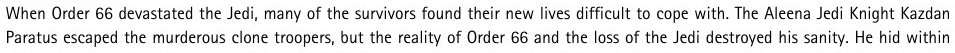

### Stat block notes (game mechanics, not feats)

- Kazdan Paratus (Saga CL 9): CL 9 Aleena Jedi 9 Force 9; Dark Side 0 Init +9; Senses Perception +11 Languages Aleena and Basic Defenses Ref 21 (flat-footed 21), Fort 20, Will 22 hp 74; Threshold 20 Speed 4 squares Melee lightsaber +11 (2d8+7) or Melee unarmed +10 (1d3+5) Atk Options Combat Reflexes, Improved Disarm, Melee Defense Special Actions Block, Deflect, (Source: *Web Articles* (SWRPG Saga Edition), scan p.325)
- The Force Unleashed Preview 2: Kazdan Paratus: When Order 66 devastated the Jedi, many of the survivors found their new lives difficult to cope with. The Aleena Jedi Knight Kazdan Paratus escaped the murderous clone troopers, but the reality of Order 66 and the loss of the Jedi destroyed his sanity. He hid within the industrial wasteland of Raxus Prime, succumbing to his delusional state and living a bizarre life of denial and fantasy. But before Order 66, Kazdan was a competent warrior who participated in many Clone Wars sorties. To increase his size and mobility, he often wore four mechanical spiderlike arms of his own making. Kazdan's roleplaying game statistics below reflect his abilities during the latter stages of the Clone Wars, sometime before Order 66. (Source: *Web Articles* (SWRPG Saga Edition), scan p.325)
- The Force Unleashed Preview 2: Kazdan Paratus: In the Star Wars Miniatures Game, Kazdan Paratus joins the ranks of Unique Jedi characters available to the Republic faction. He also brings more Jedi power to Rebel squads, thanks to his Affinity ability. Kazdan's cost is high -- much higher than most of the other Jedi, and equaling Yoda at 55. This might seem unusual, given that Kazdan's stats are similar to those of lesser-cost Jedi, but his Immediate Droid Reserves 30 accounts for the increase. In fact, this ability turns Kazdan into a droid-centric mini-squad of his own. Coupled with his Droid Mark ability, Kazdan has staying power, boosted further by Lightsaber Block and Lightsaber Deflect. (Source: *Web Articles* (SWRPG Saga Edition), scan p.325)
- The Force Unleashed Preview 2: Kazdan Paratus: Kazdan isn't all about droids, though; he also uses speed. Use his Surprise Move power to advance across the map quickly, setting up for Double Attack later in the round, or make a quick escape before opposing characters can activate and attack. (Source: *Web Articles* (SWRPG Saga Edition), scan p.325)

## scan p.326 (scan page 326)

Page contents: The Force Unleashed Preview 3: Darth Revan and Rebel Vanguard by Gary M. Sarli and Sterling Hershey (title T): Revan background (Mandalorian Wars, Unknown Regions with Malak, Jedi Civil War) and miniatures tactics (compared with Darth Malak from Champions of the Force; Triple Attack, Dark Armor, Lightsaber Duelist, Force Storm, Force Corruption, Master Tactician, commander effect) - T records; stat card (Sith; cost 88; HP 140; Def 21; Atk +16; Dmg 20; Force 2, Force Renewal 1, Force Corruption (save 11), Force Storm 2, Lightsaber Block; commander effect +4 Attack to non-Unique followers within 6, 1 ally moves after initiative); Saga stats (when first returned from the Unknown Regions) Darth Revan CL 16 Medium Human Jedi 7/Jedi Knight 5/Sith Apprentice 3/Sith Lord 1 (Destiny 4; Force 6, Strong in the Force; Dark Side 17; Init +16; Basic, Mando'a, Sith; Ref 33, Fort 33, Will 32; hp 145; Threshold 38; immune fear; lightsaber +21 (2d8+11), Double/Triple Attack; Adept Negotiator, Dark Side Adept, Force Focus, Skilled Advisor, temptation; powers battle strike, dark rage, farseeing, Force grip, Force lightning, Force stun, move object, mind trick ["trick" restored from OCR]; techniques Force point recovery, Force power mastery (battlestrike), improved sense Force) - continues p327. (hand-read)

- **Darth Malak; Revan** — entry/section: Saga Edition Web Articles: "Throughout this Jedi Civil War, Darth Revan was the central figure -- first as the enemy commander, but ultimately as the one who defeated Darth Malak and shattered the Sith forces." Source: *Web Articles* (SWRPG Saga Edition), scan p.326
  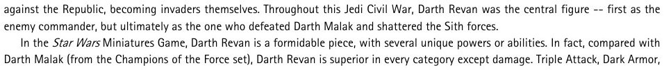
- **Revan** — entry/section: Saga Edition Web Articles: "Triple Attack, Dark Armor, and Lightsaber Duelist alone give Darth Revan a distinct advantage over most opponents." Source: *Web Articles* (SWRPG Saga Edition), scan p.326
  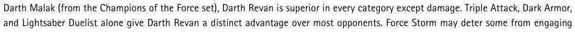
- **Revan**: "In the Star Wars Miniatures Game, Darth Revan is a formidable piece, with several unique powers or abilities." Source: *Web Articles* (SWRPG Saga Edition), scan p.326
  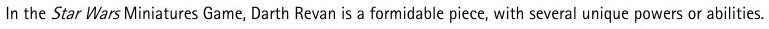

### Stat block notes (game mechanics, not feats)

- Darth Revan (Saga CL 16): CL 16 Medium Human Jedi 7/Jedi Knight 5/Sith Apprentice 3/Sith Lord 1 Destiny 4; Force 6: Strong in the Force Dark Side 17 Init +16; Senses Perception +16 Languages Basic, Mando'a, Sith Defenses Ref 33 (flat-footed 30), Fort 33, Will 32 hp 145; Threshold 38 Immune fear effects Speed 6 squares Melee lightsaber +21 (2d8+11) or Melee li (Source: *Web Articles* (SWRPG Saga Edition), scan p.326)
- The Force Unleashed Preview 3: Darth Revan: Originally a Jedi Knight, the future Darth Revan led Jedi and Republic forces against Mandalorian invaders at a time when no one could effectively stop them. The Jedi Council had avoided becoming directly involved in the war, but this outspoken and influential Jedi convinced many like-minded companions of the Order to fight back and defend the Republic. In the end, the Mandalorians were defeated, but the price for victory would prove great for the galaxy. (Source: *Web Articles* (SWRPG Saga Edition), scan p.326)
- The Force Unleashed Preview 3: Darth Revan: After the end of the Mandalorian struggle, a new threat appeared in the form of Darth Revan and Darth Malak, who came from the Unknown Regions. Now in the possession of Sith knowledge and a mysterious source of warships and military hardware, they turned against the Republic, becoming invaders themselves. Throughout this Jedi Civil War, Darth Revan was the central figure -- first as the enemy commander, but ultimately as the one who defeated Darth Malak and shattered the Sith forces. (Source: *Web Articles* (SWRPG Saga Edition), scan p.326)
- The Force Unleashed Preview 3: Darth Revan: In the Star Wars Miniatures Game, Darth Revan is a formidable piece, with several unique powers or abilities. In fact, compared with Darth Malak (from the Champions of the Force set), Darth Revan is superior in every category except damage. Triple Attack, Dark Armor, and Lightsaber Duelist alone give Darth Revan a distinct advantage over most opponents. Force Storm may deter some from engaging the character in melee combat, but Force Corruption has the potential to damage an enemy for many rounds after the initial strike. (Source: *Web Articles* (SWRPG Saga Edition), scan p.326)
- The Force Unleashed Preview 3: Darth Revan: Beyond combat, Darth Revan's most influential ability is Master Tactician, giving the Sith player considerable control over initiative. When combined with one aspect of Darth Revan's commander effect, a piece may advance across the battle grid or move out of harm's way at the beginning of a round, before an enemy can react. Darth Revan also gives non-Unique followers a considerable bonus to attack when they are within 6 squares. (Source: *Web Articles* (SWRPG Saga Edition), scan p.326)
- The Force Unleashed Preview 3: Darth Revan: These statistics reflect Darth Revan when he first returned from the Unknown Regions. (Source: *Web Articles* (SWRPG Saga Edition), scan p.326)

## scan p.327 (scan page 327)

Page contents: Darth Revan stats cont. (Str 16, Dex 17, Con 14, Int 15, Wis 17, Cha 19; SQ Fearless, Temptation; Talents Adept Negotiator, Armored Defense, Block, Dark Presence, Deflect, Force Deception, Force Focus, Multiattack Proficiency (lightsabers), Power of the Dark Side, Skilled Advisor; Feats incl. Improved Damage Threshold, Martial Arts I, Triple Attack; Skills Initiative +16, Knowledge (Tactics) +15, Acrobatics +16, Persuasion +17, Use the Force +17; possessions lightsaber, Darth Revan's armor); armor table Darth Revan's Armor (medium armor (-5); +7 Ref, +2 Fort; 5 kg; Unique) with caption (T record; no final period in source); Rebel Vanguard (TFU Preview 3 cont.): SpecForce 6th Regiment heavy weapon specialists, "gunners" vs "vanguards", tactics (cover, reload, pistol, frag grenades, antipersonnel mines); miniatures tactics vs Rebel Heavy Trooper (Bounty Hunters set), Missiles 30, Rebel Captain commander synergy; stat card (Rebel; cost 11; HP 10; Def 12; Atk +4; Dmg 10; Missiles 30). Generic unit, S only. (hand-read)

### Stat block notes (game mechanics, not feats)

- The Force Unleashed Preview 3: Darth Revan - Darth Revan's Armor: Darth Revan's Armor - +7 +2 5 kg Unique — Darth Revan's unique armor provides better protection than the average light armor thanks to ancient Rakata technology (Source: *Web Articles* (SWRPG Saga Edition), scan p.327)

## scan p.328 (scan page 328)

Page contents: Rebel Vanguard Saga stats CL 1 Medium Human "nonhuman 3" [sic, as printed; verified on image] (Init +2; Perception +1; Ref 13, Fort 11, Will 10; hp 10; unarmed +2 (1d4) [text layer "14"]; HH-15 projectile launcher +3 (6d6, 1-square splash); blaster pistol +3 (3d6); penetration 10; Armor Proficiency (light), Quick Draw (Human bonus feat or trained skill), Skill Focus (Mechanics); Skills Endurance +7 H., Mechanics +10; possessions blast helmet and vest (+2), HH-15, 4 missiles, blaster pistol, 4 frag grenades, 4 HX2 antipersonnel mines, comlink); New Weapon: HH-15 Projectile Launcher (Golan Arms; shoulder-fired; target lock if aiming; see Missiles and Torpedoes p174 and splash p155 of Saga Core; penetration 10; antiarmor; single missile, replacement missiles 100 cr, 2 kg; table: 2,000 cr, 6d6, stun 2 [as printed], 12 kg, S, Energy, Military; splash weapon); New Explosive: HX2 Antipersonnel Mine (Conner Ship Systems; ARC troopers in Clone Wars; adhesive disc; emplaced with Mechanics (full-round, Handle Explosives, Stealth +15 size mod) arms after 6 seconds, detects within 1 square Perception +10, attack 1d20+10, half damage on miss; dropped/thrown attack 1d20+0, safety feature, DC 15 Perception to detect; table 750 cr, 6d6, Energy, 1 kg, Small, Military; explosion damages everything within 4 squares). (hand-read)

## scan p.329 (scan page 329)

Page contents: The Force Unleashed Preview 4: Juno Eclipse and Star Destroyer Officer by Gary M. Sarli and Sterling Hershey (title T; text layer "UUNO", image "JUNO"): Juno Eclipse background and miniatures tactics - T records; stat card (Rebel; cost 8; HP 40; Def 13; Atk +5; Dmg 10; Unique, Careful Shot, Accurate Shot, Disruptive); Saga stats (new graduate of the Imperial Academy) Juno Eclipse CL 3 Medium Human soldier 3 (Force 3; Init +9; Perception +7; Basic, Binary (can't speak), Bocce; Ref 17, Fort 15, Will 14; Vehicular Combat; hp 41; blaster pistol +6 (3d6+1); Battle Analysis, Cover Fire; Careful Shot, Point Blank Shot, Skill Focus (Pilot); Pilot +14; possessions blaster pistol, Imperial officer's uniform, code cylinder, comlink, datapad, toolkit). (hand-read)

### Stat block notes (game mechanics, not feats)

- The Force Unleashed Preview 4: Juno Eclipse: The youngest student ever accepted into the Imperial Academy, Juno Eclipse is a gifted pilot, skilled mechanic, and model officer who quickly took command of Darth Vader's Black Eight Squadron. Later, she would serve as the pilot of the Rogue Shadow, the personal shuttle of Vader's secret apprentice. In this assignment, her conscience would eventually play a role that shaped the fate of the galaxy... (Source: *Web Articles* (SWRPG Saga Edition), scan p.329)
- The Force Unleashed Preview 4: Juno Eclipse: In the Star Wars Miniatures Game, Juno Eclipse fills a vital niche for Rebel squads by providing a low-cost source for the Disruptive ability. Being able to "jam" enemy commander effects is a nice advantage, particularly against squads that depend on commander effects to work effectively. For example, a "black and blue" squad featuring Thrawn, Vader, and Mas Amedda can have some serious problems if it is unable to swap Vader in and out of positions adjacent to major opponents. (Source: *Web Articles* (SWRPG Saga Edition), scan p.329)
- The Force Unleashed Preview 4: Juno Eclipse: For a mere 8 points, of course, you can't expect much else from the character. With the exception of Accurate Shot and extra hit points, she's little more effective than a Rebel Trooper or similar low-cost "filler." This being the case, you'll have to be careful not to leave her exposed. Try to keep her out of line of sight (around corners but within 6 squares) or, failing that, keep her behind cover (such as a stronger ally) or near a bodyguard or character with Draw Fire. (Source: *Web Articles* (SWRPG Saga Edition), scan p.329)
- The Force Unleashed Preview 4: Juno Eclipse: These statistics present Juno Eclipse as a new graduate of the Imperial Academy. (Source: *Web Articles* (SWRPG Saga Edition), scan p.329)

## scan p.330 (scan page 330)

Page contents: Star Destroyer Officer (TFU Preview 4 cont.): background (Imperial Star Destroyer; officers by skill, loyalty, or political connections) and miniatures tactics (vs Imperial Officer; Imperial Navy Trooper synergy, synchronized fire); stat card (Imperial; cost 12; HP 30; Def 13; Atk +4; Dmg 10; commander effect: Imperial Navy Troopers within 6 gain Double Attack); Saga stats CL 5 Medium Human nonheroic 4/noble 3/officer 1 (Force 4; Dark Side 5; Basic, Bocce, Durese, High Galactic; Ref 15, Fort 14, Will 19; hp 25; unarmed +6 (1d4+2); blaster pistol +5 (3d6+2); Assault Tactics, Coordinate +1, Inspire Confidence; Linguist, Skill Focus (Persuasion); Persuasion +16; possessions blaster pistol, code cylinder, encrypted comlink, officer's uniform). Generic, S only. (hand-read)

## scan p.331 (scan page 331)

Page contents: The Force Unleashed Preview 5: Wookiee Warrior and Wedge Antilles, Red Two by Gary M. Sarli and Sterling Hershey (title T; "5" verified on image): Wookiee Warrior background (Kashyyyk enslaved; Rebel SpecForce backup, Special Ops for Alliance Intelligence; bowcaster, grenade launcher, recon droid with explosive charge or beacons) and miniatures tactics (heavy filler vs Elite Hoth Trooper; Grenades 20); stat card (Rebel; cost 13; HP 40; Def 13; Atk +6; Dmg 20; Grenades 20); Saga stats Wookiee Warrior CL 2 Medium Wookiee nonheroic 8 (Init +9; Basic (understand only), Shyriiwook; Ref 10, Fort 13, Will 9; hp 44; Threshold 18; extraordinary recuperation; unarmed +9 (1d4+3)/+11 (1d4+5) during rage; bowcaster +6 (3d10); grenade launcher +6 (4d6, 2-square burst); Crush, Pin; rage 1/day; Climb +7, Persuasion +2 (reroll intimidate); possessions bowcaster, 5 quivers, grenade launcher, 10 frag grenades, bandolier, utility belt, recon droid); Recon Droid CL 1 Diminutive 4th-degree droid nonheroic 1 (Init +10; low-light vision, Perception +13; Ref 20, Fort 10, Will 11; hp 2; speed 2; hold-out blaster +5 (3d4); self-destruct (4d6, 2-square burst); Str 4, Dex 21) - continues p332. Generic, S only. (hand-read)

## scan p.332 (scan page 332)

Page contents: Recon Droid cont. (Feats Point Blank Shot, Skill Focus (Perception), Skill Training (Initiative); Stealth +20; Systems hovering locomotion, internal comlink, stabilized tool mount, miniaturized self-destruct system, improved sensor package; possession hold-out blaster; cost 7,500; Military; footnote: miniaturized self-destruct functions as if two sizes larger, costs 5 times as much); Wedge Antilles, Red Two background and miniatures tactics (vs Universe set Wedge) - T records; stat card (Rebel; cost 13; HP 50; Def 17; Atk +8; Dmg 10; Unique; Pilot; Avoid Defeat; Evade; Grenades 10; Mobile Attack); Saga stats (end of Episode IV) Wedge Antilles, Red Two CL 4 Medium human scoundrel 1/soldier 3 (Destiny 1; Force 3; Init +9; Basic, Binary; Ref 18, Fort 16, Will 16; Vehicular Combat; hp 35; blaster pistol +5 (3d6+2); Devastating Attack and Penetrating Attack (heavy weapons), Spacehound; Starship Maneuvers (Pilot +14): Corellian slip, skim the surface; Starship Tactics; Pilot +14; possessions blaster pistol, comlink, datapad, frag grenade, tool kit, flight suit, X-wing starfighter; footnote: Detailed in the upcoming product Starships of the Galaxy). (hand-read)

### Stat block notes (game mechanics, not feats)

- The Force Unleashed Preview 5: Wedge Antilles, Red Two: Wedge Antilles is destined to become one of the Rebel Alliance's most famous and talented fighter pilots. Ultimately, he flew X-wings against both Death Stars and defended the Rebel Base at Hoth. As commander of Rogue Squadron, he will be at the forefront of Rebel and New Republic strikes across the galaxy. All of that is in the future, however. When flying as Red Two in the attack on the first Death Star, Wedge is a talented young pilot with a lot to learn about flying and command. He would be one of a very small number of pilots to survive the attack, and he served as one of Luke Skywalker's wingmen on the final attack run on the battlestation's vulnerable thermal exhaust port. (Source: *Web Articles* (SWRPG Saga Edition), scan p.332)
- The Force Unleashed Preview 5: Wedge Antilles, Red Two: In the Star Wars Miniatures Game, Wedge Antilles, Red Two is somewhat less powerful than the Wedge Antilles figure released in the Universe set. Reflecting a younger, less experienced pilot, this version costs a bit less, has 20 fewer Hit Points, has a slightly lower Defense and Attack rating, and has no commander effects. He does, however, receive an upgrade in his special abilities. Wedge Antilles, Red Two has Pilot, plus the pilot's common ability Grenades 10. He also retains Avoid Defeat and Evade, both of which should keep him in the game longer. Mobile Attack rounds out his abilities, enabling him to maneuver around the battle grid during his turn, but get out of sight or behind cover in the end. (Source: *Web Articles* (SWRPG Saga Edition), scan p.332)
- The Force Unleashed Preview 5: Wedge Antilles, Red Two: The statistics below reflect Wedge's abilities at the end of Episode IV. (Source: *Web Articles* (SWRPG Saga Edition), scan p.332)

## scan p.333 (scan page 333)

Page contents: The Force Unleashed Preview 6: Luke's Snowspeeder and Luke Skywalker, Hoth Pilot Unleashed by Gary M. Sarli and Sterling Hershey (title T; "6" verified on image, text layer "&"): Luke's Snowspeeder background and miniatures tactics (vs Rebel Snowspeeder from Bounty Hunters set) - T records; stat card (Rebel; cost 45; HP 90; Def 20; Atk +12; Dmg 20; Unique (counts as Luke Skywalker); Flight; Damage Reduction 10; Harpoon Gun; Mobile Attack; Speed 16; Mounted Weapon; Twin Attack; Force 4); Saga stats Modified Incom-147 Airspeeder CL 9 Huge air vehicle (Init +20; Ref 24, Fort 16; +2 armor; Elusive Dogfighter, Vehicular Combat; hp 60; DR 10; Threshold 26; fly 16 squares (1,100 km/h); double laser cannon +11 (5d10, pilot), blaster cannon +4 (3d10, gunner), harpoon gun +4 (grapple +27); crew 2 (unique pilot [Luke Skywalker], skilled gunner); cargo 50 kg; consumables 1 day; Military; 50,000 used); Harpoon Gun rule (attack roll, opposed grapple, Pilot check DC = grapple result or automatic collision taking twice collision damage). (hand-read)

### Stat block notes (game mechanics, not feats)

- The Force Unleashed Preview 6: Luke's Snowspeeder: As commander of Rogue Group, Luke Skywalker led the snowspeeder squadron defending the Rebel base on Hoth. They took the invading Imperial AT-ATs head on, but their speeder-mounted blasters had minimal effect on the walkers’ strong armor. Luke quickly switched tactics and ordered the use of tow cables and harpoons to trip the mechanical monstrosities. (Source: *Web Articles* (SWRPG Saga Edition), scan p.333)
- The Force Unleashed Preview 6: Luke's Snowspeeder: While other Rogue pilots managed to down a walker or two, Luke ran into problems when AT-AT blaster fire proved to be too much for his speeder. He lost his gunner in the first hit, and he crashed later in the battle after taking a second direct hit. (Source: *Web Articles* (SWRPG Saga Edition), scan p.333)
- The Force Unleashed Preview 6: Luke's Snowspeeder: Luke's Snowspeeder is the second such vehicle added to the Star Wars Miniatures Game. (The Rebel Snowspeeder was released as part of the Bounty Hunters set.) Reflecting Luke's advanced skills, his speeder costs a bit more but has substantially more Hit Points and better Defense and Attack scores. The Damage score and the remainder of the special abilities remain the same. However, Luke's Snowspeeder also has Force 4, and with no other Force powers to spend the points on, Luke will have an edge in movement and attack rolls many times during a battle. (Source: *Web Articles* (SWRPG Saga Edition), scan p.333)

## scan p.334 (scan page 334)

Page contents: Luke Skywalker, Hoth Pilot Unleashed (TFU Preview 6 cont.): Battle of Hoth background and miniatures tactics (Force Push 4, Demolition Charge, cost 28) - T records; stat card (Rebel; cost 28; HP 80; Def 19; Atk +11; Dmg 20; Unique; Pilot; Demolition Charge (save 6); Force 2; Force Renewal 1; Force Push 4; Lightsaber Deflect); Saga stats Luke Skywalker (Episode V) CL 9 Medium Human scout 1/Jedi 6/ace pilot 2 (Destiny 2; Force 5, Strong in the Force; Dark Side 1; Init +12; Basic, Huttese, Shyriiwook; Ref 26, Fort 23, Will 21; Block, Deflect, Evasion; hp 84; lightsaber +11 (2d8+10) or +6/+6 Double Attack; blaster pistol +10 (3d6+4); move object, surge; vehicle dodge +1; Elusive Dogfighter, Force Pilot; Shake It Off, Weapon Finesse; Use the Force +16 ["+16" on next line, restored from OCR]; possessions blaster pistol, lightsaber, flight suit, antivehicle proton mine, ascension gun, utility belt with medpac [no period in source before note]); note on Unleashed version (T record; "Guide." restored from image). (hand-read)

- **Luke Skywalker** — entry/section: Saga Edition Web Articles: "As it turned out, the AT-AT was no match for Luke attacking on his own two feet." Source: *Web Articles* (SWRPG Saga Edition), scan p.334
  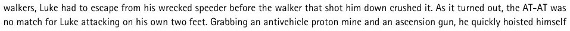

### Stat block notes (game mechanics, not feats)

- The Force Unleashed Preview 6: Luke Skywalker, Hoth Pilot Unleashed: The Battle of Hoth was rough on Luke Skywalker and his snowspeeder. Though he led a successful attack against the invading Imperial walkers, Luke had to escape from his wrecked speeder before the walker that shot him down crushed it. As it turned out, the AT-AT was no match for Luke attacking on his own two feet. Grabbing an antivehicle proton mine and an ascension gun, he quickly hoisted himself up to the belly of the beast, sliced it open with his lightsaber, and tossed in the mine. The resulting explosion blew the head off the walker, bringing it down immediately. (Source: *Web Articles* (SWRPG Saga Edition), scan p.334)
- The Force Unleashed Preview 6: Luke Skywalker, Hoth Pilot Unleashed: In the Star Wars Miniatures Game, Luke Skywalker, Hoth Pilot Unleashed brings the feel of The Force Unleashed to a classic character. This is largely reflected in the Force power Force Push 4, which pushes a target back 4 squares while doing 40 damage in the same blow. Because of his initial Force 2 score and Force Renewal 1, Luke won't be able to do this very often in a game. (Source: *Web Articles* (SWRPG Saga Edition), scan p.334)
- The Force Unleashed Preview 6: Luke Skywalker, Hoth Pilot Unleashed: However, Luke has another amazing trick, direct from the Battle of Hoth: Demolition Charge. This ability is absolutely lethal to walkers of any size, including AT-ATs, which can be brought down in a single round with a single die roll (well, most likely a single die roll). However, since Demolition Charge "replaces turn," it might take the Rebel player a bit of maneuvering to get into the right position at the right time. Still, Luke Skywalker, Hoth Pilot Unleashed is the most effective walker-killer in the game, especially at his low cost of 28 points. (Source: *Web Articles* (SWRPG Saga Edition), scan p.334)
- The Force Unleashed Preview 6: Luke Skywalker, Hoth Pilot Unleashed - stat block note: If you want to use an Unleashed version of Luke Skywalker, replace Double Attack (lightsabers) with the Unleashed feat from The Force Unleashed Campaign Guide. (Source: *Web Articles* (SWRPG Saga Edition), scan p.334)

## scan p.335 (scan page 335)

Page contents: New Explosive: Antivehicle Proton Mine (TFU Preview 6 cont.): Rebel Alliance made from proton torpedo warheads with proximity fuse; emplaced (full-round, Handle Explosives, Stealth +15 size mod), can be set for minimum target size and/or repulsorlift targets; arms after 6 seconds; detects eligible target within 2 squares (Perception +10); attack 1d20+10 vs Reflex of all in blast radius, half damage on miss; table 2,000 cr, 8d6, Energy, 1.5 kg, Small, Military; explosion damages everything within 4 squares. (hand-read)

## scan p.336 (scan page 336)

Page contents: The Force Unleashed Preview 7: Amanin Scout and 2-1B by Gary M. Sarli and Sterling Hershey: Amanin Scout background (primitive Amanin, mineral wealth, some sold into slavery under the Empire; learned Basic; scout or guide; used by an unnamed Hutt crime lord to "hunt" witnesses) and miniatures tactics (Wall Climber, Wheel Form, Melee Reach 2); stat card (Fringe; cost 13; HP 40; Def 15; Atk +7; Dmg 20; Melee Attack; Melee Reach 2; Stealth; Wall Climber; Wheel Form); Saga stats Amanin Scout CL 2 Medium Amanin scout 3 (Force 3; Dark Side 2; Amanese, Basic; Ref 16, Fort 16, Will 14; hp 39; speed 6, roll 12 (run only); spear +4* (1d8+11) [as printed]; ranged spear +3 (1d8+4); reach 2; Power Attack; Shake It Off; Improved Stealth, Hidden Movement; Linguist; Climb +4 (take 10 when distracted); possessions spear; footnote: Includes 2 points of Power Attack). Generic, S only. (2-1B title T on p337/338 if named.) (hand-read)

## scan p.337 (scan page 337)

Page contents: Amanin species entry (TFU Preview 7 cont.): description (arboreal humanoids of Maridun; scouts, bounty hunters, hired muscle); Amanin Species Traits sidebar (blue box; band y0.16-0.34 missing from text layer, read from page image and band OCR): Ability Modifiers +2 Str, -2 Int, -2 Cha; Size Medium; Speed 6 squares; Reach natural reach of 2 squares; Primitive (no Weapon Proficiency (pistols, rifles, or heavy weapons) as starting feats); Roll (run action, roll into a ball, -5 Perception, speed doubled); Resilient (+1 species bonus to Fortitude); Skills (take 10 on Climb even when distracted or threatened); Languages Amanese. (hand-read)

## scan p.338 (scan page 338)

Page contents: 2-1B (heading; TFU Preview 7 cont.): Too-Onebee background (Firro, Lord Cuvir, Rebel agent Tiree, Echo Base on Hoth, medical frigate Redemption, New Republic) and miniatures tactics (vs Medical Droid from Revenge of the Sith set; Stass Allie) - T records; stat card (Rebel; cost 17; HP 30; Def 15; Atk +2; Dmg 10; Unique; Droid; Emergency Life Support; Heal 30; Melee Attack); Saga stats Two-Onebee (advanced 2-1B medical droid) CL 3 Medium 1st-degree droid nonheroic 3/noble 3 (Force 3; Init +4; low-light vision, Perception +18; Basic, Binary, Bothan, Sullustan; Ref 15, Fort 13, Will 18; hp 24; unarmed +3 (1d3); Bolster Ally, Educated; Cybernetic Surgery, Surgical Expertise, Toughness; Knowledge (life sciences) +15, Treat Injury +16; systems walking locomotion, heuristic processor, 2 hands, improved sensor package, vocabulator; possessions medical kit, 2 medpacs; Unique, not available for sale). (hand-read)

### Stat block notes (game mechanics, not feats)

- The Force Unleashed Preview 7: 2-1B: Too-Onebee is an older model of medical droid who once served the Empire on the planet Firro shortly after that world was subject to Imperial occupation. Tasked with tending to civilians injured or maimed by Imperial atrocities, Too-Onebee provided care to a seemingly unending stream of the wounded or dying before being assigned to the newly proclaimed governor, Lord Cuvir. Forced to serve those who caused the very injuries that he was programmed to heal, Too-Onebee began to realize that he longed to serve those on the "right" side of the war. (Source: *Web Articles* (SWRPG Saga Edition), scan p.338)
- The Force Unleashed Preview 7: 2-1B: Later, when Lord Cuvir was assassinated by the Rebel agent Tiree, Too-Onebee dutifully attempted to render aid to the mortally wounded governor even as he saw an opportunity to escape Imperial servitude. Too-Onebee joined Tiree and fled the planet, accompanying him on a few missions for the Rebel Alliance before being assigned to the medical unit in Echo Base on Hoth. He would later serve on the medical frigate Redemption, and he continued to serve the New Republic after the fall of the Empire. (Source: *Web Articles* (SWRPG Saga Edition), scan p.338)
- The Force Unleashed Preview 7: 2-1B: In the Star Wars Miniatures Game, 2-1B's only real point of comparison is the Medical Droid (from the Revenge of the Sith set), and even then 2-1B puts it to shame -- assuming that medical droids are programmed to feel shame. For an extra 5 points of Cost, you gain triple-strength healing (the best in the game), 4 more points of Defense, and the capability to make attacks without losing any of the Medical Droid's abilities. (Sure, that last benefit will rarely come up, but it's just one more option when everyone is at full hit points.) Currently, the only character in the game who can match this kind of healing is Stass Allie (also from Revenge of the Sith), and she has to spend Force Points to do it. (Source: *Web Articles* (SWRPG Saga Edition), scan p.338)
- The Force Unleashed Preview 7: 2-1B: In short, 2-1B's healing is substantial enough to make a big difference during a game. It could allow even a second-tier "beatstick" to stand toe-to-toe with an enemy's best heavy-hitter -- if you can keep him protected while he's right on the front line. (Source: *Web Articles* (SWRPG Saga Edition), scan p.338)

## scan p.339 (scan page 339)

Page contents: Errata section title page (text layer empty; read from page image): "ERRATA" By Rodney Thompson; list: Clone Wars, January 2009; Core Rulebook, October 2008; Knights of the Old Republic Campaign Guide, January 2009; Scum and Villainy, January 2009; Starships of the Galaxy, January 2008; The Force Unleashed Campaign Guide, January 2009. (hand-read)

## scan p.340 (scan page 340)

Page contents: Clone Wars Errata and Official Clarifications, Updated January 2009. Clone Wars Campaign Guide Errata v1: p21 Protection (Draw Fire, Misplaced Loyalty from Scum and Villainy p14); p22 Improved Consular's Vitality prerequisite; p26 Stick Together; p29 Expert Droid Repair "(minimum 2)" [opening quote only, as printed]; p40 Higher Yield (Demolitions -> Mechanics); p40 Focused Force Talisman; p46 Tech Savant; p76 G9 Rigger Grp +34; p81 Dagger-class Starfighter Hyperdrive x2 (3 pre-programmed jumps); p138 Daystar Craft DC0052 Intergalactic Speeder fighting space 2x2; p172 Mu-class Shuttle Hyperdrive x1, navicomputer; p173 Y-Wing DR 10 not 100; p209 Subjugator-class Heavy Cruiser crew 25,350; p221 Sabaoth Starfighter Pilot +12. Clone Wars CG Clarifications v1: p61-63 ammunition capacities (BlasTech 500 "Espo" Riot Gun, DT-12, Czerka Adventurer, Merr-Sonn Model 434, SoroSuub Firelance 50 shots; DH-23 "Outback" 100 shots; DLT-20A 30 shots); p40 Rapid Reload and p46 Sabotage Device add "or power pack"; p64 Shadowsuit replacement text (Ayelixe/Krongbing; shadowsilk; +5 equipment bonus to Stealth in darkness/low light) and Table 5-4 line (Shadowsuit 2 600 +1 +1 +5 - - 2 kg Military); p94 Creating a Squad (squad CL = base creature CL +2). (hand-read)

## scan p.341 (scan page 341)

Page contents: Star Wars Saga Edition (Core Rulebook) Errata and Official Clarifications, Updated October 2008: p38 Base Attack Bonus (not to damage); p38 Jedi class skills add Jump and Mechanics; p40 Resilience; p41 Block (negate melee area attacks such as Whirlwind Attack, half/no damage, Force Point for adjacent character); p41 Deflect (Force Point for adjacent character; autofire or Force lightning); p44 Wealth ("class level"); p46 Fool's Luck (competence bonus); p47 Hyperdriven; p51 Soldier Defense Bonuses (+1 Ref, +2 Fort); p52 Stunning Strike ("damage roll"); p59 Table 4-1 and p62 Table 4-2 Jedi Jump and Mechanics; p62 Acrobatics (DC 15 Acrobatics check; Escape Bonds standard action; +5 Reflex when fighting defensively, closing quote missing as printed); p68 Jump Down (3 meters per 10 over DC); p69-70 Mechanics ("On a result"; Jury-Rig +2 steps and 1d8 hp; untrained aid another); p73 Stealth (drawing concealed item standard action); p82 Acrobatic Strike (+2 competence); p82 Burst Fire (prerequisites) - continues p342. Rules, S only. (hand-read)

## scan p.342 (scan page 342)

Page contents: Saga Edition errata cont.: Burst Fire (-10 penalty without Str 13 for non-vehicle weapons); p85 Force Training (1 + Wisdom modifier powers); p88 Rapid Shot (remove Str prerequisite; "=-5" [as printed]); p88 Rapid Strike (remove Dex prerequisite; "=-5" [as printed]); p89 Whirlwind Attack ("target"); p93 Using Force Points (return power is a reaction); p96 Regaining Force Powers (natural 20); p96 new Telekinetic descriptor (cover and concealment; Sense Surroundings; pages 156-157; applies to Force disarm, Force grip, Force slam, Force thrust, move object); p96 Battle Strike (+1 Force bonus, +1d6); p97 Force Grip (12 squares line of sight; DC 15 2d6 and single swift action; size modifiers Colossal +50, Gargantuan +20, Huge +10, Large +5; maintaining standard action, DC 15 + damage); p97 Force Disarm (target text); p97 Force Slam (size modifiers); p98 Force Stun (vs Fortitude; size modifiers); p98 Force Thrust (base attack bonus and size modifier); p98 Move Object (target text; maintaining; ceases if dealing damage). Rules, S only. (hand-read)

## scan p.343 (scan page 343)

Page contents: Saga Edition errata cont.: p100 Surge (free action; running start; Destiny Point for +4 squares and jump); p100 Disciplined Strike ("area effect"); p100 Telekinetic Power and Telekinetic Savant (italic "[telekinetic]" descriptor, text layer "/te/ekinetic/", verified on image); p102 Force Point Recovery (remove second paragraph); p113 Spending Destiny Points (act out of turn once per encounter); p120 Weapon Qualities Stun Damage (stun range 6 squares; Stunning p162); p122-123 Table 8-3 stun column "Yes" except stun baton "Yes (2d6)"; p126-127 Table 8-4 "Yes" except stun grenade "Yes (4d6)", accurate (4) sporting blaster pistol/rifle, bowcaster; inaccurate (5) hold-out blaster, heavy blaster pistol, blaster carbine, blaster cannon, heavy blaster rifle, thermal detonator, net, grenade launcher; footnotes; p128 Sporting Blaster Rifle 50 -> 100; p152 Charge replacement text (+2 competence, -2 Reflex, no tumble); p154 Aim (no benefit on area attack); p155 Area Attacks (single roll, 10 or higher; natural 20 hits all, no double damage); p157 Cover (area attacks; burst/splash vs autofire); p167 Critical Hits (vehicle weapons, Destiny Point, Jedi Master's serenity). Rules, S only. (hand-read)

## scan p.344 (scan page 344)

Page contents: Saga Edition errata cont.: p169 Vehicle Damage Threshold (occupants take half of excess); p172 Increase Vehicle Speed (free action with all-out movement); p173 Collisions (damage reduced by vehicle threshold); p186 Droid Cost Factor (Small or smaller "2/their cost factor" [as printed]); p191 Synchronized Fire Circuits (+5 instead of +2); p198 3PO Series Protocol Droid (Int 13, Cha 14); p199 B1 Battle Droid (remote receiver); p200 B2 Super Battle Droid (aid another +5); p200 Droideka replacement stat block: Droideka Series Destroyer Droid CL 4 Large droid (4th-degree) nonheroic 1 (Init +8; Perception +13; Basic, Binary [rule] - "[rule]" printed as is in three places, verified on image; Ref 16, Fort 13, Will 12; hp 40; SR 20; Threshold 18; speed 2 walking, 10 wheeled; unarmed +7 (1d4+3); laser cannon +12 (3d8), Rapid Shot/Burst Fire/dual options; 2x2; Base Atk +9; Grp +17; Str 16, Dex 15, Int 8, Wis 14, Cha 7; Burst Fire, Rapid Shot, Dual Weapon Mastery I and II, Weapon Focus (rifles); Perception +13, Stealth +3; systems walking and wheeled locomotion (exclusive), remote receiver, 2 tool appendages, shield generator (SR 20), integrated comlink, bronzium shell (+5 armor; as quadanium plating); possessions 2 laser cannons (as blaster rifles)). Generic, S only. (hand-read)

## scan p.345 (scan page 345)

Page contents: Saga Edition errata cont.: Droideka availability Military, cost 21,000 credits; p201 IG-100 Series Bodyguard Droid defenses (Ref 18, Fort 19, Will 18); p206-235 prestige class "Minimum Level"; p207 Juke (fight defensively as pilot, extra Vehicular Combat negate; prerequisite Vehicular Evasion); p208 Hunter's Mark (aim, -1 step condition track); p216 Gunslinger talent tree (pistols and rifles only) and Debilitating Shot; p220 Serenity (trance, aware but helpless); p228 Bespin (swap export/imports); p234 Rodia (moons 2 -> 4); p255 Falling Damage (Acrobatics and Jump; 60 meter cap); p261-262 Anakin Skywalker (Darth Vader) stat block (Perception +18; Reflex 40 (37 flat-footed), Fort 37, Will 34.. [double period as printed]; lightsaber +23 (2d8+17), +21 (3d8+17) Rapid Strike, +18/+18 Double Attack, +16/+16 (3d8+17) "with Double Attack and Rapid Strik" [sic, verified on image]; ranged +21; Base Atk +18; Grp +21; skills Initiative +17, Jump +17, Mechanics +16, Perception +18, Use the Force +17 (reroll with [dark side] powers, substitute for Pilot)); p263 Padme stat block ("Wanted Alive" -> "Inspire Confidence"); p264 Luke Skywalker stat block (Reflex 28 (25 flat-footed); lightsaber +14 (2d8+11), +9/+9 Double Attack; blaster +12 (3d6+5); add SQ line - continues p346). Stat errata for named characters (Darth Vader, Padme Amidala, Luke Skywalker) kept as S per stats policy. (hand-read)

## scan p.346 (scan page 346)

Page contents: Saga Edition errata cont.: Luke SQ Vehicle dodge +1, add Elusive Dogfighter; p265 Han Solo (heavy blaster pistol +12 not +14); p266 Chewbacca (skills Climb +10, Endurance +15, Initiative +11, Mechanics +11, Perception +10, Persuasion +5, Pilot +11, Use Computer +11; remove Extra Rage, add Shake It Off); p267 R2-D2 (electroshock probe +9 not +10; ranged +8 not +14); p268 C-3PO ("C-3P0" as printed; Int 13, Wis 13, Cha 15; Deception +10, Persuasion +15 ["+15." on next line, restored from OCR]); p268 Yoda (Languages Basic, Cerean, Shyriiwook (understand only); lightsaber +19/+19/+19 (2d8+16) Triple Attack); p270 Boba Fett (Reflex 36 (33 flat-footed)); p271 General Grievous (Reflex 35 (31 flat-footed); final melee +9 not +11); p278 Nonheroic class skills add Ride; p281 Clone Trooper (Perception +9, Coordinated Attack); p282 ARC Trooper (Ref 23 (21 flat-footed); "hp 57; DR 1Threshold 24; delay damage" [sic, verified on image]; SQ delay damage); p283 Bounty Hunter (Perception +14 H, Survival +12); p284 Dark Side Marauder (remove Tough as Nails). Star Wars Saga Edition - Official Clarifications intro; p27 Gungan Weapon Familiarity (atlatl, cesta); p32 Wookiee Weapon Familiarity (bowcasters as rifles); p36 Class Level vs. Character Level sidebar; p40 Force Persuasion and Force Intuition; p41 New Sidebar (Dark Side Score) - continues p347. Stat errata for named characters kept as S per stats policy. (hand-read)

## scan p.347 (scan page 347)

Page contents: Saga Edition Official Clarifications cont.: Sensing the Dark Side sidebar (aware target has Dark Side Score 1+; witnessing [dark side] action; GM may waive for stormtroopers, Sith Lords, thugs, bounty hunters, crime lords); p41 Lightsaber Throw (standard action, thrown weapon); p52 Harm's Way ("targets you instead"); p60 Taking 10 (Rorworr example - T record); p72-73 Ride (armor check penalty only for fast mount/dismount; Use Mount as Cover reaction); p73 Stealth (Pick Pocket and Sleight of Hand standard actions); p77 Use the Force (Sense Force dark side only; Sense Surroundings until start of next turn; Telepathy vs Will or base DC; Move Light Object projectile as ranged attack); p83 Cleave; p89 Weapon Focus prerequisite; p95 Selecting Force Powers (remove Force stun DC 20 example); p97 Force Disarm ([telekinetic], "disarm attempt"); p97 Force Lightning (vs Reflex); p100 Rebuke; p100 Sever Force ("As DC 25"); p100 Vital Transfer (heal less; not yourself); p101 Force Perception and Force Pilot talents. (hand-read)

### Stat block notes (game mechanics, not feats)

- Star Wars Saga Edition - Official Clarifications: p. 60 - Taking 10: Replace the last sentence with the following: "Rorworr needs to make a Climb check to reach the bounty hunter, and this time he can take 10 only because of his Wookiee ability to take 10 on Climb checks while under pressure." (Source: *Web Articles* (SWRPG Saga Edition), scan p.347)

## scan p.348 (scan page 348)

Page contents: Saga Edition Official Clarifications cont.: p119 Weapon Groups (proficient with one weapon qualifies for Weapon Focus; Spacehound example); p120 Simple Weapons (unarmed and natural weapons light simple); p120 Weapon Qualities Rate of Fire (one alternate setting; autofire stun 6 squares); p128 Bowcasters (Wookiees treat as rifles; range as rifles); p129 Ion Grenade and Ion Pistol ("normal damage"; text layer "lon"); p137 Cybernetic Prosthesis (page 144 -> 141); p144 Critical Hits (negated by Block, Deflect, Vehicular Combat, Destiny Point); p144 Free Actions and Reactions (single reaction; negate energy, Block, Deflect); p153 Draw or Holster (lightsaber drawn and activated as one move action); p156 Attacks of Opportunity (involuntary movement e.g. Bantha Rush, move object); p162 Ready replacement text; p168 Vehicle Weapon Damage formula ((Weapon Damage + 1 heroic level + misc) x multiplier [as printed]); p186 Systems and Accessories; p188 Droid Traits (Nonliving, no Con bonus); p192 Reprogramming (talents by class levels example); p214 Force Treatment. (hand-read)

## scan p.349 (scan page 349)

Page contents: Saga Edition Official Clarifications cont.: p223-224 Force Deception (remove "for the purposes of using this talent"); p247 Building an Encounter (combined CL is result or highest single CL + 2, whichever more; no single enemy more than 3 levels above average party level); p285 Yuuzhan Vong Species Traits (amphistaff as simple weapon). (hand-read)

## scan p.350 (scan page 350)

Page contents: Knights of the Old Republic Errata and Official Clarifications, Updated January 2009: p26 Demoralizing Defense (once per round per target); p32 Table 2-1 Implant Training; p39 Taint of the Dark Side (Force/Destiny Point raises Dark Side Score); p47 Melee Duelist requirements (Melee Defense, Rapid Strike, Weapon Focus melee); p47 Dual Weapon Flourish II and Single Weapon Flourish II ("once per turn on your turn"); p67 Adhesive Grenade and p69 CryoBan Grenade (2-square burst); p69 Lanvarok (Massassi and Kissai treat as simple); p75 Table 5-6 Improved Energy Cell upgrade slot cost 1. KotOR Clarifications: p31 Weapon Focus + Weapon Finesse; p35 Sniper Shot; p39 Improved Riposte; p44 Brutal Attack (threshold compare before extra die); p47 Exotic Weapon Master ("or talents"); p52 Wound Force power Special. Rules, S only. (hand-read)

## scan p.351 (scan page 351)

Page contents: Scum & Villainy Errata and Official Clarifications, Updated January 2009. Errata: p17 Swift Strider; p21 Misplaced Loyalty (not if another within 6 squares used it; "gain the benefit this talent" as printed); p21 Collateral Damage and p25 Wicked Strike ("once per turn on your turn"); p23 Knife Trick (concealed weapon threatens squares); p24 Superior Tech (Superior Protective Armor +2 Reflex); p27 Shelter (adjacent to minion, cover bonus +2 ["+2." restored from OCR]); p31 Damaging Deception (+2 dice; garbled word order "start of your next by one of your allies turn" as printed); p35 Uncanny Instincts (once per round); p37 Upgrade Slots (powered armor two free slots; "of the word power" [sic]; "name." restored from OCR); p56 Table 2-11 cost modifiers (station x5,000, cruiser x500, frigate x50). Clarifications: p21 Bonus Feats table by class (Jedi; Noble; Scoundrel list ends "Signature Device," with trailing comma as printed, verified on image; Scout; Soldier "...Slippery Maneuver, Stay Up" ["Up" restored from image]); p41 Dual Gear (separate power packs); p42 Silverplate and Spring Loaded. Rules, S only. (hand-read)

## scan p.352 (scan page 352)

Page contents: Starships of the Galaxy Errata 1.0: p18 Squadron Tactics (non-attack pattern maneuvers); p25 Corellian Slip (attack as free action); p31 Fighter Groups (joining ends actions; leader changes once per round; maneuvers only if all have them; attack pattern effects lost); p47 Table 3-5 footnote (Colossal (frigate) or larger); p47 Table 3-7 Extended range EP cost 1; p52 Table 3-8 stock ship Strength (Battlecruiser 100, Cruiser 94, Frigate 60, Corvette 58, Heavy Freighter 56); p100 Interdictor Cruiser gravity well 3x3 not 4x4; p158-159 Y-Wing SR 25. Rules, S only. (hand-read)

## scan p.353 (scan page 353)

Page contents: The Force Unleashed Errata and Official Clarifications, Updated January 2009: p86 Corruption (exceeds Fortitude by 5 or more); p118 HWK-290 Transport cargo 75 tons; p120 Maka-Eekai L4000 Transport cargo 140 tons; p270 "Sentine-class Landing Shuttle" [as printed] replaced by Sentinel-class Landing Shuttle CL 10 Colossal space transport (Init +5; Ref 17, Fort 26; +12 armor; hp 120; DR 15; SR 50; Threshold 76; fly 16 squares (1,000 km/h), 5 starship scale; 4 laser cannons +4, ion cannons +4, 2 medium concussion missiles +6, 2 repeating blaster cannons +6; 12x12; Base Atk +2; Grp +38; Str 42, Dex 20, Int 14; crew 6; passengers 54 troops; cargo 80 tons; consumables 1 month; 12 speeder bikes; payload 8 concussion missiles; hyperdrive x1 (backup x10); Military; 240,000; weapon lines ion cannon 4d10x2 ion, laser cannon 6d10x2, medium concussion missile 8d10x2 2-square splash, repeating blaster cannon 3d8x2). Official Clarifications: p17 Togorian and p18 Whiphid Large Size (-1 Reflex, -5 Stealth, +5 threshold, double carrying); p27 Hidden Weapons (flat-footed). Rules, S only. (hand-read)

## scan p.354 (scan page 354)

Page contents: The Force Unleashed Clarifications cont.: p33 Informer feat; p34 Natural Leader ("and continues to grow in scale as you gain levels"); p48 Independent Spirit ("against a single skill check or attack roll"); p48 Device Jammer (personal portable electronic equipment); p86 Telekinetic Prodigy (Wisdom increase and move object). Rules, S only. (hand-read)

## scan p.355 (scan page 355)

Page contents: Force Power Cards (front) sheet (©2007 Lucasfilm Ltd. & Wizards of the Coast; permission to photocopy for personal use): card texts for Battle Strike (title text layer "BattlesStrike"; swift; DC 15 +1 Force bonus and +1d6, DC 20 2d6, DC 25 3d6; Force Point +2d6), Farseeing (full-round; vs Will; dead target Will 30; Force Point clear image within 6 squares), Force Grip (title text layer "rorce,GFip"; standard; 6 squares; vs damage threshold 2d6/4d6/6d6; single swift action), Dark Rage [dark side] (swift; +2/+4/+6 rage bonus; Force Point extends to end of encounter), Force Disarm (standard; 6 squares; disarm, Force Point damages weapon), Force Lightning [dark side] (standard; 6 squares; vs Reflex 8d6 and -1 condition step; Force Point extra -1 step). Card text reproduces pre-errata core rules. Rules, S only. (hand-read)

## scan p.356 (scan page 356)

Page contents: Force Power Cards (front) cont.: Force Slam (6-square cone; vs damage threshold 4d6 and prone; Force Point +2d6), Force Thrust (title text layer "FOr c eginmust"; 12 squares; vs Strength check, size modifiers Colossal +20 to Fine -20, +5 stability; 1d6 into larger object; Force Point -5 and +2d6), Move Object (6 squares; DC 15 Medium 2d6 to DC 35 Colossal 10d6; vs Will if resisting; hurl vs Reflex), Force Stun (title text layer "Forces tun"; vs damage threshold, -1 step per 5; Force Point extra step), Mind Trick [mind-affecting] (Int 3+, 12 squares; hallucination for Stealth, feint, suggestion), Negate Energy (reaction; vs damage dealt; Force Point regain hp). Copyright line as p355. Rules, S only. (hand-read)

## scan p.357 (scan page 357)

Page contents: Force Power Cards (front) cont. (titles Rebuke and Surge read from page image; "sight." restored from OCR): Rebuke (reaction; redirect, exceed by 5 turn against creator; "powers originator" as printed; Force Point after rebuked twice), Surge (free; DC 10 +10 Jump and +2 squares, DC 15 +20/+4, DC 20 +30/+6), Sever Force [light side] (standard; Dark Side Score 1+, 12 squares; DC 25 no Force Points for hours = Dark Side Score, DC 30 -1 step per power, DC 35 -2 steps), Vital Transfer [light side] (touch; heals 2x/3x/4x character level; user takes half; Force Point no damage; Destiny Point +5 steps). Two blank cards with Darth Vader helmet card-back art, no caption. Copyright line as p355. Rules, S only. (hand-read)

## scan p.358 (scan page 358)

Page contents: Force Power Cards (back): five "STAR WARS ROLEPLAYING GAME" card-back logos; Force Grip cont. card (title text layer "FOr C e@user cont:") with maintaining Force grip as standard action, DC 15 + damage taken concentration, Force Point +2d6. Copyright line. Rules, S only. (hand-read)

## scan p.359 (scan page 359)

Page contents: Force Power Cards (back) cont.: Mind Trick [mind-affecting] back (terror/flee 1 minute, fear effect; Force Point attitude improvement), Move Object - cont. (maintain as standard action, DC 15 + damage; flying target opposes with grapple; Force Point +1 size and +2d6 max Colossal [frigate] 12d6; Destiny Point +3 sizes and +6d6 max Colossal [station] 16d6); card-back logos; copyright line. Rules, S only. (hand-read)

## scan p.360 (scan page 360)

Page contents: Force Power Cards (back) cont.: Sever Force [light side] back (title text layer garbled; no effect on Dark Side Score 0; Force Point doubles duration; Destiny Point days = Dark Side Score), Surge cont. (title text layer "Sur 0d Qe Gant:"; Force Point +10 Jump and +2 squares; running start; Destiny Point +4 squares, all movement as jump); card-back logos; copyright line. Rules, S only. (hand-read)

