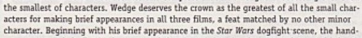

# Owner Material 038 — Star Wars Insider #1–153 plus specials (with The Lucasfilm Fan Club Magazine #1–22): Star Wars Insider #23 (1994)

- **Source:** *Star Wars Insider* magazine (issues 23–153, 1994–2014) and its predecessor *The Lucasfilm Fan Club Magazine* (issues 1–22, 1987–1994), plus seven special editions: articles, interviews, comics and short fiction Secondary source (licensed Legends reference). Scan OCR'd on the box; the scan stays box-only and is **not** published.
- **Method:** every scanned page was OCR'd and machine-screened sentence by sentence for power-relevant statements (fights, kills, defeats, Force feats, rankings, superweapons) that name a character on our roster; each kept sentence is quoted verbatim from the OCR text and has a crop of the printed passage directly under it. Pages with nothing power-relevant are still listed with what is on them.
- **Citation:** "*Star Wars Insider #23* (1994), p.X" by printed page ("scan p.X" where no printed number applies). **Weight:** Licensed magazine: a secondary source. Its short fiction and comics are Legends stories; its articles and interviews sum up or discuss lore and rank below the novels, comics and games they describe.

## scan p.1 (scan page 1)

Page contents: Cover (image-read): Star Wars Insider #23, "Premier Issue!", Obi-Wan Kenobi art (Mark Lewis); teasers for rare Holiday Special photos, the Star Wars publications timeline, Carrie Fisher, Kenny Baker and the Cult of Wedge. (hand-read)

## scan p.2 (scan page 2)

Page contents: Time Warner AudioBooks ad: Star Wars Trilogy audio collection of the three film novelizations. (hand-read)

## scan p.3 (scan page 3)

Page contents: TOC and masthead (image-read; OCR garbled). Dan Madsen publisher, president & editor; Jon Bradley Snyder senior editor; John S. Davis VP; Mike Combs comptroller; creative services Airworks and Associates; Howard Cook creative director; Donnie Whitlow art director/redesign; Mark Lewis imaging director; Dave Wolverton imaging associate; Vivian LeFebvre copy editor; pre-press A.G.P. & Gavin Graham; advertising George Koster; columnists Bob Cooper, Stephen Sansweet, Sue Seserman, Jon Bradley Snyder. Cover illustration Mark Lewis; banner logo Lance Anderson. Timeline by Allan Kausch; Carrie Fisher article by Pamela E. Roller. (hand-read)

## scan p.4 (scan page 4)

Page contents: Dan Madsen's letter on the new format; sidebar: Special Edition of Star Wars due in theaters 1997 for the twentieth anniversary, with new footage including a Jabba/Han meeting shot during principal photography, new effects shots of Mos Eisley, remixed digital soundtrack, Fox distributing; first new-trilogy film planned for 1998, set about forty years before A New Hope. (hand-read)

## scan p.5 (scan page 5)

Page contents: Letters (writers omitted) with editor replies; prequels note (Lucas to start the episode one screenplay by year's end, tentatively 1998). (hand-read)

## scan p.6 (scan page 6)

Page contents: Letters continued (writers omitted); editor correction crediting Mark Lewis. (hand-read)

## scan p.7 (scan page 7)

Page contents: Earth 2 (NBC) ad. (hand-read)

## scan p.8 (scan page 8)

Page contents: Star News: Kevin J. Anderson's Jedi Academy signing tour (Champions of the Force, mid-September); The Crystal Star and The Truce at Bakura paperback in November; the Lucasfilm Archives Japanese Museum Tour exhibit at the Yerba Buena Center for the Arts, San Francisco; the Temple of the Forbidden Eye Indiana Jones ride at Disneyland (1995). (hand-read)

## scan p.9 (scan page 9)

Page contents: Hamilton Collection plate ad (Morgan Weistling art). (hand-read)

## scan p.10 (scan page 10)

Page contents: Lucas receives an honorary USC degree (speech; family details omitted); Lucasfilm news noting the prequels will tell of a young Ben Kenobi and Anakin Skywalker. (hand-read)

## scan p.11 (scan page 11)

Page contents: Division news: Licensing, THX, ILM, Skywalker Sound (mixing Quiz Show and Radioland Murders), LucasArts (Rebel Assault best-selling PC CD-ROM, Full Throttle). (hand-read)

## scan p.12 (scan page 12)

Page contents: Danbury Mint pewter chess set ad. (hand-read)

## scan p.13 (scan page 13)

Page contents: Brian Daley radio-play scripts book ad. (hand-read)

## scan p.14 (scan page 14)

Page contents: Bob Cooper, "Straight from the Horse's Mouth": penciller Chris Gossett (Dark Lords of the Sith) on his background and influences; panel art from Tales of the Jedi: Dark Lords of the Sith #1 (pencils Gossett, inks Mike Barreiro) of Exar Kun's training session with his Jedi teacher. (hand-read)

### Stat block notes (game mechanics, not feats)

- Dark Lords of the Sith #1 caption reproduced in Cooper's column: "With the Force, Vodo can make his simple staff more powerful than Exar Kun's lightsaber!" (Tales of the Jedi: Dark Lords of the Sith #1 panel reproduced in Bob Cooper's column, Star Wars Insider 23, p. 12) (Source: *Star Wars Insider #23* (1994), scan p.14)

## scan p.15 (scan page 15)

Page contents: Gossett interview continued; second Gossett page layout of Exar Kun's Jedi training. (hand-read)

## scan p.16 (scan page 16)

Page contents: Sue Seserman, "The Creation Story": how Lucasfilm Licensing (VP Howard Roffman) builds an integrated expanded universe across books, comics, games and toys. (hand-read)

### Stat block notes (game mechanics, not feats)

- Seserman's overview of the expanded universe heroes: "Luke became a full Jedi and Leia honed her Jedi abilities; Han and Leia married and begat a new generation empowered by the Force; LucasArts' X-Wing introduced rookie Rebel pilot, Keyan Farlander, and the company's upcoming fall release, Dark Forces, launches the career of Kyle Katarn, a top Rebel agent charged with stealing the original Death Star plans and delivering them to Princess Leia." (Sue Seserman, "The Creation Story", Star Wars Insider 23, p. 14) (Source: *Star Wars Insider #23* (1994), scan p.16)
- Seserman's overview of the expanded universe villains: "Timothy Zahn gave us the icy, blue-skinned Thrawn and the Dark Jedi, Joruus C'baoth. Thrawn plays an integral role in LucasArts' TIE Fighter, which also introduced Admiral Zaarin, of the Empire's technology corps, and Admiral Harkov, a greedy Imperial commander. In Dark Forces we meet Admiral Mohc, a highly decorated member of the Imperial paratrooper force." (Sue Seserman, "The Creation Story", Star Wars Insider 23, p. 14) (Source: *Star Wars Insider #23* (1994), scan p.16)

## scan p.17 (scan page 17)

Page contents: Dark Forces preview: first-person 3-D action game slated for November, parallel to A New Hope; new locations Agamar and the Gromas Mines; LucasArts project leader Daron Stinnett and lead artist Justin Chin on developing the story. (hand-read)

### Stat block notes (game mechanics, not feats)

- Dark Forces plot as described in the Insider: "In Dark Forces, special covert Rebel agent Kyle Katarn is charged with infiltrating the Star Destroyer Avenger that carries the plans to the Death Star. During the recovery of the plans, Kyle learns that the Empire is developing another devastating weapon—an army of mechanized stormtroopers called dark troopers being designed and manufactured by an Imperial veteran soldier, Admiral Mon Mohc, who is frustrated by the fragility of the current legion of troopers. Kyle's subsequent missions involve determining the location of the dark trooper manufacturing facility, penetrating it and destroying the dark troopers and Admiral Mohc." (Sue Seserman, "The Creation Story", Star Wars Insider 23, p. 15) (Source: *Star Wars Insider #23* (1994), scan p.17)
- Kyle's encounters in Dark Forces: "He delivers the Death Star plans to Princess Leia, takes his orders from Mon Mothma, learns Darth Vader supports Admiral Mohc's efforts, battles stormtroopers and outwits Boba Fett and Jabba the Hutt." (Sue Seserman, "The Creation Story", Star Wars Insider 23, p. 15) (Source: *Star Wars Insider #23* (1994), scan p.17)

## scan p.18 (scan page 18)

Page contents: Publications Timeline (Allan Kausch; design Donnie Whitlow), with year markers before and after the films, part 1. (hand-read)

## scan p.19 (scan page 19)

Page contents: Publications Timeline part 2. (hand-read)

## scan p.20 (scan page 20)

Page contents: Timeline Q&A with continuity editors Sue Rostoni and Allan Kausch (Jon Bradley Snyder): reference materials; canon = screenplays, films, radio dramas and novelizations; Luke/Leia romance references predate the sibling reveal; off-limits period for writers is from 4,000 years before A New Hope to just before the film, except Dark Horse's Droids (five to 10 years before ANH). The Force Is Back trivia contest with Topps (winners omitted). (hand-read)

### Stat block notes (game mechanics, not feats)

- Continuity editors on Fett's survival: "For example, in Return of the Jedi, Boba Fett appears to be ingested by the Sarlacc. He reappears in Dark Empire, but the story of his escape won't be told until the upcoming anthology, Star Wars: Tales from Jabba's Palace." (Sue Rostoni and Allan Kausch, Timeline Q&A, Star Wars Insider 23, p. 18) (Source: *Star Wars Insider #23* (1994), scan p.20)
- Continuity editors on Dodonna's survival: "In the newspaper strips, General Jan Dodonna appears to make the noble sacrifice of his life for the cause of the Rebellion, only to appear later in Dark Empire, without any apparent explanation. The tale of his imprisonment by the Imperials and his daring escape has yet to be told, but rest assured, it will all make sense in the end." (Sue Rostoni and Allan Kausch, Timeline Q&A, Star Wars Insider 23, p. 18) (Source: *Star Wars Insider #23* (1994), scan p.20)

## scan p.21 (scan page 21)

Page contents: Jawa Trader catalog insert cover: Star Wars audio boxed set, The Art of Star Wars, Micro Machines playsets. (hand-read)

## scan p.22 (scan page 22)

Page contents: Catalog: Indiana Jones posters and the roleplaying game. (hand-read)

## scan p.23 (scan page 23)

Page contents: Catalog: new Star Wars products (Tomart price guide, Art of books, audio boxed set, Dark Empire audiotape, Falcon item). (hand-read)

## scan p.24 (scan page 24)

Page contents: Catalog: Star Wars books (hardcover novels, young-reader books, Art of Star Wars Galaxy, Guide to the Star Wars Universe, Jedi Academy trilogy). (hand-read)

## scan p.25 (scan page 25)

Page contents: Catalog: scripts, mousepads, radio dramas and audiotapes. (hand-read)

## scan p.26 (scan page 26)

Page contents: Catalog: Star Wars art posters and lithographs. (hand-read)

## scan p.27 (scan page 27)

Page contents: Catalog: chromart, trading cards, calendars and postcards. (hand-read)

## scan p.28 (scan page 28)

Page contents: Catalog: clothing and collectibles (shirts, pins, watches, plates). (hand-read)

## scan p.29 (scan page 29)

Page contents: Catalog: model kits. (hand-read)

## scan p.30 (scan page 30)

Page contents: Catalog: model kits continued. (hand-read)

## scan p.31 (scan page 31)

Page contents: Catalog: vinyl figure kits and model kits. (hand-read)

## scan p.32 (scan page 32)

Page contents: Catalog: Rawcliffe pewter ships and characters. (hand-read)

## scan p.33 (scan page 33)

Page contents: Catalog: pewter continued. (hand-read)

## scan p.34 (scan page 34)

Page contents: Catalog: West End Games roleplaying books. (hand-read)

## scan p.35 (scan page 35)

Page contents: Catalog: roleplaying books continued (galaxy guides, Star Wars Miniatures Battles, adventure journals). (hand-read)

## scan p.36 (scan page 36)

Page contents: Catalog: blister packs, stand-ups, Micro Machines. (hand-read)

## scan p.37 (scan page 37)

Page contents: Catalog: George Lucas' Super Live Adventure items; back issues list; fan club membership. (hand-read)

## scan p.38 (scan page 38)

Page contents: Ordering information and order form. (hand-read)

## scan p.39 (scan page 39)

Page contents: Dark Horse ad: Classic Star Wars Return of the Jedi, Tales of the Jedi: The Collection, Dark Lords of the Sith. (hand-read)

## scan p.40 (scan page 40)

Page contents: Pamela E. Roller, "Life After Leia": Carrie Fisher's writing career (private, medical and family material omitted). (hand-read)

## scan p.41 (scan page 41)

Page contents: Fisher article continued (career only): Postcards from the Edge, Surrender the Pink. (hand-read)

## scan p.42 (scan page 42)

Page contents: Fisher article continued (career only): recollections of casting and filming. (hand-read)

## scan p.43 (scan page 43)

Page contents: Fisher article continued (career only): Young Indiana Jones writing. (hand-read)

## scan p.44 (scan page 44)

Page contents: Jon Bradley Snyder, "The Star Wars Holiday Special" (1978). (hand-read)

## scan p.45 (scan page 45)

Page contents: West End Games MasterBook / World of Indiana Jones ad. (hand-read)

## scan p.46 (scan page 46)

Page contents: Holiday Special continued: centers on Chewbacca's family (printed: wife Mala, father Itchy, son Lumpy) trying to celebrate Life Day while Imperial troops search for Rebels; animated segment by Nelvana introduces Boba Fett. (hand-read)

## scan p.47 (scan page 47)

Page contents: Dan Madsen, Kenny Baker interview (professional material only): performing as R2-D2. (hand-read)

## scan p.48 (scan page 48)

Page contents: Baker interview continued. (hand-read)

## scan p.49 (scan page 49)

Page contents: Baker interview continued (filming in Tunisia and the Jedi Ewok set). (hand-read)

## scan p.50 (scan page 50)

Page contents: TIE Fighter ad. (hand-read)

## scan p.51 (scan page 51)

Page contents: Dan Madsen, Denis Lawson interview: playing Wedge. (hand-read)

## scan p.52 (scan page 52)

Page contents: Lawson interview continued. (hand-read)

## scan p.53 (scan page 53)

Page contents: Lawson interview continued. (hand-read)

## scan p.54 (scan page 54)

Page contents: "The Cult of Wedge": essay on Wedge Antilles as the greatest minor character. (hand-read)

- **Wedge Antilles** — entry/section: Star Wars Insider 023 (1994): "Wedge deserves the crown as the greatest of all the small char- acters for making brief appearances in all three films, a feat matched by no other minor character." Source: *Star Wars Insider #23* (1994), scan p.54
  

### Stat block notes (game mechanics, not feats)

- Cult of Wedge on his battle record: "Not only does Wedge survive all three major Star Wars battles, but he knocks out an Imperial walker in The Empire Strikes Back and helps Lando blow the second Death Star's reactor in Return of the Jedi." ("The Cult of Wedge", Star Wars Insider 23, p. 52) (Source: *Star Wars Insider #23* (1994), scan p.54)
- Wedge saves Luke at Yavin: "In Star Wars, Wedge saves Luke's butt from a TIE fighter as they prepare for their attack." ("The Cult of Wedge", Star Wars Insider 23, p. 52) (Source: *Star Wars Insider #23* (1994), scan p.54)

## scan p.55 (scan page 55)

Page contents: Cult of Wedge continued, with a greatest-lines box. (hand-read)

### Stat block notes (game mechanics, not feats)

- Wedge at Hoth: "In The Empire Strikes Back, Wedge leads the way by causing the first AT-AT casualty with his tow cable, a feat that buys valuable time for the evacuating Rebels. Some cunning teamwork between Wedge and his gunner, Janson, results in an Imperial walker's legs being cat's-cradled and crashing to the ground." ("The Cult of Wedge", Star Wars Insider 23, p. 53) (Source: *Star Wars Insider #23* (1994), scan p.55)
- Wedge at Endor: "Wedge guides the young greenhorn pilots through the attack and just barely gets out in time when the Death Star's reactor blows. Wedge is the only known Rebel pilot to fight and survive both Death Star battles." ("The Cult of Wedge", Star Wars Insider 23, p. 53) (Source: *Star Wars Insider #23* (1994), scan p.55)

## scan p.56 (scan page 56)

Page contents: Stephen J. Sansweet, "Scouting the Galaxy": the Tomart's Price Guide to Worldwide Star Wars Collectibles. (hand-read)

## scan p.57 (scan page 57)

Page contents: Sansweet continued; Collectibles Q&A invitation. (hand-read)

## scan p.58 (scan page 58)

Page contents: Galactic Sightings licensee news; Insider classifieds (omitted). (hand-read)

## scan p.59 (scan page 59)

Page contents: Gifted Images Ken Steacy Star Wars fine-art lithograph ad. (hand-read)

## scan p.60 (scan page 60)

Page contents: Metallic Impressions Star Wars: A New Hope metal collector's cards ad. (hand-read)

