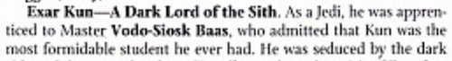

# Owner Material 038 — Star Wars Insider #1–153 plus specials (with The Lucasfilm Fan Club Magazine #1–22): Star Wars Insider #26 (1995)

- **Source:** *Star Wars Insider* magazine (issues 23–153, 1994–2014) and its predecessor *The Lucasfilm Fan Club Magazine* (issues 1–22, 1987–1994), plus seven special editions: articles, interviews, comics and short fiction Secondary source (licensed Legends reference). Scan OCR'd on the box; the scan stays box-only and is **not** published.
- **Method:** every scanned page was OCR'd and machine-screened sentence by sentence for power-relevant statements (fights, kills, defeats, Force feats, rankings, superweapons) that name a character on our roster; each kept sentence is quoted verbatim from the OCR text and has a crop of the printed passage directly under it. Pages with nothing power-relevant are still listed with what is on them.
- **Citation:** "*Star Wars Insider #26* (1995), p.X" by printed page ("scan p.X" where no printed number applies). **Weight:** Licensed magazine: a secondary source. Its short fiction and comics are Legends stories; its articles and interviews sum up or discuss lore and rank below the novels, comics and games they describe.

## scan p.1 (scan page 1)

Page contents: Cover (image-read): Star Wars Insider #26, George Lucas in Skywalker Ranch library; teasers "Win a 24kt solid gold Micro Machine!", "The Man Behind Yoda", "Exclusive interview! George Lucas preparing the Star Wars prequels!", "Ben Burtt: the sounds of Star Wars", "Kevin J. Anderson: writing for Star Wars", "Prequel update with Rick McCallum", "Star Wars news from around the globe". (hand-read)

## scan p.2 (scan page 2)

Page contents: Tomart's Action Figure Digest ad, "The Untold Star Wars Merchandise Saga" (image-read; ad copy only). (hand-read)

## scan p.3 (scan page 3)

Page contents: TOC and masthead (masthead image-read): publisher, president & editor Dan Madsen; creative director Howard Cook; vice president John S. Davis; senior editor Jon Bradley Snyder; copy editor Maren Hoven; imaging director Dave Wolverton; photography Mark Lewis/Dave Wolverton; creative services Airworks and Associates; pre-press The Electronic Easel; accounting Mike Combs; advertising George Koster; columnists Bob Cooper, Anthony Daniels, Lukas Kendall, Stephen J. Sansweet, Sue Seserman, Jon Bradley Snyder; contributors include Kevin J. Anderson, Ben Burtt, Oliver Denker, Gian Paolo Gasperi, Jane L. Garner, Patrice Girod, Lynne Hale, Allan Kausch, George Lucas, Rick McCallum, Shane Morrissey, Frank Oz, Jamie Painter, David Pescovitz, Howard Roffman, Kevin Stevens, Eimei Takeda, Lucy Autrey Wilson and others. Contents: Lucas interview 15, Star Weeze 61, Frank Oz 64, Ben Burtt 68, Star Wars Tattoos 72, Kevin J. Anderson 76; departments Rebel Rumblings, The Man Inside C-3PO, Prequel Update, Scoring the Trilogy, Around the World, Straight from the Horse's Mouth, Star News, Lucasfilm's Latest, LucasArts Update, Scouting the Galaxy, Classifieds. (hand-read)

## scan p.4 (scan page 4)

Page contents: "From the Publisher" editorial by Dan Madsen ("Dreams!"); Galoob 24kt gold Millennium Falcon Micro Machine contest with trivia questions (real-world). (hand-read)

## scan p.5 (scan page 5)

Page contents: Rebel Rumblings letters (letter writers omitted); fan opinion on the films and the club (real-world, no in-universe text). (hand-read)

## scan p.6 (scan page 6)

Page contents: Rebel Rumblings letters continued (writers omitted). (hand-read)

## scan p.7 (scan page 7)

Page contents: Rebel Rumblings letters continued (writers omitted; incl. a plea to restore the Biggs scenes); Baby Boomer Collectibles ad. (hand-read)

## scan p.8 (scan page 8)

Page contents: "The Man Inside C-3PO," column no. 1 by Anthony Daniels: on-set stunt anecdotes (stunt double Tracy Eddon, Bob Anderson as Vader's sword fighter, Colin Skeaping) told humorously; real-world. (hand-read)

## scan p.9 (scan page 9)

Page contents: Daniels column continued (Cantina Cuisine humor box, "You Ask" gag answers); real-world. (hand-read)

## scan p.10 (scan page 10)

Page contents: Prequel Update: Dan Madsen interviews producer Rick McCallum — production designer Gavin Bocquet and cinematographer David Tattersall from Young Indiana Jones, writers being considered, overseas shooting, schedule (real-world). (hand-read)

## scan p.11 (scan page 11)

Page contents: Prequel Update continued (Jeffrey Boam writing Indy 4) and "Scoring the Trilogy" by Lukas Kendall (Raiders gold CD; Joel McNeely's Shadows of the Empire score for Varèse Sarabande); real-world. (hand-read)

## scan p.12 (scan page 12)

Page contents: Around the World: Australia (Shane Morrissey; Force One convention), Japan (Eimei Takeda) — real-world fan news. (hand-read)

## scan p.13 (scan page 13)

Page contents: Around the World: France (Patrice Girod), Germany (Oliver Denker), Italy (Gian Paolo Gasperi; AllianceCon with ILM's Lorne Peterson), United Kingdom (Jane L. Garner) — real-world. (hand-read)

## scan p.14 (scan page 14)

Page contents: Straight from the Horse's Mouth by Bob Cooper, "A Guide to the Star Wars: Tales of the Jedi Universe, Part 1" (printed p. 12): source key, timeline (Naga Sadow c. 5,000 BSW4 to Exar Kun 3,991 BSW4) and A–Ambria entries. (hand-read)

### Stat block notes (game mechanics, not feats)

- Aleema Keto: Nadd's dark-side gift, illusion-casting: "She and her cousin murdered their parents and staged a political coup in the Empress Teta system. Satal and Aleema were bestowed with dark-side powers by the spirit of Freedon Nadd. Aleema's primary talent was realistic illusion-casting." (Bob Cooper, "Straight from the Horse's Mouth: A Guide to the Star Wars: Tales of the Jedi Universe, Part 1," Star Wars Insider 26, p. 12) (Source: *Star Wars Insider #26* (1995), scan p.14)
- Amanoa wields Nadd's Sith magic against the Beast-Lords: "Amanoa retained remnants of the Sith magic left from the time of Freedon Nadd, and was able to call upon the dark side forces to combat the Beast-Lords of Onderon." (Bob Cooper, "Straight from the Horse's Mouth: A Guide to the Star Wars: Tales of the Jedi Universe, Part 1," Star Wars Insider 26, p. 12) (Source: *Star Wars Insider #26* (1995), scan p.14)
- Timeline: Naga Sadow rules as Dark Lord: "5,000 BSW4—Naga Sadow rules as Dark Lord of the Sith." (Bob Cooper, "Straight from the Horse's Mouth: A Guide to the Star Wars: Tales of the Jedi Universe, Part 1," Star Wars Insider 26, p. 12) (Source: *Star Wars Insider #26* (1995), scan p.14)
- Timeline: Exar Kun becomes Dark Lord: "3,991 BSW4—Exar Kun becomes a Dark Lord of the Sith." (Bob Cooper, "Straight from the Horse's Mouth: A Guide to the Star Wars: Tales of the Jedi Universe, Part 1," Star Wars Insider 26, p. 12) (Source: *Star Wars Insider #26* (1995), scan p.14)

## scan p.15 (scan page 15)

Page contents: Tales of the Jedi guide continued (printed p. 13): Andur through Dominis entries (Arca, Bogga, Cay, Crado, Cron system, Denarii Nova, etc.); "to be continued". (hand-read)

- **Exar Kun; Vodo-Siosk Baas** — entry/section: Exar Kun (glossary): "Exar Kun—A Dark Lord of the Sith, As a Jedi, he was appren: ticed to Master Vodo-Siosk Baas, who admitted that Kun was the most formidable student he ever had." Source: *Star Wars Insider #26* (1995), scan p.15
  

### Stat block notes (game mechanics, not feats)

- Thon drives Ambria's darkness into Lake Natth: "Once a repository for great dark-side forces, all of the world's darkness was driven into Lake Natth by Thon." (Bob Cooper, "Straight from the Horse's Mouth: A Guide to the Star Wars: Tales of the Jedi Universe, Part 1," Star Wars Insider 26, p. 13) (Source: *Star Wars Insider #26* (1995), scan p.15)
- Andur Sunrider killed by gangsters: "A Jedi Knight, Andur was killed in a senseless battle with petty gangsters at the Stenness hyperspace terminal." (Bob Cooper, "Straight from the Horse's Mouth: A Guide to the Star Wars: Tales of the Jedi Universe, Part 1," Star Wars Insider 26, p. 13) (Source: *Star Wars Insider #26* (1995), scan p.15)
- Arca Jeth: Master and expert swordsman, many apprentices: "A Jedi Master and expert swordsman with a Jedi training compound located on Arkania, Master Arca taught many Jedi apprentices, including Ulic and Cay Qel-Droma, with as many as twenty in residence at one time." (Bob Cooper, "Straight from the Horse's Mouth: A Guide to the Star Wars: Tales of the Jedi Universe, Part 1," Star Wars Insider 26, p. 13) (Source: *Star Wars Insider #26* (1995), scan p.15)
- Arca Jeth's death on Deneba: "Arca was killed fighting renegade droids directed by the Krath on Deneba." (Bob Cooper, "Straight from the Horse's Mouth: A Guide to the Star Wars: Tales of the Jedi Universe, Part 1," Star Wars Insider 26, p. 13) (Source: *Star Wars Insider #26* (1995), scan p.15)
- Bogga orders Andur Sunrider's death: "He ordered the death of Jedi Andur Sunrider in order to obtain Andur's Adegan crystals." (Bob Cooper, "Straight from the Horse's Mouth: A Guide to the Star Wars: Tales of the Jedi Universe, Part 1," Star Wars Insider 26, p. 13) (Source: *Star Wars Insider #26* (1995), scan p.15)
- Cay builds his own prosthetic mid-battle: "Cay lost his left arm during the Beast Wars of Onderon, and replaced it himself during the battle with a prosthetic limb made from parts of an abandoned XT-6 service droid." (Bob Cooper, "Straight from the Horse's Mouth: A Guide to the Star Wars: Tales of the Jedi Universe, Part 1," Star Wars Insider 26, p. 13) (Source: *Star Wars Insider #26* (1995), scan p.15)
- Crado follows Exar Kun: "He became a devoted follower of Exar Kun." (Bob Cooper, "Straight from the Horse's Mouth: A Guide to the Star Wars: Tales of the Jedi Universe, Part 1," Star Wars Insider 26, p. 13) (Source: *Star Wars Insider #26* (1995), scan p.15)
- Aleema destroys a star, creating the Cron Drift: "It became the site of the future Cron Drift, when one of the stars was destroyed by Aleema, resulting in a supernova that obliterated the rest of the cluster." (Bob Cooper, "Straight from the Horse's Mouth: A Guide to the Star Wars: Tales of the Jedi Universe, Part 1," Star Wars Insider 26, p. 13) (Source: *Star Wars Insider #26* (1995), scan p.15)
- Battle of Basilisk: death of Sidrona Diath: "The scene of the death of Jedi Master Sidrona Diath." (Bob Cooper, "Straight from the Horse's Mouth: A Guide to the Star Wars: Tales of the Jedi Universe, Part 1," Star Wars Insider 26, p. 13) (Source: *Star Wars Insider #26* (1995), scan p.15)
- Denarii Nova destroyed in Naga Sadow's battle: "Denarii Nova—A double star system, site of a battle between Naga Sadow and Republic gunships that resulted in the destruction of the entire star system." (Bob Cooper, "Straight from the Horse's Mouth: A Guide to the Star Wars: Tales of the Jedi Universe, Part 1," Star Wars Insider 26, p. 13) (Source: *Star Wars Insider #26* (1995), scan p.15)
- Dominis assassinated by his apprentice Zona Luka: "Dominis—A Jedi Master. Zona Luka was one of his favorite apprentices — yet ultimately becomes his assassin." (Bob Cooper, "Straight from the Horse's Mouth: A Guide to the Star Wars: Tales of the Jedi Universe, Part 1," Star Wars Insider 26, p. 13) (Source: *Star Wars Insider #26* (1995), scan p.15)
- Vodo: Kun his most formidable student: "As a Jedi, he was apprenticed to Master Vodo-Siosk Baas, who admitted that Kun was the most formidable student he ever had." (Bob Cooper, "Straight from the Horse's Mouth: A Guide to the Star Wars: Tales of the Jedi Universe, Part 1," Star Wars Insider 26, p. 13) (Source: *Star Wars Insider #26* (1995), scan p.15)
- Exar Kun kills Odan-Urr, takes the Sith Holocron: "He confronted Master Odan-Urr in the library on Ossus, and after killing him, took the Sith Holocron in order to further his dark powers." (Bob Cooper, "Straight from the Horse's Mouth: A Guide to the Star Wars: Tales of the Jedi Universe, Part 1," Star Wars Insider 26, p. 13) (Source: *Star Wars Insider #26* (1995), scan p.15)

## scan p.16 (scan page 16)

Page contents: Star News by Jon Bradley Snyder: Mark Hamill voices Ripburger in Full Throttle, Lucas honors Spielberg at the AFI tribute, Star Wars Day at San Diego Comic-Con; "15 Years Ago in Bantha Tracks" (1980 Lucas Q&A on a nine-film saga); Fan Speak (fans omitted). Real-world. (hand-read)

## scan p.17 (scan page 17)

Page contents: Title page "An Exclusive Interview with George Lucas" (image-read; no text beyond title). (hand-read)

## scan p.18 (scan page 18)

Page contents: Lucas Q&A transcript from the Second Star Wars Summit, Skywalker Ranch, April 20, 1995 (transcribed by Allan Kausch): writing the prequel scripts, why he went back to the first trilogy, technology (real-world). (hand-read)

## scan p.19 (scan page 19)

Page contents: Lucas Q&A continued (printed p. 17): may direct Episode I, prequels cover Ben Kenobi and Anakin, digital characters, character ages; "Graph Showing Relative Dates of Star Wars Episodes I–VI" (I→II 10 years, II→III 2 years, III→IV 20 years, IV→V 3 years, V→VI 1 year). (hand-read)

### Stat block notes (game mechanics, not feats)

- Lucas: what the prequels cover: "It's a story about Ben Kenobi and Anakin Skywalker and how we got to the point where Obi-Wan Kenobi was waiting in the middle of the desert for something to happen. It's also about how Darth Vader got to be who he is, and how the Emperor came to power. It starts out with the Emperor not in power, then it keeps progressing." (George Lucas, Second Star Wars Summit Q&A, Star Wars Insider 26, p. 17) (Source: *Star Wars Insider #26* (1995), scan p.19)
- Lucas: Anakin and Obi-Wan's ages in the prequels: "At the end of the third film, Anakin is twenty-two, and Ben is about forty-two, so A New Hope is about twenty years later when Obi-Wan is in his sixties." (George Lucas, Second Star Wars Summit Q&A, Star Wars Insider 26, p. 17) (Source: *Star Wars Insider #26* (1995), scan p.19)

## scan p.20 (scan page 20)

Page contents: Lucasfilm's Latest: Fox releases Star Wars Trilogy THX videocassettes; Lucasfilm Licensing product list; ILM news (real-world). (hand-read)

## scan p.21 (scan page 21)

Page contents: Lucasfilm's Latest continued: ILM, Skywalker Sound, THX, LucasArts (Mortimer, The Dig, Rebel Assault II, TIE Fighter Collector's CD-ROM, Dark Forces passing 500,000 copies). Real-world product news only. (hand-read)

## scan p.22 (scan page 22)

Page contents: LucasArts Update by Sue Seserman on The Dig (Sean Clark, Bill Tiller, Orson Scott Card, Lucy Autrey Wilson); correction of last issue's pp. 14–15 captions (Hal Barwood on p. 14, Daron Stinnett on p. 15); real-world. (hand-read)

## scan p.23 (scan page 23)

Page contents: Jawa Trader catalog cover, "At Last! New Kenner Star Wars Figures and Vehicles!" with Landspeeder (image-read; catalog copy). (hand-read)

## scan p.24 (scan page 24)

Page contents: Jawa Trader: Kenner Electronic Millennium Falcon, TIE Fighter, action figures (catalog copy, S only). (hand-read)

## scan p.25 (scan page 25)

Page contents: Jawa Trader: Kenner AT-ST, Electronic X-wing, action figures (catalog copy). (hand-read)

## scan p.26 (scan page 26)

Page contents: Jawa Trader: Steel Tec construction Millennium Falcon and X-wing (image-read; near-empty OCR; catalog copy). (hand-read)

## scan p.27 (scan page 27)

Page contents: Jawa Trader: collector plates, pewter medallions, steins (catalog copy). (hand-read)

## scan p.28 (scan page 28)

Page contents: Jawa Trader: pewter ships and characters (catalog copy). (hand-read)

## scan p.29 (scan page 29)

Page contents: Jawa Trader: pewter figures continued (image-read; catalog copy). (hand-read)

## scan p.30 (scan page 30)

Page contents: Jawa Trader: Star Wars and Empire Strikes Back trading card sets, Galaxy cards, Widevision (catalog copy). (hand-read)

## scan p.31 (scan page 31)

Page contents: Jawa Trader: key chains and pins (catalog copy). (hand-read)

## scan p.32 (scan page 32)

Page contents: Jawa Trader: Trilogy Chromart prints (catalog copy). (hand-read)

## scan p.33 (scan page 33)

Page contents: Jawa Trader: Micro Machines vehicles and figure collections (catalog copy). (hand-read)

## scan p.34 (scan page 34)

Page contents: Jawa Trader: Micro Machines transforming action sets (catalog copy). (hand-read)

## scan p.35 (scan page 35)

Page contents: Jawa Trader: Micro Machines Millennium Falcon playset and playsets (catalog copy). (hand-read)

## scan p.36 (scan page 36)

Page contents: Jawa Trader: photographic magnets, acrylic stands, mousepads (catalog copy). (hand-read)

## scan p.37 (scan page 37)

Page contents: Jawa Trader: holograms (catalog copy). (hand-read)

## scan p.38 (scan page 38)

Page contents: Jawa Trader: pens, holograms, posters incl. Dave Dorman art posters (catalog copy). (hand-read)

## scan p.39 (scan page 39)

Page contents: Jawa Trader: movie cards, postcards, blueprints (catalog copy). (hand-read)

## scan p.40 (scan page 40)

Page contents: Jawa Trader: costumes, masks, walkie-talkies, life-size stand-ups (catalog copy). (hand-read)

## scan p.41 (scan page 41)

Page contents: Jawa Trader: adult costumes and cardboard stand-ups (image-read; little OCR; catalog copy). (hand-read)

## scan p.42 (scan page 42)

Page contents: Jawa Trader: Fan Club exclusive denim jackets, silk tie, boxer shorts (catalog copy). (hand-read)

## scan p.43 (scan page 43)

Page contents: Jawa Trader: ties and hologram watches (catalog copy). (hand-read)

## scan p.44 (scan page 44)

Page contents: Jawa Trader: T-shirts (image-read; little OCR; catalog copy). (hand-read)

## scan p.45 (scan page 45)

Page contents: Jawa Trader: T-shirts and sweatshirts (catalog copy). (hand-read)

## scan p.46 (scan page 46)

Page contents: Jawa Trader: Timothy Zahn audio boxed set and radio dramas (catalog copy). (hand-read)

## scan p.47 (scan page 47)

Page contents: Jawa Trader: audio books (catalog copy). (hand-read)

## scan p.48 (scan page 48)

Page contents: Jawa Trader: radio drama CDs/cassettes; Fan Club magazine back issues list (catalog copy). (hand-read)

## scan p.49 (scan page 49)

Page contents: Jawa Trader: 1996 calendar and datebook, vinyl and model kits (catalog copy). (hand-read)

## scan p.50 (scan page 50)

Page contents: Jawa Trader: art spread (Boba Fett, C-3PO, ships; image-read; no OCR; catalog art). (hand-read)

## scan p.51 (scan page 51)

Page contents: Jawa Trader: model kits and vinyl figure kits (catalog copy). (hand-read)

## scan p.52 (scan page 52)

Page contents: Jawa Trader: Art of the Star Wars Trilogy books and collector's scripts (catalog copy). (hand-read)

## scan p.53 (scan page 53)

Page contents: Jawa Trader: From Star Wars to Indiana Jones, From Concept to Screen to Collectible, Tomart's price guide (catalog copy). (hand-read)

## scan p.54 (scan page 54)

Page contents: Jawa Trader: young reader books, comic collections, junior Jedi Knights books (catalog copy; premise blurbs not treated as feats). (hand-read)

## scan p.55 (scan page 55)

Page contents: Jawa Trader: paperback and hardcover novels, A Guide to the Star Wars Universe (catalog copy). (hand-read)

## scan p.56 (scan page 56)

Page contents: Jawa Trader: roleplaying game supplements and Adventure Journal (catalog copy). (hand-read)

## scan p.57 (scan page 57)

Page contents: Jawa Trader: vehicle and character miniatures, computer game hint books (catalog copy). (hand-read)

## scan p.58 (scan page 58)

Page contents: Order form and ordering policies (real-world). (hand-read)

## scan p.59 (scan page 59)

Page contents: "Star Weeze" by Jon Bradley Snyder: Weezer's Matt Sharp and The Rentals as Star Wars fans (favorite figures, "Lando Day"); real-world. (hand-read)

## scan p.60 (scan page 60)

Page contents: Star Weeze continued (The Rentals with cardboard stand-ups; Return of the Jedi Ewok remark); Screamin' vinyl model kit ad. Real-world. (hand-read)

## scan p.61 (scan page 61)

Page contents: West End Games ad, The World of Indiana Jones MasterBook roleplaying game. (hand-read)

## scan p.62 (scan page 62)

Page contents: Full-page Yoda art by Tsuneo Sanda (image-read; art only, no text). (hand-read)

## scan p.63 (scan page 63)

Page contents: "Wizard of Oz" by Kevin Stevens: interview with Frank Oz on directing The Indian in the Cupboard (real-world). (hand-read)

## scan p.64 (scan page 64)

Page contents: Oz interview continued: the cupboard scene with a Darth Vader figure in a lightsaber duel with a T-Rex toy (real-world film gag, not an in-universe feat); caption on Yoda. (hand-read)

## scan p.65 (scan page 65)

Page contents: Oz interview continued: open to a computer-generated Yoda, would lend his voice; Non-Sport Update and Micro Machines ads. Real-world. (hand-read)

## scan p.66 (scan page 66)

Page contents: "Sound Advice," interview with sound designer Ben Burtt by Jamie Painter: path to USC and Star Wars, recording sounds for Lucas and Gary Kurtz (real-world). (hand-read)

## scan p.67 (scan page 67)

Page contents: Burtt interview continued: Chewbacca's voice from bears and other animals, R2-D2 as hardest sound, alien languages (Nien Nunb in Haya; caption on Ewoks and Han's blaster). Real-world. (hand-read)

## scan p.68 (scan page 68)

Page contents: Burtt continued (Ewoks from the Mongolian nomadic dialect "Chalmuk," Zulu for Jawas; blaster sound from a radio-tower guy wire); sidebar "The Great Heep" by Jon Snyder (printed p. 70) summarizing the 1986 Droids special. (hand-read)

### Stat block notes (game mechanics, not feats)

- The Great Heep feeds on Artoo units: "The Great Heep feeds himself by sucking the life out of Artoo units like cough lozenges." (Jon Snyder, "The Great Heep" sidebar, Star Wars Insider 26, p. 70) (Source: *Star Wars Insider #26* (1995), scan p.68)
- R2-D2's para-sail heroics save the day: "After some Artoo heroics (via the seldom seen R2-D2 para-sail) help save the day, R2-D2 and his band of liberated droids find poor pink KT-10 and revive her" (Jon Snyder, "The Great Heep" sidebar, Star Wars Insider 26, p. 70) (Source: *Star Wars Insider #26* (1995), scan p.68)

## scan p.69 (scan page 69)

Page contents: Burtt interview concluded: lightsaber hum from a projector motor, digital sound, IMAX directing, possible role in the restoration (real-world). (hand-read)

## scan p.70 (scan page 70)

Page contents: "Skin Deep: Star Wars Tattoos" by Jon Bradley Snyder: tattoo artist Aaron Cain and studios credited; talk-show cartoon gag with Vader (real-world). (hand-read)

## scan p.71 (scan page 71)

Page contents: Tattoo photo spread (image-read; no text). (hand-read)

## scan p.72 (scan page 72)

Page contents: Dark Horse Comics back-issue ad. (hand-read)

## scan p.73 (scan page 73)

Page contents: Star Trek: The Official Fan Club / Communicator subscription ad. (hand-read)

## scan p.74 (scan page 74)

Page contents: "The Write Stuff" by David Pescovitz: Kevin J. Anderson interview — Darksaber, Star Wars Chronology, anthologies, Young Jedi Knights with Rebecca Moesta (real-world). (hand-read)

## scan p.75 (scan page 75)

Page contents: Anderson continued: technical writing at Lawrence Livermore, dictating while hiking (wrote a Dark Apprentice turbo-skiing scene in Sequoia), writing other people's characters (real-world). (hand-read)

## scan p.76 (scan page 76)

Page contents: Anderson concluded: Tales from the Mos Eisley Cantina origin, Illustrated Star Wars Universe with Ralph McQuarrie, Dark Lords of the Sith with Tom Veitch and his solo The Sith War, Clone Wars off-limits (real-world). (hand-read)

## scan p.77 (scan page 77)

Page contents: Scouting the Galaxy by Stephen J. Sansweet: finding collectibles, Imperials vs. Star Trek crossover question, gold Darth Vader carrying case (questioners omitted). (hand-read)

## scan p.78 (scan page 78)

Page contents: Scouting continued (4-LOM figure, AST-5, costumes, "From the Adventures of Luke Skywalker" and Journal of the Whills explained as a literary device); classifieds (advertisers omitted). (hand-read)

## scan p.79 (scan page 79)

Page contents: Spectrum HoloByte ad, Star Trek: The Next Generation "A Final Unity". (hand-read)

## scan p.80 (scan page 80)

Page contents: CinemaCast Darth Vader sculpture ad (ad copy only). (hand-read)

