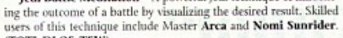

# Owner Material 038 — Star Wars Insider #1–153 plus specials (with The Lucasfilm Fan Club Magazine #1–22): Star Wars Insider #27 (1995)

- **Source:** *Star Wars Insider* magazine (issues 23–153, 1994–2014) and its predecessor *The Lucasfilm Fan Club Magazine* (issues 1–22, 1987–1994), plus seven special editions: articles, interviews, comics and short fiction Secondary source (licensed Legends reference). Scan OCR'd on the box; the scan stays box-only and is **not** published.
- **Method:** every scanned page was OCR'd and machine-screened sentence by sentence for power-relevant statements (fights, kills, defeats, Force feats, rankings, superweapons) that name a character on our roster; each kept sentence is quoted verbatim from the OCR text and has a crop of the printed passage directly under it. Pages with nothing power-relevant are still listed with what is on them.
- **Citation:** "*Star Wars Insider #27* (1995), p.X" by printed page ("scan p.X" where no printed number applies). **Weight:** Licensed magazine: a secondary source. Its short fiction and comics are Legends stories; its articles and interviews sum up or discuss lore and rank below the novels, comics and games they describe.

## scan p.1 (scan page 1)

Page contents: Cover (image-read): Star Wars Insider #27; teasers "Exclusive Tour! Return to Tatooine", Irvin Kershner interview, latest on Shadows of the Empire, prequel update with Rick McCallum, Star Wars news from around the world, "Ewoks and Droids" guide. (hand-read)

## scan p.2 (scan page 2)

Page contents: The Dig (LucasArts) ad; ad copy only. (hand-read)

## scan p.3 (scan page 3)

Page contents: Table of contents and masthead (Dan Madsen publisher/editor; columnists Bob Cooper, Anthony Daniels, Lukas Kendall, Stephen J. Sansweet, Sue Seserman, Jon Bradley Snyder). (hand-read)

## scan p.4 (scan page 4)

Page contents: Dan Madsen editorial; Galoob gold Millennium Falcon Micro Machine contest. (hand-read)

## scan p.5 (scan page 5)

Page contents: Rebel Rumblings letters (letter writers omitted; real-world). (hand-read)

## scan p.6 (scan page 6)

Page contents: Rebel Rumblings letters (letter writers omitted; real-world). (hand-read)

## scan p.7 (scan page 7)

Page contents: Rebel Rumblings letters (letter writers omitted; real-world). (hand-read)

## scan p.8 (scan page 8)

Page contents: Rebel Rumblings letters (letter writers omitted; real-world). (hand-read)

## scan p.9 (scan page 9)

Page contents: Pewter chess set ad. (hand-read)

## scan p.10 (scan page 10)

Page contents: Prequel Update with Rick McCallum (production real-world; one creator quote logged as T). (hand-read)

### Stat block notes (game mechanics, not feats)

- McCallum: the prequels are the story of Anakin, one of the most extraordinary Force-powered kids: "This is the story about one of the most extraordinary kids who ever had the power of the Force. It's the story of Anakin and what happened to him and that inevitable moment when he chose between good and evil. Why did that happen and how did that happen? Where did he come from and how could he have made that choice? That's the real saga." (Rick McCallum, "Prequel Update," Star Wars Insider 27, p. 8) (Source: *Star Wars Insider #27* (1995), scan p.10)

## scan p.11 (scan page 11)

Page contents: Prequel Update continued; Lukas Kendall's John Williams/scoring column begins. (hand-read)

## scan p.12 (scan page 12)

Page contents: Anthony Daniels' "Wonder Column" (C-3PO actor's real-world anecdotes; p14 joke boxes "Cantina Cuisine No. 78" and "Ewoks - The Virus", humor, S only). (hand-read)

## scan p.13 (scan page 13)

Page contents: Anthony Daniels' "Wonder Column" (C-3PO actor's real-world anecdotes; p14 joke boxes "Cantina Cuisine No. 78" and "Ewoks - The Virus", humor, S only). (hand-read)

## scan p.14 (scan page 14)

Page contents: Anthony Daniels' "Wonder Column" (C-3PO actor's real-world anecdotes; p14 joke boxes "Cantina Cuisine No. 78" and "Ewoks - The Virus", humor, S only). (hand-read)

## scan p.15 (scan page 15)

Page contents: Star Wars: DarkStryder (West End Games) ad. (hand-read)

## scan p.16 (scan page 16)

Page contents: Around the World: international video/laserdisc news. (hand-read)

## scan p.17 (scan page 17)

Page contents: X-wings in Frankfurt (FoxVideo Germany promotional X-wing build), byline Nelson Hall (sheet-verified). (hand-read)

## scan p.18 (scan page 18)

Page contents: Pamela Roller on the international Trilogy video marketing campaign. (hand-read)

## scan p.19 (scan page 19)

Page contents: Tomart ad; Roller article continued. (hand-read)

## scan p.20 (scan page 20)

Page contents: Roller article concluded; Around the World reports from Germany (Oliver Denker) and Canada (correspondent name not image-verified, omitted). (hand-read)

## scan p.21 (scan page 21)

Page contents: Seserman's in-universe Rebel Assault II pilot journal (Dreighton Nebula: "pilots have been mysteriously disappearing since before the Clone Wars"). (hand-read)

### Stat block notes (game mechanics, not feats)

- Rookie One helped destroy a Death Star: "...a Rebel pilot who calls himself Rookie One... In Rebel Assault, Rookie One faced numerous space and land-based battles against the Empire and ultimately played an integral part in the destruction of a Death Star." (Sue Seserman, "Excerpts from the Journal of a Rebel Pilot," Star Wars Insider 27, p. 19) (Source: *Star Wars Insider #27* (1995), scan p.21)
- Rookie One: crackerjack shot; with Ru Murleen and Ferrell blew up a Death Star: "I'm a pretty good pilot and a crackerjack shot... I was there with Ru Murleen and Captain Ferrell when we put a major crimp in the Empire's plans by blowing up a Death Star." (Sue Seserman, "Excerpts from the Journal of a Rebel Pilot," Star Wars Insider 27, p. 19) (Source: *Star Wars Insider #27* (1995), scan p.21)
- Ru Murleen: great pilot and shooter: "she wasn't only a great pilot and shooter" (Sue Seserman, "Excerpts from the Journal of a Rebel Pilot," Star Wars Insider 27, p. 19) (Source: *Star Wars Insider #27* (1995), scan p.21)
- Commander Kirby, one of the best, killed in the Dreighton Nebula: "My commander, Commander Kirby, ordered me to accompany him into the nebula... he's one of the best... I heard Commander Kirby scream through my com. I looked around and he was gone. Blown away." (Sue Seserman, "Excerpts from the Journal of a Rebel Pilot," Star Wars Insider 27, p. 19) (Source: *Star Wars Insider #27* (1995), scan p.21)
- Rookie One fights through a frigate-load of stormtroopers: "it's a good thing those stormtroopers are pretty slow, because there sure were a frigate load of them inside. By the time I reached the ship sending the signal, I was nearly out of ammo... made a break for the ship and managed to get on board with blasters firing all around me." (Sue Seserman, "Excerpts from the Journal of a Rebel Pilot," Star Wars Insider 27, p. 19) (Source: *Star Wars Insider #27* (1995), scan p.21)
- Ackbar orders an investigation of the mining facility: "Admiral Ackbar plans to send a squadron to the mining facility to investigate." (Sue Seserman, "Excerpts from the Journal of a Rebel Pilot," Star Wars Insider 27, p. 19) (Source: *Star Wars Insider #27* (1995), scan p.21)

## scan p.22 (scan page 22)

Page contents: Shadows of the Empire multimedia/licensing news (real-world). (hand-read)

## scan p.23 (scan page 23)

Page contents: Lucasfilm's Latest (company news, real-world). (hand-read)

## scan p.24 (scan page 24)

Page contents: Star News by Jon Bradley Snyder; Kendall column end. (hand-read)

## scan p.25 (scan page 25)

Page contents: Infotainment ad. (hand-read)

## scan p.26 (scan page 26)

Page contents: Star Trek fan club ad. (hand-read)

## scan p.27 (scan page 27)

Page contents: Jawa Trader merchandise catalog (image-viewed; product copy only, no in-universe text). (hand-read)

## scan p.28 (scan page 28)

Page contents: Jawa Trader merchandise catalog (image-viewed; product copy only, no in-universe text). (hand-read)

## scan p.29 (scan page 29)

Page contents: Jawa Trader merchandise catalog (image-viewed; product copy only, no in-universe text). (hand-read)

## scan p.30 (scan page 30)

Page contents: Jawa Trader merchandise catalog (image-viewed; product copy only, no in-universe text). (hand-read)

## scan p.31 (scan page 31)

Page contents: Jawa Trader merchandise catalog (image-viewed; product copy only, no in-universe text). (hand-read)

## scan p.32 (scan page 32)

Page contents: Jawa Trader merchandise catalog (image-viewed; product copy only, no in-universe text). (hand-read)

## scan p.33 (scan page 33)

Page contents: Jawa Trader merchandise catalog (image-viewed; product copy only, no in-universe text). (hand-read)

## scan p.34 (scan page 34)

Page contents: Jawa Trader merchandise catalog (image-viewed; product copy only, no in-universe text). (hand-read)

## scan p.35 (scan page 35)

Page contents: Jawa Trader merchandise catalog (image-viewed; product copy only, no in-universe text). (hand-read)

## scan p.36 (scan page 36)

Page contents: Jawa Trader merchandise catalog (image-viewed; product copy only, no in-universe text). (hand-read)

## scan p.37 (scan page 37)

Page contents: Jawa Trader merchandise catalog (image-viewed; product copy only, no in-universe text). (hand-read)

## scan p.38 (scan page 38)

Page contents: Jawa Trader merchandise catalog (image-viewed; product copy only, no in-universe text). (hand-read)

## scan p.39 (scan page 39)

Page contents: Jawa Trader merchandise catalog (image-viewed; product copy only, no in-universe text). (hand-read)

## scan p.40 (scan page 40)

Page contents: Jawa Trader merchandise catalog (image-viewed; product copy only, no in-universe text). (hand-read)

## scan p.41 (scan page 41)

Page contents: Jawa Trader merchandise catalog (image-viewed; product copy only, no in-universe text). (hand-read)

## scan p.42 (scan page 42)

Page contents: Jawa Trader merchandise catalog (image-viewed; product copy only, no in-universe text). (hand-read)

## scan p.43 (scan page 43)

Page contents: Jawa Trader merchandise catalog (image-viewed; product copy only, no in-universe text). (hand-read)

## scan p.44 (scan page 44)

Page contents: Jawa Trader merchandise catalog (image-viewed; product copy only, no in-universe text). (hand-read)

## scan p.45 (scan page 45)

Page contents: Jawa Trader merchandise catalog (image-viewed; product copy only, no in-universe text). (hand-read)

## scan p.46 (scan page 46)

Page contents: Jawa Trader merchandise catalog (image-viewed; product copy only, no in-universe text). (hand-read)

## scan p.47 (scan page 47)

Page contents: Jawa Trader merchandise catalog (image-viewed; product copy only, no in-universe text). (hand-read)

## scan p.48 (scan page 48)

Page contents: Jawa Trader merchandise catalog (image-viewed; product copy only, no in-universe text). (hand-read)

## scan p.49 (scan page 49)

Page contents: Jawa Trader merchandise catalog (image-viewed; product copy only, no in-universe text). (hand-read)

## scan p.50 (scan page 50)

Page contents: Jawa Trader merchandise catalog (image-viewed; product copy only, no in-universe text). (hand-read)

## scan p.51 (scan page 51)

Page contents: Jawa Trader merchandise catalog (image-viewed; product copy only, no in-universe text). (hand-read)

## scan p.52 (scan page 52)

Page contents: Jawa Trader merchandise catalog (image-viewed; product copy only, no in-universe text). (hand-read)

## scan p.53 (scan page 53)

Page contents: Jawa Trader merchandise catalog (image-viewed; product copy only, no in-universe text). (hand-read)

## scan p.54 (scan page 54)

Page contents: Jawa Trader merchandise catalog (image-viewed; product copy only, no in-universe text). (hand-read)

## scan p.55 (scan page 55)

Page contents: Jawa Trader merchandise catalog (image-viewed; product copy only, no in-universe text). (hand-read)

## scan p.56 (scan page 56)

Page contents: Jawa Trader merchandise catalog (image-viewed; product copy only, no in-universe text). (hand-read)

## scan p.57 (scan page 57)

Page contents: Jawa Trader merchandise catalog (image-viewed; product copy only, no in-universe text). (hand-read)

## scan p.58 (scan page 58)

Page contents: Bob Cooper TotJ guide part 2 (F-M entries; caption "Mandalore"); remaining entries places/ships (Foerost, Iron Citadel, Iziz, Kuar, Lightside Explorer, Nebulon Ranger) and minor figures (Finhead Stonebone, Fnnbu, Galia, Gruna, Halkans, Lord Keto, Korus, Magda, Modon Kira, Nebo, Netus, Norgar, Shoaneb Culu, Qrrl Toq) without feats, S only. (hand-read)

### Stat block notes (game mechanics, not feats)

- Fall of the Sith Empire: Sith led by Sadow to Yavin Four: "driven to near extinction, eventually led by Sadow to sanctuary on Yavin Four." (Bob Cooper, "Straight from the Horse's Mouth: A Guide to the Star Wars: Tales of the Jedi Universe, Part 2," Star Wars Insider 27, p. 58) (Source: *Star Wars Insider #27* (1995), scan p.58)
- Farng's execution sparks revolt: "Farng: execution by Aleema led to a citizen revolt in Cinnagar." (Bob Cooper, "Straight from the Horse's Mouth: A Guide to the Star Wars: Tales of the Jedi Universe, Part 2," Star Wars Insider 27, p. 58) (Source: *Star Wars Insider #27* (1995), scan p.58)
- Freedon Nadd: fallen Jedi, Sith apprentice, ruler of Onderon; tomb of concentrated dark-side power: "A Jedi, he was seduced by the dark side of the Force and apprenticed himself to a Dark Lord of the Sith. He brought the dark power of the Sith to Onderon four centuries before the Republic intervention, decreeing that Onderon remain isolated, thus allowing him to rule the planet unchallenged by anyone. For a long time, the tomb of Freedon Nadd existed within the walls of Iziz, and was a location of concentrated dark-side power. His sarcophagus was eventually moved to Dxun." (Bob Cooper, "Straight from the Horse's Mouth: A Guide to the Star Wars: Tales of the Jedi Universe, Part 2," Star Wars Insider 27, p. 58) (Source: *Star Wars Insider #27* (1995), scan p.58)
- Freedon Nadd Uprising: Nadd's lingering dark-side power; ended with Ommin's death: "were aided immeasurably by the mystical upwelling of the dark-side power of Freedon Nadd still prevalent throughout Onderon. The Uprising came to an end with the death of King Ommin." (Bob Cooper, "Straight from the Horse's Mouth: A Guide to the Star Wars: Tales of the Jedi Universe, Part 2," Star Wars Insider 27, p. 58) (Source: *Star Wars Insider #27* (1995), scan p.58)
- Garnoo: ancient Neti Master of Oss Wilum: "An ancient Neti Master to, among others, Oss Wilum." (Bob Cooper, "Straight from the Horse's Mouth: A Guide to the Star Wars: Tales of the Jedi Universe, Part 2," Star Wars Insider 27, p. 58) (Source: *Star Wars Insider #27* (1995), scan p.58)
- Golthar's Sky: Aleema's mammoth illusory star-freighter: "The name of a mammoth illusional star-freighter created by Aleema's magic." (Bob Cooper, "Straight from the Horse's Mouth: A Guide to the Star Wars: Tales of the Jedi Universe, Part 2," Star Wars Insider 27, p. 58) (Source: *Star Wars Insider #27* (1995), scan p.58)
- Gorm-worm venom kills instantly; used to kill Andur Sunrider: "poison sacs of venom, that can kill instantly with its bite. A gorm-worm was used to kill Andur Sunrider." (Bob Cooper, "Straight from the Horse's Mouth: A Guide to the Star Wars: Tales of the Jedi Universe, Part 2," Star Wars Insider 27, p. 58) (Source: *Star Wars Insider #27* (1995), scan p.58)
- Arca fought in the Great Droid Revolution: "which Master Arca fought in." (Bob Cooper, "Straight from the Horse's Mouth: A Guide to the Star Wars: Tales of the Jedi Universe, Part 2," Star Wars Insider 27, p. 58) (Source: *Star Wars Insider #27* (1995), scan p.58)
- Grimorg: Bogga's palace enforcer: "Great Bogga's Weequay palace enforcer." (Bob Cooper, "Straight from the Horse's Mouth: A Guide to the Star Wars: Tales of the Jedi Universe, Part 2," Star Wars Insider 27, p. 58) (Source: *Star Wars Insider #27* (1995), scan p.58)
- Gudb led the plot to kill Andur Sunrider with gorm-worm Skritch: "A gangster in the employ of Great Bogga. He led a conspiracy to kill Andur Sunrider at the Stenness hyperspace terminal, with the help of his pet gorm-worm, Skritch." (Bob Cooper, "Straight from the Horse's Mouth: A Guide to the Star Wars: Tales of the Jedi Universe, Part 2," Star Wars Insider 27, p. 58) (Source: *Star Wars Insider #27* (1995), scan p.58)
- Harkul: battle of Ulic vs Mandalore: "location of a battle between Ulic Qel-Droma and Mandalore." (Bob Cooper, "Straight from the Horse's Mouth: A Guide to the Star Wars: Tales of the Jedi Universe, Part 2," Star Wars Insider 27, p. 58) (Source: *Star Wars Insider #27* (1995), scan p.58)
- Jedi Battle Meditation: Arca and Nomi skilled users: "A powerful Jedi technique of influencing the outcome of a battle by visualizing the desired result. Skilled users of this technique include Master Arca and Nomi Sunrider." (Bob Cooper, "Straight from the Horse's Mouth: A Guide to the Star Wars: Tales of the Jedi Universe, Part 2," Star Wars Insider 27, p. 58) (Source: *Star Wars Insider #27* (1995), scan p.58)

## scan p.59 (scan page 59)

Page contents: TotJ guide part 2 continued (caption "A Mandalorian war mount"). (hand-read)

- **Arca Jeth; Nomi Sunrider** — entry/section: Star Wars Insider 027 (1995): "Skilled users of dis technique include Master Arca aml Nomi Sunrider." Source: *Star Wars Insider #27* (1995), scan p.59
  

### Stat block notes (game mechanics, not feats)

- Kith Kark killed in the Freedon Nadd Uprising: "A Jedi killed during the Freedon Nadd Uprising." (Bob Cooper, "Straight from the Horse's Mouth: A Guide to the Star Wars: Tales of the Jedi Universe, Part 2," Star Wars Insider 27, p. 59) (Source: *Star Wars Insider #27* (1995), scan p.59)
- Ktriss: Bogga's dark-side hssiss from Lake Natth: "Great Bogga's pet hssiss, a dark-side creature captured from Lake Natth on Ambria." (Bob Cooper, "Straight from the Horse's Mouth: A Guide to the Star Wars: Tales of the Jedi Universe, Part 2," Star Wars Insider 27, p. 59) (Source: *Star Wars Insider #27* (1995), scan p.59)
- Lake Natth: dark-side forces driven there by Thon: "Dark-side forces congregated in the lake, driven there by Master Thon, resulting in mutations to the species." (Bob Cooper, "Straight from the Horse's Mouth: A Guide to the Star Wars: Tales of the Jedi Universe, Part 2," Star Wars Insider 27, p. 59) (Source: *Star Wars Insider #27* (1995), scan p.59)
- Mandalore: warlord conqueror; lost to Ulic and served him: "A mercenary warlord, conqueror of the planet that now bears his name, near the Empress Teta system. He lost a forced confrontation with Ulic Qel-Droma, and became a willing servant to him. He is an antecedent of Boba Fett and the Mandalorian supercommandos of later generations, and like Boba Fett, wears a metal mask that covers his entire face." (Bob Cooper, "Straight from the Horse's Mouth: A Guide to the Star Wars: Tales of the Jedi Universe, Part 2," Star Wars Insider 27, p. 59) (Source: *Star Wars Insider #27* (1995), scan p.59)
- Massassi: mutated by Sadow's magic, use the dark side to guide weapons; conquered by Exar Kun: "...purposefully mutated by Sadow's magic in order to provide a race of fearsome warriors to guard the temples... The Massassi use the dark side of the Force to control and guide their primitive weapons. They were eventually conquered by Exar Kun." (Bob Cooper, "Straight from the Horse's Mouth: A Guide to the Star Wars: Tales of the Jedi Universe, Part 2," Star Wars Insider 27, p. 59) (Source: *Star Wars Insider #27* (1995), scan p.59)
- Mount Meru: assembly of ten thousand Jedi led by Odan-Urr: "amphitheater on Deneba where an assembly of ten thousand Jedis led by Master Odan-Urr occurred prior to the Sith War." (Bob Cooper, "Straight from the Horse's Mouth: A Guide to the Star Wars: Tales of the Jedi Universe, Part 2," Star Wars Insider 27, p. 59) (Source: *Star Wars Insider #27* (1995), scan p.59)
- Naga Sadow: Dark Lord, pure-blood Sith priesthood; battle at Denarii Nova: "A Dark Lord of the Sith, he ruled approximately a thousand years before the time of Exar Kun. A member of an elite priesthood of pure Sith blood, he was exiled from his homeworld for rebelling against the reigning Dark Lord of the Sith, and was scorned as a criminal by the Republic. He escaped across the galaxy, engaging Republic gunships in a cataclysmic battle at the Denarii Nova. Eventually, he and his followers ended up on Yavin Four, with his followers devolving into the primitive Massassi warriors over the centuries." (Bob Cooper, "Straight from the Horse's Mouth: A Guide to the Star Wars: Tales of the Jedi Universe, Part 2," Star Wars Insider 27, p. 59) (Source: *Star Wars Insider #27* (1995), scan p.59)
- Nomi Sunrider: Thon's apprentice, conversant in Battle Meditation: "The wife of Andur Sunrider, and mother of Vima Sunrider. A Jedi, Nomi was apprenticed to Master Thon. Nomi was conversant in Jedi Battle Meditation." (Bob Cooper, "Straight from the Horse's Mouth: A Guide to the Star Wars: Tales of the Jedi Universe, Part 2," Star Wars Insider 27, p. 59) (Source: *Star Wars Insider #27* (1995), scan p.59)
- Novar: minor dark-side wizard: "He was a minor dark-side wizard." (Bob Cooper, "Straight from the Horse's Mouth: A Guide to the Star Wars: Tales of the Jedi Universe, Part 2," Star Wars Insider 27, p. 59) (Source: *Star Wars Insider #27* (1995), scan p.59)

## scan p.60 (scan page 60)

Page contents: Pete Hull interview with Irvin Kershner (real-world). (hand-read)

## scan p.61 (scan page 61)

Page contents: Pete Hull interview with Irvin Kershner (real-world). (hand-read)

## scan p.62 (scan page 62)

Page contents: Pete Hull interview with Irvin Kershner (real-world). (hand-read)

## scan p.63 (scan page 63)

Page contents: Jon Bradley Snyder, "A Star Wars CELibration": history of Nelvana's Ewoks/Droids cartoons (Clive Smith, Paul Dini; real-world production). (hand-read)

## scan p.64 (scan page 64)

Page contents: Jon Bradley Snyder, "A Star Wars CELibration": history of Nelvana's Ewoks/Droids cartoons (Clive Smith, Paul Dini; real-world production). (hand-read)

## scan p.65 (scan page 65)

Page contents: CELibration concluded; captions "The Dulock Shaman", Morag captures the baby Phlog in "Rampage of the Phlogs". (hand-read)

### Stat block notes (game mechanics, not feats)

- Asha: feral fighter who single-handedly saves the tribe from the Duloks: "Asha, a creation of Paul Dini, was Ewok Princess Kneesaa's long lost red-haired older sister. Asha was lost in the forest as a Wokling and grew up in the wilderness as a savage fighter who protects the forest creatures from evildoers. In one of the best shows from the first season Asha single-handedly saves the tribe from its arch enemies the Duloks." (Jon Bradley Snyder, "A Star Wars CELibration," Star Wars Insider 27, p. 65) (Source: *Star Wars Insider #27* (1995), scan p.65)

## scan p.66 (scan page 66)

Page contents: Ewoks episode guide (Snyder): remaining episodes and characters (Wicket, Teebo, Latara, Chirpa, Shodu, Duloks, King Gorneesh, Raich and two-headed Gonster, Snow King/Sun King) without further feats. (hand-read)

### Stat block notes (game mechanics, not feats)

- Character list: Logray the wizard; Morag the Tulgah witch: "Logray: The wise old Ewok wizard/shaman. ... Morag: The Tulgah witch and fierce enemy of the Ewoks." (Jon Bradley Snyder, "Ewoks/Droids Episode Guide," Star Wars Insider 27, p. 66) (Source: *Star Wars Insider #27* (1995), scan p.66)
- Logray's Magic Seed becomes an octopus: "Logray's Magic Seed turns into a big octopus and saves the day." (Jon Bradley Snyder, "Ewoks/Droids Episode Guide," Star Wars Insider 27, p. 66) (Source: *Star Wars Insider #27* (1995), scan p.66)
- Morag with the Sunstar becomes a lava monster; Logray saves everyone: "Morag steals the sacred Ewok Sunstar and slaps it on her Shadowstone. She immediately turns into a huge lava monster. The Ewok wizard Logray comes to save everyone and retrieve the Sunstar." (Jon Bradley Snyder, "Ewoks/Droids Episode Guide," Star Wars Insider 27, p. 66) (Source: *Star Wars Insider #27* (1995), scan p.66)
- Asha: feral Ewok warrior who battles the Duloks: "the wild red-haired feral Ewok nicknamed 'the red ghost.' She rides a korrina and protects the forest creatures from evil... long lost older sister of Kneesaa... Asha battles the Duloks." (Jon Bradley Snyder, "Ewoks/Droids Episode Guide," Star Wars Insider 27, p. 66) (Source: *Star Wars Insider #27* (1995), scan p.66)
- Gracca's touch turns everything to crystal: "the evil Gracca, who lives on the floating mountain, and whose touch turns everything to crystal." (Jon Bradley Snyder, "Ewoks/Droids Episode Guide," Star Wars Insider 27, p. 66) (Source: *Star Wars Insider #27* (1995), scan p.66)
- Wicket defeats the Totem Master with a mirror: "Wicket uses a mirror to defeat him." (Jon Bradley Snyder, "Ewoks/Droids Episode Guide," Star Wars Insider 27, p. 66) (Source: *Star Wars Insider #27* (1995), scan p.66)
- Teebo and Wicket banish the Stranger to his dimension: "Teebo and Wicket send him hurtling back to his own dimension." (Jon Bradley Snyder, "Ewoks/Droids Episode Guide," Star Wars Insider 27, p. 66) (Source: *Star Wars Insider #27* (1995), scan p.66)
- Wicket defeats the hanadak: "The ferocious hanadak comes and attacks everyone. Wicket defeats the hanadak." (Jon Bradley Snyder, "Ewoks/Droids Episode Guide," Star Wars Insider 27, p. 66) (Source: *Star Wars Insider #27* (1995), scan p.66)
- Teebo defeats Zarrak, Logray's first apprentice: "Zarrak, an Ewok who was Logray's first apprentice... tries to capture Teebo. Teebo gets a magic trick to work at the last moment and defeats Zarrak." (Jon Bradley Snyder, "Ewoks/Droids Episode Guide," Star Wars Insider 27, p. 66) (Source: *Star Wars Insider #27* (1995), scan p.66)

## scan p.67 (scan page 67)

Page contents: Droids episode guide: Thall Joben, Jord Dusat, Tig Fromm, Vlix, Jann Tosh, Jessica Meade, Mungo Baobab, Auren/Nilz Yomm, Admiral Screed; Trigon One destroys itself with the Fromm base; Kybo Ren defeated by Lord Koda and Mon Julpa; Silky the magical unicorn and King Elbo (Ewoks) also here. (hand-read)

### Stat block notes (game mechanics, not feats)

- Dr. Raegar seeks the Sunstar to master the universe; punished by the Emperor: "The Evil Dr. Raegar comes to Endor aboard an Imperial Star Destroyer to steal the Sunstar and become master of the universe... In the end Raegar gets his just deserts from the Emperor, who he has betrayed." (Jon Bradley Snyder, "Ewoks/Droids Episode Guide," Star Wars Insider 27, p. 67) (Source: *Star Wars Insider #27* (1995), scan p.67)
- Droids character list: "Kea Moll: Rebel freedom fighter. ... Sise Fromm: Notorious gangster. ... Captain Kybo Ren: Evil space pirate. ... Governor Koong: Corrupt ruler of the Tauntoon province and the Roon system. ... Gaff: Koong's ruthless henchman." (Jon Bradley Snyder, "Ewoks/Droids Episode Guide," Star Wars Insider 27, p. 67) (Source: *Star Wars Insider #27* (1995), scan p.67)
- Boba Fett tries to assassinate Thall Joben: "Boba Fett, who owes Sise Fromm a favor, is enlisted to get the droids and their Rebel friends. Boba Fett attempts to assassinate Thall during a speeder race but is thwarted by the Fromms meddling. Fett is so mad he promises to deliver the Fromms to Jabba the Hutt." (Jon Bradley Snyder, "Ewoks/Droids Episode Guide," Star Wars Insider 27, p. 67) (Source: *Star Wars Insider #27* (1995), scan p.67)
- IG-88 subdued as Mon Julpa retakes his throne: "IG-88 makes his only appearance, but is subdued as the droids help Mon Julpa recapture his throne." (Jon Bradley Snyder, "Ewoks/Droids Episode Guide," Star Wars Insider 27, p. 67) (Source: *Star Wars Insider #27* (1995), scan p.67)
- Artoo stuns stormtroopers with volume: "Artoo cranks up the volume to stun stormtroopers." (Jon Bradley Snyder, "Ewoks/Droids Episode Guide," Star Wars Insider 27, p. 67) (Source: *Star Wars Insider #27* (1995), scan p.67)
- Koong uses germ warfare: "Koong uses germ warfare" (Jon Bradley Snyder, "Ewoks/Droids Episode Guide," Star Wars Insider 27, p. 67) (Source: *Star Wars Insider #27* (1995), scan p.67)

## scan p.68 (scan page 68)

Page contents: David West Reynolds, "Return to Tatooine": real-world tour of Tunisian filming locations (Robert Watts sidebar p72; non-staff companions omitted). (hand-read)

## scan p.69 (scan page 69)

Page contents: David West Reynolds, "Return to Tatooine": real-world tour of Tunisian filming locations (Robert Watts sidebar p72; non-staff companions omitted). (hand-read)

## scan p.70 (scan page 70)

Page contents: David West Reynolds, "Return to Tatooine": real-world tour of Tunisian filming locations (Robert Watts sidebar p72; non-staff companions omitted). (hand-read)

## scan p.71 (scan page 71)

Page contents: David West Reynolds, "Return to Tatooine": real-world tour of Tunisian filming locations (Robert Watts sidebar p72; non-staff companions omitted). (hand-read)

## scan p.72 (scan page 72)

Page contents: David West Reynolds, "Return to Tatooine": real-world tour of Tunisian filming locations (Robert Watts sidebar p72; non-staff companions omitted). (hand-read)

## scan p.73 (scan page 73)

Page contents: David West Reynolds, "Return to Tatooine": real-world tour of Tunisian filming locations (Robert Watts sidebar p72; non-staff companions omitted). (hand-read)

## scan p.74 (scan page 74)

Page contents: David West Reynolds, "Return to Tatooine": real-world tour of Tunisian filming locations (Robert Watts sidebar p72; non-staff companions omitted). (hand-read)

## scan p.75 (scan page 75)

Page contents: Pamela Roller on poster artist John Alvin (real-world). (hand-read)

## scan p.76 (scan page 76)

Page contents: Pamela Roller on poster artist John Alvin (real-world). (hand-read)

## scan p.77 (scan page 77)

Page contents: Pamela Roller on poster artist John Alvin (real-world). (hand-read)

## scan p.78 (scan page 78)

Page contents: Sansweet's Scouting the Galaxy: Droids/Ewoks toys (Vlix figure). (hand-read)

## scan p.79 (scan page 79)

Page contents: Del Rey books ad. (hand-read)

## scan p.80 (scan page 80)

Page contents: Scouting Queries (4-LOM/Zuckuss naming correction, real-world; questioners omitted); classifieds omitted. (hand-read)

## scan p.81 (scan page 81)

Page contents: Star Wars Trilogy CD-ROM/screen-saver ad (product copy only). (hand-read)

## scan p.82 (scan page 82)

Page contents: Contact 96 convention ad. (hand-read)

