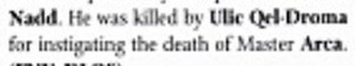
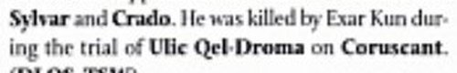
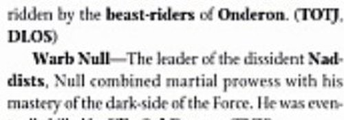
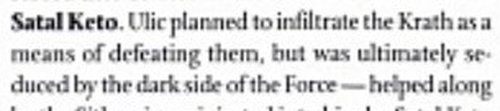

# Owner Material 038 — Star Wars Insider #1–153 plus specials (with The Lucasfilm Fan Club Magazine #1–22): Star Wars Insider #28 (1996)

- **Source:** *Star Wars Insider* magazine (issues 23–153, 1994–2014) and its predecessor *The Lucasfilm Fan Club Magazine* (issues 1–22, 1987–1994), plus seven special editions: articles, interviews, comics and short fiction Secondary source (licensed Legends reference). Scan OCR'd on the box; the scan stays box-only and is **not** published.
- **Method:** every scanned page was OCR'd and machine-screened sentence by sentence for power-relevant statements (fights, kills, defeats, Force feats, rankings, superweapons) that name a character on our roster; each kept sentence is quoted verbatim from the OCR text and has a crop of the printed passage directly under it. Pages with nothing power-relevant are still listed with what is on them.
- **Citation:** "*Star Wars Insider #28* (1996), p.X" by printed page ("scan p.X" where no printed number applies). **Weight:** Licensed magazine: a secondary source. Its short fiction and comics are Legends stories; its articles and interviews sum up or discuss lore and rank below the novels, comics and games they describe.

## scan p.1 (scan page 1)

Page contents: Cover (image-read): Star Wars Insider #28; teasers "Chewbacca: An exclusive interview with Peter Mayhew", exclusive Shadows of the Empire update, Special Edition. (hand-read)

## scan p.2 (scan page 2)

Page contents: Tomart Action Figure Digest ad; ad copy only. (hand-read)

## scan p.3 (scan page 3)

Page contents: Table of contents: Peter Mayhew interview by Kevin Stevens p50, Joe Johnston profile by Kevin Fitzpatrick p57; departments Rebel Rumblings, Prequel Update, New Wonder Column, LucasArts Update, Lucasfilm's Latest, Straight From the Horse's Mouth p55, Scoring, Scouting, Classifieds. (hand-read)

## scan p.4 (scan page 4)

Page contents: Dan Madsen editorial: Skywalker Ranch visit to see prequel art (Doug Chiang, Terryl Whitlatch); Robert Reynolds scouting Tunisia; Around the World column dropped; membership fee $12.95. Real-world. (hand-read)

## scan p.5 (scan page 5)

Page contents: Rebel Rumblings letters (writers omitted; one letter continues on p63). S only. (hand-read)

## scan p.6 (scan page 6)

Page contents: Rick McCallum Prequel Update (pp6-7): Gavin Bocquet, ksour locations, Ben's house found, Biggs scenes not added to the Special Edition, Indy news. Real-world; p7 caption of a non-staff studio executive in trooper armour, name omitted. (hand-read)

## scan p.7 (scan page 7)

Page contents: 467 words, 13 paragraphs | headings/entries: STAR WAAS INSIDER bv. ee Fe ee

## scan p.8 (scan page 8)

Page contents: Anthony Daniels "New Wonder Column" No. 3 (pp8-11): real-world anecdotes; reader replies (names omitted); joke boxes "Cantina Cuisine No. 163", "Porkins the Legend", "Trucking for Cash by Obi-Wan Kenobi" (humour, S only). (hand-read)

## scan p.9 (scan page 9)

Page contents: 695 words, 12 paragraphs | headings/entries: Frezen cut!; Wipe to;; PATOOINE DESERT: DAY Band of

## scan p.10 (scan page 10)

Page contents: 883 words, 13 paragraphs | headings/entries: OSs,; PS Who's Ed ?

## scan p.11 (scan page 11)

Page contents: 908 words, 28 paragraphs | headings/entries: CANTINA CUISINE - No, 168 You write; John M Azarian, Wyckoff NJ; Carolyn M. Tellers, Erie PA; John Sherrell, Arlington TX; Walter Wu. Cary NC; SPECIAL OFFER; Book of the Millennium Club; TRUCKING FOR CASH

## scan p.12 (scan page 12)

Page contents: Sue Seserman "Digging into The Dig" LucasArts update (pp12-13): Alan Dean Foster, game production. Real-world. (hand-read)

## scan p.13 (scan page 13)

Page contents: 681 words, 70 paragraphs | headings/entries: The Last Word; A Helping Hand; Ashburn. "With a game as com; Ht games t; Ss TAR WAAR S INSIDER

## scan p.14 (scan page 14)

Page contents: Jon Bradley Snyder Star News: Return of the Jedi radio drama, Harrison Ford, Mardji the elephant (bantha), Shadows on CNN, death of Sebastian Shaw. Real-world. (hand-read)

## scan p.15 (scan page 15)

Page contents: Lucasfilm's Latest: American Graffiti in the National Film Registry; 15 Years Ago in Bantha Tracks; In Memoriam Brian Daley; Seen and Heard; Errata (Return to Tatooine byline Reynolds and Snyder; p64 caption should read Droids Sise Fromm). Real-world. (hand-read)

## scan p.16 (scan page 16)

Page contents: Shadows of the Empire N64 update and licensing roll-out (pp16-18; Dash Rendar, Leebo, Xizor, Guri named as product content; comics solicitations incl. Naga Sadow leading the Sith to Yavin 4). Product news, S only. (hand-read)

## scan p.17 (scan page 17)

Page contents: West End Games DarkStryder ad; ad copy only. (hand-read)

## scan p.18 (scan page 18)

Page contents: 578 words, 16 paragraphs | headings/entries: NEW COMICS!

## scan p.19 (scan page 19)

Page contents: Jawa Trader merchandise catalog (pp19-50): prints, pins, masks, T-shirts, maquettes, holograms, posters, costumes, ties, books, audio, trading cards, models, RPG supplements, order form (p50). Catalog copy, S only. (hand-read)

## scan p.20 (scan page 20)

Page contents: 108 words, 14 paragraphs | headings/entries: STAR WARS BOXED FIGURINE SET; Soo, Onnra Vanen, Cuewsacca, C-3P0; STAR WARS DANGLERS; STAR WARS PUZZLE CUBE; PUZZLE CUBE TWISTS AND; TURNS TO FORM WINE EXCIT~; ING SCENES FROM THE Star Wars tnivocy!; PE, EH MU: $15.0

## scan p.21 (scan page 21)

Page contents: 78 words, 9 paragraphs | headings/entries: STAR WARS VINYL DOLLS (below); STAR WARS COLLECTIBLE TUETTES; JILSVH |

## scan p.22 (scan page 22)

Page contents: 7 words, 3 paragraphs | headings/entries: Ute rs tee eer; Vee]

## scan p.23 (scan page 23)

Page contents: 0 words, 0 paragraphs | headings/entries: 

## scan p.24 (scan page 24)

Page contents: 136 words, 16 paragraphs | headings/entries: Asrean Bam Damn Warn Lew ane Laat; Yeo; Reset Assan Sue-8 1/2" x11"; Proce, tac $11.00; S55 ty :; LM17 Ives Stun Destasver

## scan p.25 (scan page 25)

Page contents: 122 words, 6 paragraphs | headings/entries: Proce, EACH: $30.00

## scan p.26 (scan page 26)

Page contents: 98 words, 11 paragraphs | headings/entries: STAR WARS VIDEO COVER TIES; FEATURING THE ART OF THE; STAR WARS VIDEO TRILOGY POSTERS; STAR WARS EMBROIDERED CAPS

## scan p.27 (scan page 27)

Page contents: 191 words, 12 paragraphs | headings/entries: FAN CLUB EXCLUSIVE!; STAR WARS SHAKIN' PINBALL; P37 ~—s~PRICE: $75.00; SIZE 15°x 24"; LTIN2 THE EMPIRE STRIKES BAGH; IM A GALAXY FAR, FAR; P38 PRICE: $95.00

## scan p.28 (scan page 28)

Page contents: 141 words, 8 paragraphs | headings/entries: STAR WARS TRILOGY; CHROMART; Sar 11° 114"; Size: 16 x 20. Puce: $45.00

## scan p.29 (scan page 29)

Page contents: 189 words, 17 paragraphs | headings/entries: STAR WARS KEY CHAINS AND PINS; LPNS; LPNI4; Rises LPNIS; LPN7; S 3; LPN24

## scan p.30 (scan page 30)

Page contents: 44 words, 5 paragraphs | headings/entries: Fite 100

## scan p.31 (scan page 31)

Page contents: 45 words, 7 paragraphs | headings/entries: NEW STAR WARS T-SHIRTSE; NEW STAR WARS T-SHIRTS!

## scan p.32 (scan page 32)

Page contents: 5 words, 2 paragraphs | headings/entries: NUJ-3NAL-O08-L GUVINALSVH YO WSIA

## scan p.33 (scan page 33)

Page contents: 48 words, 4 paragraphs | headings/entries: Si; NV4-3NaL-008-L GUVINSLSYW YO VSIA

## scan p.34 (scan page 34)

Page contents: 214 words, 14 paragraphs | headings/entries: BOBA FETT MAQUETTE; THE NOTORIOUS BOUN 1S BROUGHT TO; Lal ADMIRAL ACKBAR MAQUETTE ©; Let; LIMITED EDITION AUTHENTIC LIFESIZE '

## scan p.35 (scan page 35)

Page contents: 116 words, 15 paragraphs | headings/entries: STAR WARS HOLOGRAMS; REBEL FIGHTER PEN; LPENI Pace: $15.00; LORD DARTH VADER HOLOGRAM LaGT Puce: $25.00; MILLENNIUM FALCON PURSUIT HOLOGRAM; Sor: BX 10" Li71 Prace: $30.00; THE MULLENNIUM FALCON HOLOGRAM; STAR WARS HOLOGRAM KEY RING; LHGS Puce: $2.50; NVI-3NN1-008-l CGHVJNSLSUW HO USIA

## scan p.36 (scan page 36)

Page contents: 173 words, 15 paragraphs | headings/entries: STAR WARS TRILOGY MOVIE POSTERS; Sax 24" 1 38"; NEW DAVE DORMAN ART POSTERS; LP33 PRICE: $45.00 STAR WARS HANG UPS; LFE2 X-WING PRICE, EACH: $16.89

## scan p.37 (scan page 37)

Page contents: 98 words, 20 paragraphs | headings/entries: STAR WARS TRILOGY MOVIE CARDS; Encut 11" x 14" images; LPMB Pact: $12.00 STAR WARS TRILOGY POSTCARDS; SET OF FOURTEEN; LMS8 Pace: $8.50 STAR WARS 3-D POSTCARDS; SET OF SEVEN; LMS8 Puce: $5.50; LAM Lowe WITS LIGHTSABER; LRM2 Dai- Wan Kenses; LRM3 C-3P0; LAM4 TIE ovrencerton; LEMS Darra Viner wine LisaTsazen; LRM6 Han Saco wean suet; LRM7 Lone avo Lea; LAMB Han on TRU; Puce, taca: $3.50; NVJ-3NYL-008-L CUVIUSLSYW YO VSIA

## scan p.38 (scan page 38)

Page contents: 116 words, 18 paragraphs | headings/entries: VISA OR MASTERCARD 1-800-TRUE-FAN; STAR WARS COSTUMES Devuxe costumes; Rusie's; Corvenscea ( Proce, ener: $0.00; Leas Leu (amas) Puce: 26.95; Puce: $58.00; G; FE STAND-UPS; Enea OF THESE LiFe SIZE CARDBOARD; Lut C-3P0 LSU2 Lint Sus; Boss Fern; SUT] «= Aan Sao CARBONITE; Prece, cxcu: $35.00

## scan p.39 (scan page 39)

Page contents: 0 words, 0 paragraphs | headings/entries: 

## scan p.40 (scan page 40)

Page contents: 133 words, 22 paragraphs | headings/entries: STAR WARS TIES; Pre, exca: $14.00; SPECIAL COLLECTORS TIN SILK TIE; UG mary, ~ alee haem Li |; OF THESE pe WATCHES. tw Ltia; VISA OR MAST

## scan p.41 (scan page 41)

Page contents: 212 words, 14 paragraphs | headings/entries: J 4 ~ orb &; STRIKES BACK; THE STAR WARS TRILOGY; SID INFORMATION; Price tacic $3.50

## scan p.42 (scan page 42)

Page contents: 252 words, 26 paragraphs | headings/entries: COLLECTIBLE TRADING CARDS; AUDIO BOOKS; SINGLE AUDIO TAPE PACKAGES; Praronurn #y Asraeny Buweis; Star Wars. Docu Event; Foul CAST ABDID DRAMA; Proce, cxca: $16.89; LAGI8 Star Wars. Wr eee 's Tme; Dire Aveie ORATION Pace: $12.00; THE EMPIRE STRIKES BACK WIDEYISION TRADING CARDS

## scan p.43 (scan page 43)

Page contents: 33 words, 10 paragraphs | headings/entries: SPECIAL, CLEARANCE; THE ae % avec) STAR WAR; LiB8t LiB80; NVs-3NUL-0

## scan p.44 (scan page 44)

Page contents: 0 words, 0 paragraphs | headings/entries: 

## scan p.45 (scan page 45)

Page contents: 265 words, 22 paragraphs | headings/entries: Pace: $14.95; ENCOUNTER WITH YODA ACTION SCENE MODEL KIT; Pace: $14.95; STAR WARS VINYL MODEL FIGURE KITS; L25M AT-ST Shap Move irr Paice: $7.25; L25F ACAI Pace: $8.20; Proce: $18.25

## scan p.46 (scan page 46)

Page contents: 205 words, 16 paragraphs | headings/entries: VISA OR MASTERCARD 1-800-TRUE-FAN; THE ILLUSTRATED STAR WARS UNIVERSE BOOK; LBX32 Puce: $35.00; THE ART OF STAR WARS TRILOGY; Pract, tree: $18.00; STAR WARS TRILOGY COLLECTOR'S SCRIPTS; Prac, cece: $19.95; THE EMPIRE STRIKES BACK; RETURN OF THE JEDI

## scan p.47 (scan page 47)

Page contents: 211 words, 14 paragraphs | headings/entries: LBKIT Pate; $22.85; L140 Paice; $18.85; LBxT Pace: $25.08; STAR WARS M05 EISLEY CANTINA POP-UP BOOK; LBK31 PRICE: $19.95; NW4-3NUL-O08-L GUVIUALSYW YO VSIA

## scan p.48 (scan page 48)

Page contents: 164 words, 20 paragraphs | headings/entries: YOUNG JED KNIGHTS | omer ao; Neiets oF Tar; KEVIN J. ANDERSON acd REBECA MOESTA; Ps; STAR Wi YOUNG READER BOOKS; LIZ7A Te Gueve oF Dear Voorn; Paice, ence: $3.99; STAR WARS COMIC COLLECTIONS; TALES OF THE JEDI LBiK24 Pace: $14.85; Star Wars: YOUNG JEDI KMIGHTS BOOK; LBK25 Hes 0F The Force Puce: $4.99; A GUIDE 'TO THE

## scan p.49 (scan page 49)

Page contents: 329 words, 17 paragraphs | headings/entries: Seconn Esra; BE! ¥4; NUs-3N1-008-1 OUVOUaLSHH 2 0 i

## scan p.50 (scan page 50)

Page contents: 832 words, 45 paragraphs | headings/entries: MERCHANDISE ORDERING FORM; ORDELING BY MALL; ORDERING BY PRONE OF FAK; SHIPPING TIME; PRODUCT PRICHE; NEWADDRESS: STAR WARS IM; SOLD TO;; NAME (please print) — ADDRESS; CITY/STATE; DAYTIME PHONE +; COUNTRY DAYTIME FAX +; STM MLITING?; RETUADS & EXCHANGES; NAME (please print?; ADDRESS; CITY/STATE; CARD EXPIRATION DATE GRAND TOTAL AMAUNT; Onxew O RENEW; ETHEUS. MUST ADIOS; IUS. TO SHIPP

## scan p.51 (scan page 51)

Page contents: Lucasfilm's Latest continued: Shadows licensee release schedule; ILM film slate; Star Wars IMAX sequences in Ben Burtt's "Special Effects: Anything Can Happen"; Skywalker Sound; THX theatres. Real-world. (hand-read)

## scan p.52 (scan page 52)

Page contents: Kevin Stevens "Chewie" interview with Peter Mayhew (pp52-56, printed 50-54): costume construction, carrying C-3PO on Cloud City, Hoth shoot, three directors, Holiday Special Wookiee family, convention plans, interest in a prequel role. Real-world, S only. (hand-read)

## scan p.53 (scan page 53)

Page contents: 119 words, 9 paragraphs | headings/entries: Wik

## scan p.54 (scan page 54)

Page contents: 535 words, 29 paragraphs | headings/entries: Maybew reports having a vague; OF the three films in the trile; May-; The padding was worn from; WARS INSIOEA

## scan p.55 (scan page 55)

Page contents: 407 words, 13 paragraphs | headings/entries: See ee Se ee NS; WRAS INSIDER; Pa)

## scan p.56 (scan page 56)

Page contents: 699 words, 51 paragraphs | headings/entries: Mayhew's opinion, and probably resulted in ch; Or Sa 3 appeal; Wars trllogy, and may be making several

## scan p.57 (scan page 57)

Page contents: Bob Cooper "A Guide to the Star Wars: Tales of the Jedi Universe Part 3" (Straight From the Horse's Mouth, pp57-58, printed 55-56), entries Odan-Urr to Zythmnr; comic panel speech balloons too small to read verbatim, not logged. (hand-read)

- **Ulic Qel-Droma; Arca Jeth** — entry/section: Star Wars Insider 028 (1996): "He was killed by Ulic Qel-Droma for instigating the death of Master Arca." Source: *Star Wars Insider #28* (1996), scan p.57
  

### Stat block notes (game mechanics, not feats)

- Odan-Urr: "Odan-Urr—A telepathic and long-lived Jedi Master who presided over Jedi assemblies, such as the one at Mount Meru on Deneba, for six centuries. He was known as the Keeper of Antiquities, and as such was entrusted as gatekeeper of the Sith Holocron and other dangerous items." (Bob Cooper, "A Guide to the Star Wars: Tales of the Jedi Universe Part 3", Star Wars Insider 28, p. 55) (Source: *Star Wars Insider #28* (1996), scan p.57)
- Ommin: "Ommin—The King of Onderon, and father of Galia. A direct descendant of Freedon Nadd, he was confined to a secret nursing facility, living on life-support equipment for years, but still able to call upon the spirit form of Freedon Nadd in order to practice dark Sith magic. He was killed during the Freedon Nadd Uprising." (Bob Cooper, "A Guide to the Star Wars: Tales of the Jedi Universe Part 3", Star Wars Insider 28, p. 55) (Source: *Star Wars Insider #28* (1996), scan p.57)
- Onderon: "It was conquered by Freedon Nadd, and is still suffused with his dark-side power." (Bob Cooper, "A Guide to the Star Wars: Tales of the Jedi Universe Part 3", Star Wars Insider 28, p. 55) (Source: *Star Wars Insider #28* (1996), scan p.57)
- Ood Bnar: "Ood Bnar—A very long-lived Jedi Master from the planet Myrkr, and gatekeeper of the Jedi Holocron." (Bob Cooper, "A Guide to the Star Wars: Tales of the Jedi Universe Part 3", Star Wars Insider 28, p. 55) (Source: *Star Wars Insider #28* (1996), scan p.57)
- Oron Kira: "Oron Kira—Husband of Galia, and son of Modon Kira. He, along with other Onderonians and their warbeasts, joined the Jedi in their fight against the Krath." (Bob Cooper, "A Guide to the Star Wars: Tales of the Jedi Universe Part 3", Star Wars Insider 28, p. 55) (Source: *Star Wars Insider #28* (1996), scan p.57)
- Oss Wilum: "Oss Wilum—A Vultan, and a Jedi, he was apprenticed to Master Thon for five years before meeting Nomi Sunrider. Prior to that, he apprenticed to ancient Neti Master Garnoo, who passed on before Oss completed his training." (Bob Cooper, "A Guide to the Star Wars: Tales of the Jedi Universe Part 3", Star Wars Insider 28, p. 55) (Source: *Star Wars Insider #28* (1996), scan p.57)
- Qrrl Toq: "Qrrl Toq—A Jedi, and Nazzar prince. He was a fearless warrior, and a designer and builder of Jedi armor." (Bob Cooper, "A Guide to the Star Wars: Tales of the Jedi Universe Part 3", Star Wars Insider 28, p. 55) (Source: *Star Wars Insider #28* (1996), scan p.57)
- Quanto: "Quanto—A gangster involved in the conspiracy to kill Andur Sunrider at the Stenness hyperspace terminal. He was ultimately killed by Nomi Sunrider." (Bob Cooper, "A Guide to the Star Wars: Tales of the Jedi Universe Part 3", Star Wars Insider 28, p. 55) (Source: *Star Wars Insider #28* (1996), scan p.57)
- Rask: "Rask—A Naddist street philosopher in Iziz." (Bob Cooper, "A Guide to the Star Wars: Tales of the Jedi Universe Part 3", Star Wars Insider 28, p. 55) (Source: *Star Wars Insider #28* (1996), scan p.57)
- Rek: "Rek—A gangster involved in the conspiracy to kill Andur Sunrider at the Stenness hyperspace terminal. He was ultimately killed by Nomi Sunrider." (Bob Cooper, "A Guide to the Star Wars: Tales of the Jedi Universe Part 3", Star Wars Insider 28, p. 55) (Source: *Star Wars Insider #28* (1996), scan p.57)
- Reliance: "Reliance—A Republic ship commanded by Captain Vanicus." (Bob Cooper, "A Guide to the Star Wars: Tales of the Jedi Universe Part 3", Star Wars Insider 28, p. 55) (Source: *Star Wars Insider #28* (1996), scan p.57)
- Roko: "Roko—First mate of the pirate crew of Captain Finhead Stonebone. He was eventually killed by Great Bogga's pet, Ktriss." (Bob Cooper, "A Guide to the Star Wars: Tales of the Jedi Universe Part 3", Star Wars Insider 28, p. 55) (Source: *Star Wars Insider #28* (1996), scan p.57)
- Rooks: "Rooks—Captain of a Tetan patrol ship." (Bob Cooper, "A Guide to the Star Wars: Tales of the Jedi Universe Part 3", Star Wars Insider 28, p. 55) (Source: *Star Wars Insider #28* (1996), scan p.57)
- Royal Protectors: "Royal Protectors—An elite Onderonian warrior group charged with protecting Aleema and Satal Keto." (Bob Cooper, "A Guide to the Star Wars: Tales of the Jedi Universe Part 3", Star Wars Insider 28, p. 55) (Source: *Star Wars Insider #28* (1996), scan p.57)
- Satal Keto: "Satal Keto—Cousin of Aleema, a direct descendant of Empress Teta, heir to the throne of the Empress Teta system, and co-leader of the Krath. He and his cousin murdered their parents and staged a political coup in the Empress Teta system. Satal and Aleema were bestowed with dark-side powers by the spirit of Freedon Nadd. He was killed by Ulic Qel-Droma for instigating the death of Master Arca." (Bob Cooper, "A Guide to the Star Wars: Tales of the Jedi Universe Part 3", Star Wars Insider 28, p. 55) (Source: *Star Wars Insider #28* (1996), scan p.57)
- Shayoto: "Shayoto—An ancient Jedi who attended the assembly at Mount Meru." (Bob Cooper, "A Guide to the Star Wars: Tales of the Jedi Universe Part 3", Star Wars Insider 28, p. 55) (Source: *Star Wars Insider #28* (1996), scan p.57)
- Shoaneb Culu: "Shoaneb Culu—A blind Miraluka Jedi from Alpheridies. She is only able to see through the Force." (Bob Cooper, "A Guide to the Star Wars: Tales of the Jedi Universe Part 3", Star Wars Insider 28, p. 55) (Source: *Star Wars Insider #28* (1996), scan p.57)
- Sidrona: "Sidrona—Leader of the Republic Senate." (Bob Cooper, "A Guide to the Star Wars: Tales of the Jedi Universe Part 3", Star Wars Insider 28, p. 55) (Source: *Star Wars Insider #28* (1996), scan p.57)
- Sidrona Diath: "Sidrona Diath—A Jedi Master, and father of Jedi Dace Diath. He was killed in the Battle of Basilisk." (Bob Cooper, "A Guide to the Star Wars: Tales of the Jedi Universe Part 3", Star Wars Insider 28, p. 55) (Source: *Star Wars Insider #28* (1996), scan p.57)
- Sith Holocron: "Sith Holocron—Also known as the Dark Holocron, it contained the teachings and histories of the Sith and their Dark Lords, going back a hundred thousand years, and only accessible to a Dark Lord of the Sith. It was captured from the Sith by Master Odan-Urr during the Fall of the Sith Empire." (Bob Cooper, "A Guide to the Star Wars: Tales of the Jedi Universe Part 3", Star Wars Insider 28, p. 55) (Source: *Star Wars Insider #28* (1996), scan p.57)
- Sith War: "Sith War—The great conflict precipitated by the ascension of Exar Kun as Dark Lord of the Sith." (Bob Cooper, "A Guide to the Star Wars: Tales of the Jedi Universe Part 3", Star Wars Insider 28, p. 55) (Source: *Star Wars Insider #28* (1996), scan p.57)
- Skritch: "Skritch—A pet gorm-worm belonging to Gudb. It was directly responsible for the death of Andur Sunrider." (Bob Cooper, "A Guide to the Star Wars: Tales of the Jedi Universe Part 3", Star Wars Insider 28, p. 55–56) (Source: *Star Wars Insider #28* (1996), scan p.57)
- caption: "Four Jedi in the forground are (from left to right): Tott Doneeta, Zona Luka, Cay Qel-Droma and Crado." (caption, Bob Cooper, "A Guide to the Star Wars: Tales of the Jedi Universe Part 3", Star Wars Insider 28, p. 55) (Source: *Star Wars Insider #28* (1996), scan p.57)

## scan p.58 (scan page 58)

Page contents: 879 words, 39 paragraphs | headings/entries: Staga—Herd beasts of Ambria. (TOT)); Starstorm One—Exar Kun's spaceship. (TOT), TSW); Stinger—A small, one-person attack ship. (DLOS); Thrasher—One of Oron Kira's warbeasts. (DLOS); Valtar cataclysm—aAn ancient conflict be-

- **Ulic Qel-Droma; Exar Kun** — entry/section: Star Wars Insider 028 (1996): "Ile was killed by Exar Kun dur: ing the trial of Ulic Qel-Droma on Coruscant." Source: *Star Wars Insider #28* (1996), scan p.58
  
- **Warb Null** — entry/section: Star Wars Insider 028 (1996): "(TOT], DLOS) Warb Null-—The leader of the dissident Naddists, Null combined martial prowess with his mastery of the dark-side of the Force." Source: *Star Wars Insider #28* (1996), scan p.58
  
- **Ulic Qel-Droma; Exar Kun; Satal Keto** — entry/section: Ulic Qel-Droma (glossary): "Vlic planned to infiltrate the Krath asa means of defeating them, but was ultimately se: duced by the dark side of the Force — helped along by the Sith poisons injected into ham by Satal Keto — and joined with Exar Kun as his foremost apprentice to attempt to bring back the glory days of the Sith." Source: *Star Wars Insider #28* (1996), scan p.58
  

### Stat block notes (game mechanics, not feats)

- caption: "Odan-Urr with Sith Holocron" (caption, Bob Cooper, "A Guide to the Star Wars: Tales of the Jedi Universe Part 3", Star Wars Insider 28, p. 56) (Source: *Star Wars Insider #28* (1996), scan p.58)
- Sylvar: "Sylvar—A Jedi from Cathar, apprenticed to Master Vodo-Siosk Baas, and lover of Crado." (Bob Cooper, "A Guide to the Star Wars: Tales of the Jedi Universe Part 3", Star Wars Insider 28, p. 56) (Source: *Star Wars Insider #28* (1996), scan p.58)
- Starstorm One: "Starstorm One—Exar Kun's spaceship." (Bob Cooper, "A Guide to the Star Wars: Tales of the Jedi Universe Part 3", Star Wars Insider 28, p. 56) (Source: *Star Wars Insider #28* (1996), scan p.58)
- T-12: "T-12—A service droid in the Jedi outpost on Ossus." (Bob Cooper, "A Guide to the Star Wars: Tales of the Jedi Universe Part 3", Star Wars Insider 28, p. 56) (Source: *Star Wars Insider #28* (1996), scan p.58)
- Tedryn Holocron: "Tedryn Holocron—A Holocron in the possession of Master Vodo-Siosk Baas." (Bob Cooper, "A Guide to the Star Wars: Tales of the Jedi Universe Part 3", Star Wars Insider 28, p. 56) (Source: *Star Wars Insider #28* (1996), scan p.58)
- Teta: "Teta—A long-lived female warlord who conquered and united the seven worlds of what was later to be known as the Empress Teta system." (Bob Cooper, "A Guide to the Star Wars: Tales of the Jedi Universe Part 3", Star Wars Insider 28, p. 56) (Source: *Star Wars Insider #28* (1996), scan p.58)
- Thon: "Thon—A Jedi Master, and watchman of the Stenness system. Master Thon, from his compound on Ambria, taught Jedi Nomi Sunrider and Oss Wilum, among others." (Bob Cooper, "A Guide to the Star Wars: Tales of the Jedi Universe Part 3", Star Wars Insider 28, p. 56) (Source: *Star Wars Insider #28* (1996), scan p.58)
- Thrasher: "Thrasher—One of Oron Kira's warbeasts." (Bob Cooper, "A Guide to the Star Wars: Tales of the Jedi Universe Part 3", Star Wars Insider 28, p. 56) (Source: *Star Wars Insider #28* (1996), scan p.58)
- Tott Doneeta: "Tott Doneeta—A Twi'lek, and Jedi, trained by Master Arca at his training compound on Arkania. His family was captive on a slave ship liberated by Arca in Tott's youth. He has the special ability to understand and converse in beast languages." (Bob Cooper, "A Guide to the Star Wars: Tales of the Jedi Universe Part 3", Star Wars Insider 28, p. 56) (Source: *Star Wars Insider #28* (1996), scan p.58)
- Ulic Qel-Droma: "Ulic Qel-Droma—A Jedi trained by Master Arca at his training compound on Arkania. Brother of Cay Qel-Droma, both were born on Alderaan to a great warrior family. He was named watchman of the Empress Teta system, and led a strike force there with Nomi Sunrider to attempt to defeat the Krath at Koros Major. They were forced into retreat at the hands of Aleema and Satal Keto. Ulic planned to infiltrate the Krath as a means of defeating them, but was ultimately seduced by the dark side of the Force — helped along by the Sith poisons injected into him by Satal Keto — and joined with Exar Kun as his foremost apprentice to attempt to bring back the glory days of the Sith." (Bob Cooper, "A Guide to the Star Wars: Tales of the Jedi Universe Part 3", Star Wars Insider 28, p. 56) (Source: *Star Wars Insider #28* (1996), scan p.58)
- Vanicus: "Vanicus—A Republic captain, in charge of the command ship Reliance during the Republic's battle with the Krath at Koros Major." (Bob Cooper, "A Guide to the Star Wars: Tales of the Jedi Universe Part 3", Star Wars Insider 28, p. 56) (Source: *Star Wars Insider #28* (1996), scan p.58)
- Vima Sunrider: "Vima Sunrider—Andur and Nomi Sunrider's daughter, and a future great Jedi. She is an ancestor of Vima-Da-Boda." (Bob Cooper, "A Guide to the Star Wars: Tales of the Jedi Universe Part 3", Star Wars Insider 28, p. 56) (Source: *Star Wars Insider #28* (1996), scan p.58)
- Vodo-Siosk Baas: "Vodo-Siosk Baas—A Jedi Master and expert lightsaber craftsman from Dantooine, he was the teacher of Exar Kun. He is an ancestor of Bodo Baas. Other apprentices of Master Vodo included Sylvar and Crado. He was killed by Exar Kun during the trial of Ulic Qel-Droma on Coruscant." (Bob Cooper, "A Guide to the Star Wars: Tales of the Jedi Universe Part 3", Star Wars Insider 28, p. 56) (Source: *Star Wars Insider #28* (1996), scan p.58)
- Vultan: "Vultan—The warrior race of Jedi Oss Wilum." (Bob Cooper, "A Guide to the Star Wars: Tales of the Jedi Universe Part 3", Star Wars Insider 28, p. 56) (Source: *Star Wars Insider #28* (1996), scan p.58)
- Warb Null: "Warb Null—The leader of the dissident Naddists, Null combined martial prowess with his mastery of the dark-side of the Force. He was eventually killed by Ulic Qel-Droma." (Bob Cooper, "A Guide to the Star Wars: Tales of the Jedi Universe Part 3", Star Wars Insider 28, p. 56) (Source: *Star Wars Insider #28* (1996), scan p.58)
- War-Mount: "War-Mount—A heavily armed, flying weapons droid that serves as a battle-mount for Mandalorian warriors both on land and in space." (Bob Cooper, "A Guide to the Star Wars: Tales of the Jedi Universe Part 3", Star Wars Insider 28, p. 56) (Source: *Star Wars Insider #28* (1996), scan p.58)
- Watchman: "The Republic has granted the watchmen the authority to operate autonomously, to right wrongs and deal with disturbances in the Force which occur outside the purview of local laws." (Bob Cooper, "A Guide to the Star Wars: Tales of the Jedi Universe Part 3", Star Wars Insider 28, p. 56) (Source: *Star Wars Insider #28* (1996), scan p.58)
- XT-6: "XT-6—An obsolete service droid, used by Cay Qel-Droma to replace his left arm lost in battle." (Bob Cooper, "A Guide to the Star Wars: Tales of the Jedi Universe Part 3", Star Wars Insider 28, p. 56) (Source: *Star Wars Insider #28* (1996), scan p.58)
- Yavin Four: "Sadow's followers eventually devolved into the primitive Massassi warriors over the centuries — but his power and all the artifacts of his alchemy for giving flesh to departed spirits of the dead remain intact there. After winning over the Massassi, Exar Kun ordered the building of new temples on Yavin Four according to the ancient Sith designs, helping to focus great dark-side energies there." (Bob Cooper, "A Guide to the Star Wars: Tales of the Jedi Universe Part 3", Star Wars Insider 28, p. 56) (Source: *Star Wars Insider #28* (1996), scan p.58)
- Zona Luka: "Zona Luka—A Jedi, she apprenticed under the Jedi Master Dominis." (Bob Cooper, "A Guide to the Star Wars: Tales of the Jedi Universe Part 3", Star Wars Insider 28, p. 56) (Source: *Star Wars Insider #28* (1996), scan p.58)
- Zythmnr: "Zythmnr—The temple priest of the Massassi of Yavin Four." (Bob Cooper, "A Guide to the Star Wars: Tales of the Jedi Universe Part 3", Star Wars Insider 28, p. 56) (Source: *Star Wars Insider #28* (1996), scan p.58)

## scan p.59 (scan page 59)

Page contents: Kevin Fitzpatrick "From Jedi to Jumanji" Joe Johnston profile (pp59-63, printed 57-61): ILM model shop 1975, storyboards, Jumanji CG, career sidebar, Lucas mentorship, not approached to direct. Real-world, S only. (hand-read)

## scan p.60 (scan page 60)

Page contents: 636 words, 48 paragraphs | headings/entries: THE BEGINN 1975; It was July, and a tiny compan); Willow, He was even the productio; Jin directing an episode of The Young; Johnston reveals. "The screenplay | was given

## scan p.61 (scan page 61)

Page contents: 692 words, 18 paragraphs | headings/entries: WILD ANIMALS; Jobnston with protetype Death Ster model,

## scan p.62 (scan page 62)

Page contents: 477 words, 11 paragraphs | headings/entries: VISUAL EFFECTS TODAY; THE LUCAS LINK

## scan p.63 (scan page 63)

Page contents: Rebel Rumblings letters continued (Biggs scenes; a reader's humorous Vader meditation-chamber fan vignette). Letters, S only; writers omitted. (hand-read)

## scan p.64 (scan page 64)

Page contents: Lukas Kendall "Scoring the Trilogy" (printed 62): Joel McNeely's Shadows of the Empire symphonic suite for Varese Sarabande, Robert Townson; Michael Land's score for The Dig. Real-world apart from the T line. (hand-read)

### Stat block notes (game mechanics, not feats)

- McNeely on Shadows suite: "I'm using the Imperial March in a very reflective version as a pensive Darth Vader (imagine that) looks out over Imperial City and tries to communicate with Luke via the Force." (Joel McNeely, quoted in Lukas Kendall, "Scoring the Trilogy", Star Wars Insider 28, p. 62) (Source: *Star Wars Insider #28* (1996), scan p.64)

## scan p.65 (scan page 65)

Page contents: Stephen J. Sansweet Scouting the Galaxy (pp65-66): Christmas in the Stars album, Action Masters, glow-in-the-dark Anakin myth, Froot Loops Han, rocket-firing Boba Fett, Death Squad Commander. Questioners omitted. (hand-read)

## scan p.66 (scan page 66)

Page contents: Club Classifieds (advertisers omitted). (hand-read)

## scan p.67 (scan page 67)

Page contents: Star Trek Official Fan Club ad; ad copy only. (hand-read)

## scan p.68 (scan page 68)

Page contents: Infotainment World official player's guides ad (Full Throttle, The Dig, Rebel Assault II, Dark Forces, Super Return of the Jedi, Shadows of the Empire); ad copy only. (hand-read)

