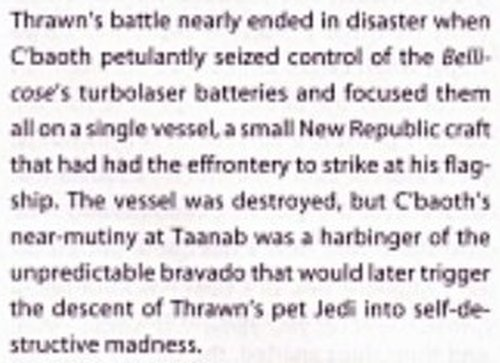

# Owner Material 038 — Star Wars Insider #1–153 plus specials (with The Lucasfilm Fan Club Magazine #1–22): Star Wars Insider #36 (1998)

- **Source:** *Star Wars Insider* magazine (issues 23–153, 1994–2014) and its predecessor *The Lucasfilm Fan Club Magazine* (issues 1–22, 1987–1994), plus seven special editions: articles, interviews, comics and short fiction Secondary source (licensed Legends reference). Scan OCR'd on the box; the scan stays box-only and is **not** published.
- **Method:** every scanned page was OCR'd and machine-screened sentence by sentence for power-relevant statements (fights, kills, defeats, Force feats, rankings, superweapons) that name a character on our roster; each kept sentence is quoted verbatim from the OCR text and has a crop of the printed passage directly under it. Pages with nothing power-relevant are still listed with what is on them.
- **Citation:** "*Star Wars Insider #36* (1998), p.X" by printed page ("scan p.X" where no printed number applies). **Weight:** Licensed magazine: a secondary source. Its short fiction and comics are Legends stories; its articles and interviews sum up or discuss lore and rank below the novels, comics and games they describe.

## p.1 (scan page 1)

Page contents: Cover (image-read): two Jawas, "Why are these Jawas Smiling?" (Prequel Update p.10); "New Prequel Photos", "New Timothy Zahn Interview", "Uncle Owen"; "First Interview with Jedi Master Liam Neeson". S only. (hand-read)

## p.2 (scan page 2)

Page contents: RCA Victor CD single ad: Figrin D'an and the Modal Nodes "Cantina Band" (first CD single), Max Rebo Band "Jedi Rocks"; music by John Williams. Ad copy only. (hand-read)

## p.3 (scan page 3)

Page contents: Estes/Cox flying Star Wars model rockets ad. Ad copy only. (hand-read)

## p.4 (scan page 4)

Page contents: Kenner 1995-1997 basic figures checklist ad (pp4-5). Ad copy only. (hand-read)

## p.5 (scan page 5)

Page contents: Kenner checklist ad continued (Collections, vehicles). Ad copy only. (hand-read)

## p.6 (scan page 6)

Page contents: Contents (image-read, "Inside Insider Number 36"): features Liam Neeson: Jedi Master (26), The Unseen Planets of Star Wars (44), The Hand of Zahn (50), LucasArts' Best Star Wars Games (56). Photo of Tatooine extras. Real-world. (hand-read)

## p.7 (scan page 7)

Page contents: Departments list and Jon Bradley Snyder editorial "Meanwhile, at Leavesden...": Jake Lloyd in a cockpit mock-up, Lucas directing Ewan McGregor with a group of Jedi including Yoda, Nick Gillard rehearsing Ray Park (one of the film's villains) for a lightsaber duel, the Young Queen with Senator Palpatine, Don Bies on remote R2 units, Samuel L. Jackson in costume. Real-world. (hand-read)

## p.8 (scan page 8)

Page contents: Masthead (Dan Madsen publisher, Jon Bradley Snyder editor in chief; contributors Melissa J. Perenson, Dan Wallace, Jack Lyon; artist Chris Trevas) and Rebel Rumblings letters (continued p.69). Letter writers omitted. Real-world. (hand-read)

## p.9 (scan page 9)

Page contents: Fossil limited edition Boba Fett watch ad. Ad copy only. (hand-read)

## p.10 (scan page 10)

Page contents: "Prequel Update" with Rick McCallum (pp10-15, continued p.70; printed 10-15) opener: Jawas on the Tatooine set. Real-world. (hand-read)

## p.11 (scan page 11)

Page contents: Prequel Update: film business, digital characters ("it's only a tool"), Special Edition opening wider only on digital screens. Real-world. (hand-read)

## p.12 (scan page 12)

Page contents: Prequel Update: release "in May 1999 no matter what"; Episode I "stars an eight-and-a-half year old boy who is basically the primary hero"; principal photography for the next films expected January 2000 at Leavesden. Real-world. (hand-read)

## p.13 (scan page 13)

Page contents: Hamilton "Eluding the Evil Empire" Millennium Falcon plate ad. Ad copy only. (hand-read)

## p.14 (scan page 14)

Page contents: Prequel Update production photos (image-read; printed 14): Rick McCallum and George Lucas by camera tracks in the Tunisian desert, a power droid on a Tatooine street, aliens and a humanoid on a village street. Captions only. Real-world. (hand-read)

## p.15 (scan page 15)

Page contents: Prequel Update interview continued. Real-world. (hand-read)

## p.16 (scan page 16)

Page contents: Star News (printed 16): RCA/Victor Battle of the Bands (Modal Nodes vs. Max Rebo Band CD singles), Ash at the Episode I wrap party at Leavesden, Ballantine/Del Rey prequel fiction licence, Hasbro and Galoob prequel toy deals, Alec Guinness's My Name Escapes Me. Real-world. (hand-read)

## p.17 (scan page 17)

Page contents: Science Fiction Book Club ad. Ad copy only. (hand-read)

## p.18 (scan page 18)

Page contents: Jon Snyder "Prequel Profile: Casting Director Robin Gurland's World of Possibilities" (printed 18): casting process for the prequels, Samuel L. Jackson. Real-world. (hand-read)

## p.19 (scan page 19)

Page contents: Special Edition lenticular cards (Doritos promotion) ad. Ad copy only. (hand-read)

## p.20 (scan page 20)

Page contents: Scott Chernoff "In the Star Wars Universe" on Phil Brown (Uncle Owen) (pp20-21, printed 20-21): flight to Tunisia beside Alec Guinness, Owen as "a man who had been beaten down by the events of his life". Family details omitted. (hand-read)

## p.21 (scan page 21)

Page contents: Phil Brown continued: "a straightforward curmudgeon" quote, 1952 McCarthy-era blacklist, 40 years working in England. Real-world. (hand-read)

## p.22 (scan page 22)

Page contents: Anthony Daniels, "The New Wonder Column" (pp22-25, printed 22-25): arriving in Tunisia. Local people and reader names omitted. Real-world. (hand-read)

## p.23 (scan page 23)

Page contents: Wonder Column continued: desert dwellings on location (homeowner named in the column omitted). Real-world. (hand-read)

## p.24 (scan page 24)

Page contents: Wonder Column continued: riding the back of the landspeeder with Mark Hamill driving and Alec Guinness in front. Real-world. (hand-read)

## p.25 (scan page 25)

Page contents: Wonder Column continued: the landspeeder runs out of gas; reshot until right. Real-world. (hand-read)

## p.26 (scan page 26)

Page contents: Lynne Hale "Liam Neeson: Jedi Master" interview (pp26-30, printed 26-30) opener: Neeson on what he knew of his Jedi Master character (T). (hand-read)

### Stat block notes (game mechanics, not feats)

- Neeson's Jedi Master under Yoda: "I knew that he was a Jedi Master who is under Yoda in the pecking order, and that he and his apprentices go on missions to propagate good throughout the galaxy" (Liam Neeson, interviewed by Lynne Hale, "Liam Neeson: Jedi Master", Star Wars Insider 36, p. 26) (Source: *Star Wars Insider #36* (1998), p.26)

## p.27 (scan page 27)

Page contents: Neeson interview: Jedi as a kind of Samurai (T), myths in society. (hand-read)

### Stat block notes (game mechanics, not feats)

- Neeson on the Jedi: "They have great powers and great humility and great learning. In fact, they seem to have it all." (Liam Neeson, interviewed by Lynne Hale, "Liam Neeson: Jedi Master", Star Wars Insider 36, p. 27) (Source: *Star Wars Insider #36* (1998), p.27)

## p.28 (scan page 28)

Page contents: Neeson interview continued: working with Lucas, filming. Real-world. (hand-read)

## p.29 (scan page 29)

Page contents: Neeson interview: his character's attitude to violence (T); Ahmed Best's CG character mentioned (unnamed, S only). (hand-read)

### Stat block notes (game mechanics, not feats)

- Neeson's Jedi and violence: "My character, even though he's a Jedi Knight, and is highly skilled in the use of a lightsaber, he's always at pains to tell Anakin a certain fundamental truth of life, a lesson, like you don't have to engage in violence because someone thinks differently from you." (Liam Neeson, interviewed by Lynne Hale, "Liam Neeson: Jedi Master", Star Wars Insider 36, p. 29) (Source: *Star Wars Insider #36* (1998), p.29)

## p.30 (scan page 30)

Page contents: Neeson interview conclusion. Real-world. (hand-read)

## p.31 (scan page 31)

Page contents: Boba Fett poster ad (Insider exclusive). Ad copy only. (hand-read)

## p.32 (scan page 32)

Page contents: Jawa Trader catalog #36 (pp32-46, catalog's own pagination): merchandise listings. Catalog copy only. (hand-read)

## p.33 (scan page 33)

Page contents: Jawa Trader catalog continued. Catalog copy only. (hand-read)

## p.34 (scan page 34)

Page contents: Jawa Trader catalog continued. Catalog copy only. (hand-read)

## p.35 (scan page 35)

Page contents: Jawa Trader catalog continued. Catalog copy only. (hand-read)

## p.36 (scan page 36)

Page contents: Jawa Trader catalog continued. Catalog copy only. (hand-read)

## p.37 (scan page 37)

Page contents: Jawa Trader catalog continued (miniatures listing; auto-cand dropped). Catalog copy only. (hand-read)

## p.38 (scan page 38)

Page contents: Jawa Trader catalog continued. Catalog copy only. (hand-read)

## p.39 (scan page 39)

Page contents: Jawa Trader catalog continued. Catalog copy only. (hand-read)

## p.40 (scan page 40)

Page contents: Jawa Trader catalog continued. Catalog copy only. (hand-read)

## p.41 (scan page 41)

Page contents: Jawa Trader catalog continued. Catalog copy only. (hand-read)

## p.42 (scan page 42)

Page contents: Jawa Trader catalog continued. Catalog copy only. (hand-read)

## p.43 (scan page 43)

Page contents: Jawa Trader catalog continued. Catalog copy only. (hand-read)

## p.44 (scan page 44)

Page contents: Jawa Trader catalog continued. Catalog copy only. (hand-read)

## p.45 (scan page 45)

Page contents: Jawa Trader catalog continued. Catalog copy only. (hand-read)

## p.46 (scan page 46)

Page contents: Jawa Trader order form. Catalog copy only. (hand-read)

## p.47 (scan page 47)

Page contents: Illusive Originals Darth Vader unmasking statue ad ("Just for once... let me look on you with my own eyes."). Ad copy only. (hand-read)

## p.48 (scan page 48)

Page contents: Dan Wallace "The Unseen Planets of Star Wars", illustrated by Chris Trevas (pp48-52, printed 44-48) opener: worlds mentioned only fleetingly on screen (Kessel, Ord Mantell, Taanab, Dantooine, Anoat). Real-world framing of in-universe planet lore. (hand-read)

## p.49 (scan page 49)

Page contents: Unseen Planets (printed 45): Dantooine (Leia's lie to Tarkin; Vodo-Siosk Baas's training centre from Dark Lords of the Sith; Daala flattens a colony with AT-ATs, T), Kessel (C-3PO's spice-mines line, the Kessel Run, Kevin J. Anderson's Jedi Search), start of Corellia. In-universe summary. (hand-read)

### Stat block notes (game mechanics, not feats)

- Daala flattens a Dantooine colony: "Admiral Daala, a rabid Imperial loyalist, flattened their budding colony with a battalion of AT-AT walkers." (Dan Wallace, "The Unseen Planets of Star Wars", Star Wars Insider 36, p. 45) (Source: *Star Wars Insider #36* (1998), p.49)

## p.50 (scan page 50)

Page contents: Unseen Planets (printed 46): Corellia (Treasure Ship Row, Corellian Trilogy economy, Han's childhood per A.C. Crispin), Ord Mantell (bounty hunters Cypher and Alfreda Goot; OCR "Goct"). In-universe summary. (hand-read)

## p.51 (scan page 51)

Page contents: Unseen Planets (printed 47): Ord Mantell (Skorr's trap, T; Shadows of the Empire train ride; assassin droid 0-88), Taanab (Norulac pirates; Lando wins on a bet, T). In-universe summary. (hand-read)

### Stat block notes (game mechanics, not feats)

- Skorr's trap on Ord Mantell: "One in particular, Skorr, set a nasty trap for Solo at the forlorn Ten Mile Plateau, but our hero gave him the slip." (Dan Wallace, "The Unseen Planets of Star Wars", Star Wars Insider 36, p. 47) (Source: *Star Wars Insider #36* (1998), p.51)
- Lando wipes out the pirate fleet: "a charming and preternaturally lucky stranger single-handedly wiped out the enemy fleet on a bet." (Dan Wallace, "The Unseen Planets of Star Wars", Star Wars Insider 36, p. 47) (Source: *Star Wars Insider #36* (1998), p.51)
- Lando at Taanab: "Ever the gambler, Lando boldly flew into the center of the fleet and ejected his cargo—hundreds of electrified, entangling Conner nets. With their formation broken and their ships snarled, the pirates watched helplessly as Lando cheerfully slingshot heavy ice blocks against their vessels' hulls and rallied the Taanab defense force to a swift, one-sided victory." (Dan Wallace, "The Unseen Planets of Star Wars", Star Wars Insider 36, p. 47) (Source: *Star Wars Insider #36* (1998), p.51)

## p.52 (scan page 52)

Page contents: Unseen Planets (printed 48): Taanab battle under Thrawn with C'baoth taking the Bellicose's turbolasers (T); Dark Lords of the Sith pirate skirmish (Kestrel Nova); Dantooine radicals incl. Kyp Durron sent to Kessel; Anoat system (Kyle Katarn vs. Moff Rebus; Ugnaughts of Gentes leaving for Cloud City). In-universe summary. (hand-read)

- **Grand Admiral Thrawn** — entry/section: Star Wars Insider 036 (1998): "Thrawn's battle nearly ended in disaster when Cbaoth petulantly seized control of the Beil cose’s turbolaser batteries and focused them all on a single vessel, a small New Republic craft that had had the effrontery to strike at his flag- Ship, The vessel was destroyed, but Chacth's nearmutiny at Taanab was a harbinger of the unpredictable bravado that would later trigger the descent of Thrawn's pet Jedi into self-destructive madness." Source: *Star Wars Insider #36* (1998), p.52
  

### Stat block notes (game mechanics, not feats)

- C'baoth seizes the Bellicose's guns: "Thrawn's battle nearly ended in disaster when C'baoth petulantly seized control of the Bellicose's turbolaser batteries and focused them all on a single vessel, a small New Republic craft that had had the effrontery to strike at his flagship." (Dan Wallace, "The Unseen Planets of Star Wars", Star Wars Insider 36, p. 48) (Source: *Star Wars Insider #36* (1998), p.52)

## p.53 (scan page 53)

Page contents: Obi-Wan Kenobi ceramic cookie jar ad. Ad copy only. (hand-read)

## p.54 (scan page 54)

Page contents: Melissa J. Perenson "The Hand of Zahn" interview (pp54-58, printed 50-54) opener: Heir to the Empire success, Zahn's physics background and early sales to Analog. Real-world. (hand-read)

## p.55 (scan page 55)

Page contents: Photo of Zahn at home in the Pacific Northwest (image-read). Caption only. (hand-read)

## p.56 (scan page 56)

Page contents: Zahn interview (printed 52): Lucy Wilson and Bantam, "start three to five years after Jedi" rule, Noghri first planned as "Siths", C'baoth first planned as an insane clone of Obi-Wan, Thrawn bridging the gap, Mara Jade (T), ysalamiri as the first idea, sources (films, West End Games). Real-world. (hand-read)

### Stat block notes (game mechanics, not feats)

- Mara Jade introduced: "Mara Jade, a smuggler who was once known as The Emperor's Hand." (Melissa J. Perenson, "The Hand of Zahn", Star Wars Insider 36, p. 52) (Source: *Star Wars Insider #36* (1998), p.56)

## p.57 (scan page 57)

Page contents: Drew Struzan Specter of the Past cover art (image-read; printed 53). Caption only. (hand-read)

## p.58 (scan page 58)

Page contents: Zahn interview (printed 54): The Hand of Thrawn duology, Bothans implicated in an attempted genocide, set a decade after Heir, Leia on leave of absence from the presidency, Tales of the Empire with Michael A. Stackpole. Real-world. (hand-read)

## p.59 (scan page 59)

Page contents: Special Edition clocks ad. Ad copy only. (hand-read)

## p.60 (scan page 60)

Page contents: Full-page Luke Skywalker with lightsaber art (image-read; printed 56). No text beyond folio. (hand-read)

## p.61 (scan page 61)

Page contents: Jack Lyon "LucasArts' Best Star Wars Games" (pp61-65, printed 57-61): Jedi Knight: Dark Forces II, Masters of Teras Kasi, Rebellion; Justin Chin quote. Real-world. (hand-read)

## p.62 (scan page 62)

Page contents: Jedi Knight section: Kyle Katarn, Force powers from the films, light/dark choice, Rebel Agent book. Game mechanics only; S only. (hand-read)

## p.63 (scan page 63)

Page contents: Rebellion section: Tom Byron on Empire's view, 200 planets and sixty characters. Game mechanics; S only. (hand-read)

## p.64 (scan page 64)

Page contents: Full-page art (image-read; no OCR text): Arden Lyn with robotic arm above Luke and a Tusken fighter, Masters of Teras Kasi production art. No text. (hand-read)

## p.65 (scan page 65)

Page contents: Masters of Teras Kasi section (printed 61): Arden Lyn (T), Thok, Camela Boswell quotes, no Ewoks. Game framing. (hand-read)

### Stat block notes (game mechanics, not feats)

- Arden Lyn and teras kasi: "Arden is Darth's right-hand woman when it comes to teräs käsi. And Arden's right hand is a fearsome robotic device that shoots out all kinds of nasty firepower" (Jack Lyon, "LucasArts' Best Star Wars Games", Star Wars Insider 36, p. 61) (Source: *Star Wars Insider #36* (1998), p.65)

## p.66 (scan page 66)

Page contents: Bob Cooper "Straight from the Horse's Mouth: Crimson Empire" (pp66-69, printed 62-65), Dave Dorman cover painting. Real-world. (hand-read)

## p.67 (scan page 67)

Page contents: Crimson Empire: writer Mike Richardson pull quote on the Royal Guard. Real-world. (hand-read)

## p.68 (scan page 68)

Page contents: Crimson Empire: Paul Gulacy and Randy Stradley on the art. Real-world. (hand-read)

## p.69 (scan page 69)

Page contents: Crimson Empire (printed 65): Kir Kanos "All of his motives are based around honor and loyalty" (Stradley); Rogue Squadron in B-wings and E-wings; planned trilogy. S only. (hand-read)

## p.70 (scan page 70)

Page contents: Stephen J. Sansweet "Scouting the Galaxy" (pp70-72, printed 66-68): forged authentication letter, a reader's gift of a Froot Loops figure. Readers omitted. Real-world. (hand-read)

## p.71 (scan page 71)

Page contents: Scouting the Galaxy Q&A (reader names omitted): Jedi SE poster date, Han Endor pants, batteries and tape. Real-world. (hand-read)

## p.72 (scan page 72)

Page contents: Scouting the Galaxy Q&A continued (reader names omitted). Real-world. (hand-read)

## p.73 (scan page 73)

Page contents: Rebel Rumblings continued (printed 69): Michael Matessino on the Special Edition score; Kevin Fitzpatrick (Major League Baseball, Insider contributor) on the Imperial March at ballparks; Lost Scenes follow-up. Letter writers and players omitted. Real-world. (hand-read)

## p.74 (scan page 74)

Page contents: Prequel Update continued (printed 70): McCallum on theatre projection, sound and digital exhibition. Real-world. (hand-read)

## p.75 (scan page 75)

Page contents: Dark Horse Crimson Empire ad (Richardson, Stradley, Gulacy, Russell, Dorman). Ad copy only. (hand-read)

## p.76 (scan page 76)

Page contents: Decipher SWCCG ad (back cover). Ad copy only. (hand-read)

