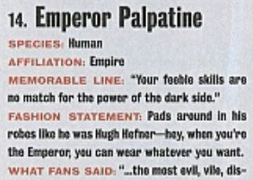

# Owner Material 038 — Star Wars Insider #1–153 plus specials (with The Lucasfilm Fan Club Magazine #1–22): Star Wars Insider #38 (1998)

- **Source:** *Star Wars Insider* magazine (issues 23–153, 1994–2014) and its predecessor *The Lucasfilm Fan Club Magazine* (issues 1–22, 1987–1994), plus seven special editions: articles, interviews, comics and short fiction Secondary source (licensed Legends reference). Scan OCR'd on the box; the scan stays box-only and is **not** published.
- **Method:** every scanned page was OCR'd and machine-screened sentence by sentence for power-relevant statements (fights, kills, defeats, Force feats, rankings, superweapons) that name a character on our roster; each kept sentence is quoted verbatim from the OCR text and has a crop of the printed passage directly under it. Pages with nothing power-relevant are still listed with what is on them.
- **Citation:** "*Star Wars Insider #38* (1998), p.X" by printed page ("scan p.X" where no printed number applies). **Weight:** Licensed magazine: a secondary source. Its short fiction and comics are Legends stories; its articles and interviews sum up or discuss lore and rank below the novels, comics and games they describe.

## scan p.1 (scan page 1)

Page contents: Cover (image-read): Darth Vader and Bart Simpson cartoon, "The Simpsons Strike Back"; Samuel L. Jackson, Billy Dee Williams, Episode I, Red Leader found; "Who are the Top 20 Star Wars Characters?" teaser. S only. (hand-read)

## scan p.2 (scan page 2)

Page contents: Estes flying model rockets ad. Ad copy only. (hand-read)

## scan p.3 (scan page 3)

Page contents: Legends in Three Dimensions busts ad (Boba Fett, Greedo, Emperor). Ad copy only. (hand-read)

## scan p.4 (scan page 4)

Page contents: Boba Fett poster ad. Ad copy only. (hand-read)

## p.1 (scan page 5)

Page contents: Max Rebo Band / Figrin D'an CD ad. Ad copy only. (hand-read)

## p.2 (scan page 6)

Page contents: Contents: Samuel L. Jackson, The Simpsons, Billy Dee Williams and the Favorite Characters Poll among the features. Real-world. (hand-read)

## p.3 (scan page 7)

Page contents: Jon Bradley Snyder editorial on The Simpsons cover and the Archie Goodwin tribute. Real-world. (hand-read)

## p.4 (scan page 8)

Page contents: Masthead and Rebel Rumblings letters ("Iceberg!", Titanic). Letter writers omitted. Real-world. (hand-read)

## p.5 (scan page 9)

Page contents: Hamilton Collection "Han Solo" plate by Keith Birdsong ad. Ad copy only. (hand-read)

## p.6 (scan page 10)

Page contents: Dan Madsen "Prequel Update" with Rick McCallum (pp10-14) opener: Digby Milner, Senior Special Effects Floor Technician, works on a speeder gun (caption). Real-world. (hand-read)

## p.7 (scan page 11)

Page contents: Prequel Update (image-read photo page): effects crew at work. Real-world. (hand-read)

## p.8 (scan page 12)

Page contents: Prequel Update caption (crop-verified): David Tattersall and George Lucas discuss a shot set-up on the set of Senator Palpatine's quarters on the planet Coruscant. Real-world. (hand-read)

## p.9 (scan page 13)

Page contents: Prequel Update (image-read): Mos Espa hovels on Tatooine; Friday Wilson, one of the handmaidens to the young queen, in Hair and Make-Up at Leavesden; Lucas with stand-ins; McCallum on character animation (Rob Coleman); John Williams to start scoring in late January or February. Real-world. (hand-read)

## p.10 (scan page 14)

Page contents: Prequel Update (image-read): Creature Effects shelf with heads and hands for Ree-Yees, a Gamorrean Guard mask and an unfinished Yoda head; third rough cut; Episode II scouting in New Zealand, Australia, Italy and Tunisia; McCallum's music tastes. Real-world. (hand-read)

## p.11 (scan page 15)

Page contents: Science Fiction Book Club ad. Ad copy only. (hand-read)

## p.12 (scan page 16)

Page contents: Jamie Painter "Dueling Lightsabers" prequel profile of stunt coordinator Nick Gillard (title/byline crop-verified): a new fighting form for Episode I; Neeson and McGregor mastered it quickly. T lines on Jedi swordsmanship. (hand-read)

### Stat block notes (game mechanics, not feats)

- Gillard on why the Jedi must be master swordsmen: "I figured that if the Jedi had chosen a sword, they'd have to be really good with it," said Gillard. "So I took the essence of all the great sword techniques, from kendo through saber, épée, and foil, and tried to flow them all together." (Nick Gillard, in Jamie Painter, "Dueling Lightsabers", Star Wars Insider 38, p. 16) (Source: *Star Wars Insider #38* (1998), p.12)
- Eleven-move Jedi swordplay vs six-move épée: "the popular swordplay using épée (a French term for a fencing or dueling sword) employs a combination of six moves, but "for Star Wars, we had to come up with a new language in sword writing and a brave new way of doing things, and we went up to eleven moves. We're way beyond épée now." (Jamie Painter quoting Nick Gillard, "Dueling Lightsabers", Star Wars Insider 38, p. 16) (Source: *Star Wars Insider #38* (1998), p.12)

## p.13 (scan page 17)

Page contents: C-3PO cookie jar ad. Ad copy only. (hand-read)

## p.14 (scan page 18)

Page contents: Scott Chernoff "Drewe Henley: Leader of the Pack" (pp18-19, title crop-verified): Red Leader actor located for the Rebel Pilot Reunion; credits misspelled his name. Medical details and the non-staff tipster omitted. Real-world. (hand-read)

## p.15 (scan page 19)

Page contents: Henley continued: shot in the X-wing cockpit on a blue-screen platform; X-wing "like a greyhound"; explosives when Red Leader was shot down by Vader's TIE (crop-verified T); played Red Leader as the older, more experienced man. Private details omitted. (hand-read)

### Stat block notes (game mechanics, not feats)

- Red Leader shot down by Vader: "explosives that went off when Red Leader was shot down by Darth Vader's TIE fighter." (Scott Chernoff, "Drewe Henley: Leader of the Pack", Star Wars Insider 38, p. 19) (Source: *Star Wars Insider #38* (1998), p.15)

## p.16 (scan page 20)

Page contents: Star Wars Salutes Titanic / Ralph McQuarrie-McCaig ad. Ad copy only. (hand-read)

## p.17 (scan page 21)

Page contents: Star Wars Encyclopedia ad. Ad copy only. (hand-read)

## p.18 (scan page 22)

Page contents: Star News: A.C. Crispin's Han Solo trilogy concludes with Rebel Dawn (crop-verified T); Fox to distribute the new prequel trilogy (April 2 announcement). Real-world. (hand-read)

### Stat block notes (game mechanics, not feats)

- Crispin trilogy: Han afraid of Boba Fett: "In her books, Crispin takes us through the many stages of Han's life and eventually explains how he became the hard-shelled smuggler who is down on women and the Rebellion, yet afraid of Boba Fett, on the run from Jabba the Hutt, and nervous about seeing Lando once again." (Star News, Star Wars Insider 38, p. 22) (Source: *Star Wars Insider #38* (1998), p.18)

## p.19 (scan page 23)

Page contents: Photo mosaic posters ad (image-read: Darth Vader and Yoda mosaics). Ad copy only. (hand-read)

## p.20 (scan page 24)

Page contents: Anthony Daniels "Wonder Column" (pp24-27): filming C-3PO dismembered. Reader names and Daniels' injuries omitted. Real-world. (hand-read)

## p.21 (scan page 25)

Page contents: Wonder Column continued. Real-world. (hand-read)

## p.22 (scan page 26)

Page contents: Wonder Column continued. Real-world. (hand-read)

## p.23 (scan page 27)

Page contents: Wonder Column continued. Real-world. (hand-read)

## p.24 (scan page 28)

Page contents: Scott Chernoff Samuel L. Jackson interview opener (pp28-33, 80). Real-world. (hand-read)

## p.25 (scan page 29)

Page contents: Jackson portrait (image-read); caption: Jackson as a Jedi Master and member of the Jedi Council in Episode I. S only. (hand-read)

## p.26 (scan page 30)

Page contents: Jackson interview continued: wanting a role in the prequels. Real-world. (hand-read)

## p.27 (scan page 31)

Page contents: Jackson continued: only on set four days. Real-world. (hand-read)

## p.28 (scan page 32)

Page contents: Jackson continued: Frank Oz performing Yoda ("Yoda's there, not Frank"). Real-world. (hand-read)

## p.29 (scan page 33)

Page contents: Jackson continued: worked out a backstory for why his character was so close to Yoda; continued p80. Real-world. (hand-read)

## p.30 (scan page 34)

Page contents: Fossil Boba Fett watch ad. Ad copy only. (hand-read)

## p.31 (scan page 35)

Page contents: Subscription card ("Even Senator Palpatine can't resist"). Ad copy only. (hand-read)

## p.32 (scan page 36)

Page contents: Subscription card reverse (image-read: Imperial officers, "I won't fail you, my Lord"). Ad copy only. (hand-read)

## p.33 (scan page 37)

Page contents: Jawa Trader catalog #38 cover. Catalog only. (hand-read)

## p.34 (scan page 38)

Page contents: Jawa Trader catalog. Catalog only. (hand-read)

## p.35 (scan page 39)

Page contents: Jawa Trader catalog. Catalog only. (hand-read)

## p.36 (scan page 40)

Page contents: Jawa Trader catalog. Catalog only. (hand-read)

## p.37 (scan page 41)

Page contents: Jawa Trader catalog. Catalog only. (hand-read)

## p.38 (scan page 42)

Page contents: Jawa Trader catalog. Catalog only. (hand-read)

## p.39 (scan page 43)

Page contents: Jawa Trader catalog. Auto-cand dropped (catalog copy). Catalog only. (hand-read)

## p.40 (scan page 44)

Page contents: Jawa Trader catalog. Catalog only. (hand-read)

## p.41 (scan page 45)

Page contents: Jawa Trader catalog. Catalog only. (hand-read)

## p.42 (scan page 46)

Page contents: Jawa Trader catalog. Catalog only. (hand-read)

## p.43 (scan page 47)

Page contents: Jawa Trader catalog. Catalog only. (hand-read)

## p.44 (scan page 48)

Page contents: Jawa Trader catalog (Sansweet scrapbook, Encyclopedia). Auto-cand dropped (catalog copy). Catalog only. (hand-read)

## p.45 (scan page 49)

Page contents: Jawa Trader catalog. Catalog only. (hand-read)

## p.46 (scan page 50)

Page contents: Jawa Trader catalog. Catalog only. (hand-read)

## p.47 (scan page 51)

Page contents: Jawa Trader catalog. Catalog only. (hand-read)

## p.48 (scan page 52)

Page contents: Jawa Trader catalog. Catalog only. (hand-read)

## p.49 (scan page 53)

Page contents: Jawa Trader catalog. Catalog only. (hand-read)

## p.50 (scan page 54)

Page contents: Jawa Trader catalog. Catalog only. (hand-read)

## p.51 (scan page 55)

Page contents: Jawa Trader order form. Catalog only. (hand-read)

## p.52 (scan page 56)

Page contents: Full-page art (image-read): Vader and Bart Simpson cartoon, no text. S only. (hand-read)

## p.53 (scan page 57)

Page contents: Scott Chernoff "Bart Wars" on Star Wars references in The Simpsons (pp57-61, printed 53-57). Real-world. (hand-read)

## p.54 (scan page 58)

Page contents: Bart Wars continued: Bill Morrison of Bongo Comics; THX trailer tie-in. Real-world. (hand-read)

## p.55 (scan page 59)

Page contents: Bart Wars continued: episode references. Real-world. (hand-read)

## p.56 (scan page 60)

Page contents: Bart Wars continued: Jason Grode and Matt Selman on Lisa and Yoda. Real-world. (hand-read)

## p.57 (scan page 61)

Page contents: Bart Wars continued: Simpsons THX trailer since 1994 (Kim Yost); Vader caricature. Auto-cand kept as S (real-world). Real-world. (hand-read)

## p.58 (scan page 62)

Page contents: Scott Chernoff Billy Dee Williams interview (pp62-68, printed 58-64): opener quotes Lando's Taanab boast (crop-verified T). Family details omitted. (hand-read)

### Stat block notes (game mechanics, not feats)

- Lando's maneuver at the Battle of Taanab: "Someone must have told them about my little meneuver [sic] at the battle of Taanab." (Lando in Return of the Jedi, quoted in Scott Chernoff, Billy Dee Williams interview, Star Wars Insider 38, p. 58) (Source: *Star Wars Insider #38* (1998), p.58)

## p.59 (scan page 63)

Page contents: Full-page art (image-read): Lando painting. S only. (hand-read)

## p.60 (scan page 64)

Page contents: Billy Dee interview continued: career biography. Auto-cand kept as S (bio). Family details omitted. Real-world. (hand-read)

## p.61 (scan page 65)

Page contents: Photo page (image-read): Billy Dee Williams roles. S only. (hand-read)

## p.62 (scan page 66)

Page contents: Billy Dee continued: Han more violent than Lando, Lando works through charm; "I even stood up to Darth Vader" (both crop-verified T). Real-world. (hand-read)

### Stat block notes (game mechanics, not feats)

- Han more violent, Lando works through charm: "although I think probably Han Solo is a little bit more on the violent side than Lando, because Lando gets his stuff through charm." (Billy Dee Williams, in Scott Chernoff, Star Wars Insider 38, p. 62) (Source: *Star Wars Insider #38* (1998), p.62)
- Lando stood up to Vader: "I lost everything because of that whole situation! I even stood up to Darth Vader, which most people don't do. Look at what he did to the guy at the opening of the movie on the ship there!" (Billy Dee Williams, in Scott Chernoff, Star Wars Insider 38, p. 62) (Source: *Star Wars Insider #38* (1998), p.62)

## p.63 (scan page 67)

Page contents: Billy Dee continued. Family details omitted. Real-world. (hand-read)

## p.64 (scan page 68)

Page contents: Billy Dee continued. Real-world. (hand-read)

## p.65 (scan page 69)

Page contents: Return of the Jedi Bronze Series Rancor ad (image-read). Ad copy only. (hand-read)

## p.66 (scan page 70)

Page contents: Jon Bradley Snyder "The Star Wars Insider Favorite Characters Poll Results" (pp70-75, printed 66-71; illustrations by Michael Rex): ranks 20-16. Reader names omitted; fan quotes are opinion, S only. (hand-read)

## p.67 (scan page 71)

Page contents: Poll ranks incl. Admiral Ackbar (memorable line crop-verified T), Dengar, Piett. Fan quotes S only. (hand-read)

### Stat block notes (game mechanics, not feats)

- Ackbar: cruisers cannot repel the Death Star's firepower: "We have no choice, General Calrissian. Our cruisers can't repel firepower [printed line ends here]" (Ackbar memorable line, Jon Bradley Snyder, "The Star Wars Insider Favorite Characters Poll Results", Star Wars Insider 38, p. 67) (Source: *Star Wars Insider #38* (1998), p.67)

## p.68 (scan page 72)

Page contents: Poll ranks 15-11 (image-read page): Wicket, Emperor Palpatine (memorable line crop-verified T), Obi-Wan Kenobi, C-3PO, Lando Calrissian. Fan quotes S only. (hand-read)

- **Palpatine (Darth Sidious)** — entry/section: Star Wars Insider 038 (1998): "Emperor Palpatine species: Human APFILLATION: Empire MEMORABLE LINE: “Your footle skills are no match for the power of the dark side.” FASHION STATEMENT: Pads around in his robes|i he was Hugh Hafner—hay, when you're the Experon yeu can wear whatever you want." Source: *Star Wars Insider #38* (1998), p.68
  

### Stat block notes (game mechanics, not feats)

- Palpatine: feeble skills vs the dark side: "Your feeble skills are no match for the power of the dark side." (Emperor Palpatine memorable line, Jon Bradley Snyder, "The Star Wars Insider Favorite Characters Poll Results", Star Wars Insider 38, p. 68) (Source: *Star Wars Insider #38* (1998), p.68)

## p.69 (scan page 73)

Page contents: Poll ranks 10-6: Jabba, Wedge, Yoda, R2-D2, Chewbacca. Fan quotes S only. (hand-read)

## p.70 (scan page 74)

Page contents: Poll ranks 5-2: Leia, Vader, Luke, Boba Fett. Fan quotes S only. (hand-read)

## p.71 (scan page 75)

Page contents: Poll #1 Han Solo; Boba Fett tops the Movie Lines/Popularity Index; Mara Jade #20 highest non-film character; Greedo 29th, Lobot tied 47th. Tina Tweedale contributed to tabulation. Real-world. (hand-read)

## p.72 (scan page 76)

Page contents: Peet Janes "The Passing of a Legend: Archie Goodwin" (pp76-79, printed 72-75): career, Al Williamson quotes, Marvel and newspaper strip runs. Medical details omitted. Real-world. (hand-read)

## p.73 (scan page 77)

Page contents: Goodwin tribute continued: continuity pioneer. Real-world. (hand-read)

## p.74 (scan page 78)

Page contents: Goodwin tribute continued: Mike Richardson quote; Goodwin Star Wars bibliography (Marvel issues). Fan quotes and names omitted. Real-world. (hand-read)

## p.75 (scan page 79)

Page contents: Goodwin bibliography continued (newspaper strips, Pizzazz, Dark Horse reprints; compiled by Rich Handley). Fan quotes and family omitted. Real-world. (hand-read)

## p.76 (scan page 80)

Page contents: Steve Sansweet "Scouting the Galaxy" (pp80-83, printed 76-79): Toy Fair, scalper prices. Real-world. (hand-read)

## p.77 (scan page 81)

Page contents: Scouting continued: exclusives for overseas collectors; Special Edition poster. Questioners omitted. Real-world. (hand-read)

## p.78 (scan page 82)

Page contents: Scouting continued: Bomarr monk described as a background character in Jabba's palace; Star Force Collectibles store; Adventure Journal. Questioners and store address omitted. Real-world. (hand-read)

## p.79 (scan page 83)

Page contents: Scouting continued: Japanese C-3PO variations; Obi-Wan lightsaber prop replica delayed by vendor problems (maker name OCR-garbled, not logged). Questioners omitted. Real-world. (hand-read)

## p.80 (scan page 84)

Page contents: Samuel L. Jackson interview continued (printed 80): theater background; Lucas low-key on set. Real-world. (hand-read)

## p.81 (scan page 85)

Page contents: Rebel Rumblings continued (printed 81): Greedo "monster" letter; juvenile books not integrated into the timeline; Biggs scenes "mass hallucination" closed out. Letter writers omitted. Real-world. (hand-read)

## p.82 (scan page 86)

Page contents: Fan Club exclusive Struzan clocks ad. Ad copy only. (hand-read)

## p.83 (scan page 87)

Page contents: Decipher SWCCG Jabba's Palace ad (image-read). Ad copy only. (hand-read)

## p.84 (scan page 88)

Page contents: Monopoly Star Wars CD-ROM ad (back cover). Ad copy only. (hand-read)

