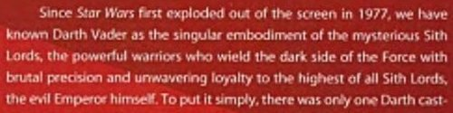
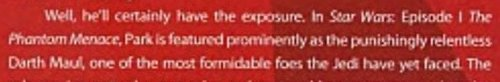

# Owner Material 038 — Star Wars Insider #1–153 plus specials (with The Lucasfilm Fan Club Magazine #1–22): Star Wars Insider #42 (1999)

- **Source:** *Star Wars Insider* magazine (issues 23–153, 1994–2014) and its predecessor *The Lucasfilm Fan Club Magazine* (issues 1–22, 1987–1994), plus seven special editions: articles, interviews, comics and short fiction Secondary source (licensed Legends reference). Scan OCR'd on the box; the scan stays box-only and is **not** published.
- **Method:** every scanned page was OCR'd and machine-screened sentence by sentence for power-relevant statements (fights, kills, defeats, Force feats, rankings, superweapons) that name a character on our roster; each kept sentence is quoted verbatim from the OCR text and has a crop of the printed passage directly under it. Pages with nothing power-relevant are still listed with what is on them.
- **Citation:** "*Star Wars Insider #42* (1999), p.X" by printed page ("scan p.X" where no printed number applies). **Weight:** Licensed magazine: a secondary source. Its short fiction and comics are Legends stories; its articles and interviews sum up or discuss lore and rank below the novels, comics and games they describe.

## p.1 (scan page 1)

Page contents: Cover (image-read): Darth Maul, "Evil has a New Name", "Darth Maul, Dark Lord of the Sith, From Episode I"; teasers: new Frank Oz interview, Lucas Down Under, Admiral Ackbar surfaces. S only. (hand-read)

## p.2 (scan page 2)

Page contents: Decipher Star Wars CCG ad. Ad copy only. (hand-read)

## p.3 (scan page 3)

Page contents: Darth Vader telephone ad. Ad copy only. (hand-read)

## p.4 (scan page 4)

Page contents: C-3PO / R2-D2 replica statues ad. Ad copy only. (hand-read)

## p.5 (scan page 5)

Page contents: DK books ad. Ad copy only. (hand-read)

## p.6 (scan page 6)

Page contents: Contents: THX joins forces (Kevin Fitzpatrick, p.52); Darth Maul / Ray Park (Scott Chernoff, p.54); George Lucas Down Under (p.60); Frank Oz interview (p.64). Real-world. (hand-read)

## p.7 (scan page 7)

Page contents: Contents departments (Prequel Profile: Nick Dudman; Star News; Wonder Column; In the Star Wars Universe: Admiral Ackbar; From the Horse's Mouth: Vader and Fett; Scouting); cover illustration Javier Fernandez; Jon Bradley Snyder editorial on Celebration (no Lucas autographs; Rick McCallum to attend). Readers omitted. Real-world. (hand-read)

## p.8 (scan page 8)

Page contents: Rebel Rumblings: casting letters; Scott Chernoff replies (casting director Robin Gurland); continues p.80. Letter writers and private details omitted. Real-world. (hand-read)

## p.9 (scan page 9)

Page contents: Dark Horse ongoing Star Wars series ad (image-read): "A planet torn by outsiders, a Jedi torn from within" (Ki-Adi-Mundi; Jan Strnad, Anthony Winn, Robert Jones). Ad copy only. (hand-read)

## p.10 (scan page 10)

Page contents: Prequel Update opener spread, left half (image-read): Darth Maul with ignited lightsaber in the Theed hangar. S only. (hand-read)

## p.11 (scan page 11)

Page contents: Prequel Update opener spread, right half (image-read): "Prequel Update" title over Maul's lightsaber. S only. (hand-read)

## p.12 (scan page 12)

Page contents: Prequel Update (Dan Madsen interviews Rick McCallum, crop-verified captions): Episodes II and III to shoot at Fox Studios Australia; teaser trailer ("we could make ten of those two-minute trailers"); opening-spread caption "a menacing Darth Maul ignites his double-ended lightsaber" in the main Theed hangar; protocol droid and battle droids; Obi-Wan on Queen Amidala's ship; unfinished C-3PO; Shmi. S only (captions descriptive). (hand-read)

## p.13 (scan page 13)

Page contents: Prequel Update (image-read photos: protocol droid C-3PO, Obi-Wan Kenobi, Shmi Skywalker): not all teaser shots are final (Naboo craft over Coruscant). Real-world. (hand-read)

## p.14 (scan page 14)

Page contents: Prequel Update: Surround EX (Gary Rydstrom); Episode II at "basic concept design"; ILM ~2,000 shots, none farmed out; caption Qui-Gon and Obi-Wan before Amidala. Real-world. (hand-read)

## p.15 (scan page 15)

Page contents: Droidworks ad. Ad copy only. (hand-read)

## p.16 (scan page 16)

Page contents: Prequel Update (crop-verified captions): ILM pushing 35-50 shots a week (Muren, Knoll, Coleman, Squires, Farrar); "two cloaked Jedi, ambassadors of goodwill" approach Naboo; Darth Maul on Tatooine; Ki-Adi-Mundi with Yoda, Mace Windu, Plo Koon (The Jedi Council). See T. (hand-read)

### Stat block notes (game mechanics, not feats)

- Maul sent by his master to hunt his prey: "Sent by his master to the desolate Outer Rim planet of Tatooine, Darth Maul scours the landscape in search of his intended prey." (caption, Prequel Update, Star Wars Insider 42, p. 16 [file p16]) (Source: *Star Wars Insider #42* (1999), p.16)

## p.17 (scan page 17)

Page contents: eBay ad. Ad copy only. (hand-read)

## p.18 (scan page 18)

Page contents: Star Wars Celebration ad (April 30-May 2, 1999, Wings Over the Rockies, Denver). Real-world. (hand-read)

## p.19 (scan page 19)

Page contents: Celebration ad continued (McCallum, Anthony Daniels; marketing director David Latimer). Real-world. (hand-read)

## p.20 (scan page 20)

Page contents: Prequel Update: McCallum on Young Indy (200 weeks, 20+ countries); reliance on ILM; older-Anakin casting from mid-1999; captions Qui-Gon and Shmi, R2/C-3PO near Jar Jar, pit droids. Real-world. (hand-read)

## p.21 (scan page 21)

Page contents: Prequel Update image page (image-read): C-3PO and R2-D2, Jar Jar Binks, pit droids. S only. (hand-read)

## p.22 (scan page 22)

Page contents: Prequel Update image spread, left half (image-read): young Anakin in a hallway of the Naboo Queen's ship (caption: Anakin and Obi-Wan meet Qui-Gon). S only. (hand-read)

## p.23 (scan page 23)

Page contents: Prequel Update image spread, right half (image-read): Obi-Wan Kenobi, "Episode I". S only. (hand-read)

## p.24 (scan page 24)

Page contents: Prequel Update image page (image-read): Sebulba; Podrace hangar. S only. (hand-read)

## p.25 (scan page 25)

Page contents: Prequel Update (crop-verified captions): older Anakin aged 19-21, same actor for II and III; McCallum on Ray Park (Robin Gurland casting); captions on Sebulba, the Jedi Council and Senator Palpatine. See T. (hand-read)

### Stat block notes (game mechanics, not feats)

- Sebulba: best Podrace pilot in Mos Espa: "Sebulba, who is acknowledged as the best Podrace pilot in Mos Espa, will not hesitate to try any dirty trick to win a race." (caption, Prequel Update, Star Wars Insider 42, p. 25 [file p25]) (Source: *Star Wars Insider #42* (1999), p.25)
- The august and powerful Jedi Council: "As the Coruscant sky fades into night, young Anakin Skywalker faces the probing questions of a senior Jedi, Mace Windu, as the other 11 members of the august and powerful Jedi Council pay close attention." (caption, Prequel Update, Star Wars Insider 42, p. 25 [file p25]) (Source: *Star Wars Insider #42* (1999), p.25)

## p.26 (scan page 26)

Page contents: Prequel Profile: Nick Dudman by Jamie Painter (Stuart Freeborn apprenticeship; Yoda as Dark Crystal prototype; Pigs Might Fly; 55-person department on The Fifth Element); recreating Yoda (crop-verified). Continues p.79. See T. (hand-read)

### Stat block notes (game mechanics, not feats)

- Dudman: Yoda a more powerful, younger Jedi; a "power" character: "he was able to give the Jedi Master greater expression and mobility for the prequel, which takes place when Yoda is a more powerful, and somewhat younger, Jedi force. "We were dealing with a Yoda who is younger and in a different social position," noted Dudman... "He's a 'power' character now, as opposed to a refugee, which was what he was in the previous movies."" (Jamie Painter, Prequel Profile: Nick Dudman, Star Wars Insider 42, p. 26 [file p26]) (Source: *Star Wars Insider #42* (1999), p.26)

## p.27 (scan page 27)

Page contents: Topps Chrome Archives ad. Ad copy only. (hand-read)

## p.28 (scan page 28)

Page contents: Star News: Nov 17 teaser advance screenings (225 screens; Westwood Mann Village; Sandy Baker). Fans quoted omitted. Real-world. (hand-read)

## p.29 (scan page 29)

Page contents: Star News: Nintendo deal (Howard Lincoln, Jack Sorensen; Rogue Squadron Dec 7 1998; Sega arcade); Lego Classic sets in April, Episode I in May (Ann Marie Mathews). Real-world. (hand-read)

## p.30 (scan page 30)

Page contents: Anthony Daniels Wonder Column: Canada fly-bite anecdote; extras. Real-world. (hand-read)

## p.31 (scan page 31)

Page contents: Wonder Column: Massassi throne room at Shepperton; Carrie Fisher costume mishap. Real-world. (hand-read)

## p.32 (scan page 32)

Page contents: Wonder Column: Hamill not congratulated by the extras; ILM models. Real-world. (hand-read)

## p.33 (scan page 33)

Page contents: Wonder Column concluded with PS notes. Reader questions omitted. Real-world. (hand-read)

## p.34 (scan page 34)

Page contents: Trailer screenings continued (applause for Samuel L. Jackson as Mace Windu); Star Sightings (Neeson, McGregor, Blessed, Hamill, Lithgow, Williams, Dunham, Kazanjian, Ford). Fans quoted omitted. Real-world. (hand-read)

## p.35 (scan page 35)

Page contents: Jawa Trader #42 cover (image-read): Action Fleet speeder and Theed Palace playset ("A small force of battle droids has been sent to take over the Queen's palace"). Ad copy only. (hand-read)

## p.36 (scan page 36)

Page contents: Jawa Trader: Pote Snitkin, AT-AT Driver, Hoth Leia, Death Star droid; Oola/Salacious; cantina band figures. Ad copy only. (hand-read)

## p.37 (scan page 37)

Page contents: Jawa Trader: Episode I clothing. Ad copy only. (hand-read)

## p.38 (scan page 38)

Page contents: Jawa Trader: international film cells; ANH/ESB manga. Ad copy only. (hand-read)

## p.39 (scan page 39)

Page contents: Jawa Trader: John Taylor Dismukes lithos; Dorman Leia and Boba Fett prints; Sanda Vader; photomosaics. Ad copy only. (hand-read)

## p.40 (scan page 40)

Page contents: Jawa Trader: masks; cookie jars. Ad copy only. (hand-read)

## p.41 (scan page 41)

Page contents: Jawa Trader: Legends in 3-D busts (Boba Fett, Greedo, Emperor). Ad copy only. (hand-read)

## p.42 (scan page 42)

Page contents: Jawa Trader: CCG products. Ad copy only. (hand-read)

## p.43 (scan page 43)

Page contents: Jawa Trader: Kellogg's cards; Trivial Pursuit; Droidworks; Rogue Squadron 3D; Behind the Magic; film cells. Ad copy only. (hand-read)

## p.44 (scan page 44)

Page contents: Jawa Trader: books and comics (Warrior Princess, Crimson Empire, Jabba: Art of the Deal, Boba Fett: Death, Lies and Treachery, Action Figure Archive, Visual Dictionary, Cross-Sections, Tomart's guide). Ad copy only. (hand-read)

## p.45 (scan page 45)

Page contents: Jawa Trader: Vader's Quest #1 gold foil; Dark Forces GSAs; Essential Guides; Alien Chronicles; Encyclopedia; Kalarba. Ad copy only. (hand-read)

## p.46 (scan page 46)

Page contents: Jawa Trader: apparel (Bespin jacket, Han vest). Ad copy only. (hand-read)

## p.47 (scan page 47)

Page contents: Jawa Trader: pewter and stand-ups. Ad copy only. (hand-read)

## p.48 (scan page 48)

Page contents: Jawa Trader: Indiana Jones items, clocks, snowglobe. Ad copy only. (hand-read)

## p.49 (scan page 49)

Page contents: Jawa Trader: Cinema Scenes; Battle Droid & STAP ("STAPs are operated by battle droids who function as the infantry of the Trade Federation army"); electronic Vader. Ad copy only; S only. (hand-read)

## p.50 (scan page 50)

Page contents: Jawa Trader: model kits; Expanded Universe Kenner figures. Ad copy only. (hand-read)

## p.51 (scan page 51)

Page contents: Insider exclusive posters ad (Hugh Fleming "Star Wars Rocks", Sanda Boba Fett, Vader & Palpatine). Ad copy only. (hand-read)

## p.52 (scan page 52)

Page contents: Kevin Fitzpatrick, "THX Joins Forces": Dolby Digital-Surround EX (6.1), debut with Episode I May 21 1999; ShowEast demo with remastered first five minutes of A New Hope; Lucas, Bill Jasper, Gary Rydstrom, Monica Dashwood quoted. Real-world. (hand-read)

## p.53 (scan page 53)

Page contents: THX concluded: Haunting of Hill House and Memoirs of a Geisha signed; 2,000+ THX theaters; Kurt Schwenk, Kim Yost quoted. Real-world. (hand-read)

## p.54 (scan page 54)

Page contents: Darth Maul feature opener (image-read): Maul face, "Evil has a..." S only. (hand-read)

## p.55 (scan page 55)

Page contents: Scott Chernoff, Ray Park / Darth Maul feature (crop-verified): Sith Lords described; Park's Wu Shu background (second-degree black belt, 4th at 1995 worlds). See T. (hand-read)

- **Darth Vader (Anakin Skywalker)** — entry/section: Star Wars Insider 042 (1999): "Since Star Wors first exploded out of the screen in 1977, we have known Darth Vader as the singular embodiment of the mysterious Sith Lords, the powerful wartices who wield the dark side of the Force with brutal precision and unwavering loyalty to the highest of all Sith Lords, the evil Emperor himself." Source: *Star Wars Insider #42* (1999), p.55
  
- **Darth Maul** — entry/section: Star Wars Insider 042 (1999): "in Star Wars Episode|The Phantom Menace, Park is featured prominently as the punishingly relentless Darth Maul, one of the most formidable foes the Jedi have yet faced." Source: *Star Wars Insider #42* (1999), p.55
  

### Stat block notes (game mechanics, not feats)

- Sith Lords: brutal precision; Maul one of the most formidable foes: "we have known Darth Vader as the singular embodiment of the mysterious Sith Lords, the powerful warriors who wield the dark side of the Force with brutal precision and unwavering loyalty to the highest of all Sith Lords, the evil Emperor himself... Park is featured prominently as the punishingly relentless Darth Maul, one of the most formidable foes the Jedi have yet faced." (Scott Chernoff, Star Wars Insider 42, p. 55 [file p55]) (Source: *Star Wars Insider #42* (1999), p.55)

## p.56 (scan page 56)

Page contents: Darth Maul feature: Mortal Kombat: Annihilation; Nick Gillard's audition fight; double-bladed lightsaber; rehearsals with Neeson and McGregor. Real-world. (hand-read)

## p.57 (scan page 57)

Page contents: Darth Maul feature captions (image-read): Park in the desert near Tozeur, Tunisia; an eighty-foot fall stunt at Leavesden; Maul battle pose on Tatooine. Real-world. (hand-read)

## p.58 (scan page 58)

Page contents: Darth Maul feature concluded: McCallum's direction ("no remorse"); make-up by Nick Dudman and Paul Engelen; Fight Arranger Andreas Petrides; Floor Runner Nathan Holmes. Family details omitted. Real-world. (hand-read)

## p.59 (scan page 59)

Page contents: Darth Maul feature captions (image-read): Park and Andreas Petrides rehearse in the Mos Espa hangar set; Nick Gillard with Park on the Theed hangar set. Real-world. (hand-read)

## p.60 (scan page 60)

Page contents: George Lucas Down Under (Sydney Screen Producers Association conference with Rick McCallum): directing then and now. Family details omitted. Real-world. (hand-read)

## p.61 (scan page 61)

Page contents: Lucas Q&A concluded: nine-film plan recollection; Ben Burtt; Neeson vs. Guinness casting; Indiana Jones script; Jurassic Park post-production; advice to filmmakers. Real-world. (hand-read)

## p.62 (scan page 62)

Page contents: Scott Chernoff, "Tim Rose: Looking for Mr. Ackbar" (crop-verified): Rose played Sy Snootles, Salacious Crumb and Ackbar; Phil Tippett; Ackbar #14 in Insider #38 poll. Reader omitted. See T. (hand-read)

### Stat block notes (game mechanics, not feats)

- Ackbar: brilliant Rebel hero commanding the fleet: "Admiral Ackbar, the brilliant and ultra-suave Mon Calamari Rebel hero... this unusual character was smack-dab in the middle of the Rebel leadership, lecturing Luke Skywalker, commanding Lando and the rest of the fleet, and exclaiming, "It's a trap!"" (Scott Chernoff, "Tim Rose: Looking for Mr. Ackbar", Star Wars Insider 42, p. 62 [file p62]) (Source: *Star Wars Insider #42* (1999), p.62)

## p.63 (scan page 63)

Page contents: Tim Rose continued: Ackbar as hand puppet (Mike Quinn); Salacious Crumb tests; Richard Marquand; Muppet workshop with Faz Fazakas; Dark Crystal Skeksis; Mike McCormick. Continues p.79. Real-world. (hand-read)

## p.64 (scan page 64)

Page contents: Frank Oz interview opener (image-read): photo of Oz with camera. S only. (hand-read)

## p.65 (scan page 65)

Page contents: Scott Chernoff, Frank Oz interview "Blizzard of Oz": Yoda on Dagobah described; Oz's Muppets and directing career. Family details omitted. Real-world. (hand-read)

## p.66 (scan page 66)

Page contents: Oz interview: five days rehearsal for two days shooting; Dave Greenaway, Don Austen, Kathy Smee; CG-Yoda question; credit to Mark Hamill. Real-world. (hand-read)

## p.67 (scan page 67)

Page contents: Oz interview: Yoda as "the wisest character in the movie" so Oz read all scripts; voice is "only 10 percent"; first Muppet job (Rowlf's right hand). Real-world; S only. (hand-read)

## p.68 (scan page 68)

Page contents: Oz interview: learning from Jim Henson; Grover, Piggy, Animal. Family details omitted. Real-world. (hand-read)

## p.69 (scan page 69)

Page contents: Oz interview: Bowfinger; Little Shop of Horrors ending; Saturday Night Live. Real-world. (hand-read)

## p.70 (scan page 70)

Page contents: Oz interview concluded (crop-verified): Yoda hit immediately; Kershner suggested the cane fight with Artoo; Yoda as Churchill. See T. (hand-read)

### Stat block notes (game mechanics, not feats)

- Oz: an extraordinarily powerful and wise figure: "what I liked about him was this extraordinarily powerful and wise figure being this little, petty guy... Yoda is like a wise Zen master, but like any Zen master, he'll smack you if you're wrong... the dichotomy of Yoda's wisdom and power and knowledge" (Frank Oz, interviewed by Scott Chernoff, Star Wars Insider 42, p. 70 [file p70]) (Source: *Star Wars Insider #42* (1999), p.70)

## p.71 (scan page 71)

Page contents: Frank Oz filmography sidebar. Real-world. (hand-read)

## p.72 (scan page 72)

Page contents: Peet Janes, From the Horse's Mouth: Boba Fett: Enemy of the Empire (John Wagner, Ian Gibson) and Vader's Quest (Darko Macan, Dave Gibbons, Angus McKie; Feb 12) (crop-verified). See T. (hand-read)

### Stat block notes (game mechanics, not feats)

- Fett vs. Vader: resourcefulness vs. dark-side Force ability: "While many fans rightly ask how anybody, including Boba Fett, could go up against Darth Vader, Enemy of the Empire scribe John Wagner has taken special care with the question, balancing the strengths of each character: Fett's resourcefulness versus Vader's dark-side Force ability; Vader's desire versus Fett's possession." (Peet Janes, From the Horse's Mouth, Star Wars Insider 42, p. 72 [file p72]) (Source: *Star Wars Insider #42* (1999), p.72)

## p.73 (scan page 73)

Page contents: Horse's Mouth image page (image-read): Enemy of the Empire cover art; Ian Gibson pull-quote on Fett ("He has the look of a survivor"). S only. (hand-read)

## p.74 (scan page 74)

Page contents: Horse's Mouth continued (crop-verified): Macan on Vader's Quest; Edvin Biukovic. See T. (hand-read)

### Stat block notes (game mechanics, not feats)

- Macan: Vader legendary, shapes events by his very existence: "For Macan's story, Vader is legendary, practically a myth to most denizens of the Star Wars universe. "There are a lot of ordinary people in the story—Rebels, Imperials, bounty hunters, peasants, miners, noblemen — whose lives all get touched and changed or destroyed as a byproduct of Vader's obsessive search for Luke," he reveals. "That's one of the great things when you have a larger-than-life heavy like Vader: you can safely assume that everybody's aware of him and that he shapes events, sometimes even to his own harm, by his very existence."" (Darko Macan, in Peet Janes, Star Wars Insider 42, p. 74 [file p74]) (Source: *Star Wars Insider #42* (1999), p.74)

## p.75 (scan page 75)

Page contents: Horse's Mouth concluded (crop-verified comic panel and text): Vader meets Fett panel; Gibbons and Macan on Vader. See T. (hand-read)

### Stat block notes (game mechanics, not feats)

- Vader to Fett: most ruthless of a ruthless breed: "I have heard much about you, Fett. I am told you are the most ruthless of a ruthless breed-- that you are feared above all others." (Darth Vader, comic panel reproduced in Peet Janes, From the Horse's Mouth, Star Wars Insider 42, p. 75 [file p75]; caption credits interior art from Vader's Quest (Dave Gibbons) and Boba Fett: Enemy of the Empire (Ian Gibson)) (Source: *Star Wars Insider #42* (1999), p.75)
- Macan on Gibbons' Vader: bulky strength and elegant speed: "His Vader possesses just the right mixture of bulky strength and elegant speed, not to mention cruelty and menace." (Darko Macan, in Peet Janes, Star Wars Insider 42, p. 75 [file p75]) (Source: *Star Wars Insider #42* (1999), p.75)

## p.76 (scan page 76)

Page contents: Steve Sansweet, Scouting the Galaxy: Oola figure colour; cord variations; Burger Chef posters. Questioners omitted. Real-world. (hand-read)

## p.77 (scan page 77)

Page contents: Scouting: Factors buttons; sheet music. Questioners omitted. Real-world. (hand-read)

## p.78 (scan page 78)

Page contents: Scouting concluded: 1976 advance theater-owner booklet; Drawing Board cards; Lee Wards latch-hook kits; Classic Lego. Questioners omitted. Real-world. (hand-read)

## p.79 (scan page 79)

Page contents: Dudman profile concluded (Rodians, Ithorian Hammerheads, Horox Ryyder, 25 new creatures, Mos Espa crowds) and Tim Rose concluded (Sy Snootles rig; Crumb originally paired with Ephant Mon; later work). Real-world. (hand-read)

## p.80 (scan page 80)

Page contents: Rebel Rumblings continued: Star Wars Rocks responses; Jon Bradley Snyder reply. Letter writers omitted. Real-world. (hand-read)

## p.81 (scan page 81)

Page contents: Rebel Rumblings concluded: Episode I expected PG; Boba Fett line count. Letter writers omitted. Real-world. (hand-read)

## p.82 (scan page 82)

Page contents: The Last Page (image-read): action-figure bounty hunters on a Star Destroyer bridge. S only. (hand-read)

## p.83 (scan page 83)

Page contents: Gamorrean statuette ad (Greg Aronowitz, Drew Struzan box art). Ad copy only. (hand-read)

## p.84 (scan page 84)

Page contents: Behind the Magic CD-ROM ad ("Not even Yoda knows this much about Star Wars"). Ad copy only. (hand-read)

