# Owner Material 038 — Star Wars Insider #1–153 plus specials (with The Lucasfilm Fan Club Magazine #1–22): Star Wars Insider #45 (1999)

- **Source:** *Star Wars Insider* magazine (issues 23–153, 1994–2014) and its predecessor *The Lucasfilm Fan Club Magazine* (issues 1–22, 1987–1994), plus seven special editions: articles, interviews, comics and short fiction Secondary source (licensed Legends reference). Scan OCR'd on the box; the scan stays box-only and is **not** published.
- **Method:** every scanned page was OCR'd and machine-screened sentence by sentence for power-relevant statements (fights, kills, defeats, Force feats, rankings, superweapons) that name a character on our roster; each kept sentence is quoted verbatim from the OCR text and has a crop of the printed passage directly under it. Pages with nothing power-relevant are still listed with what is on them.
- **Citation:** "*Star Wars Insider #45* (1999), p.X" by printed page ("scan p.X" where no printed number applies). **Weight:** Licensed magazine: a secondary source. Its short fiction and comics are Legends stories; its articles and interviews sum up or discuss lore and rank below the novels, comics and games they describe.

## scan p.1 (scan page 1)

Page contents: Cover: Celebration, Vector Prime excerpt, Aurra Sing, Ahmed Best/ILM. Cover copy only. (hand-read)

## scan p.2 (scan page 2)

Page contents: Decipher Young Jedi CCG ad (Menace of Darth Maul expansion). Ad copy only. (hand-read)

## scan p.3 (scan page 3)

Page contents: Episode I Insider's Guide CD-ROM ad. Ad copy only. (hand-read)

## scan p.4 (scan page 4)

Page contents: Ertl Episode I model kits ad. Ad copy only. (hand-read)

## scan p.5 (scan page 5)

Page contents: Del Rey Vector Prime ad ("Twenty-one years after the Battle of Endor, the New Republic faces an even darker enemy"). Ad copy only. (hand-read)

## scan p.6 (scan page 6)

Page contents: Contents: opening-night reports, Lucas interview, Ahmed Best, Jar Jar Genesis, Vector Prime excerpt, Celebration; cover-number correction. No power material. (hand-read)

## scan p.7 (scan page 7)

Page contents: Contents cont., cover note (Aurra Sing "seen briefly in The Phantom Menace"), editorial on media coverage of fans. No power material. (hand-read)

## scan p.8 (scan page 8)

Page contents: Rebel Rumblings: letters reacting to TPM (reader names omitted). Fan opinion only. (hand-read)

## scan p.9 (scan page 9)

Page contents: DK Incredible Cross-Sections/Visual Dictionary ad. Ad copy only. (hand-read)

## scan p.10 (scan page 10)

Page contents: Opening-night scene report: New York. Fan event coverage only. (hand-read)

## scan p.11 (scan page 11)

Page contents: Scene reports: Los Angeles; NYC charity screening. Fan event coverage only. (hand-read)

## scan p.12 (scan page 12)

Page contents: Scene reports: LA cont., Modesto (fan: "Darth Maul is really cool because he doesn't stop"; fan opinion, not logged). No in-universe statements. (hand-read)

## scan p.13 (scan page 13)

Page contents: Scene reports: San Francisco, Florida, Seattle. Fan event coverage only. (hand-read)

## scan p.14 (scan page 14)

Page contents: Box office records, "Star Wars Flu" absenteeism, Jake Lloyd at FAO Schwarz. Real-world coverage only. (hand-read)

## scan p.15 (scan page 15)

Page contents: Pepsi Episode I cans ad. Ad copy only. (hand-read)

## scan p.16 (scan page 16)

Page contents: NY press junket: cast reactions (Sam Jackson: battle droids "break really easily" because this is before stormtroopers with armor; actor remark, not logged). Behind the scenes. (hand-read)

## scan p.17 (scan page 17)

Page contents: Hallmark ornaments ad. Ad copy only. (hand-read)

## scan p.18 (scan page 18)

Page contents: George Lucas press conference: Qui-Gon not disappearing and Obi-Wan's "more powerful" line as the key (logged); midi-chlorians as metaphor of symbiosis; Anakin "conception by metaphor". (hand-read)

- **Qui-Gon Jinn; Obi-Wan Kenobi** — entry/section: Lucas: the ability to disappear and Ben's "more powerful than you could possibly imagine" line will be explained: "The Qui-Gon Jinn thing you will discover, as time goes on. There is a whole issue around that and the ability to disappear. The key line which you will use to understand this is when Ben Kenobi tells Darth Vader, "Strike me down and I'll become more, more..." (Stops to recall the line.) "...More powerful than you could possibly imagine." (Laughs.) Hey, he's the fan magazine — what do I know about these things? (Laughs.) But that's a key line, and it will be explained as we go along." Source: *Star Wars Insider #45* (1999), scan p.18
  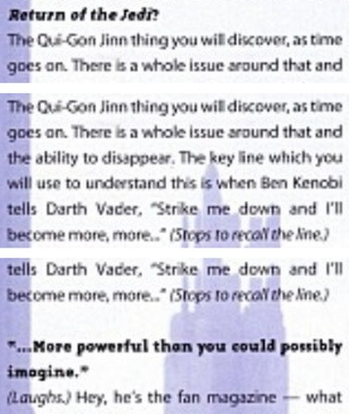

## scan p.19 (scan page 19)

Page contents: Lucas press conference cont.: favorite characters pit droids; romance next film; directing II and III; Anakin aged down from 12 to 10. No power material. (hand-read)

## scan p.20 (scan page 20)

Page contents: Hasbro CommTech figures ad. Ad copy only. (hand-read)

## scan p.21 (scan page 21)

Page contents: Lucas press conference end; cast junket cont.; CommTech checklist. No power material. (hand-read)

## scan p.22 (scan page 22)

Page contents: Ahmed Best interview opener (photo/title). No power material. (hand-read)

## scan p.23 (scan page 23)

Page contents: Ahmed Best interview: motion capture, breakdancing origin of Jar Jar's walk. Behind the scenes only. (hand-read)

## scan p.24 (scan page 24)

Page contents: Ahmed Best interview cont.: martial arts background, Stomp, first saw Ben's mind trick at age three. Behind the scenes only. (hand-read)

## scan p.25 (scan page 25)

Page contents: Ahmed Best interview cont.: R2-D2 on set, 50-50 performance/animation, Jar Jar suit. Behind the scenes only. (hand-read)

## scan p.26 (scan page 26)

Page contents: Ahmed Best interview end: Jar Jar "doesn't fall for that whole big Jedi mind trick superiority kind of thing" (actor characterization, not a feat; not logged); wants to play Han Solo's father. No power material. (hand-read)

## scan p.27 (scan page 27)

Page contents: Ace Books Black Fleet/Alien Chronicles "The Crystal Eye" ad ("mighty reptilian Viis"). Ad copy only. (hand-read)

## scan p.28 (scan page 28)

Page contents: Jar Jar Genesis (Mark Cotta Vaz): ILM CG history, Jar Jar design start. Behind the scenes only. (hand-read)

## scan p.29 (scan page 29)

Page contents: Jar Jar Genesis cont.: Lucas toyed with giving Jar Jar "the power to physically expand and contract" (discarded design idea, not logged); modeling. Behind the scenes only. (hand-read)

## scan p.30 (scan page 30)

Page contents: Jar Jar Genesis cont.: animation team, Best's reference performance. Behind the scenes only. (hand-read)

## scan p.31 (scan page 31)

Page contents: Jar Jar Genesis cont.: animation process, Watto pushing Jar Jar improvisation. Behind the scenes only. (hand-read)

## scan p.32 (scan page 32)

Page contents: Jar Jar Genesis end: cloth simulation, lighting, rendering. Behind the scenes only. (hand-read)

## scan p.33 (scan page 33)

Page contents: Hope Industries die-cast watches ad. Ad copy only. (hand-read)

## scan p.34 (scan page 34)

Page contents: Hope Industries sculpted watches ad. Ad copy only. (hand-read)

## scan p.35 (scan page 35)

Page contents: Insider subscription/Boba Fett Pez offer. Ad copy only. (hand-read)

## scan p.36 (scan page 36)

Page contents: Subscription reply card back. No content. (hand-read)

## scan p.37 (scan page 37)

Page contents: Jawa Trader catalog index (Pepsi/Jeff Gordon car). Catalog only. (hand-read)

## scan p.38 (scan page 38)

Page contents: Jawa Trader: exclusive POTF figures, CommTech reader. Catalog only. (hand-read)

## scan p.39 (scan page 39)

Page contents: Jawa Trader: Episode I figures, free Mace Windu offer. Catalog only. (hand-read)

## scan p.40 (scan page 40)

Page contents: Jawa Trader: Celebration jackets/T-shirt/poster. Catalog only. (hand-read)

## scan p.41 (scan page 41)

Page contents: Jawa Trader: Celebration pass set, TPM/Insider's Guide/Racer CD-ROMs (game copy "Use your Jedi powers to defeat battle droids"; ad copy, not logged). Catalog only. (hand-read)

## scan p.42 (scan page 42)

Page contents: Jawa Trader: soundtrack, Wonder Column CD, cards, Young Jedi CCG, interactive banks. Catalog only. (hand-read)

## scan p.43 (scan page 43)

Page contents: Jawa Trader: collector dolls. Catalog only. (hand-read)

## scan p.44 (scan page 44)

Page contents: Jawa Trader: toys (blasters, destroyer droid alarm, Podracers). Catalog only. (hand-read)

## scan p.45 (scan page 45)

Page contents: Members-only Prequel Update extra (Rick McCallum, by Dan Madsen): video release, DiCaprio rumor, Ep II shooting June 2000 in Australia, E.T. cameo, Jar Jar criticism; Maul will not return but "if you liked Darth Maul, wait until Episode II". Production news only, not logged. (hand-read)

## scan p.46 (scan page 46)

Page contents: Photo spread: Naboo starfighter in battle; astromechs repair the Queen's ship under fire. Captions only. (hand-read)

## scan p.47 (scan page 47)

Page contents: Members-only catalog (autographed Art of Star Wars, passes, posters). Catalog only. (hand-read)

## scan p.48 (scan page 48)

Page contents: Members-only catalog list. Catalog only. (hand-read)

## scan p.49 (scan page 49)

Page contents: Jawa Trader: pewter figurines. Catalog only. (hand-read)

## scan p.50 (scan page 50)

Page contents: Jawa Trader: Don Post masks, toy lightsabers ("Feel the power of the dark side!" ad copy). Catalog only. (hand-read)

## scan p.51 (scan page 51)

Page contents: Jawa Trader: costumes, life-size stand-ups. Catalog only. (hand-read)

## scan p.52 (scan page 52)

Page contents: Jawa Trader: posters (Fleming Maul poster, Qui-Gon vs Maul print). Catalog only. (hand-read)

## scan p.53 (scan page 53)

Page contents: Jawa Trader: stationery, Episode I comics and books. Catalog only. (hand-read)

## scan p.54 (scan page 54)

Page contents: Jawa Trader: bedding and apparel. Catalog only. (hand-read)

## scan p.55 (scan page 55)

Page contents: Jawa Trader: Lego and Ertl models. Catalog only. (hand-read)

## scan p.56 (scan page 56)

Page contents: Jawa Trader: towels, watches, summer sale. Catalog only. (hand-read)

## scan p.57 (scan page 57)

Page contents: Membership and back issues list. Catalog only. (hand-read)

## scan p.58 (scan page 58)

Page contents: Back issues list cont. Catalog only. (hand-read)

## scan p.59 (scan page 59)

Page contents: Order form. No content. (hand-read)

## scan p.60 (scan page 60)

Page contents: Order form/how to order. No content. (hand-read)

## scan p.61 (scan page 61)

Page contents: Star News (Chernoff): Muren Walk of Fame star; digital TPM projection in 4 theaters. News only. (hand-read)

## scan p.62 (scan page 62)

Page contents: Star News: digital projection details, MIT R2 dome prank, ILM Marfalump Pepsi ads, TriCon promo. News only. (hand-read)

## scan p.63 (scan page 63)

Page contents: Star News: Jeff Gordon Star Wars car, Weird Al "The Saga Begins", Young Jedi CCG, cast news. News only. (hand-read)

## scan p.64 (scan page 64)

Page contents: "Seeds Planted": R.A. Salvatore Vector Prime excerpt (ch. 4). Intro: ~25 ABY, Leia/Jaina/Mara mission to Rhommamool; Nom Anor (Yuuzhan Vong executor) and coomb spores. (hand-read)

- **Mara Jade Skywalker; Nom Anor** — entry/section: Star Wars Insider 045 (1999): "“Nor is her daughter you.” 4 proven Jedi,* "But Mara Jade is counted among the strongest of the Jedi Knights,” Shok Tinoktin pointed ovt “Mara lade bas her own problems to consider," Nom Anor reminded Shok Tinektin didn't take comfort in that; in fact, the reminder of Mara's disease only heightened his trepidation about letting her see Nom Anor at this time "She should be long dead,” he dared to say." Source: *Star Wars Insider #45* (1999), scan p.64
  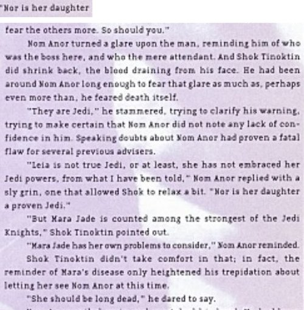
- **Mara Jade Skywalker** — entry/section: Star Wars Insider 045 (1999): "But in those endeavors and aspirations, to date at least, it appeared aa if he hed failed, for Mara Jade Skywalker had somehow defeated the spores, or at least had held them at bay." Source: *Star Wars Insider #45* (1999), scan p.64
  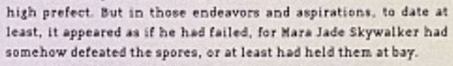
- **Mara Jade Skywalker; Nom Anor** — entry/section: Vector Prime excerpt: "The spores—coomb, brollup, tegnest, and a dozen other varieties—were but a hobby, one that he had been able to insert into his official duties in attempting to develop some method for easily killing the super-creatures, the Jedi Knights. Also, such alchemical work, if successful, could prove critical in Nom Anor's ascension to the rank of high prefect. But in those endeavors and aspirations, to date at least, it appeared as if he had failed, for Mara Jade Skywalker had somehow defeated the spores, or at least had held them at bay." Source: *Star Wars Insider #45* (1999), scan p.64
  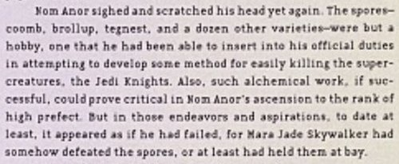

## scan p.65 (scan page 65)

Page contents: Vector Prime excerpt cont.: Nom Anor's aims (weaken Leia/Jaina), Noghri Bolpuhr, dresses like Vader; avoids letting Jedi into his quarters because of their "sensory powers" (not imaged-checked, noted only). (hand-read)

- **Nom Anor** — entry/section: Vector Prime excerpt: "The expected Noghri bodyguard, Nom Anor knew. He nodded at the sight and made a mental note to keep careful watch on that one. In many ways, Nom Anor held much more respect for the Noghri, those deadly warriors, than for any humans, even Jedi." Source: *Star Wars Insider #45* (1999), scan p.65
  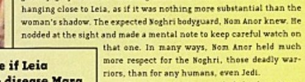

## scan p.66 (scan page 66)

Page contents: Vector Prime excerpt cont.: hallway confrontation; Leia recognizes Vader-like look; Nom Anor rejects mediation. Dialogue, no power statements. (hand-read)

## scan p.67 (scan page 67)

Page contents: Vector Prime excerpt cont.: Nom Anor threatens C-3PO; newt confirms spores on Mara's breath, "she wasn't as strong"; yammosk mention; party leaves. (hand-read)

## scan p.68 (scan page 68)

Page contents: Vector Prime excerpt cont.: Mara and Jaina sense nothing of Nom Anor through the Force; Falcon repair scene with Han, Anakin Solo, Chewie (cont. p74 of magazine). (hand-read)

- **Mara Jade Skywalker; Jaina Solo; Nom Anor** — entry/section: Vector Prime excerpt: ""And once again, my sensitivity to the Force revealed nothing about him," Mara added. "Nothing. I even tried to silently call to him, just to get a reaction, but he didn't respond at all—I don't even know that he heard it—and so completely did he ignore me that there was little I could learn about him." "Same with me," Jaina admitted. "It's like he was totally devoid of the Force." Source: *Star Wars Insider #45* (1999), scan p.68
  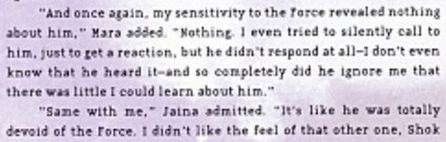

## scan p.69 (scan page 69)

Page contents: Ad: Terry Brooks Running with the Demon. No content. (hand-read)

## scan p.70 (scan page 70)

Page contents: Prequel Update: McCallum interview (by Chernoff/Fitzpatrick), 1,800 crew, Podrace/end battle hardest, Ep II returning cast; Padmé is 14, will marry Anakin and have two kids. (hand-read)

## scan p.71 (scan page 71)

Page contents: Photos: McGregor returns; caption asks if Ep II villain will rival Maul. Captions only. (hand-read)

## scan p.72 (scan page 72)

Page contents: Photos: Podrace, Trade Federation cannons vs Naboo fighters. Captions only. (hand-read)

## scan p.73 (scan page 73)

Page contents: McCallum cont.: Anakin's fall themes, Ep II schedule, $115M budget, last FX shot was Maul's saber on the force field; Palpatine "watching your career" pickup shot; "I was Darth Maul to Yoda." (hand-read)

- **Darth Maul** — entry/section: Prequel Update (McCallum): "It was a shot of the inside view of the electrical corridor. It's a shot where Darth Maul's lightsaber hits the force field, so you understand that you can't get through that force field." Source: *Star Wars Insider #45* (1999), scan p.73
  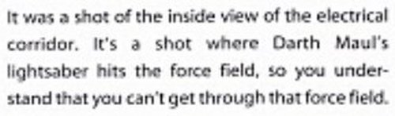

## scan p.74 (scan page 74)

Page contents: Photo: fan with Jabba sculpted backdrop at Celebration booth. Caption only. (hand-read)

## scan p.75 (scan page 75)

Page contents: Celebration report (Fitzpatrick): Denver, 30,000 fans, Columbine silence, Lucas video: Obi-Wan "huge" in next film. Event news only. (hand-read)

## scan p.76 (scan page 76)

Page contents: Celebration cont.: Ray Park on saber safety, Lloyd, Best, August on Shmi, Quarshie. Event news only. (hand-read)

## scan p.77 (scan page 77)

Page contents: Celebration photos (Daniels opening). Captions only. (hand-read)

## scan p.78 (scan page 78)

Page contents: Full-page photo, no text. (hand-read)

## scan p.79 (scan page 79)

Page contents: Celebration cont.: Quarshie on Panaka, Warwick Davis joke about playing a Jedi, McCallum Ep II timeline; sidebar Ahmed Best Jar Jar Jam. Event news only. (hand-read)

## scan p.80 (scan page 80)

Page contents: Celebration cont.: Lucasfilm archives display, Biggar/McCaig costumes, Chiang on battle droids design, Burtt sound; Chernoff letter sidebar. Production notes only. (hand-read)

## scan p.81 (scan page 81)

Page contents: Celebration photo collage. Captions only. (hand-read)

## scan p.82 (scan page 82)

Page contents: Celebration fan photo collage. Captions only. (hand-read)

## scan p.83 (scan page 83)

Page contents: Celebration cont.: Burtt; Nick Dudman on why Yoda looks younger in Ep I; licensee hangar; Chernoff "My Celebration" letter (Warwick on Ewoks). (hand-read)

- **Yoda** — entry/section: Star Wars Insider 045 (1999): "In Episode|he is powerful and at the peak of his powers, Ths mrt just 2 younger Yoda: It Is a more powerful arxl strong Jech Master." Source: *Star Wars Insider #45* (1999), scan p.83
  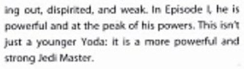
- **Yoda** — entry/section: Celebration report (Nick Dudman): "When we see Yoda in Empire, he is on the run, hiding out, dispirited, and weak. In Episode I, he is powerful and at the peak of his powers. This isn't just a younger Yoda: it is a more powerful and strong Jedi Master." Source: *Star Wars Insider #45* (1999), scan p.83
  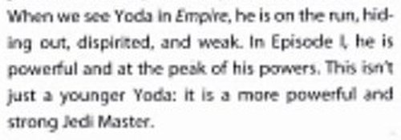

## scan p.84 (scan page 84)

Page contents: Vector Prime excerpt end: Chewie lifts Anakin Solo one-handed and takes his saber; Lando's "running the belt"; Mara's disease held off only by her Force use. (hand-read)

- **Chewbacca; Anakin Solo** — entry/section: Vector Prime excerpt: "held him there easily, with just one hand, while his other hand reached down to Anakin's belt and pulled free his lightsaber." Source: *Star Wars Insider #45* (1999), scan p.84
  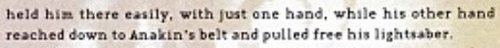
- **Mara Jade Skywalker** — entry/section: Vector Prime excerpt: "The best doctors in the galaxy were shaking their heads helplessly, able to do nothing but watch as something inside Mara continually altered her molecular structure. No medicine, no therapy, had come close to treating the rare disease, and only her own internal strength, her use of the Force, was somewhat keeping it in check. Those others who had contracted the disease had not been so fortunate." Source: *Star Wars Insider #45* (1999), scan p.84
  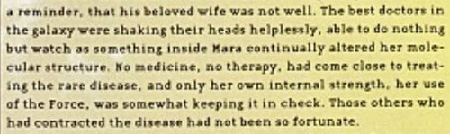

## scan p.85 (scan page 85)

Page contents: Ad: Cybertown. No content. (hand-read)

## scan p.86 (scan page 86)

Page contents: Horse's Mouth (Peet Janes, Dark Horse): new bounty hunter from Chiang sketch, Timothy Truman to draw. Comics news. (hand-read)

## scan p.87 (scan page 87)

Page contents: Horse's Mouth cont.: Truman on creating Aurra Sing (Boonta Eve cameo, long fingers, antenna). Creator commentary. (hand-read)

## scan p.88 (scan page 88)

Page contents: Horse's Mouth cont.: "Outlander" arc, Ki-Adi-Mundi (new Council member) seeks exiled Jedi Sharad Hett, the "self-exiled Tusken Jedi"; Aurra wants Hett dead. Comics lore, no power statements. (hand-read)

## scan p.89 (scan page 89)

Page contents: Letters (TPM reactions). Editor note: Qui-Gon is meditating behind the laser doors (per screenplay). (hand-read)

### Stat block notes (game mechanics, not feats)

- Letters (editor reply): Editor says Qui-Gon kneeling between the laser doors is meditating, citing the screenplay. (Source: *Star Wars Insider #45* (1999), scan p.89)

## scan p.90 (scan page 90)

Page contents: Letters cont. Editor reply on Obi-Wan's training; Glove of Peace answer; Celebration letters. (hand-read)

## scan p.91 (scan page 91)

Page contents: Celebration end: Lego Naboo starfighter, fan costumes, baby named with "Ashla"; sidebar Brian Blessed missed Celebration after North Pole trek. Event news only. (hand-read)

### Stat block notes (game mechanics, not feats)

- Celebration report: Article glosses "Ashla" as a term for the light side of the Force from an early Star Wars script. (Source: *Star Wars Insider #45* (1999), scan p.91)

## scan p.92 (scan page 92)

Page contents: Last Page art (Matthew Hatton). Art only. (hand-read)

## scan p.93 (scan page 93)

Page contents: Last Page cont. (submission note). No content. (hand-read)

## scan p.94 (scan page 94)

Page contents: Ad: Amidala portrait dolls. No content. (hand-read)

## scan p.95 (scan page 95)

Page contents: Ad: TPM game ("there's no such thing as a part-time Jedi"). Ad copy only. (hand-read)

