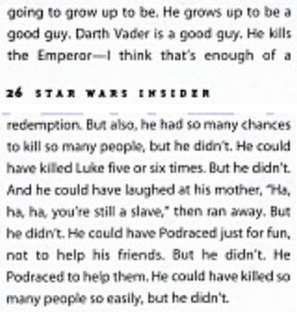
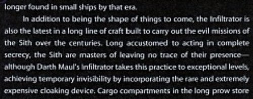
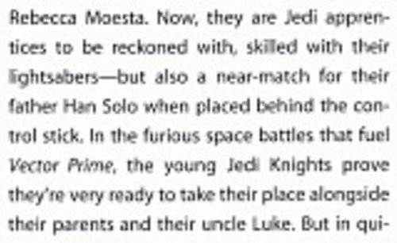
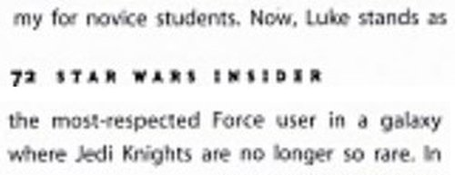
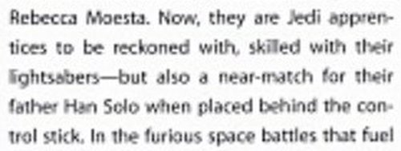
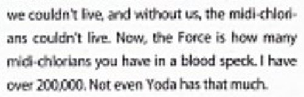

# Owner Material 038 — Star Wars Insider #1–153 plus specials (with The Lucasfilm Fan Club Magazine #1–22): Star Wars Insider #46 (1999)

- **Source:** *Star Wars Insider* magazine (issues 23–153, 1994–2014) and its predecessor *The Lucasfilm Fan Club Magazine* (issues 1–22, 1987–1994), plus seven special editions: articles, interviews, comics and short fiction Secondary source (licensed Legends reference). Scan OCR'd on the box; the scan stays box-only and is **not** published.
- **Method:** every scanned page was OCR'd and machine-screened sentence by sentence for power-relevant statements (fights, kills, defeats, Force feats, rankings, superweapons) that name a character on our roster; each kept sentence is quoted verbatim from the OCR text and has a crop of the printed passage directly under it. Pages with nothing power-relevant are still listed with what is on them.
- **Citation:** "*Star Wars Insider #46* (1999), p.X" by printed page ("scan p.X" where no printed number applies). **Weight:** Licensed magazine: a secondary source. Its short fiction and comics are Legends stories; its articles and interviews sum up or discuss lore and rank below the novels, comics and games they describe.

## scan p.1 (scan page 1)

Page contents: Cover (C-3PO). No text content. (hand-read)

## scan p.2 (scan page 2)

Page contents: Ad: RCCA Jeff Gordon Pepsi/Star Wars die-cast cars. Ad only. (hand-read)

## scan p.3 (scan page 3)

Page contents: Ad: Young Jedi CCG (Decipher) "Feel the Force". Ad copy only. (hand-read)

## scan p.4 (scan page 4)

Page contents: Ad/art page, OCR garbled (title art). No content. (hand-read)

## scan p.5 (scan page 5)

Page contents: Ad: The Art of Star Wars Episode I (Del Rey). Ad copy only. (hand-read)

## scan p.6 (scan page 6)

Page contents: Contents: TPM cast Q&A, Jedi home movie, Art of Episode I, vehicles overview (David West Reynolds), Anthony Daniels interview. Contents only. (hand-read)

## scan p.7 (scan page 7)

Page contents: Contents cont.; editorial on Blair Witch Project producer Gregg Hale citing Star Wars. No lore. (hand-read)

## scan p.8 (scan page 8)

Page contents: Rebel Rumblings letters: Jar Jar defenses, TheForce.net spoiler apology. Fan opinion; letter praises "an older Jedi Knight valiantly risking his life to save others" (Qui-Gon) and Mace leading the Council; no power statements. (hand-read)

## scan p.9 (scan page 9)

Page contents: Ad: Hasbro Sea and Swamp creatures (opee sea killer, colo claw fish). Ad only. (hand-read)

## scan p.10 (scan page 10)

Page contents: Prequel Update: Rick McCallum on Episode II locations (Australia, Tunisia, Italy), cut waterfall scene, cut Bail Antilles scenes. Production news. (hand-read)

## scan p.11 (scan page 11)

Page contents: Prequel Update photos: Yaddle with Saesee Tiin and Even Piell on the Jedi Council; Valorum; Palpatine. Captions only, no power statements. (hand-read)

## scan p.12 (scan page 12)

Page contents: Star News: Indiana Jones/Young Indy video set; Labyrinth/Dark Crystal DVD. Non-SW news. (hand-read)

## scan p.13 (scan page 13)

Page contents: Star News: TPM London royal premiere. Event news. (hand-read)

## scan p.14 (scan page 14)

Page contents: Star News cont.: premiere party; Magic of Myth tour dates; Presidio digital backlot. News only. (hand-read)

## scan p.15 (scan page 15)

Page contents: Star News: Presidio cont.; Manga wins Eisner; TPM box office chart. News only. (hand-read)

## scan p.16 (scan page 16)

Page contents: In the Star Wars Universe: Michael Sheard (Admiral Ozzel) interview; Ozzel's Hoth blunders and Force-choke death. Actor profile. (hand-read)

### Stat block notes (game mechanics, not feats)

- In the Star Wars Universe (Scott Chernoff): Article frames Ozzel's death as inevitably meeting "the business end of one of Darth Vader's lethal Force chokes"; Vader calls Ozzel "as clumsy as he is stupid." (Source: *Star Wars Insider #46* (1999), scan p.16)

## scan p.17 (scan page 17)

Page contents: Sheard profile cont. (First Frontier with Jeremy Bulloch, Empire casting). Actor career only. (hand-read)

## scan p.18 (scan page 18)

Page contents: Prequel Profile: editor Paul Martin Smith (1.3 million feet of film, ~2,000 effects shots, in-frame editing). Production only. (hand-read)

## scan p.19 (scan page 19)

Page contents: Ad: DK Visual Dictionary / Incredible Cross-Sections with paper pit droid. Ad only. (hand-read)

## scan p.20 (scan page 20)

Page contents: Smith profile cont. (favorite scene Padme finds Anakin; Spielberg reaction); Sheard end ("best screen death ever"). Production/actor only. (hand-read)

## scan p.21 (scan page 21)

Page contents: Ad: TPM video game, "Mastery of the Force requires that one purge all unnecessary activities from daily life... no such thing as a part-time Jedi." Ad copy, no character feats. (hand-read)

## scan p.22 (scan page 22)

Page contents: Cast Q&A: Liam Neeson on Qui-Gon (Shane x Mifune x Lucas; "Jedi Knights are basically cowboys in space"); Qui-Gon's standing with the Council left for later films. Actor commentary. (hand-read)

## scan p.23 (scan page 23)

Page contents: Neeson cont. (virgin birth, death scene, body didn't vanish, hopes to return); Samuel L. Jackson on getting his lightsaber, Yoda on set. Actor commentary. (hand-read)

## scan p.24 (scan page 24)

Page contents: Jackson cont.: Mace Windu reportedly first name Lucas wrote for Star Wars; costume; no feats. (hand-read)

## scan p.25 (scan page 25)

Page contents: Ad: Queen Amidala portrait doll. Ad only. (hand-read)

## scan p.26 (scan page 26)

Page contents: Jackson end (working with Yoda puppet); Jake Lloyd Q&A: Anakin/Vader "a good guy," kills the Emperor, spared Luke. Actor opinion. (hand-read)

- **Darth Vader (Anakin Skywalker); anakin-skywalker; Luke Skywalker; palpatine** — entry/section: Jake Lloyd interview: "He grows up to be a good guy, Darth Vader is a good guy. He kills the Emperor! I think that's enough of a redemption. But also, he had so many chances to kill so many people, but he didn't. He could have killed Luke five or six times. But he didn't." Source: *Star Wars Insider #46* (1999), scan p.26
  

## scan p.27 (scan page 27)

Page contents: Ad: Jeff Gordon Pepsi/Star Wars die-cast (Action). Ad only. (hand-read)

## scan p.28 (scan page 28)

Page contents: Feature: Return of the Ewok, David Tomblin's 1982 16mm home movie starring Warwick Davis; Boba Fett "hunting Ewok" framing is parody. Behind-the-scenes, non-canon. (hand-read)

## scan p.29 (scan page 29)

Page contents: Ad: Ertl Episode I model kits. Ad only. (hand-read)

## scan p.30 (scan page 30)

Page contents: Return of the Ewok photo-comic: Warwick meets Prowse, soccer, Hamill in Bespin gear, talent agent sends him to be an Ewok. Parody, non-canon. (hand-read)

## scan p.31 (scan page 31)

Page contents: Photo-comic cont.: Elstree dressing rooms (Ford, Fisher, Hamill), Jabba's palace, Boba Fett (Bulloch) chase, Throne Room. Parody, non-canon. (hand-read)

## scan p.32 (scan page 32)

Page contents: Photo-comic end: Vader (Prowse), Han, C-3PO switched off, Yoda gives "galactic passport," Endor footage. Parody, no feats. (hand-read)

## scan p.33 (scan page 33)

Page contents: Ad: Science Fiction Book Club. Ad only. (hand-read)

## scan p.34 (scan page 34)

Page contents: Ad: Insider deluxe posters. Ad only. (hand-read)

## scan p.35 (scan page 35)

Page contents: Holiday gift subscription forms. No content. (hand-read)

## scan p.36 (scan page 36)

Page contents: Renewal envelope forms. No content. (hand-read)

## scan p.37 (scan page 37)

Page contents: Jawa Trader catalog: Naboo starship Laser Tag playset, LEGO Droid Developer Kit. Product copy only. (hand-read)

## scan p.38 (scan page 38)

Page contents: Jawa Trader: Celebration passes set, Jeff Gordon car/hat. Product copy only. (hand-read)

## scan p.39 (scan page 39)

Page contents: Jawa Trader: 13" vinyl dolls, FAO 12" Wedge/Biggs, Leia/R2. Product copy only. (hand-read)

## scan p.40 (scan page 40)

Page contents: Jawa Trader: Dark Trooper/Spacetrooper set, exclusive carded figures, free Mace Windu. Product copy only. (hand-read)

## scan p.41 (scan page 41)

Page contents: Jawa Trader: Episode I figures, Oola & Salacious Crumb two-pack. Product copy only. (hand-read)

## scan p.42 (scan page 42)

Page contents: Jawa Trader: Christmas cards, dolls. Product copy only. (hand-read)

## scan p.43 (scan page 43)

Page contents: Jawa Trader: pewter ornaments and figurines. Product copy only. (hand-read)

## scan p.44 (scan page 44)

Page contents: Jawa Trader: Episode I Trivial Pursuit, Young Jedi Jedi Council, SWCCG. Product copy only. (hand-read)

## scan p.45 (scan page 45)

Page contents: Jawa Trader: Masterpiece Editions, TPM portfolio, Vector Prime blurb ("a new generation of Jedi faces the forces of evil"). Product copy only. (hand-read)

## scan p.46 (scan page 46)

Page contents: Jawa Trader: CD-ROMs (Pit Droids, Gungan Frontier, Racer), soundtrack. Product copy only. (hand-read)

## scan p.47 (scan page 47)

Page contents: Jawa Trader: Episode I and classic LEGO, model kits. Product copy only. (hand-read)

## scan p.48 (scan page 48)

Page contents: Jawa Trader: Jedi robes, costumes, helmets. Product copy only. (hand-read)

## scan p.49 (scan page 49)

Page contents: Jawa Trader: Don Post masks; Qui-Gon and Darth Maul toy lightsabers ("Feel the power of the dark side!"). Product copy only. (hand-read)

## scan p.50 (scan page 50)

Page contents: Jawa Trader: apparel (Celebration Maul jacket, Jedi Knight denim shirt). Product copy only. (hand-read)

## scan p.51 (scan page 51)

Page contents: Jawa Trader: life-size stand-ups list. Product copy only. (hand-read)

## scan p.52 (scan page 52)

Page contents: Jawa Trader: posters and Dave Dorman signed prints. Product copy only. (hand-read)

## scan p.53 (scan page 53)

Page contents: Membership/back issues list #37-#45 (contents blurbs). No lore. (hand-read)

## scan p.54 (scan page 54)

Page contents: Membership form/back issues cont. (OCR of fold). No lore. (hand-read)

## scan p.55 (scan page 55)

Page contents: Order form / business reply mail. No content. (hand-read)

## scan p.56 (scan page 56)

Page contents: How to order / shipping chart. No content. (hand-read)

## scan p.57 (scan page 57)

Page contents: Ad: Indiana Jones soundtrack CDs, fedoras, jacket, Infernal Machine. Non-SW. (hand-read)

## scan p.58 (scan page 58)

Page contents: Art of Episode I: Obi-Wan and Qui-Gon concept art (Iain McCaig) title page. Captions only. (hand-read)

## scan p.59 (scan page 59)

Page contents: Art of Episode I intro; Obi-Wan/Qui-Gon costume and face concepts, lightsaber designs. Design notes, no feats. (hand-read)

## scan p.60 (scan page 60)

Page contents: Art of Episode I: Podrace arena and viewing platform concepts (Doug Chiang). Design notes only. (hand-read)

## scan p.61 (scan page 61)

Page contents: Art of Episode I: full-page art (caption only). No content. (hand-read)

## scan p.62 (scan page 62)

Page contents: Art of Episode I: C-3PO concept designs (Doug Chiang). Design notes only. (hand-read)

## scan p.63 (scan page 63)

Page contents: Ad: Hasbro CommTech figures. Ad only. (hand-read)

## scan p.64 (scan page 64)

Page contents: Art of Episode I: Sith Lord concepts (Iain McCaig), "Sith Witch" drawn as Lucas's "worst nightmare." Design notes, no feats. (hand-read)

## scan p.65 (scan page 65)

Page contents: Ad: Episode I pinball (defeat Darth Maul in a lightsaber duel to advance). Ad copy only. (hand-read)

## scan p.66 (scan page 66)

Page contents: Vehicles feature (David West Reynolds): intro on Doug Chiang's designs and Cross-Sections back-stories. Design commentary. (hand-read)

## scan p.67 (scan page 67)

Page contents: Vehicles: Sith Infiltrator (Raith Sienar design, stygium-crystal cloaking device, prow holds speeder bike, probe droids, torture devices); Trade Federation C-9979 landing ship (tensor fields; 11 MTTs, 114 AATs). Tech lore. (hand-read)

- **Darth Maul; the-sith** — entry/section: Vehicles feature (David West Reynolds): "In addition to being the shape of things to come, the Infiltrator is also the latest in a long line of craft built to carry out the evil missions of the Sith over the centuries. Long accustomed to acting in complete secrecy, the Sith are masters of leaving no trace of their presence although Darth Maul's Infiltrator takes this practice to exceptional levels, achieving temporary invisibility by incorporating the rare and extremely expensive cloaking device." Source: *Star Wars Insider #46* (1999), scan p.67
  

## scan p.68 (scan page 68)

Page contents: Vehicles: Naboo Flash and Gian speeders; Gungan bongo sub (hydromotive field, hydrostatic field windshields). Tech lore, no character feats. (hand-read)

## scan p.69 (scan page 69)

Page contents: Vehicles: MTT (holds up to 112 battle droids, Baktoid Armor Workshop) and AAT (crew of four droids, plasma-cocooned shells). Tech lore, no character feats. (hand-read)

## scan p.70 (scan page 70)

Page contents: Full-page art (vehicle). No text. (hand-read)

## scan p.71 (scan page 71)

Page contents: Anthony Daniels interview title page. No content. (hand-read)

## scan p.72 (scan page 72)

Page contents: Daniels interview: new C-3PO look; reaction to learning Anakin (Vader) built Threepio. Actor commentary. (hand-read)

## scan p.73 (scan page 73)

Page contents: Daniels cont.: "just been built by a nine-year-old"; Artoo/Threepio pairing; Leavesden security story. Actor commentary. (hand-read)

## scan p.74 (scan page 74)

Page contents: Daniels cont.: Celebration MC, gold jacket, fans. Actor commentary. (hand-read)

## scan p.75 (scan page 75)

Page contents: Daniels cont.: path to acting; Threepio "utterly confused by things like the Force." Actor characterization, no feats. (hand-read)

## scan p.76 (scan page 76)

Page contents: Daniels end: Threepio's fear "not an emotion, it's a reaction"; Wonder Column CD; Episode II hopes. Actor commentary. (hand-read)

## scan p.77 (scan page 77)

Page contents: Ad: Hope Industries die-cast watches. Ad only. (hand-read)

## scan p.78 (scan page 78)

Page contents: Bookshelf (Jason Fry): R.A. Salvatore's NJO Vector Prime. Yuuzhan Vong; Luke as most-respected Force user; Solo kids' skills. Book-promo lore. (hand-read)

- **Jaina Solo; Jacen Solo (Darth Caedus); Han Solo** — entry/section: Star Wars Insider 046 (1999): "Now, they are Jedi apprentices to be reckoned with, skilled with their Sghtsabers—but also a near-match for their father Han Solo when placed behind the can tral stick, In the furious space battles that fuel Vector Prime, the young Jedi Knights prave they're very ready to take their place alongside their parents and their uncle Luke." Source: *Star Wars Insider #46* (1999), scan p.78
  
- **Luke Skywalker** — entry/section: Bookshelf: Vector Prime (Jason Fry): "Now, Luke stands as the most-respected Force user in a galaxy where Jedi Knights are no longer so rare." Source: *Star Wars Insider #46* (1999), scan p.78
  
- **jacen-solo; Jaina Solo; Anakin Solo; Han Solo** — entry/section: Bookshelf: Vector Prime (Jason Fry): "Now, they are Jedi apprentices to be reckoned with, skilled with their lightsabers—but also a near-match for their father Han Solo when placed behind the control stick." Source: *Star Wars Insider #46* (1999), scan p.78
  

## scan p.79 (scan page 79)

Page contents: Salvatore profile cont.: "Star Wars is fantasy"; writing the Solo teens. Author commentary. (hand-read)

## scan p.80 (scan page 80)

Page contents: Bookshelf: NJO Onslaught/Ruin plans, Art of Episode I, Jedi Apprentice, Episode I Adventures, Darth Maul journal teaser. Publishing news. (hand-read)

## scan p.81 (scan page 81)

Page contents: Jake Lloyd interview end (from p26): Vader "brings balance to the Force"; midi-chlorian claim. Actor's in-joke, not canon. (hand-read)

- **anakin-skywalker; Yoda** — entry/section: Jake Lloyd interview: "Now, the Force is how many midi-chlorians you have in a blood speck. I have over 200,000. Not even Yoda has that much." Source: *Star Wars Insider #46* (1999), scan p.81
  

## scan p.82 (scan page 82)

Page contents: Collecting column: Revenge of the Jedi crew shirts (Kazanjian letter), bedsheets, POP displays. Collecting only. (hand-read)

## scan p.83 (scan page 83)

Page contents: Collecting cont.: poster versions A/B/C, DVD wait, Journal of the Whills novelization. Collecting only. (hand-read)

## scan p.84 (scan page 84)

Page contents: Collecting end (figure stands, creased posters) + box-office news (Japan/UK openings). No lore. (hand-read)

## scan p.85 (scan page 85)

Page contents: Obituaries: Declan Mulholland (unused Jabba scene), John Stears (effects, R2-D2). Production history. (hand-read)

## scan p.86 (scan page 86)

Page contents: Rebel Rumblings: R2-D2 best-man wedding photos; spoiler etiquette letters. Fan content. (hand-read)

## scan p.87 (scan page 87)

Page contents: Rebel Rumblings: fan haiku (Chewie "Rips arms off when he loses"; Yoda "Force is his ally"), Brian Blessed letter. Fan verse, not canon. (hand-read)

## scan p.88 (scan page 88)

Page contents: Back-of-issue ad page. No content. (hand-read)

## scan p.89 (scan page 89)

Page contents: Ad: Scholastic Jude Watson books. Ad only. (hand-read)

## scan p.90 (scan page 90)

Page contents: Ad: Episode I Insider's Guide CD-ROM. Ad only. (hand-read)

