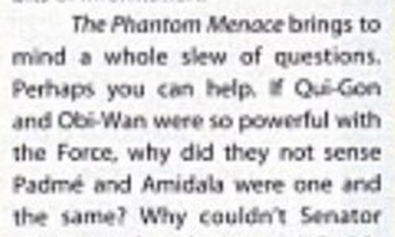
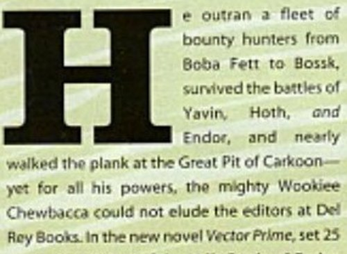
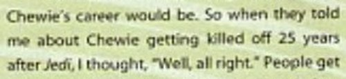
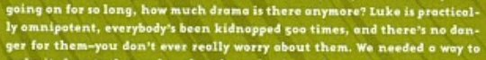
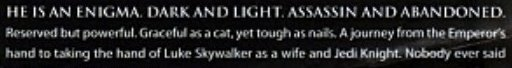
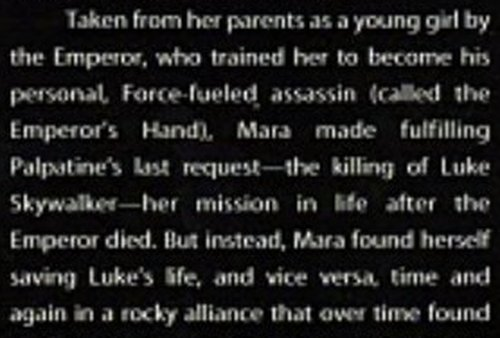
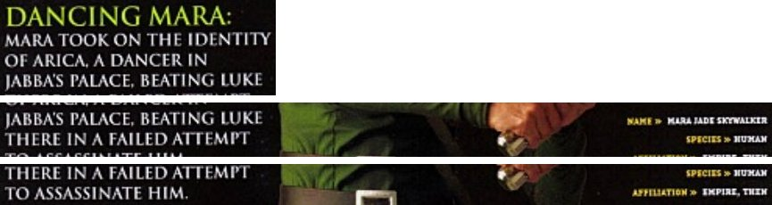
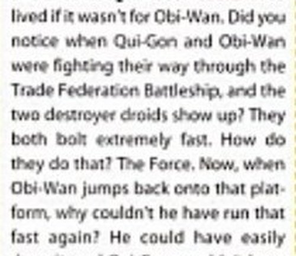
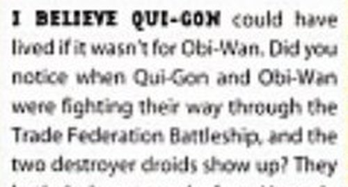

# Owner Material 038 — Star Wars Insider #1–153 plus specials (with The Lucasfilm Fan Club Magazine #1–22): Star Wars Insider #47 (1999)

- **Source:** *Star Wars Insider* magazine (issues 23–153, 1994–2014) and its predecessor *The Lucasfilm Fan Club Magazine* (issues 1–22, 1987–1994), plus seven special editions: articles, interviews, comics and short fiction Secondary source (licensed Legends reference). Scan OCR'd on the box; the scan stays box-only and is **not** published.
- **Method:** every scanned page was OCR'd and machine-screened sentence by sentence for power-relevant statements (fights, kills, defeats, Force feats, rankings, superweapons) that name a character on our roster; each kept sentence is quoted verbatim from the OCR text and has a crop of the printed passage directly under it. Pages with nothing power-relevant are still listed with what is on them.
- **Citation:** "*Star Wars Insider #47* (1999), p.X" by printed page ("scan p.X" where no printed number applies). **Weight:** Licensed magazine: a secondary source. Its short fiction and comics are Legends stories; its articles and interviews sum up or discuss lore and rank below the novels, comics and games they describe.

## scan p.1 (scan page 1)

Page contents: Cover (Mara Jade / Shannon Baksa; Chewie's fate; Portman). Cover lines only. (hand-read)

## scan p.2 (scan page 2)

Page contents: Ad: Young Jedi CCG Jedi Council expansion. Ad only. (hand-read)

## scan p.3 (scan page 3)

Page contents: Ad: TPM video game ("no such thing as a part-time Jedi"). Ad copy, no character feats. (hand-read)

## scan p.4 (scan page 4)

Page contents: Ad: Chronicle Books (Chiang portfolio, C-3PO Masterpiece, Star Wars Chronicles). Ad only. (hand-read)

## scan p.5 (scan page 5)

Page contents: Ad: Cybertown. Non-SW ad. (hand-read)

## scan p.6 (scan page 6)

Page contents: Contents: Portman/August, Mayhew, Mara Jade "Flesh and Blood", creatures of Episode I, Star Wars Rocks II. Contents only. (hand-read)

## scan p.7 (scan page 7)

Page contents: Contents cont.; humorous 2-1B guest editorial (claims credit for saving Luke, mocks FX-7, Bossk, 4-LOM). Joke piece, no canon feats. (hand-read)

## scan p.8 (scan page 8)

Page contents: Rebel Rumblings: Episode II spoiler complaint (Anakin/Amidala marriage) and editor reply; "Menace-ing Questions" letter on Jedi sensing. (hand-read)

- **Qui-Gon Jinn; Obi-Wan Kenobi; Padmé Amidala**: "The Phantom Menace brings to mind a whole slew of questions, Perhaps you can help, & Qui-Gon and Obi-Wan were so powerful with the Force, why did they not sense Padmé and Amidals were one and the same?" Source: *Star Wars Insider #47* (1999), scan p.8
  

## scan p.9 (scan page 9)

Page contents: Ad: cold-cast resin busts. Ad only. (hand-read)

## scan p.10 (scan page 10)

Page contents: Prequel Update: McCallum on Episode II script, locations, design, casting. Production only. (hand-read)

## scan p.11 (scan page 11)

Page contents: Prequel Update cont.: Maul "he's dead" but other bad guys; Italy rumors; Indy 4. Production only. (hand-read)

## scan p.12 (scan page 12)

Page contents: Star News: USC film school anniversary. News only. (hand-read)

## scan p.13 (scan page 13)

Page contents: Star News: TPM home video, charity re-release, box office, Rogue Planet (Obi-Wan and Anakin, Greg Bear) announced. News only. (hand-read)

## scan p.14 (scan page 14)

Page contents: Star News: Magic of Myth in San Diego; box office cont.; ILM at DGA. News only. (hand-read)

## scan p.15 (scan page 15)

Page contents: Star News: ILM effects talk (Muren, Coleman). Production only. (hand-read)

## scan p.16 (scan page 16)

Page contents: Star News: ILM "Dual Visions" art show; cast whereabouts. News only. (hand-read)

## scan p.17 (scan page 17)

Page contents: Ad: Star Wars Kids subscription. Ad only. (hand-read)

## scan p.18 (scan page 18)

Page contents: In the Star Wars Universe: Mike Quinn (Nien Nunb puppeteer). Actor/puppeteer profile. (hand-read)

## scan p.19 (scan page 19)

Page contents: Quinn cont.: name from "number nine" on creature list; lip-sync. Production only. (hand-read)

## scan p.20 (scan page 20)

Page contents: Quinn end: assisted Jabba, Ackbar, Yoda's right hand; early Jedi Council "all Yoda-type characters". Production only. (hand-read)

## scan p.21 (scan page 21)

Page contents: Ad: action figure stands. Ad only. (hand-read)

## scan p.22 (scan page 22)

Page contents: Portman Q&A: Amidala/Padmé same person, accent. Actor commentary. (hand-read)

## scan p.23 (scan page 23)

Page contents: Pernilla August Q&A: Liam Neeson, Celebration, Bergman. Actor commentary. (hand-read)

## scan p.24 (scan page 24)

Page contents: August/Portman cont.: costumes; Shmi letting Anakin go ("She is strong inside"). Actor commentary. (hand-read)

## scan p.25 (scan page 25)

Page contents: Portman cont. (Amidala strong but inexperienced; Sebulba favorite); August on Anakin's conception ("one of those metaphysical things" per Lucas). (hand-read)

## scan p.26 (scan page 26)

Page contents: Full-page photo (Portman). No text. (hand-read)

## scan p.27 (scan page 27)

Page contents: Mayhew interview opens: Chewie's heroic death in Vector Prime saving Han's son. (hand-read)

- **Chewbacca** — entry/section: Peter Mayhew interview intro (Scott Chernoff): "He outran a fleet of bounty hunters from Boba Fett to Bossk, survived the battles of Yavin, Hoth, and Endor, and nearly walked the plank at the Great Pit of Carkoon—yet for all his powers, the mighty Wookiee Chewbacca could not elude the editors at Del Rey Books." Source: *Star Wars Insider #47* (1999), scan p.27
  
- **Chewbacca** — entry/section: Back, and Returr ed Although Chewie's: "So when they told me about Chewie getting Killed off 25 years after Jedi, | thought, "Well all right."" Source: *Star Wars Insider #47* (1999), scan p.27
  

## scan p.28 (scan page 28)

Page contents: Shapiro on why Chewie was killed (stakes, growth for Han); Mayhew on Chewie's appeal. (hand-read)

- **Luke Skywalker; Chewbacca; Han Solo** — entry/section: "Why Chewie?" sidebar (Shelly Shapiro, Del Rey NJO editor): "Luke is practically omnipotent, everybody's been kidnapped 500 times, and there's no danger for them—you don't ever really worry about them." Source: *Star Wars Insider #47* (1999), scan p.28
  
- **Luke Skywalker**: "I think « lot more people would be upset with us if we killed Luke or Hon or Leis." Source: *Star Wars Insider #47* (1999), scan p.28
  

## scan p.29 (scan page 29)

Page contents: Mayhew: MTV Lifetime Achievement medal; Empire memories. Actor commentary. (hand-read)

## scan p.30 (scan page 30)

Page contents: Mayhew: chess scene, Han frozen reaction, casting (chose Chewie over Vader). Actor commentary. (hand-read)

## scan p.31 (scan page 31)

Page contents: Ad: Indiana Jones merchandise. Non-SW ad. (hand-read)

## scan p.32 (scan page 32)

Page contents: Mayhew end: carrying C-3PO, timber business, TPM, Chewie "200 years old" in Star Wars (interviewer), Holiday Special. Actor commentary. (hand-read)

## scan p.33 (scan page 33)

Page contents: Ad: sculpted watches. Ad only. (hand-read)

## scan p.34 (scan page 34)

Page contents: Ad: Episode I pinball. Ad only. (hand-read)

## scan p.35 (scan page 35)

Page contents: Subscription form. No content. (hand-read)

## scan p.36 (scan page 36)

Page contents: Subscription envelope page. No content. (hand-read)

## scan p.37 (scan page 37)

Page contents: Jawa Trader: international two-packs. Merchandise only. (hand-read)

## scan p.38 (scan page 38)

Page contents: Jawa Trader: exclusive figures (Dark Trooper, etc.). Merchandise only. (hand-read)

## scan p.39 (scan page 39)

Page contents: Jawa Trader: action figures list. Merchandise only. (hand-read)

## scan p.40 (scan page 40)

Page contents: Jawa Trader: Celebration passes, Jeff Gordon car, Wonder Column CD. Merchandise only. (hand-read)

## scan p.41 (scan page 41)

Page contents: Jawa Trader: deluxe toys (Slave Leia set, Rebel Pilot set). Merchandise only. (hand-read)

## scan p.42 (scan page 42)

Page contents: Jawa Trader: card games. Merchandise only. (hand-read)

## scan p.43 (scan page 43)

Page contents: Jawa Trader: pewter figurines. Merchandise only. (hand-read)

## scan p.44 (scan page 44)

Page contents: Jawa Trader: books/portfolios. Merchandise only. (hand-read)

## scan p.45 (scan page 45)

Page contents: Jawa Trader: books/comics (By the Emperor's Hand blurb: "the Emperor's personal assassin"; Vector Prime). Catalog copy. (hand-read)

## scan p.46 (scan page 46)

Page contents: Jawa Trader: reference books. Merchandise only. (hand-read)

## scan p.47 (scan page 47)

Page contents: Jawa Trader: CD-ROMs. Merchandise only. (hand-read)

## scan p.48 (scan page 48)

Page contents: Jawa Trader: models, LEGO. Merchandise only. (hand-read)

## scan p.49 (scan page 49)

Page contents: Jawa Trader: masks, toy lightsabers. Merchandise only. (hand-read)

## scan p.50 (scan page 50)

Page contents: Jawa Trader: apparel. Merchandise only. (hand-read)

## scan p.51 (scan page 51)

Page contents: Jawa Trader: stand-ups. Merchandise only. (hand-read)

## scan p.52 (scan page 52)

Page contents: Jawa Trader: lithographs, clock. Merchandise only. (hand-read)

## scan p.53 (scan page 53)

Page contents: Ad: Bowen Darth Vader bronze. Ad only. (hand-read)

## scan p.54 (scan page 54)

Page contents: Mara Jade feature opens: Shannon Baksa photo shoot for Decipher card; Mara the only non-movie character in the 1998 favorite-character poll (#20). (hand-read)

- **Mara Jade Skywalker** — entry/section: Mara Jade: Flesh & Blood (Scott Chernoff), printed p. 52: "He is an enigma. Dark and light. Assassin and abandoned. Reserved but powerful. Graceful as a cat, yet tough as nails. A journey from the Emperor's hand to taking the hand of Luke Skywalker as a wife and Jedi Knight." Source: *Star Wars Insider #47* (1999), scan p.54
  
- **Mara Jade Skywalker; Palpatine (Darth Sidious); Luke Skywalker** — entry/section: Mara Jade: Flesh & Blood (Scott Chernoff), printed p. 52: "Taken from her parents as a young girl by the Emperor, who trained her to become his personal, Force-fueled assassin (called the Emperor's Hand), Mara made fulfilling Palpatine's last request—the killing of Luke Skywalker—her mission in life after the Emperor died. But instead, Mara found herself saving Luke's life, and vice versa, time and again" Source: *Star Wars Insider #47* (1999), scan p.54
  

## scan p.55 (scan page 55)

Page contents: Full-page photo (Baksa as Mara). No text. (hand-read)

## scan p.56 (scan page 56)

Page contents: Baksa on preparing ("a very strong woman, physically as well as mentally"); Zahn sidebar: Mara's alertness, "thinking two or three steps ahead"; flip side of Han and Leia. Character commentary. (hand-read)

## scan p.57 (scan page 57)

Page contents: Data file: Jedi Knight, magenta lightsaber and Luke's blue lightsaber from Empire; Zahn on name meaning (Mara = bitterness, jade = discarded woman). (hand-read)

- **Mara Jade Skywalker; Luke Skywalker** — entry/section: Mara Jade feature caption, printed p. 55: "Dancing Mara: Mara took on the identity of Arica, a dancer in Jabba's palace, beating Luke there in a failed attempt to assassinate him." Source: *Star Wars Insider #47* (1999), scan p.57
  

## scan p.58 (scan page 58)

Page contents: Zahn: Mara's anger at Luke was "the Emperor's anger"; caption: Luke gave Mara his Bespin-lost lightsaber; Baksa/Burns comments. Character commentary. (hand-read)

## scan p.59 (scan page 59)

Page contents: "Mara Jade: Superstar!" bibliography of novels, comics, games, toys. List only. (hand-read)

## scan p.60 (scan page 60)

Page contents: Creatures of Episode I (Daniel Wallace / Terryl Whitlatch) title page. No text. (hand-read)

## scan p.61 (scan page 61)

Page contents: 892 words, 39 paragraphs | headings/entries: SANDO AQUA MONSTER; SANDS AQUA; Nobso cceon; STAR WARS INSIDER 59

### Stat block notes (game mechanics, not feats)

- Creatures of Episode I (Daniel Wallace), printed p. 59: Sando aqua monster spans 525 feet (caption says 525); its partially modified clawed forelimbs "come in handy when you need to tear an opee sea killer in half"; "king of the Naboo ocean." (Source: *Star Wars Insider #47* (1999), scan p.61)

## scan p.62 (scan page 62)

Page contents: Opee sea killer and colo claw fish anatomy. Creature design only. (hand-read)

## scan p.63 (scan page 63)

Page contents: Kaadu and fambaa: fambaa "tough hide allow them to shrug off low-power blaster fire", carry shield generators. Creature design. (hand-read)

## scan p.64 (scan page 64)

Page contents: Eopie and falumpaset. Creature design only. (hand-read)

## scan p.65 (scan page 65)

Page contents: Pikobi, ikopi, peko peko. Creature design only. (hand-read)

## scan p.66 (scan page 66)

Page contents: Star Wars Rocks Strikes Back (Jon Bradley Snyder) title art (Maul breakdancing). No lore. (hand-read)

## scan p.67 (scan page 67)

Page contents: Title page continues. No lore. (hand-read)

## scan p.68 (scan page 68)

Page contents: Music feature: Weird Al "The Saga Begins", Meco, Skabba the Hut. Music only. (hand-read)

## scan p.69 (scan page 69)

Page contents: Music lists (songs with SW characters in the title). Music only. (hand-read)

## scan p.70 (scan page 70)

Page contents: Contributors list, Lawrence Welk, MC Gee Gee, "Sweet Palpatine" filk. Music only. (hand-read)

## scan p.71 (scan page 71)

Page contents: Princess Lola's band, Raven, "Star Wars Soca", wish list (a song about Lobot). Music only. (hand-read)

## scan p.72 (scan page 72)

Page contents: Full-page art (Union cover). No text. (hand-read)

## scan p.73 (scan page 73)

Page contents: Union preview (Peet Janes): Luke and Mara's wedding; Vision of the Future implied "a powerful bond between Luke and Mara, a sharing of vision and feeling"; Vector Prime five years later. Publishing lore only. (hand-read)

## scan p.74 (scan page 74)

Page contents: Union: Imperial remnants plan to spoil the wedding; cast incl. Karrde, Wedge, Booster, Mirax, Corran Horn; Stackpole quotes. Publishing commentary. (hand-read)

## scan p.75 (scan page 75)

Page contents: Chewbacca miniseries (Darko Macan): family Mallatobuck, Lumpawarrump, Itchy; Trandoshan storyteller; Mala Mala. Publishing commentary. (hand-read)

## scan p.76 (scan page 76)

Page contents: Scouting the Galaxy (Sansweet): Pepsi cans, gold Yoda odds. Collecting only. (hand-read)

## scan p.77 (scan page 77)

Page contents: Scouting: Montgomery Ward "barroom scene" figures, Bibb pillowcase, 6-ft Maul promo. Collecting only. (hand-read)

## scan p.78 (scan page 78)

Page contents: Scouting: Hasbro ideas, collecting philosophy. Collecting only. (hand-read)

## scan p.79 (scan page 79)

Page contents: Prequel Profile: prop master Ty Teiger (2,500 props, 300+ weapons). Production only. (hand-read)

## scan p.80 (scan page 80)

Page contents: Fan art gallery. No text. (hand-read)

## scan p.81 (scan page 81)

Page contents: Fan art gallery. No text. (hand-read)

## scan p.82 (scan page 82)

Page contents: Letters: Vanity Fair Maul/Obi-Wan photo was staged for Leibovitz; Air Force screening; classic trilogy complaint. (hand-read)

- **Qui-Gon Jinn; Obi-Wan Kenobi** — entry/section: Rebel Rumblings letter (Chris Kauppila), printed p. 80: "Did you notice when Qui-Gon and Obi-Wan were fighting their way through the Trade Federation Battleship, and the two destroyer droids show up? They both bolt extremely fast. How do they do that? The Force. Now, when Obi-Wan jumps back onto that platform, why couldn't he have run that fast again?" Source: *Star Wars Insider #47* (1999), scan p.82
  
- **Obi-Wan Kenobi**: "1 BELIEVE QUI-CON could have © lived if it wasn't for Obi-Wan, Did you hotice when QuiGen and Ob-Wan were fighting their way through the Trade Fecleration Battleship, and the two destroyer coils show up?" Source: *Star Wars Insider #47* (1999), scan p.82
  

## scan p.83 (scan page 83)

Page contents: Letters: original theatrical versions plea; Aurra Sing/Boba Fett speculation; Fett confirmed for Episode II; stormtrooper armor ("One word, Kevin: fashion"). Ownership statement. (hand-read)

## scan p.84 (scan page 84)

Page contents: The Last Page cartoon. No lore. (hand-read)

## scan p.85 (scan page 85)

Page contents: Ad: deluxe posters. Ad only. (hand-read)

## scan p.86 (scan page 86)

Page contents: Ad: Episode I Insider's Guide CD-ROM. Ad only. (hand-read)

