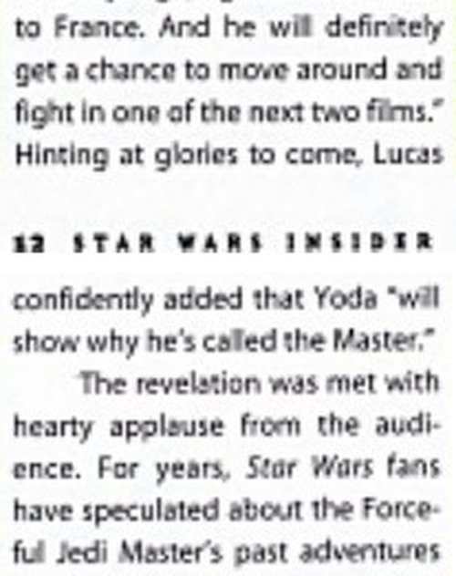
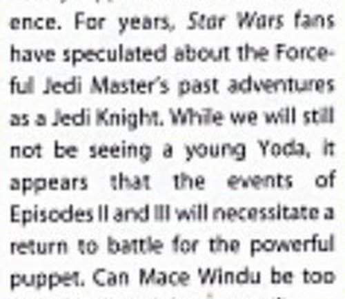
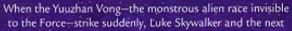
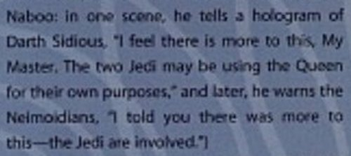
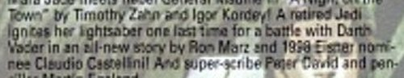
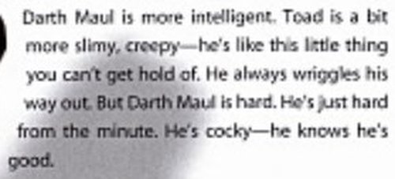
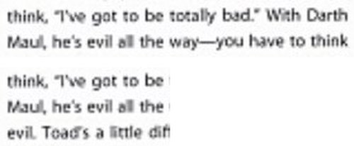
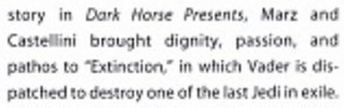
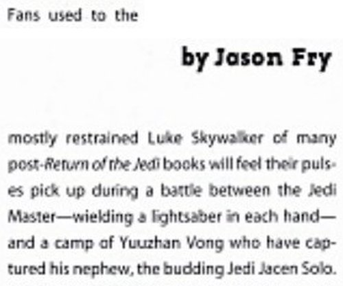

# Owner Material 038 — Star Wars Insider #1–153 plus specials (with The Lucasfilm Fan Club Magazine #1–22): Star Wars Insider #48 (2000)

- **Source:** *Star Wars Insider* magazine (issues 23–153, 1994–2014) and its predecessor *The Lucasfilm Fan Club Magazine* (issues 1–22, 1987–1994), plus seven special editions: articles, interviews, comics and short fiction Secondary source (licensed Legends reference). Scan OCR'd on the box; the scan stays box-only and is **not** published.
- **Method:** every scanned page was OCR'd and machine-screened sentence by sentence for power-relevant statements (fights, kills, defeats, Force feats, rankings, superweapons) that name a character on our roster; each kept sentence is quoted verbatim from the OCR text and has a crop of the printed passage directly under it. Pages with nothing power-relevant are still listed with what is on them.
- **Citation:** "*Star Wars Insider #48* (2000), p.X" by printed page ("scan p.X" where no printed number applies). **Weight:** Licensed magazine: a secondary source. Its short fiction and comics are Legends stories; its articles and interviews sum up or discuss lore and rank below the novels, comics and games they describe.

## scan p.1 (scan page 1)

Page contents: Cover (Star Wars Road Trip; Easter eggs; Ray Park; action-figure poll). Cover lines only. (hand-read)

## scan p.2 (scan page 2)

Page contents: Ad: The Seventh Tower books. (hand-read)

## scan p.3 (scan page 3)

Page contents: Ad: Scuzzle. (hand-read)

## scan p.4 (scan page 4)

Page contents: Ad: Cybertown. (hand-read)

## scan p.5 (scan page 5)

Page contents: Ad: Jedi Apprentice books. (hand-read)

## scan p.6 (scan page 6)

Page contents: Contents. (hand-read)

## scan p.7 (scan page 7)

Page contents: Editorial; Wuher action-figure poll / fax form. (hand-read)

## scan p.8 (scan page 8)

Page contents: Rebel Rumblings: Chewbacca R.I.P. letters reacting to his Vector Prime death (fan remarks only). (hand-read)

## scan p.9 (scan page 9)

Page contents: Ad: book club. (hand-read)

## scan p.10 (scan page 10)

Page contents: Prequel Update (McCallum), part 1: Ep II production status. (hand-read)

## scan p.11 (scan page 11)

Page contents: Prequel Update cont.: Yoda lightsaber fight "still the plan"; Boba Fett still in the movie (production talk, no feat). (hand-read)

## scan p.12 (scan page 12)

Page contents: Star News: "Yoda-Fu" — Lucas says Yoda will fight in Ep II or III; TPM Oscar nominations; Ep II casting begins. (hand-read)

- **Yoda** — entry/section: Star News "Yoda-Fu" (Scott Chernoff), printed p. 12: ""And he will definitely get a chance to move around and fight in one of the next two films." Hinting at glories to come, Lucas confidently added that Yoda "will show why he's called the Master."" Source: *Star Wars Insider #48* (2000), scan p.12
  
- **Yoda** — entry/section: Star News "Yoda-Fu" (Scott Chernoff), printed p. 12: "For years, Star Wars fans have speculated about the Forceful Jedi Master's past adventures as a Jedi Knight. While we will still not be seeing a young Yoda, it appears that the events of Episodes II and III will necessitate a return to battle for the powerful puppet." Source: *Star Wars Insider #48* (2000), scan p.12
  

## scan p.13 (scan page 13)

Page contents: Star News cont.: casting statement, Simpsons video, TPM video release. (hand-read)

## scan p.14 (scan page 14)

Page contents: Star News: 1999 box office; LucasArts Jedi Power Battles announcement; WotC RPG announcement. (hand-read)

## scan p.15 (scan page 15)

Page contents: Star News cont.: WotC RPG; Raiders in Library of Congress; Lucas awards. (hand-read)

## scan p.16 (scan page 16)

Page contents: Star News cont.: costume exhibit, Grammy, Biukovic obituary, celebrity news. (hand-read)

## scan p.17 (scan page 17)

Page contents: Ad: The New Jedi Order (Vector Prime). (hand-read)

- **yuuzhan-vong** — entry/section: NJO ad, printed p. 17: "the Yuuzhan Vong—the monstrous alien race invisible to the Force" Source: *Star Wars Insider #48* (2000), scan p.17
  

## scan p.18 (scan page 18)

Page contents: Ad: video. (hand-read)

## scan p.19 (scan page 19)

Page contents: Ad: video. (hand-read)

## scan p.20 (scan page 20)

Page contents: Easter Eggs feature (Mark Cotta Vaz), part 1: hidden in-jokes in TPM. (hand-read)

## scan p.21 (scan page 21)

Page contents: Easter Eggs cont. (hand-read)

## scan p.22 (scan page 22)

Page contents: Easter Eggs cont. (hand-read)

## scan p.23 (scan page 23)

Page contents: Easter Eggs cont.; model-maker aside that Phantom-era tech reads more advanced ("From Phantom there's a drop in technology") — production note. (hand-read)

## scan p.24 (scan page 24)

Page contents: Easter Eggs cont. + Snyder sidebar. (hand-read)

## scan p.25 (scan page 25)

Page contents: Ad: Scholastic. (hand-read)

## scan p.26 (scan page 26)

Page contents: Voices of Episode I (Jason Fry), part 1. (hand-read)

## scan p.27 (scan page 27)

Page contents: Voices cont.: Peter Serafinowicz (Maul's voice); Maul's cut lines to Sidious and the Neimoidians. (hand-read)

- **Darth Maul; Palpatine (Darth Sidious)** — entry/section: Voices of Episode I (Jason Fry), printed p. 27: "in one scene, he tells a hologram of Darth Sidious, "I feel there is more to this, My Master. The two Jedi may be using the Queen for their own purposes," and later, he warns the Neimoidians, "I told you there was more to this—the Jedi are involved."" Source: *Star Wars Insider #48* (2000), scan p.27
  

## scan p.28 (scan page 28)

Page contents: Voices cont.: Watto ("confounder of Jedi"), Tarpals. (hand-read)

## scan p.29 (scan page 29)

Page contents: Voices cont.: TC-14 (Lindsay Duncan). (hand-read)

## scan p.30 (scan page 30)

Page contents: Voices cont.: Fode and Beed. (hand-read)

## scan p.31 (scan page 31)

Page contents: Ad: Dynamic Forces signed comics (Chewbacca, Star Wars Tales #1 blurb). (hand-read)

- **Darth Vader (Anakin Skywalker)** — entry/section: Dynamic Forces ad, Star Wars Tales #1 blurb, printed p. 31: "A retired Jedi ignites her lightsaber one last time for a battle with Darth Vader in an all-new story by Ron Marz and 1998 Eisner nominee Claudio Castellini!" Source: *Star Wars Insider #48* (2000), scan p.31
  

## scan p.32 (scan page 32)

Page contents: George Lucas in Love short film feature. (hand-read)

## scan p.33 (scan page 33)

Page contents: Ads: TPM novelization (Brooks), Essential Chronology. (hand-read)

## scan p.34 (scan page 34)

Page contents: Posters. (hand-read)

## scan p.35 (scan page 35)

Page contents: Posters. (hand-read)

## scan p.36 (scan page 36)

Page contents: Subscription ad. (hand-read)

## scan p.37 (scan page 37)

Page contents: Jawa Trader catalog. (hand-read)

## scan p.38 (scan page 38)

Page contents: Jawa Trader catalog. (hand-read)

## scan p.39 (scan page 39)

Page contents: Jawa Trader catalog. (hand-read)

## scan p.40 (scan page 40)

Page contents: Jawa Trader catalog. (hand-read)

## scan p.41 (scan page 41)

Page contents: Jawa Trader catalog. (hand-read)

## scan p.42 (scan page 42)

Page contents: Jawa Trader catalog. (hand-read)

## scan p.43 (scan page 43)

Page contents: Jawa Trader catalog. (hand-read)

## scan p.44 (scan page 44)

Page contents: Jawa Trader catalog. (hand-read)

## scan p.45 (scan page 45)

Page contents: Jawa Trader catalog. (hand-read)

## scan p.46 (scan page 46)

Page contents: Jawa Trader catalog. (hand-read)

## scan p.47 (scan page 47)

Page contents: Jawa Trader catalog. (hand-read)

## scan p.48 (scan page 48)

Page contents: Jawa Trader catalog. (hand-read)

## scan p.49 (scan page 49)

Page contents: Jawa Trader catalog. (hand-read)

## scan p.50 (scan page 50)

Page contents: Jawa Trader catalog. (hand-read)

## scan p.51 (scan page 51)

Page contents: Jawa Trader catalog. (hand-read)

## scan p.52 (scan page 52)

Page contents: Jawa Trader catalog. (hand-read)

## scan p.53 (scan page 53)

Page contents: Jawa Trader catalog. (hand-read)

## scan p.54 (scan page 54)

Page contents: Jawa Trader catalog. (hand-read)

## scan p.55 (scan page 55)

Page contents: Jawa Trader catalog. (hand-read)

## scan p.56 (scan page 56)

Page contents: Ray Park interview (Scott Chernoff), opener: Maul as "high-kicking Jedi killing ... Dark Lord of the Sith". (hand-read)

## scan p.57 (scan page 57)

Page contents: Park interview cont.: career, martial arts background. (hand-read)

## scan p.58 (scan page 58)

Page contents: Park interview cont.: X-Men Toad vs Maul characterization. (hand-read)

- **Darth Maul** — entry/section: Ray Park interview (Scott Chernoff), printed p. 58: "Darth Maul is more intelligent, Toad is a bit more slimy, creepy ... Darth Maul is hard. He's just hard from the minute. He's cocky—he knows he's good." Source: *Star Wars Insider #48* (2000), scan p.58
  
- **Darth Maul** — entry/section: Ray Park interview (Scott Chernoff), printed p. 58: "With Darth Maul, he's evil all the way—you have to think evil." Source: *Star Wars Insider #48* (2000), scan p.58
  

## scan p.59 (scan page 59)

Page contents: Park interview cont. (hand-read)

## scan p.60 (scan page 60)

Page contents: Park interview cont.; pull quotes. (hand-read)

## scan p.61 (scan page 61)

Page contents: Park interview end: TPM viewing, Maul "gone for good", appeal of Maul (moves, look, double-bladed saber). (hand-read)

## scan p.62 (scan page 62)

Page contents: Star Wars Road Trip (David West Reynolds), part 1: Death Valley Tatooine pick-ups. (hand-read)

## scan p.63 (scan page 63)

Page contents: Road Trip cont.: Bantha Canyon (Mardji the elephant). (hand-read)

## scan p.64 (scan page 64)

Page contents: Road Trip cont.: Mos Eisley overlook = Dante's View; Artoo's dunes at Stovepipe Wells. (hand-read)

## scan p.65 (scan page 65)

Page contents: Road Trip cont.: Sandcrawler Station, landspeeder mirror shots (Dalva), Artoo's Arroyo. (hand-read)

## scan p.66 (scan page 66)

Page contents: Road Trip map. (hand-read)

## scan p.67 (scan page 67)

Page contents: Route guide (Los Angeles) + resource numbers. (hand-read)

## scan p.68 (scan page 68)

Page contents: Road Trip: Endor locations (Rockefeller Forest, Smith River Tract) + route guide. (hand-read)

## scan p.69 (scan page 69)

Page contents: Endor cont.; Yuma/Buttercup Valley dunes; route guide. (hand-read)

## scan p.70 (scan page 70)

Page contents: Yuma cont.; LA "Cantina Arena" (Goldwyn lot) + route guide. (hand-read)

## scan p.71 (scan page 71)

Page contents: LA locations cont. (ILM Van Nuys, Egg Factory, Fox, Chinese Theater) + route guide. (hand-read)

## scan p.72 (scan page 72)

Page contents: Chinese Theater/Walk of Fame; Modesto; Disneyland route. (hand-read)

## scan p.73 (scan page 73)

Page contents: Marin County (Ewoks/Miwoks, Bothin, Dagobah name puns); Road Trip treasure contest sidebar (Chernoff). (hand-read)

## scan p.74 (scan page 74)

Page contents: In the Star Wars Universe (Jason Fry): Jerome Blake (Rune Haako, Mas Amedda, Orn Free Taa, Oppo Rancisis etc.). (hand-read)

## scan p.75 (scan page 75)

Page contents: Blake profile cont. (hand-read)

## scan p.76 (scan page 76)

Page contents: The Horse's Mouth (Peet Janes): origin of Star Wars Tales; "Extinction" (Vader vs a Jedi in exile), Mara Jade story. (hand-read)

- **Darth Vader (Anakin Skywalker)** — entry/section: The Horse's Mouth (Peet Janes), printed p. 72: "Marz and Castellini brought dignity, passion, and pathos to "Extinction," in which Vader is dispatched to destroy one of the last Jedi in exile." Source: *Star Wars Insider #48* (2000), scan p.76
  

## scan p.77 (scan page 77)

Page contents: Horse's Mouth cont.: Skippy the Jedi Droid; future issues. (hand-read)

## scan p.78 (scan page 78)

Page contents: Star Wars Bookshelf (Jason Fry): Stackpole, Dark Tide: Onslaught. (hand-read)

- **Luke Skywalker; yuuzhan-vong; jacen-solo** — entry/section: Star Wars Bookshelf (Jason Fry), printed p. 74: "Fans used to the mostly restrained Luke Skywalker of many post-Return of the Jedi books will feel their pulses pick up during a battle between the Jedi Master—wielding a lightsaber in each hand—and a camp of Yuuzhan Vong who have captured his nephew, the budding Jedi Jacen Solo." Source: *Star Wars Insider #48* (2000), scan p.78
  

## scan p.79 (scan page 79)

Page contents: Bookshelf cont.: Stackpole career; upcoming books (Journal: Darth Maul, Jedi Apprentice). (hand-read)

## scan p.80 (scan page 80)

Page contents: Scouting the Galaxy (Steve Sansweet): collectibles Q&A. (hand-read)

## scan p.81 (scan page 81)

Page contents: Scouting the Galaxy cont. (hand-read)

## scan p.82 (scan page 82)

Page contents: DecipherCon '99 CCG World Championship. (hand-read)

## scan p.83 (scan page 83)

Page contents: CCG cont.; finalists list. (hand-read)

## scan p.84 (scan page 84)

Page contents: Rebel Rumblings letters (Return of the Ewok, Bookshelf, Portman). (hand-read)

## scan p.85 (scan page 85)

Page contents: Rebel Rumblings cont.: Raiders, Mace pick-up shot, Gasgano species, Maul vs Vader letter + editor reply. (hand-read)

## scan p.86 (scan page 86)

Page contents: The Last Page: action-figure poll. (hand-read)

## scan p.87 (scan page 87)

Page contents: Ad: cold-cast busts. (hand-read)

## scan p.88 (scan page 88)

Page contents: Ad: Decipher Battle of Naboo CCG. (hand-read)

