# Owner Material 038 — Star Wars Insider #1–153 plus specials (with The Lucasfilm Fan Club Magazine #1–22): Star Wars Insider #49 (2000)

- **Source:** *Star Wars Insider* magazine (issues 23–153, 1994–2014) and its predecessor *The Lucasfilm Fan Club Magazine* (issues 1–22, 1987–1994), plus seven special editions: articles, interviews, comics and short fiction Secondary source (licensed Legends reference). Scan OCR'd on the box; the scan stays box-only and is **not** published.
- **Method:** every scanned page was OCR'd and machine-screened sentence by sentence for power-relevant statements (fights, kills, defeats, Force feats, rankings, superweapons) that name a character on our roster; each kept sentence is quoted verbatim from the OCR text and has a crop of the printed passage directly under it. Pages with nothing power-relevant are still listed with what is on them.
- **Citation:** "*Star Wars Insider #49* (2000), p.X" by printed page ("scan p.X" where no printed number applies). **Weight:** Licensed magazine: a secondary source. Its short fiction and comics are Legends stories; its articles and interviews sum up or discuss lore and rank below the novels, comics and games they describe.

## scan p.1 (scan page 1)

Page contents: Cover (Empire Strikes Back 20th anniversary special: Wampas, bounty hunters, Kershner, James Earl Jones, Billy Dee). Cover lines only. (hand-read)

## scan p.2 (scan page 2)

Page contents: Ad: Dark Horse Chewbacca comic series. (hand-read)

## scan p.3 (scan page 3)

Page contents: Ad: Cybertown. (hand-read)

## scan p.4 (scan page 4)

Page contents: Ad: Science Fiction Book Club. (hand-read)

## scan p.5 (scan page 5)

Page contents: Ad: Dark Horse comics (Prequel). (hand-read)

## scan p.6 (scan page 6)

Page contents: Blank/image-only page (no text). (hand-read)

## scan p.7 (scan page 7)

Page contents: Contents (image-heavy; OCR garbled). (hand-read)

## scan p.8 (scan page 8)

Page contents: Masthead; Rebel Rumblings header. (hand-read)

## scan p.9 (scan page 9)

Page contents: Rebel Rumblings letters (garbled) and Road Trip contest winners (Artoo's Arroyo, Death Valley). (hand-read)

## scan p.10 (scan page 10)

Page contents: Prequel Update: Rick McCallum on Episode II casting, sets, darker mood ("Episodes II and III explore how and why he becomes Darth Vader"). (hand-read)

## scan p.11 (scan page 11)

Page contents: Prequel Update cont.: McCallum; Gavin Bocquet ("People will know a lot more about Boba Fett after this film"). (hand-read)

## scan p.12 (scan page 12)

Page contents: Prequel Update: Jonathan Hales joins Episode II; Bocquet cont. (Boba Fett's ship and apartment). (hand-read)

## scan p.13 (scan page 13)

Page contents: Prequel Update: Bocquet cont.; Stephen Jones production supervisor. (hand-read)

## scan p.14 (scan page 14)

Page contents: Star News: Harrison Ford AFI award; Lucas celebrity race; Seventh Tower. (hand-read)

## scan p.15 (scan page 15)

Page contents: Star News: THX 1138 4EB online; Verant online Star Wars game; Jeffrey Boam obituary; Jake Lloyd reading campaign. (hand-read)

## scan p.16 (scan page 16)

Page contents: Section title: The Empire Strikes Back (image page). (hand-read)

## scan p.17 (scan page 17)

Page contents: Editorial intro to ESB anniversary (Scott Chernoff): Luke tested, Vader "in top form", Han wields a lightsaber. (hand-read)

- **Darth Vader (Anakin Skywalker); Luke Skywalker** — entry/section: Editorial (Scott Chernoff), printed p. 17: "the moment when Vader volunteers, "The Force is with you, young Skywalker, but you are not a Jedi yet"—and then proves it." Source: *Star Wars Insider #49* (2000), scan p.17
  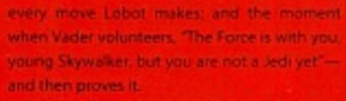

## scan p.18 (scan page 18)

Page contents: Bounty hunters feature intro: Piett's "scum" line; Dengar, Zuckuss, Boba Fett, Bossk, 4-LOM, IG-88. (hand-read)

## scan p.19 (scan page 19)

Page contents: Bounty hunters search story (call sheets, Ben Burtt, Bulloch). (hand-read)

## scan p.20 (scan page 20)

Page contents: Jason Wingreen, voice of Boba Fett (recorded in 20 minutes; Yoda audition). (hand-read)

## scan p.21 (scan page 21)

Page contents: Alan Harris (Bossk; Boba Fett costume flame-thrower made practical then dropped). (hand-read)

## scan p.22 (scan page 22)

Page contents: Cathy Munro (Zuckuss; contradictory EU background); Chris Parsons (4-LOM, K-3PO). (hand-read)

## scan p.23 (scan page 23)

Page contents: Dengar (Moray Bush) and IG-88 (operator unknown) profiles. (hand-read)

- **Dengar; Han Solo** — entry/section: Dengar profile, printed p. 23: "This was Dengar, a fan favorite among bounty hunters because of his unique back-story: nearly killed in a swoop accident, the cyborg blamed Han Solo for his disfigurement and vowed to avenge himself against his old rival." Source: *Star Wars Insider #49* (2000), scan p.23
  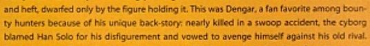

## scan p.24 (scan page 24)

Page contents: Cold Comfort: John Ratzenberger (Major Bren Derlin). (hand-read)

## scan p.25 (scan page 25)

Page contents: Ratzenberger cont. (Ford inspiration, Cheers). (hand-read)

## scan p.26 (scan page 26)

Page contents: Irvin Kershner interview (Scott Chernoff) start: bio; Lucas's offer. (hand-read)

## scan p.27 (scan page 27)

Page contents: Kershner cont.: script with Kasdan; storyboards. (hand-read)

## scan p.28 (scan page 28)

Page contents: Kershner cont.: "nothing's gonna work" (frozen tauntaun, R2 on plastic ice, C-3PO on Chewie's back). (hand-read)

## scan p.29 (scan page 29)

Page contents: Kershner cont.: Yoda puppet; X-wing lift shot; Dagobah set dangers. (hand-read)

- **Yoda; Luke Skywalker** — entry/section: Kershner interview, printed p. 29: "George also came over once when I was shooting the X-wing being pulled out of the water and moving across the swamp, based on the magic power of our little man." Source: *Star Wars Insider #49* (2000), scan p.29
  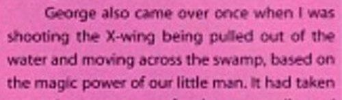

## scan p.30 (scan page 30)

Page contents: Kershner cont.: Vader/Luke reveal shot (crew and Prowse not told); kids under 7 say Vader is lying; Special Edition; regret not directing Jedi. (hand-read)

## scan p.31 (scan page 31)

Page contents: Ad: Random House Episode I punch-out books. (hand-read)

## scan p.32 (scan page 32)

Page contents: Lawrence Kasdan interview (Scott Chernoff) start: bio. (hand-read)

## scan p.33 (scan page 33)

Page contents: Kasdan cont.: Empire as second act; Raiders; Yoda his favorite character to write. (hand-read)

## scan p.34 (scan page 34)

Page contents: Kasdan cont.; sidebar Leigh Brackett (Jaime Painter). (hand-read)

## scan p.35 (scan page 35)

Page contents: Subscription order card (unnumbered insert). (hand-read)

## scan p.36 (scan page 36)

Page contents: Subscription card reverse (unnumbered insert). (hand-read)

## scan p.37 (scan page 37)

Page contents: Ad: The Seventh Tower (printed p. 35 position). (hand-read)

## scan p.38 (scan page 38)

Page contents: Kasdan cont. (printed p. 36): writing process; Vader as Luke's father = dark side/light side theme. (hand-read)

## scan p.39 (scan page 39)

Page contents: Jawa Trader: Pepsi cans, life-size Watto and Yoda replicas. (hand-read)

## scan p.40 (scan page 40)

Page contents: Kasdan cont. (printed p. 38): Mumford, Phantom Menace "all George", Empire's look. (hand-read)

## scan p.41 (scan page 41)

Page contents: Ad: Rogue Planet (Greg Bear) and NJO novels. (hand-read)

## scan p.42 (scan page 42)

Page contents: Jawa Trader: exclusive figure two-packs. (hand-read)

## scan p.43 (scan page 43)

Page contents: Jawa Trader: action figure guide poster. (hand-read)

## scan p.44 (scan page 44)

Page contents: Jawa Trader: Celebration passes, Maul poster. (hand-read)

## scan p.45 (scan page 45)

Page contents: Jawa Trader: LEGO UCS X-wing, TIE Interceptor, Millennium Falcon, minifigs. (hand-read)

- **millennium-falcon** — entry/section: Jawa Trader LEGO Millennium Falcon listing, printed p. 43: "The Millennium Falcon is one of the fastest ships in the galaxy. Its special hyperdrive makes the ship twice as fast as most Imperial ships." Source: *Star Wars Insider #49* (2000), scan p.45
  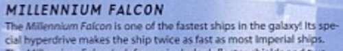

## scan p.46 (scan page 46)

Page contents: Jawa Trader: Rogue Planet signed hardcover, Prelude to Rebellion, Essential Chronology, books. (hand-read)

## scan p.47 (scan page 47)

Page contents: Jawa Trader: R2/Yoda backpacks, Dutch film-cel set, Japanese art T-shirts. (hand-read)

## scan p.48 (scan page 48)

Page contents: Jawa Trader: Kyle Katarn & Mara Jade, Dark Trooper sets, stands. (hand-read)

## scan p.49 (scan page 49)

Page contents: Jawa Trader: exclusive figure sets, Wuher, Oola & Salacious Crumb. (hand-read)

## scan p.50 (scan page 50)

Page contents: Jawa Trader: pewter figurines, stand-ups. (hand-read)

## scan p.51 (scan page 51)

Page contents: Jawa Trader: Indiana Jones fedoras, videos, CDs, jacket. (hand-read)

## scan p.52 (scan page 52)

Page contents: Billy Dee Williams interview (Scott Chernoff) intro, printed p. 50. (hand-read)

## scan p.53 (scan page 53)

Page contents: Insert (unnumbered): back issues & fan club membership. (hand-read)

## scan p.54 (scan page 54)

Page contents: Insert (unnumbered): merchandise order form; file page = printed + 4 from p55. (hand-read)

## scan p.55 (scan page 55)

Page contents: Billy Dee cont. (printed p. 51): Lando beyond questions; Kershner/Buddhism; cape. (hand-read)

## scan p.56 (scan page 56)

Page contents: Billy Dee cont. (printed p. 52): James Earl Jones, Kershner, effects, confidence. (hand-read)

## scan p.57 (scan page 57)

Page contents: Billy Dee cont. (printed p. 53): romanticism, The Visit, Ladies Man. (hand-read)

## scan p.58 (scan page 58)

Page contents: Billy Dee cont. (printed p. 54): Empire the best; Ewok head from Lucas. (hand-read)

## scan p.59 (scan page 59)

Page contents: Ad: The Power of Myth (DK). (hand-read)

## scan p.60 (scan page 60)

Page contents: James Earl Jones interview (Scott Chernoff) start, printed p. 56. (hand-read)

- **Darth Vader (Anakin Skywalker)** — entry/section: James Earl Jones interview intro, printed p. 56: "the evil Sith Lord who has embraced the dark side but will ultimately prove unable to keep buried his true, human nature." Source: *Star Wars Insider #49* (2000), scan p.60
  
- **Darth Vader (Anakin Skywalker); Luke Skywalker** — entry/section: James Earl Jones interview, printed p. 56: "I thought I was lying! I thought Darth Vader was lying. I thought, "What a ploy." But it did deepen who Darth Vader was." Source: *Star Wars Insider #49* (2000), scan p.60
  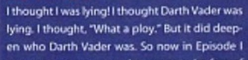

## scan p.61 (scan page 61)

Page contents: JEJ cont. (printed p. 57): no inflection; Orson Welles considered; Episode I. (hand-read)

- **Darth Vader (Anakin Skywalker)** — entry/section: James Earl Jones interview, printed p. 57: "In fact, my job was to keep awareness out of Darth Vader's voice—take all humanity out of it." Source: *Star Wars Insider #49* (2000), scan p.61
  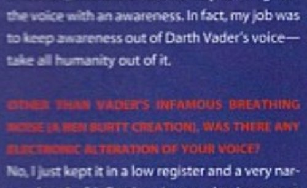
- **anakin-skywalker** — entry/section: James Earl Jones on Episode I, printed p. 57: "All we needed was the observation by the Jedi that this kid was special—how special, we don't know." Source: *Star Wars Insider #49* (2000), scan p.61
  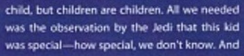

## scan p.62 (scan page 62)

Page contents: JEJ cont. (printed p. 58): last five minutes of Episode III; voice work and masks. (hand-read)

- **Darth Vader (Anakin Skywalker)** — entry/section: James Earl Jones interview, printed p. 58: ""Oh, yeah, you'll work maybe the last five minutes of Episode III." ... It'll be after Darth goes bionic." Source: *Star Wars Insider #49* (2000), scan p.62
  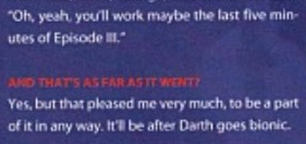

## scan p.63 (scan page 63)

Page contents: JEJ cont. (printed p. 59): stuttering, poetry, line readings. (hand-read)

## scan p.64 (scan page 64)

Page contents: Clive Revill: Voice of the Emperor (Scott Chernoff), printed p. 60. (hand-read)

## scan p.65 (scan page 65)

Page contents: JEJ cont. (printed p. 61): Kubrick, Field of Dreams, Greer, fan mail. (hand-read)

## scan p.66 (scan page 66)

Page contents: Ultimate ESB Insider's Guide opener (Vader portrait), printed p. 62. (hand-read)

## scan p.67 (scan page 67)

Page contents: Ultimate ESB Insider's Guide title page (Daniel Wallace), printed p. 63. (hand-read)

## scan p.68 (scan page 68)

Page contents: Insider's Guide: cut scenes (wampa attack, sticker scene), printed p. 64. (hand-read)

## scan p.69 (scan page 69)

Page contents: Insider's Guide: discarded concepts, printed p. 65. (hand-read)

- **Darth Vader (Anakin Skywalker)** — entry/section: Ultimate ESB Insider's Guide (Daniel Wallace), printed p. 65: "In one concept for Empire, Darth Vader would appear at his private retreat, described as "a grim castle of black iron" amid a sea of lava. During this sequence Vader would be shown feeding gargoyles from a golden bowl." Source: *Star Wars Insider #49* (2000), scan p.69
  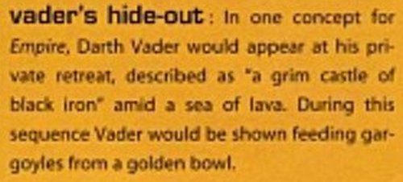
- **Darth Vader (Anakin Skywalker); C-3PO** — entry/section: Ultimate ESB Insider's Guide (Daniel Wallace), printed p. 65: "In early story sessions for Empire it was suggested that Vader could pluck Threepio's "heart" from the droid's dismembered parts on Bespin and crush it in his fist." Source: *Star Wars Insider #49* (2000), scan p.69
  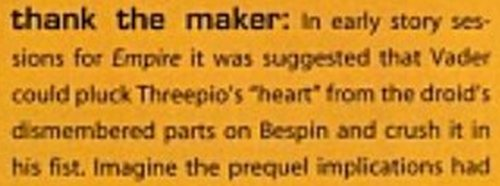
- **Lando Calrissian**: "Lando was "a clone of the Ashandi family," hiding out because of the war that practically wiped out his species." Source: *Star Wars Insider #49* (2000), scan p.69
  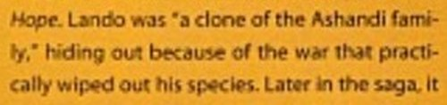

## scan p.70 (scan page 70)

Page contents: Insider's Guide: wampa stilt suit, bacta mask, Cloud City romance, printed p. 66. (hand-read)

## scan p.71 (scan page 71)

Page contents: Insider's Guide: Han torture cut, Luke/Lando atop Falcon, printed p. 67. (hand-read)

## scan p.72 (scan page 72)

Page contents: Jon Berg stop-motion interview, printed p. 68. (hand-read)

## scan p.73 (scan page 73)

Page contents: Berg cont.: elephant reference, cantina aliens, Lucas "Wow", printed p. 69. (hand-read)

## scan p.74 (scan page 74)

Page contents: Insider's Guide: Special Edition changes (wampa, Luke's scream, Vader to Executor), printed p. 70. (hand-read)

## scan p.75 (scan page 75)

Page contents: Insider's Guide: starship lot (TIE bomber, Slave I, cloud car, frigate, Executor), printed p. 71. (hand-read)

- **executor; super-star-destroyer** — entry/section: Ultimate ESB Insider's Guide starship lot, printed p. 71: "The mighty Executor has arrived. This Super Star Destroyer has been variously pegged as 8000 and 12,800 meters in length, but either way it's plenty big enough to spoil your picnic." Source: *Star Wars Insider #49* (2000), scan p.75
  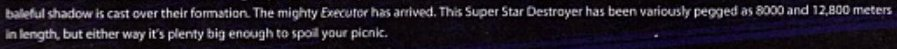

## scan p.76 (scan page 76)

Page contents: Insider's Guide: Hoth, Dagobah, Bespin, printed p. 72. (hand-read)

- **bespin** — entry/section: Ultimate ESB Insider's Guide planets, printed p. 72: "A gas giant, Bespin lacks any kind of surface — if you fall, you'll keep falling until the pressures near the core squash you like a grape." Source: *Star Wars Insider #49* (2000), scan p.76
  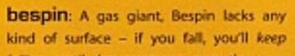

## scan p.77 (scan page 77)

Page contents: Insider's Guide: freeze-frame classics, trivia, printed p. 73. (hand-read)

## scan p.78 (scan page 78)

Page contents: Comics: ESB adaptation, Frozen World of Ota , printed p. 74. (hand-read)

## scan p.79 (scan page 79)

Page contents: Comics cont.: Shadows, Classic Star Wars, Vader's Quest, printed p. 75. (hand-read)

## scan p.80 (scan page 80)

Page contents: Bookshelf: ESB novelization, storybook, purple Yoda, Sketchbook, printed p. 76. (hand-read)

- **hobbie; General Veers** — entry/section: Star Wars Bookshelf (ESB novelization), printed p. 76: "the Rebel pilot Hobbie—a mainstay of Mike Stackpole's post-Return of the Jedi X-Wing books—dies in a kamikaze snowspeeder attack that takes out General Veers' AT-AT." Source: *Star Wars Insider #49* (2000), scan p.80
  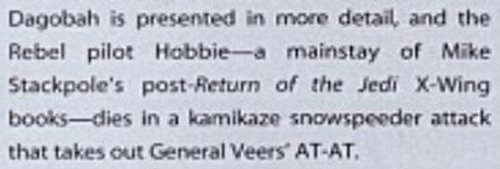
- **Darth Vader (Anakin Skywalker); palpatine** — entry/section: Star Wars Bookshelf (ESB novelization), printed p. 76: "intrigued by the suggestion that Darth Vader may be trembling slightly as he awaits word from the Emperor" Source: *Star Wars Insider #49* (2000), scan p.80
  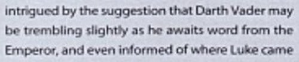

## scan p.81 (scan page 81)

Page contents: Bookshelf cont.: Art of ESB, Once Upon a Galaxy, printed p. 77. (hand-read)

## scan p.82 (scan page 82)

Page contents: Scouting the Galaxy (Steve Sansweet): ESB toys, Greek cards, printed p. 78. (hand-read)

## scan p.83 (scan page 83)

Page contents: Scouting cont.: Beta tape, Fett, Burger King glasses, Fett replica (350), printed p. 79. (hand-read)

## scan p.84 (scan page 84)

Page contents: Rebel Rumblings: Dear 2-1B letters, printed p. 80. (hand-read)

## scan p.85 (scan page 85)

Page contents: Rebel Rumblings cont.: Mara Jade daughter photo, 2-1B replies. (hand-read)

## scan p.86 (scan page 86)

Page contents: The Last Page: Marco Nero "Surfing Fett" art, printed p. 82. (hand-read)

## scan p.87 (scan page 87)

Page contents: Ad: Episode I pinball machine. (hand-read)

## scan p.88 (scan page 88)

Page contents: Back cover ad: Wuher exclusive figure. (hand-read)

