# Owner Material 038 — Star Wars Insider #1–153 plus specials (with The Lucasfilm Fan Club Magazine #1–22): Star Wars Insider #50 (2000)

- **Source:** *Star Wars Insider* magazine (issues 23–153, 1994–2014) and its predecessor *The Lucasfilm Fan Club Magazine* (issues 1–22, 1987–1994), plus seven special editions: articles, interviews, comics and short fiction Secondary source (licensed Legends reference). Scan OCR'd on the box; the scan stays box-only and is **not** published.
- **Method:** every scanned page was OCR'd and machine-screened sentence by sentence for power-relevant statements (fights, kills, defeats, Force feats, rankings, superweapons) that name a character on our roster; each kept sentence is quoted verbatim from the OCR text and has a crop of the printed passage directly under it. Pages with nothing power-relevant are still listed with what is on them.
- **Citation:** "*Star Wars Insider #50* (2000), p.X" by printed page ("scan p.X" where no printed number applies). **Weight:** Licensed magazine: a secondary source. Its short fiction and comics are Legends stories; its articles and interviews sum up or discuss lore and rank below the novels, comics and games they describe.

## scan p.1 (scan page 1)

Page contents: Cover (Hayden Christensen, 50th issue). Cover lines only. (hand-read)

## scan p.2 (scan page 2)

Page contents: Hasbro international two-pack figure and Muftak/Kabe ad. No in-universe power content beyond ad copy. (hand-read)

## scan p.3 (scan page 3)

Page contents: 68 words, 7 paragraphs | headings/entries: THINK YOU CAN HANDLE ITP WWW.CYBERTOWN.COM

## scan p.4 (scan page 4)

Page contents: Del Rey NJO Onslaught ad: Yuuzhan Vong "stand utterly outside the Force"; Jedi "rendered helpless by this impervious foe" (ad copy). (hand-read)

## scan p.5 (scan page 5)

Page contents: 144 words, 11 paragraphs | headings/entries: ULTIMATE COLLECTOR SERIES; TT SIENAR FLEET SYSTEMS TIE = INTERCEE

## scan p.6 (scan page 6)

Page contents: 271 words, 18 paragraphs | headings/entries: Insider; STAR WARS

## scan p.7 (scan page 7)

Page contents: Contents and editor's desk (Jon Bradley Snyder): 50th issue, new columns, action figure poll top 10, corrections. (hand-read)

## scan p.8 (scan page 8)

Page contents: Rebel Rumblings letters on Insider #49 Empire issue; one letter cites Vader deflecting Han's blaster bolts with his hand (fan opinion). (hand-read)

- **Darth Vader (Anakin Skywalker); Han Solo** — entry/section: Rebel Rumblings letter, printed p. 8: "When Han, Leia and Chewie are led to the dining hall where Vader and Fett are waiting. Vader deflects Han's laser bolts with his hand! I never knew Vader was that powerful until then." Source: *Star Wars Insider #50* (2000), scan p.8
  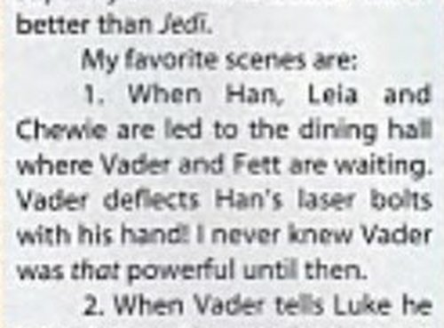

## scan p.9 (scan page 9)

Page contents: 110 words, 17 paragraphs | headings/entries: THE New; YORK TIMES BESTSEL LER; MICHASL A, BTACKRPOLE; S Tad REY WW. Slarwers.conmn; Finally in paperback!; STAR WARS saga!; JAMES ttLttnNG |; Join-starwars @user

## scan p.10 (scan page 10)

Page contents: 93 words, 5 paragraphs | headings/entries: 

## scan p.11 (scan page 11)

Page contents: George Lucas letter congratulating the Insider on 50 issues. No power content. (hand-read)

## scan p.12 (scan page 12)

Page contents: Prequel Update: Rick McCallum on Hayden Christensen casting, Jedi training with Nick Gillard, ~50 new characters, Mace Windu and Yoda returning. (hand-read)

- **anakin-skywalker** — entry/section: Prequel Update (Rick McCallum), printed p. 12: "It's the process of being Anakin Skywalker and his eventual fall to the dark side that I think requires an enormous amount of acting ability, and Hayden has that." Source: *Star Wars Insider #50* (2000), scan p.12
  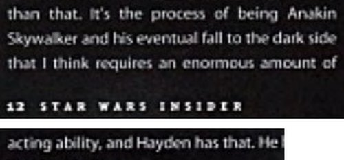

## scan p.13 (scan page 13)

Page contents: 230 words, 19 paragraphs | headings/entries: ROSE BYRME; LEZANNA WALSMAN; TAY LAGAATA VERONICA SEGURA; EPISODE II CASTING NEws!; STARK WARS [MSEDER 42

## scan p.14 (scan page 14)

Page contents: McCallum continued (C-3PO in Ep II, sets, locations, digital shooting) and Gavin Bocquet interview begins. (hand-read)

## scan p.15 (scan page 15)

Page contents: 650 words, 18 paragraphs | headings/entries: ENORMOUS FOR YOU-EPISODE I OR EPIsopE ti?; STAR WARS INSIDER

## scan p.16 (scan page 16)

Page contents: Bocquet on new planets, Naboo, personal environments, Boba Fett's "apartment" set (p17), 2001 as inspiration. (hand-read)

## scan p.17 (scan page 17)

Page contents: 1293 words, 26 paragraphs | headings/entries: STAR WARS CMSIBER 47

## scan p.18 (scan page 18)

Page contents: Star News: R.A. Salvatore to write Episode II novelization; TPM video sales; Manga Harvey award. (hand-read)

## scan p.19 (scan page 19)

Page contents: Art of Star Wars exhibit at the Barbican, London. (hand-read)

## scan p.20 (scan page 20)

Page contents: Lucas at the Toyota Pro/Celebrity race; "That's the Jedi way" quip. (hand-read)

- **jedi** — entry/section: Star News Lucas race (George Lucas), printed p. 20: "You cannot teach compassion and win—you have to let others win. That's the Jedi way." Source: *Star Wars Insider #50* (2000), scan p.20
  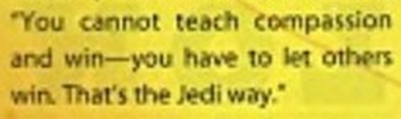

## scan p.21 (scan page 21)

Page contents: GenCon 2000 (Daniels, Aurra Sing actress), MTV Best Action Sequence for the Podrace, Saturn awards, Meco CD. (hand-read)

## scan p.22 (scan page 22)

Page contents: Star News continued: Walk of Fame, Disney Star Wars Weekends, Star Sightings. (hand-read)

## scan p.23 (scan page 23)

Page contents: The Seventh Tower book ad (Lucasfilm/Garth Nix). No Star Wars power content. (hand-read)

## scan p.24 (scan page 24)

Page contents: Hayden Christensen interview intro (Scott Chernoff): casting from 400+ actors; Anakin's rise as Jedi and fall to Sith; list of Anakin/Vader performers. (hand-read)

- **anakin-skywalker; Darth Vader (Anakin Skywalker)** — entry/section: Hayden Christensen interview intro (Scott Chernoff), printed p. 24: "He must convey the goodness of Jake Lloyd's Anakin and the vicious, remorseless evil of Darth Vader, the guy who choked Imperials just for kicks. He gets to swing a lightsaber, summon the Force, and romance Natalie Portman." Source: *Star Wars Insider #50* (2000), scan p.24
  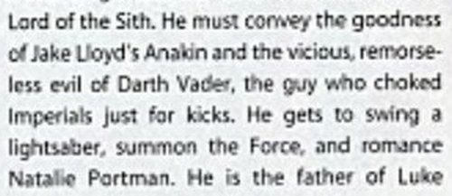

## scan p.25 (scan page 25)

Page contents: 4 words, 1 paragraphs | headings/entries: STAR WARS EWMSIBDER 28

## scan p.26 (scan page 26)

Page contents: 7 words, 3 paragraphs | headings/entries: 

## scan p.27 (scan page 27)

Page contents: Christensen interview: audition process with Robin Gurland and George Lucas, screen test with Natalie Portman. (hand-read)

## scan p.28 (scan page 28)

Page contents: Christensen on studying Lloyd and Shaw, fencing and stunt training with Nick Gillard. (hand-read)

## scan p.29 (scan page 29)

Page contents: 0 words, 0 paragraphs | headings/entries: 

## scan p.30 (scan page 30)

Page contents: 58 words, 13 paragraphs | headings/entries: XK; SLAAAAALAAS; MK NN OO Ww SS So AK; AWN \ A | a WY |

## scan p.31 (scan page 31)

Page contents: Christensen on acting background; favorite characters Vader and Yoda. (hand-read)

## scan p.32 (scan page 32)

Page contents: Christensen on Shadows of the Empire, Anakin's arc from good to Vader, Jedi costume with lightsaber. (hand-read)

- **anakin-skywalker; Darth Vader (Anakin Skywalker)** — entry/section: Hayden Christensen interview, printed p. 32: "Yeah. It's going to be weird making that transition from pretty much the pinnacle of good—which Jake embodies—to the most powerful man in the universe, the darkest, evilest Darth." Source: *Star Wars Insider #50* (2000), scan p.32
  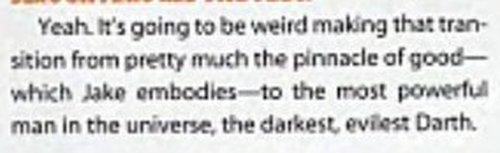

## scan p.33 (scan page 33)

Page contents: 14 words, 4 paragraphs | headings/entries: OPIIK; STAR WARS [WSIDER 22

## scan p.34 (scan page 34)

Page contents: In the Star Wars Universe: Michonne Bourriague, Aurra Sing actress (pp. 34-37): casting, makeup, costume, Lucas naming the character. (hand-read)

## scan p.35 (scan page 35)

Page contents: 608 words, 15 paragraphs | headings/entries: Mithonne 6 Gre; SECRET..."; STAR WARS EMSISER 38

## scan p.36 (scan page 36)

Page contents: 610 words, 12 paragraphs | headings/entries: TECTIA SR US Re? iv P

- **Aurra Sing** — entry/section: Michonne Bourriague interview (Kevin Fitzpatrick), printed p. 36: "They said she's a bounty hunter, ruthless, she kills people. I later learned from the comics that she has six Jedi lightsabers." Source: *Star Wars Insider #50* (2000), scan p.36
  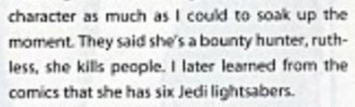

## scan p.37 (scan page 37)

Page contents: 962 words, 38 paragraphs | headings/entries: I'd be ready for itt"; She's already found some fans while; STAR WARS IMSIDER 37

## scan p.38 (scan page 38)

Page contents: Jawa Trader signed Aurra Sing photo ad ("the bounty hunter who has Jedi for breakfast"). (hand-read)

- **Aurra Sing** — entry/section: Jawa Trader signed photo ad, printed p. 38: "Now you can own an 8 x 10 glossy of the bounty hunter who has Jedi for breakfast." Source: *Star Wars Insider #50* (2000), scan p.38
  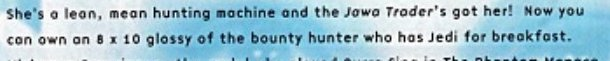

## scan p.39 (scan page 39)

Page contents: Jawa Trader catalog (12" Valorum/Coruscant guard, Celebration passes, posters, mini-movie cards, books, calendars, helmets, lightsabers, exclusive figures incl. Kyle Katarn & Mara Jade). Ad copy only. (hand-read)

## scan p.40 (scan page 40)

Page contents: 417 words, 27 paragraphs | headings/entries: TOLL FREE! 1-800-878-3326; STAR WARS ACTION FIGURE POSTER; COMES IN DECORATIVE BLACK BOK WITH CLEAR; TOP AMD FOIL; MUTHEMTICITY; EXMIBITOR PASS TS —t; STAR WARS CELEBRATION PASSES SET; WCG0000 $48.00

## scan p.41 (scan page 41)

Page contents: 223 words, 18 paragraphs | headings/entries: COLLECTISGLES 1-800-878-3326; DeLluXe FAX 24 HOURS: 1-303-574-9442; LIMITED TO 1,500 PIECES; R2-D2 COOLER; DARTH VADER, DARTH MAUL, EMPEROR PALPATINE

## scan p.42 (scan page 42)

Page contents: 415 words, 26 paragraphs | headings/entries: JEDI FORCES; BOOKS §| CALENDARS; STAR WARS 2001 FLIP ANIMATION BOX CALENDAR; Wont SPACE ny oat; STAR WARS: PRELUDE TO REBELLION; WPB 1066 $14.95; WPBOO24 $12.95; WPB 1071 $12.95; WAV2014 $20.00; AUTOGRAPHED WAY2014 SIG $45.00; STAR WARS; ENCYCLOPEDIA; WPB3007 $39.95; STAR WARS: THE ESSENTIAL CHRONOLOGY; WPB 3057 $18.95

- **Ki-Adi-Mundi** — entry/section: Jawa Trader Prelude to Rebellion listing, printed p. 42: "Ki-Adi-Mundi's homeworld of Cerea is low-tech by choice, but there is a growing faction that want to import advanced technology from offworlders." Source: *Star Wars Insider #50* (2000), scan p.42
  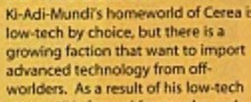

## scan p.43 (scan page 43)

Page contents: 244 words, 17 paragraphs | headings/entries: WCL 1000MD; WCL 1000LG; WCL 1000XL; STAR WARS HELMETS; Perfect for those Dagobah workouts or; WCL 1001MmD OARTH MAUL LIGHTSABER

## scan p.44 (scan page 44)

Page contents: 253 words, 15 paragraphs | headings/entries: DEATH STAR TROOPER AND REE-YEES; WTY 0318 $19.95; FREE!; ACTION FisukKeS=; WTY0414 $19.95; WTY 0419 $9.95; STAR WARS; ACTION STANDS; WTY 9026 $6.00

## scan p.45 (scan page 45)

Page contents: Jawa Trader exclusive figures (AT-AT driver, Pote Snitkin, Hoth Leia, Death Star droid, Wuher, Oola & Salacious Crumb). Ad copy. (hand-read)

## scan p.46 (scan page 46)

Page contents: Jawa Trader pewter figurines and stand-ups; p47 Indiana Jones CDs, jacket, fedoras. Ad copy. (hand-read)

## scan p.47 (scan page 47)

Page contents: 188 words, 12 paragraphs | headings/entries: INDIANA JONES LEATHER JACKET; WHI so00 SM/MD/1G/XL $3700.00

## scan p.48 (scan page 48)

Page contents: 4 words, 2 paragraphs | headings/entries: 

## scan p.49 (scan page 49)

Page contents: Dark Horse Jedi Council: Acts of War ad (Stradley/Fabbri). No text beyond title. (hand-read)

## scan p.50 (scan page 50)

Page contents: 50-issue retrospective of covers (Bantha Tracks to Lucasfilm Fan Club Magazine to Star Wars Insider). (hand-read)

## scan p.51 (scan page 51)

Page contents: 271 words, 21 paragraphs | headings/entries: Comes Io he Seufpeeeee; Sesator Palpatine; REVENGE; EPLOD; STAR WARS [WSEDIR sa

## scan p.52 (scan page 52)

Page contents: They Said It: 50 issues of quotes from stars, filmmakers and fans (pp. 52-59), incl. Force-choke anecdotes from Motti and Ozzel actors, Oz on Yoda, McDiarmid on Emperor toy. (hand-read)

## scan p.53 (scan page 53)

Page contents: 913 words, 51 paragraphs | headings/entries: That was &@, fm afraid—noth-; Novet IDEA; Empire revelation (#49, May; Uboyd (#39, August 1998); And | said, Like what?; Men BEHIND TH; First IMPRESSIONS; STAR WARS [WSEDER ss

## scan p.54 (scan page 54)

Page contents: 917 words, 44 paragraphs | headings/entries: Irvzé Savers; CHARACTER BUILDING; S4 STAR WARS INSEDER; Ewox ADVENTURES; Valorum (#41, December 1998); McDiarmid, on the Emperor (437, Apeil 1998); Inventors must have been like when they; Portman (444, June 1999)

- **Darth Vader (Anakin Skywalker); palpatine** — entry/section: They Said It (Jake Lloyd, #46), printed p. 54: "Darth Vader is a good guy. He kills the Emperor—I think that's enough of a redemption." Source: *Star Wars Insider #50* (2000), scan p.54
  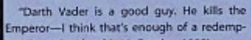

## scan p.55 (scan page 55)

Page contents: 853 words, 44 paragraphs | headings/entries: Han Solo (#38, June 1998); June 1998); BURNING QUESTIONS; Wuew You WirsxH Upon a STAR WARS; Warwick Davis (#31, fall 1996); STAR WARS INSIDER ss

## scan p.56 (scan page 56)

Page contents: 733 words, 44 paragraphs | headings/entries: Ir ApvEnTURE Has A NAME; READY FOR THEIR Ctosz-; Ups; BRUSHES WITH GREATNESS; STAR Wars GENERATION; August 1999)

## scan p.57 (scan page 57)

Page contents: 827 words, 43 paragraphs | headings/entries: On THE Sz2T; Lucas' token; Denis Lawson, who; Fi \; My Missuee23, sumener; Say WHat?; Anthony Daniels (#25, winter 1995)

## scan p.58 (scan page 58)

Page contents: 884 words, 54 paragraphs | headings/entries: Tue Joys or COLLEcTING; CLASSIFIED; INFORMATION "WANTED — SW, if; Jones"; FANDEMONIUM; Dee Williams (#49, May 2000); THat's Putrina Ir Mrrpry; DAWN OF THE DiarrTar AGE; Billy

- **palpatine** — entry/section: They Said It (Ian McDiarmid, #37), printed p. 58: "Our company manager was in New York lately, and he brought back a fascinating little [Emperor toy] that actually does shoot those thunderbolts. When I see it I think, 'God, I wish I had just a little bit of that in my pinky every now and again.'" Source: *Star Wars Insider #50* (2000), scan p.58
  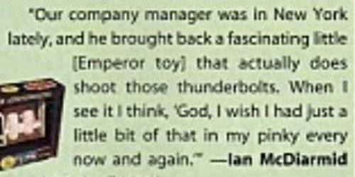

## scan p.59 (scan page 59)

Page contents: 750 words, 39 paragraphs | headings/entries: TV carry a Rune Heako action =; Emprre Tarxs Bacx; BETTER CHECK THE COORDINATES; CREATIVE IMPULSE "Ultimately you just; STATE OF THE ART; THe DAy THE WooxrerE DrED; THe Last Word; STAR WARS [MSIDER

- **palpatine** — entry/section: They Said It (reader letter, #25), printed p. 59: "I'll bet everybody has wanted to be the Emperor at least once. But the problem is that in real life you can't blow away entire planets and subjugate billions." Source: *Star Wars Insider #50* (2000), scan p.59
  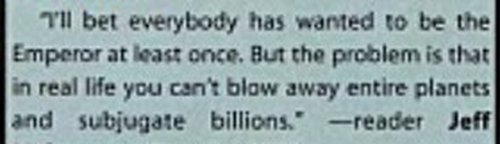

## scan p.60 (scan page 60)

Page contents: Master meets apprentice: Ralph McQuarrie and Doug Chiang conversation (Mark Cotta Vaz), pp. 60-64+: McQuarrie career, designing Vader mask, C-3PO, Chiang on Naboo starfighter. (hand-read)

## scan p.61 (scan page 61)

Page contents: 938 words, 19 paragraphs | headings/entries: STAR WARS IMSIDER

## scan p.62 (scan page 62)

Page contents: 578 words, 20 paragraphs | headings/entries: Il heleets

## scan p.63 (scan page 63)

Page contents: 926 words, 20 paragraphs | headings/entries: TMAT WAS YOUR FIRST DRAWING?; STAR WARE IMSESER 42

## scan p.64 (scan page 64)

Page contents: 619 words, 16 paragraphs | headings/entries: O4 STAM WARS EMSIDER

## scan p.65 (scan page 65)

Page contents: McQuarrie on Star Wars ground rules (spherical planets, physics), Hoth snow castle concept, Yavin hangar, air whales; Chiang on Tatooine pit city (pp. 65-68). (hand-read)

- **hoth; Wampa** — entry/section: McQuarrie/Chiang conversation (Ralph McQuarrie), printed p. 65: "There were no living aliens on this planet except for these animals [the wampa and tauntaun]. But in the past there'd been a civilization before the planet went completely cold." Source: *Star Wars Insider #50* (2000), scan p.65
  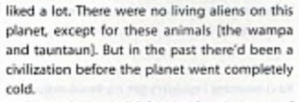

## scan p.66 (scan page 66)

Page contents: 658 words, 22 paragraphs | headings/entries: G6 STAR WARS EMRSIDER; WHAT WAS YOUR FAVORITE EMVIROHMENT, Rap?

## scan p.67 (scan page 67)

Page contents: 687 words, 21 paragraphs | headings/entries: Ratpu, | UNDERSTAND YoU SAW SOME OF; STAR WARS EMSIDER 4F

## scan p.68 (scan page 68)

Page contents: 628 words, 15 paragraphs | headings/entries: 

## scan p.69 (scan page 69)

Page contents: Hasbro Action Figure Update first installment: kids are 50% of buyers, new biker scout, shortpack explanation. (hand-read)

## scan p.70 (scan page 70)

Page contents: Comics Link (Rich Handley): Roy Thomas, Howard Chaykin, Steve Leialoha on Marvel's 1977 adaptation, yellow Jabba, Jaxxon; Thomas left, uninterested in the Force (pp. 70-71). (hand-read)

## scan p.71 (scan page 71)

Page contents: 960 words, 22 paragraphs | headings/entries: STAR WARS; INSEDER va

- **the-force** — entry/section: Comics Link (Roy Thomas), printed p. 71: "I like science fiction and space opera, but I don't have much interest in mysticism or the Force, so it was just as well that I left." Source: *Star Wars Insider #50* (2000), scan p.71
  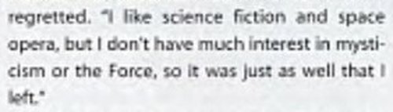

## scan p.72 (scan page 72)

Page contents: Alan Dean Foster profile (Jason Fry): ghostwrote the ANH novelization, Splinter of the Mind's Eye as low-budget sequel; p73 Back Pages novel retrospective timeline 1976-2001. (hand-read)

## scan p.73 (scan page 73)

Page contents: 449 words, 22 paragraphs | headings/entries: Csrya\l Pe; YOUNG ETH INCHES |; So LAR WARS; BACK PAGES: A RETROSPECTIVE; BY JASON FRY

## scan p.74 (scan page 74)

Page contents: Gamescape (Blake Fischer): Battle for Naboo (N64), Starfighter (PS2), Obi-Wan (PC) with controllable lightsaber swings and Darth Maul; pp. 74-75. (hand-read)

## scan p.75 (scan page 75)

Page contents: 429 words, 21 paragraphs | headings/entries: STAPs followed the; Blake Tischer is previews editer for Sext

## scan p.76 (scan page 76)

Page contents: Collecting (Steve Sansweet): Tomland Star Raiders 'cantina' figures in the Ward catalog; Panini stickers, N-1 starfighter display (pp. 76-77). (hand-read)

## scan p.77 (scan page 77)

Page contents: 944 words, 50 paragraphs | headings/entries: IN A STORE THAT I; SUSPECT WAS; OWNED BY JAWAS OR BY WATTO."; Card Guord; Stickers that came with the alburn; The American stickers show different; Raffle Baffle; STEPHANI; Mooresville, IN

## scan p.78 (scan page 78)

Page contents: Rebel Rumblings letters: Artoo's Arroyo road trip, Empire cut near-kiss scene (Luke 'stronger than a Gundark'), Boba Fett voice (Jason Wingreen), Episode I Easter eggs, Vader shadow in Watto's shop (pp. 78-80). (hand-read)

## scan p.79 (scan page 79)

Page contents: 1077 words, 52 paragraphs | headings/entries: ERICA CHAM Son Antonio, TX; Sop taking; Andrew ®; Erica, the scene is; J before they kiss. Artoo and; TOM EGLOFF Secromento, CA; Underwood

- **Luke Skywalker; Wampa** — entry/section: Rebel Rumblings editor reply on cut Empire scene, printed p. 79: "In the scene, Luke explains that his near-death experience with the wampa "made me think about things," and puts his hand on Leia's cheek." Source: *Star Wars Insider #50* (2000), scan p.79
  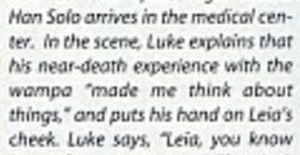
- **Luke Skywalker; gundark** — entry/section: Rebel Rumblings editor reply on cut Empire scene, printed p. 79: "Soon after, the scene picks up with Han's familiar entrance, telling Luke he looks stronger than a Gundark" Source: *Star Wars Insider #50* (2000), scan p.79
  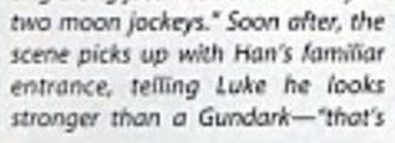

## scan p.80 (scan page 80)

Page contents: 1468 words, 102 paragraphs | headings/entries: The Topps article goes on at; PETE CHUKA Bridgeport, CT; Empire Strikes Back; Easter Egg Toss; Easter Eggs. it was interesting to; BO STAR WARS INSIDER; CHRIS BODELL; Bottle Creek, MI; Theme," there is 3 gentle, flowing; Inmocence of Anakin and the evi; MATT LOGAN; Move Seotie, CANADA; I WOMDER IF YOU CONSIDER the; SHAWNWEE L. SHARP-RAMAGE | Golden, CO»; Oh, that counts al right, |; Shownee. Anybody notice ony other; Star Wars references in the indy; JULIE SALMOM Tohlequch, OK; Still Celebrating I'VE BEEN MEAMING TO WRITE; DEREX RYAN Redlands, CA; ANDY RANSOM Grend Hoven, MI

## scan p.81 (scan page 81)

Page contents: Dear 2-1B humor column: 2-1B claims he saved the galaxy by restoring Luke's lightsaber hand. (hand-read)

## scan p.82 (scan page 82)

Page contents: 0 words, 0 paragraphs | headings/entries: 

## scan p.83 (scan page 83)

Page contents: Jawa Trader ads: R2-D2 cooler, Pepsi can set; p84 Wuher exclusive figure and badge. (hand-read)

## scan p.84 (scan page 84)

Page contents: 214 words, 12 paragraphs | headings/entries: ORDER NOW! 4-800-878-3326 AN EXCLUSIVE NEW FIGURE; ONLY; WUHERTHE BARTENDER

