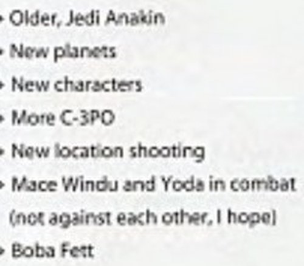
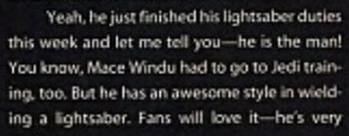
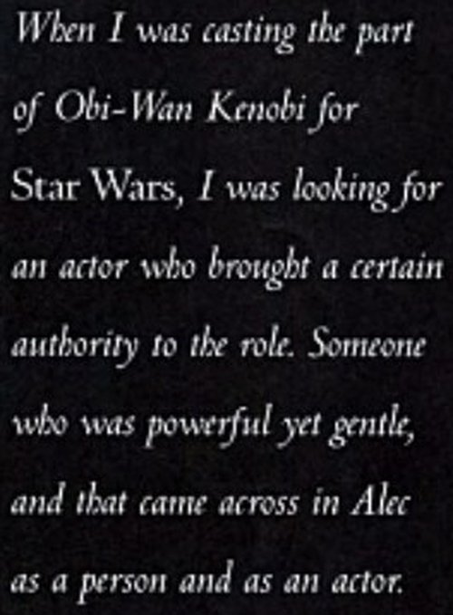
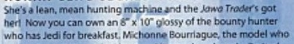
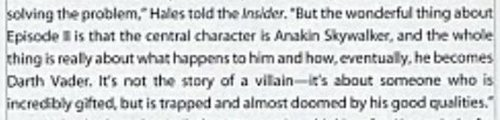
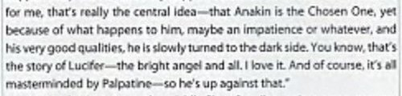
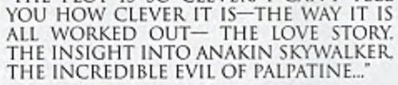
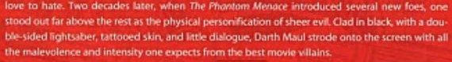
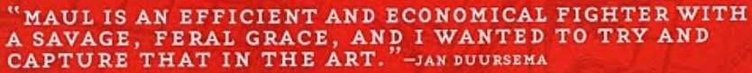
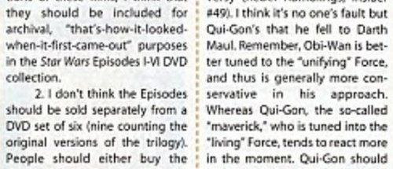

# Owner Material 038 — Star Wars Insider #1–153 plus specials (with The Lucasfilm Fan Club Magazine #1–22): Star Wars Insider #51 (2000)

- **Source:** *Star Wars Insider* magazine (issues 23–153, 1994–2014) and its predecessor *The Lucasfilm Fan Club Magazine* (issues 1–22, 1987–1994), plus seven special editions: articles, interviews, comics and short fiction Secondary source (licensed Legends reference). Scan OCR'd on the box; the scan stays box-only and is **not** published.
- **Method:** every scanned page was OCR'd and machine-screened sentence by sentence for power-relevant statements (fights, kills, defeats, Force feats, rankings, superweapons) that name a character on our roster; each kept sentence is quoted verbatim from the OCR text and has a crop of the printed passage directly under it. Pages with nothing power-relevant are still listed with what is on them.
- **Citation:** "*Star Wars Insider #51* (2000), p.X" by printed page ("scan p.X" where no printed number applies). **Weight:** Licensed magazine: a secondary source. Its short fiction and comics are Legends stories; its articles and interviews sum up or discuss lore and rank below the novels, comics and games they describe.

## scan p.1 (scan page 1)

Page contents: Cover (Christopher Lee): "Summons the Force in Episode II and Casts a Spell over The Lord of the Rings". Cover lines only. (hand-read)

## scan p.2 (scan page 2)

Page contents: 95 words, 5 paragraphs | headings/entries: WHAT'S THIS GUY'S STORY?; GET YOUR STORY PUBLISHED,

## scan p.3 (scan page 3)

Page contents: 8 words, 2 paragraphs | headings/entries: STAR. WARS. E Pal OcDa; ADVENT URE GAME

## scan p.4 (scan page 4)

Page contents: 163 words, 6 paragraphs | headings/entries: 

## scan p.5 (scan page 5)

Page contents: 78 words, 4 paragraphs | headings/entries: From the creators of

## scan p.6 (scan page 6)

Page contents: 200 words, 23 paragraphs | headings/entries: I; S STAR WARS IWSIDER; Features ae; HARRISON FORD; JONATHAN HALES; CHRISTOPHER LEE

## scan p.7 (scan page 7)

Page contents: Contents and editor's desk (Snyder): TPM vs ESB unfair comparison; Ep II recap list incl. older Jedi Anakin, Mace Windu and Yoda in combat, Boba Fett. (hand-read)

- **Mace Windu; Yoda; anakin-skywalker** — entry/section: From the editor's desk (Jon Bradley Snyder), printed p. 7: "» Older, Jedi Anakin
» New planets
» New characters
» More C-3PO
» New location shooting
» Mace Windu and Yoda in combat
(not against each other, I hope)
» Boba Fett" Source: *Star Wars Insider #51* (2000), scan p.7
  

## scan p.8 (scan page 8)

Page contents: Rebel Rumblings letters on Empire issue and Ep I VHS; no in-universe power content. (hand-read)

## scan p.9 (scan page 9)

Page contents: 115 words, 10 paragraphs | headings/entries: Avalon Hill

## scan p.10 (scan page 10)

Page contents: 30 words, 8 paragraphs | headings/entries: IN SKYWALKER AYDEN CHRISTENSEN]; Sue; Hoa ae Se BE

## scan p.11 (scan page 11)

Page contents: Prequel Update (Dan Madsen interviews Rick McCallum): Ep II darker; love story; more action; Mace lightsaber work; Oz as Yoda; Morrison "really bad guy". (hand-read)

- **Mace Windu** — entry/section: Prequel Update (Rick McCallum), printed p. 11: "Yeah, he just finished his lightsaber duties this week and let me tell you—he is the man! You know, Mace Windu had to go to Jedi training, too. But he has an awesome style in wielding a lightsaber." Source: *Star Wars Insider #51* (2000), scan p.11
  

## scan p.12 (scan page 12)

Page contents: 529 words, 21 paragraphs | headings/entries: Sh Son oe ee Me; Photo by George Lwcos; GEORGieLUCAS SELECT; Photo by John Knoll

## scan p.13 (scan page 13)

Page contents: McCallum cont.: Italy/Spain = Naboo, Tunisia = Tatooine; digital shooting. (hand-read)

## scan p.14 (scan page 14)

Page contents: 397 words, 12 paragraphs | headings/entries: 

## scan p.15 (scan page 15)

Page contents: 65 words, 3 paragraphs | headings/entries: 

## scan p.16 (scan page 16)

Page contents: McCallum cont.: photo captions (Nick Gillard trains McGregor in new moves); cut scenes; Lucas directing style. (hand-read)

## scan p.17 (scan page 17)

Page contents: McCallum cont.: Guinness brought "total legitimacy"; Indy IV. (hand-read)

## scan p.18 (scan page 18)

Page contents: Guinness tribute: Lucas message; life and career (Jason Fry, Rich Handley). (hand-read)

- **Obi-Wan Kenobi** — entry/section: A Message from George Lucas (Guinness tribute), printed p. 18: "When I was casting the part of Obi-Wan Kenobi for Star Wars, I was looking for an actor who brought a certain authority to the role. Someone who was powerful yet gentle, and that came across in Alec as a person and as an actor." Source: *Star Wars Insider #51* (2000), scan p.18
  

## scan p.19 (scan page 19)

Page contents: 6 words, 3 paragraphs | headings/entries: PGACY; STAR WARS 1H

## scan p.20 (scan page 20)

Page contents: Guinness tribute cont.: Ben ties the characters together; smile at Vader before sacrificing his life; filmography. (hand-read)

## scan p.21 (scan page 21)

Page contents: 353 words, 26 paragraphs | headings/entries: A LIFETIME OF ACCOLADES

## scan p.22 (scan page 22)

Page contents: Star Wars tales featuring Obi-Wan list (Splinter, Marvel, Jedi Apprentice, Rogue Planet, Jedi Council etc.). (hand-read)

## scan p.23 (scan page 23)

Page contents: 1170 words, 34 paragraphs | headings/entries: In which he played Germany's infamous dicta-; BOOKS BY SIR ALEC GUINNESS; Steviiegs in Dingeite, Warner Books, 1967; BOOKS ABOUT SIR ALEC GUINNESS; Alec Guinness an Screen, Allan Hueter, 1085

## scan p.24 (scan page 24)

Page contents: Star News: Samuel L. Jackson Walk of Fame (Mace Windu in Eps I and II). (hand-read)

## scan p.25 (scan page 25)

Page contents: Star News: Kershner and McCallum in Paris; Liam Neeson motorcycle injury; Queen's Gambit game (Obi-Wan/Qui-Gon vs Maul duel among four battles); Ford helicopter rescue. (hand-read)

## scan p.26 (scan page 26)

Page contents: Star News: Ronny Coutteure obituary; Star Sightings; classic trilogy VHS box set with Ep II sneak peek. (hand-read)

## scan p.27 (scan page 27)

Page contents: 109 words, 15 paragraphs | headings/entries: THE; A SPECTACULAR SERIES; FROM THE CREATORS OF; JEDI APPRENTICE AND THE PUBLISHERS OF; Visit theseventhtower.com |

## scan p.28 (scan page 28)

Page contents: Harrison Ford What Lies Beneath interview (pp. 28-31); career, no in-universe content. (hand-read)

## scan p.29 (scan page 29)

Page contents: 925 words, 36 paragraphs | headings/entries: ANU; R20; BY JASON FRY WITH SCOTT CHERNOFF; STAR."; STAR WARS IMSIDER a?

## scan p.30 (scan page 30)

Page contents: 822 words, 25 paragraphs | headings/entries: Ford, Zemeckis indicated, made the "The; Working with; BO STAR WARS INSIDER; O point wm The tepire Strikes Bock; Ford compared Zemeckis to Lucas

## scan p.31 (scan page 31)

Page contents: 898 words, 26 paragraphs | headings/entries: WITH STUNT GUYS."; STAM WARS [WSEOER BA

## scan p.32 (scan page 32)

Page contents: Meet the new stars of Episode II: Hayden Christensen (man who will become Darth Vader), Christopher Lee (charismatic separatist), Jimmy Smits (Bail Organa). (hand-read)

## scan p.33 (scan page 33)

Page contents: 598 words, 21 paragraphs | headings/entries: A CHARISMATIC SEPARATIST; From patrolling the streets of New; Senator Ball Organa of Alderaan,; The character was killed when the Death; Star destroyed Alderaan in the original Star; Photo by Bue Helter; SENATOR BAIL ORGANA; STAR WARS EMSIPER 282

## scan p.34 (scan page 34)

Page contents: New cast: Bowers (Mas Amedda), Byrne, Logan (mysterious young boy), Segura, Phelan, Rowan (martial artist, tae kwon do). (hand-read)

## scan p.35 (scan page 35)

Page contents: 394 words, 12 paragraphs | headings/entries: EPISODE II RETURNING CAST; RENA OWEN; RONALD FALK

## scan p.36 (scan page 36)

Page contents: New cast: Morrison (dangerous bounty hunter), Dharker, Porter, Yiamkiati (Jedi hopeful), Walsman (skilled bounty hunter, physical role). (hand-read)

## scan p.37 (scan page 37)

Page contents: New cast: Edgerton (Owen Lars; search "orchestrated by the fallen Anakin Skywalker" cost Owen his life), Piesse (Beru), Csokas, Laga'aia, Doran. (hand-read)

## scan p.38 (scan page 38)

Page contents: Late-breaking casting: McGrath (Jedi academic), Thompson, Noble, Karvan, Blundell, Truswell, Watkin, Mooy, Wingate. (hand-read)

## scan p.39 (scan page 39)

Page contents: 98 words, 3 paragraphs | headings/entries: WTY 0420 $24.99

## scan p.40 (scan page 40)

Page contents: Jawa Trader catalog (pp. 39-47): ornaments, Jedi Council #1 (Yinchorri), Jedi Forces calendar. (hand-read)

## scan p.41 (scan page 41)

Page contents: 248 words, 24 paragraphs | headings/entries: INSIDER EXCLUSIVES; YODA JAPANESE T-SHIRT; HAN AND GREEDO WCL4068 LG/XL $18.95; JAPANESE T-SHIRT; WCL4069 LG/XL $18.95; PEPSI COLLECTOR CANS AND CABINET; WLEP028 $100.00; The wizened Yoda appears in Classic Japanese; AURRA SING SIGNED PHOTO; WLCV034 $15.00; R2-D2 BRCKPACK; WCL901L0 $29.95

- **Aurra Sing** — entry/section: Jawa Trader catalog ad copy (Aurra Sing signed photo), printed p. 41: "She's a lean, mean hunting machine and the Jawa Trader's got her! Now you can own an 8 x 10" glossy of the bounty hunter who has Jedi for breakfast" Source: *Star Wars Insider #51* (2000), scan p.41
  

## scan p.42 (scan page 42)

Page contents: Jawa Trader: Boba Fett, Kyle Katarn & Mara Jade figure set ("The Emperor's Hand and the Rebel agent"), international figures. (hand-read)

## scan p.43 (scan page 43)

Page contents: 303 words, 21 paragraphs | headings/entries: EXCLUSIVE FIGURES; WTYO4i3 $9.95; MANY OTH; PLEASE cal; PTS. <=»; EXCLUSIVE ACTION FIGURE SETS; FREE!; WTY 0418 $69.00

## scan p.44 (scan page 44)

Page contents: 174 words, 19 paragraphs | headings/entries: WHI 9006; INDIANA JONES AND THE LAST CRUSADE CD; INDIANA JONES MOVIE SOUNDTRACK COs; INDIANA JONES LEATHER JACKET; WWI s000 SM/MD/LG/XL $300.00; INDIANA JONES; WOOL FELT FEDORA; WNI cooo $M/MD/1LG/XL $36.00; INDIANA JONES FELT FEDORAS

## scan p.45 (scan page 45)

Page contents: 352 words, 28 paragraphs | headings/entries: COCLECTIsaLlesS; STAR WARS CELEBRATION PASS SET; WCG 0000 $48.00; LEGO MINI FIGURES; BA62 - BTAW WANE 6B WAC1O58 $4.00; DEATH STAR II CCG CARDS; WCG 4026 L $10.95; WCG 4028 D $10.95; WCG 4029 BOX $118.95; WCG 4029 SIX (Six booster pocks) $19.95; STAR WARS THIRD ANTHOLOGY CCG CARDS; WCG4026 $32.00; AUTOGRAPHED THREE DAY CELEBRATION PASS; WOG 0008 $24.00

## scan p.46 (scan page 46)

Page contents: Jawa Trader: costumes, helmets, lightsabers ("Feel the power of the dark side!" Maul saber ad). (hand-read)

## scan p.47 (scan page 47)

Page contents: 199 words, 27 paragraphs | headings/entries: ORDER TODAY! WWW.STORE.WIZARDS.COM/JAWA; EPLSODE L PEPSI COLLECT IBLES; R2-D2 COOLER; Jundland Wastes or at; WHS 9006 $109.95; WIC 9028 $100.00; ORDER TODAY! by VISA/Mastercard/Discover/AMEX!

## scan p.48 (scan page 48)

Page contents: 3 words, 1 paragraphs | headings/entries: BY SCOTT CHERNOFI

## scan p.49 (scan page 49)

Page contents: Jonathan Hales feature (by Scott Chernoff, pp. 48-53): Ep II about Anakin becoming Vader; Young Indy writing. (hand-read)

- **anakin-skywalker; Darth Vader (Anakin Skywalker)** — entry/section: Jonathan Hales feature (Hales quoted), printed p. 49: "But the wonderful thing about Episode II is that the central character is Anakin Skywalker, and the whole thing is really about what happens to him and how, eventually, he becomes Darth Vader. It's not the story of a villain—it's about someone who is incredibly gifted, but is trapped and almost doomed by his good qualities." Source: *Star Wars Insider #51* (2000), scan p.49
  

## scan p.50 (scan page 50)

Page contents: 120 words, 5 paragraphs | headings/entries: SO STAR WARS IMSIDER

## scan p.51 (scan page 51)

Page contents: Jonathan Hales profile cont.: Young Indy writing; waiting for Episode II; read TPM script early (hand-read)

## scan p.52 (scan page 52)

Page contents: Hales on Ep II: love story central, Anakin/Obi-Wan master-apprentice, Yoda tricky to write; pull-quote on plot/Palpatine (hand-read)

- **Hales; Anakin; Palpatine** — entry/section: Hales: Anakin slowly turned to dark side: ""that Anakin is the Chosen One, yet because of what happens to him, maybe an impatience or whatever, and his very good qualities, he is slowly turned to the dark side. You know, that's the story of Lucifer—the bright angel and all. I love it. And of course, it's all masterminded by Palpatine—so he's up against that."" Source: *Star Wars Insider #51* (2000), scan p.52
  
- **Hales; Palpatine** — entry/section: Hales: incredible evil of Palpatine: ""the way it is all worked out—the love story, the insight into Anakin Skywalker, the incredible evil of Palpatine"" Source: *Star Wars Insider #51* (2000), scan p.52
  

## scan p.53 (scan page 53)

Page contents: Del Rey ad: NJO Dark Journey/Hero's Trial ("Han Solo fights solo against the New Republic's greatest enemy"), Balance Point coming (hand-read)

## scan p.54 (scan page 54)

Page contents: Nothing But Star Wars (Scott Chernoff? column): Factors Etc. 1978 iron-ons, posters, buttons ("Brotherhood of Jedi Knights" patch) (hand-read)

## scan p.55 (scan page 55)

Page contents: Factors cont.; High Five list (Terence Stamp, Christopher Lee casting, Cushing, ESB pinball, FX-7 medical droid) (hand-read)

## scan p.56 (scan page 56)

Page contents: Inside the Worlds of Star Wars Episode I (DK) excerpt intro; Coruscant cross-section (hand-read)

## scan p.57 (scan page 57)

Page contents: Coruscant: city skyline, Jedi Temple (Temple Spire houses original manuscripts of founding Jedi), Galactic Senate (hand-read)

## scan p.58 (scan page 58)

Page contents: Theed power generator: plasma mining; Maul vs Qui-Gon & Obi-Wan battle site; laser doors (hand-read)

## scan p.59 (scan page 59)

Page contents: Generator cont.: military power, Senator Palpatine presided over opening, plasma trade via Trade Federation (hand-read)

## scan p.60 (scan page 60)

Page contents: Otoh Gunga cross-section: ~1 million inhabitants, Boss Nass boardroom, locap farming (hand-read)

## scan p.61 (scan page 61)

Page contents: Otoh Gunga cont.: City Bigspace, hydrostatic bubble power (hand-read)

## scan p.62 (scan page 62)

Page contents: Christopher Lee interview opener (charismatic separatist in Ep II) (hand-read)

## scan p.63 (scan page 63)

Page contents: Lee intro/bio; Hales calls character "the perfect gentleman"; confidentiality (hand-read)

## scan p.64 (scan page 64)

Page contents: Lee: WWII secrets, offers, casting by Robin Gurland, Lucas "a lot of fun", looking forward to Jackson, Smits, etc. (hand-read)

## scan p.65 (scan page 65)

Page contents: Lee on LOTR (Saruman), Peter Jackson, bluescreen; 1941/Bill Murray SNL sidebar (hand-read)

## scan p.66 (scan page 66)

Page contents: Many faces of Christopher Lee filmography; Dracula typecasting, SNL hosting, Jinnah (hand-read)

## scan p.67 (scan page 67)

Page contents: Lee: Young Indy Czernin role, Vic Armstrong, relaxing, Star Wars "magic"/"wizardry", Cushing "Grand Moff?" anecdote (hand-read)

## scan p.68 (scan page 68)

Page contents: Comics Link: Dark Horse Darth Maul miniseries (Ron Marz, Jan Duursema, Rick Magyar, Drew Struzan covers) (hand-read)

- **Darth Maul** — entry/section: Insider: Maul personification of evil: ""one stood out far above the rest as the physical personification of sheer evil. Clad in black with a double-sided lightsaber, tattooed skin, and little dialogue, Darth Maul strode onto the screen with all the malevolence and intensity one expects from the best movie villains."" Source: *Star Wars Insider #51* (2000), scan p.68
  

## scan p.69 (scan page 69)

Page contents: Maul comic cont.: Marz (Maul a servant, Bullseye comparison), Duursema (Quinlan Vos in Twilight) (hand-read)

- **Darth Maul** — entry/section: Duursema: Maul efficient fighter, savage feral grace: ""He is an efficient and economical fighter with a savage, feral grace, and I wanted to try and capture that in the art."" Source: *Star Wars Insider #51* (2000), scan p.69
  

## scan p.70 (scan page 70)

Page contents: Bookshelf (Jason Fry): Star Wars nonfiction; Inside the Worlds of Episode I; Guide to the SW Universe 3rd ed. (hand-read)

## scan p.71 (scan page 71)

Page contents: Bookshelf cont.: Slavicsek, Dan Wallace (Essential Chronology, Kaiburr crystal), Whitlatch Wildlife, Burtt phrase book (hand-read)

## scan p.72 (scan page 72)

Page contents: Gamescape: LucasArts Obi-Wan PC game; lightsaber focus, Glyph control system (hand-read)

## scan p.73 (scan page 73)

Page contents: Obi-Wan game cont.: Force powers (Force push) learned per Padawan conduct; Neimoidian cowardice tidbits (hand-read)

## scan p.74 (scan page 74)

Page contents: Action Figure Update: Power of the Jedi line, Jedi Force Files, checklist (hand-read)

## scan p.75 (scan page 75)

Page contents: Star Wars Gamer subscription ad (hand-read)

## scan p.76 (scan page 76)

Page contents: Scouting the Galaxy (Sansweet): Style D poster, Target exclusives (hand-read)

## scan p.77 (scan page 77)

Page contents: Scouting cont.: Naboo guard flaws, projectile rules, Rolling Stone ROTJ issue (hand-read)

## scan p.78 (scan page 78)

Page contents: Rebel Rumblings letters: Ep I film strips, original trilogy preservation, Qui-Gon's fault letter (hand-read)

- **Qui-Gon; Obi-Wan; Darth Maul** — entry/section: Letter (Kerry Sandler): Qui-Gon's own fault he fell: ""I think it's no one's fault but Qui-Gon's that he fell to Darth Maul. Remember, Obi-Wan is better tuned to the "unifying" Force, and thus is generally more conservative in his approach. Whereas Qui-Gon, the so-called "maverick," who is tuned into the "living" Force, tends to react more in the moment."" Source: *Star Wars Insider #51* (2000), scan p.78
  

## scan p.79 (scan page 79)

Page contents: Letters: ESB Notebook, probe droid search-and-destroy, Mara/Lando, Boba Fett Harley, Lando appreciation (hand-read)

## scan p.80 (scan page 80)

Page contents: Letters: Lando cont. (took out main reactor), fan fiction/copyright answer (Chewie death planned) (hand-read)

## scan p.81 (scan page 81)

Page contents: Letters: Seven Wonders of SW galaxy; stormtrooper armor (shrapnel, glancing laser); Dear 2-1B rant (hand-read)

## scan p.82 (scan page 82)

Page contents: The Last Page: fan art (hand-read)

## scan p.83 (scan page 83)

Page contents: Dark Horse Darth Maul #1 ad (hand-read)

## scan p.84 (scan page 84)

Page contents: Hasbro Power of the Jedi back-cover ad (hand-read)

