# Owner Material 038 — Star Wars Insider #1–153 plus specials (with The Lucasfilm Fan Club Magazine #1–22): Star Wars Insider #52 (2000)

- **Source:** *Star Wars Insider* magazine (issues 23–153, 1994–2014) and its predecessor *The Lucasfilm Fan Club Magazine* (issues 1–22, 1987–1994), plus seven special editions: articles, interviews, comics and short fiction Secondary source (licensed Legends reference). Scan OCR'd on the box; the scan stays box-only and is **not** published.
- **Method:** every scanned page was OCR'd and machine-screened sentence by sentence for power-relevant statements (fights, kills, defeats, Force feats, rankings, superweapons) that name a character on our roster; each kept sentence is quoted verbatim from the OCR text and has a crop of the printed passage directly under it. Pages with nothing power-relevant are still listed with what is on them.
- **Citation:** "*Star Wars Insider #52* (2000), p.X" by printed page ("scan p.X" where no printed number applies). **Weight:** Licensed magazine: a secondary source. Its short fiction and comics are Legends stories; its articles and interviews sum up or discuss lore and rank below the novels, comics and games they describe.

## scan p.1 (scan page 1)

Page contents: Cover: Episode II, George Lucas speaks, bonus interviews Rick McCallum and Robin Gurland, Star Wars satire (The Onion). Cover lines only. (hand-read)

## scan p.2 (scan page 2)

Page contents: 84 words, 4 paragraphs | headings/entries: WHAT'S THIS GUY'S STORY?

## scan p.3 (scan page 3)

Page contents: 12 words, 3 paragraphs | headings/entries: AOVENTURE GAME; EVERYBODY HAS A STORY. WHAT'S YOURS?

## scan p.4 (scan page 4)

Page contents: 163 words, 11 paragraphs | headings/entries: 

## scan p.5 (scan page 5)

Page contents: Contents and editor's desk (Jeff Quick, new Editor-in-Chief; Insider now from Wizards of the Coast). No in-universe content. (hand-read)

## scan p.6 (scan page 6)

Page contents: Masthead; Rebel Rumblings letters remembering Alec Guinness ("There will never be a Jedi quite like Obi-Wan") and praising #50 Hayden interview. (hand-read)

## scan p.7 (scan page 7)

Page contents: Random House ad: ultimate guide to the Sith (history, training, weaponry). (hand-read)

## scan p.8 (scan page 8)

Page contents: Prequel Update (Dan Madsen interviews Rick McCallum, pp. 8-16): Australia, Italy, Tunisia, Spain, Elstree; Sony digital camera. (hand-read)

## scan p.9 (scan page 9)

Page contents: McCallum: more sets and planets than Ep I, "much more dynamic movie". (hand-read)

## scan p.10 (scan page 10)

Page contents: McCallum: Sydney lifestyle; Hayden "Brilliant"; audiences watching him go to the dark side "unbearable"; Ewan now mentor to Hayden. (hand-read)

## scan p.11 (scan page 11)

Page contents: McCallum: Natalie; Ep II darker than Ep I, next darker still ("Darkness is illuminating"). (hand-read)

## scan p.12 (scan page 12)

Page contents: 567 words, 18 paragraphs | headings/entries: SO THAT'S THE PLAN?

- **anakin-skywalker; Darth Vader (Anakin Skywalker)** — entry/section: Prequel Update (Rick McCallum), printed p. 12: "happens with Anakin. Because, remember, at the end of the day he does fulfill his destiny. At the end of the day he chooses the dark side but he ultimately does redeem himself." Source: *Star Wars Insider #52* (2000), scan p.12
  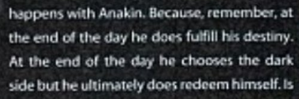

## scan p.13 (scan page 13)

Page contents: McCallum: 30 mph wind rain storm set; particle animation, Perfect Storm; captions. (hand-read)

## scan p.14 (scan page 14)

Page contents: George Lucas Select photo pages (pp. 14-15), from starwars.com. (hand-read)

## scan p.15 (scan page 15)

Page contents: 47 words, 2 paragraphs | headings/entries: STAR WARS IMSIDER

## scan p.16 (scan page 16)

Page contents: McCallum cont.: script by Hales and Lucas; additional shooting; Ep II ends with two paths "you pretty much know which is going to be taken"; Anakin "a nice boy" with a destiny. (hand-read)

## scan p.17 (scan page 17)

Page contents: LucasArts Star Wars Demolition ad. (hand-read)

## scan p.18 (scan page 18)

Page contents: SF Book Club ad (pp. 18-19). (hand-read)

## scan p.19 (scan page 19)

Page contents: 74 words, 9 paragraphs | headings/entries: HITTIN; HH14" NCABEAT ASD ALVIN J. ANDTASON; ADVENTURE; ARTHUR c; CLARK

## scan p.20 (scan page 20)

Page contents: Star News: Shelagh Fraser (Aunt Beru) obituary. (hand-read)

## scan p.21 (scan page 21)

Page contents: Star News: American Graffiti at Aspen; TPM Ultimate Edition soundtrack (Duel of the Fates dialogue version, "Desert Winds"); E.T. 20th anniversary edition. (hand-read)

## scan p.22 (scan page 22)

Page contents: Star Sightings: Ford/Neeson K-19, McGregor/Lawson, cast news. No in-universe content. (hand-read)

## scan p.23 (scan page 23)

Page contents: Danbury Mint fantasy chess set ad. (hand-read)

## scan p.24 (scan page 24)

Page contents: Nothing But Star Wars (Jon Bradley Snyder / Chris Holoka custom landspeeders, pp. 24-25): SoroSuub X-1031, Kuan KMRocket, Mark-V wagon, Dust Devil, GRi-d3 cruiser; tongue-in-cheek speeder copy. (hand-read)

## scan p.25 (scan page 25)

Page contents: 205 words, 8 paragraphs | headings/entries: STAR WARS IWSIDER 25

## scan p.26 (scan page 26)

Page contents: George Lucas set interview (Scott Chernoff, Sydney, pp. 26-31 approx.): Lucas directing Portman/Christensen. (hand-read)

## scan p.27 (scan page 27)

Page contents: Lucas: "The next one will probably be the darkest of all of them"; story comes first. (hand-read)

## scan p.28 (scan page 28)

Page contents: Lucas: story "very, very dark"; cloning theme developed 30 years ago; films structured like a symphony with recurring themes. (hand-read)

- **clone-troopers** — entry/section: George Lucas set interview, printed p. 28: "No, because the cloning theme was developed 30 years ago, so the fact that it's going to end up in this movie is just part of the inevitability of things." Source: *Star Wars Insider #52* (2000), scan p.28
  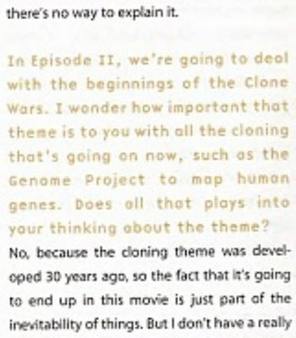

## scan p.29 (scan page 29)

Page contents: Lucas: saga as symphony; Anakin and Luke follow the same path; Anakin cursed by the same flaws all humans are cursed with; Anakin a normal, good kid who turns bad; Hales collaboration; script rewrites. (hand-read)

- **anakin-skywalker; Luke Skywalker; Boba Fett** — entry/section: George Lucas set interview, printed p. 29: "So you're going to find that there's a lot of similarity between what Anakin goes through and what Luke goes through. They follow the same path. And it's a similar situation with some of the other characters, such as Boba Fett." Source: *Star Wars Insider #52* (2000), scan p.29
  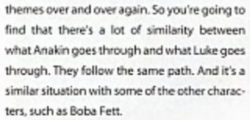
- **anakin-skywalker** — entry/section: George Lucas set interview, printed p. 29: "The whole point is—and the reason I started the story where I did—is that Anakin is a normal, good kid. And how does somebody who is normal and good turn bad? What are the qualities, what is it that we all have within us that will turn us bad?" Source: *Star Wars Insider #52* (2000), scan p.29
  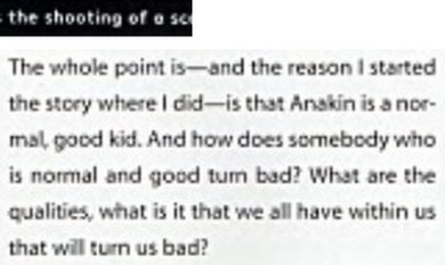

## scan p.30 (scan page 30)

Page contents: Lucas: Hayden casting ("a very talented actor"); villain in the Peter Cushing mold, Christopher Lee "the gentleman, he's the aristocrat"; production; Ep I 90% digital. (hand-read)

- **Count Dooku** — entry/section: George Lucas set interview (on Christopher Lee's role), printed p. 30: "I wanted to get back to the kind of character and actor like I had in the first film, someone played by Peter Cushing. And Christopher Lee is so perfect because he's the gentleman, he's the aristocrat, he's perfect for the part and lets us be subtle." Source: *Star Wars Insider #52* (2000), scan p.30
  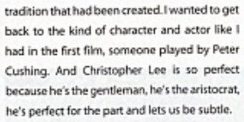

## scan p.31 (scan page 31)

Page contents: Lucas: editing-room filmmaking; one bad idea eats 100 good ideas. (hand-read)

## scan p.32 (scan page 32)

Page contents: Lucas: two cameras, monitors; digital like going from frescoes to oils. (hand-read)

## scan p.33 (scan page 33)

Page contents: Del Rey Darth Maul: Shadow Hunter ad. (hand-read)

- **Darth Maul; Palpatine (Darth Sidious)** — entry/section: Del Rey ad (Darth Maul: Shadow Hunter), printed p. 33: "Darth Maul, Sith Lord apprentice and master of the double-edged lightsaber, is on a mission to kill a treacherous Neimoidian planning to sell information that could sabotage the sinister plans of Maul's master, Darth Sidious." Source: *Star Wars Insider #52* (2000), scan p.33
  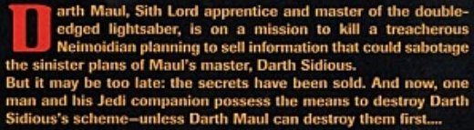
- **Palpatine (Darth Sidious); Darth Maul**: "And now, one man and his Jedi companion possess the means to destroy Darth Sidious's scheme—unless Darth Maul can destroy them first..." Source: *Star Wars Insider #52* (2000), scan p.33
  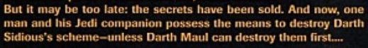

## scan p.34 (scan page 34)

Page contents: Star Wars Gamer subscription ad. (hand-read)

## scan p.35 (scan page 35)

Page contents: Jawa Trader catalog (pp. 35-39): Oola & Salacious Crumb exclusive. (hand-read)

## scan p.36 (scan page 36)

Page contents: Jawa Trader: Pote Snitkin, Kyle Katarn, Watto, Death Star trooper, Epic Force Obi-Wan/Maul figures. (hand-read)

- **Luke Skywalker; Chewbacca**: "Even though he was killed when Luke rescued Han and Chewie in Rerurn of the Jedi, this scoundrel can live to fight another day in your collection." Source: *Star Wars Insider #52* (2000), scan p.36
  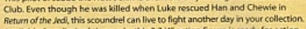

## scan p.37 (scan page 37)

Page contents: Jawa Trader: 12-inch Chancellor's guard and Valorum figures. (hand-read)

## scan p.38 (scan page 38)

Page contents: Jawa Trader: SW RPG core rulebook, Inside the Worlds, Invasion of Theed, signed comics, record sheets. (hand-read)

## scan p.39 (scan page 39)

Page contents: Jawa Trader: carbon-freezing chamber playset. (hand-read)

## scan p.40 (scan page 40)

Page contents: Jawa Trader: chrome archive cards, Maul LEGO keychain, Celebration passes, Luke 24K card, watches. (hand-read)

## scan p.41 (scan page 41)

Page contents: Jawa Trader: Yoda and Han/Greedo Japanese t-shirts, Aurra Sing signed photo (same ad copy as #51), R2 backpack, Pepsi cans. (hand-read)

## scan p.42 (scan page 42)

Page contents: Jawa Trader: helmets; Obi-Wan and Maul toy lightsabers. (hand-read)

## scan p.43 (scan page 43)

Page contents: DK Inside the Worlds of Episode I ad. (hand-read)

## scan p.44 (scan page 44)

Page contents: Robin Gurland casting interview (pp. 44-49): Australian talent; Joel Edgerton as young Owen matched to Phil Brown. (hand-read)

## scan p.45 (scan page 45)

Page contents: Gurland: Bonnie Piesse as Beru; Hayden's arc runs through this film and the next, emotional balance, "one of the strongest actors". (hand-read)

## scan p.46 (scan page 46)

Page contents: Gurland: Hayden "popped" on camera; Anakin "a very complex character"; could handle anything thrown at him in tests with Natalie. (hand-read)

## scan p.47 (scan page 47)

Page contents: Gurland: Lucas wanted Lee's role 100% human, "the Peter Cushing of this film"; Lee in great form; Temuera Morrison casting. (hand-read)

- **Count Dooku** — entry/section: Robin Gurland interview, printed p. 47: "And the role of Christopher's was one of those that we started talking out and it went a couple of ways before George decided he wanted it to be 100% human: "You know what I think we'll do? I'll have him as the Peter Cushing of this film."" Source: *Star Wars Insider #52* (2000), scan p.47
  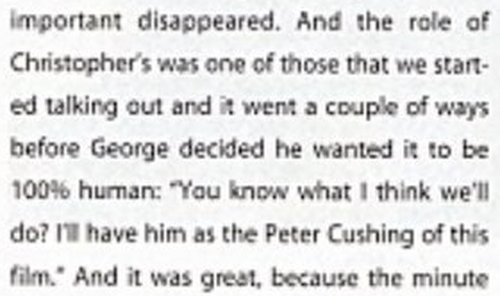

## scan p.48 (scan page 48)

Page contents: Gurland: accents; Fett voice continuity; Lucas very visual (Lee role). (hand-read)

## scan p.49 (scan page 49)

Page contents: Gurland: voice casting (Lewis MacLeod as Sebulba sustains voice); CG actors on set; Silas Carson as Ki-Adi-Mundi and Nute Gunray. (hand-read)

## scan p.50 (scan page 50)

Page contents: Star Wars in The Onion (Scott Chernoff, pp. 50-57): Onion background, Clinton satire intro. (hand-read)

## scan p.51 (scan page 51)

Page contents: Onion feature title spread. (hand-read)

## scan p.52 (scan page 52)

Page contents: Onion feature: Star Wars headlines ("Death Star to Open Day Care Center", "University Cuts Jedi Studies Program", Boba Fett Renaissance Man); Tim Harrod. (hand-read)

## scan p.53 (scan page 53)

Page contents: Onion: Harrod and Siegel as fans; Death Star day-care sidebar. Satire. (hand-read)

## scan p.54 (scan page 54)

Page contents: Onion: obscure references (Het Nik, 1138, Lady Valarian); Harrod: "Dengar was the best man at Boba Fett's wedding" (from the books). Behind-the-scenes, not logged. (hand-read)

## scan p.55 (scan page 55)

Page contents: Hasbro Queen's Gambit ad (four battles at once for Theed Palace). (hand-read)

## scan p.56 (scan page 56)

Page contents: Onion reprint: Clinton takes leave to stand in line for TPM (satire; Owen as Obi-Wan's brother joke); favorite Onion headlines. (hand-read)

## scan p.57 (scan page 57)

Page contents: Onion reprint cont.: Clinton urges Milosevic to use powers like the Jedi "only for knowledge and defense"; Yoda talked like Grover. Satire, no canon value. (hand-read)

## scan p.58 (scan page 58)

Page contents: Comics Link (Rich Handley, pp. 58-60): best comic for each classic character; Luke: Dark Empire, Riders in the Void, Death-Mosque; Leia: Alderaan Factor, Weapons Master, Imperial Servant. (Dark Empire Luke quote already logged in scan pass.) (hand-read)

- **Luke Skywalker** — entry/section: Dark Empire: "Luke ignores his mentors’ teachings and attempts to defeat the dark side from within. Shockingly, he fails, ruling the galaxy at the Emperor's side before overcoming the darkness binding his spirit." Source: *Star Wars Insider #52* (2000), scan p.58
  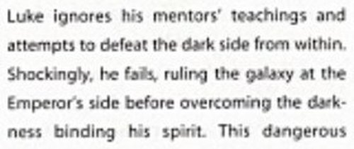
- **Leia Organa Solo** — entry/section: Comics Link (Rich Handley), printed p. 58: "Ever wonder how a member of the Royal House of Alderaan, a world without weapons, became such a fine shot? She was trained by mercenary Giles Durane, who served Bail Organa in the Clone Wars." Source: *Star Wars Insider #52* (2000), scan p.58
  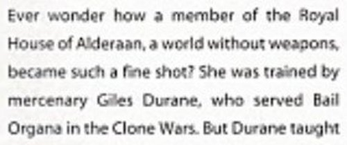

## scan p.59 (scan page 59)

Page contents: Comics Link: Han (Shadeshine, Bounty Hunter of Ord Mantell, Jawas of Doom); Vader (Dark Lord's Conscience, Extinction, Dark Encounter); Chewbacca miniseries; pull-quote on Luke in Dark Empire. (hand-read)

- **Darth Vader (Anakin Skywalker)** — entry/section: Comics Link (Rich Handley, "Dark Lord's Conscience"), printed p. 59: "Vader accepts an invitation to Cheelit for a game of Firepath with Lady Dohl, who has secretly conspired with an assassin to kill him. Vader has forseen their treachery, however, and eliminates them both in the gameboard fire of his winning move." Source: *Star Wars Insider #52* (2000), scan p.59
  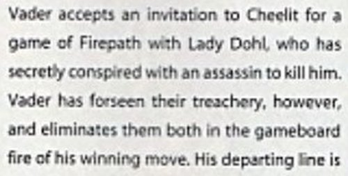
- **Darth Vader (Anakin Skywalker); Mara Jade Skywalker** — entry/section: Comics Link (Rich Handley, "Extinction"), printed p. 59: "Beautifully illustrated, this two-parter about Vader's search for a Jedi woman he failed to kill years before epitomizes his single-minded determination to succeed at all he sets out to do." Source: *Star Wars Insider #52* (2000), scan p.59
  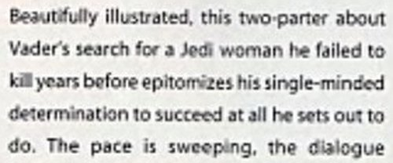
- **Darth Vader (Anakin Skywalker)** — entry/section: Comics Link (Rich Handley, "Dark Encounter"), printed p. 59: "The final chapter of Marvel's Valance trilogy finds Vader on Centares, battling a cyborg bounty hunter for the identity of Luke Skywalker." Source: *Star Wars Insider #52* (2000), scan p.59
  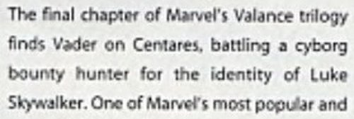

## scan p.60 (scan page 60)

Page contents: Comics Link: Lando (Scoundrel's Wages), droids, Obi-Wan (Silent Drifting), Wedge (Phantom Affair), Fett ("This is my face"), Jabba, Palpatine (Dark Empire); Dark Empire panel of the cloned Emperor. (hand-read)

- **palpatine; Luke Skywalker** — entry/section: Comics Link panel (Dark Empire, Emperor to Luke), printed p. 60: "DON'T WORRY, LITTLE JEDI...I WILL NOT HARM YOU. INDEED, I WILL TEACH YOU THINGS YOU HAVE NEVER IMAGINED. I WILL SHOW YOU THE REAL POWER A JEDI CAN WIELD!" Source: *Star Wars Insider #52* (2000), scan p.60
  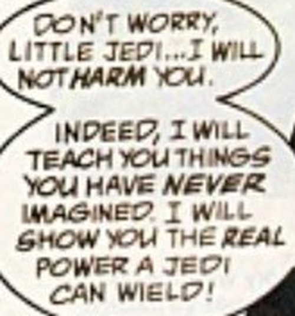
- **palpatine** — entry/section: Comics Link (Rich Handley, Dark Empire), printed p. 60: "The Emperor's evil is so strong that it lives beyond his death, given new life by a series of clones that reclaim his hold on the galaxy." Source: *Star Wars Insider #52* (2000), scan p.60
  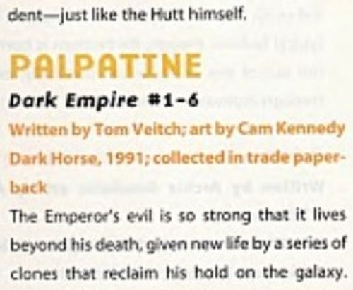

## scan p.61 (scan page 61)

Page contents: Dark Horse Boba Fett: Agent of Doom ad. (hand-read)

## scan p.62 (scan page 62)

Page contents: Bookshelf (Jason Fry): Kathy Tyers, NJO Balance Point; Vong on Duro; Jacen lead, Mara Jade third lead. (hand-read)

## scan p.63 (scan page 63)

Page contents: Tyers cont.: Luke as married man, Jacen's struggles with the nature of the Force; Firebird trilogy; Aurra Sing: Dawn of the Bounty Hunters masterpiece edition ("the peerless Boba Fett"). (hand-read)

## scan p.64 (scan page 64)

Page contents: Gamescape (Blake Fischer): Star Wars Demolition; Jabba's tournament between ESB and ROTJ. (hand-read)

## scan p.65 (scan page 65)

Page contents: Demolition cont.: arenas, hidden characters. Game mechanics only. (hand-read)

## scan p.66 (scan page 66)

Page contents: Scouting the Galaxy (Sansweet): Ewok Adventure; stormtrooper figure value. (hand-read)

## scan p.67 (scan page 67)

Page contents: Scouting cont.: bagged C-3PO, Burger Chef posters, Burger King stickers. (hand-read)

## scan p.68 (scan page 68)

Page contents: DecipherCon 2000 (Rich Handley, pp. 68-69): Young Jedi CCG final, Ian Vincent beats Philippe Parrise; Bourriague pull-quote. (hand-read)

## scan p.69 (scan page 69)

Page contents: DecipherCon cont.: Shannon Baksa (Mara Jade), Bourriague (Aurra Sing); Matt Sokol wins Star Wars CCG over Yannick Lapointe. Game mechanics only. (hand-read)

## scan p.70 (scan page 70)

Page contents: Rebel Rumblings: letters on Insider #50; C. Andrew Nelson on playing Vader 43 times since 1994 incl. ESB Special Edition shuttle walk. (hand-read)

## scan p.71 (scan page 71)

Page contents: Letters cont.: Nelson; IG-88 operator correction (not Paul Klein); Road Trip photos (Tikal, Buttercup Valley, Twenty Mule Team Canyon). (hand-read)

## scan p.72 (scan page 72)

Page contents: Letters: reader theory that Vader was the last hope (fan opinion, not logged); stormtrooper cylinder soda joke. (hand-read)

## scan p.73 (scan page 73)

Page contents: Ask 2-1B (comedic in-character column): long sleeves, Jedi vanishing question (joke answer, no canon value). (hand-read)

## scan p.74 (scan page 74)

Page contents: Last Page: Podracers illustration by John Alvin? (credit "illustrated by John Alvin"); no text. (hand-read)

## scan p.75 (scan page 75)

Page contents: Episode I Ultimate Edition soundtrack ad. (hand-read)

## scan p.76 (scan page 76)

Page contents: Hasbro Power of the Jedi back cover ad. (hand-read)

