# Owner Material 038 — Star Wars Insider #1–153 plus specials (with The Lucasfilm Fan Club Magazine #1–22): Star Wars Insider #53 (2001)

- **Source:** *Star Wars Insider* magazine (issues 23–153, 1994–2014) and its predecessor *The Lucasfilm Fan Club Magazine* (issues 1–22, 1987–1994), plus seven special editions: articles, interviews, comics and short fiction Secondary source (licensed Legends reference). Scan OCR'd on the box; the scan stays box-only and is **not** published.
- **Method:** every scanned page was OCR'd and machine-screened sentence by sentence for power-relevant statements (fights, kills, defeats, Force feats, rankings, superweapons) that name a character on our roster; each kept sentence is quoted verbatim from the OCR text and has a crop of the printed passage directly under it. Pages with nothing power-relevant are still listed with what is on them.
- **Citation:** "*Star Wars Insider #53* (2001), p.X" by printed page ("scan p.X" where no printed number applies). **Weight:** Licensed magazine: a secondary source. Its short fiction and comics are Legends stories; its articles and interviews sum up or discuss lore and rank below the novels, comics and games they describe.

## scan p.1 (scan page 1)

Page contents: Cover: Ian McDiarmid, first look at Essential Guide to Alien Species, PlayStation 2. Cover lines only. (hand-read)

## scan p.2 (scan page 2)

Page contents: 110 words, 13 paragraphs | headings/entries: THE; SPECTACULAR series; FROM THE CREATORS OF; JEDI APPRENTICE; Visit www.theseventhtower,com

## scan p.3 (scan page 3)

Page contents: 151 words, 20 paragraphs | headings/entries: ROGER ROGER SIGN ME UP; Includes a 2 year membership in; State' Courtry; Famed Medical Droid

## scan p.4 (scan page 4)

Page contents: 81 words, 6 paragraphs | headings/entries: The Essential Guidéto Alien Species; Yh UWG

## scan p.5 (scan page 5)

Page contents: Contents and editor's desk (Jeff Quick on wrong online-store URLs; correct = swfan.wizards.com). No power content. (hand-read)

## scan p.6 (scan page 6)

Page contents: Rebel Rumblings letters (back from hiatus, hate mail, female fans; continued p70). No power content. (hand-read)

## scan p.7 (scan page 7)

Page contents: 31 words, 8 paragraphs | headings/entries: From the creators of; Vigilante 8; Vigilante 8: 2nd Offense"

## scan p.8 (scan page 8)

Page contents: Prequel Update: McCallum Jan 2001 - editing, ILM miniatures, ~800 animatics, London pick-ups; Hayden/Natalie praised. (hand-read)

## scan p.9 (scan page 9)

Page contents: 63 words, 3 paragraphs | headings/entries: 

## scan p.10 (scan page 10)

Page contents: 366 words, 18 paragraphs | headings/entries: HOW ARE THE PERFORMANCES?; It ee

- **Yoda** — entry/section: Prequel Update (Rick McCallum), printed p. 10: "No, we haven't started on that yet. We've done the rough cut of what the basic action is, but we haven't actually started creating those sequences with Yoda yet." Source: *Star Wars Insider #53* (2001), scan p.10
  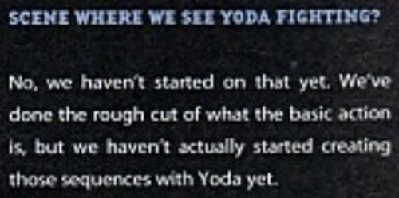

## scan p.11 (scan page 11)

Page contents: 95 words, 7 paragraphs | headings/entries: STAR WARS [WSIDER aa

## scan p.12 (scan page 12)

Page contents: 60 words, 5 paragraphs | headings/entries: 

## scan p.13 (scan page 13)

Page contents: McCallum on Australian crew, 24P HD camera, no Indiana Jones movement; ends p16. No power content. (hand-read)

## scan p.14 (scan page 14)

Page contents: 4 words, 1 paragraphs | headings/entries: 

## scan p.15 (scan page 15)

Page contents: 59 words, 5 paragraphs | headings/entries: Proto by George tect; STAR WARS; Protea Bp Poul Tiler; Prete by sasen Sret

## scan p.16 (scan page 16)

Page contents: 213 words, 10 paragraphs | headings/entries: It's always a pleasure, W; BG STAR WARS INSTDER

## scan p.17 (scan page 17)

Page contents: 69 words, 5 paragraphs | headings/entries: 

## scan p.18 (scan page 18)

Page contents: 92 words, 11 paragraphs | headings/entries: TCARY Pratceetr; CNCYCLOPEREA; ACORNA'S WORLD ct

## scan p.19 (scan page 19)

Page contents: 125 words, 17 paragraphs | headings/entries: IDUNE); Choose 5 books from = WWW. JoinSFBC.com; Fie Arete evel. 1.0 2m ent

## scan p.20 (scan page 20)

Page contents: Star News: Episode II additional shooting in England, TPM Fox TV premiere, Jedi-Con 2001, McGregor's Natural Nylon theatre; Star Sightings p22. No power content. (hand-read)

## scan p.21 (scan page 21)

Page contents: 828 words, 32 paragraphs | headings/entries: JEDI-CON 2001, April 13-15; OBI-WAN KENOBI LIVE!; STAR WARS EMSIDER 24

## scan p.22 (scan page 22)

Page contents: 392 words, 19 paragraphs | headings/entries: AMERICAN GRAFFITI TRIBUTE ADDS; Series at the US, Comedy; DUROS DEBUTS; AS HASBRO FAN FIGURE

## scan p.23 (scan page 23)

Page contents: 36 words, 6 paragraphs | headings/entries: LAST STAND ON ORD MANTELL'; FEATURING AN ALTERNATE COVER BY TONY DANIEL!

## scan p.24 (scan page 24)

Page contents: Ian McDiarmid interview (Scott Chernoff) on Palpatine/Emperor, pp. 24-28 (+ continuation). (hand-read)

## scan p.25 (scan page 25)

Page contents: 9 words, 3 paragraphs | headings/entries: PALPATI NE; STAR WARS INSIDER 2s

## scan p.26 (scan page 26)

Page contents: 774 words, 28 paragraphs | headings/entries: Blockade Runner amid smoke,; OF ALL TIME,

- **Darth Vader (Anakin Skywalker); Palpatine (Darth Sidious)** — entry/section: Return of the Jedi: "Sure enough, in Return of the Jedi, we learned quickly that Vader was but a pawn in his master’s dark game of galactic domination." Source: *Star Wars Insider #53* (2001), scan p.26
  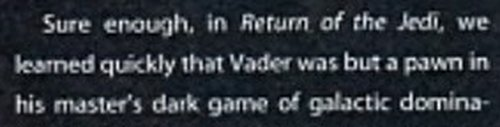
- **palpatine** — entry/section: Ian McDiarmid interview, printed p. 26: "The principal answer to that, of course, is that he is a man of mystery. That is how he exercises, maintains, and increases his power—by choosing what he's public about. He's the great political manipulator of all time." Source: *Star Wars Insider #53* (2001), scan p.26
  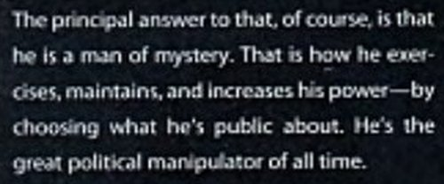

## scan p.27 (scan page 27)

Page contents: 735 words, 25 paragraphs | headings/entries: STAR WARS IMSIDER 27

- **palpatine** — entry/section: Ian McDiarmid interview, printed p. 27: "the pure exercise of power is what he's all about. That's the only thing he's interested in and the only thing that can satisfy him—which makes him completely fascinating to play, because it is an evil soul. He is more evil than the devil. At least Satan fell—he has a history, and it's one of revenge." Source: *Star Wars Insider #53* (2001), scan p.27
  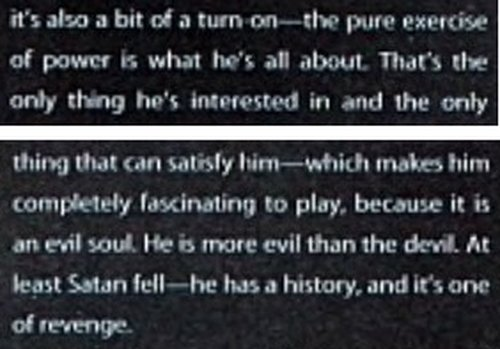
- **palpatine; Luke Skywalker** — entry/section: Ian McDiarmid interview, printed p. 27: "The only emotion that manifests itself truly is the one seen just before he meets his end, if that's what he meets, in Jedi—and then that's pure anger, when he realizes that he hasn't succeeded in manipulating young Skywalker. So he has to kill him, and he tries to do that with unadulterated fury." Source: *Star Wars Insider #53* (2001), scan p.27
  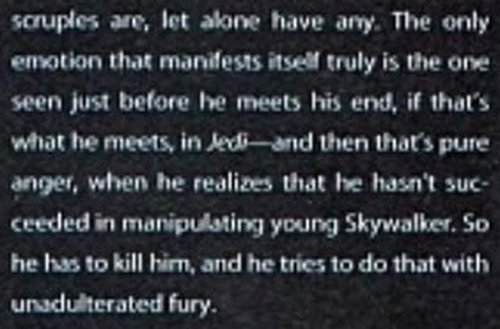
- **palpatine; Luke Skywalker; Darth Vader (Anakin Skywalker)** — entry/section: Ian McDiarmid interview, printed p. 27: "And his great strength is that he's not fearful, which of course is also young Skywalker's great strength, and ultimately Vader's too." Source: *Star Wars Insider #53* (2001), scan p.27
  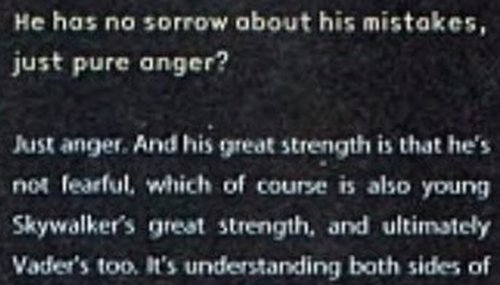

## scan p.28 (scan page 28)

Page contents: 821 words, 22 paragraphs | headings/entries: Phote by Sue Adler,

- **palpatine** — entry/section: Ian McDiarmid interview, printed p. 28: "He doesn't have any of those potentially redemptive qualities. He hasn't fallen. I imagine he's evil from birth, which is a terrible thing to imagine. He's not human." Source: *Star Wars Insider #53* (2001), scan p.28
  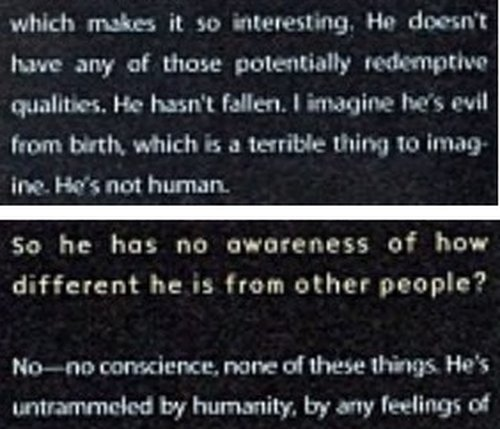
- **palpatine** — entry/section: Ian McDiarmid interview, printed p. 28: "He's untrammeled by humanity, by any feelings of guilt or responsibility or any of these things that bother all of us to a degree. And that's why, up to a point, he's entirely able to exercise his will. Of course, he's immensely clever, too." Source: *Star Wars Insider #53* (2001), scan p.28
  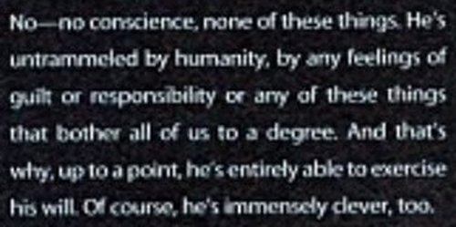

## scan p.29 (scan page 29)

Page contents: 842 words, 28 paragraphs | headings/entries: Phota by Sue Adler,; How long were you in Sydney?; RESPONSIBILITYS; STAR WARS [CMSIDER 29

- **anakin-skywalker** — entry/section: Ian McDiarmid interview, printed p. 29: "Episode II is the big step of the story, when they get together and when Anakin learns. He's a great and fast learner and has a tremendous instinct. He grows up very quickly, perhaps too quickly." Source: *Star Wars Insider #53* (2001), scan p.29
  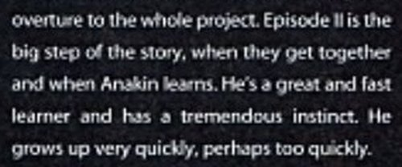

## scan p.30 (scan page 30)

Page contents: 1005 words, 26 paragraphs | headings/entries: BO STAR WARS INSEDER; THE EMPEROR; It was also imeresting because there were

- **palpatine** — entry/section: Ian McDiarmid interview, printed p. 30: "Yes. I could see how the character had developed. He wasn't seeking a power base—he had one." Source: *Star Wars Insider #53* (2001), scan p.30
  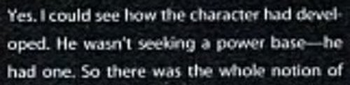

## scan p.31 (scan page 31)

Page contents: 888 words, 20 paragraphs | headings/entries: Do you ever have time to relax?; STAR WARS INSIDER 234

## scan p.32 (scan page 32)

Page contents: Topps Star Wars trading cards history (Gary Gerani): 1977 sets, C-3PO card #207, Yoda held back for Empire; continued p44. No power content. (hand-read)

## scan p.33 (scan page 33)

Page contents: 389 words, 25 paragraphs | headings/entries: BOLAOM OF LEE; ADENG. CARDS; SEE WHICH; SET OF CARDS WOULD SUSTAIN MORE SETS."; STAR WARS IMSIDER a3

## scan p.34 (scan page 34)

Page contents: Del Rey Cloak of Deception ad (Qui-Gon and Obi-Wan vs a dark overlord's plan). Ad copy only. (hand-read)

## scan p.35 (scan page 35)

Page contents: Jawa Trader pp. 35-40: store apology, action figures (Pote Snitkin, Leia Hoth exclusives), pewter, CCG, RPG products. No power content. (hand-read)

## scan p.36 (scan page 36)

Page contents: 210 words, 11 paragraphs | headings/entries: Wo eae

## scan p.37 (scan page 37)

Page contents: 108 words, 9 paragraphs | headings/entries: ORDER NOW! e swfan.wizards.com; POTE SNITKIN ACTION FIGURE; MANY OTHER FIGURES TO CHOOSE FROM!

## scan p.38 (scan page 38)

Page contents: 364 words, 12 paragraphs | headings/entries: CHECK OUT OUR ONLINE STORE AT:; TRADE FEDERATION TANK RAT; SWOO26PEW $26.99

## scan p.39 (scan page 39)

Page contents: 85 words, 8 paragraphs | headings/entries: ORDER NOW! e swfan.wizards.com; SeACTION FIGURE; MANY OTHER FIGURES ] TO CHOOSE FROM!; PLEASE CHECK OUR WEBSITE FOR PRICING

## scan p.40 (scan page 40)

Page contents: 357 words, 23 paragraphs | headings/entries: CHECK OUT OUR ONLINE STORE AT: swfan.wizards.com; FOR SPECIAL PROMOTIONS; DEATH STAR II CCG CARDS; Swit; STAR WARS ROLEPLAYING GAME CORE RULE BOOK; TSRLL79S; TSRLi792 $14.95; INVASION OF THEED; STAR WARS CHARACTER RECORD SHEETS; TSRii795 $9.95

## scan p.41 (scan page 41)

Page contents: Jawa Trader end: Chancellor Valorum/Coruscant Guard 12-inch exclusive, Maul/Qui-Gon toy lightsabers. Products only. (hand-read)

## scan p.42 (scan page 42)

Page contents: 387 words, 31 paragraphs | headings/entries: CHECK OUT OUR ONLINE STORE AT:; LG/XL $18.99; Signed by Inker Howard Shum; QUI-GON JINN'S LIGHTSABER; Two "C" batteries not included. 082606016384 $9.99; Ob248601461314 $14.99; MANY OTHER ITEMS TO CHOOSE FROM

## scan p.43 (scan page 43)

Page contents: Del Rey Darth Maul: Shadow Hunter ad (same copy as ins052 p33; dupe). (hand-read)

## scan p.44 (scan page 44)

Page contents: Topps trading cards history pp. 44-49 (Galaxy, Widevision, Finest, 3-Di, Chrome Archives, Episode I) and set checklist. No power content. (hand-read)

## scan p.45 (scan page 45)

Page contents: 608 words, 19 paragraphs | headings/entries: ARTISTS] LOOPRESIN!; Gaok ortest/entar Wolte heart tor ott +; PETER GUYNOSTYEES; The widawyo; STAR WARS IMSI BER as

## scan p.46 (scan page 46)

Page contents: 537 words, 23 paragraphs | headings/entries: LucasArts cards featuring art from different; Once the Special Edition films were released,

## scan p.47 (scan page 47)

Page contents: 600 words, 29 paragraphs | headings/entries: IES TH; Stor Wo; The (pisode Diaarrcn proms core; POeeatt CHteiiMial; STAR WARS IWSIDER AF

## scan p.48 (scan page 48)

Page contents: 386 words, 33 paragraphs | headings/entries: Phantom Menace tends itself well to; P@user STAR WARS) FRAT; Star Wars Galaxy binder (SWAT promo); Galaxyiset, lettered instead of numbered); Star Wars Galaxy binder (SW'B2 promo)

## scan p.49 (scan page 49)

Page contents: 445 words, 8 paragraphs | headings/entries: YINGRCA RDS, 1977-2000 =—; STAR WARS EWSIDER 49

## scan p.50 (scan page 50)

Page contents: Essential Guide to Alien Species (Ann Margaret Lewis, art R.K. Post) excerpt intro. (hand-read)

## scan p.51 (scan page 51)

Page contents: 508 words, 13 paragraphs | headings/entries: SsSsSEenTint; PLANET OF; General Wedge Antilles writes of the Verpine:; STAR WARS ENSIDER sa

- **verpine** — entry/section: Essential Guide to Alien Species excerpt (Verpine), printed p. 51: "their sticklike bodies are covered by plates of flexible, green chitinous shell called carahide, capable of deflecting a glancing blaster bolt or a knife attack." Source: *Star Wars Insider #53* (2001), scan p.51
  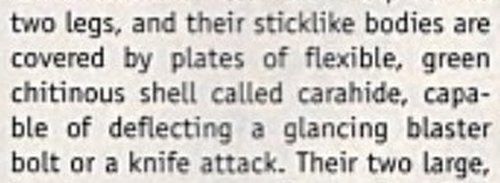

## scan p.52 (scan page 52)

Page contents: Rodians: hunters, theater, bounty-hunting prizes, viewed as cowards; Joon Odovrera nightclub transcript. No named-character power content. (hand-read)

## scan p.53 (scan page 53)

Page contents: 440 words, 9 paragraphs | headings/entries: THe Essentrint. Guive tro ALIEN SPECIES; STAR WARS [MSIDER 8B

## scan p.54 (scan page 54)

Page contents: 485 words, 11 paragraphs | headings/entries: Hn; INSIDER; ExectLusivel; S4 STAR WARS IMSEDER

- **yuuzhan-vong** — entry/section: Essential Guide to Alien Species excerpt (Yuuzhan Vong), printed p. 54: "For some unknown reason, the Jedi cannot sense the Yuuzhan Vong through the Force. It is as if the Yuuzhan Vong are completely devoid of the Force." Source: *Star Wars Insider #53* (2001), scan p.54
  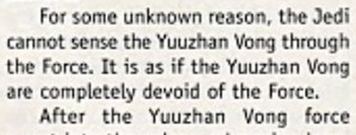

## scan p.55 (scan page 55)

Page contents: 670 words, 20 paragraphs | headings/entries: THE EssentTrintw; Guinpete tro Rvien SPECIES; Amphistaff DEsIGWwATION: NONSENTIENT Lenorn: 1.38 MILTERS (arprox.); Coralskipper Desicuation: NONSENTIENT LExGta: 3 METERS (arPrc.); STAR WARS INSIDER 88

- **yuuzhan-vong** — entry/section: Essential Guide to Alien Species excerpt (Garqi refugee account), printed p. 55: "My father stood up to one. The Yuuzhan Vong was tall, muscular, and humanlike, but his face and body were horribly scarred and disfigured. He had no hair, and his nose was practically missing. He was horrible to behold. Father fought as hard as he could, but the Yuuzhan Vong sliced him in half." Source: *Star Wars Insider #53* (2001), scan p.55
  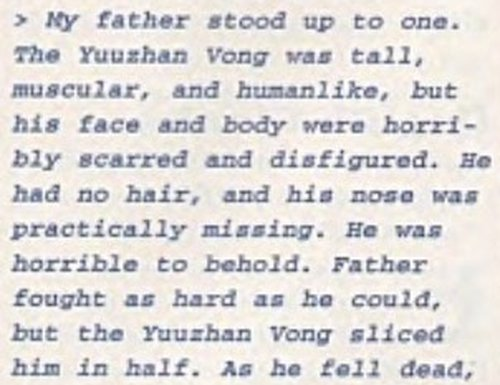
- **yuuzhan-vong** — entry/section: Essential Guide to Alien Species excerpt (coralskipper), printed p. 55: "In a circle of enemies, the coralskipper spins faster and faster, bending an adversary's laser blasts into a field of gravity. Opponents can't break free and are forced to orbit the coralskipper until they crash together, at which point the gravity well dissipates, and all of the ships, including the coralskipper and its suicidal pilot, go up in a tremendous flash of energy." Source: *Star Wars Insider #53* (2001), scan p.55
  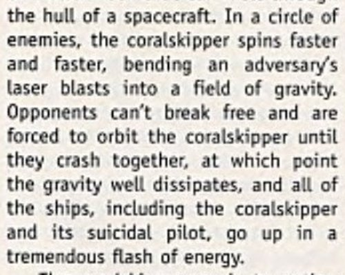

## scan p.56 (scan page 56)

Page contents: 625 words, 20 paragraphs | headings/entries: AN IinvsiveArA Excrtcusiue; Gnullith Destcuation: NOMNSENTIENT Lenota: t METER; SQ@ STAR WARS 1IMSTERER; Ooglith Cloaker; Ooglith Masquer Destcration: NONSENTIENT Lexctse: 0.3 METERS

- **yuuzhan-vong; Chewbacca** — entry/section: Essential Guide to Alien Species excerpt (dovin basal), printed p. 56: "The more they focus their line, the greater the pull. One was used to pull down a moon onto the planet Sernpidal, resulting in the deaths of millions—including Han Solo's close friend Chewbacca." Source: *Star Wars Insider #53* (2001), scan p.56
  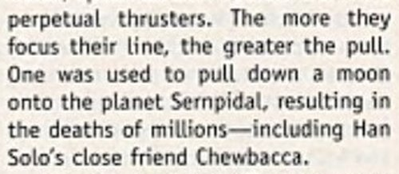
- **jacen-solo** — entry/section: Essential Guide to Alien Species excerpt (grashal), printed p. 56: "A lightsaber can easily cut through the grashal's shell." Source: *Star Wars Insider #53* (2001), scan p.56
  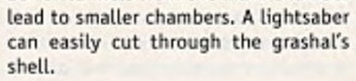

## scan p.57 (scan page 57)

Page contents: 642 words, 25 paragraphs | headings/entries: THe E; Uillip; Desicnation: NONSENTIENT Hercxt: O.2 METERS; Yammosk Desicnation: SENTIENT DIamMeTER: t» METERS; SSENTIANW Guipnpe; Ly taunted Miko with his own; STAR WARS [HSIDER 87

- **yuuzhan-vong; miko-reglia** — entry/section: Essential Guide to Alien Species excerpt (yammosk, Danni Quee report), printed p. 57: "It wanted Miko Reglia, a Jedi Knight, to experience uncontrollable despair and fear. It seemed to feed on it, enjoy it—as did all the Yuuzhan Vong who witnessed the torture. Time after time it taunted Miko with his own death, bringing him close to its cavernous mouth and its single, hideous tooth. It pummeled him with telepathic waves of hopelessness, and each time he weakened, its mental hold grew stronger and stronger. It slowly drained him of his will to live." Source: *Star Wars Insider #53* (2001), scan p.57
  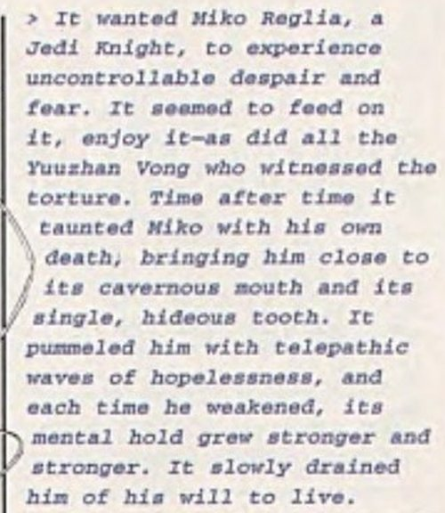

## scan p.58 (scan page 58)

Page contents: 377 words, 16 paragraphs | headings/entries: Jedi vs. Sth cover ilust; SG STAR WARS INSIDER

- **sith; jedi** — entry/section: Comics Link (Dave Land, Jedi vs. Sith), printed p. 58: "Not to give away the ending, but the battle of Ruusan concludes with the destruction of the Sith along with a healthy portion of the Jedi army." Source: *Star Wars Insider #53* (2001), scan p.58
  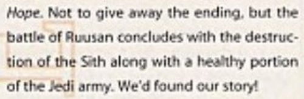

## scan p.59 (scan page 59)

Page contents: 513 words, 9 paragraphs | headings/entries: STAR WARS IMSIDER 5S?

- **Greedo; Luke Skywalker**: ""What if Greedo had killed Han in the cantina?" or "What if Luke had completed his Jedi training?" of "What would have happened if Uncle Owen hadn't bought R2-D2?"" Source: *Star Wars Insider #53* (2001), scan p.59
  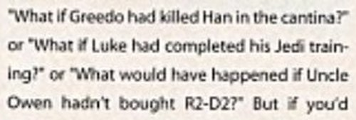

## scan p.60 (scan page 60)

Page contents: 450 words, 29 paragraphs | headings/entries: Infinities cover ilhestration by Tang Horris; Other non-cominuity In@user tithes are in; Nise to OPEN up the poss; Star Wars' best loved characters. These; Tefinities internal ileatrations by brew sohnson

- **Luke Skywalker; Leia Organa Solo** — entry/section: Comics Link (Dave Land, Infinities), printed p. 60: "Its horrific, yet wonderful ending featured Luke and Leia serving side by side as the Dark Lords of the Galaxy." Source: *Star Wars Insider #53* (2001), scan p.60
  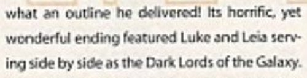
- **Luke Skywalker; Darth Vader (Anakin Skywalker)** — entry/section: Comics Link (Dave Land, Infinities), printed p. 60: "Luke screams down the trench toward the battle station's exhaust port and fires his torpedoes... but they explode prematurely! The Death Star is rocked, but not destroyed." Source: *Star Wars Insider #53* (2001), scan p.60
  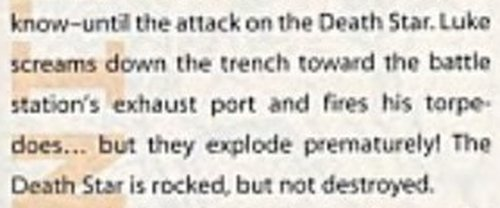

## scan p.61 (scan page 61)

Page contents: Star Wars Gamer subscription ad. No power content. (hand-read)

## scan p.62 (scan page 62)

Page contents: 558 words, 22 paragraphs | headings/entries: J. GREGORY KEYES DOES HIS HOMEWORK; BY JASON FRY; Vy Jb

## scan p.63 (scan page 63)

Page contents: 538 words, 28 paragraphs | headings/entries: JEDI ORDER, STEPPING BACK FROM THE GRAND; WEEP OF GALACTIC; Luke Skywalker rea; Eventually, it's Anakin 6 twho's had a; Wolter P. Montpowery; STAR WARS [MSIDER 43

- **Anakin Solo; Luke Skywalker** — entry/section: Bookshelf (Jason Fry, Conquest), printed p. 63: "Eventually, it's Anakin Solo (who's had a premonition that things are going wrong) who defies orders and heads for Yavin 4 in his X-wing—only to find the evil collaborators of the Peace Brigade already there looking for Jedi." Source: *Star Wars Insider #53* (2001), scan p.63
  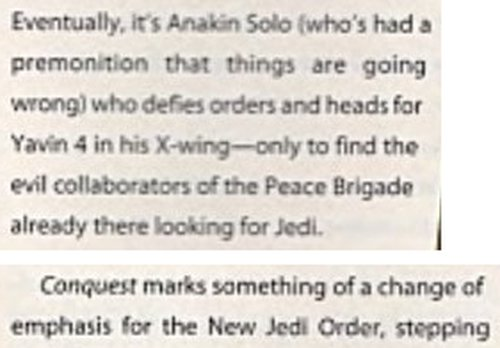

## scan p.64 (scan page 64)

Page contents: Gamescape: Starfighter (PS2) - Rhys, Vana Sage, Nym; 14 levels. No canon power content. (hand-read)

## scan p.65 (scan page 65)

Page contents: 553 words, 37 paragraphs | headings/entries: Ld Yh; Rival; Vone closes in for the kill; Enemy fighters coning; STAR WARS EMBTIDER 68

## scan p.66 (scan page 66)

Page contents: Scouting the Galaxy (Sansweet): collecting 'dead' cycles; Q&A continues. No power content. (hand-read)

## scan p.67 (scan page 67)

Page contents: Scouting the Galaxy Q&A pp. 67-69 (documentaries, Pepsi standees, Revenge flyer, cookie jars, bootlegs; Chewie red cloak = Holiday Special). No power content. (hand-read)

## scan p.68 (scan page 68)

Page contents: 372 words, 24 paragraphs | headings/entries: Up is also; Mountain Dew |; DAN MAXYMIV; Strongsville, OF

## scan p.69 (scan page 69)

Page contents: 447 words, 52 paragraphs | headings/entries: Tens of th os of f; Gaiden ¢; Vader cookie jar, only; Today it will set you; Chewbacca in a red cloak and; PATRICK SCERRI; Harper Woods, Ml; Holiday Special" W; STAR WARS INSIDER a

## scan p.70 (scan page 70)

Page contents: 1300 words, 67 paragraphs | headings/entries: Until last year | thought | was; BETHARY AXDERSON; Meso, AZ; At the moment, all we are real-; CHRISTINA BROWM; Polmdole, CA; CASEY L. CLAIBORNE; You Can't Be Healthy; Heavy Medal; JAKE PIRKKANEN — Soilisbury, YT |; Looks like there's justice ofter al!; Henn... okay, back fo no justice,

## scan p.71 (scan page 71)

Page contents: Rebel Rumblings: Chewbacca medal letter, advice on writing Star Wars fiction; next-issue ad. No power content. (hand-read)

## scan p.72 (scan page 72)

Page contents: 664 words, 14 paragraphs | headings/entries: Deor 2-13,; ADVICE FOR HUMANS

## scan p.73 (scan page 73)

Page contents: 553 words, 33 paragraphs | headings/entries: God, do | love yous; Viars & ol; Sate, ond Ste eStering medical; Rebtel of; Ryan,; Ommmend upgrading

## scan p.74 (scan page 74)

Page contents: Last Page: Stan Shaw illustration of Darth Maul with MOM heart tattoo being inked by Watto. Image only, no text. (hand-read)

## scan p.75 (scan page 75)

Page contents: Star Wars Roleplaying Game ad ('Your honor rivals that of a Jedi'); p76 Scholastic Jedi Apprentice ad ('An evil scientist is ready to kill Qui-Gon Jinn for the secrets of the Force'). Ad copy only. (hand-read)

## scan p.76 (scan page 76)

Page contents: 65 words, 10 paragraphs | headings/entries: MSCHOLASTIC; JEDI APPRENTICE; At last The stories been told,; Wherever Books :

