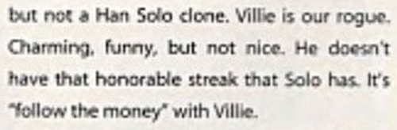
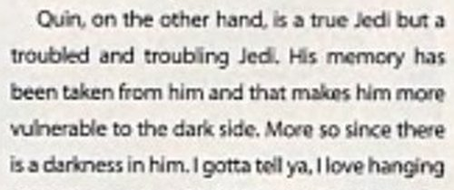
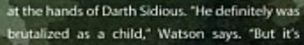
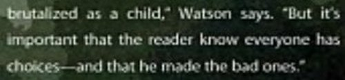
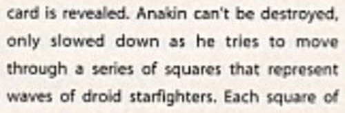
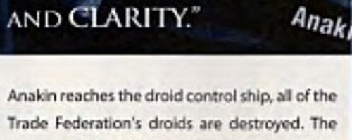

# Owner Material 038 — Star Wars Insider #1–153 plus specials (with The Lucasfilm Fan Club Magazine #1–22): Star Wars Insider #54 (2001)

- **Source:** *Star Wars Insider* magazine (issues 23–153, 1994–2014) and its predecessor *The Lucasfilm Fan Club Magazine* (issues 1–22, 1987–1994), plus seven special editions: articles, interviews, comics and short fiction Secondary source (licensed Legends reference). Scan OCR'd on the box; the scan stays box-only and is **not** published.
- **Method:** every scanned page was OCR'd and machine-screened sentence by sentence for power-relevant statements (fights, kills, defeats, Force feats, rankings, superweapons) that name a character on our roster; each kept sentence is quoted verbatim from the OCR text and has a crop of the printed passage directly under it. Pages with nothing power-relevant are still listed with what is on them.
- **Citation:** "*Star Wars Insider #54* (2001), p.X" by printed page ("scan p.X" where no printed number applies). **Weight:** Licensed magazine: a secondary source. Its short fiction and comics are Legends stories; its articles and interviews sum up or discuss lore and rank below the novels, comics and games they describe.

## scan p.1 (scan page 1)

Page contents: Cover (Raiders of the Lost Ark 20th anniversary issue / flip cover; Episode II update): cover lines for interviews with cast & crew (Pernilla August, Peter Walpole, Ben Burtt), "Secrets of the Set Revealed", Cantina Crawling with John Ostrander, Eduardo Sanchez loves Ewoks, The New Jedi Order, The Queen's Gambit, www.starwars.com. No in-universe character material. (hand-read)

## scan p.2 (scan page 2)

Page contents: Advertisement (Star Trek: Starfleet Command: Empires at War game: "The greatest threat to the universe is the one least expected"). No Star Wars character material. (hand-read)

## scan p.3 (scan page 3)

Page contents: Advertisement (Franklin Mint official Star Trek three-level chess set). No Star Wars character material. (hand-read)

## scan p.4 (scan page 4)

Page contents: "Inside the Insider 54" contents (read from page image; OCR garbled): Features p22 Pernilla August "Mother of the Force"; p30 Peter Walpole "Ready, Set... Go!" (Feng Shui is only the beginning); p38 Ben Burtt "The Sound & the Vision" (film editor). On the cover: Ewan McGregor plays Obi-Wan Kenobi in Star Wars: Episode II, photo by Sue Adler. No in-universe character material. (hand-read)

## scan p.5 (scan page 5)

Page contents: Departments list (Rebel Rumblings 6, Prequel Update 8, Star News 16, Comics Link 56, Bookshelf 58 "Beware the dark side Jude Watson", Gamescape 60 "The Queen's Gambit revealed", Holonet 62, Set Piece 64, Scouting the Galaxy 66 Eduardo Sanchez, Dear 2-1B 72 "Advice for humans"); editorial "All Right, All Right, You Old Smoothie." by Jeff Quick, Editor-in-Chief (bimonthly schedule, 96 pages, squarebound, flip cover for Raiders 20th anniversary, PCS subscription service). No in-universe character material. (hand-read)

## scan p.6 (scan page 6)

Page contents: Masthead (staff credits; contributors include "2-1B" as the advice-column persona) and Rebel Rumblings letters column (reader letters on issue 51 subscriber-only, Insider vs Star Wars Gamer split: "Gamer is about the Star Wars fiction, Insider is about Star Wars nonfiction"; praise of the George Lucas interview in #52; website ordering). Letter-writer names omitted per rules. No in-universe character material. (hand-read)

## scan p.7 (scan page 7)

Page contents: Advertisement (New Line Platinum Series Dungeons & Dragons DVD; contest trip to Prague). No Star Wars character material. (hand-read)

## scan p.8 (scan page 8)

Page contents: Prequel Update: interview with producer Rick McCallum by Dan Madsen, conducted April 2001, on Episode II pick-up shooting at Ealing Film Studios (crew Gavin Bocquet, Peter Russell, Peter Heslop, Giles Nuttgens; ~12 days of pick-ups; Alec Guinness began his film career at Ealing). Real-world production material; no in-universe character material. (hand-read)

## scan p.9 (scan page 9)

Page contents: Episode II Prequel Update opener "...date with Rick McCallum [Producer]" (read from page image): full-page set photo of a human extra and a Bith-costumed extra in an alley outside a swinging Coruscant nightclub set; captions credit Sue Adler. No in-universe character statements. (hand-read)

## scan p.10 (scan page 10)

Page contents: Episode II Prequel Update photos: pull quote from Rick McCallum ("Sometimes there are specific parts you want to extend because you like the actor so much..."); captions: Anakin Skywalker (actor Hayden Christensen) lands his speeder deep in the Coruscant cityscape; documentarian Tony Kaplan; Ahmed Best (Jar Jar Binks) resting between shots. Production material; no power or character statements beyond the scene description. (hand-read)

## scan p.11 (scan page 11)

Page contents: Rick McCallum interview cont. (pick-ups as "additional shooting", scenes filmed out of order, a new sequence never thought of during principal photography); captions: possible Coruscant nightclub light fixture prop; Ahmed Best interviews Stunt Coordinator Nick Gillard for starwars.com; George Lucas operating a Sony 24P digital camera in Plaza de España, Seville; Susie Porter plays waitress Hermione Bagwa in Episode II. T for the Count Dooku caption. (hand-read)

### Stat block notes (game mechanics, not feats)

- Episode II Prequel Update photo caption (verified on page image): [BOTTOM, RIGHT] Count Dooku (played by actor Christopher Lee) is a charismatic separatist who has a commanding presence in Episode II. Photo by Paul Tiller. (Source: *Star Wars Insider #54* (2001), scan p.11)

## scan p.12 (scan page 12)

Page contents: "George Lucas Select [Images hand-picked by the director]" (read from page image): Lucas photos of architecture (Plaza de España style colonnades and arches) and a robed silhouette in a hall. No text beyond credits. (hand-read)

## scan p.13 (scan page 13)

Page contents: George Lucas Select cont. (read from page image): photos of a masked figure, a cockpit scene (a helmeted pilot and a young woman), hands, a Naboo-style craft; text box: Lucas shares personally selected moments first posted on www.starwars.com. No in-universe character statements. (hand-read)

## scan p.14 (scan page 14)

Page contents: Episode II Prequel Update cont.: captions (Obi-Wan Kenobi (actor Ewan McGregor) and his Padawan Anakin Skywalker (actor Hayden Christensen) confer with Padmé Amidala in her Coruscant apartment; Dormé, played by Rose Byrne, is a handmaiden to Padmé Amidala; Padmé (Natalie Portman) lies awake in her Coruscant apartment bedroom); McCallum interview cont. (filmmaking as a work in progress; lessons from The Young Indiana Jones Chronicles: international crew). No power statements. (hand-read)

## scan p.15 (scan page 15)

Page contents: McCallum interview cont. (crew together almost ten years, over 40 countries, new Australian crew; "for the first time in film history a writer can write anything he wants to and we have the tools and the technology to be able to bring it to life"); captions: George Lucas on set; Lake Como, Italy as a new location on the planet Naboo; Obi-Wan Kenobi (Ewan McGregor) confers with Mace Windu (Samuel L. Jackson) before he takes off in his starfighter. No power statements. (hand-read)

## scan p.16 (scan page 16)

Page contents: Star News: "Shooting wraps at Ealing" header; "Star Wars Events Light Up Summer Conventions": Steve Sansweet's Star Wars: CONNECTIONS presentation at four conventions; San Diego Comic-Con International July 19-22 (Dark Horse Comics). T for the CONNECTIONS description. (hand-read)

### Stat block notes (game mechanics, not feats)

- Star News: "Star Wars Events Light Up Summer Conventions" — Star Wars: CONNECTIONS presentation description, per the Official Star Wars Web Site (italic; verified on page image): The Star Wars saga is a space epic of grand design-and boundless fun. It entertains and inspires as it explores the conflict between good and evil, technology and humanity. The saga of the Skywalker family celebrates heroism and the limitless potential of the individual. And it is those individuals who stay with us long after the last battle fades: the feisty princess and the strong-willed queen; a young farmboy whose yearnings for adventure lead to the end of an Empire-and revelations of family secrets; the Padawan who becomes a Jedi Knight and connects father to son; and finally, a young Podracer who travels a torturous path to the dark side before ultimately finding redemption at the hands of that son. Join Lucasfilm's Steve Sansweet as he explores the connections among the Star Wars films, from A New Hope... to next year's Episode II. (Source: *Star Wars Insider #54* (2001), scan p.16)

## scan p.17 (scan page 17)

Page contents: Star News conventions cont.: Gen Con Game Fair Aug 2-5 Milwaukee (Billy Dee Williams; Star Wars RPG and CCG events; Sansweet quote on Gen Con); Wizard World Aug 17-19 Chicago; Dragon*Con Aug 31-Sep 3 Atlanta (Anthony Daniels as MC; Jeremy Bulloch, Richard LeParmentier; authors Aaron Allston, Kevin J. Anderson, A.C. Crispin, Rebecca Moesta; artist guest). No in-universe character statements. (hand-read)

## scan p.18 (scan page 18)

Page contents: Advertisement (Science Fiction Book Club membership offer, left half: book list). No Star Wars character material. (hand-read)

## scan p.19 (scan page 19)

Page contents: Advertisement (Science Fiction Book Club, right half: Lord of the Rings, comics, X-Men etc.). No Star Wars character material. (hand-read)

## scan p.20 (scan page 20)

Page contents: Star News: "From the World of Lucasfilm" cast/crew news column (Mark Hamill in Kevin Smith's Jay and Silent Bob Strike Back lightsaber spoof; Harrison Ford with John Woo, Apocalypse Now Redux; Ewan McGregor in Black Hawk Down; Natalie Portman in The Seagull; Liam Neeson in The Crucible, lightsaber auction $49,500; Christopher Lee projects; Samuel L. Jackson in Changing Lanes; Hayden Christensen in Life as a House, quoted: "The room in which I had to explore my character [Anakin] was much more defined by the previous movies"; Carrie Fisher). Real-world news; no in-universe power statements. (hand-read)

## scan p.21 (scan page 21)

Page contents: Star News cont.: American Graffiti reunion tribute (Lucas quotes on TV plans); Dave Prowse (Darth Vader actor) arthritis attack ("may have wished for some of the Force powers of his famed alter-ego" — real-world joke, not an in-universe statement); cast/crew briefs (Carrie Fisher's These Old Broads, Billy Dee Williams, Keira Knightley (Sabé), James Earl Jones, Ahmed Best, George Lucas, Ben Burtt, Ty Teiger); awards (Rick Baker, John Williams, Skywalker Sound, ILM, Mary Selway BAFTA, Lucas quote). No in-universe character material. (hand-read)

## scan p.22 (scan page 22)

Page contents: Feature title spread "Pernilla August: Mother of the Force" (deck across pp22-23: "The acclaimed Swedish actress tells the Insider why returning as Shmi Skywalker in Star Wars: Episode II is like living inside a dream."), read from page image. T for the opener. (hand-read)

### Stat block notes (game mechanics, not feats)

- Pernilla August: Mother of the Force — feature opener by Scott Chernoff (italic; verified on page image): When we last saw Shmi Skywalker, she was standing outside in the hot desert sun, bidding a bittersweet farewell to her son, insisting that he leave her to live the free life she couldn't and fulfill his powerful destiny. We were left to wonder what would happen to Shmi, still a slave to a Toydarian and letting go of the connection to the one person she loved most, Anakin. (Source: *Star Wars Insider #54* (2001), scan p.22)

## scan p.23 (scan page 23)

Page contents: Feature title spread cont.: full-page photo of Pernilla August as Shmi Skywalker; byline Scott Chernoff; deck end. No further text. (hand-read)

## scan p.24 (scan page 24)

Page contents: Pernilla August feature by Scott Chernoff: The Phantom Menace farewell scene; August famous in the U.S. for Shmi and for NBC's Mary, Mother of Jesus; Episode II emotions ("There are big emotions in Episode II... I've been working with Ingmar Bergman so much"); shooting in Sydney; new on-screen son Hayden Christensen ("He has the same warmth and kindness as Jake"). Caption on Bergman. Real-world interview; no power statements. (hand-read)

## scan p.25 (scan page 25)

Page contents: Pernilla August cont.: friendship with Lucas and McCallum; first English-language role; Mary, Mother of Jesus opposite Christian Bale ("they will never give me something else!"); has not watched it; childhood theater at 10. Caption: mother figures to Anakin and Jesus; her three daughters. No in-universe character statements. (hand-read)

## scan p.26 (scan page 26)

Page contents: Pernilla August cont.: career history (Giliap at 16, Roy Andersson; drama school Stockholm at 19; Lasse Hallström; Bergman's Fanny & Alexander at 21; theater in Gävle with Peter Oskarson; Royal Dramatic Theater; Best Intentions, Cannes Best Actress 1993; Private Confessions). Pull quote: "To be a part of Star Wars is like a dream...". No in-universe character statements. (hand-read)

## scan p.27 (scan page 27)

Page contents: Pernilla August cont.: Private Confessions directed by Liv Ullmann; Gossip, Anna; Mary Stuart for Bergman; theater vs film; small Swedish crews vs Star Wars multi-camera shoots. Caption on her Young Indiana Jones episode "Northern Italy, June 1916." No in-universe character statements. (hand-read)

## scan p.28 (scan page 28)

Page contents: Pernilla August cont.: acting the same in any language; not interested in conventions; laser body scan for a possible action figure; fan mail; cast as "the matriarch of the Skywalker clan—mother to Anakin, grandmother to Luke and Leia"; desert sunrise memories; closing "like a candy I have in my pocket" quote; what happened to Shmi to be seen in May 2002. Real-world interview; no power statements. (hand-read)

## scan p.29 (scan page 29)

Page contents: Advertisement (Scholastic, Deltora Quest books: "A promise to his dying father. A city he must save. All he needs is the power."). No Star Wars character material. (hand-read)

## scan p.30 (scan page 30)

Page contents: Full-page portrait photo of set decorator Peter Walpole (read from page image). No text beyond folio. (hand-read)

## scan p.31 (scan page 31)

Page contents: "Peter Walpole talks..." interview by Scott Chernoff, Patrice Girod, Brian Robb, Oliver Denker, and Steve Sansweet: recreating the Lars garage and homestead kitchen as studio interiors in Australia for Episode II, Matmata location; Archive drawings and photographs as reference; would have loved to do the Millennium Falcon; well over 60 sets. Real-world production; no in-universe character material. (hand-read)

## scan p.32 (scan page 32)

Page contents: Walpole interview cont.: more environments and medium-sized sets than Episode I; less blue screen than feared ("Then how come they employed me for 10 months?"); build decisions flow from Rick McCallum, ILM's John Knoll, Gavin Bocquet. Caption: replicating the garage. No in-universe character material. (hand-read)

## scan p.33 (scan page 33)

Page contents: Walpole interview cont.: Padmé's apartment the most challenging set (big, minimalist, relates to her background), Palpatine's Senate office; "domestic interiors"; a personal interior for "Fett" whose details he cannot discuss; getting on George Lucas's "wavelength". Captions: Lucas, Walpole and Ty Teiger examine Naboo guard weapons; Padmé's Coruscant apartment set at Fox Studios Australia. No power statements. (hand-read)

## scan p.34 (scan page 34)

Page contents: Walpole interview cont.: Flash Gordon vs Star Wars prop style; MDF; the look drifts toward the original trilogy subconsciously; Phantom Menace aircraft-parts junk vs Episode II furniture. Captions: Peter Wyborn and Ty Teiger; Watto's junkyard full-sized set. No in-universe character material. (hand-read)

## scan p.35 (scan page 35)

Page contents: Walpole interview cont.: Episode II environments Coruscant, Tatooine, Naboo (Throne Room, palace exterior), new largely CG environments; Tunisia slave quarters, Mos Espa street, Watto's shop exterior, homestead; favorite moment is when Lucas likes a finished set. Caption: Watto's shop interior. No in-universe character material. (hand-read)

## scan p.36 (scan page 36)

Page contents: Walpole interview cont.: Lucasfilm unique ("only one George Lucas and one Rick McCallum"), short chain of command; coordination with cinematographer David Tattersall; coping with cut scenes. Captions: entrance to Watto's shop; set stands from Episode I; the Queen's apartment on Coruscant. No in-universe character material. (hand-read)

## scan p.37 (scan page 37)

Page contents: Walpole interview cont.: teamwork with Ty Teiger; the Christopher Lee bust for Episode II in the style of Auguste Rodin, three sculptors, George Lucas finished it himself in clay; cast, fiberglass, painted as bronze. Captions: Christopher Lee bust; Mos Espa composite sets. No in-universe character material. (hand-read)

## scan p.38 (scan page 38)

Page contents: Ben Burtt feature title page ("The creator of the Star Wars saga's superior aural..." display type over photo; read from OCR/page image). No in-universe character material. (hand-read)

## scan p.39 (scan page 39)

Page contents: Ben Burtt feature opener: Fox Studios Australia production offices, Burtt's office full of recorded frog "ribbits"; the Oscar-winning sound designer behind R2-D2's beeps, the lightsaber hum. No in-universe character material. (hand-read)

## scan p.40 (scan page 40)

Page contents: Ben Burtt feature cont. (pull quote "It's just like a giant puzzle, fitting in pieces here and there, until things connect"): Burtt is picture editor for Episode II as well as sound designer; cutting scenes as soon as Lucas shoots; Star Wars action figures on his end table; recording birds and frogs at dawn. No in-universe character material. (hand-read)

## scan p.41 (scan page 41)

Page contents: Ben Burtt interview: picture editing is 90% of his work; Matt Wood recording rain forest; "Every Star Wars film requires a thousand new sounds"; his son recording C-3PO, R2 and a pyrotechnic lightsaber effect on set; nearly 150 scenes, 20-25 cut; temp CG character stand-ins and image collages ("Like Monty Python"). No in-universe character material. (hand-read)

## scan p.42 (scan page 42)

Page contents: Ben Burtt interview cont.: temp backdrops from Doug Chiang art; a scene takes three times as long to cut, Ahmed Best reference performances; action-figure previsualization ("We've had meetings where we actually fought with action figures"); digital editing speeds; weekly Saturday meetings with Lucas. Pull quote "Beyond a certain point there is no 'best' cut of a film". No in-universe character material. (hand-read)

## scan p.43 (scan page 43)

Page contents: Ben Burtt interview cont.: Lucas storyboarding on Saturdays; Burtt as main picture editor and sound designer ("You momentarily wield great power in shaping the final appearance" — about the editor, not a character); temp mixes; sound glues the film together. No in-universe character material. (hand-read)

## scan p.44 (scan page 44)

Page contents: Subscription advertisement (read from page image): Star Wars Insider / Fan Club offer ($19.95 6 issues, $34.95 12 issues); "You Get" list; photo of a Kaminoan-like make-up head; inset photo labeled "2-1B Famed Medical Droid" with speech bubble "Subscribe Today and Save 45%". Ad label only; no in-universe character statement. (hand-read)

## scan p.45 (scan page 45)

Page contents: "The Jawa Trader" Fan Club online store page (swfan.wizards.com; non-collector items; membership benefits and prices; signed "Online Store Customer Service Staff"). No in-universe character material. (hand-read)

## scan p.46 (scan page 46)

Page contents: Jawa Trader online specials: Episode I figure list with prices (Darth Sidious, Destroyer Droid, Queen Amidala, Boss Nass, Rune Haako, Nute Gunray, Ki-Adi-Mundi, Mace Windu, Adi Gallia, Darth Maul (Duel), Qui-Gon Jinn (Duel/Naboo), Obi-Wan Kenobi (Duel/Naboo)). Product listing only. (hand-read)

## scan p.47 (scan page 47)

Page contents: Jawa Trader specials cont.: Episode I C-3PO, Battle Droid, Opee & Qui-Gon Jinn, Captain Tarpals, Watto, Kaadu & Jar Jar Binks, R2-D2, Darth Maul (Tatooine), OOM-9, Jar Jar Binks, Ody Mandrell & droid, Gasgano & pit droid. Product listing only. (hand-read)

## scan p.48 (scan page 48)

Page contents: Jawa Trader specials cont.: classic figures (Lando Calrissian, Han Solo (Cantina/Bespin), Luke Skywalker, Endor Rebel Soldier, Princess Leia (prisoner), Greedo, Death Star Trooper, Luke as Stormtrooper, Luke & T-16 Skyhopper, Jawa & Gonk Droid, Kyle Katarn); Cantina Band Member figure "officially retired". Product listing only. (hand-read)

## scan p.49 (scan page 49)

Page contents: Jawa Trader exclusive: Pote Snitkin action figure ("This pilot of Jabba the Hutt's skiff is available only through the Star Wars Fan Club. Even though he was killed when Luke rescued Han and Chewie in Return of the Jedi..."), $8.99. Product copy only. (hand-read)

## scan p.50 (scan page 50)

Page contents: Jawa Trader: pewter figurines (Watto, Darth Maul, Obi-Wan, Trade Federation vehicles, Qui-Gon, Droopy McCool, Jar Jar, Nute Gunray) and Epic Force figures (Obi-Wan, Princess Leia, Stormtrooper, Darth Maul "The Sith apprentice moves when you rotate the base"). Product listing only. (hand-read)

## scan p.51 (scan page 51)

Page contents: Jawa Trader: LEGO sets (A-wing, Snowspeeder, Gungan Sub, Naboo Starfighter, Speeder Bikes, Mos Espa Podrace, Luke's Landspeeder, Sith Infiltrator, Darth Maul keychain). Product listing only. (hand-read)

## scan p.52 (scan page 52)

Page contents: Jawa Trader: CCG Special Edition and Death Star II cards; Star Wars Roleplaying Game Core Rulebook; Invasion of Theed Adventure Game; The Secrets of Naboo Campaign Book. Product listing only (no rules or stats printed). (hand-read)

## scan p.53 (scan page 53)

Page contents: Jawa Trader: Episode I hardbound novel special edition signed by Terry Brooks; Living Force Campaign Guide; Art of the Star Wars Trilogy Special Edition; Gamemaster's Screen; Episode I graphic novel; Character Record Sheets. Product listing only. (hand-read)

## scan p.54 (scan page 54)

Page contents: Jawa Trader: Royal Naboo Starship ornament; Chrome Archive card set; Celebration pass set; R2-D2 backpack ("nearsighted scrap pile"); signed holo-foil comics; Pepsi can set; Qui-Gon Jinn's and Darth Maul's toy lightsabers. Product listing only. (hand-read)

## scan p.55 (scan page 55)

Page contents: Jawa Trader exclusive: Oola & Salacious Crumb figure two-pack ($11.99). Product listing only. (hand-read)

## scan p.56 (scan page 56)

Page contents: "The Grim Reaper of Comics": comic-strip-style humorous interview, Dark Horse editor Dave Land with writer John Ostrander framed as a Mos Eisley cantina meeting; Ostrander's career (DC, Marvel, First Comics, acting with Joe Mantegna and Dennis Franz); on A New Hope and The Phantom Menace; "Twilight" arc with Jan Duursema introducing Quinlan Vos, who lost his memory, and Devaronian sidekick Villie. Waiter is unnamed. (hand-read)

## scan p.57 (scan page 57)

Page contents: Ostrander interview cont.: pull quote "Heck, kid—I was a fan of Star Wars before the first movie came out"; caption "So wait—is Villie "Hope" or "Crosby?""; "Darkness" four-issue horror arc picking up Quin's Padawan Aayla and his origins ("a character who could go either way"); prefers blaster; praise for Jan Duursema; Lucasfilm owns created characters; Ewoks vs Jawas; Watto vs Sebulba. (hand-read)

- **Vilmarh Grahrk** — entry/section: Villie as a rogue — writer John Ostrander, "The Grim Reaper of Comics" interview (crop ok): ""Villie is our rogue. Charming, funny, but not nice. He doesn't have that honorable streak that Solo has. It's "follow the money" with Villie." —John Ostrander" Source: *Star Wars Insider #54* (2001), scan p.57
  
- **Quinlan Vos** — entry/section: Quinlan Vos as troubled Jedi — writer John Ostrander, "The Grim Reaper of Comics" interview (crop ok): ""Quin, on the other hand, is a true Jedi but a troubled and troubling Jedi. His memory has been taken from him and that makes him more vulnerable to the dark side. More so since there is a darkness in him." —John Ostrander" Source: *Star Wars Insider #54* (2001), scan p.57
  

### Stat block notes (game mechanics, not feats)

- Comic panel reprint (Star Wars monthly, "Twilight"), Villie speech balloon (verified on crop): VILLIE NOT REALLY YOUR FRIEND. (Source: *Star Wars Insider #54* (2001), scan p.57)
- Comic panel reprint (Star Wars monthly, "Twilight"), Villie speech balloon (verified on page image): VILLIE DON'T LIKE YOU, EITHER. (Source: *Star Wars Insider #54* (2001), scan p.57)

## scan p.58 (scan page 58)

Page contents: "Jedi Apprentice!" by Jason Fry on Jude Watson: Star Wars Journal: Captive to Evil (1998); 14 Jedi Apprentice books (editor David Levithan; Dave Wolverton wrote book 1, The Rising Force); plot recap (Obi-Wan nearly exiled to Agricultural Corps, Xanatos, teenage revolutionaries, Tahl, Bruck Chun, Bant); Qui-Gon/Obi-Wan relationship trajectory; Special Edition: Deceptions (Obi-Wan and Padawan Anakin face the Chun family). Article narration; no T-eligible in-universe statements. (hand-read)

## scan p.59 (scan page 59)

Page contents: Jude Watson cont.: Jedi Quest (Obi-Wan and Anakin infiltrate slave traders; Anakin "more difficult to write for than Obi-Wan"; isolation from other Jedi); Qui-Gon's vision of an old Obi-Wan alone; foreshadowing; "What's On The Way" book schedule July-December 2001 (Balance Point, Galactic Phrase Book, Edge of Victory: Rebirth, Jedi Apprentice #14 The Ties That Bind, Jedi Quest, Star by Star, Darth Maul: Shadow Hunter); sidebar "The Diaries of Jude Watson" (Journals for Leia, Amidala, Darth Maul; Lucas wanted Maul to remain mysterious; writing down to kids; violence restraint; Yoda's syntax). Sidebar read from page crop. (hand-read)

- **Darth Maul** — entry/section: Jude Watson on young Maul in her Darth Maul Journal, "The Diaries of Jude Watson" sidebar (crop ok): ""He definitely was brutalized as a child," —Jude Watson" Source: *Star Wars Insider #54* (2001), scan p.59
  
- **Darth Maul** — entry/section: Jude Watson on Maul's choices, "The Diaries of Jude Watson" sidebar (crop ok): ""But it's important that the reader know everyone has choices—and that he made the bad ones." —Jude Watson" Source: *Star Wars Insider #54* (2001), scan p.59
  

## scan p.60 (scan page 60)

Page contents: Game review: Star Wars: The Queen's Gambit (Avalon Hill; designers Craig Van Ness and Alan Roach): four simultaneous battles of The Phantom Menace's climax; card-drive turn structure; dice combat (Jedi have defense dice; Obi-Wan, Qui-Gon, Darth Maul, the Queen take multiple hits); Anakin's droid control ship track. Game rules — S only. (hand-read)

- **Darth Vader (Anakin Skywalker)** — entry/section: Board game: Anakin in the Droid Control Ship battle: "Anakin can't be destroyed, only slowed down as he tries to move through a series of squares that represent waves of droid starfighters." Source: *Star Wars Insider #54* (2001), scan p.60
  

## scan p.61 (scan page 61)

Page contents: Queen's Gambit review cont.: Naboo Tips and Trade Federation Tips sidebars (window ledges, catapults, Anakin's run, Duel of the Fates, "Darth Maul's Rage" card); victory conditions (outnumber in throne room / kill the real Queen); play length and components; "in most games, Qui-Gon dies". Game rules/strategy — S only. (hand-read)

- **Darth Vader (Anakin Skywalker)** — entry/section: Board game: Anakin reaches the droid control ship: "Anakin reaches the droid control ship, all of the Trade Federation's droids are destroyed." Source: *Star Wars Insider #54* (2001), scan p.61
  

## scan p.62 (scan page 62)

Page contents: "Fan Online" by Paul Ens (header read from OCR; "Slicers take note. The Internet is your outlet."): Lucasfilm's support for fan sites on starwars.com; Stargeeks fan film by Marc A. Samson (24-minute comedy; Phil Tippett as childhood idol; dangermen films); YodaMac site by Bill MacAlister (Satellite Beach, Florida; Super-8 films). Real-world fan coverage; site creators are named as featured subjects, not letter writers. (hand-read)

## scan p.63 (scan page 63)

Page contents: Fan Online cont.: YodaMac scrapbook (1977 ticket stubs, Kenner Early Bird Kit, Revenge of the Jedi T-shirt, Star Wars SIMs skins); Vader's Mask site (fon.starwars.com/vadersmask) by Barbara Walton (Anakin's redemption, fan fiction, illustrators' gallery, fairy-tale essay). Fan art caption T below (art by Sean Cooke, read from crop). (hand-read)

### Stat block notes (game mechanics, not feats)

- Fan Online, Vader's Mask fan art caption (verified on crop): The many faces of Vader: in turn regal, bold, and pensive. Whither goest Anakin? (Source: *Star Wars Insider #54* (2001), scan p.63)

## scan p.64 (scan page 64)

Page contents: "Set Piece: The Mos Eisley Cantina" by Chris Reiff & Chris Trevas ("Where a cool drink won't cost an arm and a leg... well, maybe just an arm."): Elstree set construction (wood and plaster, Djerba exterior); filming began May 1976; Stuart Freeborn, John Mollo; Rick Baker's added aliens and the band Figrin D'an and the Modal Nodes; the severed-arm blade was a Scotchlite rod. Prop callouts: Dr. Evazan's gun from a stripped-down Swiss submachine gun; Ponda Baba's orange jacket same as Snowspeeder pilots. Read from page image. (hand-read)

### Stat block notes (game mechanics, not feats)

- Set Piece: The Mos Eisley Cantina, body text (verified on page image): The gruff, walrus-faced Ponda Baba was one of Freeborn's original creations. Ponda Baba lost an arm underestimating the seemingly defenseless desert hermit Ben Kenobi. (Source: *Star Wars Insider #54* (2001), scan p.64)

## scan p.65 (scan page 65)

Page contents: Set Piece cont. callouts (read from page image): distillery of copper plumbing and scrap parts, one piece later became the head of assassin droid IG-88 in The Empire Strikes Back; Ponda Baba's blaster a cut-down hunting rifle with a WWII British mortar-bomb fin assembly; Obi-Wan's lightsaber prop built from parts including a British WWII rifle grenade and a faucet handle. (hand-read)

### Stat block notes (game mechanics, not feats)

- Set Piece: Mos Eisley Cantina callout box (Wuher the bartender, Aunt Beru; verified on crop): The underage Luke Skywalker ordered blue milk at the bar, though Wuher's mix isn't as good as Aunt Beru's. (Source: *Star Wars Insider #54* (2001), scan p.65)

## scan p.66 (scan page 66)

Page contents: "Why is Eduardo Sanchez hugging Ewoks?" by Steve Sansweet: The Blair Witch Project co-director as Star Wars collector (about $50,000 in 18 months); saw Star Wars late; Story of Star Wars record; Art of Star Wars; pull quote "I think Star Wars has to be the most influential movie of all time; it certainly got me into movie making." Real-world feature. (hand-read)

## scan p.67 (scan page 67)

Page contents: Sanchez cont.: Super 8 storyboarding, Miami Vice riffs ("Shrimp Fried Vice"); childhood play inventing further adventures of Boba Fett; pull quote about card condition and prices. Real-world; no in-universe statements. (hand-read)

## scan p.68 (scan page 68)

Page contents: Sanchez feature end (bought The Phantom Menace toys after Blair Witch success; eBay; favorite pieces Y-wing, B-wing, TIE Interceptor, Imperial shuttle, AT-AT, Ewok village, Amanaman, Aunt Beru figure; mint-on-card plus loose sets) and "Scouting the Galaxy" collecting Q&A column (reader letters, names omitted): Jedi Master Points on Hasbro proof-of-purchase not yet redeemable; Icons Authentic Replicas Han Solo blaster pre-order deposits lost (no license, bankruptcy filings). Real-world. (hand-read)

## scan p.69 (scan page 69)

Page contents: Advertisement: store.wizards.com free shipping for Dungeons & Dragons products ("+2 Crossbow Shipped free"). No Star Wars character material. (hand-read)

## scan p.70 (scan page 70)

Page contents: "Rebel Rumblings" letters (writer names omitted): praise for #52, theme of bottomless pits (Obi-Wan and Luke survive falls); editor jokes about Vader eyeing the carbon-freeze chamber for a lightsaber duel and internet rumors; reader concerns about Wizards of the Coast taking over (Jawa Trader, editorial errors). Entertainment Earth ad. Letter content and editor humor; no T-eligible character statements. (hand-read)

## scan p.71 (scan page 71)

Page contents: Rebel Rumblings cont. (writer names omitted): editor acknowledges start-up problems ("we just couldn't get the Ugnauts to work any faster"); complaint about thinner issues; IG-88's head visible in the cantina plumbing (editor: "You heard the man, they don't allow his kind there. His head though? Yeah, sure."); trading-card nostalgia. "Next Issue" box (top right, read from page image): Samuel L. Jackson interview, Brian Daley remembered, Star Wars on The Muppet Show, Episode II prequel update; "In Two Weeks!" Star Wars Gamer back-to-nature issue (Eight from Aduba-3, Alien Safari field guide, The Secrets of Kashyyyk, Starfaring Jungles (Ithorian Herd Ships), Starships of the Smuggler's Alliance (Talon Karrde's fleet: Wild Karrde, Etherway, Uwana Buyer)). "Wanna Rumble?" submission rules. (hand-read)

## scan p.72 (scan page 72)

Page contents: "Dear 2-1B" humorous advice column answered in character by the medical droid 2-1B (reader names omitted): baby-name letter; 2-1B mocks naming a child Darth, suggests Mon Mothma, lists Star Wars names, belittles Luke and R2-D2. Illustration by Stan Shaw. T below for 2-1B's in-character statements. (hand-read)

### Stat block notes (game mechanics, not feats)

- "Dear 2-1B" column, 2-1B's in-character answer (verified on crop): And for a girl, there's an obvious choice: Mon Mothma. After all, she was leader of the Rebellion, AND her name sounds like she once battled Godzilla. (Source: *Star Wars Insider #54* (2001), scan p.72)

## scan p.73 (scan page 73)

Page contents: "Dear 2-1B" cont.: spelling of "Too-Onebee"; reply to a letter on his Return of the Jedi briefing-room cameo; complains Lando Calrissian was promoted to General; pull quote "Dengar just started Little League, and Emperor's Royal Guard looks so cute in her new Brownie uniform!"; address box. Humor column. (hand-read)

### Stat block notes (game mechanics, not feats)

- "Dear 2-1B" column, 2-1B's in-character answer (verified on crop): Artoo was just using Luke as a way to get the Princess' message out and thus enhance his shaky reputation. He only stuck with Luke because he became a big star in the Alliance. But I'd never speak ill of R2-D2; he's a very good friend of mine.) Rather, the droid I'm talking about is, of course, the humble and unsung medical droid who saved Luke's bacon time after time and stood back while lesser medical assistant droids clumsily took the credit and grabbed the glory. (Source: *Star Wars Insider #54* (2001), scan p.73)
- "Dear 2-1B" column, 2-1B's in-character answer about his Return of the Jedi role (verified on crop): Unfortunately, I can't tell you now about my scenes reviving Darth Vader after the Emperor's lightning-bolt attack, or my daring, movie-opening battle with the rancor (which weakened the monster to the point where basically anyone could kill it), because I only do that for 15 bucks a pop at major conventions. (Source: *Star Wars Insider #54* (2001), scan p.73)
- "Dear 2-1B" column, 2-1B's in-character sign-off (verified on crop): I'm 2-1B, the most important, brilliant, and charming medical droid in cinematic and galactic history. I healed a Jedi. I saved the universe. People are naming their babies after me. And you dare question ME? You humans never learn. (Source: *Star Wars Insider #54* (2001), scan p.73)

## scan p.74 (scan page 74)

Page contents: Advertisement: Dragon Magazine ("Give your game": roleplaying strategy, Dungeon Master advice, new D&D rules). No Star Wars character material. (hand-read)

## scan p.75 (scan page 75)

Page contents: Subscription advertisement: Star Wars Gamer magazine ("Passport to Excitement!"; 6 issues $19.95, 12 issues $34.95). No character statements. (hand-read)

## scan p.76 (scan page 76)

Page contents: Advertisement: Wild West game "Wanted Dead or Alive" ("The posse that slays together stays together"; unique environments from ghost towns and steamboats to gold mines and swamps). No Star Wars character material. (hand-read)

## scan p.77 (scan page 77)

Page contents: Indiana Jones feature "Indiana Clothes" by Michael G. Ryan (costume anatomy callouts: Herbert Johnson hat, shirt by Anthony Powell/Bermans and Nathans, belt, David Morgan whip, pants, Harrison Ford's scar, Peter Botwright jacket, Mk VII gas-mask bag, Smith & Wesson revolver, Alden boots; author bio). Indiana Jones, not Star Wars; S only. (hand-read)

## scan p.78 (scan page 78)

Page contents: Indiana Jones feature cont.: "Licensing a Legend" collectibles (Henry Jones's Grail Diary replica, Infernal Machine and Fate of Atlantis games, Williams pinball, Toys McCoy figure); "Raiders: The Dream DVD" wish list (commentary, featurettes, deleted scenes, shooting script, photo gallery). Indiana Jones material; S only. (hand-read)

## scan p.79 (scan page 79)

Page contents: Indiana Jones feature cont.: "Indy-pendent: Adventures Beyond the Films" (Marvel comics 1983-86, Find Your Fate books by R.L. Stine, Young Indiana Jones books and TV series, Dark Horse comics, Bantam novels, German Goldmann novels); Raiders DVD wish list conceptual art (Jim Steranko) and Spielberg's storyboards. Indiana Jones material; S only. (hand-read)

## scan p.80 (scan page 80)

Page contents: Indiana Jones feature cont.: "Brief Encounter" sidebar (sword fight cut short by Harrison Ford's dysentery); "The Indiana Jones Epic Stunt Spectacular" at Disney-MGM Studios (directed by Raiders stunt coordinator Glenn Randall; audience extras); "Hidden Mickeys" in the Disneyland Indiana Jones Adventure (Spike Room pole, Do Not Pull rope, decoder cards). Indiana Jones material; S only. (hand-read)

## scan p.81 (scan page 81)

Page contents: Indiana Jones feature cont.: Raiders named to the National Film Registry (1999; Star Wars selected 1989); author's goddaughter cheers the swordsman scene; "Indiana Jones Adventure: Temple of the Forbidden Eye" at Disneyland (opened March 3, 1995; goddess Mara; queue film references incl. a crate addressed to Club Obi-Wan from Temple of Doom, Ark serial number 9906753, Marcus Brody stencil). Indiana Jones material; S only. (hand-read)

## scan p.82 (scan page 82)

Page contents: Indiana Jones feature cont.: "Where Are They Now?" sidebar on the Raiders cast (Karen Allen, Paul Freeman, Ronald Lacey with Spielberg quote on casting him, John Rhys-Davies as Gimli/Treebeard, Denholm Elliott, Terry Richards). Real-world; S only. (hand-read)

## scan p.83 (scan page 83)

Page contents: Indiana Jones feature cont.: Tom Selleck as first choice for Indy, lost to Magnum, P.I.; Magnum episode "Legend of the Lost Art"; Lucas quotes ("I was so convinced that it was a crowd-pleaser"); Indy IV rumors box (Spielberg to Larry King, Ford on Inside the Actor's Studio, M. Night Shyamalan script talks, Sean Connery). Real-world; no Star Wars character statements; S only. (hand-read)

## scan p.84 (scan page 84)

Page contents: Indiana Jones feature cont.: Indiana Jones and the Last Crusade (Sean Connery as Henry Jones Sr.; Ford quote "He's not old enough... Then I forgot—I'm too old"; Bond as spiritual father; River Phoenix as young Indy; rat scene; Spielberg made it "to apologize for the second one"; Ford's own tank stunts, Vic Armstrong; dubbed butler line). Real-world; S only. (hand-read)

## scan p.85 (scan page 85)

Page contents: Indiana Jones feature cont.: Raiders reception (Pauline Kael, Lucas "you get in line for a second ride"); "If Adventure Has a Name... It Must Be Indiana" name trivia box (originally Smith; named after Lucas's malamute; Marion after Lawrence Kasdan's wife's grandmother; Vic Tablian as Barranca and the Monkey Man; Frank Marshall as German pilot; monkey named Snuff; Mauna Kea Beach Hotel 1977); "Built Ford Tough" photo caption. Indiana Jones material; S only. (hand-read)

## scan p.86 (scan page 86)

Page contents: Indiana Jones feature cont.: Raiders reviews and awards (People's Choice, Rolling Stone, Time, Playboy's Bruce Williamson quote); Ford's spinal injury from elephant riding on Temple of Doom. Real-world; S only. (hand-read)

## scan p.87 (scan page 87)

Page contents: Indiana Jones feature cont.: Raiders production in Kauai; "Braver and Boulder" sidebar (Ford raced the boulder multiple times); "Figures of the Lost Ark" stats box (300-lb plaster boulder, tarantulas on Alfred Molina, Oscar nominations/wins, AFI ranking, Indy born July 1, 1899); Indiana Jones and the Temple of Doom overview (Mola Ram, Willie Scott, Short Round). Indiana Jones material; S only. (hand-read)

## scan p.88 (scan page 88)

Page contents: Indiana Jones feature cont.: Ford pinned by the Flying Wing ("There was an airplane on my leg"); "Solo Shot" truck explosion caption; Ford's "physical acting" stunts and bullwhip practice; filming locations box (Elstree soundstages; La Rochelle U-boat; Tozeur, Tunisia canyon is the same canyon where Luke Skywalker meets Obi-Wan Kenobi in A New Hope; Kairouan as Cairo; Kauai, Kalalea/King Kong Mountain, Huleia River). Real-world; S only. (hand-read)

## scan p.89 (scan page 89)

Page contents: Indiana Jones feature cont.: Tunisia shoot (130-degree heat, 5,000 gallons of water a day, dysentery; Spielberg's "get me out of Tunisia shot"; Ford "I matched Steven's enthusiasm to get out"); Ford later bitten by a snake in his garden. Real-world; S only. (hand-read)

## scan p.90 (scan page 90)

Page contents: Indiana Jones feature cont.: Well of Souls snakes (7,000 more snakes; Karen Allen quote); "Truck? What Truck?" goofs box (tarantulas on Ford's shoulders, plane ID OB-CPO as an homage to two Star Wars characters, Ford's "Why don't we just shoot him?", hidden R2-D2 and C-3PO hieroglyphic in the Well of Souls, fly in Belloq's mouth, rat with equilibrium problem, shooting order). Real-world trivia; no character statements; S only. (hand-read)

## scan p.91 (scan page 91)

Page contents: Indiana Jones feature cont.: Raiders origins (Philip Kaufman and the Ark, Spear of Destiny; homages to Lost Horizon, Stagecoach, Citizen Kane; Lucas "I just want to see this movie"); "Making Movie Magic"/"Snakes Alive!" caption (Frank Marshall quote); production start in La Rochelle and Elstree. Real-world; S only. (hand-read)

## scan p.92 (scan page 92)

Page contents: Indiana Jones feature cont.: Don Winslow of the Navy inspiration; Philip Kaufman and the Ark as MacGuffin; Lucas's Cary Grant-like playboy vs. Spielberg's Bogart-esque hero; Total Film poll naming Indy greatest movie hero; Ford quote "In his spare time, he's a grave robber."; "On the Marquee" poster caption ("The creators of JAWS and STAR WARS bring you the ultimate hero in the ultimate adventure"). Real-world; S only. (hand-read)

## scan p.93 (scan page 93)

Page contents: Indiana Jones feature cont.: Seattle Cinerama 20th-anniversary revival (manager quote; same theater as The Phantom Menace premiere, Seattle Star Wars society photos); Spielberg "The audience never shuts up"; origin on a Hawaiian beach in May 1977 while Lucas awaited Star Wars ("I've got something better than Bond"). Real-world; S only. (hand-read)

## scan p.94 (scan page 94)

Page contents: Indiana Jones feature opening spread: "Celebrating the 20th Anniversary of Raiders of the Lost Ark" (Cinerama, the author's goddaughter asks "Is this a good movie?"). Real-world; S only. (hand-read)

## scan p.95 (scan page 95)

Page contents: Advertisement: Dark Horse Star Wars "Darkness" four-issue arc by John Ostrander, Jan Duursema, and Ray Kryssing, cover by Jon Foster; tagline "A Jedi with no memory faces his past!" (Quinlan Vos arc, marketing copy); on sale July-October 2001. No in-universe character statement. (hand-read)

## scan p.96 (scan page 96)

Page contents: Flip cover (Raiders of the Lost Ark 20th Anniversary): Episode II update, special collectible flip cover; cover lines "20 pages of Raiders history unearthed!", "Adventures beyond the films: Disney, books, collectibles, & more!", "Stories from the set", "Indiana Jones IV? Keep up with the Joneses", "Marion, Sallah: where are they now?", "Globe-trotting: Raiders on location". Top-left "Exclusive photos" corner box. No character statements. (hand-read)

