# Owner Material 038 — Star Wars Insider #1–153 plus specials (with The Lucasfilm Fan Club Magazine #1–22): Star Wars Insider #55 (2001)

- **Source:** *Star Wars Insider* magazine (issues 23–153, 1994–2014) and its predecessor *The Lucasfilm Fan Club Magazine* (issues 1–22, 1987–1994), plus seven special editions: articles, interviews, comics and short fiction Secondary source (licensed Legends reference). Scan OCR'd on the box; the scan stays box-only and is **not** published.
- **Method:** every scanned page was OCR'd and machine-screened sentence by sentence for power-relevant statements (fights, kills, defeats, Force feats, rankings, superweapons) that name a character on our roster; each kept sentence is quoted verbatim from the OCR text and has a crop of the printed passage directly under it. Pages with nothing power-relevant are still listed with what is on them.
- **Citation:** "*Star Wars Insider #55* (2001), p.X" by printed page ("scan p.X" where no printed number applies). **Weight:** Licensed magazine: a secondary source. Its short fiction and comics are Legends stories; its articles and interviews sum up or discuss lore and rank below the novels, comics and games they describe.

## scan p.1 (scan page 1)

Page contents: Cover, Star Wars Insider #55 (Sept/Oct 2001): Samuel L. Jackson as Mace Windu ("Mace Windu Fights!"); "Silas Carson: Ki-Adi-Mundi & Nute Gunray Strike Back!"; "The Muppet Show: most sensational, inspirational, celebrational, muppetational"; Episode I DVD update p. 18; free Topps trading card; Plus: tribute to Brian Daley, Jim Luceno's Cloak of Deception, exploring Hoth's Echo Base, new games. Top banner "Spectacular Episode II behind-the-scenes pix!" with top-left corner photo. Read from page image. (hand-read)

## scan p.2 (scan page 2)

Page contents: Contents, features (read from page image): 26 Samuel Jackson interview by Scott Chernoff ("Mace Windu was all talk in Episode I. In the next film, he has the bad guys shakin' in their boots"); 36 Silas Carson interview (Ki-Adi-Mundi and Nute Gunray in Episode II); 42 Brian Daley Remembered by Michael G. Ryan; 52 The Muppet Show by Tim Harrod; 60 Jedi Knights TCG by Cory J. Herndon. Boxes: "From Topps to You" (exclusive Obi-Wan Kenobi trading card); "On the Cover" (Jedi Master Mace Windu returns in Episode II; Jackson on kicking butt and taking numbers). (hand-read)

## scan p.3 (scan page 3)

Page contents: Contents, departments (read from page image: Rebel Rumblings 6, Prequel Update 8 by Dan Madsen, Star News 18, Comics Link 74, Bookshelf 76 on Jim Luceno, Gamescape 78, HoloNet 82, Set Piece 84 Echo Base, Scouting the Galaxy 86, Dear 2-1B 96 "with special guest star: FX-7?") and editorial "Yummy Is the Dark Side" by Chris Perkins (Insider and Gamer cross-promotion; Dark Side Sourcebook; Gamer #5 galaxy map; joke "That farm boy Luke don't know nuthin'"). Top-right photo caption (read from image): editor "revels in the dark side... shoves his head in deference to Darth Maul, and he collects stuffed Ewoks. How evil is that?" Editorial humor; S only. (hand-read)

## scan p.4 (scan page 4)

Page contents: Masthead (issue #55, Sept/Oct 2001, Wizards of the Coast) and "Rebel Rumblings" letters (writer names omitted): why the other surviving Yavin pilots got no medals (editor jokes about adding actors to the ceremony); "the Dweeb" alien joke; Star Wars Encyclopedia error calling Biggs Darklighter a Rogue Squadron legend (editor joke that Biggs "had the power cells blown out of him"); an Indiana Jones fan letter praising the Raiders issue. Letter content and editor humor; no in-universe statements. (hand-read)

## scan p.5 (scan page 5)

Page contents: "Prequel Update" by Dan Madsen: interview with producer Rick McCallum (conducted April 2001): favorite locations Australia and Tunisia; most interesting Episode II characters Anakin and Amidala (praise for Hayden Christensen, 19); film set 10 years after Episode I; security at Ealing; the most complex films ever made. Real-world; S only. (hand-read)

## scan p.6 (scan page 6)

Page contents: Prequel Update photo spread (Episode II production photos by Sue Adler and Lisa Tomasetti): Natalie Portman between shots; Chancellor's Guards' new look; Chancellor's aide Sly Moore played by Sandi Finlay; pull quote from Rick McCallum on science fiction. T below for character captions. (hand-read)

### Stat block notes (game mechanics, not feats)

- Photo caption (verified on crop): Padmé Amidala (played by Natalie Portman) seems radiant even in working-class clothing. (Source: *Star Wars Insider #55* (2001), scan p.6)
- Photo caption (Anakin; verified on crop): Anakin Skywalker (actor Hayden Christensen) is illuminated by the glow of a lightsaber. (Source: *Star Wars Insider #55* (2001), scan p.6)

## scan p.7 (scan page 7)

Page contents: McCallum interview cont. (favorite SF: X-Files, 2001, Planet of the Apes; fans ask "can I borrow some money?"; Episode III talks starting); clockwise photo captions incl. Samuel L. Jackson reading between shots, Lucas briefing Ewan McGregor in the starfighter. T below for character captions. (hand-read)

### Stat block notes (game mechanics, not feats)

- Photo caption (Anakin; verified on crop): Ten years have passed, but it isn't difficult for Anakin Skywalker (played by Hayden Christensen) to retrace his steps in Mos Espa. (Source: *Star Wars Insider #55* (2001), scan p.7)
- Photo caption (verified on crop): Jedi Obi-Wan Kenobi (actor Ewan McGregor) and Captain Typho (actor Jay Laga'aia) step off a speeder bus on Coruscant. (Source: *Star Wars Insider #55* (2001), scan p.7)

## scan p.8 (scan page 8)

Page contents: McCallum interview cont. (marketing under Jim Ward; every great entertainment has a message; staggered worldwide release; Christopher Lee "a consummate gentleman"; joke he'd listen to his mother); captions: Lucas and AD James McTeigue at Mos Espa set; Jedi starfighter "wedgie" shape inspired by Imperial Star Destroyers, astromech R4-P17 dome to be inserted later. T below. (hand-read)

### Stat block notes (game mechanics, not feats)

- Photo caption (verified on crop): Padmé Amidala (actress Natalie Portman) seems composed and even a bit amused as others sit in judgement. (Source: *Star Wars Insider #55* (2001), scan p.8)

## scan p.9 (scan page 9)

Page contents: "George Lucas Select [Images Hand-Picked by the Director]" Episode II photo spread (left page): desert rock arch landscape, silhouettes against pink sky, row of children in robes. Photo credits only; no character captions. (hand-read)

## scan p.10 (scan page 10)

Page contents: George Lucas Select cont.: intro box (photos first appeared on the official web site, starwars.com, here in enhanced printed version for the first time); set and effects photos (cityscape, blue-screen stunt sequence, boots on a platform). Photo credits only. (hand-read)

## scan p.11 (scan page 11)

Page contents: McCallum interview cont.: the Internet has had no effect on making the film but rumors spread and security tightened; John Williams to see a rough cut this summer, scoring begins January; McCallum's favorite part is prepping; caption: Costume Designer Trisha Biggar confers with Lucas. T below. (hand-read)

### Stat block notes (game mechanics, not feats)

- Photo caption (verified on crop): Madame Jocasta Nu (played by Alethea McGrath) pauses before the bust of Count Dooku and tells his story to Jedi Obi-Wan Kenobi (actor Ewan McGregor) in the Jedi Temple Library Archives. (Source: *Star Wars Insider #55* (2001), scan p.11)

## scan p.12 (scan page 12)

Page contents: McCallum interview concl. (prepping is his favorite part; "it's always my pleasure"); captions: actors Silas Carson (Ki-Adi-Mundi) and Samuel L. Jackson (Mace Windu) get ready for a scene in Chancellor Palpatine's office; a massive pleasure dome takes shape on an Australian soundstage. T below. (hand-read)

### Stat block notes (game mechanics, not feats)

- Photo caption (Anakin; verified on crop): Padmé Amidala (actress Natalie Portman) and Anakin Skywalker (actor Hayden Christensen) share a simple meal in the hold of a freighter. (Source: *Star Wars Insider #55* (2001), scan p.12)
- Photo caption (Anakin; verified on crop): Padmé Amidala and Anakin Skywalker share a tender moment at a perilous time in Star Wars: Episode II. (Source: *Star Wars Insider #55* (2001), scan p.12)
- Photo caption (verified on crop; print spells "Barris Offee"): Jedi Luminara Unduli (played by Mary Oyaya) and her assistant Barris Offee (played by Nalini Krishan) join a meeting in the Chancellor's office. (Source: *Star Wars Insider #55* (2001), scan p.12)

## scan p.13 (scan page 13)

Page contents: News by Sue Weinlein Cook: Phantom Menace DVD with extras, U.S. release October 16, 2001 (Lucas commentary, seven deleted scenes, documentary from 600 hours of footage, animatics featurette; two-disc set ~480 min); VHS sold 5 million copies; Willow DVD; "Living the Dream": U.S. Air Force pilot Scot Zamolyi at the Starfighter premiere with the N-1 Naboo Starfighter model. Real-world. (hand-read)

## scan p.14 (scan page 14)

Page contents: News cont.: Smithsonian "Star Wars: Art of the Starfighter" exhibit at the Arts and Industries Building, Washington D.C., previewed April 28 with a full-scale 35-foot Naboo Starfighter; over 11,000 preview visitors; ribbon-cutting guests from ILM, Lucas Learning, LucasArts, Lucasfilm; Undersecretary Sheila Burke tried a toy lightsaber. Real-world. (hand-read)

## scan p.15 (scan page 15)

Page contents: "Star Sightings" by Sue Weinlein Cook (big "55" issue number box top right): Kevin Smith's Jay and Silent Bob Strike Back with Carrie Fisher and Mark Hamill cameos; Hamill voices the Joker; Harrison Ford on Premiere Power 100 and K-19; Ewan McGregor in On the Line; Episode II casting (Christopher Lee as Count Dooku, Veronica Segura as Cordé, Rose Byrne as Dormé, Susie Porter as Hermione Bagwa); Warwick Davis as Professor Flitwick; Star Wars Weekends guests; James Earl Jones at Kentucky Derby Festival; Liam Neeson in The Crucible; Natalie Portman in The Seagull; Hugh Quarshie on Horatio Hornblower. Real-world. (hand-read)

## scan p.16 (scan page 16)

Page contents: Starfighter exhibit cont. (fan-and-family costume day; kids' droid crafts; four-year tour of Smithsonian Affiliate museums; Magic of Myth exhibit dates in Toledo and Brooklyn) plus photo strip "Star Wars: Art of the Starfighter Premiere" (costumed fans, Undersecretary with lightsaber). Real-world. (hand-read)

## scan p.17 (scan page 17)

Page contents: "ComLink" community page (big "55" box top right): I-Con 20 report at SUNY Stony Brook (Empire City Garrison female stormtrooper group; sci-fi cartoonist Tye Bourdony; author guests Timothy Zahn, Ann Lewis, Jeanne Cavelos, John Peel); JediCon 2001 Cologne report (McCallum, Bulloch, Davis, Blake, Mayhew, Sheard, Don Bies, Steve Sansweet; fan film; Filmorchester concert). Fan costume photos with joke captions. Fan names omitted. Real-world. (hand-read)

## scan p.18 (scan page 18)

Page contents: Feature opener "Samuel L. Jackson: The Jedi Returns" by Scott Chernoff (reporting by Lynne Hale & Spencer Susser): Shaft-theme parody intro about Mace Windu; Jackson's Episode I role expanded significantly for Episode II; full lightsaber attack mode. Episode II photos of Mace. Real-world feature; character Q/T on following pages. (hand-read)

## scan p.19 (scan page 19)

Page contents: Feature cont.: full-page portrait of Jackson as Mace Windu; headline "...is back in Episode II as Jedi Master Mace Windu—bigger, better, and badder than before." T below for caption. (hand-read)

### Stat block notes (game mechanics, not feats)

- Photo caption (verified on crop): Mace Windu, a man of mystery in Episode I, has a more active role in the next film. (Source: *Star Wars Insider #55* (2001), scan p.19)
- Photo caption (verified on crop): Jedi Master Mace Windu conducts important business in his office in the Jedi Temple on Coruscant. (Source: *Star Wars Insider #55* (2001), scan p.19)

## scan p.20 (scan page 20)

Page contents: Feature cont.: Jackson's career (Pulp Fiction, Jungle Fever Cannes award, decade's most prolific actor with 36 films earning over $1.7 billion; saw Star Wars on opening day 1977). Captions: Jackson's assistant spars with him in a fight choreographed by Nick Gillard; Jedi Council chamber photo. T below. (hand-read)

### Stat block notes (game mechanics, not feats)

- Photo caption (verified on crop): Qui-Gon Jinn and Obi-Wan Kenobi seek the wisdom of the Jedi Council. (Source: *Star Wars Insider #55* (2001), scan p.20)
- Photo caption (verified on crop): The relationship between Yoda and Mace Windu, both pivotal characters in Star Wars: Episode II, was first explored in Episode I. (Source: *Star Wars Insider #55* (2001), scan p.20)

## scan p.21 (scan page 21)

Page contents: Feature cont., Q&A with Jackson on the Sydney set: pull quote on wanting to do something like The Crimson Pirate; fight rehearsal with Nick Gillard (Kendo, footwork like dance choreography); MTV Movie Awards remark by Lucas about best fight; trained intensely. Q below. (hand-read)

- **Mace Windu** — entry/section: Samuel L. Jackson on Mace's fighting style (verified on crop): ""He's put together a pretty exciting and incredible fight for me. And since I'm supposedly the second baddest person in the universe, I'm pretty efficient. I don't do a lot of fancy sword twirling or anything. I dispense people pretty quickly, use as little energy as possible. But I'm pretty bad." —Samuel L. Jackson, Star Wars Insider 55, p. 29" Source: *Star Wars Insider #55* (2001), scan p.21
  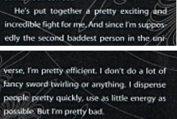
- **Mace Windu** — entry/section: Samuel L. Jackson on Mace's Episode I role vs Episode II (verified on crop): ""Yeah, just kinda' chillin'. Being kind of wise and all-knowing and just sitting around. But you know, I'm up on my feet and doing work now. It's going to be great. You're going to see another side of Mace Windu." —Samuel L. Jackson, Star Wars Insider 55, p. 29" Source: *Star Wars Insider #55* (2001), scan p.21
  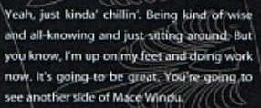

## scan p.22 (scan page 22)

Page contents: Jackson Q&A cont.: Crimson Pirate dream; most fun part is the sense of adventure; Episode II back to the spirit of Episode IV; young girls will love Hayden Christensen; approach unchanged though he read the entire screenplay this time. Caption: Jackson and Lucas discuss action at Fox Studios Australia. Q below. (hand-read)

- **Mace Windu; Yoda** — entry/section: Samuel L. Jackson describing Mace Windu (verified on crop): ""I usually describe Mace as a voice of reason. He thinks before he speaks. He's pretty calculating, mostly even-tempered. And he's not to be trifled with. He knows that the war is coming. I think he has a pretty good idea of who is behind it, but nobody is willing to just step up right now and say exactly who the bad guy is. Everyone is being very cautious. And they're starting to get pretty aggressive about what they need to do to participate in it, or to nip this thing in the bud. He seems to be the second-most-powerful Jedi on that Council, next to Yoda." —Samuel L. Jackson, Star Wars Insider 55, p. 30" Source: *Star Wars Insider #55* (2001), scan p.22
  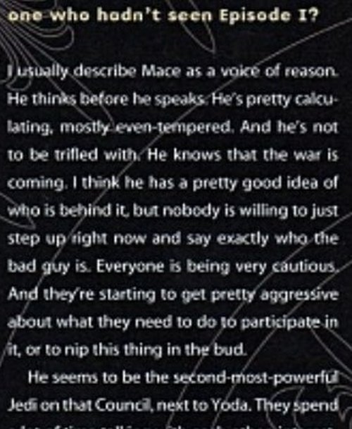

## scan p.23 (scan page 23)

Page contents: Jackson Q&A cont.: Mace's theme would be loyalty; Jedi as protectors of the universe; qualities of a Jedi; Jedi hair joke (no Jedi hair codes); relationships with Obi-Wan, Anakin, and Yoda. Captions: Christopher Lee (Count Dooku) chats with Jackson (Mace Windu) during filming; Jackson listens to Lucas before an important scene. Q below. (hand-read)

- **Mace Windu** — entry/section: Samuel L. Jackson on Mace's view of the story's theme (verified on crop): ""I guess he would talk about loyalty. He would talk about the spirit of mankind, and how people try to band together to make the world a better place, to create some sort of unity, some sort of balance with everyone, that not one person controls everything—trying to create harmony among the people." —Samuel L. Jackson, Star Wars Insider 55, p. 31" Source: *Star Wars Insider #55* (2001), scan p.23
  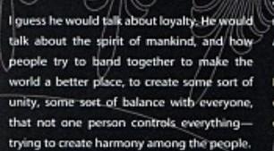
- **Mace Windu; Obi-Wan Kenobi; Qui-Gon Jinn; Darth Vader (Anakin Skywalker)** — entry/section: Samuel L. Jackson on Mace's relationship with Obi-Wan and Anakin (verified on crop): ""With Obi, he's known him for a very long time. He knew Qui-Gon; they were contemporaries. He understood Qui-Gon's faults and admired his qualities, and he sees that Obi-Wan has taken on some of his strong-headedness—number one, by wanting to train Anakin. But Anakin is starting to display some interesting characteristics that need to be watched more closely. Obi-Wan intuitively has sensed that and understands our trepidation at wanting Anakin trained. He's sensing that now. But once he's in the program, per se, I think that we watch him more closely and hope that he'll outgrow those things or intuit that he shouldn't do certain things a certain way." —Samuel L. Jackson, Star Wars Insider 55, p. 31" Source: *Star Wars Insider #55* (2001), scan p.23
  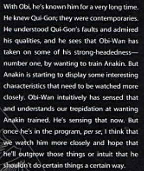
- **Mace Windu; Yoda** — entry/section: Samuel L. Jackson on Mace Windu's relationship with Yoda (verified on crop; continues p. 32): ""I guess they have been in service with each other for a very long time. He's also a student. Yoda is definitely Master, even though Mace is referred to as Master himself. Everyone has a secondary position to Yoda, in some way. We're all under him. We aren't as intuitive, we aren't as strong mentally, and we aren't as strong spiritually. Yoda is incorruptible. He's kind of unfathomable in a lot of ways. But spiritually, Mace and Yoda are kind of in tune. That's why they can talk to each other, and a lot of times almost finish each other's sentences in an interesting kind of way. But Yoda is definitely the stronger and smarter and more spiritual of the two." —Samuel L. Jackson, Star Wars Insider 55, pp. 31-32" Source: *Star Wars Insider #55* (2001), scan p.23
  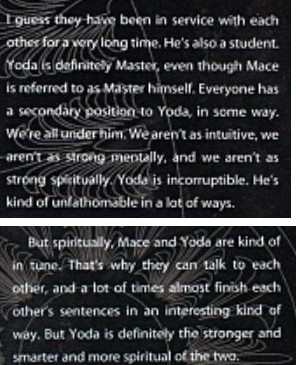

## scan p.24 (scan page 24)

Page contents: Jackson Q&A cont.: Lucas never told him Mace's qualities, let him create the character; campaigned for the role on a London interview show, casting director Robin Gurland; "willing to be a stormtrooper"; experience in London and Australia; high-definition video. Caption: Jackson on the set of Chancellor Palpatine's office. Q below. (hand-read)

- **Mace Windu** — entry/section: Samuel L. Jackson on creating Mace (verified on crop): ""Actually, nothing. Honestly, he never actually told me any of the qualities that Mace had. He never said, "He's from here, he's from there, he's this, he's that." He's allowed me to totally create this character and fill him out in any way that I've seen fit." —Samuel L. Jackson, Star Wars Insider 55, p. 32" Source: *Star Wars Insider #55* (2001), scan p.24
  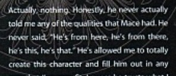

## scan p.25 (scan page 25)

Page contents: Jackson Q&A concl.: 100 percent bluescreen; active imagination from improv theater; reunion with Jimmy Smits; Lucas animated and funny, couldn't work his screening room (son Jett fixed it). Sidebar "Vengeance: The Essential Samuel L. Jackson" filmography list from Ragtime to Episode II. Real-world. (hand-read)

## scan p.26 (scan page 26)

Page contents: Feature opener "Silas Carson: Hero with a Thousand Faces" by Scott Chernoff (A Phantom Menace fan returns to reprise two characters in Episode II: Jedi Ki-Adi-Mundi and Neimoidian Nute Gunray): Carson played four Episode I roles (Ki-Adi-Mundi, Nute Gunray, Lott Dod, Republic Cruiser pilot); UK TV work (Metrosexuality, A&E); voice-over career. T below. (hand-read)

### Stat block notes (game mechanics, not feats)

- Photo caption (verified on crop): The villainous Nute Gunray [ABOVE] and Jedi Knight Ki-Adi-Mundi [RIGHT] are two of the four characters played by actor Silas Carson in Star Wars: Episode I. (Source: *Star Wars Insider #55* (2001), scan p.26)

## scan p.27 (scan page 27)

Page contents: Carson feature cont.: impressed Lucas, McCallum and Gurland; expanded Ki-Adi-Mundi role ventures out on a new mission; Nute Gunray back; got the Nute part after another actor couldn't take the claustrophobia of the Neimoidian costumes. Q below. (hand-read)

- **Ki-Adi-Mundi; Nute Gunray** — entry/section: Silas Carson pull quote (verified on crop): ""You're just one of those cogs in a very mighty machine, and it doesn't always make sense at the time. You have to trust George." —Silas Carson, Star Wars Insider 55, p. 37" Source: *Star Wars Insider #55* (2001), scan p.27
  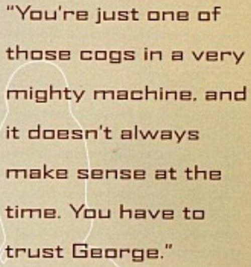

## scan p.28 (scan page 28)

Page contents: Carson Q&A: fight scenes in thick wool costumes and latex, opponents painted in later; lightsaber work with Nick Gillard; playing Ki-Adi as a warrior; no days playing both roles this time. Captions: Carson as Republic Cruiser pilot destroyed by Nute; Carson breathing through a tube between shots; transformation into Viceroy Nute Gunray. Q below. (hand-read)

- **Ki-Adi-Mundi** — entry/section: Silas Carson on playing Ki-Adi-Mundi in a fight (verified on crop): ""It's a very difficult thing to do. I just told myself that he's a Jedi Knight, so he's going to be able to do anything physically that any young person could do. I had to remind myself of that, because obviously sitting in the chair, he looks like an old man, whereas when he gets up and he's wielding his lightsaber, he's going to be as quick as anybody else, because he's a Jedi." —Silas Carson, Star Wars Insider 55, p. 38" Source: *Star Wars Insider #55* (2001), scan p.28
  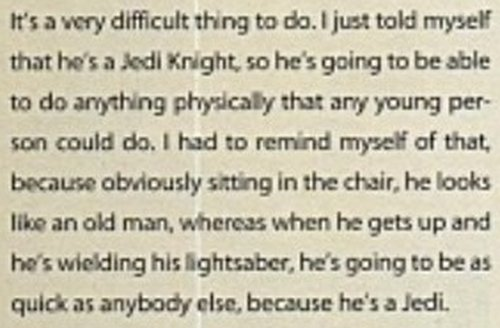
- **Ki-Adi-Mundi** — entry/section: Silas Carson on Ki-Adi's voice mid-fight (verified on crop): ""You want to sound like an old man who's completely in control of his whole system and has 17 different lungs." —Silas Carson, Star Wars Insider 55, p. 38" Source: *Star Wars Insider #55* (2001), scan p.28
  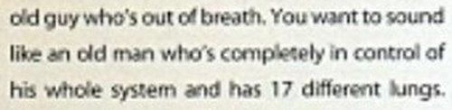

## scan p.29 (scan page 29)

Page contents: Carson Q&A cont.: playing only two characters now; didn't know he'd return until a call in early 2000; heavy disguise makes Nute and Ki-Adi feel like two friends; Lucas kept his slower, older voice for Ki-Adi; has read the Dark Horse comics. Q and T below. (hand-read)

- **Ki-Adi-Mundi** — entry/section: Silas Carson on Ki-Adi-Mundi (verified on crop): ""With Ki-Adi, I enjoy playing this very wise man who is part of the great council. You get the feeling that he is kind of like your uncle, because he's this nice, kind, wise, protective master. I always think that way of him." —Silas Carson, Star Wars Insider 55, p. 39" Source: *Star Wars Insider #55* (2001), scan p.29
  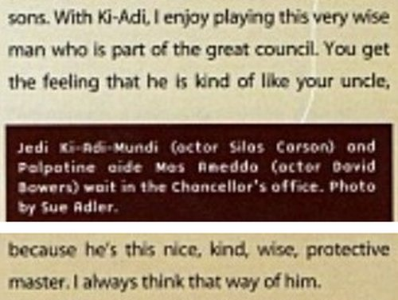
- **Nute Gunray** — entry/section: Silas Carson on Nute Gunray (verified on crop): ""Nute is a completely different character altogether, but he makes me laugh because he's such a coward. He's one of those guys that's always cowering in the background and making a lot of noise, acting up as though he is very big and strong and brave. But he is quite the opposite, and I adore him for that, because there is something dreadfully vulnerable about him." —Silas Carson, Star Wars Insider 55, p. 39" Source: *Star Wars Insider #55* (2001), scan p.29
  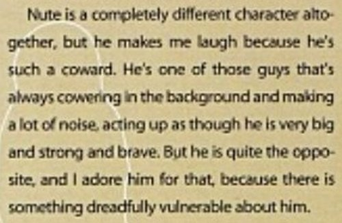
- **Ki-Adi-Mundi** — entry/section: Silas Carson on Ki-Adi's design (verified on crop): ""To me, he looks part Native American and part European, and he's got a wonderful, wise face." —Silas Carson, Star Wars Insider 55, p. 39" Source: *Star Wars Insider #55* (2001), scan p.29
  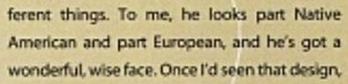

### Stat block notes (game mechanics, not feats)

- Photo caption (verified on crop): Jedi Ki-Adi-Mundi (actor Silas Carson) and Palpatine aide Mas Amedda (actor David Bowers) wait in the Chancellor's office. (Source: *Star Wars Insider #55* (2001), scan p.29)

## scan p.30 (scan page 30)

Page contents: Carson Q&A cont.: returning was like catching up with old mates; filming in Sydney during the Olympics build-up; less pressure than Episode I; Nute application 10-15 minutes, Ki-Adi nearly three hours; skin allergies from Australian glues; Ki-Adi make-up light, Nute costume hot and heavy. T below. (hand-read)

### Stat block notes (game mechanics, not feats)

- Photo caption (verified on crop): Carson reprises the role of Jedi Master Ki-Adi-Mundi from Episode I, only this time fans will get to see him doing a lot more than just sitting around with his friends. (Source: *Star Wars Insider #55* (2001), scan p.30)
- Photo caption (verified on crop): Nute Gunray, Episode I [RIGHT] A familiar pair are back again—and up to no good—in Episode II. Playing the Neimoidian bad guys are returning actor Silas Carson (left) and newcomer David Healey. (Source: *Star Wars Insider #55* (2001), scan p.30)

## scan p.31 (scan page 31)

Page contents: Carson Q&A cont.: canvas leotard with battery packs under Nute's robes; coping with claustrophobia and heat; Nute's voice re-recorded in a Thai accent chosen by Lucas and McCallum; saw Episode I at an L.A. charity preview; "you have to trust George"; bluescreen work about the same; conventions. Real-world. (hand-read)

## scan p.32 (scan page 32)

Page contents: Carson Q&A concl.: conventions let him meet the audience; not previously a sci-fi fan; one day of pick-ups at Ealing; still exciting (Christopher Lee, Temuera Morrison, Jimmy Smits); Sam Jackson "so normal"; TV fame in England ending his anonymity; doesn't know about Episode III. Caption: Carson would take long hours as the Jedi Master over the Neimoidian mask and robes. Real-world. (hand-read)

## scan p.33 (scan page 33)

Page contents: Remembering Brian Daley feature opener (magazine p. 44): tribute to the author of the Han Solo trilogy and the NPR Star Wars radio dramatizations; pull quote from Lucas Licensing editor on his dedication to the trilogy and mythos. (hand-read)

## scan p.34 (scan page 34)

Page contents: Full-page photo of Brian Daley (1947-1996), photos courtesy of James Luceno (magazine p. 45). (hand-read)

## scan p.35 (scan page 35)

Page contents: Daley feature cont. (magazine p. 46): the novels were first expected to be a Luke Skywalker trilogy, then refocused on Han Solo; Daley's personality softened Han's mercenary edges; Lucasfilm moved the books to the Corporate Sector Authority (Espos); six weeks to write the first book. (hand-read)

- **Han Solo** — entry/section: James Luceno on Lucasfilm's continuity restriction for Daley's Han Solo novels (verified on crop): ""Brian's original outline called for Han doing things within the Empire, but Lucasfilm rejected that because they weren't sure what they were going to do in the second movie. So, they wanted Brian to set those books in a different part of the galaxy, someplace that wouldn't break any of the continuity that might be established by the films." —James Luceno, Star Wars Insider 55, p. 46" Source: *Star Wars Insider #55* (2001), scan p.35
  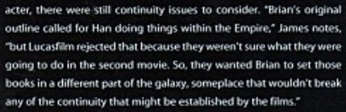

## scan p.36 (scan page 36)

Page contents: Daley feature cont. (magazine p. 47): Han Solo at Stars' End; NPR chose Daley for the 1979-80 radio play for his handling of Han Solo; the radio drama includes a Han confrontation with one of Jabba's hired thugs; pull quote from James Luceno; photo captions (cake celebrating Han Solo at Stars' End). (hand-read)

## scan p.37 (scan page 37)

Page contents: Daley feature cont. (magazine p. 48): Star Wars radio drama poster; Jedi radio drama recorded while Daley had pancreatic cancer; "Daley Affirmation" sidebar transcribes the cast's in-character tribute tape (Leia, Han, Jabba, Salacious Crumb, R2, Luke). (hand-read)

### Stat block notes (game mechanics, not feats)

- "Daley Affirmation" sidebar, Leia's in-character message on the cast's tribute tape (verified on crop): LEIA: (URGENTLY) This is Princess Leia Organa transmitting to Brian Daley on Earth. We seem to be having a bit of a time warp here. Luke seems to be shedding years as he matures into a Jedi Knight and... (Source: *Star Wars Insider #55* (2001), scan p.37)
- "Daley Affirmation" sidebar, Han and Leia exchange on the cast's tribute tape (verified on crop): HAN: (INTERRUPTING) Leia? LEIA: Han? HAN: Are you talking to Brian? LEIA: Uhhuh. HAN: You... You love him, don't you? LEIA: (LONG PAUSE) Well, yes. HAN: (PAUSE) Fine. I understand. When he comes back, I won't get in your way. LEIA: Han, he's the writer. HAN: The writer! Then you weren't... well... but then, Brian isn't...? LEIA: (INTERRUPTING) Why don't you just stop worrying about Brian and... kiss me. HAN: Uh Leia. Uhhh. (HE KISSES THE BACK OF HIS HAND WITH ARDOUR) LEIA: Uhh mhhh. Urgh! Aggh! (GRUNTING & SWEATING FX) (JABBA MUSIC FADES UP UNDER) Get that tongue off me! You vile—thing, you! (SHE LAUGHS, UNABLE TO CONTAIN HER MIRTH ANY LONGER. A REAL PRO.) (Source: *Star Wars Insider #55* (2001), scan p.37)
- "Daley Affirmation" sidebar, Jabba and Salacious Crumb on the cast's tribute tape (verified on crop): JABBA: Yabriannndaley gomm-makikochh. Ggehhht wellll. (HE FALLS ASLEEP, SNORING) SALACIOUS CRUMB: (CACKLES WITH HYSTERICAL MIRTH) (Source: *Star Wars Insider #55* (2001), scan p.37)
- "Daley Affirmation" sidebar, Luke and R2 exchange on the cast's tribute tape (verified on crop): LUKE: Artoo. Prepare to lay a course on the navicomputer. R2: ??*!!? LUKE: What? My part? R2: ! LUKE: No, it's fine. I just took over for another actor. R2: *?? LUKE: No, it doesn't hurt. I won't let it. Okay. Course plotted. Get ready to jump into hyperspace. R2: **? LUKE: That's right. We're going to go to the Baltimore system. I have a promise to keep—to an old friend. Look, actually, I've never met the guy. But do you think I'm going to pass up an opportunity like this... (PROXIMITY ALERT STARS SPEEDING UP) (Source: *Star Wars Insider #55* (2001), scan p.37)

## scan p.38 (scan page 38)

Page contents: Daley feature cont. (magazine p. 49): radio drama poster captions; Anthony Daniels returned as See-Threepio for the Jedi radio drama because of Daley's scripts; a Lucas Licensing editor on working with Daley in 1995; the cast's tribute tape. "Daley Affirmation" sidebar continued (Vader, Emperor, R2, 3PO). (hand-read)

- **C-3PO; Han Solo** — entry/section: Anthony Daniels on Brian Daley's radio writing for Threepio (verified on crop): ""had a real ability to capture Threepio's strange mixture of humorless comedy, his oddly bleak but loving personality. No other writer has been able to do this for Threepio, outside his movie incarnation. Only Brian, at the end of the Ewok storytelling scene, could find a radio way of capturing the droid's deeply felt frustration with Han Solo." —Anthony Daniels, Star Wars Insider 55, p. 49" Source: *Star Wars Insider #55* (2001), scan p.38
  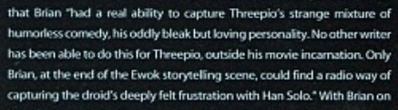

### Stat block notes (game mechanics, not feats)

- "Daley Affirmation" sidebar continued, Vader on the cast's tribute tape (verified on crop): VADER: Greetings, Brian. I kneel before you and await your orders to execute your wish. (FADE BREATHING & MUSIC UNDER) (Source: *Star Wars Insider #55* (2001), scan p.38)
- "Daley Affirmation" sidebar continued, the Emperor on the cast's tribute tape (verified on crop): EMPEROR: (CHILLING ACOUSTIC) Brian... Your overlord the Emperor is pleased... with his lines, and commands you to get well, be well, to stay well... (Source: *Star Wars Insider #55* (2001), scan p.38)
- "Daley Affirmation" sidebar continued, See-Threepio and Artoo close the tribute tape (verified on crop): 3PO: (CALLING) Artoo? Artoo-Detoo? What you doing here, in an empty studio? R2: ** ** * *** * 3PO: Rehearsing for your next scene? But Artoo, we have finished recording Return of the Jedi. R2: *** 3PO: Oh don't be sad, Artoo. We had a lot of fun, didn't we? And all because of Master Brian. R2: *** *** 3PO: Yes. I think he did an excellent job. But... well... I think he gave you rather too many lines. R2: ! 3PO: Just you watch your language! R2: ** *** **! 3PO: Ohh. That is a good idea, Artoo. Um, let me see. Um, um. (TAPS THE MICROPHONE TENTATIVELY) Hello? Um. R2: ** 3PO: Um. Ready? (CONFIDENTLY) Master Brian. Artoo and I want to say that it has been a distinct honor and a joy to work with you. R2: ** 3PO: With our thanks, we send you our very best wishes. (PAUSES, THEN TO ARTOO) There! R2: ***?? 3PO: No, you can't have another retake, Artoo! Oh really! (HIS VOICE FADES AS THEY LEAVE) The trouble with you is, Hollywood has affected your circuits. You have become ridiculously starstru... (A DISTANT DOOR CLOSES BEHIND THEM) (SILENCE) (Source: *Star Wars Insider #55* (2001), scan p.38)

## scan p.39 (scan page 39)

Page contents: Daley feature conclusion (magazine p. 50): Daley died March 1996 aged 48; Luceno on their collaboration (Galaxy Rangers, Robotech, Black Hole Travel Agency) and Daley's lost chance to relaunch the Star Wars novels; reprints of the Han Solo trilogy and radio dramas; pull quote repeats Daniels on Threepio; photo of Luceno, Barbieri and Daley at Tikal, 1994. (hand-read)

- **Luke Skywalker** — entry/section: James Luceno on how Brian Daley would have approached new Star Wars novels (verified on crop): ""He would've tried to give it more of a mythological tone. I'm a fan of Tim Zahn's work, and I think the difference would've been that it wouldn't have been military science fiction, but more of the mythical fantasy that Lucas demonstrated in the films. More quests, more about the Jedi Knights. Have Luke put together a sort of Knights of the Round Table, which Bantam eventually did anyway." —James Luceno, Star Wars Insider 55, p. 50" Source: *Star Wars Insider #55* (2001), scan p.39
  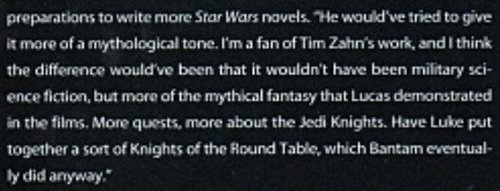

## scan p.40 (scan page 40)

Page contents: Star Wars on The Muppet Show feature opener spread, left page (magazine p. 52): title art with Luke Skywalker (Mark Hamill), C-3PO and Miss Piggy. (hand-read)

## scan p.41 (scan page 41)

Page contents: Muppet Show feature opener, right page (magazine p. 53): "May the Foam be with You" deck about the 1980 episode's first home video release; photo of Chewbacca, Darth Vader-costumed Muppet and pig in space gear. (hand-read)

## scan p.42 (scan page 42)

Page contents: Muppet Show feature (magazine p. 54): the 1980 episode with Luke, C-3PO, R2-D2 and Chewbacca on the planet Koozebane; Labyrinth as the only Lucas-Henson collaboration; group photo caption and pull quote of Miss Piggy's line to Luke Skywalker ("Go along with this or I'll eat you in half"); Muppet performer Dave Goelz on the Muppets and Star Wars heroes. (hand-read)

- **Luke Skywalker; Leia Organa Solo; Han Solo; Chewbacca** — entry/section: Muppet performer Dave Goelz comparing the core Muppets with the core Star Wars heroes (verified on crop): ""They were loyal, and both groups had a very positive message to give. That's different than much of the culture today, but one thing we were able to do in the '70s was be positive and truthful at the same time." —Dave Goelz, Star Wars Insider 55, p. 54" Source: *Star Wars Insider #55* (2001), scan p.42
  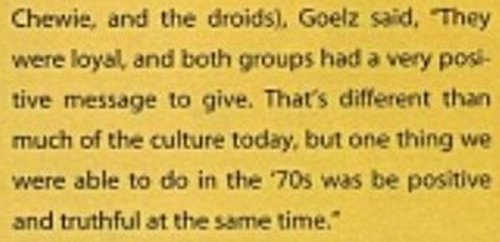

## scan p.43 (scan page 43)

Page contents: Muppet Show feature cont. (magazine p. 55): "In a Vaudeville House Far, Far Away" (Angus McGonagle; Luke, C-3PO and R2-D2 blast into the dressing room); "Gotcha Copy Right Here" box on the Time-Life video; "Every Little Thing Counts" box (Summertime lyrics, non-Star Wars scenes, Chewbacca's "Wookiee Waltz", Hamill and Skywalker as separate characters, Koozebane); caption: Chewbacca and R2-D2 in a dance routine. (hand-read)

- **Luke Skywalker** — entry/section: Dave Goelz on why The Muppet Show wrote Mark Hamill and Luke Skywalker as separate characters (verified on crop): ""Mark Hamill was concerned at the time about being typecast. He was rightfully concerned about being identified forever as Luke Skywalker, so for that reason, they wrote a dual storyline. Our whole stance was, we wanted guest stars to be able to do what they wanted to do." —Dave Goelz, Star Wars Insider 55, p. 55" Source: *Star Wars Insider #55* (2001), scan p.43
  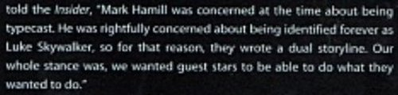
- **Chewbacca** — entry/section: Peter Mayhew on Chewbacca's "Wookiee Waltz" in The Muppet Show episode (verified on crop): ""I have got two left feet." —Peter Mayhew, Star Wars Insider 55, p. 55" Source: *Star Wars Insider #55* (2001), scan p.43
  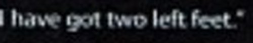

## scan p.44 (scan page 44)

Page contents: Muppet Show feature cont. (magazine p. 56): episode plot (Kermit, McGonagle, C-3PO, Chewbacca kidnapped); "The Muppet Connection" box (taped at ATV Borehamwood near Elstree; Henson first asked to create and perform Yoda; C-3PO and R2-D2 on Sesame Street in 1981); "Anthony Daniels Talks About the Muppets" interview opener (fan of the Muppets). (hand-read)

## scan p.45 (scan page 45)

Page contents: Muppet Show feature cont. (magazine p. 57): Muppet Connection box cont. (Labyrinth, The Dark Crystal, Will Lee and James Earl Jones, Frank Oz, Gonzo/Nader); plot cont. (Mark Hamill as Luke's cousin, Animal); Daniels interview cont. (Muppet Show taping, Miss Piggy and Frank Oz, Oz searching for Yoda's voice, tap-dancing in the gold suit). (hand-read)

- **C-3PO; Yoda** — entry/section: Anthony Daniels on Frank Oz asking how he found C-3PO's voice while Oz was searching for Yoda's (verified on crop): ""I know it was a challenge for Frank to characterize something so old and green. I was very flattered when he asked me how I came up with C-3PO's voice. He was searching for a voice for Yoda at the time, as was George. Of course, being asked for advice by such an accomplished performer hushed me to incoherence. But we talked about believing in the characters we played and their own personalities rather than ours. I don't think I helped much but was delighted when they realized that everything about his voice and his timing was the character." —Anthony Daniels, Star Wars Insider 55, p. 57" Source: *Star Wars Insider #55* (2001), scan p.45
  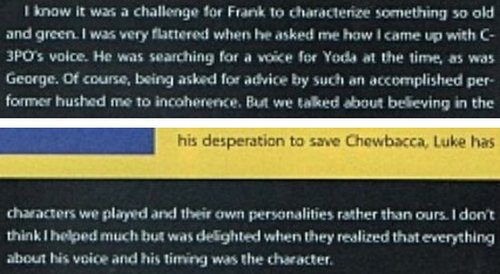

## scan p.46 (scan page 46)

Page contents: Muppet Show feature cont. (magazine p. 58): plot cont. (Swine Trek crew, Derth Nader, crash on Koozebane, Chewbacca's entrance); "Shooting Gonzo into the Canon" box placing the episode before Empire (timing, Luke's Bespin fatigues, Piggy as Leia); Daniels interview cont. (Sesame Street, working with Muppets, puppeteering C-3PO). (hand-read)

- **C-3PO** — entry/section: Anthony Daniels on C-3PO as a puppet in Episode I (verified on crop): ""C-3PO seemed a little awkward to me in Episode I. When I mentioned it to George he said, "What do you expect? He's just been built by an eight year-old!" 'Nuff said. So I did suggest I would puppeteer in this current movie. But I didn't aim to replicate anything from Episode I." —Anthony Daniels, Star Wars Insider 55, p. 58" Source: *Star Wars Insider #55* (2001), scan p.46
  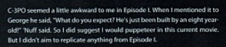

## scan p.47 (scan page 47)

Page contents: Muppet Show feature conclusion (magazine p. 59): canon box cont. (Luke's psychology, Han absent, Derth Nader speculation); closing medley and Luke meeting "cousin" Mark Hamill; Daniels on puppeteering C-3PO for Episode II and the Swine Trek vs. Millennium Falcon; ordering info; author bio. (hand-read)

### Stat block notes (game mechanics, not feats)

- Photo caption from the Muppet Show episode (verified on crop): Luke Skywalker prepares to unleash his secret weapon on Derth Nader—Chewbacca the Wookiee. (Source: *Star Wars Insider #55* (2001), scan p.47)

## scan p.48 (scan page 48)

Page contents: Jedi Knight Shift: Decipher's new Jedi Knights trading card game (magazine p. 60), interview opener with designer Tom Lischke; "The Game in a Databurst" box (two- or four-player game; decks built around Theme characters such as Luke, Han, Vader or Tarkin; control of four planets; Final Conflict). (hand-read)

## scan p.49 (scan page 49)

Page contents: Jedi Knights TCG interview cont. (magazine p. 61): "The Cardface Deciphered!" diagram on a Boba Fett card; "Character" and "Theme" boxes (first four Theme cards Han, Luke, Vader and Tarkin); Gamorrean guard and Han Solo theme card images (card text too small to read). (hand-read)

### Stat block notes (game mechanics, not feats)

- Boba Fett card lore text in "The Cardface Deciphered!" diagram (verified on crop): Boba Fett has the trophies and scars to prove he is the most feared bounty hunter in the galaxy. Ruthlessly efficient. (Source: *Star Wars Insider #55* (2001), scan p.49)

## scan p.50 (scan page 50)

Page contents: Jedi Knights TCG interview cont. (magazine p. 62): "Starship", "Force" and "Locations (Sites & Systems)" boxes; worked combat example with Boba Fett attacking Obi-Wan while a Jawa and a Stormtrooper support; why the game plays fast. (hand-read)

## scan p.51 (scan page 51)

Page contents: Jedi Knights TCG interview conclusion (magazine p. 63): complexity versus Star Wars CCG; why a third Decipher game; starter decks; "Event" and "Weapon" boxes; the game sticks with the classic trilogy period for now; card images (Vader weapon card, Tatooine event card) and R2-D2 render. (hand-read)

## scan p.52 (scan page 52)

Page contents: Comics Link: "Top 10 Reasons to Try the Tales" by Lee Dawson (magazine p. 74; the scan jumps from magazine p. 63 to p. 74): Star Wars Tales as a non-continuity comic; reasons 1-4 (Tales #1 with Vader hunting the Dark Woman and "Skippy the Jedi Droid"; the Tales #6 cover of Vader holding C-3PO's head; Boba Fett in love in Tales #7; Kevin Rubio's "A Death Star Is Born" and "Force Fiction" with Yoda and Mace Windu). (hand-read)

## scan p.53 (scan page 53)

Page contents: Top 10 Tales cont. (magazine p. 75): reasons 5-10 (Ewoks in underwear; truly short stories incl. Qui-Gon and Obi-Wan in "Life, Death, and the Living Force"; artistic diversity; Yoda wielding a lightsaber in "The Hidden"; character coverage incl. Greedo, Mara Jade, Amidala, Grissom the Gamorrean; Vader vs. Maul); pull quote; panel captions. (hand-read)

## scan p.54 (scan page 54)

Page contents: Bookshelf: "Serving Darth Sidious" by Jason Fry, profile of author James Luceno (magazine p. 76): his apprenticeship with Brian Daley; Agents of Chaos (an older, grief-stricken Han Solo); Cloak of Deception (Valorum, Palpatine, Qui-Gon and Obi-Wan); the e-book Darth Maul: Saboteur. (hand-read)

- **Han Solo** — entry/section: James Luceno on writing an older Han Solo in Agents of Chaos (verified on crop): ""I was challenged to show him not only older but in a situation in which he's somewhat grief-stricken and isolated from Leia and his family." —James Luceno, Star Wars Insider 55, p. 76" Source: *Star Wars Insider #55* (2001), scan p.54
  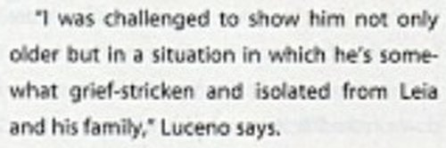

## scan p.55 (scan page 55)

Page contents: Luceno profile cont. (magazine p. 77): Maul as trickster in Saboteur; Han meets characters from Daley's books in Hero's Trial and Jedi Eclipse; tribute to Daley; travel and Latin America; pull quote; James Luceno bibliography box. (hand-read)

- **Darth Maul; Palpatine (Darth Sidious)** — entry/section: James Luceno on getting inside Darth Maul's head for Saboteur (verified on crop): ""I just portrayed [Maul] completely introspectively—I was trying to imagine what it's like serving someone like Sidious." —James Luceno, Star Wars Insider 55, p. 77" Source: *Star Wars Insider #55* (2001), scan p.55
  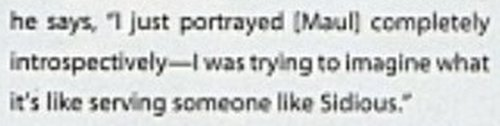

## scan p.56 (scan page 56)

Page contents: Gamescape: "Something Wicked This Way Comes", review of Wizards of the Coast's Dark Side Sourcebook by Jesse Decker (magazine p. 78): dark side rules, skills, feats and prestige classes (Emperor's Hand, Sith Lord); book cover art. (hand-read)

## scan p.57 (scan page 57)

Page contents: Dark Side Sourcebook review cont. (magazine p. 79): Gamemaster advice and Sith equipment; pull quote; "Chapter-by-Chapter Summary" box (history from 25,000 years before Yavin, playing and gamemastering the dark side, equipment, traditions incl. Naga Sadow, Darth Maul and the Sorcerers of Tund, creatures, campaigns); large art spread. (hand-read)

## scan p.58 (scan page 58)

Page contents: Dark Side Sourcebook review conclusion (magazine p. 80): dark side villains, Sith creatures, Nightsisters of Dathomir, the Dagobah cave, Sith empire era; "A Sampling from the Dark Side Online Art Gallery" with caption on renditions of Darth Bane, dark side spirits, a duelling Jedi and a bounty hunter taking down a Jedi. (hand-read)

## scan p.59 (scan page 59)

Page contents: Dark Side art gallery cont. (magazine p. 81): top-right caption on D. Alexander Gregory's prestige-class illustrations (Imperial Inquisitor, Sith Cultist, red-cloaked Sith witch, darksider Gethzerion); bounty hunter vs. Jedi art. (hand-read)

## scan p.60 (scan page 60)

Page contents: HoloNet: "Surfing with Starwars.com" by Paul Ens (magazine p. 82): hidden starwars.com content - Homing Beacon archive, the "A Gift to Soothe the Savage Beast" Flash short with R2-D2 in the Wampa caves of Hoth, "The One Abroad" international Episode I campaign (Malaysian bus with Queen Amidala), Making of Episode I featurettes. (hand-read)

## scan p.61 (scan page 61)

Page contents: Starwars.com feature cont. (magazine p. 83): Anatomy of a Dewback; Podracing Tales web comic (sabotage and rivalries around young Anakin before the Boonta Eve Podrace); Urban Legends of Star Wars; Celebration 1999 coverage; pull quote; captions. (hand-read)

## scan p.62 (scan page 62)

Page contents: Set Piece: "Hoth Echo Base Main Hangar" by Chris Reiff & Chris Trevas (magazine p. 84): building the Rebel hangar set at EMI-Elstree in 1979, the full-size Millennium Falcon (80 feet, 23 tons), snowspeeders by Ogle Design; callout: a pilot's helmet first worn by Gold Leader's lost wingman Tiree during the battle of Yavin; Rebel pilot helmet callout. (hand-read)

## scan p.63 (scan page 63)

Page contents: Hoth hangar set piece cont. (magazine p. 85): top-right pull quote from director Irvin Kershner on Chewbacca welding; callouts (astromech R4-M9 first seen aboard Tantive IV; hydraulic lift for lightbulbs; fake snow shared with The Shining; ski goggles; duckboard; blasters from modified MG34 rifles). (hand-read)

- **Chewbacca** — entry/section: Director Irvin Kershner on why Chewbacca works with a welding torch on the Falcon (verified on crop): ""Do you know why I had Chewbacca work with a welding torch on the Falcon? That was the only thing I could find where you could see what he was doing. If he was screwing something with a tool, you wouldn't see anything. So whenever anything needs fixing, you'll notice the characters are welding!" —Irvin Kershner, Star Wars Insider 55, p. 85" Source: *Star Wars Insider #55* (2001), scan p.63
  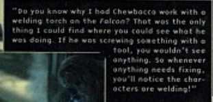

## scan p.64 (scan page 64)

Page contents: Scouting the Galaxy: "Bootleggers' Revenge? Artistic Homage" by Steve Sansweet (magazine p. 86): Toy Fair intro (Hasbro, Gentle Giant laser-scanned Episode II busts); collector letter on authenticating a Revenge of the Jedi advance poster; poster image (letter-writer names omitted). (hand-read)

## scan p.65 (scan page 65)

Page contents: Scouting the Galaxy cont. (magazine p. 87): answer on bootleg Revenge posters; letter on a second Revenge poster; letter and answer on the Star Wars Encyclopedia cover showing Luke with a red-bladed and Vader with a blue-bladed lightsaber (Struzan's original poster coloring); top-right pull quote from that letter; letter asking for Hoth/Dagobah playset plans (letter-writer names omitted). (hand-read)

- **Luke Skywalker; Darth Vader (Anakin Skywalker)**: "It shows Luke Skywalker and Darth Vader in a lightsaber duel." Source: *Star Wars Insider #55* (2001), scan p.65
  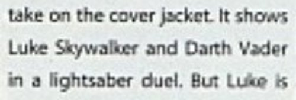

## scan p.66 (scan page 66)

Page contents: Scouting the Galaxy cont. (magazine p. 88): answer on Woman's Day playset plans and Outer-Space Station; letter and answer on vintage Star Wars, Empire and Jedi wallpaper; Outer-Space Station top-left box; submission box. Scan jumps from magazine p. 88 to p. 90. (hand-read)

## scan p.67 (scan page 67)

Page contents: Rebel Rumblings letters cont. from p. 6 (magazine p. 90): letters with editor's joking replies (Owen Lars is not Ben Kenobi's brother; Jar Jar Binks; Ewok films on video); "Dr. Jones, I Presume?" fan Indiana Jones costume photo; James Earl Jones star-sighting letter header (letter-writer and fan names omitted). (hand-read)

## scan p.68 (scan page 68)

Page contents: Rebel Rumblings cont. (magazine p. 91): reader star-sighting letter on James Earl Jones delivering his 2001 Kentucky Derby Festival luncheon speech in character as Darth Vader, escorted by 501st Legion stormtroopers; "The Immaculate Mr. Jones" photo caption; editor reply; collector letter on the Carbon Freeze Chamber and editor reply (Tatooine's two suns joke) (letter-writer and fan names omitted). (hand-read)

- **Darth Vader (Anakin Skywalker)** — entry/section: James Earl Jones, speaking in character as Darth Vader at the 2001 Kentucky Derby Festival, as reported in a reader letter (verified on crop): ""I was born Anakin Skywalker. I was trained under the great Jedi Master, Obi-Wan Kenobi. I fought many glorious battles, but I lost my battle with the dark side of the Force. I also lost much of my humanity to machines after falling into a molten pit of lava. After that, I could not even breathe on my own." —James Earl Jones (in character as Darth Vader), Star Wars Insider 55, p. 91" Source: *Star Wars Insider #55* (2001), scan p.68
  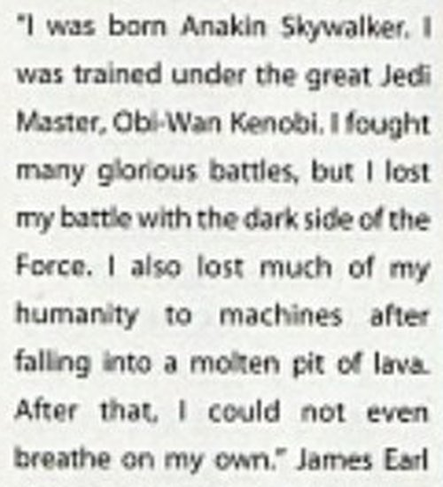
- **Darth Vader (Anakin Skywalker); Luke Skywalker; Leia Organa Solo** — entry/section: James Earl Jones, in character as Darth Vader, on Luke and Leia as the hope of the future, as reported in a reader letter (verified on crops): ""I am the key to the future. I know you thought I was going to say some hero figure like Captain Kirk, but the future cannot be saved by James T. Kirk. I, Darth Vader, am the hope of the future. Why? My children, Luke and Leia, had the courage to do what I did not do. They resisted temptation; they did not fall to the easy, evil way of the dark side. They had the courage to fight for the Light! They stood and fought for justice, freedom, and right. They even helped me change my ways. There is the hope for the future. Yes, you see the answer lies within my children. I am here today to tell you, in that respect, you are all my children." —James Earl Jones (in character as Darth Vader), Star Wars Insider 55, p. 91" Source: *Star Wars Insider #55* (2001), scan p.68
  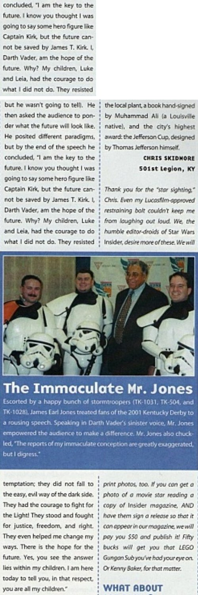

## scan p.69 (scan page 69)

Page contents: Rebel Rumblings cont. (magazine p. 92): fan letter praising Insider; letter on Burger King Empire cups; letter reading The Phantom Menace as an inverted American Revolution allegory, with editor reply; "Dog Fight" fan photo caption; letter complaining about subscription delivery and too many interviews (letter-writer and fan names omitted). (hand-read)

## scan p.70 (scan page 70)

Page contents: Rebel Rumblings cont. (magazine p. 93): editor reply on subscriptions and balance of interviews/articles; letter praising the Palpatine/Ian McDiarmid article; letter on writing Star Wars stories and whether Luke and Leia learn about their mother, with editor reply; letter criticizing Leia's portrayal as wife and mother in the Zahn-era novels; "Did I Say THAT?!?" caption on actress Michonne Bourriague (Aurra Sing) (letter-writer names omitted). (hand-read)

## scan p.71 (scan page 71)

Page contents: Rebel Rumblings cont. (magazine p. 94): end of the Leia letter and editor reply defending Leia's novel roles as mother and leader; fan engagement photo caption with editor joke referencing Jason, Jaina and Anakin; letter from a fan in a homemade Darth Vader costume asking for more fan content, with editor reply (letter-writer and fan names omitted). (hand-read)

## scan p.72 (scan page 72)

Page contents: "Vaderesque" (magazine p. 95): a reader's homemade Darth Vader costume with head-to-toe parts rundown (modified Don Post helmet, placemat armor, craft-store chest box and belt boxes, thrift-store cape); photos (fan name omitted). (hand-read)

## scan p.73 (scan page 73)

Page contents: "Dear 2-1B" humor column (magazine p. 96): contributing editor Scott Chernoff's note introducing medical assistant droid FX-7 as co-columnist; reader letter scolding 2-1B; 2-1B's in-character reply belittling Chewbacca and George Lucas's casting; FX-7's polite reply begins; illustrations by Stan Shaw (letter-writer names omitted). T below for 2-1B's in-character statements. (hand-read)

### Stat block notes (game mechanics, not feats)

- "Dear 2-1B" column, 2-1B's in-character answer on Chewbacca (verified on crop): Who would you put in the lead role – the medical droid who saves the universe by bailing Luke Skywalker out of his self-inflicted "crises," or the overgrown ape who follows Han Solo around like a hairy magnet? Yes, I'm talking about Chewbacca, the "mighty Wookiee." Yeah, real mighty, alright. Mighty SMELLY. Obviously, when it comes to the success of the story, Chewie, a co-pilot, contributed less than I, the lead doctor on the surgical procedures that saved a Rebellion. Chewie was to Solo what empty-circuited medical assistant droid FX-7 was to me: an assistant, and NOTHING more. You'll also agree that I'm a more engaging character than Chewie, too: I can talk. (Source: *Star Wars Insider #55* (2001), scan p.73)

## scan p.74 (scan page 74)

Page contents: "Dear 2-1B" cont. (magazine p. 97): FX-7's gentle reply recommending Episode I; second reader letter asking 2-1B for Rebellion stories; 2-1B's insulting reply calling himself the glue of the saga; FX-7's reply about assisting 2-1B in treating Luke and praising the Special Edition "Jedi Rocks"; "Need Advice?" address box (letter-writer names omitted). T below. (hand-read)

### Stat block notes (game mechanics, not feats)

- "Dear 2-1B" column, 2-1B's in-character answer on his place in the saga (verified on crop): And when you do read, [name omitted], you will read stories of heroism that will blow your mind, and you will wonder, when will the lackeys at Star Wars Insider, who stick me in the last pages of the magazine where only nerds and little kids are still reading, realize and accept that I am an integral part of this saga, the glue that holds the fabric of the Star Wars universe—and hence, their little magazine—together? (Source: *Star Wars Insider #55* (2001), scan p.74)
- "Dear 2-1B" column, medical assistant droid FX-7's in-character answer on treating Luke (verified on crop): I guess if I had to pinpoint one event that was important in my career, it was assisting 2-1B in the treatment of a very important Rebel leader, who shall go nameless due to doctor-patient confidentiality. (After all, I don't know if Luke wants everyone to know he has a fake hand.) But I'll just say that it was a true honor to contribute in even a tiny way on some routine procedures for a very good and nice Jedi Knight. (Source: *Star Wars Insider #55* (2001), scan p.74)

## scan p.75 (scan page 75)

Page contents: Full-page illustration by Jay Stephens (magazine p. 98): a giant C-3PO head idol in the Endor forest with an Ewok holding a spear, a plate of fruit, and stormtrooper helmets used as drums. No text besides credit. (hand-read)

## scan p.76 (scan page 76)

Page contents: Back cover ad (unnumbered): Del Rey/LucasBooks Star Wars novels - New Jedi Order paperbacks incl. Balance Point by Kathy Tyers, a phrase book trade paperback, Star by Star by Troy Denning (coming November), Cloak of Deception by James Luceno (prequel novel); delreydigital.com. (hand-read)

