# Owner Material 038 — Star Wars Insider #1–153 plus specials (with The Lucasfilm Fan Club Magazine #1–22): Star Wars Insider #56 (2001)

- **Source:** *Star Wars Insider* magazine (issues 23–153, 1994–2014) and its predecessor *The Lucasfilm Fan Club Magazine* (issues 1–22, 1987–1994), plus seven special editions: articles, interviews, comics and short fiction Secondary source (licensed Legends reference). Scan OCR'd on the box; the scan stays box-only and is **not** published.
- **Method:** every scanned page was OCR'd and machine-screened sentence by sentence for power-relevant statements (fights, kills, defeats, Force feats, rankings, superweapons) that name a character on our roster; each kept sentence is quoted verbatim from the OCR text and has a crop of the printed passage directly under it. Pages with nothing power-relevant are still listed with what is on them.
- **Citation:** "*Star Wars Insider #56* (2001), p.X" by printed page ("scan p.X" where no printed number applies). **Weight:** Licensed magazine: a secondary source. Its short fiction and comics are Legends stories; its articles and interviews sum up or discuss lore and rank below the novels, comics and games they describe.

## scan p.1 (scan page 1)

Page contents: Cover: Star Wars Insider (issue 56) "Behind the Episode I The Phantom Menace DVD" - 7 new scenes plus many extras, exclusive interviews and photos; Qui-Gon Jinn and Obi-Wan Kenobi on a cable in the waterfall escape; banners "Jay & Silent Bob Strike Back!", "Attack of the Clones"; "Interviews with Ahmed Best & Anthony Daniels". (hand-read)

## scan p.2 (scan page 2)

Page contents: Contents "Insider 56" (magazine p. 2): features - DVD Sneak Peek (p. 25), Ahmed Best interview (p. 38), Anthony Daniels interview (p. 44), Unseen Planets of Episode I by Daniel Wallace (p. 52), Kevin Smith flip-cover interview; "On the Covers" box (Ewan McGregor and Liam Neeson in the waterfall escape; Kevin Smith); young Anakin photo. (hand-read)

## scan p.3 (scan page 3)

Page contents: Departments list and editorial "Who Runs This Show? Overworked and Underpaid, But They Know Their Stuff" by outgoing editor-in-chief Chris Perkins (magazine p. 3): top-right "Yut chda!" box on his move to the Roleplaying Game; staff introductions with joking favorite-character notes (Greedo, Han Solo/Chewbacca, dianoga, Darth Vader); new editor Dave Gross. No in-universe character material. (hand-read)

## scan p.4 (scan page 4)

Page contents: Masthead and Rebel Rumblings (magazine p. 4): "a Jawa picks this month's letters" intro; letter asking why Anakin left C-3PO on Tatooine, editor reply about their destinies; letter to 2-1B mocking C-3PO, editor reply; letter about the Indiana Jones flip cover; top-right Episode I still with gag balloon "Seeya!"; "Wanna Rumble?" address box (letter-writer names omitted). (hand-read)

## scan p.5 (scan page 5)

Page contents: Prequel Update: "Episode II Prequel Update with Rick McCallum [Producer]" conducted July 2001 by Dan Madsen (magazine p. 8): progress on Episode II (ILM about 200 effects shots, miniatures, Eric Brevik's work), number of cuts, first trailer due in the fall; photos of Anthony Daniels in a Coruscant nightclub and Hayden Christensen as Anakin in an apartment set. (hand-read)

- **Darth Vader (Anakin Skywalker); Padmé Amidala** — entry/section: Producer Rick McCallum on the state of Episode II (verified on crop): ""Things are going really well. We're just moving along nicely. I think the film looks fantastic. The relationship between Anakin and Padmé is terrific, and the visual effects are superb." —Rick McCallum, Star Wars Insider 56, p. 8" Source: *Star Wars Insider #56* (2001), scan p.5
  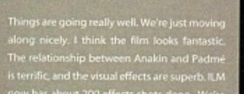

## scan p.6 (scan page 6)

Page contents: Prequel Update cont. (magazine p. 9): full-page photo of Natalie Portman as Padmé in a white cape on a platform; captions (Republic officer played by Anthony Daniels in a Coruscant nightclub; "Padmé Amidala finds herself in one of many of Episode II's harrowing predicaments"). (hand-read)

## scan p.7 (scan page 7)

Page contents: Prequel Update cont. (magazine p. 10): McCallum on the intensity of production and daily meetings with George Lucas; photos/captions of a young Jedi trainee in the Jedi Temple, Ewan McGregor as Obi-Wan Kenobi, and Obi-Wan with R4-P17 aboard the Jedi starfighter at Fox Studios Australia. (hand-read)

## scan p.8 (scan page 8)

Page contents: Prequel Update cont. (magazine p. 11): McCallum on meetings with Lucas and not yet discussing Episode III; captions (break between takes with McCallum, John Knoll, George Lucas, Natalie Portman; stunt coordinator Nick Gillard with Samuel L. Jackson (Mace Windu) and Ewan McGregor (Obi-Wan)); continued on p. 14. (hand-read)

## scan p.9 (scan page 9)

Page contents: "George Lucas Select [Images Hand-Picked by the Director]" (magazine p. 12): Episode II photos first posted on starwars.com - Mace Windu (Samuel L. Jackson) on bluescreen, an animatic starship by Matthew Ward, a Tatooine-like location shoot, cloaked figures in an apartment, a staircase set; intro box. (hand-read)

## scan p.10 (scan page 10)

Page contents: George Lucas Select cont. (magazine p. 13): headdress/costume sketches, bluescreen stunt shot, and Hayden Christensen reclining photo; title "George Lucas Select". No text beyond credits. (hand-read)

## scan p.11 (scan page 11)

Page contents: Prequel Update cont. (magazine p. 14): top pull quote from McCallum ("There is nothing major that has caused us to stumble on this film—it's just very intense."); Q&A on early prep for Episode III (Lucas to start writing in late summer), additional shooting fall 2001/spring 2002; captions (Temuera Morrison as Jango Fett at the controls of Slave I; Obi-Wan on a secret mission; Obi-Wan beside his Jedi starfighter in the rain). (hand-read)

## scan p.12 (scan page 12)

Page contents: Prequel Update conclusion (magazine p. 15): McCallum on fan sites, Episode II "unique to itself", travel, sailing, his Rick McCallum doll; captions (George Lucas with Rose Byrne (handmaiden Dormé) and Natalie Portman (Padmé) on a public speeder bus set; Padmé in subdued colors traveling incognito); large Padmé headdress photo. (hand-read)

## scan p.13 (scan page 13)

Page contents: Star News "From the World of Lucasfilm" by Sue Weinlein Cook (magazine p. 16): "Willow Comes to DVD November 27, 2001" - Special Edition DVD features, plot summary (Willow, Madmartigan, Queen Bavmorda, Elora, Sorsha), Warwick Davis photo, battle still. Non-Star Wars. (hand-read)

## scan p.14 (scan page 14)

Page contents: Star News cont. (magazine p. 17): "British Film Academy to Salute Lucas at Britannia Awards" (Stanley Kubrick Britannia Award; Smithsonian committee); "Star Wars Episode II Attack of the Clones" title announcement box (title announced August 6). No in-universe character statements. (hand-read)

## scan p.15 (scan page 15)

Page contents: "Star Sightings: Neeson in Asylum, Lucas Attends Playboy Mansion Bash" (magazine p. 20; scan skips magazine pp. 18-19): actor news - Liam Neeson (Gangs of New York, Asylum), Ben Affleck on Harrison Ford's blessing for Jack Ryan, AFI 100 Thrills list, Lucas at the Playboy Mansion Monroe event, Jeremy Bulloch cast in Nature's Guard, Natalie Portman in FHM, Denis Lawson in The Fabulous Bagel Boys, Indiana Jones writer rumors, David Prowse hospitalized. (hand-read)

## scan p.16 (scan page 16)

Page contents: Star Sightings cont. (magazine p. 21): Ewan McGregor singing in Moulin Rouge (quotes from Baz Luhrmann, Nicole Kidman, McGregor), Black Hawk Down, Young Adam, Kritkers; "Legal Battle Heats up over Ford-Neeson Cold War Film" (K-19: The Widowmaker lawsuit); photos. (hand-read)

## scan p.17 (scan page 17)

Page contents: Star News "Comlink: Welcome to 'Community Link,' or 'Comlink' for short" (magazine p. 22): Star Wars Weekends at Disney-MGM Studios, Orlando - actors Kenny Baker, Carrie Fisher, Peter Mayhew, Jeremy Bulloch, Warwick Davis, Phil Brown signing autographs and leaving handprints; costumed motorcade (Emperor, Vader, Boba Fett, Tusken Raiders, Jawas, stormtroopers); Bulloch comment on the event; Doug Chiang; photo gag captions about fans and costumed characters (editorial jokes). (hand-read)

## scan p.18 (scan page 18)

Page contents: Star Wars Weekends cont. (magazine p. 23): photo captions (Ewok and Chewbacca costumers, Mayhew and Fisher handprints, stormtrooper on the park globe, Vader leading kids with toy lightsabers); attraction list - costumers, face painting, Star Tours, Galactic Games, "Behind the Force" presentation with hint "Senator Palpatine is more than he seems," Hyperspace Hoopla street party, Obi-Wanna-Be Jedi training. (hand-read)

## scan p.19 (scan page 19)

Page contents: Star Wars Weekends conclusion (magazine p. 24): kids' lightsaber duel with Vader, Tatooine Traders store, 2002 plans; captions (Kenny Baker with Vader helmet; Phil Brown and Mike Quinn handprints); Star Sightings continuation on the K-19: The Widowmaker lawsuit and National Geographic documentary; box on Weezer's Green Album guitar stickers (R2-D2, Chewbacca, C-3PO, Darth Vader) and Travis musician quote comparing music to the X-wing in the Death Star. (hand-read)

## scan p.20 (scan page 20)

Page contents: "Behind the Episode I DVD: The Phantom Menace" opener (magazine p. 25): title page, "U.S. Release - October 16, 2001," byline Ron Magid, Ted A. Bohus & Terry Coleman; Darth Maul eyes background and film-strip frames. (hand-read)

## scan p.21 (scan page 21)

Page contents: Episode I DVD feature (magazine p. 26): "Oie Boie! It's Finally Here!" intro; filmstrip header "Anakin's Scuffle with Greedo - Cut Scene No. 6" with caption on Wald (Warwick Davis) leaping from his perch and a young Rodian named Greedo; "Something for the Fans" interview with Lucasfilm VP of Marketing Jim Ward by Ron Magid begins - why the DVD took so long, Lucas finishing seven deleted scenes. (hand-read)

## scan p.22 (scan page 22)

Page contents: Jim Ward interview cont. (magazine p. 27): 20 minutes of new footage, why bluescreen scenes had to be completed by ILM, THX involvement, the hour-long documentary "The Beginning" by Jon Shenk; "Air Taxi - Cut Scene No. 4" filmstrip with caption on Anakin (Jake Lloyd) and an air taxi driver above Coruscant. (hand-read)

## scan p.23 (scan page 23)

Page contents: Jim Ward interview cont. (magazine p. 28): Lynne's Diary web documentaries and featurettes, first-ever Lucas/McCallum/ILM audio commentary, still gallery, international posters, storyboard-animatic-film comparisons (underwater sequence and Podrace lap one), DVD-ROM web link; "Dawn Before the Race - Cut Scene No. 5" filmstrip with caption on Padme (Natalie Portman) at a Tatooine sunrise speaking with Anakin before the Boonta Eve podrace. (hand-read)

## scan p.24 (scan page 24)

Page contents: Jim Ward interview conclusion and "65 Minutes: An Interview with Jon Shenk, Maker of the Star Wars Episode I Documentary" by Ron Magid begins (magazine p. 29): how Shenk was hired to organize ~100 hours of behind-the-scenes footage begun in late 1994; "Farewell to Jira - Cut Scene No. 7" filmstrip with caption on Anakin giving podrace proceeds to his friend Jira (Margaret Towner). (hand-read)

## scan p.25 (scan page 25)

Page contents: Jon Shenk interview cont. (magazine p. 30): Lucas wanting footage organized, Shenk's hiring via Stanford, Lynne's Diaries web docs, cinema verite approach; "The Waterfall - Cut Scene No. 3" filmstrip with caption on Liam Neeson (Qui-Gon) firing an imaginary grappling hook surrounded by bluescreen never filled in until the DVD release. (hand-read)

## scan p.26 (scan page 26)

Page contents: Jon Shenk interview conclusion (magazine p. 31): early animatics and proto-Jar Jar footage, Ben Burtt shooting an early Jar Jar puppet, Lucas's first ILM meeting, Ewan McGregor's haircut scene, cutting the documentary to 65 minutes, Shenk's all-access pass; caption on McGregor and Neeson making their way along a cable during the waterfall escape sequence. (hand-read)

## scan p.27 (scan page 27)

Page contents: "Sabre Man: An Interview with Pablo Helman, ILM's Sabre Department Supervisor" by Ted A. Bohus (magazine p. 32): career, Sabre compositing system, matching Episode I lightsabers and first hologram to the original trilogy, working on the DVD deleted scenes; the waterfall sequence with Qui-Gon, Jar Jar and Obi-Wan; "Extended Race, Lap 2 - Cut Scene No. 2" filmstrip. (hand-read)

## scan p.28 (scan page 28)

Page contents: Helman interview cont. (magazine p. 33): waterfall scene description (ship lost over the falls, about three minutes); extra Podrace lap; new pre-race characters including racer Ratts Tyerell and his family ("Ratts is one of the racers who gets killed"), announcer; seven new scenes; 220 new shots in six months. (hand-read)

- **Darth Vader (Anakin Skywalker)** — entry/section: Pablo Helman on the extended Podrace on the Episode I DVD: ""Yes, we added one more lap to the race. In the original movie there were two laps; now there's three laps. There are additional things that happen to Anakin in that lap." —Pablo Helman, Star Wars Insider 56, p. 33" Source: *Star Wars Insider #56* (2001), scan p.28
  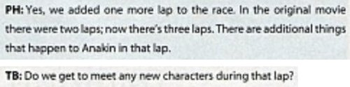

## scan p.29 (scan page 29)

Page contents: Helman interview conclusion (magazine p. 34): Lucas pleased with the DVD, Episode II about 2,200 effects shots shot in high definition; "Ranch on the Side: Wined, Dined, and Digitally Remastered with Episode I on DVD" by Terry Coleman begins - Skywalker Ranch press event, Rick Dean and Van Ling on piracy; "Complete Podrace Grid Sequence - Cut Scene No. 1" filmstrip. (hand-read)

## scan p.30 (scan page 30)

Page contents: "Ranch on the Side" conclusion and "Finishing Touches: An Interview with Jon Alexander, ILM's Composite Supervisor" by Ted A. Bohus begins (magazine p. 35): image quality over DTS sound, McCallum opening-night stories, Lucas on digital editing and "virtual" actors; Alexander on over 200 shots revisited, mostly re-editing the Podrace. (hand-read)

- **Jar Jar Binks** — entry/section: Lucas, asked about so-called "virtual" actors from Jar Jar to Final Fantasy's Aki: ""The whole debate over this issue is ludicrous, because there is no such thing as a virtual actor." He then described how all of these characters were the creation not of a computer, but of very human artists, engineers, editors and directors, who achieve their results with craft, inspiration and talent. "No computer will be able to be an actor," said George, "until you have an AI able to think and react in as quirky a manner as a human. And that won't happen in our lifetimes." —George Lucas (reported by Terry Coleman), Star Wars Insider 56, p. 35" Source: *Star Wars Insider #56* (2001), scan p.30
  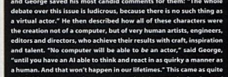

## scan p.31 (scan page 31)

Page contents: "Finishing Touches" Jon Alexander interview conclusion (magazine p. 36): building new scenes from animatics and real plates, blooper reel with characters pretending to be actors, the composite supervisor's job of matching grain, contrast and lighting, added scenes on the Jedi Council planet; filmstrip. (hand-read)

## scan p.32 (scan page 32)

Page contents: "Jar Jar Binks Take 2: An Interview with Ahmed Best" by Helen Keier opener (magazine p. 38; scan skips magazine p. 37): large Jar Jar image; intro on Jar Jar's lasting impression and Best enjoying Episode I as a new experience. (hand-read)

## scan p.33 (scan page 33)

Page contents: Ahmed Best interview cont. (magazine p. 39): excitement over discovering Jar Jar, rewatching The Phantom Menace for the Maul-Obi-Wan fight, Buster Keaton-influenced moves in Jar Jar's battle-droid melee, praise for Liam Neeson; caption on Best and Stunt Coordinator Nick Gillard filming "The Lowdown with Nick Gillard" for starwars.com's On Location. (hand-read)

- **Jar Jar Binks** — entry/section: Ahmed Best on discovering Jar Jar in Episode I: ""I was so excited about what Jar Jar was going to look like, how he was going to move, how he was going to be completed, and now I pretty much know that. I still love playing the character, just the nuance, and the discovery of him." —Ahmed Best, Star Wars Insider 56, p. 39" Source: *Star Wars Insider #56* (2001), scan p.33
  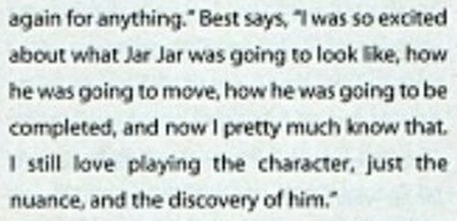

## scan p.34 (scan page 34)

Page contents: Ahmed Best interview cont. (magazine p. 40): pull quote on positive feedback; letters from children; Episode II easier with Rob Coleman and John Knoll; 6:30 a.m. days and costume; Jar Jar wearing Air Jordans in Episode II (never seen on screen); On Location interviews; caption on Best interviewing behind the camera; "Best's Best" box (favorite Star Wars moment, favorite non-Star Wars movie Raiders of the Lost Ark / Crouching Tiger, Hidden Dragon, favorite website). (hand-read)

- **Jar Jar Binks** — entry/section: Ahmed Best on the reaction to Jar Jar: ""Jar Jar was a part that I played, and I played it to the best of my ability. That's all that I really cared about and was concerned with," he says. "People don't realize that as much negativity as there was, there was maybe ten times as much positive feedback that I got personally." —Ahmed Best, Star Wars Insider 56, p. 40" Source: *Star Wars Insider #56* (2001), scan p.34
  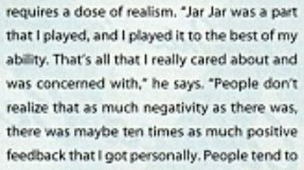
- **Han Solo; Leia Organa Solo** — entry/section: "Best's Best" box: Ahmed Best's favorite Star Wars moment: ""When Han Solo kissed Princess Leia in The Empire Strikes Back. Han was the underdog, and he got the princess. I think that's cool." —Ahmed Best, Star Wars Insider 56, p. 40" Source: *Star Wars Insider #56* (2001), scan p.34
  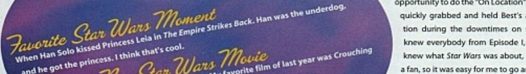

## scan p.35 (scan page 35)

Page contents: Ahmed Best interview cont. (magazine p. 41): people acting nervous on camera, favorite On Location piece (lightsaber duel with Nick Gillard), wanting to interview cinematographer David Tattersall about digital capture, Best's view that digital filming changes nothing for the actor; photos of Best with microphone and a costumed Jar Jar stand-in. (hand-read)

## scan p.36 (scan page 36)

Page contents: Ahmed Best interview cont. (magazine p. 42): looping and pick-ups ahead; a matured Jar Jar ten years older in Episode II; first sequel; working with Hayden Christensen; set memory of Lucas directing Rob Coleman's line for the documentary crew. (hand-read)

- **Jar Jar Binks** — entry/section: Ahmed Best on aging Jar Jar for Episode II: "Jar Jar is now ten years older and has matured, having "seen the worlds, so to speak." ... "That was probably my biggest challenge in Episode II—trying to make Jar Jar seem mature, without taking away any of his sense of fun, and any of his child-like sense of discovery," he says. —Ahmed Best, Star Wars Insider 56, p. 42" Source: *Star Wars Insider #56* (2001), scan p.36
  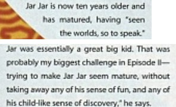
- **Darth Vader (Anakin Skywalker)** — entry/section: Ahmed Best on Hayden Christensen: ""He was fantastic. He just fit right in. You're seeing someone totally different. He's not an older kid; he's not a younger adult. He's the perfect guy to be both Anakin Skywalker and Darth Vader." —Ahmed Best, Star Wars Insider 56, p. 42" Source: *Star Wars Insider #56* (2001), scan p.36
  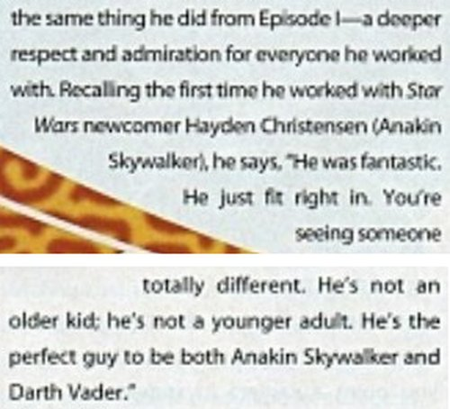

## scan p.37 (scan page 37)

Page contents: Ahmed Best interview conclusion (magazine p. 43): Lucas directing Rob Coleman, more intense ILM effects in Episode II, praise for ILM on A.I., Best's comedy writing interests, Stomp film Pulse, not returning to Stomp, being behind a mask, friendships with the cast; captions on Best and the On Location crew. (hand-read)

## scan p.38 (scan page 38)

Page contents: "A Touch of Wry: Anthony Daniels on Episode II" opener (magazine p. 44): full-page C-3PO head photo by Lisa Tomasetti. (hand-read)

## scan p.39 (scan page 39)

Page contents: "A Touch of Wry" interview by Brian J. Robb begins (magazine p. 45): pull quote "You wouldn't want my life to get boring, would you?"; Daniels puppeteering C-3PO in Episode II with Don Bies' team, the heavy harness, early-morning gym sessions, rehearsing with a mirror; Daniels photo. (hand-read)

## scan p.40 (scan page 40)

Page contents: "A Touch of Wry" cont. (magazine p. 46): voice vs. physical performance of C-3PO, less is more, telling Mark Hamill not to bother acting, new facets in Episode II, filming in Tunisia, Australian crew; pull quote; "The Man in the Golden Suit" sidebar header begins with photos. (hand-read)

- **C-3PO** — entry/section: Anthony Daniels on the magic of C-3PO: ""That's quite a good question. The one thing you've possibly missed out is a kind of weird magic that sort of happened on the first day that I stood in the desert in 1976. That C-3PO saw to this himself. He's an entity that has something to do with me, something to do with George, with the suit, the voice, the environment ..." —Anthony Daniels, Star Wars Insider 56, p. 46" Source: *Star Wars Insider #56* (2001), scan p.40
  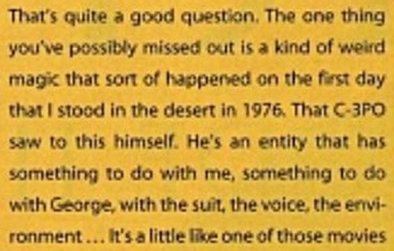
- **C-3PO** — entry/section: Anthony Daniels on C-3PO's movement: ""It's definitely a combination of voice and movement, because he doesn't move all the time. That would become tiresome. I'm quite selective in movements. You really have to remember less is more, because a small movement after a period of rest can speak volumes. Also he's a very distracting character in the gold, or in any format because he's visually interesting." —Anthony Daniels, Star Wars Insider 56, p. 46" Source: *Star Wars Insider #56* (2001), scan p.40
  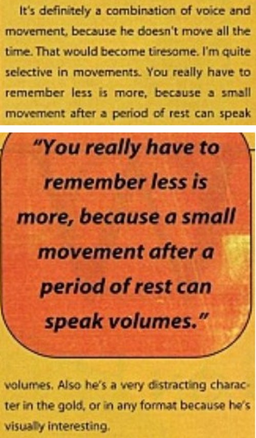
- **C-3PO** — entry/section: Anthony Daniels on C-3PO in Episode II: ""You're going to see new stuff, yes. I added in one line. I just turned a sentence around to give the character somewhere to have come from. I mean, he's not going anywhere, as we already know where he's been. Possibly I've added a wry touch. A touch of wry, yeah." —Anthony Daniels, Star Wars Insider 56, p. 46" Source: *Star Wars Insider #56* (2001), scan p.40
  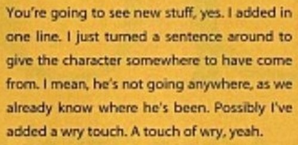

## scan p.41 (scan page 41)

Page contents: "The Man in the Golden Suit: Anthony Daniels on Episodes I, IV, V, and VI" sidebar (magazine p. 47): photo of Lucas and C-3PO conferring at the Lars homestead; realizing Star Wars was a hit, Lucasfilm pretending C-3PO was a real robot, wanting acknowledgment, recognition only around Empire. (hand-read)

- **C-3PO** — entry/section: Anthony Daniels on when he began to get recognition: ""Only around The Empire Strikes Back, when they began to realize that it was okay to say I was in there. I think they realized they'd been overly protective of the character. Nobody's more protective of the character than me." —Anthony Daniels, Star Wars Insider 56, p. 47" Source: *Star Wars Insider #56* (2001), scan p.41
  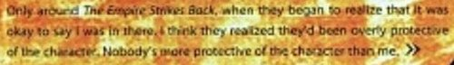

## scan p.42 (scan page 42)

Page contents: "A Touch of Wry" cont. (magazine p. 48): being the "Grand Old Man" of Star Wars, preparatory sadness at the saga's ending, Ewan McGregor as Alec Guinness; caption gag on a "jaded Artoo-Detoo" unimpressed by Daniels; "The Man in the Golden Suit [continued]" - hesitation about returning for Empire, the heat of 1976, "Threepio is human" matchbooks, suit and droid malfunctions, mime training, Liz Moore's sculpture. (hand-read)

- **C-3PO** — entry/section: Anthony Daniels on looking after Threepio: ""I've always been very fond of Threepio, and I've always felt that he slightly needs—how can I say—not protecting, but he needs looking after." —Anthony Daniels, Star Wars Insider 56, p. 48" Source: *Star Wars Insider #56* (2001), scan p.42
  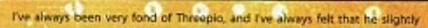
- **C-3PO** — entry/section: Anthony Daniels on being inside the suit: ""I did actually have some books of matches printed up with the words in gold on black, 'Threepio is human,' because I felt it was easy for people to forget that I was actually in there. Which in a way is a compliment." —Anthony Daniels, Star Wars Insider 56, p. 48" Source: *Star Wars Insider #56* (2001), scan p.42
  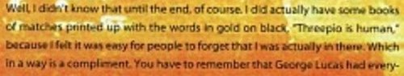
- **Obi-Wan Kenobi** — entry/section: Anthony Daniels on Ewan McGregor in the Alec Guinness role: ""I think he's his own person. I think in this one it became clear to me that Ewan has decided to make the part his own. He gets to do fun things as well. What a nice guy." —Anthony Daniels, Star Wars Insider 56, p. 48" Source: *Star Wars Insider #56* (2001), scan p.42
  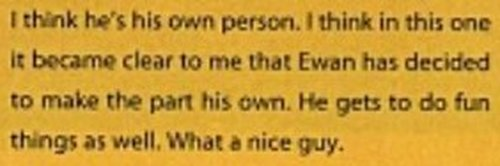

## scan p.43 (scan page 43)

Page contents: "A Touch of Wry" cont. (magazine p. 49): praise for Hayden Christensen, the family atmosphere of the Australian shoot; caption gag on Daniels half-dressed for a Tatooine scene; "The Man in the Golden Suit" cont. - remade costume for Empire, quick suit by Jedi, Lucas describing Threepio's origin for Episode I; photo of the C-3PO puppet. (hand-read)

- **C-3PO; Darth Vader (Anakin Skywalker)** — entry/section: Anthony Daniels on learning C-3PO's origin for Episode I: ""I had a meeting with George where he described how Threepio came about. And he said, 'You have a very small part, it's just to say hello.' I was thrilled to be asked anyway. ... Then he told me what Threepio would look like and where he would be from. I thought he was telling me that Alec Guinness had made my character, and I was really, really pleased. I thought, 'Alec was such a good friend that I think it's right that I was made by him.' A couple of days later I suddenly realized that Anakin Skywalker was not played by Alec Guinness. I'm not very good on all these names. I thought, 'Well, that really is interesting, that he's made by Anakin Skywalker, and he's a little boy.'" —Anthony Daniels, Star Wars Insider 56, pp. 49-50" Source: *Star Wars Insider #56* (2001), scan p.43
  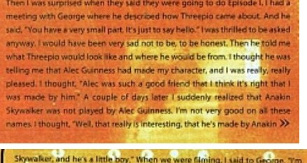

## scan p.44 (scan page 44)

Page contents: "A Touch of Wry" conclusion (magazine p. 50): Lucas relaxed with Rick McCallum producing, plasma-screen monitoring, fondness for C-3PO; pull quote "Praise or acknowledgement is very important in anything you do..."; "The Man in the Golden Suit [cont]" - concern about the Episode I puppet, script suggestions, refusing to give away Episode II secrets; C-3PO photo. (hand-read)

- **C-3PO** — entry/section: Anthony Daniels on what has kept him with C-3PO: ""Oh yeah, there was a time I thought I should just stop. And then I thought, well, the income I get from various things is very welcome, but really my fondness for the character of C-3PO is what has kept me attached for 25 years. I just like him. He's weird. A bit strange." —Anthony Daniels, Star Wars Insider 56, p. 50" Source: *Star Wars Insider #56* (2001), scan p.44
  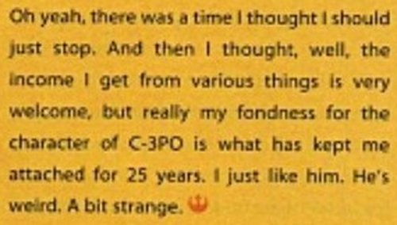
- **C-3PO** — entry/section: Anthony Daniels on finding something new in C-3PO: ""Yes, because of the circumstances George puts him in. But also I try and find new physical ways, and of course with a puppet that's dead easy, as it's like a different thing. But then the trick is to try and make him as much as the thing we know. It's kind of complicated, as I know where we're going." —Anthony Daniels, Star Wars Insider 56, p. 50" Source: *Star Wars Insider #56* (2001), scan p.44
  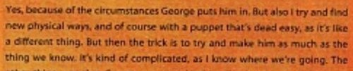

## scan p.45 (scan page 45)

Page contents: "Unseen Planets of Episode I" by Daniel Wallace, illustrated by Chris Trevas (magazine p. 52; scan skips magazine p. 51): epigraph "I want to be the first one to see 'em all." -Anakin Skywalker; intro on space-exploration dreams, Qui-Gon's remark that most stars have planets, only Naboo, Tatooine and Coruscant seen in Episode I, alien species as clues to homeworlds, unseen classic-trilogy planets (Insider #36), Wittin and Wuher trivia; Neimoidia fungus-farm illustration. (hand-read)

## scan p.46 (scan page 46)

Page contents: "Unseen Planets" cont. (magazine p. 53): Expanded Universe coverage of Ord Mantell and Malastare; "Neimoidia" section - Nute Gunray in the opening, Trade Federation droid control ship, Darth Sidious goading the blockade, Neimoidia in James Luceno's Cloak of Deception as a humid world of fungus farms and beetle ranches. (hand-read)

## scan p.47 (scan page 47)

Page contents: "Unseen Planets" cont. (magazine p. 54): Neimoidian insectoid design, The Essential Guide to Alien Species on Neimoidians as a Duros offshoot and their grub "nurseries," Senator Lott Dod, Senate delegations (Quarren, Wookiees, E.T.s); "Tund" section - Fode announcing Ben Quadinaros, Toong species, Podracing Tales comic, L. Neil Smith's Lando Calrissian novels and Rokur Gepta, the Sorcerer of Tund; caption on Duros and Neimoidians; pull quote on Neimoidian larval nurseries. (hand-read)

## scan p.48 (scan page 48)

Page contents: "Unseen Planets" cont. (magazine p. 55): Gepta revealed as a Croke who destroyed the Sorcerers; Toong refugees from Toong'l possibly on Tund; "Malastare" section - Qui-Gon's dinner line on Podracing on Malastare, Aks Moe of the Gran in the Senate ("The Congress of Malastare concurs with the honorable delegate from the Trade Federation"), Palpatine's nomination scene; captions on Ben Quadinaros, Toong refugees, Aks Moe prompting Chancellor Valorum. (hand-read)

- **Rokur Gepta** — entry/section: Rokur Gepta: "After infiltrating the Sorcerers' ranks and learning their dark side magic, Gepta (a tiny alien Croke) annihilated them all with a weapon of mass destruction." Source: *Star Wars Insider #56* (2001), scan p.48
  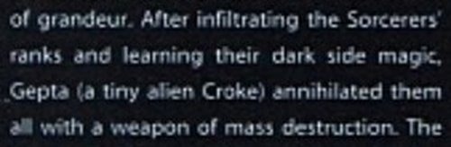

## scan p.49 (scan page 49)

Page contents: "Unseen Planets" cont. (magazine p. 56): Malastare cont. - Panaka naming Bail Antilles and Ainlee Teem; cut script line in which Jabba introduced "Sebulba tuta Malastare"; Episode I Visual Dictionary calling Sebulba an arboreal Dug from Malastare; The Insider's Guide to Episode I placing him in Pixelito; full-page illustration of Podracing through Pixelito with caption (Gran and Dug slaves); pull quote "Will the real Malastare please stand up?" (hand-read)

## scan p.50 (scan page 50)

Page contents: "Unseen Planets" cont. (magazine p. 58; scan skips p. 57): Episode I Racer's Malastare tracks; Dark Horse's "Emissaries to Malastare" arc with Mace Windu; The Essential Guide to Alien Species on Gran colonization of the Dug homeworld and the Zehethbra; caption on Sebulba; "Iego" section - Anakin's "Are you an angel?" and the novelization's expanded angel dialogue, comparison with the Sirens of Anthemoessa and Odysseus; pull quote on the angels' bewitching power. (hand-read)

## scan p.51 (scan page 51)

Page contents: "Troy and Troy Again" by Jason Fry (Bookshelf, magazine p. 68; scan skips pp. 59-67): Troy Denning on The New Jedi Order: Star By Star - collaboration with Luceno, Stover, Shapiro, Rostoni and Greg Keyes on Anakin Solo, the voxyn mission led by Anakin Solo with Tenel Ka, Raynar Thul and Zekk, reading the Young Jedi Knights books, adding his own strike-team characters for a bloody storyline; Star By Star cover. (hand-read)

- **Anakin Solo** — entry/section: Troy Denning on co-writing Anakin Solo: ""I would be hard-pressed to say, 'This is Greg's part of Anakin and this is my part.'" —Troy Denning, Star Wars Insider 56, p. 68" Source: *Star Wars Insider #56* (2001), scan p.51
  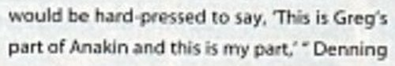
- **Tenel Ka; Raynar Thul; Zekk** — entry/section: Troy Denning on the Young Jedi Knights characters: ""One of the really pleasant surprises I had was to find out how interesting these characters really were." ... "by the end of the series I really thought I knew these kids." —Troy Denning, Star Wars Insider 56, p. 68" Source: *Star Wars Insider #56* (2001), scan p.51
  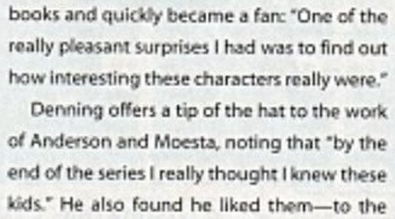

## scan p.52 (scan page 52)

Page contents: "Troy and Troy Again" cont. (magazine p. 69): Denning's character questions, unplanned light moments, his Forgotten Realms debut Waterdeep and Return of the Arch-Wizards trilogy, seeing Star Wars in Denver in 1977; pull quote "Hey, I wrote that guy"; top-right box "Denning's Back Pages" - West End Games' Galaxy Guide 4: Alien Races (naming Rodians and Barabels), Scoundrel's Luck and Jedi's Honor gamebooks, unpublished pick-a-path adventures; photo of Denning and gamebook covers. (hand-read)

## scan p.53 (scan page 53)

Page contents: "Take Your Seat on the Senate" by Joe Alread, Decipher game designer (Gamescape, magazine p. 70): Star Wars CCG Coruscant expansion and the roughly 240-card Episode I closed environment (Tatooine and Coruscant sets); "Power of Authority" - Galactic Senate, Senate majority, the Politics statistic, Political Effects, objectives My Lord, Is That Legal? and Plead My Case To The Senate; "The Council Speaks" begins; card images. (hand-read)

## scan p.54 (scan page 54)

Page contents: "Take Your Seat on the Senate" cont. (magazine p. 71): Jedi Council Chamber site deploying Yoda; "Unfinished Business on Tatooine" - objectives No Money, No Parts, No Deal! (Watto) and The Hyperdrive's Gone (Qui-Gon Jinn); "Master, Destroyers!" - Destroyer Droid cards P-59 and P-60; "Past, Present, & Future" - combo cards, Rebel and Imperial Artillery, Theed Palace expansion and Deciphercon (Nov. 15-18, Virginia Beach); pull quote on the 240-card environment; card images. (hand-read)

## scan p.55 (scan page 55)

Page contents: "The Palace of Jabba the Hutt" by Chris Reiff & Chris Trevas (Set Piece, magazine p. 72): Return of the Jedi Stage Six at Elstree - raised set with puppeteers under the floor and in the walls, Sy Snootles' three operators, Jabba's three-month build and three internal operators with his own make-up person, 100-degree heat, hairdryers cooling masks, Gamorrean guards propping mouths open with sticks; captions on the chef's barbecued bantha and the Tauntaun-head trophy beside the carbonite slab holding Han Solo. (hand-read)

## scan p.56 (scan page 56)

Page contents: "The Palace of Jabba the Hutt" cont. (magazine p. 73): prop callouts - Lando's vibro-ax weapon built from a hairdryer, toy gun and garden-watering device on plumbing pipe; Luke's blaster as dressed-up German air pistols; Chewbacca's bandolier of metal electronics-project boxes; Jabba's food bowl of rubber creatures with a live frog; Leia's bounty-hunter disguise kit-bashed by ILM from model kits including Vader's TIE fighter and a Ferrari Formula 1 car; Rodian vests reused from Leia's Hoth costume and dyed orange. (hand-read)

## scan p.57 (scan page 57)

Page contents: "Help Celebrate a Scouting Anniversary!" by Steve Sansweet (Scouting the Galaxy, magazine p. 74): Hasbro's Special Edition 300th figure Boba Fett with firing rocket; milestone figures No. 1 (1978 Luke Skywalker), No. 100 (1985 Han Solo in Carbonite), No. 200 (1998 Mara Jade); 12-inch Luke Skywalker Action Collection 100th figure; history of the Lucasfilm Fan Club Magazine (issue #21, Winter 1994, Boba Fett cover) and its renaming to Star Wars Insider; caption on the Boba Fett figure. (hand-read)

## scan p.58 (scan page 58)

Page contents: "Scouting the Galaxy" cont. (magazine p. 75): the first column, Sansweet's books, the 35th column since 1994; reader letter (name omitted) on A New Hope set blueprints; reply on Ballantine's 1977 Star Wars Blueprints (15 sheets incl. Death Star sections), Bandai's Japanese edition; images of the old column, Fan Club Magazine cover, Japanese and US blueprint packages. (hand-read)

## scan p.59 (scan page 59)

Page contents: "Scouting the Galaxy" cont. (magazine p. 76): blueprints reply cont. (Starlog/Shane Johnson volumes, Del Rey's Star Wars Technical Journal, Dorling Kindersley cross-sections); "Opening the Unopenable" - two reader letters (names omitted) on electronic toys' batteries and sealed packaging, with reply advising careful opening for expensive talking figures; images of electronic Anakin, Darth Maul, Qui-Gon figures and a boxed toy. (hand-read)

## scan p.60 (scan page 60)

Page contents: "Scouting the Galaxy" cont. (magazine p. 77): "Talking Newbie" (reader letter, name omitted) - finding vintage toys via yard sales, Toy Shop and conventions; "A Shadow of a Deal" (name omitted) - Episode I vinyl teaser banner of Anakin with Vader's shadow (500 sold to Fan Club at $149.95, now about $100); "True Variation" (name omitted) - Episode I Yoda card missing the EPISODE I tagline and the corrected cards; "Scouting for Answers?" mailing box; images of Toy Shop, the banner and the Yoda card. (hand-read)

## scan p.61 (scan page 61)

Page contents: "Dear 2-1B: Advice for Humans" humor column (magazine p. 78): 2-1B's in-character opening rant (Lando and Wedge jab, FX-7's "accident" with Dagobah swamp water, repairs by 8D8), answering e-mails this issue; first reader e-mail (name omitted) asking for relationship advice about a Star Trek-fan friend; 2-1B's reply begins; illustration by Stan Shaw of 2-1B and a Star Trek doctor caricature with martinis (letter-writer names omitted). T below. (hand-read)

### Stat block notes (game mechanics, not feats)

- "Dear 2-1B" column, 2-1B's in-character opening rant (verified on crop): I continue to fulfill my universally encoded duties of transmitting my column—but only because I believe in a little thing called responsibility (take THAT, Lando "I-Get-Credit-for-Destroying-the-Death-Star-When-It-Was-Really-Wedge-Who-Did-All-the-Work" Calrissian). (Source: *Star Wars Insider #56* (2001), scan p.61)
- "Dear 2-1B" column, 2-1B's in-character account of FX-7's accident (verified on crop): But not to worry, for it seems this droid met with an unfortunate accident soon after publication of the column. And what a sad accident it was. I won't go into the details, but let's just say that if a little Dagobah swamp water "falls" into the wrong circuitry, suddenly a certain multi-armed Robbie-the-Robot rip-off starts to spew smoke and spin around like a pit droid. Pity I'm only programmed to administer emergency assistance to humans of the Rebel persuasion—and not droids of the STUPID persuasion. So that droid is being worked on by my good friend 8D8 and is unavailable to offer his input this time around. (Source: *Star Wars Insider #56* (2001), scan p.61)

## scan p.62 (scan page 62)

Page contents: "Dear 2-1B" cont. (magazine p. 79): 2-1B's reply recounting Echo Base's fall and mocking Star Trek, advising "dump the bum"; spam e-mail offering debt relief with 2-1B's reply on FX-7, wanting a 2-1B novel line, and his autograph income; hyperdrive question answered "Yes." (letter-writer names omitted). (hand-read)

### Stat block notes (game mechanics, not feats)

- "Dear 2-1B" column, 2-1B's in-character account of the Battle of Hoth (verified on crop): [You] weren't on Hoth when the medical bay was rocking and the bacta was spilling and my hydraulic system pumps were working at maximum capacity, and the only "help" I had was from a cut-rate assistant droid whose arm rotator base was barely installed. ... Everything was shaking, and there were explosions, and it was loud—so inhumanly loud. "Someone make it stop! For the love of the Maker, make it stop," I cried. I was shrieking for help, but I was overwhelmed by the chaos—pilots and officers scurrying around, everybody leaving in a hurry. ... all I could do was cower in a corner and hide, so as to protect my delicate fine-motion hands, which would be needed to heal the carnage—and later, to give a second chance to an aspiring Jedi who just needed a helping hand. ... I'm talking about Darth-Vader-is-about-to-swoop-in-just-as-the-last-ship-is-taking-off fear. (Source: *Star Wars Insider #56* (2001), scan p.62)
- "Dear 2-1B" column, 2-1B's in-character answer on Star Wars vs. Star Trek (verified on crop): Clearly, Star Wars is better than Star Trek simply because I'm in it. If I wasn't, Star Trek would definitely be better, because Luke Skywalker would not have survived his little pow-wow with the wampa and the series would have ended about 20 minutes into Episode V. (Source: *Star Wars Insider #56* (2001), scan p.62)
- "Dear 2-1B" column, 2-1B's in-character answer on FX-7 and his finances (verified on crop): And another thing about FX-7. Have you ever noticed how you can never really trust anybody until you look in their eyes? Well, how do you think it feels trying to look into your assistant's eyes only to discover that he doesn't have any, and the only thing staring back at you is a cold, metallic, magnetic diffraction scanner? ... And to think that despite my service to the Rebellion, Del Rey Books has yet to publish a series of novels about MY exploits before Empire. A line of 2-1B Adventures would outsell Rogue Squadron and Jedi Academy COMBINED. But all I really care about is saving lives (Source: *Star Wars Insider #56* (2001), scan p.62)

## scan p.63 (scan page 63)

Page contents: "Rebel Rumblings" letters cont. from p. 6 (magazine p. 80): reader letter on the flip-cover double issue #54 with editor reply that a couple of "flippy" issues per year are planned; "Completing the Collection" - an uncle's Star Wars room built for his nephew; "With Eyes Glued to the Pages" - praise for the Jude Watson interview and Jedi Apprentice's Obi-Wan/Qui-Gon relationship; "Better Than a Rolling Boulder" begins; photos "One Lucky Kid" (letter-writer and family names omitted). (hand-read)

## scan p.64 (scan page 64)

Page contents: "Rebel Rumblings" cont. (magazine p. 81): Petra's Treasury as the Last Crusade location with photo "Well Worth the Trip!"; "Jedi on a Mission" - reader praise for issue #54's Episode II images; "Don't Muck It Up!" - Pernilla August interview, Dear 2-1B, Jawa Trader order-form and classic-trilogy interview requests with editor reply promising Classic Trilogy interviews for the 25th anniversary; "Aussie Issues" - department-by-department review begins (letter-writer names omitted). (hand-read)

## scan p.65 (scan page 65)

Page contents: "Rebel Rumblings" cont. (magazine p. 82): review cont. and wish list (artist interviews, George Lucas, Anthony Daniels' column); "On the Blink" - discouraged young fan with editor reply; "Too Cute for Words" - grandparents collecting figures with grandchildren, photo "Spread the Love"; "Poetry Corner" - teacher's request with a student's short Episode I poem printed and editor quip about the rancor opening the mail (letter-writer, student and family names omitted). (hand-read)

## scan p.66 (scan page 66)

Page contents: Scanner's inserted note page (not a magazine page): "Originally you had to flip the issue to read" the Kevin Smith interview by Scott Chernoff ("Kevin Smith embraces his destiny, playing off his love of Star Wars in his latest film, Jay and Silent Bob Strike Back"); notes the following flip-side pages were rotated and reordered. (hand-read)

## scan p.67 (scan page 67)

Page contents: Flip-side opener "Chasing Chewie" (flip section p. 4): full-bleed photo of Jason Mewes and Kevin Smith as Jay and Silent Bob. (hand-read)

## scan p.68 (scan page 68)

Page contents: "A Conversation with Kevin Smith" by Scott Chernoff (flip section p. 5): deck on growing up Star Wars, respecting comic-book fans, and working with Mark Hamill and Carrie Fisher in Jay and Silent Bob Strike Back; intro on his New Jersey films (Clerks, Mallrats, Chasing Amy, Dogma), View Askew Productions with Scott Mosier, Good Will Hunting, Clerks cartoon on DVD, Jay and Silent Bob's Secret Stash, his Green Arrow and Daredevil comics; photo of Jay and Silent Bob costumes; photo by Tracy Bennett. (hand-read)

## scan p.69 (scan page 69)

Page contents: Kevin Smith interview cont. (flip section p. 8; scan lacks flip pp. 6-7): training for the blunt-saber fight, Mark Hamill retraining, being kept apart from Hamill, Jason Mewes' line about fighting Luke Skywalker and ogling Princess Leia, Hamill as a raconteur and "a prince," Carrie Fisher as the "anti-Mark" who avoids talking about Star Wars; photo of Ben Affleck, Jason Mewes, Kevin Smith. (hand-read)

- **Luke Skywalker** — entry/section: Kevin Smith on dueling Mark Hamill: ""Oh, my God, I'm actually gonna do this, I'm gonna stick fight—what will later become a lightsaber fight—with Luke Skywalker himself." —Kevin Smith, Star Wars Insider 56, p. 8 (Kevin Smith flip section)" Source: *Star Wars Insider #56* (2001), scan p.69
  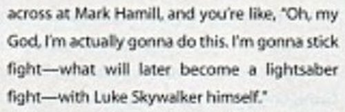

## scan p.70 (scan page 70)

Page contents: Kevin Smith interview cont. (flip section p. 9): Fisher's "blah, blah, blah" re-release anecdote; casting the nun role (Sally Field passed; Bob Weinstein suggested Fisher); Fisher discovering Hamill was in the film; the Clerks Death Star scene and press interest; invoking Star Wars visually; Bob Weinstein prompting a lightsaber fight; pull quote "We were allowed to play with the monkey"; photos from Mallrats set. (hand-read)

## scan p.71 (scan page 71)

Page contents: Kevin Smith interview cont. (flip section p. 10): Weinstein approving the lightsaber fight; growing up on the trilogy and its toys, Episode I lines; Return of the Jedi debates as "playful jabs"; seeing Jedi at 13; his positive Phantom Menace review and its pace and complex plot; photo of Ali Larter, Jason Mewes, Kevin Smith, Shannon Elizabeth. (hand-read)

## scan p.72 (scan page 72)

Page contents: Kevin Smith interview cont. (flip section p. 11): Phantom Menace effects, Jar Jar, "it's mythology," Chapter One as set-up, Episode II expectations; Ben Affleck's report of Lucas saying "Death Star contractors—very funny"; hosting Sci-Fi Channel's Exposure; box "Talkin' 'Bout the Death Star at the Quick Stop: Star Wars in the View Askewniverse" - Clerks (Death Star contractors debate, "Chewbacca" song), Mallrats (X-wing-style attack, Jedi mind trick), Chasing Amy begins. (hand-read)

- **Obi-Wan Kenobi; Darth Vader (Anakin Skywalker); Padmé Amidala** — entry/section: Kevin Smith on The Phantom Menace's relationships: ""I really dug the relationships that were forged there that we know so much about later on down the road—what eventually happens to Ben Kenobi and Anakin Skywalker, what eventually happens to Anakin and the Queen—it was great to see the origins of all those." —Kevin Smith, Star Wars Insider 56, p. 11 (Kevin Smith flip section)" Source: *Star Wars Insider #56* (2001), scan p.72
  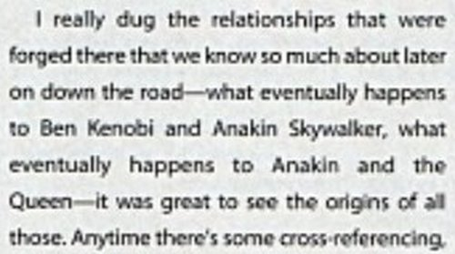
- **Jar Jar Binks** — entry/section: Kevin Smith on Jar Jar Binks: ""I guess Jar Jar was a little much for some people, but on the second viewing, he actually made me laugh a few times." —Kevin Smith, Star Wars Insider 56, p. 11 (Kevin Smith flip section)" Source: *Star Wars Insider #56* (2001), scan p.72
  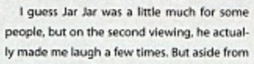

## scan p.73 (scan page 73)

Page contents: Kevin Smith interview cont. (flip section p. 12): Lucas as technical storyteller vs. dialogue-driven influences; trilogy plan; View Askewniverse vs. Star Wars universe; making Jay and Bob leads; Internet critics; fans of comics and sci-fi seen as geeks; top box cont. - Chasing Amy (Lando, "Vader's beautiful black visage," Silent Bob quoting Yoda), Dogma ("I feel like Han Solo, you're Chewie, and she's Ben Kenobi"), Clerks: The Animated Series episodes #2-#6 (Hoth cold, tauntaun line, "our new black character, Lando," animated George Lucas on the stand, spirits of Yoda, Obi-Wan and Anakin, "No Darth Mauls Please," Leia's sovereignty), Jay and Silent Bob Strike Back's Star Wars-theme wedding. (hand-read)

- **C-3PO; R2-D2** — entry/section: Kevin Smith on Jay and Bob as Threepio and Artoo: ""Yeah, same universe, and a lot of people draw the comparison between Jay and Bob and Threepio and Artoo. It was never anything I set out to do, but once somebody put that theory out there, I thought, 'Absolutely.'" —Kevin Smith, Star Wars Insider 56, p. 12 (Kevin Smith flip section)" Source: *Star Wars Insider #56* (2001), scan p.73
  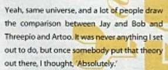

## scan p.74 (scan page 74)

Page contents: Kevin Smith interview cont. (flip section p. 14; scan lacks flip p. 13): passion for art vs. sports fandom, identifying with Chasing Amy rather than Die Hard, origin of Jay and Silent Bob, playing Silent Bob instead of Randal; photo of Smith and Jason Mewes on set; photo by Tracy Bennett. (hand-read)

## scan p.75 (scan page 75)

Page contents: Kevin Smith interview cont. (flip section p. 16; scan lacks flip p. 15): Silent Bob testing as audience favorite, The Muppet Movie as influence, Clerks cartoon movie and Fletch plans, closing thanks to Star Wars; top box "Fandom Menace: Kevin Smith's Favorite Star Wars Stuff" - favorite movie Empire, favorite character, favorite alien Nien Nunb then Admiral Ackbar, favorite merchandise the AT-AT, favorite line Tarkin's; photo of Nien Nunb. (hand-read)

- **Han Solo; Darth Vader (Anakin Skywalker)** — entry/section: Kevin Smith on his favorite Star Wars character: ""When I was a kid, it was always Han Solo. Then later on in life, it became Darth Vader, who's far more tragic a figure. Han Solo had all the bluster, so when you're a kid, you kind of dig on that. But as you get older, you see how Anakin Skywalker is such a complex character. Was he ever truly evil? Yes, he was, but there's some redemption there, which appeals to the Catholic in me." —Kevin Smith, Star Wars Insider 56, p. 16 (Kevin Smith flip section)" Source: *Star Wars Insider #56* (2001), scan p.75
  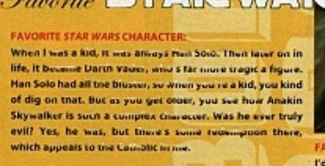
- **Nien Nunb; Admiral Ackbar** — entry/section: Kevin Smith on his favorite Star Wars alien: ""I'd have to go with Nien Nunb. I thought he looked pretty good, and I thought his speech pattern was phenomenal. He's one of those quick hits—he's in and out of the picture. Followed closely by Admiral Ackbar, also a good-looking character from Jedi. They really did kind of nail them by then." —Kevin Smith, Star Wars Insider 56, p. 16 (Kevin Smith flip section)" Source: *Star Wars Insider #56* (2001), scan p.75
  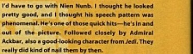
- **Grand Moff Tarkin** — entry/section: Kevin Smith on his favorite Star Wars line: ""I think my favorite line, which I try to work in as much as possible in conversation is Grand Moff Tarkin's old, 'Evacuate? In our moment of triumph? I think you overestimate their chances.' It's one of the really great unsung lines of a dude who's just about to get blown from the stars." —Kevin Smith, Star Wars Insider 56, p. 16 (Kevin Smith flip section)" Source: *Star Wars Insider #56* (2001), scan p.75
  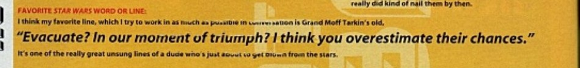

## scan p.76 (scan page 76)

Page contents: Flip cover (Kevin Smith side): Star Wars Insider cover with Jay & Silent Bob; cover lines "Exclusive! Episode I DVD interviews & photos!", Anthony Daniels, Ahmed Best, Kevin Smith, "Plus: spectacular Episode II Attack of the Clones photos!", "Card Wars on Coruscant," "Building Jabba's Palace." (hand-read)

